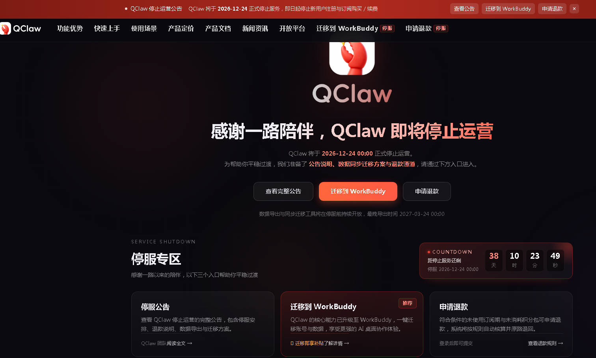
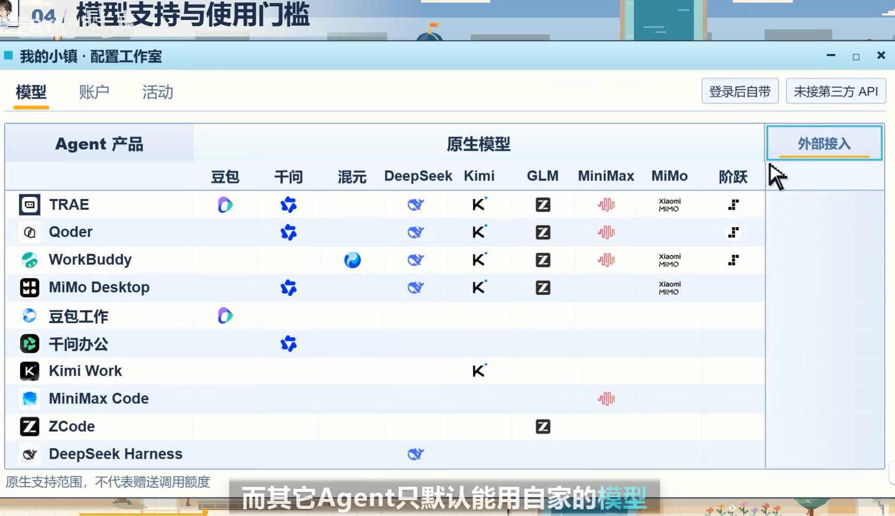
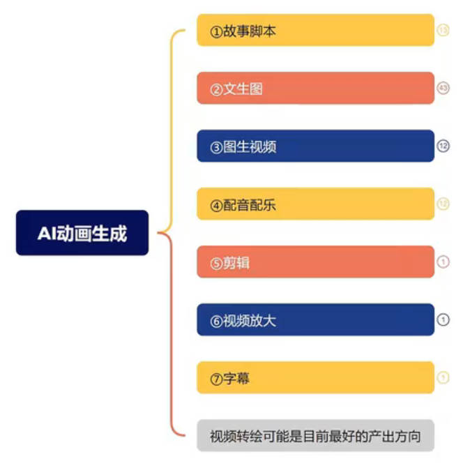
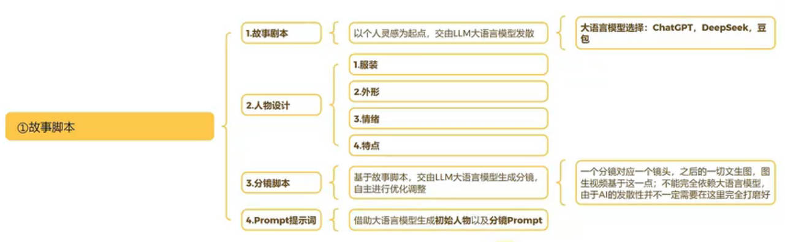
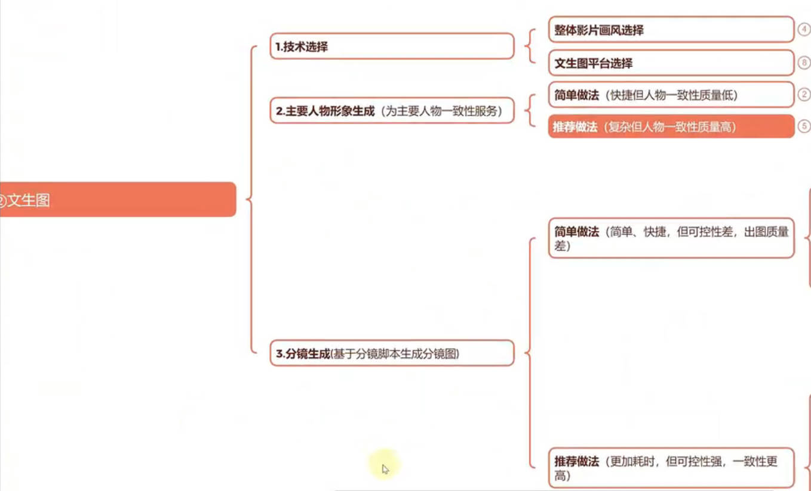
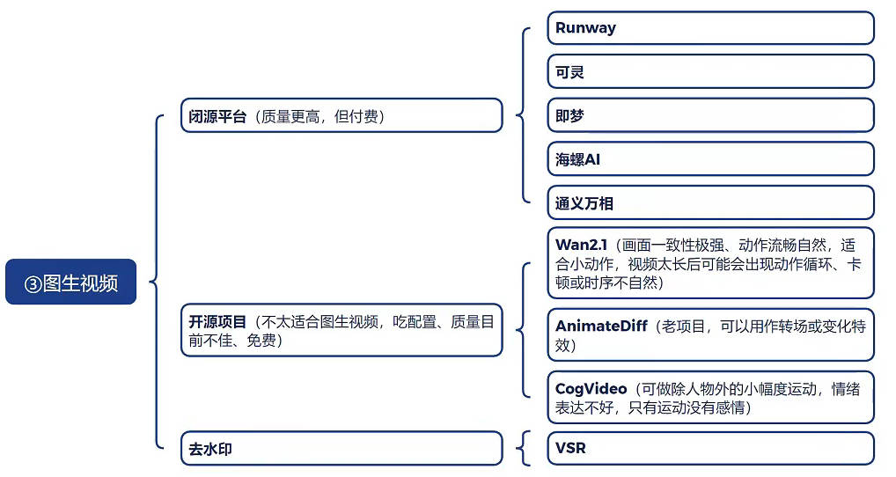
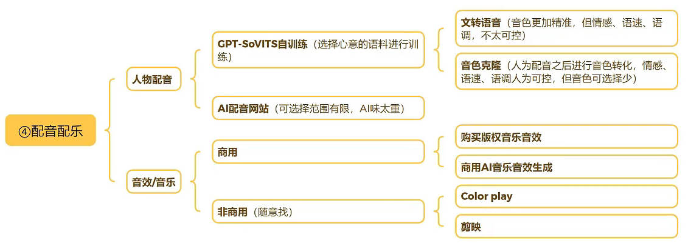
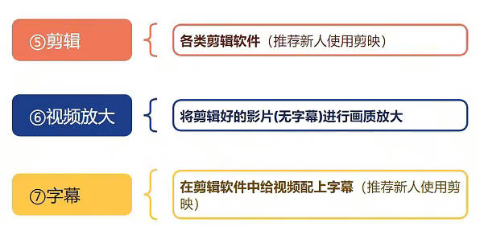

# 概念

## Skills和agent

Skills agent 指的是“技能智能体”，即通过标准化技能包（Skills）扩展能力的 AI 智能体。核心思路是把某类任务的知识、步骤、工具和最佳实践打包成一个可复用的“技能包”，让 Agent 按需调用，而不是每次从零推理。

### 核心概念

- Skills：==可复用的能力模块==，本质是包含 `SKILL.md` 文件的目录，里面装着任务说明、脚本和参考资料。它只负责“怎么做好一件事”，不决定目标和顺序。
- Agent：任务执行主体，接收目标后自行拆解、规划步骤、调用合适的 Skill、检查结果，出问题时还能重新规划。
- 关系：==Agent 是“大脑”，Skills 是“工具箱”==。Agent 负责判断和决策，Skill 负责具体执行，两者组合才能完成复杂任务。

### 工作原理

Skills 采用三层分级加载机制，以控制上下文成本：

1. 元数据（始终加载）：启动时只加载每个 Skill 的名称和描述，约 30-50 个 token，让 Agent 知道“有什么技能可用”。
2. 说明文档（触发时加载）：任务匹配后，才读取 `SKILL.md` 正文里的详细步骤和规则。
3. 资源与代码（按需加载）：只有执行中需要时，才读取脚本、参考文档等大文件。

### 与工作流、MCP 的区别

- Skill vs 工作流：Skill 是单一能力单元，不规定执行顺序；工作流把多个步骤按固定规则串联，所有分支提前写好。判断标准是“下一步由谁决定”——人预先定好的是工作流，Agent 自己决定的是智能体。
- Skill vs MCP：Skill 是“方法论”，MCP 是“连接标准”。Skill 内部脚本通过 MCP 协议调用外部工具，两者是消费者与提供者的关系，不是替代关系。

### 生态现状

截至 2026 年初，公开可用的 Agent Skills 已超 10 万个，获微软 Azure AI Studio、GitHub Copilot、Cursor IDE、Claude Code、Codex 等 40 多个平台支持，成为事实上的开放标准。 国内也有落地案例，如极空间把 NAS 文件管理、Docker 部署等 90 多项能力封装为 Skill，供 Claude Code、Codex 等第三方 Agent 调用；智合AI 在进博会开源了 70 个法律 AI Skills。

### 实践建议

写 Skill 时遵循几个原则：单一职责（每个 Skill 只做一件事）、给足示例（用输入输出样例说明期望格式）、明确边界（写清不能做什么）、定义接口（固定输入输出格式），并像迭代产品一样持续打磨。

技能包的写法有讲究，可以看看技能包怎么写才好用或者技能包的输入输出格式怎么定

## MCP

[mcp相当于网关还是接口_百度搜索](https://www.baidu.com/s?ie=UTF-8&wd=mcp%E7%9B%B8%E5%BD%93%E4%BA%8E%E7%BD%91%E5%85%B3%E8%BF%98%E6%98%AF%E6%8E%A5%E5%8F%A3)  

> MCP（模型上下文协议）本质是‌**接口（协议）标准**‌，而非网关。它定义AI应用与外部工具、数据源之间的统一通信方式，常被类比为“AI界的USB-C接口”

MCP 在人工智能领域指的是模型上下文协议（Model Context Protocol）‌，由 Anthropic 公司于 2024 年底推出，是一套让 AI 应用连接外部数据、工具和业务流程的开放标准 。这个缩写在其他领域也有不同含义（如主控程序、磁罗经导航等），但目前 AI 圈里说的 MCP 基本都指这个协议。

### MCP 是个啥，为啥需要它

MCP 的核心定位是给 AI 模型和外部工具之间搭一座"标准化桥梁"。以前每个 AI 助手要连接数据库、文件系统或第三方 API，都得单独写一套适配代码，就像每台电器都用不同形状的插头，接得越多越麻烦 。==MCP 做的就是约定一套共同语言，只要双方都遵守这套规则，就能相互识别、交换信息、调用功能== 。

‌推出背景‌：Anthropic 在 2024 年 11 月 25 日开源发布，2025 年 3 月 OpenAI 宣布其 Agent SDK 支持该协议，截至 2026 年已有超过 1000 个社区服务器投入实际使用 。
‌核心价值‌：把"读文件、查数据库、调接口、操作浏览器"这些能力包装成模型能看懂的工具描述，模型只负责"想"，MCP 负责"做" 。
‌与 Agent 的关系‌：MCP 是协议层的基础设施，Agent 是应用层的实体，Agent 利用 MCP 提供的标准化接口来调用外部工具和服务 。

### MCP 怎么运转，架构是啥样

MCP 采用客户端 - 服务器架构，整个流程可以分五步：AI 判断用户要完成什么任务→查看当前已连接且有权使用的工具→挑选最合适的工具并生成参数→服务器校验权限后调用真实系统→执行结果由 AI 整理成用户容易理解的答案 。
一套 MCP 连接通常有四个角色：

- ‌**[MCP 主机](https://www.baidu.com/s?wd=MCP 主机&usm=3&ie=utf-8&rsv_pq=85d8151c002f703b&oq=MCP&rsv_t=1040EJYfHUy4Shbpb95cssP%2BaEdg7XDHGgqvct1JLr2hSq%2FawC%2FmI9QrO8g&rsv_dl=re_dqa_generate&sa=re_dqa_generate)（Host）**‌：用户直接使用的 AI 应用，如聊天助手、编程工具或办公助手 。
- ‌**[MCP 客户端](https://www.baidu.com/s?wd=MCP 客户端&usm=3&ie=utf-8&rsv_pq=85d8151c002f703b&oq=MCP&rsv_t=dc9ccd0vNRxt99uQ9%2FZy2PKSBASQRb1EPWdya1XFuhXwakNA9EAGHQUVpMQ&rsv_dl=re_dqa_generate&sa=re_dqa_generate)（Client）**‌：主机内部负责建立连接、传递请求的"联络员"，与服务器保持 1:1 连接 。
- ‌**[MCP 服务器](https://www.baidu.com/s?wd=MCP 服务器&usm=3&ie=utf-8&rsv_pq=85d8151c002f703b&oq=MCP&rsv_t=dc9ccd0vNRxt99uQ9%2FZy2PKSBASQRb1EPWdya1XFuhXwakNA9EAGHQUVpMQ&rsv_dl=re_dqa_generate&sa=re_dqa_generate)（Server）**‌：把某种数据或能力按照统一规则提供的"服务窗口"，专精于一类工作 。
- ‌**外部系统**‌：真正保存文件、日志、数据库或执行操作的地方 。

通讯方式主要有两种：STDIO 模式用于本地服务，Client 启动 Server 程序作为子进程，通过标准输入输出传输数据；Streamable HTTP 模式用于远程服务，Client 通过指定端口连接到部署在远程服务器上的 MCP Server。

### MCP 能帮用户做什么

MCP 的核心能力可以概括为三类：资源（给 AI 看的资料，如文件内容、数据库记录）、工具（允许 AI 调用的动作，如查询数据、生成报表）、提示模板（提前写好的专业操作模板）。

- ‌**开发者场景**‌：用自然语言指示"帮我把修改的代码提交到 Feature 分支，并自动创建一个新 PR"，MCP 会帮你完成相关操作 。
- ‌**企业场景**‌：把公司里分散的系统（人事、财务、研发等）拉到一个窗口里，让 AI 可以帮你"一站式操作"，不用来回点开几十个软件 。
- ‌**安全注意**‌：MCP 本身没有内置认证、授权或加密功能，开发者需自行实现这些保护措施，对于删除、转账等高风险操作应增加"人工确认"环节 。

MCP 这个协议挺有意思，要不要继续看看 它和 OpenAPI 的区别在哪？ 或者 权限管理具体怎么实现？

## Token

Token是AI处理文字的最小计量单位，也是AI收费的基本单位。AI看不懂文字，只会把你输入的问题和它生成的回答都切成小块，每一块就是一个Token，按块数算钱，类似按“字数”收费但又不完全等于字数。

### Token到底是什么

AI把你的提问和回答都拆成小块，每块就是1个Token。中文一般1个汉字约等于1—2个Token，英文约4个字母算1个Token，不同模型切法不同。

### 怎么收费

- 输入+输出都算钱：你问的内容和AI答的内容都要计费，总费用 = 输入Token数 × 输入单价 + 输出Token数 × 输出单价。
- 输出比输入贵：AI生成回答是逐个Token算出来的，算力消耗大，输出单价通常是输入的3—5倍。
- 多轮对话越聊越贵：AI本身没记忆，每轮都会把之前的聊天记录重新打包发送，聊得越久，输入Token越多，费用越高。

### 怎么省钱

- 精简提问，去掉“你好”“请”之类的客套话，别让AI读无用信息。
- 简单任务用便宜的小模型，复杂任务才用高端模型。
- 话题结束就开新对话，别让历史记录一直堆积。
- 用缓存功能，重复的系统提示词只计费一次。

> 国内主流模型普通版约每百万输入Token一元左右，输出几元钱；高端模型会贵不少，具体看各家定价。

Token的计费方式清楚了，实际用起来还有两点容易踩坑，可以看看输入和输出单价差多少算贵或者缓存功能怎么用才不浪费

## prompt、Skills、agent对比

[prompt Skills agent_百度搜索](https://www.baidu.com/s?ie=utf-8&f=8&rsv_bp=1&tn=baidu&wd=prompt%20Skills%20agent&oq=prompt&rsv_pq=d9db50860031236a&rsv_t=31ddVb1BTwEDpV3BdoFaiYNBJDvE4944ZLVZfQgMgX87e8CPTq6vh6GeRUc&rqlang=cn&rsv_enter=1&rsv_dl=tb_click&rsv_btype=t&inputT=2558&rsv_sug3=27&rsv_sug1=4&rsv_sug7=100&rsv_n=2&rsv_sug4=2558)  [Agent Skills、Rules、Prompt、MCP](https://cloud.tencent.com/developer/article/2623459)  

Prompt、Skills 和 Agent 是 AI 应用里从“简单指令”到“能干活的智能体”的三个层级，理解它们的关系，基本就摸清了现在 AI 工具圈的核心概念。

### 三者到底怎么区分

1. Prompt（提示词）：你直接对 AI 说的每一句话、提的每个要求，如“帮我写个朋友圈文案”。特点是一次性、现说现用，问一句答一句，没有自主性。
2. Skills（技能包）：把做某类任务常用的 Prompt、步骤、工具和知识打包成可复用的“能力包”，像给 AI 一本工作手册加工具箱。如“写周报”“PDF 总结”“代码审查”都能做成 Skill，以后直接调用，不用每次从头教。
3. Agent（智能体）：能自己规划步骤、调用工具、循环执行直到干完活的“AI 员工”。你只给目标，它自己拆解、查资料、写代码、检查结果，最后交差。

> 打个比方：Prompt 是你当面喊的一句话，Skills 是员工手里的操作手册，Agent 就是那个拿着手册、自己会动手干活的员工。

### 它们怎么配合

- Prompt 是最小输入单位，告诉模型“这一轮该做什么”。
- Skills 是方法封装，告诉模型“这类任务长期怎么做”，通常一个 Skill 里包含精心设计的 Prompt，还会带上脚本和资源。
- Agent 是执行控制器，负责决定“现在该调什么能力、按什么顺序执行、做完怎么校验”，它把 Prompt、Skills、工具串起来，自动完成整套流程。

### 你该怎么选

- 临时、简单任务：直接用 Prompt 就够了。
- 高频重复、要稳定质量的任务：把流程做成 Skill，一次创建，长期复用。
- 复杂、多步骤、需要查资料或操作外部系统的任务：交给 Agent，你只管提目标。

### 用 Agent 前先记住这几点

Agent 自主性高，容易“失控”，比如疯狂调用工具烧钱、误删文件或跑偏方向。实操时务必给它最小权限、设预算上限，关键操作保留人工确认。

另外，Skills 生态现在已经很成熟了，截至 2026 年初公开可用的 Agent Skills 超过 10 万个，微软 Azure、GitHub Copilot、Cursor 等平台都已支持这套标准。

三者的关系理清了，实际用起来还有两点值得看看Agent怎么控制调用哪些技能或者调用外部工具时怎么设权限

# 开源Skills

[VoltAgent/awesome-openclaw-skills](https://github.com/VoltAgent/awesome-openclaw-skills)  [ClawHub](https://clawhub.ai/)  

[ClawHub](https://skills.cipgpt.com/)  

[开源Agent Skills_百度搜索](https://www.baidu.com/s?ie=UTF-8&wd=%E5%BC%80%E6%BA%90Agent%20Skills)  [开源skills_百度搜索](https://www.baidu.com/s?ie=utf-8&f=8&rsv_bp=1&tn=baidu&wd=%E5%BC%80%E6%BA%90skills&oq=%25E6%2599%25BA%25E5%2590%2588%2520AI&rsv_pq=880db6dd002e895d&rsv_t=cdffxtPRtWpq5Z3F6jJOi5ZadJ4m4EniSCAoeP6kUB4plZcwmoj1fUoVB%2Bg&rqlang=cn&rsv_enter=1&rsv_dl=tb_enter&rsv_sug3=13&rsv_sug1=8&rsv_sug7=100&rsv_btype=t&inputT=3503&rsv_sug4=3503)  

[awesome-agent-skills](https://github.com/libukai/awesome-agent-skills/blob/main/docs/README_ZH.md)  

使用： [ OpenClaw 中文教程](https://github.com/xianyu110/awesome-openclaw-tutorial)  [龙虾聚合站 ](https://www.clawhup.cc/)  [OpenClaw 中文网](https://www.clawfather.cn/tools/clawhub/)  

[技能市场与注册中心使用指南](https://zhuanlan.zhihu.com/p/2013719009527350278)  

# 机器学习

## TensorFlow

[TensorFlow_百度搜索](https://www.baidu.com/s?ie=UTF-8&wd=TensorFlow)  

端到端开源机器学习平台

# Agent智能体

[智能体_百度搜索](https://www.baidu.com/s?ie=UTF-8&wd=%E6%99%BA%E8%83%BD%E4%BD%93)  

[ai agent工具有哪些_百度搜索](https://www.baidu.com/s?ie=utf-8&f=3&rsv_bp=1&tn=baidu&wd=ai%20agent%E5%B7%A5%E5%85%B7%E6%9C%89%E5%93%AA%E4%BA%9B&oq=%25E6%2599%25BA%25E8%2583%25BD%25E4%25BD%2593&rsv_pq=fd10de7000315ff1&rsv_t=a6008ZBdM3sQoy8JmI0FQ4SANB9UHgqEg0IhQBaeXrNkfI03Le8eNH%2FoIpU&rqlang=cn&rsv_enter=1&rsv_dl=ts_1&rsv_sug3=13&rsv_sug1=7&rsv_sug7=100&rsv_btype=t&prefixsug=ai%2520agent%25E5%25B7%25A5%25E5%2585%25B7%25E6%259C%2589%25E5%2593%25AA%25E4%25BA%259B&rsp=1&inputT=8651&rsv_sug4=8651)  [ai agent用途有哪些_百度搜索](https://www.baidu.com/s?ie=utf-8&f=8&rsv_bp=1&tn=baidu&wd=ai%20agent%E7%94%A8%E9%80%94%E6%9C%89%E5%93%AA%E4%BA%9B&oq=ai%2520agent%25E5%25B7%25A5%25E5%2585%25B7%25E6%259C%2589%25E5%2593%25AA%25E4%25BA%259B&rsv_pq=b4bd8ebd0031417e&rsv_t=ab3clGTydAWhboy4QCjdNYRMFNVrNqS6zXS7RvNFKHLn8psRCVx8sgRvLqk&rqlang=cn&rsv_enter=1&rsv_dl=tb_enter&rsv_btype=t&inputT=60217&rsv_sug2=0&rsv_sug3=36&rsv_sug1=26&rsv_sug7=100&rsv_sug4=60217)  

[懂智能体在替你做什么](https://baijiahao.baidu.com/s?id=1881888512699108965&wfr=spider&for=pc)  

[DeepSeek Harness_百度百科](https://baike.baidu.com/item/DeepSeek%20Harness/68533699?fromtitle=Harness&fromid=68534693&fr=aladdin)  [MiniMax code_百度搜索](https://www.baidu.com/s?ie=UTF-8&wd=MiniMax%20code)  [大模型入门到进阶](https://www.bilibili.com/video/BV1AJen6SEVQ/?vd_source=7346303e5e18677d7261c2c0c109ecfd)  

[LangChain架构](https://www.baidu.com/s?ie=UTF-8&wd=LangChain)  [ LangChain](https://cloud.tencent.com/developer/article/2592832)  

对比： [Agent怎么选](https://www.bilibili.com/video/BV1WV486FEz8/?vd_source=7346303e5e18677d7261c2c0c109ecfd)  

AI客户端：[Cherry Studio_百度搜索](https://www.baidu.com/s?ie=UTF-8&wd=Cherry%20Studio)  

Hermes Agent： 开源 AI 智能体 

[Agent入门](https://www.bilibili.com/video/BV1HKWv6bEwe/?vd_source=7346303e5e18677d7261c2c0c109ecfd&p=4&spm_id_from=333.788.videopod.episodes)  [AI Agent智能体搭建](https://www.bilibili.com/video/BV11NNAz5EKn/?vd_source=7346303e5e18677d7261c2c0c109ecfd)  

# AI

## OpenClaw

概述： [一个视频搞懂OpenClaw](https://www.bilibili.com/video/BV1jEAaz3E6K/?vd_source=7346303e5e18677d7261c2c0c109ecfd)  [OpenClaw装Skills](https://www.bilibili.com/video/BV16bPzz6EBr/?vd_source=7346303e5e18677d7261c2c0c109ecfd)  

第三方： [腾讯龙虾WorkBuddy介绍](https://www.bilibili.com/video/BV1QRXABoEuu?vd_source=7346303e5e18677d7261c2c0c109ecfd&spm_id_from=333.788.videopod.sections) [Qclaw本地虾](https://www.qclawd.com/)  [千问技能、连接器、专家套件](https://cloud.tencent.com/developer/article/2745827)  

[OpenClaw可用的3家免费模型API](https://cloud.tencent.com/developer/article/2638824)  [openclaw能接入国内哪些免费api_百度搜索](https://www.baidu.com/s?ie=utf-8&f=8&rsv_bp=1&tn=baidu&wd=openclaw%E8%83%BD%E6%8E%A5%E5%85%A5%E5%9B%BD%E5%86%85%E5%93%AA%E4%BA%9B%E5%85%8D%E8%B4%B9api&oq=openclaw%25E6%2594%25B6%25E8%25B4%25B9%25E4%25BD%25BF%25E7%2594%25A8%25E5%2590%2597&rsv_pq=864a577300318cdc&rsv_t=74e4aoLJ%2BtyV1fLrf%2F0EsGjOw6Y3vG6MviSOIa5I9eFArZ4KkxkOPWwWuFo&rqlang=cn&rsv_enter=1&rsv_dl=tb_enter&rsv_btype=t&inputT=66833&rsv_sug2=0&rsv_sug3=49&rsv_sug1=26&rsv_sug7=100&rsv_sug4=66833)  

OpenClaw ‌**软件本身完全免费**‌，但运行过程中可能产生间接费用。

- ‌**框架本体**‌：开源免费，可从 GitHub 下载使用，官方不收取授权或订阅费。
- ‌**大模型调用**‌：需接入外部大模型 API 才能运行，按 Token 消耗计费；轻度使用可绑定免费额度，复杂任务可能产生持续开销。
- ‌**本地部署**‌：若本地运行开源模型，无需 API 费用，但需要独立显卡等硬件支持，硬件投入是主要成本。

## WorkBuddy

[WorkBuddy入门](https://www.bilibili.com/video/BV1ABu96JEAR/?p=10&vd_source=7346303e5e18677d7261c2c0c109ecfd)  

[WorkBuddy官网](https://www.workbuddy.cn/)  [自动上下架智能客服电商](https://www.bilibili.com/video/BV1jLWA6PE9x/?vd_source=7346303e5e18677d7261c2c0c109ecfd)  

## Claude

[Claude能干什么_百度搜索](https://www.baidu.com/s?ie=UTF-8&wd=Claude%E8%83%BD%E5%B9%B2%E4%BB%80%E4%B9%88)  [Claude Code和Claude对比_百度搜索](https://www.baidu.com/s?ie=utf-8&f=8&rsv_bp=1&tn=baidu&wd=Claude%20Code%E5%92%8CClaude%E5%AF%B9%E6%AF%94&oq=%2526lt%253Blaude%2520%2526lt%253Bode&rsv_pq=b769ce7100317df6&rsv_t=587b7PYUaGWkn1KCe5W1FK1D7wLDdqcPKgH1RnV%2BGYErhU%2FyWb3PhYPNIfk&rqlang=cn&rsv_enter=1&rsv_dl=tb_enter&rsv_btype=t&inputT=20442&rsv_sug2=0&rsv_sug3=28&rsv_sug4=20442)  

Anthropic开发

==Claude Opus==： Claude 系列旗舰模型‌

## Claude Code

[Claude和Claude Code 区别 ](https://www.cnblogs.com/Twittery/p/20067297)  

- Claude： 通用对话AI助手
- Claude Code： 专为开发者设计的==终端AI编程代理‌==

## Codex

[Codex_百度搜索](https://www.baidu.com/s?ie=UTF-8&wd=Codex)  

[Codex有什么用](https://www.zhihu.com/question/2020702567198410280/answer/2023464844855182207)  

**OpenAI 开发的 AI 编程与自动化代理工具**‌，最初基于 GPT-3 架构优化，能将自然语言指令转换为代码，2026 年 4 月后核心能力整合至 ChatGPT 生态

## Cursor

[Cursor_百度搜索](https://www.baidu.com/s?ie=UTF-8&wd=Cursor)  

Anysphere 公司开发，是基于大语言模型的人工智能==编程助手==，支持接入 GPT-4o、Claude 3.7 Sonnet 等外部模型，已成为 GitHub Copilot 的竞争对手之一

## Gemini

‌Google DeepMind 研发的多模态人工智能大模型‌，支持文本、代码、音频、图像与视频的原生理解与生成

|  |  |
| ------------------------------------------------- | ------------------------------------------------- |
|                                              |                                              |
|                                              |                                              |
|                                              |                                              |

# AI应用

## 编程助手

[Vibe Coding](https://www.bilibili.com/video/BV1vgNm6zESr/?vd_source=7346303e5e18677d7261c2c0c109ecfd)  [AI驱动的自然语言编程](https://vibecodingcn.cn/)  

[Vibe Coding_百度搜索](https://www.baidu.com/s?ie=UTF-8&wd=Vibe%20Coding)  [ Vibe Coding 指南](https://developer.aliyun.com/article/1720705)  

[Qoder_百度搜索](https://www.baidu.com/s?ie=UTF-8&wd=qoder)  [TRae_百度搜索](https://www.baidu.com/s?ie=UTF-8&wd=TRae)  

使用： [Claude Code 入门](https://www.bilibili.com/video/BV1BGuc64E78/?vd_source=7346303e5e18677d7261c2c0c109ecfd&spm_id_from=333.788.videopod.episodes)  

**Vibe Coding（氛围编程）是一种由 AI 主导代码生成、开发者用自然语言描述需求的编程范式**‌，由 OpenAI 联合创始人 Andrej Karpathy 于 2025 年 2 月提出

### 有哪些工具能直接上手

1. ‌**[Cursor](https://www.baidu.com/s?wd=Cursor&usm=4&ie=utf-8&rsv_pq=c66450360032381b&oq=Vibe Coding&rsv_t=c210DVWiZdlGeBxpy4Ta9Edk%2FFYJWiJxA%2FP4q0u0bnI5qz3eG%2BsMkMbGkcc&rsv_dl=re_dqa_generate&sa=re_dqa_generate)**‌：目前热门的 AI 原生编辑器，自带 AI 助手可直接生成代码、查 bug、重构逻辑，贴合 Vibe Coding 的沉浸反馈风格 。
2. ‌**[Trae](https://www.baidu.com/s?wd=Trae&usm=4&ie=utf-8&rsv_pq=c66450360032381b&oq=Vibe Coding&rsv_t=c210DVWiZdlGeBxpy4Ta9Edk%2FFYJWiJxA%2FP4q0u0bnI5qz3eG%2BsMkMbGkcc&rsv_dl=re_dqa_generate&sa=re_dqa_generate)**‌：字节跳动推出的 AI 编程 IDE，目前免费使用，支持原生 Vibe Coding 模式，具备长上下文理解能力 。
3. ‌**[扣子编程](https://www.baidu.com/s?wd=扣子编程&usm=4&ie=utf-8&rsv_pq=c66450360032381b&oq=Vibe Coding&rsv_t=f2a8KBh9fcApWpbFzIhnK4dadnmUho52JZykc0pG9ySgGnThhp%2BOrTaetXI&rsv_dl=re_dqa_generate&sa=re_dqa_generate)**‌：字节跳动 AI Agent 开发平台"扣子"（Coze）2026 年 1 月升级至 2.0 版本，新增开发者平台提供一站式 Vibe Coding 环境 。
4. ‌**[Grok Build](https://www.baidu.com/s?wd=Grok Build&usm=4&ie=utf-8&rsv_pq=c66450360032381b&oq=Vibe Coding&rsv_t=f2a8KBh9fcApWpbFzIhnK4dadnmUho52JZykc0pG9ySgGnThhp%2BOrTaetXI&rsv_dl=re_dqa_generate&sa=re_dqa_generate)**‌：xAI 公司 2026 年 1 月发布的新工具，被归类为 Vibe Coding 模式产品，提供网页端版本和独立提示输入栏 。
5. ‌**Vibe.Coding.org.cn**‌：国内专注于 AI 驱动自然语言编程的平台，让创意自由流动 （http://coding.org.cn/）。
6. ‌**[VibeDream](https://www.baidu.com/s?wd=VibeDream&usm=4&ie=utf-8&rsv_pq=c66450360032381b&oq=Vibe Coding&rsv_t=f2a8KBh9fcApWpbFzIhnK4dadnmUho52JZykc0pG9ySgGnThhp%2BOrTaetXI&rsv_dl=re_dqa_generate&sa=re_dqa_generate)**‌：海外工具，支持通过打字、说话或添加图片描述应用，可一键部署上线 （[vibedream.ai](https://vibedream.ai/)）。
7. ‌**其他辅助工具**‌：VSCode + Cline 插件、GitHub Copilot、ChatGPT 等也可实现类似功能

## AI生成视频

[分镜脚本是什么_百度搜索](https://www.baidu.com/s?ie=UTF-8&wd=%E5%88%86%E9%95%9C%E8%84%9A%E6%9C%AC%E6%98%AF%E4%BB%80%E4%B9%88)  

节点式AI工作流引擎： [ComfyUI（AI绘图工具）](https://baike.baidu.com/item/ComfyUI/65194192)  

[Flux模型_百度搜索](https://www.baidu.com/s?ie=utf-8&f=8&rsv_bp=1&tn=baidu&wd=flux%E6%A8%A1%E5%9E%8B&oq=comfy%2520ui%2520flux&rsv_pq=c8a9fe950033c927&rsv_t=8cb1hRRi96zpgFGEqajtz0tqQcumRzGnL71g95LuXedaHQFtfB%2Fx3KX8ONg&rqlang=cn&rsv_enter=1&rsv_dl=tb_enter&rsv_btype=t&inputT=61564&rsv_sug2=0&rsv_sug3=17&rsv_sug1=5&rsv_sug7=100&rsv_sug4=61564)  [LoRA大模型微调技术](https://www.baidu.com/s?ie=UTF-8&wd=LoRA)  [剪映_百度搜索](https://www.baidu.com/s?ie=utf-8&f=8&rsv_bp=1&tn=baidu&wd=%E5%89%AA%E6%98%A0&oq=%25E5%2589%25AA%25E5%25BD%25B1&rsv_pq=d5702ef500347e72&rsv_t=c4fbNGZURJoPOEuCpcyxp2uhRyAmdtpaheP7mMxA7ckUTmcMnIoPA0Q6Xlk&rqlang=cn&rsv_enter=1&rsv_dl=tb_enter&rsv_sug3=6&rsv_sug1=3&rsv_sug7=100&rsv_btype=t&inputT=5696&rsv_sug4=5696)  

**ComfyUI 是运行 Flux 模型最主流的本地平台**‌，Flux 是黑森林实验室（Black Forest Labs）开发的图像生成模型，以提示词理解强、手部细节准、文字渲染好著称

|  |  |
| ------------------------------------------------- | ------------------------------------------------- |
|  |  |
|  |  |

### ComfyUI

[ComfyUI](https://www.bilibili.com/video/BV1L8xd6nEqx/?vd_source=7346303e5e18677d7261c2c0c109ecfd)  

### Workbuddy

[Workbuddy+AI漫剧 ](https://www.bilibili.com/video/BV1zGbP6QECP/?vd_source=7346303e5e18677d7261c2c0c109ecfd&p=2&spm_id_from=333.788.player.switch)  

### Seedance

[即梦AI](https://www.bilibili.com/video/BV1UhtN6eEWq/?vd_source=7346303e5e18677d7261c2c0c109ecfd&p=2&spm_id_from=333.788.videopod.episodes)  

## 复刻项目

[GitHub 上的开源复刻项目](https://www.bilibili.com/video/BV1fyWy6WE9G/?vd_source=7346303e5e18677d7261c2c0c109ecfd)  

# 工作流引擎

## 节点式工作流引擎

[节点式工作流引擎_百度搜索](https://www.baidu.com/s?ie=utf-8&f=8&rsv_bp=1&tn=baidu&wd=%E8%8A%82%E7%82%B9%E5%BC%8F%E5%B7%A5%E4%BD%9C%E6%B5%81%E5%BC%95%E6%93%8E&oq=%25E7%25B1%25BB%25E4%25BC%25BC%2526lt%253BomfyUI%25E7%259A%2584%25E8%25BD%25AF%25E4%25BB%25B6&rsv_pq=e76ecba30034f6ed&rsv_t=1665xy%2Fo%2Ft2s9lCPaWtGsSfSU%2FLPVSmT6WjrrS35ErjmypEx0aCo2xXTNko&rqlang=cn&rsv_enter=1&rsv_dl=tb_pre&rsv_sug3=29&rsv_sug1=13&rsv_sug7=100&rsv_n=2&bs=%E7%B1%BB%E4%BC%BCComfyUI%E7%9A%84%E8%BD%AF%E4%BB%B6)  [工作流引擎_百度百科](https://baike.baidu.com/item/%E5%B7%A5%E4%BD%9C%E6%B5%81%E5%BC%95%E6%93%8E/3077593)  

[n8n能干什么_百度搜索](https://www.baidu.com/s?ie=utf-8&f=8&rsv_bp=1&tn=baidu&wd=n8n%E8%83%BD%E5%B9%B2%E4%BB%80%E4%B9%88&oq=n8n&rsv_pq=8531cbfe00352fbc&rsv_t=d5caAFueyiTmRIYWLE06ZUIGqAWoRIY5mGbQJ1UmdfJLdRHO5cI804bCQdM&rqlang=cn&rsv_enter=1&rsv_dl=tb_enter&rsv_sug3=16&rsv_sug1=6&rsv_sug7=100&rsv_btype=t&inputT=4389&rsv_sug4=4390)   [n8n_百度百科](https://baike.baidu.com/item/n8n/67258707)  [初识 N8N](https://cloud.tencent.com/developer/article/2609101) [n8n如何成为AI Agent最受欢迎的搭建平台](https://hub.baai.ac.cn/view/48599)  [全面支持AI节点的国产开源工作流引擎](https://blog.csdn.net/weixin_29038303/article/details/170532799)  

节点式工作流引擎的核心是把流程拆成一个个独立节点，通过连线定义数据流向，让执行过程从“黑盒”变成“白盒”。

### 核心原理

1. 节点与边：每个节点是独立功能单元（如“加载模型”“条件判断”“调用API”），有明确的输入输出端口；边（连线）描述节点间的数据依赖关系。
2. DAG驱动：工作流本质是有向无环图（DAG），引擎通过拓扑排序确定执行顺序，并检测环、悬空节点等非法结构。
3. 状态机管理：节点通常有READY、SUCCESS、ERROR、SKIP等状态，引擎按依赖关系调度执行，支持并行、条件分支和循环。
4. 上下文传递：上游节点的输出写入流程上下文，下游节点通过模板引用（如`{{node_llm_001.output}}`）读取数据，实现跨节点数据流转。

### 典型应用场景

1. AI应用编排：把大模型调用、知识库检索、意图识别等AI能力嵌入流程，支持条件分支、人工审批和批量任务。
2. 图像生成管线：ComfyUI把扩散模型的推理过程拆成节点，实现文生图、图生图、ControlNet控制等，支持工作流保存复用和API化批量处理。
3. 业务自动化：如合同审批、工单流转、文档处理，AI节点负责要素抽取和风险标记，人力压缩到异常处理和最终复核。
4. 开源自动化工具：n8n通过节点连接不同应用和服务，非技术人员也能构建复杂业务流程。

### 选型与落地要点

- 可控性优先：节点式引擎最大价值是“过程可见”，每一步都有日志和状态，出问题能定位到具体节点，而非黑盒对话。
- 关注边界：引擎定位是“编排和调度”，不是高性能推理网关或模型训练平台；高并发低延迟场景应把模型服务单独部署再接入。
- 可靠性设计：需考虑超时控制、失败重试、幂等性（避免节点重复执行）和未命中分支处理，否则流程易卡死或资源耗尽。
- 迁移评估：若已用某平台搭建复杂工作流，下线或变更时需盘点Bot、工作流、知识库、权限规则等资产，区分低风险工具和核心业务应用再制定迁移方案。

想深入理解，可研究MaxKB4j的节点工作流引擎实现，或直接上手ComfyUI跑通最小文生图流程，建立数据流直觉。

引擎的可控性确实关键，可以看看节点式引擎和黑盒对话的区别或者节点状态机怎么设计不卡死

## 类似ComfyUI的软件

[类似ComfyUI的软件_百度搜索](https://www.baidu.com/s?ie=UTF-8&wd=%E7%B1%BB%E4%BC%BCComfyUI%E7%9A%84%E8%BD%AF%E4%BB%B6)  