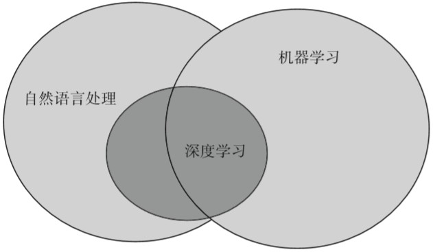
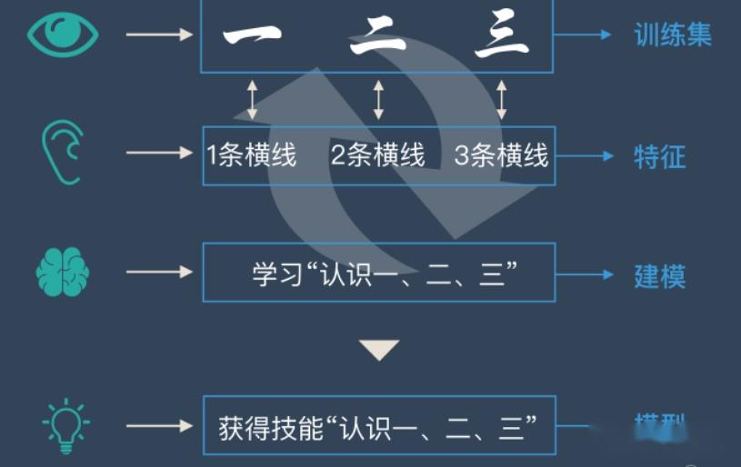
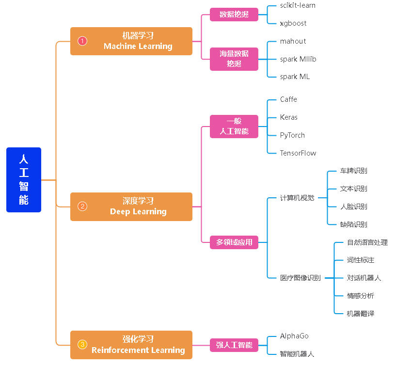
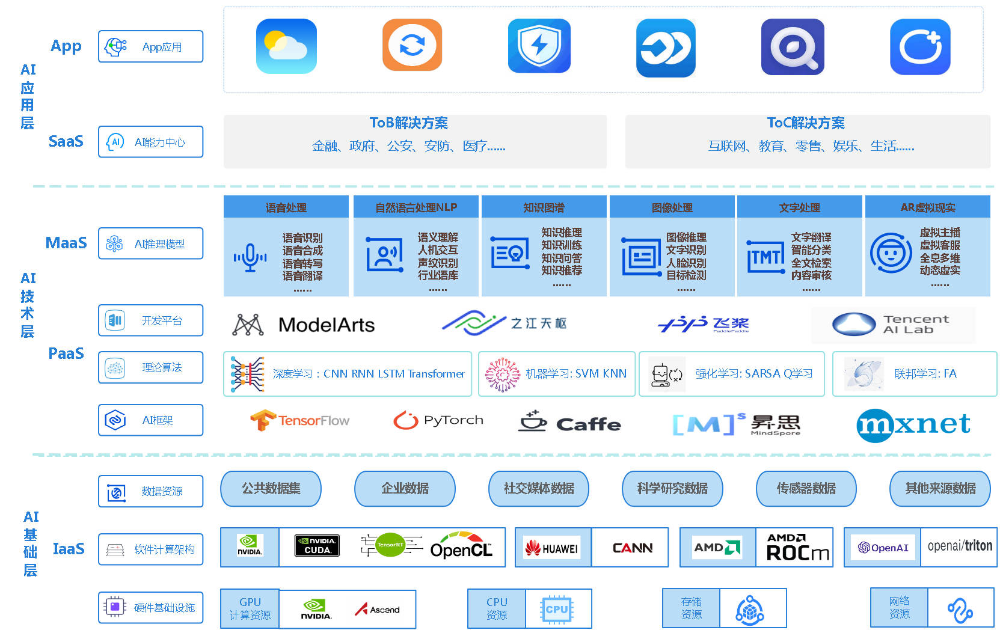
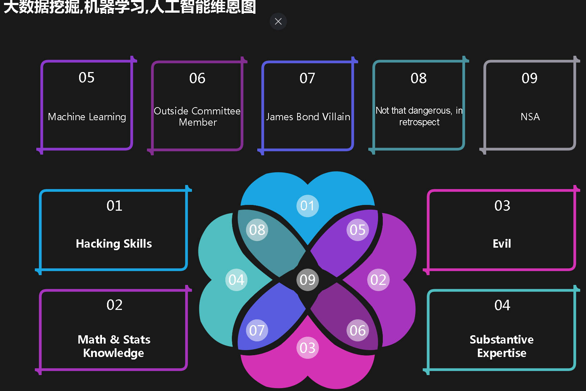
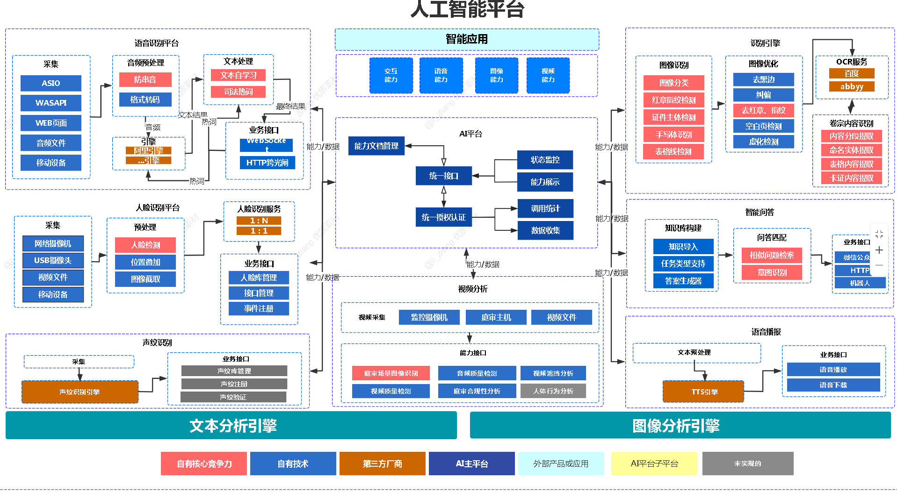
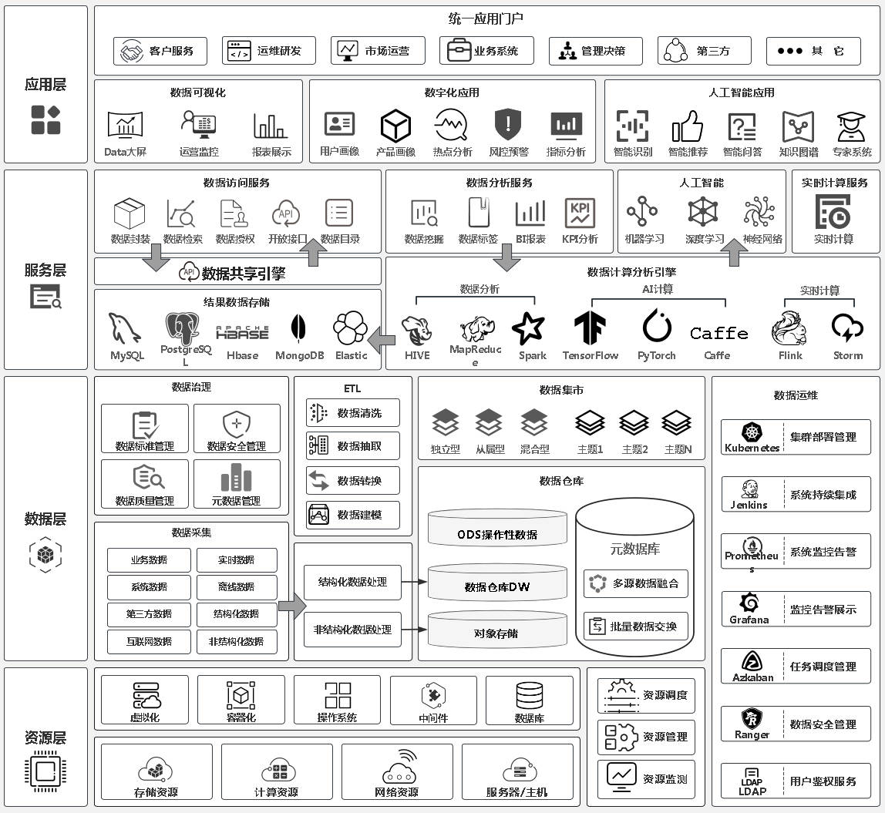
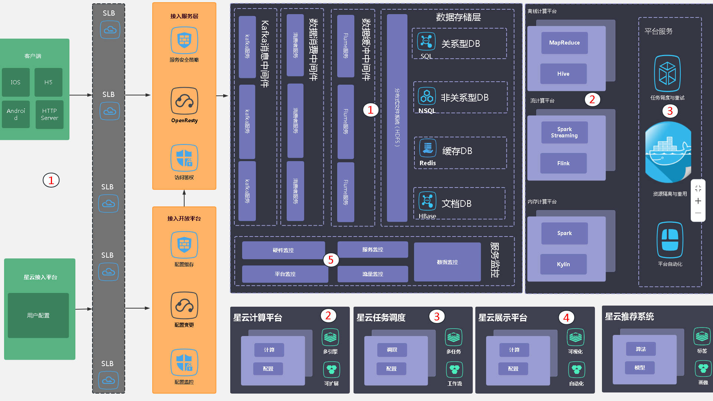

# 技术对比

[AI三层楼](https://blog.csdn.net/u014605429/article/details/160520308)  [ 厘清AI、ML、DL、LLM ](https://zhuanlan.zhihu.com/p/2084907829111021756)  [AI，ML，NN和DL区别](https://cloud.tencent.com/developer/ask/sof/116128973)  [从AI到神经网络：技术演进与实战指南](https://cloud.baidu.com/article/5099596)  [AI 相关概念之基础层级](https://www.cnblogs.com/hnzhengfy/p/20045434/AIConcept_ml)  [从人工智能到深度学习的全景图解](https://zhidao.baidu.com/question/254258450382936444.html)  [AI基础概念](https://blog.51cto.com/u_16099256/14532258)  [人工智能、机器学习与深度学习的核心逻辑](https://cloud.baidu.com/article/4529897)  

[AI系统概述与设计目标](https://cloud.tencent.com/developer/article/2475977)  

LLM： [LLM是神经网络吗_百度搜索](https://www.baidu.com/s?ie=utf-8&f=8&rsv_bp=1&tn=baidu&wd=LLM%E6%98%AF%E7%A5%9E%E7%BB%8F%E7%BD%91%E7%BB%9C%E5%90%97&oq=LLM&rsv_pq=b5f966620009d821&rsv_t=7c171DUA2VGl3S5M4Khsqf8hF%2FrSvZwAe2y9nOOLja8zBr6sMwxgfIGINMA&rqlang=cn&rsv_enter=1&rsv_dl=tb_enter&rsv_sug3=23&rsv_btype=t&inputT=5359&rsv_sug4=5360)  [什么是大语言模型？| NVIDIA 词汇表](https://www.nvidia.cn/glossary/large-language-models/)  [LLM简介](https://cloud.tencent.com/developer/techpedia/1962)   [大语言模型](https://zhuanlan.zhihu.com/p/664321892)  [LLM工作原理](https://www.uml.org.cn/ai/202503114.asp?artid=26723)   [用初中数学理解LLM工作原理](https://hub.baai.ac.cn/view/40662)  [了解 LLM  | Microsoft Learn](https://learn.microsoft.com/zh-cn/training/modules/introduction-large-language-models/2-understand-large-language-models)   [LLM的前世今生](https://mp.weixin.qq.com/s?__biz=MzA5Mzg2MTMwMA==&mid=2650475296&idx=1&sn=ae53d98328b706c67f662058d4d321aa&poc_token=HDJrs2qj27YW6WrAKsuryVxUqwAZJihDKwT8VLwx)  [人工智能大模型_百度百科](https://baike.baidu.com/item/%E4%BA%BA%E5%B7%A5%E6%99%BA%E8%83%BD%E5%A4%A7%E6%A8%A1%E5%9E%8B/63800799)  

[NVIDIA 官方术语表](https://www.nvidia.cn/glossary/)  

[过拟合_百度搜索](https://www.baidu.com/s?ie=UTF-8&wd=%E8%BF%87%E6%8B%9F%E5%90%88)  

## 技术对比

问题： 神经网络、深度学习、机器学习、人工智能对比？

### 四层概念的“套娃”关系

这四个词并非并列的四种技术，而是**从大到小的四层包含关系**，如同俄罗斯套娃：

> **人工智能（AI）⊃ 机器学习（ML）⊃ 深度学习（DL）≈ 深度神经网络 ⊃ 神经网络（NN，作为模型家族）**

- **人工智能**是“让机器表现出智能行为”的**学科与愿景**（目标层）
- **机器学习**是实现 AI 的一条**主流路径**（方法层）：不靠人工写规则，而是从数据里学规律
- **深度学习**是机器学习的一个**子流派**（模型层）：用多层非线性变换自动提取特征
- **神经网络**是深度学习的**数学载体**（结构层）：由神经元、权重、激活函数堆叠而成的计算图

一句话概括：**AI 是目的，ML 是手段，DL 是手段里的重型武器，NN 是武器的零件。**

### 一、逐层拆解

#### 1. 人工智能 Artificial Intelligence

- **定义**：研究如何让机器完成通常需要人类智能才能完成的任务（感知、推理、规划、创作、决策）。
- **范围**：最广。既包含“从数据学习”的流派，也包含**不学习**的流派——如专家系统、搜索算法（A*、AlphaBeta）、规则引擎、知识图谱推理、运筹优化。
- **关键特征**：评判标准是**任务表现**，不看内部怎么实现。一个纯 if-else 的规则系统也能算“弱 AI”。
- **典型代表**：深蓝（1997 年击败卡斯帕罗夫，几乎不含学习成分）、AlphaGo、ChatGPT、自动驾驶系统、推荐系统。

#### 2. 机器学习 Machine Learning

- **定义**：通过经验（数据）自动改进性能的算法研究。形式化表述为：对任务 T、性能指标 P、经验 E，使 P 在 T 上随 E 提升。
- **三大范式**：监督学习、无监督学习、强化学习（另有半监督、自监督、迁移学习等变体）。
- **典型算法**（多数与神经网络无关）：线性/逻辑回归、决策树、随机森林、梯度提升树（XGBoost/LightGBM）、SVM、KNN、K-Means、PCA、朴素贝叶斯、隐马尔可夫模型。
- **关键特征**：**特征工程靠人做**——把原始数据加工成有意义的字段，是传统 ML 成败的关键。
- **优势**：小数据友好、训练快、可解释性强、CPU 即可跑、表格数据上常常打败深度学习。

#### 3. 深度学习 Deep Learning

- **定义**：基于多层（“深”）神经网络的表示学习，核心思想是**特征自动学习**（representation learning），端到端地从原始输入映射到输出。
- **“深”的含义**：通常指隐藏层层数较多、具有层次化抽象能力（浅层学边缘/音素，深层学部件/语义）。
- **典型架构**：CNN（图像）、RNN/LSTM/GRU（序列）、Transformer（通用序列，当前主流）、GAN、VAE、Diffusion、GNN。
- **关键依赖**：大数据 + 大算力（GPU/TPU）+ 反向传播 + 框架（PyTorch/TensorFlow）。
- **优势**：在非结构化数据（图像、语音、文本、视频）上碾压传统方法，且省去了手工特征工程。

#### 4. 神经网络 Neural Networks

- **定义**：受生物神经元启发的一类参数化函数逼近器，由节点（神经元）、带权连接、激活函数组成，通过梯度下降最小化损失来调整权重。
- **历史形态**：感知机（1958）→ 多层感知机 MLP + 反向传播（1986）→ 浅层网络 → 深度化后成为 DL。
- **定位澄清**：神经网络本身是**模型结构族**，既可用于浅层（2–3 层，不算深度学习），也可用于深层。因此“神经网络 ≠ 深度学习”，准确说法是**深度学习 ≈ 深度神经网络及其配套技术栈**。
- **理论基石**：通用近似定理（足够宽的 MLP 可逼近任意连续函数）——但定理不保证“能学好”或“能泛化”。

### 二、横向对比总表

| 维度               | 人工智能 AI            | 机器学习 ML                | 深度学习 DL                    | 神经网络 NN              |
| ------------------ | ---------------------- | -------------------------- | ------------------------------ | ------------------------ |
| **层级定位**       | 学科 / 愿景            | 实现 AI 的方法论           | ML 的一个子领域                | DL 的模型骨架            |
| **核心问题**       | 机器能否表现智能       | 如何从数据中归纳规律       | 如何自动学习分层表征           | 如何用神经元组合拟合函数 |
| **是否必须“学习”** | 否（规则、搜索也可）   | 是                         | 是                             | 是                       |
| **数据需求**       | 视具体实现而定         | 中小规模即可               | 通常需要海量标注数据           | 视网络深度而定           |
| **算力需求**       | 差异极大               | CPU 常够用                 | 依赖 GPU/集群                  | 中等到高                 |
| **特征工程**       | 不适用                 | 人工为主，决定上限         | 自动学习，端到端               | 同左                     |
| **可解释性**       | 规则型高，学习型低     | 中等（树模型较好）         | 低（黑箱）                     | 低                       |
| **典型数据结构**   | 任意                   | 结构化表格最擅长           | 图像、文本、语音、视频         | 同左                     |
| **失败模式**       | 范围太广，无法一概而论 | 过拟合、分布偏移、特征失效 | 数据不足即崩、对抗样本、幻觉   | 梯度消失/爆炸、局部极小  |
| **代表工具**       | 无统一工具             | scikit-learn、XGBoost      | PyTorch、TensorFlow、JAX       | 同左                     |
| **里程碑**         | 1956 达特茅斯会议      | 1997 SVM；2006 随机森林    | 2012 AlexNet；2017 Transformer | 1958 感知机；1986 BP     |

### 三、关系示意（文字版）

```
人工智能 AI
├── 非学习型（符号主义 / 搜索与优化）
│   ├── 专家系统、规则引擎
│   ├── 博弈搜索（深蓝）
│   └── 知识图谱推理、约束求解
└── 学习型 ← 机器学习 ML
    ├── 传统模型（非神经网络）
    │   ├── 线性模型、SVM、贝叶斯
    │   ├── 决策树 / 随机森林 / GBDT
    │   └── 聚类、降维、HMM
    └── 神经网络家族 ← 深度学习 DL（深层 + 大数据 + GPU）
        ├── MLP、CNN、RNN/LSTM
        ├── Transformer / LLM
        ├── GAN、Diffusion、VAE
        └── GNN、RL 中的深度网络（DQN）
```

### 四、最容易踩的 6 个误区

1. **“AI = 深度学习”** —— 错。工业界大量场景仍用 XGBoost、规则或简单统计模型，效果稳定且成本更低。深度学习只是 AI 版图中增长最快的一块。
2. **“机器学习就是神经网络”** —— 错。在表格数据、风控评分、医疗诊断等结构化任务上，树模型长期是业界首选，且具备更好的可解释性。
3. **“神经网络模拟人脑”** —— 过度类比。现代 ANN 与生物大脑的相似性非常有限（无脉冲时序、突触可塑性机制不同），它本质上是**数学上的复合函数拟合器**。
4. **“层数越多越好”** —— 错。数据量少时加深网络必然导致过拟合；残差连接、归一化等技术正是为了解决“加深反而变差”的问题而诞生的。
5. **“深度学习不需要特征工程”** —— 半对。它省去的是**手工设计特征**，但数据清洗、标注质量、提示词设计、数据增强、embedding 选择等“新形态特征工程”反而更重要。
6. **“AI 有意识 / 会思考”** —— 目前的大语言模型属于统计模式匹配与推理能力的外显，不具备自我意识。这是 AI 的能力边界问题，而非术语问题。

### 五、实战选型：我该用哪个？

| 你的情况                                 | 建议路线                                                 |
| ---------------------------------------- | -------------------------------------------------------- |
| 几百到几万行表格数据，要做分类/回归/风控 | **传统 ML**（LightGBM/XGBoost + 特征工程），别上深度学习 |
| 图像识别、目标检测、医学影像             | **DL：CNN / ViT**                                        |
| 文本理解、翻译、对话、摘要               | **DL：Transformer / LLM**（微调或 RAG）                  |
| 语音识别、声纹                           | **DL：Conformer / Whisper 类**                           |
| 数据极少（几十条），但有明确业务规则     | **规则引擎 / 专家系统**（仍是 AI！）                     |
| 需要可解释、要过审计（金融、医疗）       | **ML 树模型 + SHAP 解释**，或浅层模型                    |
| 推荐排序                                 | 两者混合：召回用 embedding（DL），精排常用 GBDT          |
| 机器人控制、游戏 Agent                   | **强化学习 + 深度网络（DRL）**                           |
| 只是想快速出活、资源有限                 | 优先调 API 用现成大模型，其次 ML，最后考虑自己训 DL      |

**经验法则**：先建立 baseline（简单模型或规则），再逐步升级复杂度；每升一级都要验证收益是否覆盖成本（数据标注、算力、延迟、维护）。

### 六、一条简明的历史脉络

- **1950s–1970s**：AI 诞生，符号主义主导；感知机兴起后被 Minsky 批评，进入第一次寒冬。
- **1980s**：反向传播复兴神经网络；专家系统商业化。
- **1990s–2000s**：统计学习崛起（SVM、随机森林），ML 成为 AI 主流；神经网络被边缘化（“浅层”时代）。
- **2006**：Hinton 提出深度信念网络，“Deep Learning”一词正式流行。
- **2012**：AlexNet 引爆 ImageNet，GPU + ReLU + Dropout 组合奏效。
- **2015–2017**：ResNet、AlphaGo、Transformer 相继问世。
- **2020s**：大模型时代——DL 的规模扩展（scaling）带来涌现能力，LLM 成为 AI 的事实入口；同时“AI”一词重新大众化。

### 七、总结成一句记忆口诀

> **AI 想做什么，ML 决定怎么学，DL 用多层网络去学，NN 就是那层网络本身。**

- 谈**愿景与产业** → 说 AI
- 谈**方法论与实验设计** → 说 ML
- 谈**模型架构与大模型** → 说 DL
- 谈**具体结构、层数、激活函数** → 说 NN

------

你目前是在学习、做项目，还是工作中需要选型？告诉我具体场景，我可以帮你推荐更合适的路线。

## 四层包含关系是不是说AI的底层技术是神经网络

### 不完全是——“包含”说的是**范围**，不是**地基**

四层套娃描述的是**概念外延的大小**（谁涵盖谁），而不是**技术依赖的上下层**（谁撑着谁）。把它理解成“AI 的底层 = 神经网络”，相当于说“交通工具的底层技术是内燃机”——对内燃机车成立，但对马车、电动车、帆船都不成立，而且内燃机下面还有热力学、材料学和精密加工。

### 一、为什么这个说法站不住

**1. AI 里有大量完全不碰神经网络的系统**

| 系统                | 底层技术                     | 有无神经网络 |
| ------------------- | ---------------------------- | ------------ |
| 深蓝（国际象棋）    | 博弈树搜索 + 评估函数 + 剪枝 | 无           |
| 专家系统 / 规则引擎 | 符号逻辑、产生式规则         | 无           |
| 地图导航路径规划    | A*、Dijkstra、约束求解       | 无           |
| 银行风控评分卡      | 逻辑回归、决策树             | 通常无       |
| 电商排序精排        | GBDT / XGBoost               | 常无         |
| 知识图谱推理        | 本体论、图查询、逻辑演绎     | 无           |
| 排产调度、物流优化  | 整数规划、启发式算法         | 无           |

这些都是货真价实的 AI 应用，且至今仍在大规模服役。所以“AI 的底层是神经网络”在**定义上不成立**。

**2. 就算在深度学习内部，神经网络也不是最“底层”**

神经网络之上还有架构设计（Transformer、ResNet），而它**之下**才是真正的技术底座：

> 线性代数与概率论 → 优化理论（梯度下降、凸优化） → 自动微分 → GPU/TPU 并行计算与显存管理 → 分布式训练框架 → **神经网络** → 预训练范式 → 应用

也就是说，神经网络本身是**被支撑的那一层**，它的底层是矩阵乘法、反向传播和算力。把 NN 叫作“AI 的底层”，等于把楼的第二层当成了地基。

**3. 集合包含 ≠ 技术栈**

- 包含关系回答的是：**这个词指代的对象集合有多大**。
- 技术栈回答的是：**做这个东西需要哪些前置条件**。

两者方向不同。比如“机器学习 ⊃ 深度学习”，但做机器学习并不以深度学习为前提；反过来，深度学习却强依赖 ML 里的损失函数、正则化、交叉验证等通用概念——**依赖方向甚至和包含方向相反**。

### 二、那该怎么正确理解这四层

更贴切的比喻不是“盖楼”，而是**一棵树的分支**：

```
            人工智能（学科 / 总目标）
           /                        \
   非学习型（符号主义）          学习型（机器学习）
   搜索·推理·规则·优化         /                \
                         传统模型           神经网络家族
                       树/SVM/贝叶斯      （深起来 = 深度学习）
```

- **AI 是树干和目标**：评判标准只看“机器能不能完成该任务”，不看内部实现。
- **ML 是其中一根粗枝**：主张“从数据里学”，而非人工写规则。
- **DL 是这根枝上的一个分叉**：主张“用多层网络自动学特征”。
- **NN 是这个分叉上的叶片结构**：一种具体的函数逼近器。

### 三、但你的直觉在**一个限定条件下是对的**

如果把主语从“AI”缩小到“**今天大众口中的 AI（尤其是大模型、生成式 AI）**”，那么：

> 在这一特定子领域里，神经网络确实是事实上的技术底座，而且是几乎唯一的底座。

原因很现实：2017 年 Transformer 之后，加上 2020 年以来的规模扩展（scaling），这条路线在语言、图像、语音、代码上的表现全面领先，导致**产业和舆论把“AI”一词的使用范围大幅收缩到了 DL 上**。所以现在听到“AI 公司”“AI 能力”，大概率指的就是神经网络系统。

但这属于**语言习惯的漂移**，不属于概念本身的定义。混淆这两者会带来实际代价：遇到表格数据、可解释性要求或算力受限的场景时，如果默认“AI = 神经网络”，就容易选错技术方案。

### 四、顺带一提：还有人在刻意不让 NN 成为底层

符号主义学界和部分产业团队一直在推进**神经符号 AI（Neuro-symbolic）**——用神经网络处理感知（看和听），用符号系统处理推理与约束（想和证）。动机很直接：纯神经网络缺乏可解释性、难以保证逻辑一致性，且在数据稀缺时表现不佳。医疗诊断、法律合规、工业控制等领域对这条路线的需求很强。

如果哪天这条路走通了，“AI 的底层是神经网络”这句话就更要打折扣了：**神经网络可能只是 AI 的感知层，而非整个底层。**

### 五、一句话修正

> **神经网络是当前主流 AI（尤其大模型）的实现载体，但不是 AI 这门学科的底层技术；AI 的真正底座是数学、算法、算力和数据，神经网络只是其中一条技术路线上的一个环节。**

记忆时可以这样对应：

- 谈**学科边界** → AI 的底层是数学与计算
- 谈**方法论** → ML 的底层是统计与优化
- 谈**当代大模型产品** → 可以说底层是神经网络
- 谈**具体模型** → 才轮到层数、注意力头、激活函数

------

你之前提到在学习/做项目，方便说说具体方向吗？比如是偏理论推导、工程落地，还是想选技术路线？我可以帮你梳理更有针对性的学习路径。

## 那么它们有各自的技术吗？相互技术依赖有多强？

### 各有专属技术，且依赖是**单向、不对称**的

这四个层次各自拥有独立的技术栈，彼此之间并非“全有或全无”的绑定关系。其依赖强度呈现出明显的**单向性**：上层严重依赖下层，而下层对上层基本零依赖。同时，包含范围与技术依赖的方向常常相反。

### 一、各层的“专属技术”清单

#### AI 层（非学习型，跟神经网络完全无关）

- **搜索**：A*、Dijkstra、Minimax、Alpha-Beta 剪枝、MCTS（蒙特卡洛树搜索）
- **知识表示与推理**：一阶逻辑、Prolog、本体/OWL、知识图谱、前向/后向链推理
- **规划**：STRIPS、PDDL、HTN 分层任务网络
- **约束求解**：SAT/SMT 求解器、整数线性规划、启发式搜索
- **多智能体**：博弈论、机制设计、合约网协议
- **机器人**：SLAM、卡尔曼滤波、PID/最优控制

> 这套技术栈至今仍在物流调度、芯片布局、航班排班、形式化验证中不可替代。

#### ML 层（传统机器学习）

- **学习范式**：监督/无监督/半监督/强化学习、迁移学习、主动学习
- **模型族**：线性模型、SVM、决策树、随机森林、GBDT、K-Means、PCA、HMM、贝叶斯网络
- **评估与验证**：交叉验证、偏差-方差分解、ROC/AUC、精确率-召回率权衡、数据泄露检测
- **数据处理**：特征工程（WOE/IV、One-hot、TF-IDF）、缺失值处理、SMOTE 采样、分布偏移检测
- **集成方法**：Bagging、Boosting、Stacking、Blending
- **可解释性**：SHAP、LIME、特征重要性、部分依赖图
- **超参优化**：网格/随机搜索、贝叶斯优化、早停

#### DL 层（深度学习——**这一层的技术密度最高**）

- **训练机制**：反向传播、自动微分、计算图、梯度裁剪
- **稳定性技巧**：Xavier/Kaiming 初始化、BatchNorm/LayerNorm/RMSNorm、残差连接、Dropout
- **架构**：CNN、RNN/LSTM/GRU、Transformer、注意力机制、位置编码、MoE
- **优化器**：SGD+动量、Adam、AdamW、LAMB、LR 调度（cosine/warmup）
- **大规模工程**：混合精度、数据/张量/流水线并行、ZeRO、显存优化、checkpoint
- **大模型特有**：预训练-微调范式、Tokenizer、KV Cache、Prompt/RAG、LoRA/QLoRA、RLHF/DPO、量化蒸馏、思维链
- **生成模型**：GAN、VAE、Diffusion、流匹配

#### NN 层（神经网络——最薄的一层，纯结构）

- 神经元、权重、偏置、激活函数（Sigmoid→ReLU→GELU→SiLU）
- 卷积、池化、步长、感受野
- Embedding 表、Softmax、门控机制
- 损失端：交叉熵、MSE、对比损失、 triplet loss

注意：**NN 层几乎没有“算法”，只有“结构”**。它的全部动作就是“怎么连、怎么算”，训练方法全部借自 ML 和 DL。

### 二、依赖强度矩阵（0=无关，5=缺了就不存在）

| 上层 ↓ 依赖 → 下层   | AI（非学习）        | ML                 | DL              | NN    |
| -------------------- | ------------------- | ------------------ | --------------- | ----- |
| **AI（非学习分支）** | —                   | 0                  | 0               | 0     |
| **ML**               | 1（问题形式化）     | —                  | 0               | 0     |
| **DL**               | 1（MCTS等少量借用） | **4**              | —               | **5** |
| **NN**               | 0                   | 3（梯度/损失思想） | 0（历史反向了） | —     |

**几个关键读数：**

1. **DL → NN = 5（绝对依赖）**。去掉神经网络，深度学习直接消失，没有任何替代载体。这是整张表里唯一一条“生死线”。
2. **DL → ML = 4（强依赖）**。深度学习的损失函数、正则化、交叉验证、过拟合判断、偏差方差权衡，全部继承自传统机器学习。很多人以为“学深度学习不用学机器学习”，这是最大的认知陷阱——**不懂正则化和验证集泄漏，调大模型只会玄学**。
3. **ML → AI ≈ 1（极弱）**。机器学习在数学上完全自洽，可以不依赖 AI 学科独立存在（统计学系就是这么干的）。它只从 AI 那里借了“任务定义”和“智能行为”这个叙事框架。
4. **AI → ML/DL = 0（零依赖）**。符号主义那一支对学习和神经网络毫无需求。这也是“AI 底层是神经网络”不成立的直接证据。
5. **NN → ML = 3（思想依赖）**。反向传播的根是链式法则+梯度下降，属于优化理论，不是神经科学的产物。

### 三、三个容易被忽略的结构特征

**① 包含方向 ≠ 依赖方向**

集合上是 AI ⊃ ML ⊃ DL，但依赖链条是 **DL → ML →（几乎不依赖）AI**。越往里层，对外层的依赖越弱，反而对**外部**的数学和算力依赖越强。真正的地基在这四者之外：

> 线性代数 · 概率统计 · 最优化 · 信息论 · 数值计算 · GPU 体系结构 · 分布式系统

**② 有一块“共享底座”，不属于任何一层**

特征表示、评估指标设计、数据清洗、实验管理、AB 测试、工程部署——这些技能横跨所有层，且往往是项目成败的真正决定因素。它们不属于任何单一层次，却是层与层之间唯一的通用语言。

**③ 跨层“借用”真实存在，但很稀疏**

最经典的例子是 AlphaGo：**DL（策略/价值网络）+ AI（MCTS 搜索）**。网络负责直觉，搜索负责验算，两者互补而非替代。这类组合说明依赖关系不是纯粹的链条，而是**稀疏的桥接**。

### 四、这种依赖结构带来的实际后果

| 现象                     | 原因              | 后果                                                         |
| ------------------------ | ----------------- | ------------------------------------------------------------ |
| **故障向上传导**         | 单向依赖          | NN 层数值溢出 → DL 层梯度爆炸 → ML 层指标崩溃。排查必须往下走，往上查没用 |
| **技能迁移不对称**       | 依赖单向          | 会 DL 的人转传统 ML 很快（统计概念本就懂）；会传统 ML 的人转 DL，卡在的是算力工程和架构，不是理论 |
| **替换成本悬殊**         | 依赖强度不同      | 把规则引擎换成 ML 模型，成本可控；把 Transformer 换成非 NN 方案，等于重做整个产品 |
| **可解释性诉求倒逼回退** | AI 层不受 DL 约束 | 金融风控、医疗、司法场景常主动放弃 DL，退回树模型甚至规则——因为那条依赖链可以整体剪掉 |
| **算力成为隐形第五层**   | DL/NN 强依赖硬件  | 这四者的“政治地位”被 GPU 供给直接决定，这不是比喻            |

### 五、一个正在发生的变化：依赖关系开始“回流”

过去十年依赖是单向向下的，但现在出现了**反向调用**：

- 大模型 + 工具调用 / Agent 框架：让神经网络去**调用**搜索、求解器、代码执行器这些非学习 AI 模块
- 神经符号 AI：网络做感知，符号系统做约束和推理（医疗、法律、工业控制需求最强）
- LLM + 形式化验证：用证明器校验模型输出
- Diffusion + 物理仿真：生成结果受物理方程约束

这意味着未来的结构可能不再是单纯的套娃，而变成**神经网络作为感知前端 + 传统 AI 作为推理后端**的组合体。到那时，“AI 的底层是什么”这个问题会有新答案：神经网络可能只是**感知层**，而不是整个底层。

### 六、一句话总结

> **每一层都有自己的技术，且越往外层越“轻算法、重思想”，越往内层越“重工程、轻理论”。依赖强度从内向外递减：DL 离不开 NN（5级），DL 高度依赖 ML（4级），ML 几乎不依赖 AI（1级），AI 的非学习分支对其他三层零依赖。所以这四者更像一棵单侧生长的树，而不是一座层层承重的楼。**

如果你在做技术选型或学习规划，这个依赖结构的实用推论是：**想搞懂大模型，必须补 ML 的验证与正则化基础；想做落地系统，则必须补 AI 层的搜索与约束求解——因为那是当前神经网络最不擅长的部分。**

---

你目前更偏哪个方向？

1. 理论推导/算法研究
2. 工程落地/模型部署
3. 技术选型/路线规划

## 分层

AI是上层，它的范围最大，ML、DL、NN都是它下面的子集。

这四者的关系是一个层层包含的“金字塔”结构：

### 🔺 层级关系

1. 人工智能（AI）：最顶层的概念，目标是让机器像人一样思考、学习和决策。
2. 机器学习（ML）：实现AI的核心方法，让计算机从数据中自动学习规律。
3. 深度学习（DL）：机器学习的一个分支，通过多层神经网络处理复杂任务。
4. 神经网络（NN）：深度学习依赖的核心算法载体，由模仿大脑的神经元连接组成。

> 可以这样理解：AI是“造一辆能自动驾驶的车”这个目标，ML是“让车能自己学习的系统”，DL是系统里更先进的学习模块，NN则是模块里具体的零件。

### ⚠️ 容易混淆的点

- 神经网络不全是深度学习，比如单层感知机是NN但不是DL。
- 机器学习也不全依赖神经网络，比如SVM、决策树属于ML但不是NN。

搞清楚了层级关系，要不要再看看深度学习为什么叫深度?或者神经网络和深度学习有什么区别?

# AI系统

## LLM是神经网络吗

是的，LLM（大语言模型）本质上就是一种神经网络，而且是深度神经网络。

它的核心架构是 Transformer，这是由谷歌在 2017 年提出的一种神经网络模型，也是现代大语言模型的基石。 可以这样理解：LLM 是通过在海量文本数据上训练出来的大规模神经网络，学会了语言中的模式，从而能理解、生成和处理文本。

补充两个相关概念，方便你理解：

- 深度学习算法：LLM 属于深度学习算法，是机器学习的一个分支，核心就是多层神经网络。
- 核心能力：得益于神经网络，LLM 才能完成翻译、总结、问答、代码生成等复杂的自然语言处理任务。

如果想深入了解，可以进一步搜索 Transformer架构{id="entity_1"} 或 自注意力机制{id="entity_2"}，这两个是理解 LLM 内部工作原理的关键。

LLM是深度神经网络，想深入了解的话，可以看看Transformer架构或者自注意力机制

## 神经网络

[神经网络_百度搜索](https://www.baidu.com/s?ie=UTF-8&wd=%E7%A5%9E%E7%BB%8F%E7%BD%91%E7%BB%9C)  [神经网络](https://hub.baai.ac.cn/knowledge-tree/9b161d45-1395-42af-8104-4e698c06b1a2)  [神经网络](https://www.uml.org.cn/ai/202410094.asp) [神经网络结构](https://cloud.tencent.com/developer/article/2398345)    [入门神经网络](https://cloud.tencent.com/developer/article/2550658)  [什么是神经网络](https://nic.zjtu.edu.cn/content/mxzs/202506/4507.html)   

神经网络本质上是一个模仿大脑神经元连接方式的计算模型，它通过大量简单的处理单元（神经元）相互连接，从数据中自动学习规律和特征，是当前人工智能和深度学习最核心的技术。

可以把神经网络想象成一个“黑匣子”：给它输入数据（比如图片的像素、文本的词向量），它内部经过层层处理，最后输出一个结果（比如“这是一只猫”）。 这个过程之所以“智能”，关键在于它不需要人类手动设计规则，而是通过大量数据训练，自己调整内部参数来逼近输入和输出之间的复杂关系。

### 🧠 核心结构与工作原理

1. 三层基本骨架：标准神经网络由输入层（接收原始数据）、隐藏层（核心特征提取区）和输出层（生成预测结果）组成。 当隐藏层数量增多时，就变成了“深度神经网络”。
2. 关键部件：
   - 神经元：每个神经元接收来自上一层多个信号，进行加权求和。
   - 激活函数：在求和后引入非线性变换（如ReLU、Sigmoid），让网络能学习和表达复杂的非线性关系，而不是简单的线性叠加。
   - 权重与偏置：神经元之间连接的“强度”参数，是网络学习的主要内容，相当于可调的旋钮。
3. 学习过程（训练）：这是神经网络能“变聪明”的核心机制，主要通过反向传播算法（Backpropagation）实现。简单说，就是网络先做一次预测（前向传播），将预测结果与真实答案对比得到误差，再把误差反向传递回每一层，用梯度下降法不断微调权重，如此反复迭代，直到预测足够准确。

### 📌 两大主流网络变体

除了基础的“全连接”结构，针对不同类型的数据和任务，演化出了专门化的网络，最典型的有：

1. 卷积神经网络（CNN）：专为处理图像等网格结构数据设计。它通过卷积核在图像上滑动提取局部特征（边缘、纹理等），配合池化层压缩信息，擅长捕捉空间模式，在图像分类、目标检测领域是绝对主力。
2. 循环神经网络（RNN）及其变体（LSTM等）：擅长处理序列数据（如文本、语音、时间序列）。其核心是“记忆”，会将上一个时间步的状态传递给下一个时间步，从而捕捉时间上的依赖关系。

> 需要区分的是，CNN和RNN解决“特征提取方式”的问题，而像Transformer这类基于注意力机制的新架构，则在处理长序列和并行计算上更具优势，是当前大语言模型的基础。

### 🚀 为什么它如此重要

神经网络的崛起，尤其是2012年AlexNet在图像识别竞赛中取得突破后，开启了深度学习时代。 它让计算机在视觉识别、语音识别、自然语言处理、自动驾驶等众多领域的能力大幅超越传统方法。 例如，在视频动作识别中，双流卷积网络通过将“静态画面”和“运动信息”（光流）拆分为两条独立的处理流，第一次让深度学习在该任务上超越了传统手工特征方法。 你之前问的线性代数、概率论正是理解神经网络数学原理的基石。

### ⚠️ 前沿进展与挑战

神经网络并非无所不能，其发展也伴随挑战：

- 前沿方向：当前研究正向量子神经网络（结合量子计算特性）、神经符号AI（融合逻辑推理与统计学习）、1-bit量化模型（大幅压缩模型体积、降低能耗）等方向发展。
- 核心挑战：模型的可解释性（为什么它做出这个判断？）、对数据质量与隐私的依赖，以及随着能力增强带来的安全与治理问题（如目标对齐风险），都是业界关注焦点。

神经网络的结构和原理已经清楚了，要不要继续看看激活函数为什么必须引入非线性?或者反向传播算法如何计算梯度?

# CUDA

## 区别

[CANN CUDA TVM XLA起什么作用_百度搜索](https://www.baidu.com/s?ie=UTF-8&wd=CANN%20CUDA%20TVM%20XLA%E8%B5%B7%E4%BB%80%E4%B9%88%E4%BD%9C%E7%94%A8)  

问题： CANN CUDA TVM XLA起什么作用

这四个都是AI计算领域的软件技术，核心作用都是让AI模型在特定硬件上跑得更快、更高效，但各自服务的硬件和侧重点不同。简单区分：

- CUDA：英伟达GPU的“专属翻译官”，让开发者能用通用编程语言调用GPU海量核心做并行计算，是英伟达生态的基石。
- CANN：华为昇腾AI芯片的“专属翻译官”，对标CUDA，向上支持主流AI框架，向下调度昇腾芯片算力。
- XLA：谷歌推出的AI编译器，把TensorFlow等框架的计算图编译成针对硬件优化的机器码，加速模型运行。
- TVM：开源的AI编译器框架，目标是“一套代码，多种硬件”，自动优化并生成适配不同硬件的代码。

### 🧩 详细解读

1. CUDA（英伟达GPU的算力底座）
   - 作用：英伟达推出的通用并行计算平台和编程模型，支持C、C++、Python等语言。它让CPU和GPU能协同工作，把复杂任务拆分成大量小任务，交给GPU成千上万个核心并行处理。
   - 地位：相当于英伟达GPU的“灵魂”，覆盖全球95%以上的AI开发者，是英伟达软硬件生态的核心壁垒。

2. CANN（华为昇腾的算力底座）
   - 作用：华为推出的神经网络异构计算架构，向上支持PyTorch、TensorFlow、MindSpore等主流AI框架，向下服务昇腾AI处理器，起到“承上启下”的桥梁作用，让开发者无需关心芯片细节就能调用底层算力。
   - 特点：常被称作“昇腾的CUDA”，提供Ascend C编程语言、算子库和开发工具，2025年8月已全面开源。

3. XLA（谷歌的AI编译器）
   - 作用：谷歌推出的编译器，主要用于TensorFlow和JAX框架。它能把计算图直接编译成针对目标硬件优化的机器码，从而提升运行速度、改善内存使用。
   - 现状：从TensorFlow 2.x开始成为默认开启的特性，PyTorch社区也推出了PyTorch/XLA版本以支持谷歌TPU。

4. TVM（通用的AI编译器框架）
   - 作用：开源的深度学习编译器技术栈，聚焦图级优化、算子级优化、自动调优和代码生成。它试图屏蔽底层硬件差异，让同一套模型能自动适配CPU、GPU、NPU等多种硬件。
   - 定位：和XLA类似，但更强调“统一中间层”，旨在成为连接AI框架和多样化硬件的通用编译器，CUDA和CANN也可以看作是特定硬件生态下的编译与调度方案。

### 💡 一句话总结

如果把AI模型比作一道菜谱，那么：

- CUDA 和 CANN 分别是英伟达和华为的“专属厨房”，只有用它们才能在自己的锅（芯片）上把菜炒出来。
- XLA 和 TVM 是“通用厨艺优化师”，不管在哪个厨房，都能帮你把做菜流程优化得更快更省料。

这四个技术各有侧重，可以看看CANN和CUDA具体有哪些区别?或者TVM和XLA的优化方向有何不同?

## CUDA编译

[cuda编译器是自动运行的吗?需不需要开发者_百度搜索](https://www.baidu.com/s?ie=UTF-8&wd=cuda%E7%BC%96%E8%AF%91%E5%99%A8%E6%98%AF%E8%87%AA%E5%8A%A8%E8%BF%90%E8%A1%8C%E7%9A%84%E5%90%97%EF%BC%9F%E9%9C%80%E4%B8%8D%E9%9C%80%E8%A6%81%E5%BC%80%E5%8F%91%E8%80%85)  

[Linux下CUDA安装全攻略](https://developer.huawei.com/home/forum/hwc/thread-0228188730644737028-1-1.html)  [CUDA编程](https://developer.volcengine.com/articles/7384337124658839561)  [CUDA ](https://cloud.tencent.com/developer/news/1896466)  [安装cuda](https://www.cnblogs.com/kakafa/p/18574408)  [CUDA编程系列](https://zhuanlan.zhihu.com/p/2036180482958816387)  

> 问题： cuda编译器是自动运行的吗?需不需要开发者

不需要开发者手动干预，CUDA编译器（nvcc）会按流程自动完成编译，但开发者需要先写好代码并调用它。

简单说，CUDA 编译器不是像后台服务那样一直自动运行，而是当你执行编译命令（比如 `nvcc hello.cu`）时，它才会启动并处理你的 `.cu` 源文件，整个过程自动完成，不需要你一步步操作。

### 🔧 编译流程是怎样的

1. 写代码：你用 CUDA C/C++ 写好 `.cu` 源文件，其中包含在 GPU 上运行的函数（用 `__global__` 标记）。
2. 执行编译命令：在终端运行 `nvcc 你的文件.cu`，编译器随即启动。
3. 自动处理：nvcc 会自动完成两大部分——
   - 设备代码（GPU部分）：编译成 PTX 中间指令，再转成 GPU 实际执行的机器码（SASS）。
   - 主机代码（CPU部分）：交给平台编译器处理，Linux 用 gcc，Windows 用 cl.exe（MSVC）。
4. 生成可执行文件：最后链接成可直接运行的程序，比如 `a.out` 或 `a.exe`。

整个过程你只需要敲一次命令，剩下的编译器全包了。

### 💡 需要开发者做什么

- 安装环境：先装好 NVIDIA 驱动、CUDA Toolkit，以及配套的 C/C++ 编译器（Windows 上必须用 Visual Studio 的 MSVC）。
- 指定架构（可选但推荐）：编译时可以通过 `-arch=sm_XX` 指定你的 GPU 架构，让生成的机器码更高效。不指定也能编译，但可能无法利用你显卡的全部性能。
- 处理编译错误：如果代码有语法或逻辑问题，编译器会报错，你需要根据提示修改代码再重新编译。

> 有一点要注意：如果你是直接用 PyTorch、TensorFlow 这类框架跑 AI 模型，完全不需要手动调用 nvcc，框架内部已经帮你处理好 GPU 加速了。 只有你自己写 CUDA 代码时才需要编译器。

编译流程里提到了 PTX 和 SASS，要不要了解一下PTX 是什么?或者SASS 是什么?

# 残差

[残差_百度搜索](https://www.baidu.com/s?ie=UTF-8&wd=%E6%AE%8B%E5%B7%AE)  [从数学定义到大模型前沿应用](https://zhuanlan.zhihu.com/p/1937111317036109867)  

残差是实际观测值与模型预测值之间的差，计算公式为：残差 = 观测值 - 预测值。在统计学和回归分析中，残差用来衡量模型对数据的拟合程度，是模型诊断的核心工具。

### 残差到底是什么

1. 基本定义：残差就是真实数据减去模型算出来的预测值，反映模型对每个样本的偏差程度。
2. 与误差的区别：误差是理论上的真实偏差（不可观测），残差是用拟合值代替真实均值后能实际算出来的数值。
3. 英文含义：根据剑桥词典和 britannica，residual 在统计学中指回归方程中观测值与预测值的差异，也有"剩余的、残留的"含义。

### 残差怎么计算

1. 计算公式：$\delta_i = y_i - \hat{y}_i$，其中 $y_i$ 是实际观测值，$\hat{y}_i$ 是回归方程得到的预测值。
2. 计算方向：残差是观测值减去预测值，不是反过来，这一点在高中数学和统计学中是统一的。
3. 手算示例：比如有 4 组数据，拟合出回归方程后，把每个 x 代入方程算出预测值，再用实际 y 减去预测值，就得到每个点的残差。
4. 重要性质：
   - 残差的和为 0（与回归直线的正交性有关）。
   - 残差可正可负，不是非负数。
   - 标准化残差近似服从标准正态分布。

### 残差有什么用

1. 检验模型假设：通过残差分析可以判断回归模型是否满足基本假设，如正态分布、方差齐次等。
2. 识别异常值：如果某个点的标准化残差落在 (-2,2) 区间以外，可在 95% 置信度判为异常点，不参与回归拟合。
3. 评估拟合效果：残差点均匀落在水平带状区域内，说明模型比较合适；如果有明显规律，说明模型可能需要改进。
4. 模型改进方向：残差图能帮助发现变量间是否有非线性关系、是否还有重要自变量未进入模型等。

需要我帮你整理残差图的解读要点吗？可以快速判断模型是否满足正态性和方差齐性。

# 1、人工智能实战就业(面试)学习路线图

[最通俗易懂的深度学习教程](https://www.bilibili.com/video/BV1Tq37z3EcU/?vd_source=7346303e5e18677d7261c2c0c109ecfd)  

## 1、书签

[人工智能学习路线图_包括：Python，数学，机器学习，数据分析，深度学习，计算机视觉，自然语言处理等热门领域 ](https://github.com/xiaochengcike/Ai-learn)

[人工智能学习路线图](https://github.com/xiaochengcike/Ai-learn)  [人工智能的技术发展](https://www.processon.com/view/64e71707932af4787f87252f)   [人工智能架构](https://www.processon.com/view/607700967d9c08283dc6c71f)  [AI人工智能整体分层架构](https://www.processon.com/view/64c5d40b484ed866e4c1ae80)  [人工智能平台](https://www.processon.com/view/641432a361dbf90a5f6316db)

[技术栈_人工智能-大数据-云计算](https://www.cnblogs.com/ytwang/p/14638177.html)  [人工智能技术栈与学习路线：机器学习 深度学习 视觉 NLP 推荐系统](https://www.xjx100.cn/news/692254.html?action=onClick)  [人工智能](http://www.taodudu.cc/news/show-5210814.html?action=onClick)

[嵌入式AI](https://www.zhihu.com/question/593773969) [AI技术栈](https://www.jianshu.com/p/21118673e3fd) [开发者备忘清单 速查表-Quick Reference ](https://www.ahhhhfs.com/33131/) [Quick Reference ](https://wangchujiang.com/reference/index.html)

[咕泡人工智能深度学习高薪就业班 P5第5期2022年](https://www.ahhhhfs.com/26354/)

[人工智能实战就业(面试)学习路线图](https://www.ahhhhfs.com/44010/)  [通往AGI之路 - 飞书云文档](https://waytoagi.feishu.cn/wiki/QPe5w5g7UisbEkkow8XcDmOpn8e)

[ChatGPT学习精华内容汇总](https://www.ahhhhfs.com/39976/)

[MirrorSite-常用网站镜像网站地址](https://www.ahhhhfs.com/46823/)

## 2、人工智能研究课题

[人工智能（智能科学与技术专业术语）](https://baike.baidu.com/item/人工智能/9180?fromModule=lemma_inlink)  [人工智能技术栈与学习路线](https://www.xjx100.cn/news/692254.html?action=onClick)  [自然语言处理、机器学习、深度学习和AI](https://m.cyzone.cn/article/593566.html)  [人工智能知识图谱](https://www.processon.com/view/64785dd997dfee0f88668d29)  [技术栈](https://www.cnblogs.com/ytwang/p/14638177.html)

[人工智能](https://www.processon.com/view/601b56afe401fd1b8db68b3f)  [大数据总体技术架构 ](https://www.processon.com/view/649e3823111c1d7d8a17ae11)  [人工智能发展6阶段](https://baijiahao.baidu.com/s?id=1759523679273698838&wfr=spider&for=pc) 

应用：[基于人工智能的智慧交通运输管理 ](https://www.processon.com/view/64ef1b2559e6736908305ff1) [AI人工智能整体架构 ](https://www.processon.com/view/6232e930e0b34d0744517942) [星云数据中心架构](https://www.processon.com/view/59a7c99ae4b086ea0bfa550f)

[人工智能数据如何采集](https://cloud.tencent.com/developer/news/1059392)

> 1. Nlp
>    1. **自然语言**是一种有机且自然发展而来的书面和口头交流形式
>    2. 自然语言处理是人类语言的机器处理，旨在教授机器如何处理和理解人类的语言，从而在人与机器之间建立一个简单的沟通渠道
> 2. 

|         |    |
| ------------------------------------------------------------ | ------------------------------------------------------------ |
|             |             |
|             |             |
|  |  |


### 1、自然语言处理（NLP）

[从 ChatGPT 爆火回溯 ==NLP 技术== ](https://baijiahao.baidu.com/s?id=1759151652351802814&wfr=spider&for=pc) [ChatGPT本质是什么](https://www.zhihu.com/question/574569704?utm_id=0) [自然语言处理（NLP）详解 ](https://zhuanlan.zhihu.com/p/641502778)

> 1. **NLP 1.0：**基于规则的 NLP，即按照提前设定好的规则，进行自然语言理解
> 2. **NLP 2.0：**基于统计学的 NLP，即根据语料库中对应搭配出现的概率大小来做出自然语言的理解
> 3. **NLP 3.0：**基于深度学习的 NLP，利用深度学习技术，构建类似“人脑”的神经网络，能够像人脑一样理解自然语言
>    1. NLP中最重要的发展是大语言模型（LLM）

### 2、机器学习

[==机器学习-讲的很明白==](https://zhuanlan.zhihu.com/p/550736179)   [自然语言处理实战：机器学习常见工具与技术](https://zhuanlan.zhihu.com/p/259537722)  [机器学习](https://aistudio.baidu.com/projectdetail/619648?ad-from=1683)  

> 机器学习过程
>
> 1. 认字的卡片在机器学习中叫——训练集
> 2. “一条横线，两条横线”这种区分不同汉字的属性叫——特征
> 3. 小朋友不断学习的过程叫——建模
> 4. 学会了识字后总结出来的规律叫——模型
> 5. 通过==训练集==，不断识别==特征==，不断==建模==，最后形成有效的==模型==，这个过程就叫“机器学习”

### 3、深度学习-神经网络

#### 1、大语言模型

[图解大语言模型 ](http://news.sohu.com/a/706743378_488163) [大语言模型-百科](https://baike.baidu.com/item/大语言模型/62884793?fr=ge_ala)

[主流大语言模型](https://baijiahao.baidu.com/s?id=1772915541770778467&wfr=spider&for=pc)  [大语言模型技术](https://zhuanlan.zhihu.com/p/625972351) [国外12个大语言模型](https://www.chinaz.com/2023/0717/1543953.shtml) 

[ChatGPT_百科](https://baike.baidu.com/item/ChatGPT/62446358?fr=ge_ala)

`大语言模型（LLM）是指使用大量文本数据训练的深度学习模型，可以生成自然语言文本或理解语言文本的含义`

## 3、目录

- [必备基础技能](#必备基础技能)
  - [必备Python基础](#必备Python基础) 
  - [必备数学基础](#必备数学基础)   
  - [必备Python工具包](#必备Python工具包) 
- [机器学习](#机器学习)
  - [机器学习算法](#机器学习算法) 
  - [机器学习算法实验分析](#机器学习算法实验分析) 
  - [机器学习算法代码复现](#机器学习算法代码复现) 
  - [机器学习经典案例实战](#机器学习经典案例实战)
  - [机器学习实战集锦](#机器学习实战集锦)   
- [数据分析与挖掘](#数据分析与挖掘) 
  - [数据挖掘实战](#数据挖掘实战) 
  - [数据挖掘竞赛优胜解决方案](#数据挖掘竞赛优胜解决方案) 
  - [数据分析实战](#数据分析实战) 
- [深度学习](#深度学习) 
  - [深度学习必备算法](#深度学习必备算法) 
  - [深度学习必备工具](#机器学习算法) 
- [深度学习框架](#深度学习框架)
  - [深度学习框架-Tensorflow2](#深度学习框架-Tensorflow2) 
  - [深度学习框架-Pytorch](#深度学习框架-Pytorch) 
  - [深度学习框架-Keras](#深度学习框架-Keras) 
  - [深度学习框架-Caffe](#深度学习框架-Caffe)
- [计算机视觉](#计算机视觉)
  - [Opencv图像处理实战](#Opencv图像处理实战) 
  - [计算机视觉实战项目（基于深度学习）](#计算机视觉实战项目（基于深度学习）) 
- [自然语言处理](#自然语言处理)
  - [自然语言处理实战项目（基于深度学习）](#自然语言处理实战项目（基于深度学习）) 
  
# 2、必备基础技能

要学人工智能（数据科学）这行还是需要一些基本功的，最基础也是最核心的就是**Python**和**数学**了！这两兄弟入门起来
并不难，先掌握基础的边用边学也是可以的！

## 必备Python基础

如果对Python不熟悉的同学们，建议先看一下我的Python入门视频课程，可以快速入门！[传送门](https://www.bilibili.com/video/av22404277?from=search&seid=12821472533341778879)

- [x] 为什么是Python？

最直接的解释就是大家都用它！以前是面向对象编程，后来大家更喜欢面向复制粘贴编程，现在懒到面向github编程，确实如此，该偷懒就得偷懒，Python就是这个作用！
后续所有的实战内容都是基于Python，所以没得选啦！

- [x] 需要安装什么？

**Anaconda**就够了！Anaconda就够了！Anaconda就够了！好了，说了三遍了，具体解释大家参考上面传送门课程就好

- [x] 用什么编程工具开始？
虽然大家都有趁手的兵器，但是我给大家准备的绝大多数课件都是基于**jupyter notebook**的，所以这个肯定是必备的！

## 必备Python工具包

- [x] 什么是工具包？

工具包就是人家把功能都写好了，咱们直接调用就完事啦！数据处理，分析，建模等都有对应的工具包。对于学习来说
并不用把这些工具包背下来，先熟悉起来，后续肯定还是要现用现查的。

- [x] 哪些工具包是初学者必备的呢？

| 工具包名称 |                           功能概述                           |
| ---------- | :----------------------------------------------------------: |
| Numpy      | 矩阵计算必备！它是后续一切计算的核心，数据科学领域核心工具包 |
| Pandas     |     数据处理必备！读数据，处理数据，分析数据，非他不可!      |
| Matplotlib | 可视化必备！功能十分强大，没有画不出来的图，分析展示就靠它了！ |
| Seaborn    |    更简单的可视化神器！一行代码给你搞定一个可视化展示结果    |

## 必备数学基础

- [x] 数学重要吗？非学不可吗？ 


数学有多重要同学们肯定都十分清楚，尤其是在人工智能（数据科学）领域，不懂数学想必寸步难行，很多同学都问过我一个问题，工作中真能用上这么多数学吗？
我跟大家来解释一下，人工智能这行发展相当迅速，在实际工作中肯定要边干边学，学什么呢？想必就是当下的一些优秀论文了，如果连基本的数学公式都看不懂，
那就不用再去谈什么高端技术了。做这行的同学们肯定都会有这样一个想法，所谓的人工智能就是对数据做各种各样的数学计算罢了！

- [x] 如何学数学？要定一个长期计划吗？

对于数学我觉得并不需要从头开始花大量时间一步一个脚印去学习，举一个例子，我和我身边的同事，朋友都是干这行蛮久的了，数学不知道撸了多少遍了，考研时候也曾刷题无数，
但也会遇到这样的问题，很多知识点如果一段时间没看很快还是会忘记。我最常做的一件事就是用到什么查什么，查找的过程其实也是学习进步过程。建议大家可以快速过一遍
常用的知识点（高数，线性，概率论中的基础），这个过程中千万别去看各种解题过程，也不用管具体求解的方法，说白了就是只要理解一个公式是做什么的，有什么用
就足够了，类似教材中的习题，练习册上的求解这些统统不需要，以后也根本不会用笔去算这些麻烦事，把这个时间省下来去学习算法更划得来！

- [x] 下面是课程中所设计的知识点，也是必备基础

| 知识点   |                                       内容 |         作用         |
| -------- | -----------------------------------------: | :------------------: |
| 高等数学 | 高等数学基础，微积分，泰勒公式与拉格朗日， | 机器学习公式推导必备 |
| 线性代数 |           线性代数基础，特征值与矩阵分解， |     算法求解必备     |
| 概率论   |   概率论基础，随机变量与概率估计，常用分布 | 机器学习经常提这些词 |
| 统计分析 |     回归分析，假设检验，相关分析，方差分析 |     数据分析必备     |

# ==3、机器学习==

人工智能领域最核心的就是机器学习了，无论大家后续想从事哪个方向，肯定都是先从机器学习开始！主要就两件事，
第一就是掌握经典算法原理，第二就是熟练应用Python工具包进行建模实战！

## 机器学习算法

- [x] 算法要学什么？
理解机器学习算法是如何对数据进行操作从而完成建模求解过程，说白了就是熟悉下数学在算法中是如何应用的。重在理解即可！不要对一个问题钻的没完没了，这样太
浪费时间了，没准后续学习过程中一下子就迎刃而解了。我觉得对算法的学习肯定不止一遍，尤其是准备面试就业的同学们，二刷，三刷都是很正常的现象（曾经有同学
跟我说面试前一共刷了6遍课程）

- [x] 有了深度学习还需要机器学习吗？

深度学习可以说是机器学习算法的一种，并不是有了神经网络其他经典算法就不需要了，需要根据不同的任务和数据来选择最合适的算法，学习路径肯定是先从机器学习开始，
其实掌握了这些经典算法之后再看神经网络真的很简单！

- [x] 下面是课程中会讲解的算法，也是大家必须掌握的！这里没有列出所有机器学习算法，因为有很多现在已经不实用了。

| 知识点   |                                               内容 |                概述                |
| -------- | -------------------------------------------------: | :--------------------------------: |
| 分类算法 | 逻辑回归，决策树，支持向量机，集成算法，贝叶斯算法 |      准备面试的同学们必须掌握      |
| 回归算法 |                         线性回归，决策树，集成算法 |    有些算法既能做分类也能做回归    |
| 聚类算法 |                                  k-means，dbscan等 |  无监督是实在没标签的时候才考虑的  |
| 降维算法 |                         主成分分析，线性判别分析等 |         重在理解降维的思想         |
| 进阶算法 |   GBDT提升算法，lightgbm，，EM算法，隐马尔科夫模型 | 进阶算法有时间精力的同学们可以挑战 |

## 机器学习算法实验分析

通过对比实验分析经典算法建模方法及其参数对结果的影响，通过实验与可视化展示理解算法中的参数与应用实例。

| 案例名称           |                         内容概述                         |
| ------------------ | :------------------------------------------------------: |
| 线性回归实验分析   | 掌握一元与多元线性回归，非线性回归方法，正则化惩罚的作用 |
| 模型评估方法       |      常用分类与回归算法评估方法对比，数据集切分实例      |
| 逻辑回归实验分析   |         经典分类模型构造方法，决策树边界绘制方法         |
| 聚类算法实验分析   | 无监督建模实例，聚类算法评估方法，无监督的作用与应用实例 |
| 决策树实验分析     |    树模型可视化实例与构造方法，树模型的分类与回归应用    |
| 集成算法实验分析   |       集成方法应用实例与效果分析，常见集成策略对比       |
| 支持向量机实验分析 |                SVM涉及参数与建模对比实验                 |
| 关联规则实战分析   |             关联规则必备知识点与建模分析实例             |

## 机器学习算法代码复现

为了更好理解算法的机制从零开始复现经典算法，坚持不掉包原则，一步步完成算法所需所有模块。

- [x] 为什么要自己复现代码？有何价值呢？

主要目的是更好的掌握算法的工作原理，重在练习！有时间的同学们可以自己复现一遍，时间紧的同学就不必亲力亲为了。

| 案例名称         |             内容概述             |
| ---------------- | :------------------------------: |
| 线性回归代码实现 |      分模块构建算法常用函数      |
| 逻辑回归代码实现 |     实例解读逻辑回归实现方法     |
| Kmeans代码实现   |     非常简单易懂的无监督算法     |
| 决策树代码实现   |      树模型其实就是递归实现      |
| 神经网络代码实现 |  代码量略大，建议debug模式学习   |
| 贝叶斯代码实现   | 贝叶斯在文本任务中还是比较好解释 |
| 关联规则代码实现 |        常用的数据分析算法        |
| 打造音乐推荐系统 |     从零开始构造推荐系统模型     |


## 机器学习经典案例实战

- [x] 实战需要掌握哪些技能？

在实战中可能把数学知识点都弱化了，因为更多时候我们都是使用现成的工具包来完成任务（调包侠）。这里需要大家掌握的节能功能比较多，
首先就是熟练使用这些常用工具包了，数据预处理，特征工程，调参，验证这些都是非常核心的步骤。概括来说就是要完成不同的任务所需流程和套路都是类似的，
但是使用的方法和算法却可能不同，这就需要大家不断积累来丰富实战经验了。给同学们提供的这些案例大家都可以当作是自己的实战模板！

- [x] 这些案例能让我收获什么？

最重要的就是学会针对不同数据（数值，文本，图像）如何进行预处理与分析，熟练应用工具包中各大核心函数进行调参与预处理，针对不同任务提出多种解决
方案并进行实验分析。总结起来就是多做实验，多动手，代码写的多了自然就熟练了！

| 案例名称                        |                    内容概述                    |
| ------------------------------- | :--------------------------------------------: |
| K近邻算法实战                   |   机器学习入门案例，掌握工具包应用于建模方法   |
| 交易数据异常检测                |   十分重要，数据处理和建模策略的详细分析对比   |
| 集成算法建模实战                |         集成不用我多说了，必备核心策略         |
| 基于随机森林的气温预测          | 随机森林是机器学习中最常用的算法，详细分析对比 |
| 新闻分类实战                    |  文本数据分析处理，基于贝叶斯算法展开建模实战  |
| 聚类实践分析                    |                 无监督应用实例                 |
| 时间序列分析                    |   时间序列数据制作方法，基于序列数据进行建模   |
| 用户流失预警                    |   我经常说梦幻西游的用户流失，这个只是个DEMO   |
| 使用lightgbm进行饭店流量预测    |         又是一个大杀器，比xgboost还虎          |
| 人口普查数据集项目实战-收入预测 |    核心模板，数据分析，可视化啥的该有的都有    |
| 贝叶斯优化实战                  |       难度较大，贝叶斯优化工具包使用实例       |
| 文本特征方法对比                |          文本数据常用特征提取方法对比          |
| 制作自己常用工具包              |                 自己做个包玩玩                 |

## 机器学习实战集锦

- [x] 这里还给大家准备了丰富的实战项目，非常适合大家来练手！

| 案例名称                        |                   内容概述                   |
| ------------------------------- | :------------------------------------------: |
| Python实战关联规则              |       用工具包来做关联规则实在太轻松了       |
| 爱彼迎数据集分析与建模          |           房价数据集分析与建模实例           |
| 基于相似度的酒店推荐系统        |        来构建一个推荐系统完成酒店推荐        |
| 商品销售额回归分析              |    销售额预测，很常规的任务，常规套路搞定    |
| 绝地求生数据集探索分析与建模    |  绝地求生数据集，来看看你究竟被什么人干掉了  |
| 模型解释方法实战                | 建模后如何来解释模型呢，这几个工具包帮你搞定 |
| 自然语言处理必备工具包实战      |         NLP常用工具包解读，实例演示          |
| 银行客户还款可能性预测          |        银行客户数据来预测还款的可能性        |
| 图像特征聚类分析实践            |           图像数据如何进行聚类呢？           |
| 人口普查数据集项目实战-收入预测 |   核心模板，数据分析，可视化啥的该有的都有   |

# ==4、数据分析与挖掘==

数据分析这个词大家天天都在听，要干什么呢？无非就是从数据中获取有价值的信息，这其中方法与套路还是非常多的。
这个方向不需要什么理论积累，直接上数据，干就得了！案例的积累就是学习过程！

## 数据挖掘实战

- [x] 数据挖掘是什么？和机器学习有什么区别？

简单来说数据挖掘就是对海量数据应用机器学习算法来得到想要的结果。在数据挖掘中重点并不是机器学习算法的选择，而是怎么样对数据进行处理才能得到更好的
预测结果，在这里特征工程与预处理将成为核心解决方案。

| 案例名称              |                         内容概述                          |
| --------------------- | :-------------------------------------------------------: |
| 泰坦尼克号获救预测    |    经典的kaggle竞赛案例，入门数据挖掘的第一个实战项目     |
| 数据特征构建          | 特征工程是数据挖掘的核心，基于sklearn讲解多种特征构建方法 |
| 用户画像实战          |   用户画像想必大家都听过了，如何应用数据来完成画像呢？    |
| 集成策略实例          |     数据挖掘中选择通常都选择集成策略来更好的提升效果      |
| Xgboost实战           |              集成中的典型代表，竞赛的大杀器               |
| 京东购买意向预测      |      经典预测问题，基于用户历史行为数据完成预测任务       |
| kaggle数据科学调查    |            可视化展示kaggle竞赛中参赛人员情况             |
| 房价预测              |          数据挖掘入门级别案例，快速掌握常规套路           |
| 电力敏感用户分析      |             竞赛实例，主要讲解特征工程的作用              |
| fbprophet时间序列预测 |        时间序列预测非常实用的算法，用起来非常简单         |

## 数据挖掘竞赛优胜解决方案

- [x] 我又不参加竞赛，为什么要看人家的解决方案呢？

给大家选择了天池，kaggle，融机等大型竞赛案例，并且提供的代码和方案均为竞赛时优胜者的解决思路。就好比要学下棋就得跟下的最好的玩自己才会提升，
案例中均会讲解优胜者的思路和整体解决方案并提供代码实现。非常有助于大家提升！

| 案例名称                   |                         内容概述                         |
| -------------------------- | :------------------------------------------------------: |
| 快手短视频用户活跃度分析   |         基于用户的行为数据来预测接下来的活跃程度         |
| 工业化工生产预测           |           对化工数据进行分析，建模预测生产效率           |
| 智慧城市-道路通行时间预测  |         很接地气的竞赛，基于道路数据预测通行时间         |
| 特征工程建模可解释工具包   | 数据挖掘中很难的一点就是进行特征解释，这些工具包非常实用 |
| 医学糖尿病数据命名实体识别 |            命名实体识别算法讲解与应用实例分析            |
| 贷款平台风控模型-特征工程  |         用图模型来构建特征工程，这套思路应用很广         |
| 新闻关键词抽取模型         |             关键词抽取可以说是NLP必备技能了              |
| 机器学习项目实战模板       |       模板来了，以后有任务可以套用了，方法都差不多       |
| 电力敏感用户分析           |             竞赛实例，主要讲解特征工程的作用             |


## 数据分析实战

- [x] 数据分析的重点又是什么呢？

数据挖掘主要是建模来进行预测，数据分析则重在可视化展示，分析其中各项指标对结果的影响等。给大家选择了一些经典分析案例，很多都可以直接当作模板来使用

| 案例名称                   |                           内容概述                           |
| -------------------------- | :----------------------------------------------------------: |
| 散点图绘制技巧             |             都说了可视化是重点，画图肯定必须的了             |
| 纽约出租车运行情况分析建模 |    用了好多工具包，可以熟悉下对地理数据如何进行分析与展示    |
| 基于统计分析的电影推荐任务 |                 统计分析常用方法，还能做推荐                 |
| 数据分析与机器学习模板     | 这个模板真的非常全面了，分析，展示，建模，评估，简直一套龙了 |
| 数据降维                   |               几种常用的降维算法对比分析与展示               |
| 商品可视化展示与文本处理   |                  文本数据预处理与可视化展示                  |
| 多变量分析                 |              多变量分析也是数据分析中常见的方法              |
| 商品订单数据集分析         |                        订单数据集分析                        |
| KIVA贷款数据分析           |                        贷款数据集分析                        |

# ==5、深度学习==
- [x] 终于说到深度学习了，都需要学什么呢？

深度学习可以说是当下最好用的算法了，各个领域都能吃得开。其实最核心的还是在计算机视觉和自然语言处理中，因为神经网络算法更适用于图像和文本数据。
主要需要掌握的就是算法和框架了，算法就是CNN,RNN这些经典网络模型，框架就是实战的工具了例如tenorflow,Pytorch等，后面还会详细说。

- [x] 深度学习听起来比较高大上，是不是比机器学习难很多？

好像现在好多小伙伴一拿到任务，第一个想法都是直接用深度学习做。如果深度学习难度大，做起来麻烦，那还能有这么高的热度吗？其实恰恰相反，我觉得深度学习
真的比机器学习简单很多，在机器学习中需要我们对不同的数据选择不同的预处理方法和特征工程构建方法。深度学习中的套路相对来说更固定一些，而且有这些开源框架
和各大经典网络架构，我们通常需要做的就是套用就可以了。整体难度要比机器学习任务更容易一些（只是相对来说！）。

## 深度学习必备算法

- [x] 深度学习都需要学哪些算法呢？

| 算法名称         |                           内容概述                           |
| ---------------- | :----------------------------------------------------------: |
| 神经网络         |      神经网络是最基础的，相当于为后面网络的学习打下基础      |
| 卷积神经网络     | 这个大家听起来很熟悉吧，深度学习中的大哥大！计算机视觉的核心网络 |
| 递归神经网络     |       北乔峰，南慕容，它就是自然语言处理中的大哥大了！       |
| 对抗生成网络     |     现在比较火的模型，玩起来很有趣，可以进行各种图像融合     |
| 序列网络模型     |        NLP中常用架构，机器学习翻译模型，应用点比较多         |
| 各大经典网络架构 | 刚才说的CNN和RNN都是比较基础的网络模型，在其基础上还有很多拓展需要大家掌握 |

## 深度学习必备工具
- [x] 什么是框架？能帮我们做什么呢？

框架好比说你设计了一个网络模型，但是如果把其中具体的计算过程全部自己完成就太麻烦了。框架提供了高效的计算方法并且不需要咱们来完成，一套全自动的计算。
相当于我们只需要设计好结构，具体的施工就交给它了。要玩深度学习必备的就是框架了。

- [x] 深度学习框架哪家强？

tensorflow,Pytorch,keras,caffe等，有这么多框架，我该选哪一个呢？是不是不同框架差异很大呢？
现在最主流的就是tensorflow和PyTorch了，相当于肯德基和麦当劳吧。都很强，至于具体选择哪一个还是参考大家各自的项目组和任务需求吧。如果非要我推荐一个
我会给大家推荐PyTorch，因为更简洁通俗。这些框架我全都用过，最主要的原因就是工作中经常需要参考论文和开源项目，一般别人论文中源码用什么框架我也就接着进行
二次开发了，所以这些框架早晚大家都会用一遍的！

- [x] 框架该怎么学呢？

框架没有什么理论可谈，也不用看各种长篇大论，直接用就得了！其实就是一个工具包，边用边学，案例当模板来总结就可以了！

- [x] 针对不同框架，分别给大家准备了丰富的实战项目和学习内容。

| 框架名称        |                           内容概述                           |
| --------------- | :----------------------------------------------------------: |
| Caffe框架       |  远古时代的神级框架，现在有点跌落神坛了，我学习的第一个框架  |
| Tensorflow2版本 |   2版本做了很多改进，终于更人性化了，用起来比1版本舒服多了   |
| Keras           | 一句话概述就是简单！简单！简单！都不用学，看代码非常容易理解 |
| PyTorch         | 现阶段最火的框架，我估计也是今年（2020）最流行的框架了，推荐！ |

# 6、深度学习框架
针对各大深度学习框架均给大家提供了丰富的实战案例，用哪个就看大家的喜好了！

## 深度学习框架-Tensorflow2
- [x] 请给我一个学tensorflow2的理由!

谷歌出品我就不用多解释了，人家谷歌那么多开源项目肯定都是基于TF框架的，要学习或者参考人家开源项目和论文肯定要学TF的，工业界应用也非常广泛。这波肯定不亏！

- [x] 给大家准备的案例内容，借用程咬金的配音：一个字，干!

| 案例名称                         |                    内容概述                    |
| -------------------------------- | :--------------------------------------------: |
| tensorflow安装与简介             |     2版本的介绍于安装方法，简单过一下就好      |
| 神经网络原理解读与整体架构       |               复习下神经网络架构               |
| 搭建神经网络进行分类与回归任务   |  用TF完成基本的分类于回归任务，掌握其应用方法  |
| 卷积神经网络原理与参数解读       |         CNN的架构于其中每一个参数详解          |
| 猫狗识别实战                     | 经典的图像分类任务，这里要讲很多内容，非常重要 |
| 图像数据增强实例                 |         数据增强可以说了现在必备技能了         |
| 训练策略-迁移学习实战            |        迁移学习带来的效果还是相当可以的        |
| 递归神经网络与词向量原理解读     |                  RNN模型解读                   |
| 基于TensorFlow实现word2vec       |         词向量模型解读，并基于TF来实现         |
| 基于RNN模型进行文本分类任务      |             基于TF完成文本分类任务             |
| tfrecord制作数据源               |                 数据源制作实例                 |
| 将CNN网络应用于文本分类实战      |               CNN也能玩文本分类                |
| 时间序列预测                     |           时间序列数据处理与建模实例           |
| 对抗生成网络实战                 |             GAN来啦，这个可好玩了              |
| 基于CycleGan开源项目实战图像融合 |        我最喜欢玩的GAN，效果相当逗了！         |
| 经典网络架构Resnet实战           |          必须懂的网络架构，学就得了！          |

## 深度学习框架-Pytorch

- [x] 听说它很火，为啥呢？

19年底Pytorch框架使用人数已经超越tensorflow成为当下最火的框架，原因其实很简单，大家都喜欢用更简单易懂的框架。整体的感觉确实比tensorflow好上手而且
调试起来十分方便，也是建议初学的同学们优先选择Pytorch框架。

| 案例名称                         |                    内容概述                    |
| -------------------------------- | :--------------------------------------------: |
| PyTorch框架基本处理操作          |     PyTorch简单熟悉一下就好，上手非常简单      |
| 神经网络实战分类与回归任务       |  用PyTorch构建神经网络模型，确实比TF用的顺手   |
| 卷积神经网络原理与参数解读       |            CNN模型架构与参数书解读             |
| 图像识别核心模块实战解读         |     非常重要，PyTorch中的图像处理核心模块      |
| 迁移学习的作用与应用实例         |        PyTorch中加载模型来进行迁移学习         |
| 递归神经网络与词向量原理解读     |                RNN模型架构解读                 |
| 新闻数据集文本分类实战           |         基于PyTorch来构建文本分类模型          |
| 对抗生成网络架构原理与实战解析   |                GAN模型通俗解读                 |
| 基于CycleGan开源项目实战图像融合 | PyTorch版本的CYCLEGAN，这个开源项目写的相当棒  |
| OCR文字识别原理                  |    OCR其实原理很简单，需要多个模型协助完成     |
| OCR文字识别项目实战              |                构建OCR网络模型                 |
| 基于3D卷积的视频分析与动作识别   |      用3D卷积来处理视频数据并完成行为识别      |
| 基于PyTorch实战BERT模型          |        BERT这个架构太火了，必备模型之一        |
| PyTorch框架实战模板解读          | 提供一个模板，以后有任务可以基于模板来进行改进 |

## 深度学习框架-Keras

- [x] Keras都说简单，有多简单呢？

整体感觉就是啥都不用学，从案例开始直接用就好了，TF2版本其实跟keras很像。适合做实验写论文，简单快速！

| 案例名称                 |                 内容概述                  |
| ------------------------ | :---------------------------------------: |
| 安装与简介               |    keras安装与上手很容易，基于tf来进行    |
| 搭建神经网络模型         |        搭建个神经网络模型来试试水         |
| 再战卷积神经网络         |         CNN模型构建起来也非常容易         |
| LSTM时间序列预测任务     |        LSTM模型应用于时间序列任务         |
| 文本分类实战             |               文本分类实例                |
| 多标签与多输出           |      多标签任务很常见，很有学习价值       |
| 新闻数据集文本分类实战   |          基于keras的文本分类任务          |
| 数据增强                 |             数据增强实例解读              |
| 对抗生成网络             |        GAN架构，用keras来做更简单         |
| 迁移学习与Resnet残差网络 |     resnet模型大家一定自己动手玩一遍      |
| 地址邮编多序列任务       |               文本模型实例                |
| seq2seq网络实战          |       序列网络模型应用还是比较广的        |
| 实战模板总结             | 给大家提供的keras模板，再有任务直接写就好 |

## 深度学习框架-Caffe

- [x] Caffe框架现阶段还有必要学习吗？

我觉得现阶段已经有tensorflow和pytorch了，暂时轮不到caffe登场了，初学的同学们就不推荐了。可能有些论文和任务还是需要caffe框架，需要的同学们自取就好啦！

| 案例名称           |                内容概述                |
| ------------------ | :------------------------------------: |
| Caffe配置文件解读  |       Caffe框架常用配置文件解读        |
| 多种数据集构建方法 |       数据集构建方法，这个很重要       |
| Caffe常用工具解读  | 里面内置了很多小工具，可以快速完成任务 |
| 人脸检测实战       |     基于Caffe框架构建人脸检测模型      |
| 人脸关键点定位实战 |  基于Caffe框架完成人脸关键点识别模型   |

# ==7、计算机视觉==

- [x] 计算机视觉发展这么火，就业面试都需要哪些核心技能呢？

计算机视觉这个行业我就不用多说啦，当下最吃香的了。那都需要学什么呢？最核心的其实就两部分，一个是图像处理，另一个是图像建模。所谓的图像处理就是Opencv
那一套啦，这个工具包简直无敌了，但凡你要用的这里全能找到。图像建模主要就是用深度学习来完成检测，识别等任务。现阶段的学习我觉得关于传统图像处理算法可以
都不用去看啦，简单熟悉一下就好，主流的方向还是用深度学习来做，这就需要大家多多最新的阅读论文了。

## Opencv图像处理实战

- [x] 关于opencv我该怎么学呢？

建议大家选择Python版本来进行学习和使用，跟其他工具包一样，调就完事了！遇到不熟悉的多查API，边用边学是最快的途径。Opencv中基本所有函数都涉及非常多的
数学公式，这些大家都可以先放一放，如果把每个算法每个公式都学一遍那得猴年马月了，以后用到了再说完全来得及。

- [x] 这些案例我需要自己动手写一遍吗？

给大家准备了非常多的学习资源和案例，前期只需要熟悉即可，工具包就是用的，面向复制粘贴编程也是一项技能！

| 案例名称                 |                    内容概述                    |
| ------------------------ | :--------------------------------------------: |
| Opencv简介与环境配置     |                 环境安装与配置                 |
| 图像基本操作             |     用opencv完成基本的图像处理操作，练手!      |
| 阈值与平滑处理           |       最常用的处理操作，几行代码就能搞定       |
| 图像形态学操作           |           这几个形态学操作熟悉下即可           |
| 图像梯度计算             |                图像梯度计算实例                |
| 边缘检测                 |             边缘检测的应用面非常广             |
| 图像金字塔与轮廓检测     |          轮廓检测实例，效果还是不错的          |
| 直方图与傅里叶变换       |                   熟悉下即可                   |
| 项目实战-信用卡数字识别  | 动手做一个实战项目，对信用卡数字进行检测与识别 |
| 项目实战-文档扫描OCR识别 |           扫描文档数据，进行ocr识别            |
| 图像特征-harris          |      常用特征提取方法，算法简单熟悉就可以      |
| 图像特征-sift            |     最老牌的特征提取方法了，数学还是蛮多的     |
| 案例实战-全景图像拼接    |     全景摄像大家肯定都玩过，怎么实现的呢？     |
| 项目实战-停车场车位识别  |    重型项目，从零开始构建停车场车位识别模型    |
| 项目实战-答题卡识别判卷  |           咱们也整一个自动阅卷的玩玩           |
| 背景建模                 |                  常规处理方法                  |
| 光流估计                 |                  简单熟悉即可                  |
| Opencv的DNN模块          |            加载训练好的模型进行识别            |
| 项目实战-目标追踪        |            追踪的效果还是蛮有意思的            |
| 卷积原理与操作           |                卷积到哪都是核心                |
| 项目实战-疲劳检测        |               基于摄像头检测疲劳               |

## 计算机视觉实战项目（基于深度学习）

- [x] 这些项目我都需要掌握吗？

对于准备面试就业的同学们建议都过一遍，里面的思想都是蛮好的，大部分都是基于论文来进行复现，有时间的同学最好
先阅读一遍论文再开始研究代码，里面的代码量都会相对较大，建议从debug模式入手，一行代码一行代码来看，我在
讲解过程中也会进入debug模式给大家逐行进行讲解。

- [x] 有没有哪个是需要重点学习的？最好能写在简历里面呢？

重点推荐Mask-rcnn实战项目，可以说是计算机视觉中的通用项目，检测，识别，分割一步全到位了！应用场景非常
广，也适合进行二次开发和改进，如果要写在简历里肯定非它莫属了，算法原理和源码都需要大家熟悉，在课程中
我会重点讲解该项目，并应用到自己的数据任务中！

| 项目名称                         |                        内容概述                        |
| -------------------------------- | :----------------------------------------------------: |
| 图像风格转换（style-transfer）   |          主要来学习其思想，效果还是很有意思的          |
| 图像缺失自动补全                 |        GAN网络应用场景非常多，图像也能自己修复         |
| 超分辨率重构                     | 近几年研究的重点领域之一，这篇论文的效果已经非常不错了 |
| 物体检测框架-MaskRcnn项目        |    这个就是我重点强调的开源项目，必看！必看！必看！    |
| MaskRcnn网络框架源码详解         |             源码非常重要，每一行都需要懂！             |
| 基于MASK-RCNN框架训练自己的数据  |       如何标注图像数据并进行训练呢？这里给你答案       |
| 人体姿态识别demo                 |                 MaskRcnn应用场景非常多                 |
| 物体检测FasterRcnn系列           |          物体检测的经典之作，可以当作学习资源          |
| 基于CycleGan开源项目实战图像融合 |     PyTorch版本的CYCLEGAN，这个开源项目写的相当棒      |
| OCR文字识别原理                  |        OCR其实原理很简单，需要多个模型协助完成         |
| OCR文字识别项目实战              |                    构建OCR网络模型                     |
| 基于3D卷积的视频分析与动作识别   |          用3D卷积来处理视频数据并完成行为识别          |


# ==8、自然语言处理==

- [x] NLP学习难度大不大？就业方向怎么样呢？

难度可以说还是蛮大的，对于图像来说，数据都是固定的，拍了什么就是什么！但是文本数据就没那么固定了，人类
有时候理解起来都不容易，更何况计算机了。高挑战也是高收益，NLP发展前景还是非常不错的，至于具体选择哪个方向
其实还是看大家的喜好了！

## 自然语言处理实战项目（基于深度学习）

- [x] 这么多项目，有没有哪个是需要重点学习的？最好能写在简历里面呢？

18年的时候谷歌一篇论文横空出世，BERT！相当于自然语言处理通用解决框架了，基本所有任务都能做！
这个需要大家重点来学习，并且可以当作项目写在简历里，可以说是当下NLP必备技能之一啦！

| 项目名称                     |                  内容概述                   |
| ---------------------------- | :-----------------------------------------: |
| 语言模型                     |  语言模型需要大家熟悉下，后续词向量的基础   |
| 使用Gemsim构建词向量         |           Gensim这个包实在好用！            |
| 基于word2vec的分类任务       |     先用这个例子来理解上如何使用词向量      |
| NLP-文本特征方法对比         |  文本特征构造方法这么多，哪一个更好用呢？   |
| LSTM情感分析                 | 用这个项目来理解RNN模型所需的输入长什么样子 |
| NLP-相似度模型               |             文本相似度计算方法              |
| 对话机器人                   |    基于tensorlfow框架构建一个聊天机器人     |
| 动手打造自己的输入法         |  能不能构建一款自己的输入法呢？帮你搞定！   |
| 机器人写唐诗                 |          看看模型写出的唐诗咋样！           |
| NMT机器翻译框                |         开源项目，可以进行二次开发          |
| 地址邮编多序列任务           |              经典文本分类任务               |
| 自然语言处理通用框架BERT原理 | 这个就是上面说的BERT了，重点！重点！重点！  |
| 谷歌开源项目BERT源码解读     |       源码非常重要，每一行都需要理解        |
| 基于BERT的中文情感分析       |          基于开源项目进行模型开发           |
| 基于BERT的中文命名实体识别   |        基于开源项目进行命名实体识别         |

# 9、AI工具

[正则表达式生成器](https://www.ahhhhfs.com/42514/) [HelloAI](https://helloai.wiki/)  [AI应用 ](http://www.hello-ai.chat/pages/apply/index) [AI工具收录](https://dzu6t0u40s.feishu.cn/base/bascnL0IG0qINbTXFznvSjmkKsf?table=tbluBl957wcj0js3&view=vewdlFnIOb)  [Ask2End-利用苏格拉底式的提问方法 一问到底AI工具](https://www.ahhhhfs.com/41671/)  [Ask2End](https://ask2end.com/)

[AIGC导航](https://www.aigc.cn/) [国内外AI绘画工具](https://www.ahhhhfs.com/39682/) [2023 最大的人工智能AI工具目录](https://www.ahhhhfs.com/35024/) [AI帮个忙](https://aibang.run/) [AI工具导航](https://www.ahhhhfs.com/38927/)  [一起用AI](https://17yongai.com/)  [AI研究所](https://www.ahhhhfs.com/39236/)  [Adobe Firefly](https://www.ahhhhfs.com/39831/) [AI工具集合](https://www.ahhhhfs.com/39762/)

[16篇AI变现实战案例教程](https://www.ahhhhfs.com/43103/)  [周报生成器](https://www.ahhhhfs.com/38011/) [OpenAI智能阅读在线文章](https://www.ahhhhfs.com/37378/) [智能AI照片衣服去除处理工具-DeepSukebe - A姐分享 (ahhhhfs.com)](https://www.ahhhhfs.com/39487/)

## 1、语音生成

[抖音上面的配音](https://www.zhihu.com/question/433501863?ivk_sa=1024320u)  [抖音ai配音](https://www.jqdemo.com/rjjc/93854.html) [AI语音生成器](https://zhuanlan.zhihu.com/p/602706050) [语音生成器](https://zhuanlan.zhihu.com/p/602706050) [人工智能语音发生器](https://baijiahao.baidu.com/s?id=1728052904179577629&wfr=spider&for=pc) [Murf](https://www.baidu.com/s?ie=UTF-8&wd=Murf) ai

## 2、网站

[百度AI助手](https://chat.baidu.com/search?dyTabStr=MCwxMiwzLDEsMiwxMyw3LDYsNSw5&pd=csaitab&setype=csaitab&extParamsJson=%7B%22apagelid%22%3A%2216766869166086287503%22%2C%22enter_type%22%3A%22a_ala%22%2C%22ori_lid%22%3A%2216766869166086287503%22%2C%22srcid%22%3A%2260601%22%2C%22order%22%3A%22left_5%22%2C%22tplname%22%3A%22ai_agent_distribute%22%2C%22sa%22%3A%22re_dl_agent_ala%22%7D&word=cpu%E5%86%85%E9%83%A8%E7%BB%93%E6%9E%84&agentInfo=%7B%22agentSearchId%22%3A%2216%22%2C%22isUpperBox%22%3Atrue%2C%22agentId%22%3A%2216%22%2C%22agentName%22%3A%22%E7%88%B1%E9%87%87%E8%B4%AD%E5%AF%BB%E6%BA%90%E5%AE%9D%22%2C%22agentParams%22%3A%7B%22isQ2c%22%3A1%2C%22content_build_id%22%3A%22304a183%22%2C%22app_key%22%3A%22RuziOkwFkDUWL2HjF3y1vjir05ZEKntM%22%2C%22agent_id%22%3A%224891%22%7D%2C%22startIndex%22%3A0%2C%22endIndex%22%3A6%7D)	

## 3、工作流

### ComfyUI

图像生成工作流：  [comfyui_百度搜索](https://www.baidu.com/s?ie=UTF-8&wd=comlyui)	[ComfyUI_百度百科](https://baike.baidu.com/item/ComfyUI/65194192)	

[免费comfyui工作流网站|流程图|界面设计](https://www.163.com/dy/article/J3F2HMUR05568718.html)	 [Comfy UI 绘画使用](https://www.cnblogs.com/gclove2000/p/18184258)  [ComfyUI入门](https://blog.csdn.net/A2421417624/article/details/142086385)	

[ComfyUI本地部署](https://blog.csdn.net/2401_84760719/article/details/145458716)	[本地安装部署ComyUI](https://zhuanlan.zhihu.com/p/701313058)	

### Stable Diffusion 

[Stable Diffusion_百度搜索](https://www.baidu.com/s?ie=UTF-8&wd=Stable%20Diffusion)	[一个项目体验stable-diffusion、waifu、NovelAI三大模型 ](https://aistudio.baidu.com/projectdetail/4704437?ad-from=6645)	 [35张图，直观理解Stable Diffusion](https://segmentfault.com/a/1190000043330934)	

[AI全球视野 | Midjourney支持外部编辑器、ComfyUI桌面版本发布](https://www.thepaper.cn/newsDetail_forward_29207362)	

# 资料收集

[300年前的数学，让AI学会了说话](https://www.bilibili.com/video/BV1qYDTBrEVo/?spm_id_from=333.1007.tianma.1-2-2.click&vd_source=7346303e5e18677d7261c2c0c109ecfd)  

## 数学

### 人工智能：让机器“学会”概率分布

来源：学3重积分时千问查资料

在机器学习（特别是贝叶斯深度学习）中，高维积分是核心引擎。

*   **场景**：一个AI模型有数百万个参数（权重）。当我们训练好模型后，这些参数并不是一个确定的数，而是服从某种**概率分布**。
*   **维度来源**：如果模型有100万个参数，积分空间就是**100万维**。
*   **作用**：
    *   **归一化**：为了计算概率，必须对高维函数进行积分，确保总概率为1。
    *   **推断**：AI在预测时，实际上是在对所有可能的参数进行“加权平均”，这在数学上就是一个高维积分。

### 机器学习中的“高维特征筛选”

在人工智能领域，AI 眼中的世界是几百甚至上万维的。

*   **场景**：你正在训练一个AI识别图片中的“猫”。对于计算机来说，一张图片可能被简化为5个特征值：
    1.  耳朵的尖锐度
    2.  胡须的长度
    3.  瞳孔的形状
    4.  毛发的纹理密度
    5.  尾巴的长度
*   **问题**：这5个特征构成了一个5维空间。AI 需要计算“这只动物属于猫类”的概率分布。
*   **积分逻辑**：
    为了归一化概率（确保所有可能性的总和为1），或者计算某个特征范围内的期望值，算法内部需要进行高维积分运算。虽然实际计算通常用近似算法（如蒙特卡洛积分），但数学本质就是五重（甚至更高重）积分。

## AI涉及哪些学科

人工智能是一门高度交叉的综合学科，其涉及的学科范围广泛，核心基础包括计算机科学、数学、心理学和哲学，同时与信息论、控制论、神经生理学、语言学、医学等多门学科深度融合。

### 核心基础学科

人工智能的构建离不开以下几个核心学科的支撑：

- **计算机科学**：这是人工智能最根本的技术基础，提供了算法、数据结构、编程以及实现智能系统的计算平台。
- **数学**：尤其是==线性代数、概率论与统计学、微积分和离散数学==，为机器学习、深度学习等AI核心算法提供了理论工具和模型优化方法。
- **心理学与认知科学**：研究人类的智能行为、学习机制和认知过程，为人工智能模拟人类思维提供了理论模型和启发。
- **哲学**：在逻辑、伦理以及智能的本质等问题上为人工智能的发展提供了思想框架和方向指引。

### 相关支撑与交叉学科

除了核心基础，人工智能还与众多其他学科紧密关联，形成交叉融合：

- **信息论与控制论**：为智能系统的信息处理、反馈与自适应控制提供了理论基础。
- **神经生理学与生物学**：通过研究大脑和生物体的神经系统，为人工神经网络和仿生智能提供了灵感。
- **语言学**：自然语言处理（NLP）是AI的重要分支，直接依赖于语言学对语言结构、语义和语用的研究。
- **医学、仿生学等其他学科**：这些学科在智慧医疗、生物启发计算等特定AI应用领域中扮演着关键角色。

### 学科融合的具体体现与应用

这些学科的交叉并非简单叠加，而是在AI的研究与应用中具体融合：

- **在技术体系层面**：AI的知识体系融合了通识知识、各学科基础及专业知识，具体课程常同时涵盖计算机（如Python程序设计）、数学（如统计学、优化方法）以及认知心理学等内容。
- **在研究方向上**：诸如知识表示、自动推理、机器学习、自然语言理解、计算机视觉、智能机器人等主要研究内容，无一不是多学科知识协同作用的产物。
- **在应用领域层面**：智能控制、智慧医疗、智能金融等广泛的应用范畴，正是AI综合运用计算机技术、数学模型、领域知识（如医学、金融学）的结果。

# 大模型

AI架构： [各种ai大模型基于什么模型架构_百度搜索](https://www.baidu.com/s?ie=UTF-8&wd=%E5%90%84%E7%A7%8Dai%E5%A4%A7%E6%A8%A1%E5%9E%8B%E5%9F%BA%E4%BA%8E%E4%BB%80%E4%B9%88%E6%A8%A1%E5%9E%8B%E6%9E%B6%E6%9E%84)  [Transformer模型架构_百度百科](https://baike.baidu.com/item/Transformer%E6%A8%A1%E5%9E%8B%E6%9E%B6%E6%9E%84/64430120?fr=aladdin)  

[2026年终于有人把Transformer讲透彻了](https://www.bilibili.com/video/BV1YJgN6cEfo/?vd_source=7346303e5e18677d7261c2c0c109ecfd)  

[一文理解透Transformer](https://cloud.tencent.com/developer/article/2407712)   [Transformer 深入浅出全解析](https://zhuanlan.zhihu.com/p/2000239000703751260)  [神经网络算法 —— 一文搞懂Transformer](https://cloud.tencent.com/developer/article/2400095)  [Transformer模型架构_百度百科](https://baike.baidu.com/item/Transformer%E6%A8%A1%E5%9E%8B%E6%9E%B6%E6%9E%84/64430120?fr=aladdin) 

[拆解AI的“硬核骨架”：从底层到应用，看懂大模型到底是什么](https://mp.weixin.qq.com/s?__biz=MzU2NzI5MjQzMQ==&mid=2247569734&idx=1&sn=859b3a9fdd96aa25dfbb6447960e4163&poc_token=HAm1gmqj0Pz5e62vFgt5frrfBgn6xCvpWXWSUOdu)   

# 生成式UI

[生成式UI，AI交互的下一个十年？ - 知乎](https://zhuanlan.zhihu.com/p/2061196295394611770)  

[cosui_百度搜索](https://www.baidu.com/s?ie=UTF-8&wd=cosui)  [cosui](https://github.com/baidu/cosui/blob/main/README.md)  

## COSUI

- 一套面向 AI 时代的前端 UI 解决方案，包含 UI 协议、解析渲染 SDK 与 UI 组件库等，可应用于生成式 UI、智能体、AI 对话等多种大模型场景
- **百度开源的面向 AI 时代的前端 UI 解决方案**‌，包含 UI 协议、解析渲染 SDK 与组件库，主要用于生成式 UI、智能体和 AI 对话等大模型场景

# AI

[New API_百度百科](https://baike.baidu.com/item/New%20API/67751277)  [2026年实测对比：oneapi与newapi到底选哪个？](https://baijiahao.baidu.com/s?id=1874466154689393843&wfr=spider&for=pc)  

[API网关_百度搜索](https://www.baidu.com/s?ie=UTF-8&wd=API%E7%BD%91%E5%85%B3)  [API网关（一种API管理中间件）_百度百科](https://baike.baidu.com/item/API%E7%BD%91%E5%85%B3/22636779)  [什么是API网关？](https://www.aliyun.com/getting-started/what-is/what-is-api-gateway)  [API网关](https://developer.baidu.com/article/detail.html?id=4472702)  [API网关](https://developer.huawei.com/consumer/cn/agconnect/apigw/)  

[什么是API网关](https://cloud.tencent.com/developer/techpedia/1033)  [API网关](https://cloud.tencent.com/developer/article/2385561)  

[API网关](https://baike.baidu.com/item/API%E7%BD%91%E5%85%B3/50557291?fr=aladdin)  

AI编程工具：  [ClaudeCode Codex Trae](https://www.baidu.com/s?ie=UTF-8&wd=Claude%20Code%20Codex%20Trae)   [AI 编程 Agent](https://www.cnblogs.com/behavioursblogs/articles/22842530)  

[四款 AI 编程工具适用场景对比与TaoToken 接入教程](https://blog.csdn.net/weixin_42605397/article/details/170238511)  [编程工具怎么选](https://cloud.tencent.com/developer/article/2741408)  [2026 AI Coding](https://security-hyacinth.blog.csdn.net/article/details/161057119)  

## AI生态系统

一句话概括：**AI 生态系统是围绕“算力—数据—模型—应用—治理”形成的协作网络**，芯片厂商、云服务商、数据供给方、模型开发者、工具链提供者、行业应用方和监管治理方共同构成一个互相依赖、彼此增益的群落。它和大数据生态的最大区别是：大数据生态的核心是“数据管道”，AI 生态的核心是“模型与智能的规模化生产”。

### 一、分层结构：从芯片到应用

| 层级         | 核心作用                             | 典型参与者/组件                                              |
| ------------ | ------------------------------------ | ------------------------------------------------------------ |
| 算力层       | 提供训练与推理所需的计算、存储、网络 | GPU/ASIC/NPU 芯片、服务器、智算中心、高速互联（InfiniBand/RoCE）、液冷 |
| 基础软件层   | 把硬件算力变成可用能力               | CUDA/ROCm 等计算栈、编译器、分布式训练框架、推理引擎、调度系统（K8s） |
| 数据层       | 提供可训练的语料与特征               | 数据采集与清洗、标注服务、数据湖/AI 数据湖、特征存储、合成数据、隐私计算 |
| 模型层       | 生态的“技术心脏”                     | 基础模型/大模型、开源模型权重、行业模型、小模型与端侧模型    |
| 平台与工具层 | 降低开发与运维门槛                   | 训练/微调平台、MLOps/LLMOps、向量数据库、RAG 框架、Agent 编排、评测与安全护栏 |
| 应用层       | 价值出口                             | 智能客服、代码助手、搜索问答、医疗影像、工业质检、金融风控、具身智能 |
| 治理与标准层 | 保证可信、合规、可持续               | 模型备案与评测、数据安全与个人信息保护、AI 伦理规范、标准与开源许可证 |

### 二、生态中的关键角色与价值分配

- **算力与云厂商**：掌握最稀缺的资源，往往同时提供 IaaS、模型服务与工具链，形成垂直整合优势。
- **模型厂商**：分化为“通用基座”与“行业/垂直模型”两条路，前者拼规模与生态，后者拼场景理解与数据壁垒。
- **数据供给方**：从公开爬取转向高质量授权语料、行业专有数据与合成数据，数据质量与合规性成为核心竞争力。
- **应用开发者与集成商**：数量最庞大，靠场景Know-how、工作流嵌入和交付能力获利。
- **开源社区**：提供模型权重、框架与工具，是生态扩散速度的放大器，也决定了技术路线的收敛方向。
- **监管与标准机构**：通过备案、评测、安全要求影响生态准入门槛与合规成本。

### 三、当前生态演进的几条主线

**1）从“模型竞赛”转向“工程与成本竞赛”。** 基座能力差距收窄后，推理成本、吞吐、延迟、稳定性成为选型关键，量化、蒸馏、KV Cache 优化、专用推理芯片等工程手段的价值凸显。

**2）从“对话”转向“Agent 与工作流”。** 生态关注点从单轮问答扩展到工具调用、多步规划、长任务执行，由此催生 Agent 编排框架、MCP 之类的工具协议、记忆与上下文管理组件。

**3）从“纯软件”走向“软硬一体与具身”。** 端侧小模型、AI PC/手机、机器人、自动驾驶把生态边界扩展到传感器、仿真、控制与制造环节。

**4）数据要素与 AI 基础设施政策化。** 在国内语境下，AI 生态被纳入“算力—流通—网络—安全”的国家数据基础设施框架，智算中心、可信数据空间、数据要素流通是配套抓手，目标是让数据“供得出、流得动、用得好、保安全”。

**5）治理与安全成为生态门槛。** 内容安全、幻觉与可靠性、版权与训练数据合规、模型评测与备案，正从“加分项”变成“准入项”。

### 四、与大数据生态的关系

- **继承关系**：AI 生态建立在大数据生态之上，采集、存储、调度、治理这些能力仍是必需品，只是服务对象从“报表与分析”扩展到“训练与推理”。
- **新增环节**：语料工程、标注与评测、GPU 集群调度、模型生命周期管理、推理服务与护栏，这些是大数据生态里原本没有或很轻的部分。
- **反向影响**：AI 也在改造大数据生态本身，比如自动写 SQL、自动数据打标、智能运维与治理，形成双向增强。

### 五、生态面临的主要挑战

- **算力集中与成本壁垒**：训练成本高昂导致头部集中，中小参与者更依赖开源与云上的普惠算力。
- **同质化竞争**：应用层易出现“套壳”扎堆，差异化来自专有数据、工作流深度与交付能力。
- **评测标准不统一**：能力评测、安全性评测缺乏公认口径，影响选型与监管有效性。
- **数据合规压力**：训练数据来源、跨境流动、个人信息处理要求提高，合规成本上升。
- **人才结构错配**：既懂数据链路又懂模型工程的复合型人才稀缺，MLOps/语料工程岗位缺口明显。

### 六、如果你要落地，可以按这个顺序思考

1. **先定场景与价值**：明确要解决的具体问题、成功指标和可接受成本，避免“为了上 AI 而上 AI”。
2. **再定数据可得性**：有没有合规、足量、高质量的数据，往往比选哪个模型更决定成败。
3. **然后选技术路径**：优先尝试“成熟模型 + RAG/Agent + 工程优化”，评估自研微调的必要性与 ROI。
4. **同步规划治理**：内容安全、权限、审计、评测集与回退机制，上线前就要设计好。
5. **最后建迭代闭环**：把线上反馈、评测、数据回流打通，形成持续改进的飞轮。

你是想写研究报告、做企业 AI 落地规划，还是梳理课程/面试知识体系？告诉我具体用途，我可以把上面某一块展开成更细的框架图、对比表或实施路线图。

## AI大模型分类

[开源的多模态大模型有哪些_百度搜索](https://www.baidu.com/s?ie=utf-8&f=3&rsv_bp=1&tn=baidu&wd=%E5%BC%80%E6%BA%90%E7%9A%84%E5%A4%9A%E6%A8%A1%E6%80%81%E5%A4%A7%E6%A8%A1%E5%9E%8B%E6%9C%89%E5%93%AA%E4%BA%9B&oq=eureka%2520zookeeper%2520%25E5%258C%25BA%25E5%2588%25AB&rsv_pq=def31ebe0017126c&rsv_t=91ce95bGxiCw7Unc5dOqgN7L02mAfMwuVjTWkVfZTaLjHBnUaBCqBrdB3yo&rqlang=cn&rsv_enter=1&rsv_dl=ts_0&rsv_btype=t&inputT=1346506&rsv_sug2=0&rsv_sug3=14&rsv_sug1=12&rsv_sug7=100&prefixsug=%25E5%25BC%2580%25E6%25BA%2590%25E7%259A%2584%25E5%25A4%259A%25E6%25A8%25A1%25E6%2580%2581%25E5%25A4%25A7%25E6%25A8%25A1%25E5%259E%258B%25E6%259C%2589%25E5%2593%25AA%25E4%25BA%259B&rsp=0&rsv_sug4=1346507)  

[多模态大模型_百度百科](https://baike.baidu.com/item/%E5%A4%9A%E6%A8%A1%E6%80%81%E5%A4%A7%E6%A8%A1%E5%9E%8B/63122644?fr=aladdin)  [5个实际开源的多模态AI模型](https://cloud.tencent.com/developer/article/2476969)  [开源大模型_百度百科](https://baike.baidu.com/item/%E5%BC%80%E6%BA%90%E5%A4%A7%E6%A8%A1%E5%9E%8B/68226592?fr=aladdin)  

一句话概括：大模型没有唯一的分类标准，通常从**模态、能力定位、应用场景、技术架构、开放程度、部署形态**六个维度交叉划分，同一个模型往往同时属于多个类别（例如“开源、多模态、MoE 架构的通用基座模型”）。

### 一、按模态划分（最基础的分类）

| 类型              | 输入/输出                      | 典型代表                                                     |
| ----------------- | ------------------------------ | ------------------------------------------------------------ |
| 文本大模型（LLM） | 文本→文本                      | GPT 系列、Claude、Qwen、DeepSeek、Llama、Gemini 的文本能力   |
| 视觉模型          | 图像→标签/描述/图像            | ViT 类识别模型、CLIP 类图文对齐模型、扩散图像生成模型        |
| 语音模型          | 语音→文本/语音                 | 语音识别（ASR）、语音合成（TTS）、端到端语音对话模型         |
| 多模态大模型      | 文本+图像+音频+视频混合        | 各类“看图说话”“文生图/文生视频”模型、统一多模态理解与生成模型 |
| 视频/世界模型     | 视频、时空序列                 | 视频生成模型、面向机器人与自动驾驶的世界模型                 |
| 科学/专用模态     | 蛋白质结构、分子、气象、遥感等 | 生物计算、材料发现、气象预报等专用模型                       |

### 二、按能力定位与规模划分

- **超大参数基座模型（Frontier/Foundation Model）**：参数量与训练数据规模最大，通用能力最强，通常由少数机构维护，通过 API 提供服务。
- **中等规模主力模型**：在能力与成本之间平衡，是企业私有化部署和微调的主力选择。
- **轻量/端侧小模型**：参数从几亿到几十亿，可运行在手机、PC、车载与边缘设备上，强调低延迟与隐私。
- **推理强化模型（Reasoning Model）**：通过后训练与思维链训练强化多步逻辑、数学与代码能力，推理时消耗更多计算换取更高质量，是近两年最明显的分化方向。

### 三、按用途与领域划分

- **通用模型**：面向开放域对话、写作、翻译、代码等通用任务。
- **行业模型**：在金融、医疗、法律、教育、能源、制造等领域，用行业语料继续训练或做适配。
- **任务专用模型**：代码模型、数学模型、翻译模型、嵌入（Embedding）模型、重排序（Reranker）模型、安全审核模型等。
- **Agent 型模型**：以工具调用、多步规划、长任务执行为核心能力，配套记忆与编排框架。

### 四、按技术架构划分

- **Transformer 系**：当前绝对主流，包含编码器-only、解码器-only、编码器-解码器三类结构。
- **稀疏专家架构（MoE）**：用稀疏激活降低推理计算量，已成为大规模模型的主流设计之一。
- **扩散模型（Diffusion）**：图像、视频、音频生成的主要范式，与自回归路线并行。
- **非 Transformer 探索路线**：状态空间模型（如 Mamba 类）、线性注意力等，目标是改善长序列的效率与扩展性。
- **统一理解与生成架构**：把判别式理解与生成式输出整合到同一模型中的尝试，是多模态方向的重要趋势。

### 五、按开放程度与许可划分

| 类型                            | 含义                        | 优点                       | 局限                           |
| ------------------------------- | --------------------------- | -------------------------- | ------------------------------ |
| 闭源商用模型                    | 仅通过 API 使用，权重不公开 | 能力强、运维省心、更新快   | 数据出域、成本与供应商锁定风险 |
| 开源权重模型                    | 权重可下载，可自行部署微调  | 可控、可私有化、可深度定制 | 需自建算力与运维，版本碎片化   |
| 开放许可受限模型                | 权重公开但附带使用限制条款  | 兼顾开放与商业保护         | 合规审查成本较高               |
| 完全开放（含训练代码/数据说明） | 训练细节也公开              | 可复现、利于研究           | 数量较少                       |

### 六、按部署与服务形态划分

- **云端 API 服务**：按 token 计费，弹性最强，适合快速迭代。
- **私有化/专有云部署**：模型部署在自有或专属环境，满足数据不出域要求。
- **端侧与混合部署**：小模型在本地处理，复杂任务上云，兼顾隐私与能力。
- **一体机与行业交付形态**：硬件+模型+应用打包交付，常见于政企与工业场景。

### 七、按训练阶段与角色划分（工程视角）

- **预训练基座模型**：完成大规模自监督训练，通用能力来源。
- **后训练/对齐模型**：经过指令微调、人类反馈对齐等，更适合对话与遵循指令。
- **微调适配模型**：在基座上做 LoRA、全参微调或领域继续训练的产物。
- **蒸馏与量化版本**：为降本提速产生的小模型、低比特版本。
- **辅助模型**：判别器、奖励模型、安全护栏模型、评测模型等，服务于训练与治理环节。

### 八、如何选一个合适的分类口径

- **做技术选型**：优先按“用途 + 部署形态 + 开放程度”三维定位，再比较具体模型。
- **写研究报告**：按“模态 + 能力层级”分层展开，便于呈现产业格局。
- **做合规与治理**：按“开放程度 + 应用场景风险等级”划分，对应不同备案与评估要求。
- **做课程教学**：先讲模态分类，再讲架构与训练阶段，最后讲应用与部署，认知负担最低。

需要提醒的是，大模型迭代极快，具体模型的参数规模、版本与能力边界会持续变化，选型时应以官方技术报告与最新评测为准。

如果你能说明用途（比如写论文、企业选型、面试准备），我可以把其中一种分类口径展开成更详细的对照表或选型建议。

## 如何学习AI技术

一句话概括：学 AI 最有效的路径是 **“数学打底 → 编程与工具熟练 → 经典模型动手复现 → 选一个方向深入 → 做项目并沉淀作品”** ，而不是先看一堆视频再迟迟不动手。下面用几张表格把路径、时间、资源和常见坑说清楚。

### 一、总体学习路径（阶段表）

| 阶段              | 核心目标                 | 主要内容                                                     | 建议时长 | 产出物                                               |
| ----------------- | ------------------------ | ------------------------------------------------------------ | -------- | ---------------------------------------------------- |
| 0. 基础准备       | 能看懂公式、能写代码     | 高等数学（微积分、线代、概率统计）、Python 编程、Linux 基本操作、Git | 1–3 个月 | 能独立写 Python 脚本、会用 Jupyter、会拉取与提交代码 |
| 1. 机器学习入门   | 建立“数据—模型—评估”思维 | 线性回归、逻辑回归、决策树、SVM、聚类、降维；过拟合、正则化、交叉验证、评价指标 | 1–2 个月 | 用 sklearn 完成 2–3 个表格数据竞赛/项目              |
| 2. 深度学习核心   | 理解并能训练神经网络     | 反向传播、CNN、RNN/LSTM、注意力机制、Transformer；PyTorch 训练流程、优化器、调参 | 2–3 个月 | 手写一个 MNIST/图像分类项目；复现一篇经典论文        |
| 3. 方向深入       | 具备岗位级专业能力       | 二选一或多选：CV、NLP/大模型、推荐系统、语音、强化学习       | 3–6 个月 | 方向内 2 个较完整项目 + 论文阅读笔记                 |
| 4. 工程与落地     | 让模型能上线             | 数据管道、特征工程、模型压缩与加速、部署（ONNX/TensorRT/服务化）、MLOps、监控 | 2–3 个月 | 一个可演示的端到端服务（含 API 与前端/演示）         |
| 5. 前沿跟进与输出 | 形成个人竞争力           | 论文精读、开源贡献、技术博客、竞赛、实习/科研                | 持续     | GitHub 仓库、博客、简历项目、竞赛名次                |

### 二、按目标人群调整路线

| 人群                         | 侧重                       | 可压缩的部分           | 建议强化                                    |
| ---------------------------- | -------------------------- | ---------------------- | ------------------------------------------- |
| 在校本科生                   | 数学 + 基础模型 + 科研入门 | 工程部署可后置         | 论文阅读、竞赛、实验室项目                  |
| 计算机类转岗（后端/前端）    | 工程优势 + 模型能力        | 数学可边学边补         | PyTorch、部署、MLOps、大模型应用            |
| 非技术背景（产品/运营/分析） | 应用能力 + 判断力          | 底层推导、手写训练     | Prompt 工程、RAG/Agent 搭建、数据分析与评测 |
| 数据/大数据背景              | 数据链路 + 建模            | 采集存储可复用已有能力 | 特征工程、模型训练、AI 数据工程             |
| 已有算法基础想升级           | 大模型与工程化             | 传统 ML 基础           | 分布式训练、微调、推理优化、Agent           |

### 三、推荐资源类型对照（不绑定具体课程，避免过期）

| 类型           | 用途         | 挑选标准                                            |
| -------------- | ------------ | --------------------------------------------------- |
| 系统课程       | 建立完整框架 | 有作业与代码、被广泛引用、更新近 2–3 年             |
| 经典教材       | 补理论深度   | 讲清原理与推导，配合习题                            |
| 官方文档与教程 | 学工具链     | 以 PyTorch、Hugging Face 等官方教程为准，最贴近版本 |
| 开源项目       | 学工程实践   | 星标高、有 README 与可复现脚本、issue 活跃          |
| 论文           | 学前沿方法   | 从综述入手，再读经典与 SOTA，配合代码实现           |
| 社区与竞赛     | 检验水平     | Kaggle、天池等，看排行榜方案拆解                    |

### 四、每周时间分配模板（在职/在校通用）

| 时间块     | 时长        | 内容                   | 说明                             |
| ---------- | ----------- | ---------------------- | -------------------------------- |
| 工作日晚上 | 1.5–2 h × 4 | 课程/文档学习 + 敲代码 | 只看不写等于没学，务必边看边跑   |
| 周末上午   | 3 h         | 项目实践               | 集中处理调试与实验               |
| 周末下午   | 2 h         | 论文或源码阅读         | 每周精读 1 篇，做笔记            |
| 碎片时间   | 30 min × 5  | 资讯、社区、复习笔记   | 保持对前沿的敏感度               |
| 每月一次   | 2 h         | 复盘                   | 检查产出物是否增加，调整下月计划 |

### 五、常见坑与对策

| 常见坑     | 表现                         | 对策                               |
| ---------- | ---------------------------- | ---------------------------------- |
| 收藏式学习 | 视频存了几百 G，代码没跑过   | 每节课必须产出可运行代码           |
| 数学恐惧   | 跳过推导，只会调库           | 按需补数学，遇到不懂的公式再回头学 |
| 教程依赖   | 只会跟着教程做，独立做就卡住 | 定期做“无教程”练习，自己从零搭     |
| 追新不追深 | 每个新模型都玩一遍，没有深度 | 锁定一个方向做 3 个月以上          |
| 忽视数据   | 只调模型不清洗数据           | 把 60% 精力放在数据质量与特征上    |
| 没有产出   | 学了一年说不出做过什么       | 每个阶段必须有可展示的作品         |

### 六、检验是否学好的标准

| 层级 | 自检问题                                                     |
| ---- | ------------------------------------------------------------ |
| 基础 | 能否不看资料解释过拟合、正则化、AUC 的含义                   |
| 建模 | 能否从零搭建一个分类/生成任务并给出合理指标                  |
| 调试 | 模型不收敛时，能否列出 5 个以上排查方向并逐一验证            |
| 工程 | 能否把模型封装成服务并说明延迟、吞吐、成本                   |
| 判断 | 面对新业务问题，能否判断该用规则、传统模型还是大模型，并说明理由 |

如果你告诉我**当前基础（是否会编程/数学水平）、目标（就业/科研/兴趣/转岗）和每周可投入时间**，我可以把上面的表格改写成一份带具体周次安排的个性化学习计划。

## 程序员如何使用AI

一句话概括：程序员用 AI 的正确姿势是**把它当成“不知疲倦但会犯错的初级结对程序员”**——用它加速重复劳动、补齐知识盲区、扩大并行任务数，但所有输出都必须由你审查、测试和承担责任。

### 一、高频使用场景与预期收益

| 场景               | 具体做法                                           | 典型收益             | 风险点                           |
| ------------------ | -------------------------------------------------- | -------------------- | -------------------------------- |
| 代码补全与样板代码 | 让 AI 生成 CRUD、配置、DTO、脚手架、正则、SQL      | 减少 30%~60% 打字量  | 生成代码风格不一致、隐藏边界 bug |
| 调试与排错         | 贴报错栈 + 相关代码 + 已尝试方案，让它列排查清单   | 缩短定位时间         | 会“编造”不存在的 API 或参数      |
| 代码解释           | 陌生仓库、遗留代码、第三方库源码让它逐段讲解       | 上手速度显著提升     | 概括可能漏掉关键副作用           |
| 重构与迁移         | 让它给出重构方案、分步计划、影响面清单，再逐步执行 | 大改动更有章法       | 大范围自动改写易破坏语义         |
| 单元测试           | 生成测试用例、边界值、mock、参数化测试             | 覆盖率提升最快的一项 | 测试断言可能“跟着 bug 写”        |
| 代码审查           | 提交前先让 AI 审一遍（安全、并发、空值、资源泄漏） | 提前发现低级问题     | 误报多，需人工过滤               |
| 文档与注释         | 生成 README、接口文档、注释、变更说明              | 补齐长期欠债         | 注释与代码不同步                 |
| 技术选型与学习     | 让它对比方案、给出决策矩阵、生成学习路线           | 快速建立认知框架     | 信息可能过时，需查官方文档       |
| 脚本与工具化       | 写数据处理脚本、CI 脚本、监控告警规则、批量重命名  | 自动化收益极高       | 破坏性脚本需先干跑（dry-run）    |
| 需求拆解           | 把需求转成任务列表、验收标准、工时预估             | 减少遗漏             | 估算偏乐观                       |

### 二、工具形态分类

| 类型           | 代表形态                       | 适合谁                 | 关键考量                          |
| -------------- | ------------------------------ | ---------------------- | --------------------------------- |
| IDE 内补全插件 | 行内补全、聊天面板             | 所有开发者             | 是否支持本地/私有化、代码是否上传 |
| 对话式助手     | 网页/客户端对话                | 学习、方案讨论、写文档 | 上下文长度、是否可读你的代码库    |
| 代码库级问答   | 索引整个仓库后问答             | 接手大型/遗留项目      | 索引质量、权限与保密              |
| Agent/自主执行 | 自动改文件、跑命令、提 PR      | 熟练用户               | 必须有人工确认与回滚机制          |
| CLI 与 CI 集成 | 命令行工具、流水线中的自动审查 | 团队工程化             | 成本、误报率、可配置性            |
| 本地/开源模型  | 私有化部署                     | 强合规场景             | 效果与算力成本的平衡              |

### 三、把 AI 嵌入开发工作流

| 阶段     | AI 做什么                      | 人做什么                         |
| -------- | ------------------------------ | -------------------------------- |
| 需求理解 | 拆解需求、列出边界与验收标准   | 确认业务正确性、优先级           |
| 设计     | 提供 2~3 套方案与优劣对比      | 做技术决策、评估长期维护成本     |
| 编码     | 生成骨架、样板、工具函数       | 写核心业务逻辑、把控架构一致性   |
| 自测     | 生成单测、边界用例、测试数据   | 补充业务场景用例、验证断言正确性 |
| 审查     | 静态风险扫描、风格建议         | 判断真问题、保护设计意图         |
| 提交     | 生成 commit message、PR 描述   | 审核变更范围、控制 PR 粒度       |
| 上线     | 生成发布说明、回滚清单、监控项 | 执行发布、观察指标               |
| 复盘     | 汇总常见问题、生成改进项       | 沉淀团队规范                     |

### 四、写好提示词的工程化要点

| 要素         | 说明                               | 反例 → 正例                                                  |
| ------------ | ---------------------------------- | ------------------------------------------------------------ |
| 上下文       | 给出语言/框架/版本、相关代码、约束 | “写个登录” → “Java 17 + Spring Boot 3，用 JWT，已有 User 实体如下…” |
| 目标明确     | 说明输入输出、成功标准             | “优化一下” → “把这段循环改为批量查询，减少 N+1，保持行为不变” |
| 限定范围     | 明确不要改什么                     | “只改这一个函数，不要动接口签名”                             |
| 要求推理     | 让它先分析再给代码                 | “先列出可能的 3 种原因，再给修复方案”                        |
| 提供反馈     | 报错信息、失败尝试一并给出         | 附上完整栈与已排除项                                         |
| 迭代而非重来 | 基于上一轮结果追问                 | “第 2 段有并发问题，请只修这部分”                            |
| 要求自检     | 让它列出假设与风险                 | “说明你做了哪些假设，哪些地方需要我确认”                     |

### 五、必须守住的安全与合规红线

| 红线       | 具体要求                                                     |
| ---------- | ------------------------------------------------------------ |
| 敏感信息   | 不把密钥、令牌、生产数据、客户隐私、内部未公开代码贴给外部服务 |
| 许可证风险 | 对 AI 生成代码保持与人工代码同等的审查，注意开源许可与来源不明片段 |
| 安全漏洞   | 对 SQL 拼接、反序列化、路径穿越、权限校验、加密用法逐行复核  |
| 幻觉核验   | 所有 API 名、配置项、版本号一律回官方文档确认                |
| 责任归属   | 提交前完整读懂每一行，不做“看不懂但先合进去”的提交           |
| 公司规范   | 遵守团队对 AI 工具的使用政策、数据出域规定与审计要求         |

### 六、不同经验水平的侧重

| 水平             | 主要用法                                     | 需要警惕                                       |
| ---------------- | -------------------------------------------- | ---------------------------------------------- |
| 新手（0–2 年）   | 解释概念、纠错、写样板                       | 过度依赖导致基本功不牢，务必自己重写一遍再理解 |
| 中级（3–5 年）   | 加速交付、跨语言/跨栈补位、代码审查          | 接受“能跑但不合理”的设计，需坚持设计审查       |
| 高级（5 年以上） | 方案对比、大规模重构规划、团队规范与工具落地 | 低估 AI 在业务语义上的误判，重视上下文供给质量 |
| 团队负责人       | 制定使用规范、评估 ROI、集成到 CI            | 只追求“提效数字”而忽视质量与安全风险           |

### 七、能力升级方向（AI 时代程序员的差异化竞争力）

| 能力       | 说明                                             |
| ---------- | ------------------------------------------------ |
| 上下文工程 | 会组织代码、文档、约束喂给模型，决定输出质量上限 |
| 快速验证   | 能写最小复现、写评测集，用测试而非感觉判断好坏   |
| 架构与取舍 | AI 擅长局部实现，不擅长长期权衡，这是人的护城河  |
| 业务理解   | 把模糊需求转成可执行规格的能力更难被替代         |
| 调试深度   | 面对 AI 也解决不了的问题，靠系统与原理功底       |
| 工具链建设 | 把 AI 能力沉淀为团队可复用的流水线与规范         |

### 八、一个可立即执行的两周上手计划

| 时间        | 任务                                                         |
| ----------- | ------------------------------------------------------------ |
| 第 1–2 天   | 选定 1 个 IDE 插件 + 1 个对话工具，配好项目上下文说明文件    |
| 第 3–5 天   | 用 AI 完成 3 个真实小任务（补全、修 bug、写单测），记录节省时间与出错点 |
| 第 2 周前半 | 为团队沉淀提示词模板与“AI 使用注意事项”清单                  |
| 第 2 周后半 | 在 CI 或代码审查流程中试点 AI 预审，统计误报率与有效发现数   |
| 持续        | 每月复盘：哪些环节 AI 可靠、哪些必须人工，动态调整分工       |

如果你告诉我**主要语言/技术栈、使用的 IDE、以及是想提升个人效率还是推动团队落地**，我可以把上面的内容整理成一份更具体的工具清单 + 提示词模板 + 团队规范草案。
