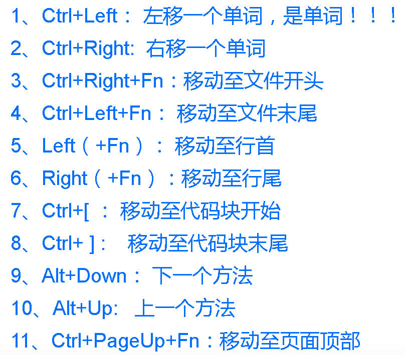

# 一、阅读源码

```
文件结构树、左侧文件夹隐藏、Terminal、最近文件、切换、格式化代码、注释、包裹代码、跳转历史光标
复制/删除行、快速选择、切换方法、上下文信息、快速文档、所选表达式的类型
项目结构、
```

快捷键：[IDEA常用快捷键汇总+快速编写常用代码 ](https://www.zhihu.com/tardis/sogou/art/383905631)  [IDEA快捷键大全](https://jishuin.proginn.com/p/763bfbd6869a)  [IDEA快捷键](https://blog.51cto.com/u_15368284/5117372)  [快捷键](https://blog.csdn.net/weixin_45433031/article/details/106166961)

[IDEA使用技巧](http://www.bjpowernode.com/idea/1524.html)  [“快速”功能](https://zhuanlan.zhihu.com/p/632373978)

[使用方法时自动显示参数提示](https://blog.csdn.net/Thinkingcao/article/details/85989040/)  [IDEA抽取常量到(2019.3版本)](https://blog.csdn.net/baixf/article/details/106682384) 

工具： [sourcegraph](https://www.bilibili.com/video/BV13Z4y1x73K/?spm_id_from=333.788.recommend_more_video.-1&vd_source=7346303e5e18677d7261c2c0c109ecfd) [Source Insight](https://www.bilibili.com/video/BV1nK4y1r7fN/?spm_id_from=333.788.recommend_more_video.0&vd_source=7346303e5e18677d7261c2c0c109ecfd) [源代码分析Understand](https://www.cnblogs.com/westfly/archive/2011/09/01/2162183.html) [一键生成源码导向图](https://www.bilibili.com/video/BV1rQ4y1L7iV/?spm_id_from=333.1007.tianma.1-3-3.click&vd_source=7346303e5e18677d7261c2c0c109ecfd)

Editor/General/Postfix Completion 代码补全

| keymap                          | 介绍                                                         |
| :------------------------------ | :----------------------------------------------------------- |
| Ctrl + P                        | parameter info (使用方法时自动显示参数提示)                  |
| Ctrl + alt +p                   | introduce parameter 引入参数，选中的内容设置为方法的参数     |
| ==Ctrl + shift +p==             | ==type info，仅显示所选表达式的类型==                        |
| Ctrl + Q  alt+but2 click        | Quick  Documentation 快速文档                                |
| Alt + Q                         | Context   Info (上下文信息)                                  |
|                                 |                                                              |
| ^+b ^+but1 click  Button2 click | Declaration or Usages                                        |
| ^+sh+B  ^+sh+but1 click         | type declaration                                             |
| ^+alt+b  ^+alt+but1 click       | Implementation   在接口方法上按，会显示所有实现方法          |
| ^+u                             | super method                                                 |
| Ctrl + sh +I                    | Quick  Definition ,打开任何类型（类、接口、记录、枚举等）的定义 |
|                                 |                                                              |
| ctrl+I                          | 实现方法，在接口的实现类上按,添加实现方法                    |
| ctrl+空格                       | Basic,自动提示，和输入法冲突，改为alt+x                      |
| alt+/                           | cycle expand word  循环                                      |
| Ctrl + Shift + 左右方向键       | move caret to previous word with selection                   |
| Ctrl + Alt + 左右方向键         | 跳转历史光标所在处                                           |
| Ctrl + Shift + 上下方向键       | 代码向上/下                                                  |
| Ctrl+Shift+Backspace            | 返回上次编辑位置                                             |
| Next Edit Location              | 返回后一次编辑位置                                           |
| Ctrl + H                        | Type Hierarchy(类的层级关系)，子类和父类之间的关系           |
| Ctrl + ALT + H                  |                                                              |
|                                 |                                                              |
| Alt  + sh +7                    | Find  Usages （查看当前变量，方法的使用，看哪里调用了）      |
| Ctrl + Alt  + 7                 | Show    Usages                                               |
| Ctrl  + 7                       | Find Usages in   File                                        |
| Ctrl + Alt +U                   | 打开类图 （类 鼠标右击，diagrams）                           |
| Ctrl + NumPad +     -           | Expand    Collapse                                           |
| Ctrl +Shift + NumPad  +     -   | Expand All                                                   |
| Ctrl + Alt + NumPad +     -     | Expand    Recursively 递归、循环                             |
| ctrl +sh + NumPad * ,1-5        | Expand   All  to level                                       |
| ctrl + 句号                     | Fold  selection （折叠选择）                                 |

## 1、编辑相关

| keymap                    | 介绍                                            |
| :------------------------ | :---------------------------------------------- |
| Ctrl + W                  | Extend selection（快速选中）                    |
| ==alt +j==                | 选中多个相同变量                                |
| Alt + 上下方向键          | Previous  Method(方法快速跳转)                  |
| Alt + 左右方向键          | 切换tab标签                                     |
| Ctrl + sh + Enter         | complete current statement                      |
| Ctrl + Alt + Enter        | 当前行之前插入一行                              |
| Shift + Enter             | 当前行之后插入一行，新行                        |
| ctrl + enter              | 分隔行                                          |
| Alt + Enter               | 万能键，导包，生成变量等                        |
| Ctrl+Y                    | delete     line                                 |
| Ctrl + D                  | Duplicate  line                                 |
|                           |                                                 |
| Ctrl + G                  | 跳转指定行号                                    |
| Shift + F6                | Rename                                          |
| Alt+鼠标选择              | 列选择                                          |
| Ctrl+Alt+T                | 自动包裹代码，加括号等，快捷代码块 try catch 等 |
| Ctrl + 空格               | 代码自动补全提示                                |
| ctrl+/  或   ctrl+shift+/ | 单行（多行）注释                                |
| shift +alt +L             | Reformat   Code(格式化代码)                     |

快捷代码(live Templates)： [idea快速生成代码](https://www.jb51.net/article/234119.htm)   [IDEA输入结构代码](https://jingyan.baidu.com/article/c14654134da2dc4afdfc4c72.html) [自定义快捷键输出想要的语句](https://www.lmlphp.com/user/58708/article/item/2354790/)  [自定义创建想要输出的语句的快捷键](https://blog.csdn.net/weixin_40740272/article/details/109752455?spm=1001.2101.3001.6661.1&utm_medium=distribute.pc_relevant_t0.none-task-blog-2~default~CTRLIST~default-1-109752455-blog-84306032.pc_relevant_multi_platform_whitelistv2&depth_1-utm_source=distribute.pc_relevant_t0.none-task-blog-2~default~CTRLIST~default-1-109752455-blog-84306032.pc_relevant_multi_platform_whitelistv2&utm_relevant_index=1)  [ idea的快捷代码](https://blog.csdn.net/qq_40772429/article/details/119413329)  [idea快捷代码块 ](https://zhuanlan.zhihu.com/p/470934625)   [使用idea快速抽取方法](https://blog.51cto.com/topic/shiyongideakuaisushurudaimadefangfa.html)

[IDEA一键生成代码](https://www.bilibili.com/read/cv14044396/)  [easycode快速生成代码](http://t.zoukankan.com/zwh0910-p-15660551.html)  [快速创建 Vue 项目](https://www.shuzhiduo.com/A/q4zVKnK2JK/)

| 代码         | 介绍                                                         |
| :----------- | :----------------------------------------------------------- |
| fori         | for循环                                                      |
| Alt + lnsert | Generate(添加快捷键)，代码自动生成，如生成对象的 set / get 方法，构造函数，toString() 等 |

## 2、查找

| keymap            | 介绍                           |
| :---------------- | :----------------------------- |
| Shift + Ctrl + F  | Find    In   Path              |
| Shift + Shift     | 快速查找                       |
| Ctrl + Alt + X, F | Find  by Xpath (按 x松开，按f) |

## 3、工具显示

| keymap                  | 介绍                                  |
| :---------------------- | :------------------------------------ |
| ctrl  + F12             | File   Structrue (文件结构树)         |
| Alt + 1                 | project (左侧文件夹隐藏)              |
| Alt + 3                 | Find                                  |
| Alt + 7                 | Structrue (文件结构树)                |
| Alt + F12               | Terminal                              |
| Ctrl + E     Ctrl + Tab | 最近文件                              |
| Ctrl + 反引号           | Quick Switch  Scheme (切换快捷键映射) |

## 4、图标

[Icon reference](https://www.jetbrains.com/help/idea/2019.3/symbols.html) [IDEA图标含义](https://blog.csdn.net/song_6666/article/details/125418288) [图标](https://blog.csdn.net/hu_belif/article/details/82688884) [图标含义](https://blog.51cto.com/u_15127548/4543793)

## 5、光标操作

[光标操作](https://blog.csdn.net/weixin_53676834/article/details/135175911)  

|  |  |
| ------------------------------------------------------------ | ----- |


# 二、技巧

[Intellij IDEA技巧](https://cloud.tencent.com/developer/article/1185483)  [光标不定位到行尾](https://zhuanlan.zhihu.com/p/652476687) [调试技巧](https://zhuanlan.zhihu.com/p/571730492?utm_id=0) [调试](https://www.cnblogs.com/LaoYuanStudyPython/p/12949627.html)  [技巧](https://zhuanlan.zhihu.com/p/259542483)

Inject language;   Smart Step Into

[Idea关闭或开启引用提示Usages和Annotations](http://wed.xjx100.cn/news/136241.html?action=onClick)

书签：做的改动，过了几天，忘记在哪里改过

> F11：匿名书签可以生成无数个；
>
> Shift+F11：打开书签列表；
>
> Ctrl+F11：标记书签，可以用数字或字母标记书签，总共只能生成 10 个数字以及 26 个字母的标记书签。使用数字标记的标签，可以使用 Ctrl + 数字键 跳转到相应标签。
>
> 收藏夹（Alt+2）里面也能看到书签信息

[软件测试管理神器之JIRA-windows环境部署](https://zhuanlan.zhihu.com/p/618416265?utm_id=0) [高级用法](https://www.cnblogs.com/yepei/p/6248128.html)

[IDEA lambda生成模板](https://blog.csdn.net/xianghanscce/article/details/125000608) [Live Template](https://blog.51cto.com/u_16099239/6555905)

## HTML快速输入

[HTML代码快捷输入](https://blog.csdn.net/m0_62544574/article/details/121604556)   [ html快捷](https://blog.csdn.net/asacmxjc/article/details/125432841?utm_medium=distribute.pc_relevant.none-task-blog-2~default~baidujs_baidulandingword~default-0-125432841-blog-121604556.pc_relevant_multi_platform_whitelistv1_exp2&spm=1001.2101.3001.4242.1&utm_relevant_index=3)   [JS缩写快速输入](https://blog.csdn.net/qq_44199674/article/details/106179462)

### 1. 快捷输入注意事项

> 1.输入完代码按Tab。
>
> 2.光标一定要定在代码的最后才会生效。
>
> 3.标签名后加中括号 [ ] 是输入属性值，加大括号 { } 是输入文本。

### 2. 代码格式

> 1. 父子关系 >  ：标签名>标签名+tab(生成代码)： div>ul>li>a
> 2. 兄弟 + ： 标签名+标签名+tab  ：div+p+div+p
> 3. ^ 生成父元素： div+div>p>span+em^bq
> 4. 乘法关系 * ：标签名*需要的个数+tab ：div * 5
> 5. () 给元素分组：div>(header>u)+footer           //+ 后面的元素，与括号中的第一个元素属于兄弟关系
> 6. 给标签加类名： a、 标签名.class类名+tab ： div.class      b、div#id
> 7. 组合代码： div.y>ul>li*5>a[href="#"]{$}
> 8. $ 自动编号：改起始值：li.item$@3*3  ；改编号方向： $后面加@- ：`li.item$@-3*3`

`输入：! 或者 html:5 或者 html:4s 或者 html:4t 自动补全html基本结构`

