# 9、JUC并发编程(小结)

[JUC并发编程学习笔记](https://www.kuangstudy.com/bbs/1640650143068217345) [JUC并发编程](https://www.kuangstudy.com/bbs/1481890953970561026)

视频： [JUC并发编程视频](https://www.bilibili.com/video/BV1B7411L7tE/?vd_source=7346303e5e18677d7261c2c0c109ecfd)      [JUC概述](https://www.jianshu.com/p/e924b859f2a5)  [JUC基础知识](https://blog.csdn.net/weixin_46141936/article/details/123287451) 

[JUC指南](https://zhuanlan.zhihu.com/p/609191930) [JUC详解](https://blog.csdn.net/weixin_53379153/article/details/130980148) [Stream 流式计算](https://blog.csdn.net/qq_43341842/article/details/119899966)

JUC并发包： [14个JUC并发容器](https://baijiahao.baidu.com/s?id=1695738158976780723&wfr=spider&for=pc) [Java 并发工具包（concurrent）](https://blog.csdn.net/zcm036200/article/details/120297445) [concurrent包](https://www.cnblogs.com/xgss/articles/16537095.html) [Concurrent包](https://www.cnblogs.com/chuijingjing/p/10072912.html)

==小结：==

1. 线程同步问题：==java.util.concurrent.locks== ：3个接口
   1. `Condition ：精准的通知和唤醒线程`
   2. Lock ：锁
      1. 实现类有：ReentrantLock；  ReentrantReadWriteLock.ReadLock 可重入的读锁，还有个写锁
   3. ReadWriteLock :读写锁
2. 通信问题： ==生产者消费者问题==：传统的synchronized锁用： wait()、notify()
   1. juc版的： `Lock`替换`synchronized`方法和语句的使用，  `Condition`取代了对象监视器方法的使用(JDK原话)； 以前用Object对象：wait()，notify()； 现在用Condition对象: await()、通知用signal()
   2. 锁 -> 业务(判断->执行->通知) -> 解锁
   3. ==狂神学习方法==：1、先会用； 2、货比三家，寻找其它解决方案  3、分析源码
3. ==读写锁==ReadWriteLock   
   1. ==比ReentrantLock更细粒度的Lock锁==
   2. ==读可以被多线程同时读，写只能有1个线程去写==
4. ==阻塞队列==
   1. 阻塞队列里有个同步队列SynchronousQueue：  没有容量，进去一个元素，必须等待取出来之后，才能再放进去一个；  ==消息队列里大量使用==
5. ==线程池==
   1. 3大方法，7大参数,4种拒绝策略

> 1. juc：java.util.concurrent包， 位于jdk的rt.jar中，是jdk的核心工具包之一。从字面上来理解就是java并发工具包
>    1. `Java 5` 以后新增的一组并发编程工具包，提供了一系列高效、线程安全的并发集合，方便在多线程环境下处理共享数据
>    1. ==四个包==：java.util.concurrent、 concurrent.atomic原子性、concurrent.locks、 function函数式包
> 2. java默认2个线程： main、GC
> 3. 并发：多线程操作同一个资源，并发本质是为了充分利用cpu资源(1核)；  并行：多个人一起行走(多核)
> 4. 线程状态：枚举类；state； 超时等待：例如：只等1天，超过就不等
> 5. wait/sleep区别
>    1. TimeUnit.DAYS.sleep(1) 休眠1天

| 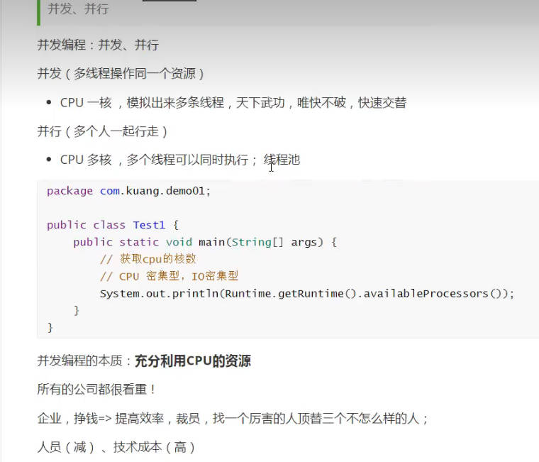 | 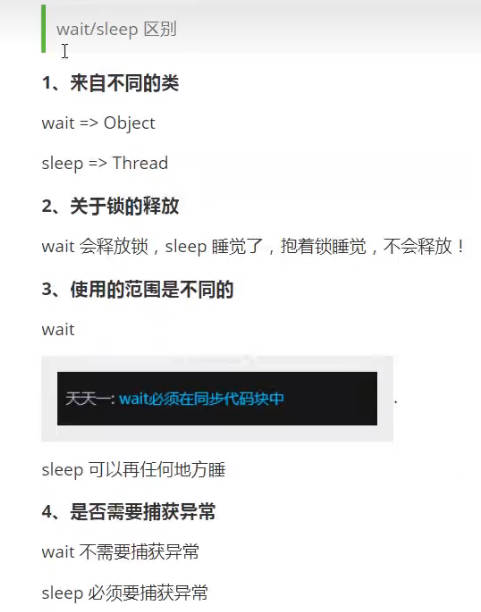 |
| ---------------------------------------------------------- | ---------------------------------------------------------- |

## 1、==lock==

==线程就是一个单独的资源类==,没有任何附属的操作! 以前的实现线程接口方法，再new一个对象，以后不要用了,耦合太高，

- 用这种方法==解耦==：`Ticket ticket=new Ticket();   new Thread(()->{ticket.sale()})`
- 一个业务类，new一个对象，方法引用到Runnable接口

java.util.concurrent.locks ==3个接口,有各自的实现类== -> Condition、  Lock、  ReadWriteLock

- Lock锁的实现类：`java.util.concurrent.locks.ReentrantLock `

### 1、传统的synchronized锁

==传统的synchronized锁==:  synchronized==锁对象和Class==

```java
package JUCDemo;

//传统的线程开发
//public class Demo {
//    public static void main(String[] args) {
//        new Thread(new MyThread()).start();
//    }
//}
//
//class MyThread implements Runnable {
//    @Override
//    public void run() {
//
//    }
//}

/*
 * 真正的多线程开发,公司中的开发,降低耦合型
 * 线程就是一个单独的资源类,没有任何附属的操作!
 * 线程资源类里包含： 属性  方法
 * */
public class TicketSale {
    //单线程时没问题，多线程会有问题
    public static void main(String[] args) {
        //并发:多线程(3个线程)操作同一个资源类,把资源丢入线程
        Ticket ticket = new Ticket();

        //@FunctionalInterface 函数式接口,jkd1.8 lambda 表达式(参数)->{代码}
        //3个线程同时卖票
        new Thread(() -> {
            for (int i = 0; i < 10; i++) {
                ticket.sale();
            }
        }, "A").start();
        new Thread(() -> {
            for (int i = 0; i < 10; i++) {
                ticket.sale();
            }
        }, "B").start();
        new Thread(() -> {
            for (int i = 0; i < 5; i++) {
                ticket.sale();
            }
        }, "C").start();
        new Thread(ticket::sale, "D").start();
    }
}

//线程资源类  OOP
class Ticket {
    //属性  方法
    private int number = 30;

    //卖票的方式: 加了synchronized锁
    public synchronized void sale() {
        if (number > 0) {
            System.out.println(Thread.currentThread().getName() + "卖出了" + (number--) + "票,剩余" + number);
        }
    }
}
```

| 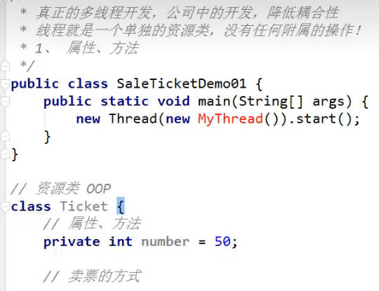 | 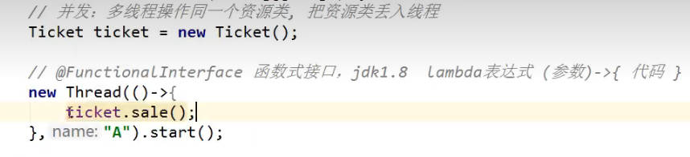 |
| ------------------------------------------------------------ | ------------------------------------------------------------ |

### 2、==Lock（公平锁）==

- Lock默认非公平锁:==可以插队==(无参构造方法默认为非公平锁)
- 公平锁:十分公平，先来后到(有参构造方法传值true时为公平锁),==一定要排队==
- 源码里：ReentrantLock(boolean fair)， 传入true是公平锁

补充知识：for循环只有一句时可简化掉{}: for (int i=1;i<10;i++){ticket.sale()} ;  `for (int i=1;i<10;i++)ticket.sale();`

```java
/* 并发JUC,用lock锁的实现类ReentrantLock
* lock三部曲
* 1.new ReentrantLock() //new一个锁出来
* 2.lock.lock();//加锁
* 3.finally-> lock.unlock() //解锁
* */
class  Ticket2{
    //属性  方法
    private int number = 30;
    //卖票的方式
    Lock lock = new ReentrantLock(); //new一个锁出来
    public  void sale(){
        lock.lock();//加锁
        try {
            //业务代码
            if (number>0){
                System.out.println(Thread.currentThread().getName()+"卖出了"+(number--)+"票,剩余"+number);
            }
        } catch (Exception e) {
            e.printStackTrace();
        } finally {
            lock.unlock();//解锁
        }
    }

```

### 3、synchronized和Lock区别

## 2、生产者消费者

[JUC并发编程学习笔记](https://www.kuangstudy.com/bbs/1640650143068217345)

- synchronized锁和lock锁区别
  - synchronized线程1获得线程2要的锁，线程2只会傻傻的等； lock就不一定会等下去，lock.trylock()尝试获取锁
- 什么是锁，如何判断锁的是谁？

==传统的synchronized锁用： wait()、notify()==; 代码逻辑是： 判断是否等待-> 业务 -> 通知

Juc版的用Lock解决线程通信问题

juc的生产者消费者：

1. `线程之间的通信问题:生产者和消费者问题 等待唤醒 ,通知唤醒`
2. `线程交替执行  A B线程操作同一个变量  num = 0;A+1，B-1，线程之间如果没有通信是做不到的`

| 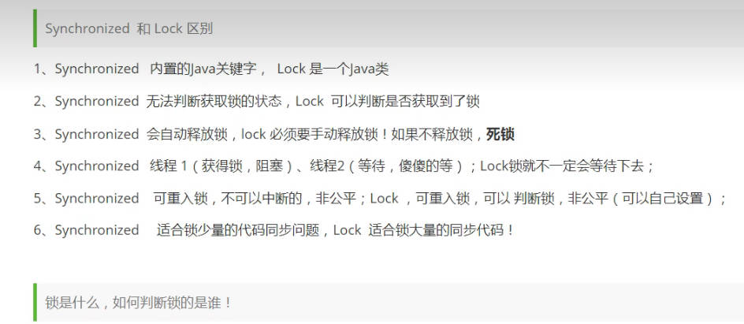 | 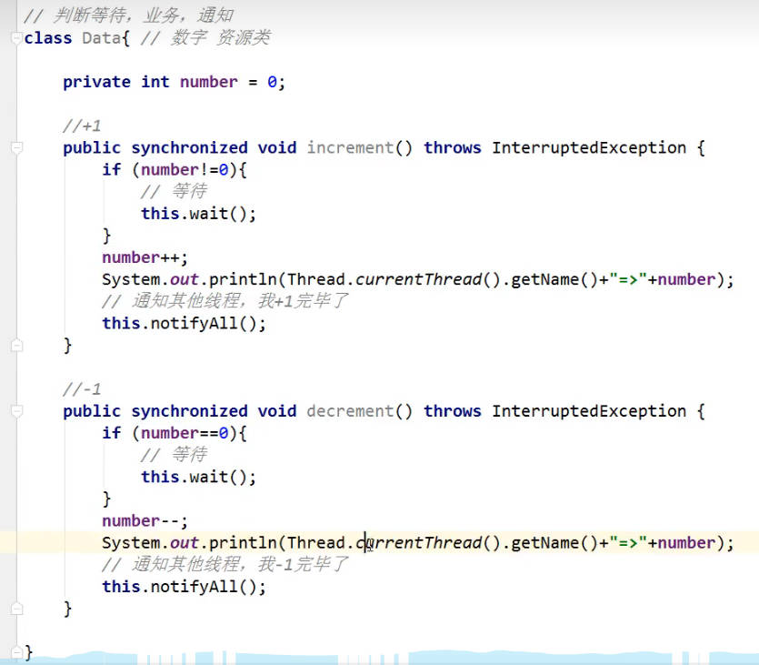 |
| ------------------------------------------------------------ | ---------------------------------------------------------- |
| 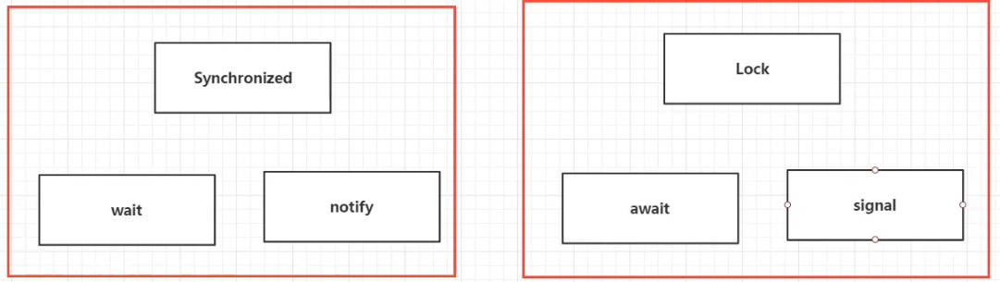 | 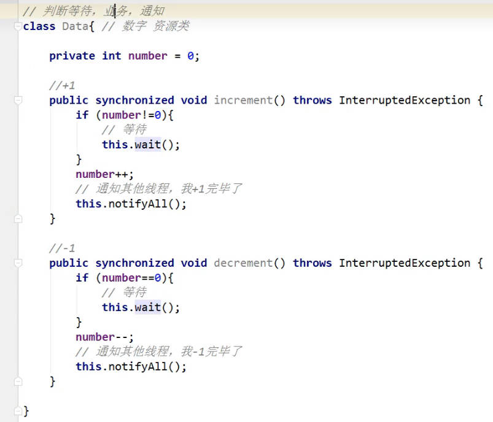 |
| 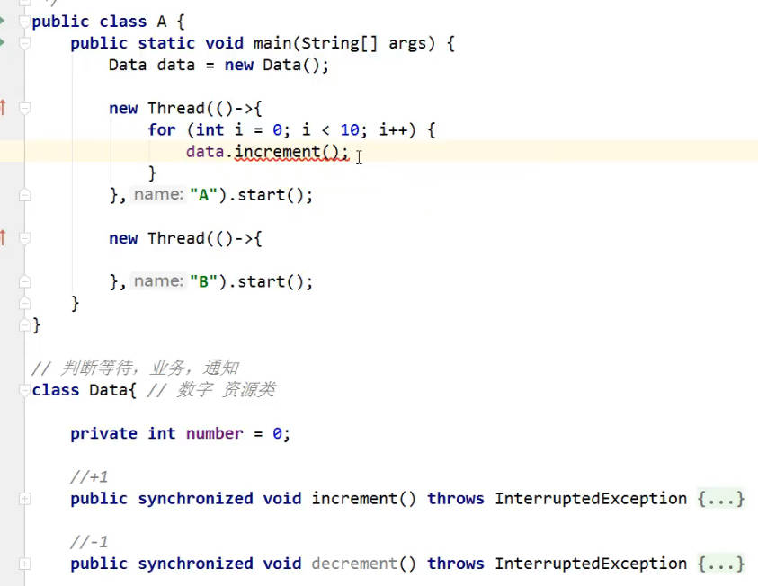 | 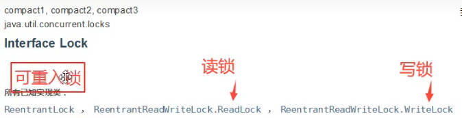 |

### ==a、传统的生产者消费者问题==

wait()、notify()

==虚假唤醒： 2个线程时正常，如果abcd4个线程就有问题；if只判断一次，改成while就没事了==

- 加1，减1逻辑：不等0时，减1线程运行；等0时，加1线程运行;
  - AB2个线程没事，如果是ABCD四个线程就会出问题：虚假唤醒，解决用while替换掉if   
  - AC+1, BD-1,两个加两个减
- 面试必问：单例模式、排序算法、生产者消费者、死锁

```java
/* *
* 线程之间的通信问题:生产者和消费者问题 等待唤醒 ,通知唤醒
* 线程交替执行  A  B  操作同一个变量  num = 0;
* A num+1
* B num-1
* */
public class Increment1_1 {
    public static void main(String[] args) {
        Data data = new Data();
        //2个线程，A+1，B-1
        new Thread(()->{
            for (int i = 0; i < 10; i++) {
                try {
                    data.increment();
                } catch (InterruptedException e) {
                    e.printStackTrace();
                }
            }
        },"A").start();
        new Thread(()->{
            for (int i = 0; i < 10; i++) {
                try {
                    data.decrement();
                } catch (InterruptedException e) {
                    e.printStackTrace();
                }
            }
        },"B").start();
    }
}
//等待 业务 通知
class Data{//数字  资源类
    private  int number = 0;
    public  synchronized void increment() throws InterruptedException {
        if (number != 0) { //用if会虚假唤醒，改成while
            //等待
            this.wait();
        }
        number++;
        //通知其他线程,我+1完毕了
        System.out.println(Thread.currentThread().getName()+"-->"+number);
        this.notifyAll();
    }
    public synchronized void decrement() throws InterruptedException {
        if (number == 0) { //用if会虚假唤醒，改成while
            this.wait();
        }
        number--;
        System.out.println(Thread.currentThread().getName()+"-->"+number);
        this.notifyAll();
    }
}
```

### ==b、Lock版的生产者消费者问题==

[锁和监视器之间的区别](https://www.cnblogs.com/keeplearnning/p/7020287.html)

==await、通知用signal==

就是juc版的： `Lock`替换`synchronized`方法和语句的使用，  `Condition`取代了对象监视器方法的使用(JDK原话)； 以前用Object对象：wait()，notify()； 现在用Condition对象: await()、通知用signal()

- synchronized替换成Lock
- wait()，notify()替换成await、通知用signal

`Condition 精准的通知和唤醒线程，有序执行：A执行完通知B执行，B执行完执行C,C执行完调用A; 一个监视器只监视一个`

==Condition 精准的通知和唤醒线程，有序执行==: 例如生产线：下单-> 支付-> 交易-> 物流

|  | 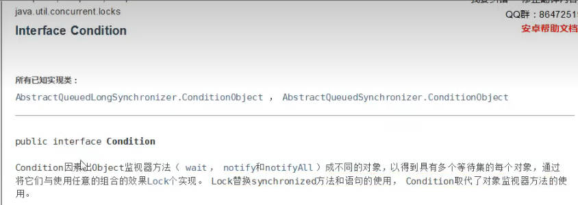 |
| ---------------------------------------------------------- | ---------------------------------------------------------- |
| 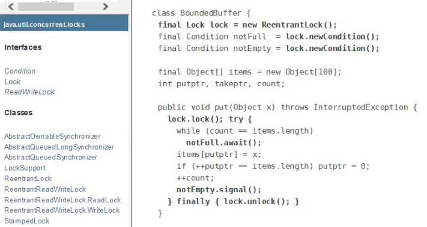 | 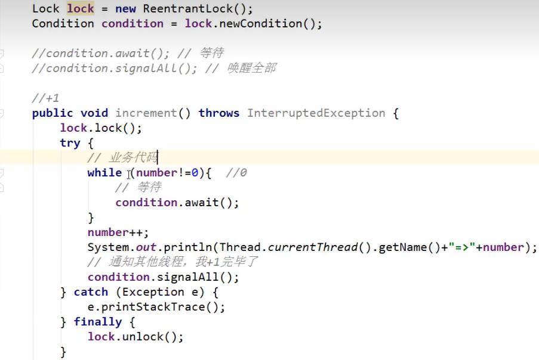 |

```java
//等待 业务 通知
class Data2 {//数字  资源类
    private int number = 0;

    Lock lock = new ReentrantLock(); //锁
    Condition condition = lock.newCondition();//同步监视器

//    condition.await();//等待
//    condition.signalAll();//唤醒全部
    public void increment() throws InterruptedException {
        lock.lock();
        try {
            //业务代码
            while (number != 0) {
                //等待
                condition.await();
            }
            number++;
            //通知其他线程,我+1完毕了
            System.out.println(Thread.currentThread().getName() + "-->" + number);
            condition.signalAll();
        } catch (InterruptedException e) {
            e.printStackTrace();
        } finally {
            lock.unlock();
        }
    }
    public void decrement() throws InterruptedException {
        lock.lock();
        try {
            while (number == 0) {
                condition.await();
            }
            number--;
            System.out.println(Thread.currentThread().getName() + "-->" + number);
            condition.signalAll();
        } catch (Exception e) {
            e.printStackTrace();
        } finally {
            lock.unlock();
        }
    }
}
```

`Condition 精准的通知和唤醒线程，有序执行：A执行完通知B执行，B执行完执行C,C执行完调用A; 一个监视器只监视一个`

#### 1、Condition 精准的排序线程执行

==Condition 精准的通知和唤醒线程，有序执行==: 例如生产线：下单-> 支付-> 交易-> 物流

`生产者消费者代码怎么写`：锁 -> 业务(判断->执行->通知) -> 解锁

```JAVA
import java.util.concurrent.locks.Condition;
import java.util.concurrent.locks.Lock;
import java.util.concurrent.locks.ReentrantLock;
public class ConditionTest {
    public static void main(String[] args) {
        Data3 data = new Data3();
        new Thread(() -> {
            for (int i = 0; i < 10; i++) {
                data.printA();
            }
        }, "A").start();
        new Thread(() -> {
            for (int i = 0; i < 10; i++) {
                data.printB();
            }
        }, "B").start();
        new Thread(() -> {
            for (int i = 0; i < 10; i++) {
                data.printC();
            }
        }, "C").start();
    }
}
class Data3 {// 资源类 Lock
    private Lock lock = new ReentrantLock();
    private Condition condition1 = lock.newCondition();  //Condition同步监视器可以一次只监视一个
    private Condition condition2 = lock.newCondition();
    private Condition condition3 = lock.newCondition();
    private int number = 1;
    public void printA() {
        //锁 -> 业务(判断->执行->通知) -> 解锁
        lock.lock();
        try {
            //业务,判断->执行->通知
            while (number != 1) {
                //等待
                condition1.await();
            }
            System.out.println(Thread.currentThread().getName() + "--->AAAAAAAAA");
            //唤醒指定的人:B
            number = 2;
            condition2.signal();
        } catch (Exception e) {
            e.printStackTrace();
        } finally {
            lock.unlock();
        }
    }
    public void printB() {
        lock.lock();
        try {
            //业务,判断->执行->通知
            while (number != 2) {
                //等待
                condition2.await();
            }
            System.out.println(Thread.currentThread().getName() + "--->BBBBBBBBB");
            //唤醒指定的人:C
            number = 3;
            condition3.signal();
        } catch (Exception e) {
            e.printStackTrace();
        } finally {
            lock.unlock();
        }
    }
    public void printC() {
        lock.lock();
        try {
            //业务,判断->执行->通知
            while (number!=3){
                //等待
                condition3.await();
            }
            System.out.println(Thread.currentThread().getName()+"--->CCCCCCCCCCC");
            number=1;
            condition1.signal();
        } catch (Exception e) {
            e.printStackTrace();
        } finally {
            lock.unlock();
        }
    }
}
```


## 3、关于锁的八个问题

- `锁的对象是方法的调用者`
- 普通方法没有锁，不受锁的影响
- `两个对象,两个调用者,两把锁!`

8锁现象： 如何判断锁的是谁！  永远的知道什么是锁，锁到底锁的是谁！

- ==锁只会锁2个东西==，一个是new出来的对象，第2个，对象是class模板new出来的，所以还会锁1个class模板
- synchronized ==锁的对象是方法的调用者==, 两个方法是同一个锁,谁先拿到谁先执行

补充知识：public enum TimeUnit {NANOSECONDS {}},这种写法什么意思，参考 [Java中的枚举类](https://www.cnblogs.com/1995stone/p/13623309.html)

- 枚举类的每个变量名都可看作： public static final 类名 变量名 = new 类名();因此用类名.变量名就可以得到一个类的对象, 如：`public static final TestNume A = new TestNume();`

==锁的8个问题==

1. 两个线程先执行发短信还是打电话
   1. synchronized 锁的对象是==方法的调用者==,调用者是Phone；  ==谁先拿到谁先执行==

```java
package com.cc.juc;
import java.util.concurrent.TimeUnit;
/*
 * 问题1.标准情况下，两个线程先打印发短信还是打电话?1.发短信﹑2.打电话
 * 问题2.sendSms延迟4秒,两个线程先打印发短信还是 打电话?1.发短信 2.打电话
 * */
public class PhoneDemo1 {
    public static void main(String[] args) throws InterruptedException {
        Phone1 phone1 = new Phone1();
        //不是说发短信先调用，是因为锁的存在
        new Thread(()->{
            phone1.sendSms();
        },"A").start();
        TimeUnit.SECONDS.sleep(1); //暂停1s
        new Thread(()->{
            phone1.call();
        },"B").start();
    }
}
class Phone1{
    //解答问题1： synchronized 锁的对象是方法的调用者,调用者是Phone
    //两个方法是同一个锁,谁先拿到谁先执行
    public synchronized void sendSms(){
        try {
            TimeUnit.SECONDS.sleep(4);//暂停4s
        } catch (InterruptedException e) {
            e.printStackTrace();
        }
        System.out.println("发短信");
    }
    public synchronized void call(){
        System.out.println("打电话");
    }
}
```

==问题3： 线程资源类里添加一个普通方法，普通方法没有锁，不受锁的影响；所以先执行==

==问题4：两个同步对象,两个调用者,两把锁!拿的锁不一样，所以按时间执行==

```java
package com.cc.juc;
import java.util.concurrent.TimeUnit;
/*
 * 问题3.增加了一个普通方法,先发短信还是Hello: hello  sendSms
 * 问题4.两个对象,两个同步方法,先发短信还是先打电话: call sendSms
 * */
public class PhoneDemo2 {
    public static void main(String[] args) throws InterruptedException {
        //两个对象,两个调用者,两把锁!
        Phone2 phone1 = new Phone2();
        Phone2 phone2 = new Phone2();
        //锁的存在
        new Thread(()->{
            phone1.sendSms();
        },"A").start();
        TimeUnit.SECONDS.sleep(1);
        new Thread(()->{
            phone2.call();
        },"B").start();
        new Thread(()->{
            phone2.hello();
        },"C").start();
    }
}
class Phone2{
    //synchronized 锁的对象是方法的调用者
    //两个方法是同一个锁,谁先拿到谁先执行
    public synchronized void sendSms(){
        try {
            TimeUnit.SECONDS.sleep(4);
        } catch (InterruptedException e) {
            e.printStackTrace();
        }
        System.out.println("发短信");
    }
    public synchronized void call(){
        System.out.println("打电话");
    }
    //普通方法： 这里没有锁,不是同步方法,不受锁的影响
    public void hello(){
        System.out.println("hello");
    }
}
```

==问题5： 增加2个静态的同步方法： 类一加载就有了!锁的是Class 模板, 用的还是同一把锁；  Class对象全局唯一；== 

```java
package com.cc.juc;
import java.util.concurrent.TimeUnit;
/*
 * 5.增加两个静态的同步方法,只有一个对象,先打印 发短信还是打电话
 * 6.两个对象!增加两个静态的同步方法, 先打印 发短信还是打电话
 * */
public class PhoneDemo3 {
    public static void main(String[] args) throws InterruptedException {
        //两个对象的Class类模板只有一个,static,锁的是Class
        Phone3 phone1 = new Phone3();
        Phone3 phone2 = new Phone3();
        //锁的存在
        new Thread(()->{
            phone1.sendSms();
        },"A").start();
        TimeUnit.SECONDS.sleep(1);
        new Thread(()->{
            phone2.call();
        },"B").start();
    }
}
//Phone唯一的一个Class对象
class Phone3{
    //synchronized 锁的对象是方法的调用者
    //static 静态方法
    //类一加载就有了!锁的是Class
    public static synchronized void sendSms(){
        try {
            TimeUnit.SECONDS.sleep(4);
        } catch (InterruptedException e) {
            e.printStackTrace();
        }
        System.out.println("发短信");
    }
    public static synchronized void call(){
        System.out.println("打电话");
    }
}
```

==问题6： 1个静态的同步方法,1个普通的同步方法，1个对象==

- 静态的同步方法锁的是class类模板， 普通的同步方法，锁的是调用者，用的不是同一把锁，2把锁

==问题7： 1个静态的同步方法,1个普通的同步方法，2个对象==

- 同上，静态的同步方法锁的是class类模板

```java
package com.cc.juc;
import java.util.concurrent.TimeUnit;
/*
 * 7.1个静态的同步方法,1个普通的同步方法,1个对象,先打印谁： 打电话
 * 8.1个静态的同步方法,1个普通的同步方法,2个对象,先打印谁： 打电话
 * */
public class PhoneDemo4 {
    public static void main(String[] args) throws InterruptedException {
        //两个对象的Class类模板只有一个,static,锁的是Class
        Phone4 phone1 = new Phone4();
        Phone4 phone2 = new Phone4();
        //锁的存在
        new Thread(() -> {
            phone1.sendSms();
        }, "A").start();
        TimeUnit.SECONDS.sleep(1);
        new Thread(() -> {
            phone2.call();
        }, "B").start();
    }
}
//Phone唯一的一个Class对象
class Phone4 {
    //静态的同步方法  锁的是Class类模板
    public static synchronized void sendSms() {
        try {
            TimeUnit.SECONDS.sleep(4);
        } catch (InterruptedException e) {
            e.printStackTrace();
        }
        System.out.println("发短信");
    }
    //普通的同步方法   锁的调用者,不需要等上面释放锁
    public synchronized void call() {
        System.out.println("打电话");
    }
}
```

小结：锁的是2个东西，1个new出来的，1个是static；

- new this 具体的一个对象，1把锁；  2个对象，2把锁
- static Class 唯一的一个模板

## 4、==集合类不安全==

单线程永远安全，并发不安全；

1. List不安全

### 1、CopyOnWriteArrayList(写入时复制)

[写入时复制CopyOnWrite](https://blog.csdn.net/FromZeroJiYuan/article/details/121528307)  [有关 COW (CopyOnWrite) 的一切  ](https://zhuanlan.zhihu.com/p/475746296)  [读写分离思想_快速失败fail-fast、COW](https://www.cnblogs.com/goloving/p/15246441.html) [同步读写策略 COW](https://www.jianshu.com/p/89d2ca36567d)

- COW：写入时复制，CopyOnWrite； 计算机程序设计领域的一种优化策略
  - 资源是唯一的，写入时不能同时操作1个，后面写的会覆盖前面的，cow，写入时复制1份给调用者
  - 调用者要写入时，复制一份专用副本（private copy）给调用者，==在copy的数据上修改==； 而其他调用者所见到的最初的资源仍然保持不变； 修改完成之后改变原有数据的引用(指针)即可

并发下ArrayList不安全;

为什么用CopyOnWriteArrayList(用的lock)，不用vector：只要有synchronized，效率就会很低； 看vector源码

报错：`ConcurrentModificationException`并发修改异常

```java
//报错：`ConcurrentModificationException`并发修改异常
//并发下ArrayList不安全
public class ListTest {
    public static void main(String[] args) {
        List<String> list = new ArrayList<>();
        for (int i = 0; i < 10; i++) {
            new Thread(() -> {
                list.add(UUID.randomUUID().toString().substring(0, 5));
                System.out.println(list);
            }, String.valueOf(i)).start();
        }
    }
}

//新的遍历方法
public class ListTest {
    public static void main(String[] args) {
        List<String> list = Arrays.asList("1","2","3");
        list.forEach(System.out::println);
    }
}
```

==狂神学习方法==：1、先会用； 2、货比三家，寻找其它解决方案  3、分析源码

```java
package com.cc.juc.collection;
import java.util.*;
import java.util.concurrent.CopyOnWriteArrayList;
public class ListTest {
    public static void main(String[] args) {
        //并发下 ArrayLIst 不安全的 ,Synchronized
        /*
         * 解决方案:
         * 1. List<String> list = new Vector<>();
         * 2. List<String> list = Collections.synchronizedList(new ArrayList<>()); 转换为同步安全
         * 3. List<String> list = new CopyOnWriteArrayList<>();
         * */
        /*
         * CopyOnWrite 写入时复制 COW 计算机程序设计领域的一种优化策略
         * 多个线程调用的时候 , list , 读取的时候 , 固定的, 写入(覆盖)
         * 在写入的时候避免覆盖 , 造成数据问题!
         * 读写分离
        */
        List<String> list = new CopyOnWriteArrayList<>();
        for (int i = 0; i < 10; i++) {
            new Thread(() -> {
                list.add(UUID.randomUUID().toString().substring(0, 5));
                System.out.println(list);
            }, String.valueOf(i)).start();
        }
    }
}
```

### 2、CopyOnWriteArraySet

HashSet底层是HashMap

```java
/*
* 同理可证 :ConcurrentModificationException
* 1.Set<String> set = Collections.synchronizedSet(new HashSet<>());
* 2.Set<String> set =new CopyOnWriteArraySet<>();
* */
public class SetTest {
    public static void main(String[] args) {
        //Set<String> set = new HashSet<>();
        //Set<String> set = Collections.synchronizedSet(new HashSet<>());
        Set<String> set =new CopyOnWriteArraySet<>();
        for (int i = 0; i < 30; i++) {
            new Thread(()->{
                set.add(UUID.randomUUID().toString().substring(0,5));
                System.out.println(set);
            },String.valueOf(i)).start();
        }
    }
}
```

| 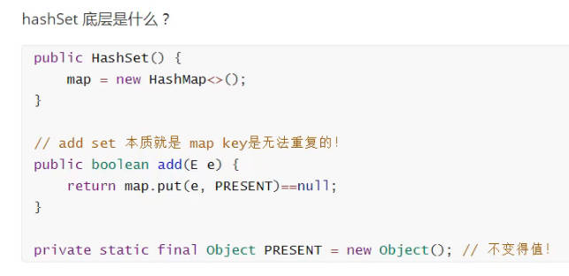 | 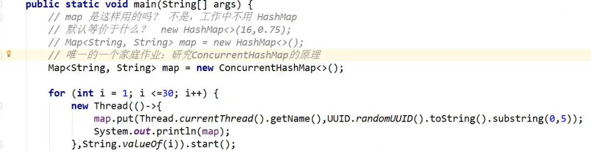 |
| ---------------------------------------------------------- | ---------------------------------------------------------- |

### 3、ConcurrentHashMap

`java.util.concurrent.ConcurrentHashMap`	HashMap

- HashMap 加载因子，初始化容量

## 5、Callable

`java.lang,  Interface Runnable`

- java.lang.Thread有参构造没有Callable, 需要把Callable和Runnable搭上关系
- Runnable有个实现类FetureTask，有方法``FutureTask(Callable<V> callable)` `，可以和Callable搭上关系
- 结果会被缓存，效率高

| 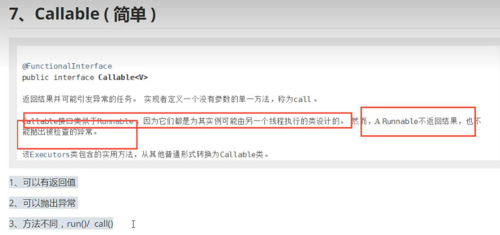 | 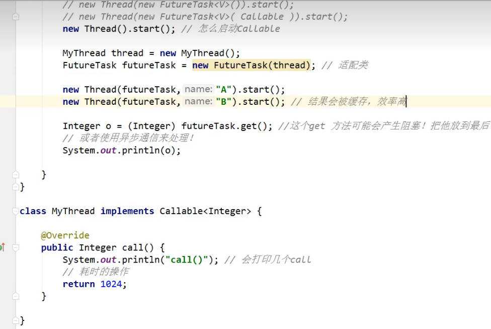 |
| ---------------------------------------------------------- | ---------------------------------------------------------- |
| 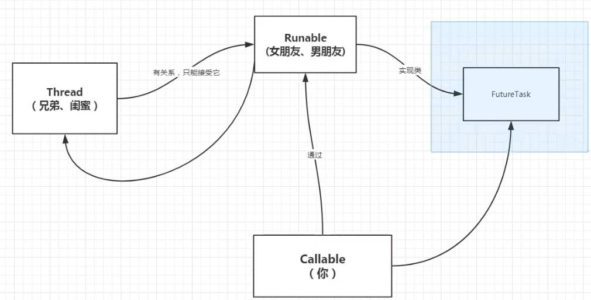 |                                                            |

```java
public class CallableTest {
    public static void main(String[] args) throws ExecutionException, InterruptedException {
        MyThread myThread = new MyThread();  //类型：Callable
        FutureTask task = new FutureTask(myThread); //适配类,类型：Runnable
        new Thread(task,"A").start();
        new Thread(task,"A").start(); //只执行1次，结果会被缓存，效率高
        callable返回的结果在FutureTask里面//callable返回的结果在FutureTask里面,get方法可能产生阻塞!把他放到最后或者使用异步通信来处理
        Integer o = (Integer)task.get();
        System.out.println(o);
    }
}
class MyThread implements Callable<Integer> {
    @Override
    public Integer call() {
        System.out.println("call()"); 
        return 1024;
    }
}
```

## 6、JUC常用辅助类

### 1、CountDownLatch(减法计数器)

`java.util.concurrent.CountDownLatch `

==减法计数器==: 例如：倒计时，6个线程执行完后，再执行其它操作

- 小结：`new CountDownLatch(6)  -> await()`

```java
//计数器
public class CountDownLatchDemo {
    public static void main(String[] args) throws InterruptedException {
        //总数是6,必须要执行任务的时候再使用
        //倒计时完，执行减1操作;  例如：6个人走完再关门
        CountDownLatch countDownLatch = new CountDownLatch(6);
        for (int i = 0; i < 6; i++) {
            new Thread(()->{
                //打印谁走了
                System.out.println(Thread.currentThread().getName()+" Go out");
                countDownLatch.countDown();  //countDown() 数量-1
            },String.valueOf(i)).start();
        }
        countDownLatch.await(); //等待计数器归零,然后再往下执行
        System.out.println("Close Door");
    }
}
```

|  |  |
| ---------------------------------------------------------- | ------------------------------------------------------------ |

### 2、CylicBarrier(加法计数器)

==加法计数器==，参数：1个计数，一个执行线程(Runnable)

- 例：集齐7颗龙珠，然后执行召唤神龙

### 3、Semaphore(信号量)

==信号量；==  相当于一个通行证；  Semaphore（），参数是线程数量

- 例如：抢车位，6个车，3个车位；3走了，4进来，轮流等待车位
- [`acquire()`](../../../java/util/concurrent/Semaphore.html#acquire--) 获取；  `release()` 释放
- 用来并发限流，控制最大的线程数，保证服务器的安全和高可用

```java
public class SemaphoreDemo {
    public static void main(String[] args) {
        //线程数量,停车位,限流
        Semaphore semaphore = new Semaphore(3);
        for (int i = 0; i < 6; i++) {
            new Thread(()->{
                try {
                    semaphore.acquire();//获得,假设如果满了,等待,等待被释放为止!
                    System.out.println(Thread.currentThread().getName()+"抢到车位");
                    TimeUnit.SECONDS.sleep(2);
                    System.out.println(Thread.currentThread().getName()+"离开车位");
                } catch (InterruptedException e) {
                    e.printStackTrace();
                } finally {
                    semaphore.release();//释放,会将当前的信号量释放+1,然后唤醒等待的线程!
                }
            },String.valueOf(i)).start();
        }
    }
}
```

## 7、读写锁ReadWriteLock

==小结：比ReentrantLock更细粒度的Lock锁==

1. 写锁（独占锁）
2. 读锁（共享锁）

`java.util.concurrent.locks `   Interface  ReadWriteLock; 

- ==读可以被多线程同时读，写只能有1个线程去写==
- 写时不用ReentrantLock锁，有个比它更细粒度的锁`ReentrantReadWriteLock` ,==也是Lock接口的实现类==

| 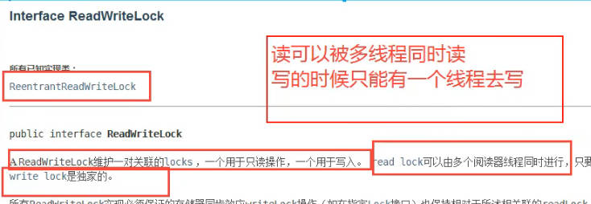 | 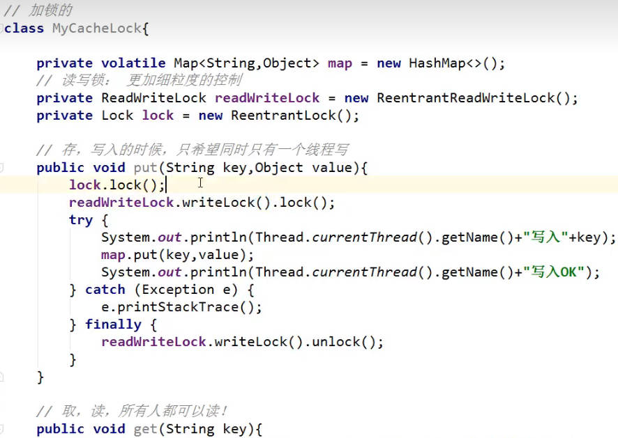 |
| ---------------------------------------------------------- | ---------------------------------------------------------- |
| 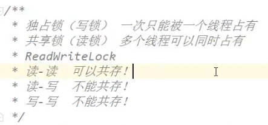 |                                                            |


## 8、==阻塞队列==

`java.util.concurrent ,  Interface BlockingDeque`

- BlockingQueue四组API: 用的是它们的实现类
- ArrayDeque ==双端队列，可以从两头取==
- AbstractQueue 非阻塞队列
- 阻塞队列不是新的东西，什么时候用？
  - 一般用在多线程和线程池中，A调用B，B没执行完，A就会等待


==阻塞队列有四组API==：

1. 抛出异常：add、remove
2. 有返回值，不抛出异常：offer、poll
3. 阻塞等待：put、take
4. 超时等待：offer、poll

peek()检测队首元素；  offer和poll有个重载方法，用来超时等待

| 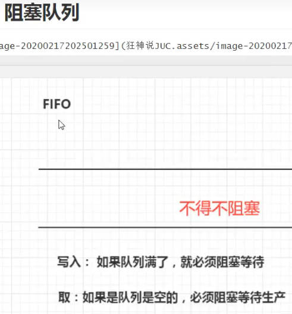 | 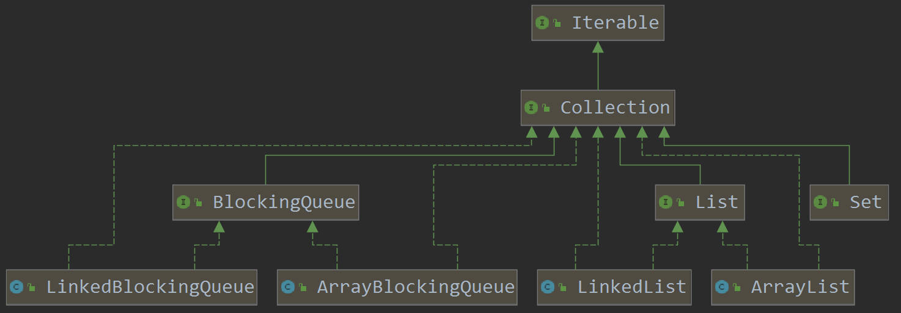   |
| ---------------------------------------------------------- | ------------------------------------------------------------ |
| 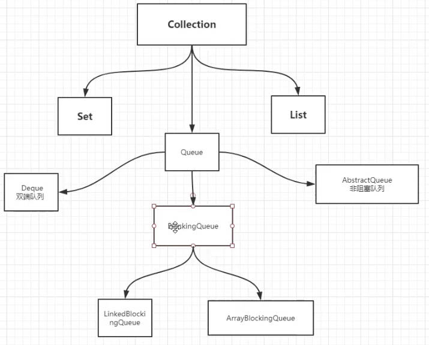 | 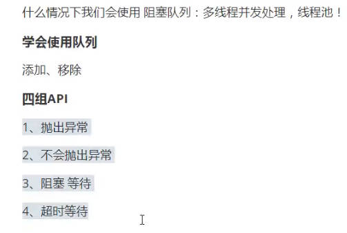   |
| 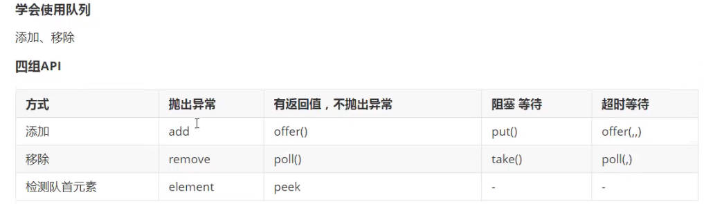 | 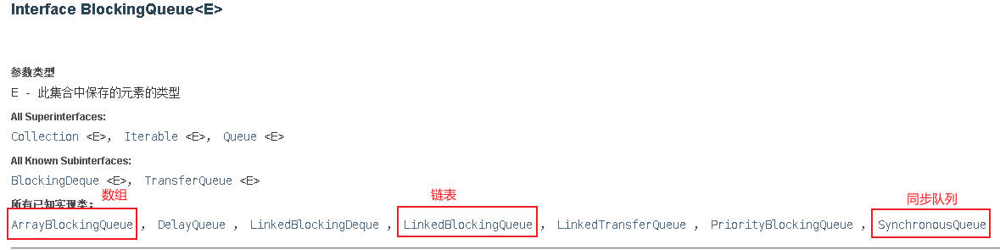 |

```java
public class BlockQueuTest {
    public static void main(String[] args) {
        test1();
    }

    /*抛出异常*/
    public static void test1() {
        //3:队列大小，能放多少个元素
        ArrayBlockingQueue blockingQueue = new ArrayBlockingQueue<>(3);
        System.out.println(blockingQueue.add("a"));
        System.out.println(blockingQueue.add("b"));
        System.out.println(blockingQueue.add("c"));
        System.out.println(blockingQueue.remove());
        System.out.println(blockingQueue.remove());
        System.out.println(blockingQueue.remove());
    }

    /*超出有返回值，不抛出异常*/
    public static void test2() {
        ArrayBlockingQueue blockingQueue = new ArrayBlockingQueue<>(3);
        System.out.println(blockingQueue.offer("a"));
        System.out.println(blockingQueue.offer("b"));
        System.out.println(blockingQueue.offer("c"));
        System.out.println(blockingQueue.poll());
        System.out.println(blockingQueue.poll());
        System.out.println(blockingQueue.poll());
    }
}
```


### 1、同步队列

`java.util.concurrent , Interface  BlockingQueue<E>的实现类 SynchronousQueue`

- 没有容量，进去一个元素，必须等待取出来之后，才能再放进去一个；  ==消息队列里大量使用==
- put take

## 9、==线程池==(重点)

[ThreadPoolExecutor创建线程池](https://www.cnblogs.com/tpcwlilacfover/p/14293497.html)

[ThreadFactoryBuilder](https://www.cnblogs.com/buguge/p/16131838.html)  [ThreadFactoryBuilder ](https://www.cnblogs.com/trekxu/p/10332554.html)  [Java线程池中三种方式创建 ThreadFactory ](https://cloud.tencent.com/developer/article/1948703?areaSource=102001.14&traceId=d5Oy0rPZ555asZb6B7ibm) [如何使用ThreadFactoryBuilder创建Java线程工厂](https://www.python100.com/html/72246.html)

小结： ==3大方法，7大参数,4种拒绝策略==

连接和关闭很耗资源，所以事先准备好一些资源，有人要用，就来这里拿，用完之后还给我

1. ==三大方法==：  线程池不允许使用 Executors 去创建，而是通过 ThreadPoolExecutor 的方式
   1. Executors 返回的线程池对象有弊端：因为返回的对象，允许的请求队列太长。导致OOM
   2. 但没办法，==线程的三大方法==还和Executors有关，源码底层是ThreadPoolExecutor
      1. `Executors.newSingleThreadExecutor();  //单例，单个线程`
      2. `Executors.newFixedThreadPool(5);  //固定的线程`
      3. `Executors.newCachedThreadPool();  //可伸缩的线程`

2. ==7大参数==：Executors三大方法源码是ThreadPoolExecutor； 有7个参数; 7个参数的最后一个是==拒绝策略==

- 核心线程池大小：开2个窗口办业务
- 最大核心线程池大小：345窗口侯客区满后才开放办业务
- ==keepAliveTime==: 存活时间, 超时了没有人调用就会释放
- ==阻塞队列==：侯客区座位等待办业务
- ThreadFactory: 线程工厂，创建线程的，一般不用动
- ==拒绝策略==：最大线程池满了，阻塞队列也满了，再来了直接走
- 超时不候：345窗口，1个小时都没人来办业务，就关闭释放
- handle:有==4种拒绝策略==，看源码
  - AbortPolicy：银行满了，还有人进来，不处理这个人的，抛出异常
  - CallerRunsPolicy: 哪来的去哪里，例：公司让你去银行办卡，银行人满了，银行告诉你去找你公司代办
  - DiscardPolicy：队列满了，丢掉任务，不抛异常
  - DiscarOldestPolicy：队列满了，==尝试和最早的竞争==，看第一个是不是快结束了，如果第1个没结束，依然丢掉任务，也不会抛出异常
  
- ==自定义线程池==
  - 最大承载线程：队列+Max值， 超过后，看拒绝策略，如果是AbortPolicy，就抛出异常


| 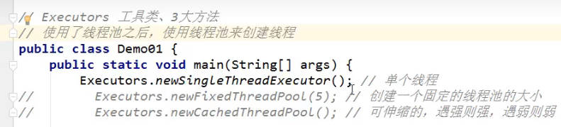 | 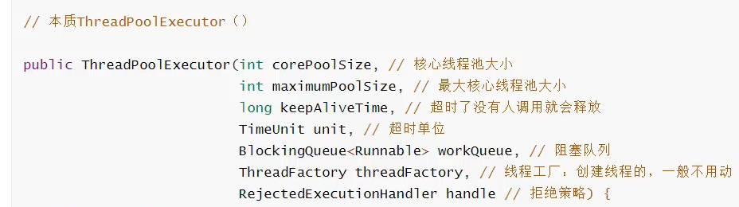   |
| ------------------------------------------------------------ | ------------------------------------------------------------ |
| 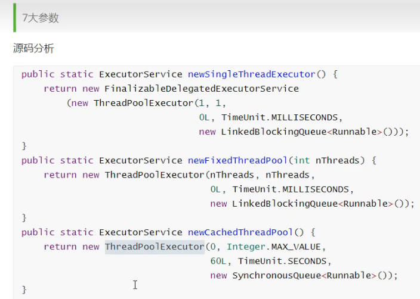 | 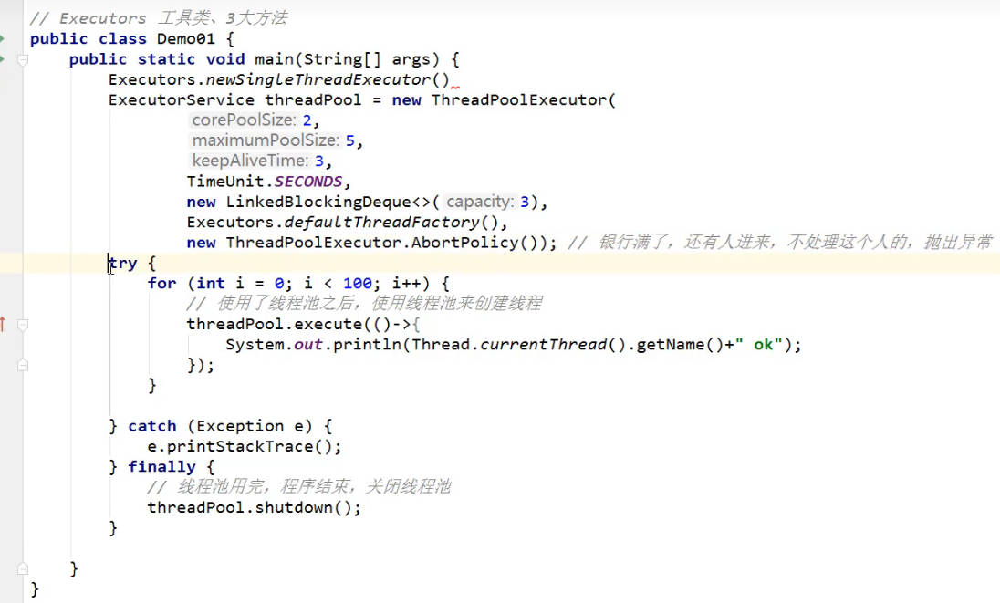   |
|    | 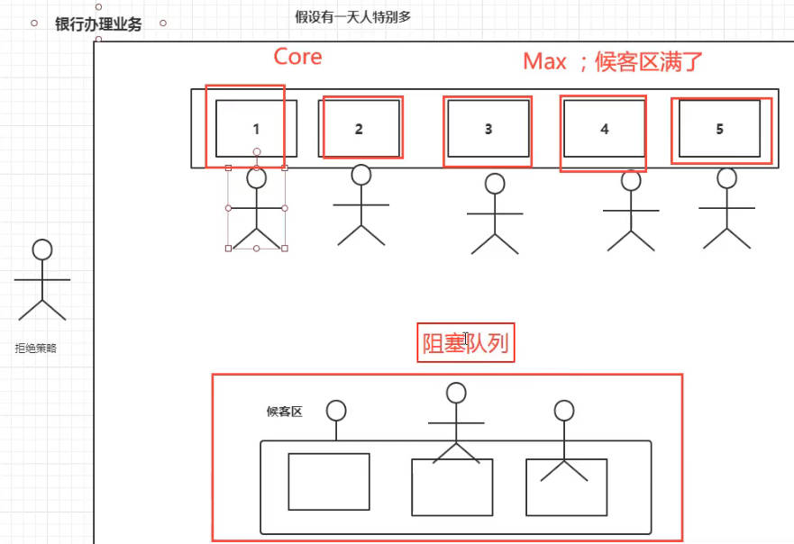 |
| 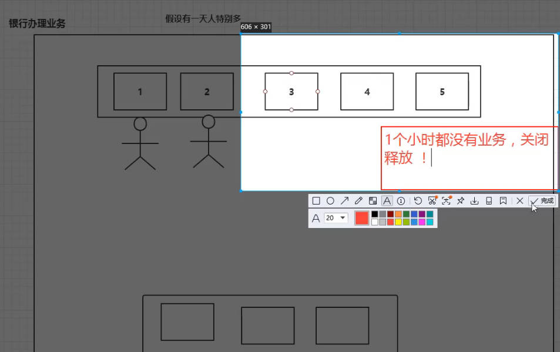   | 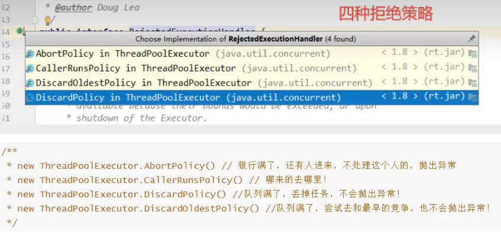   |
| 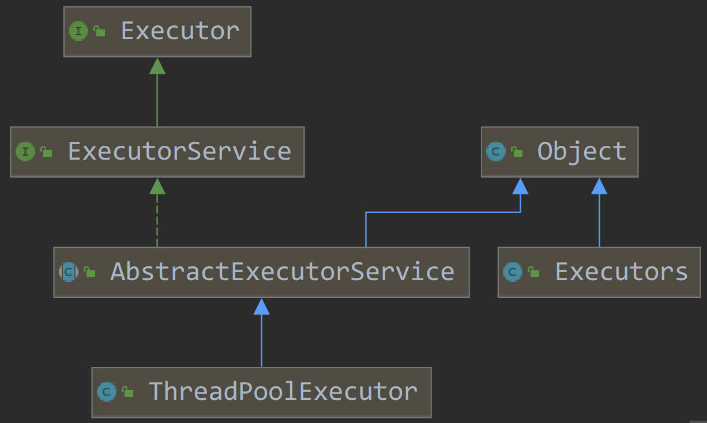   | 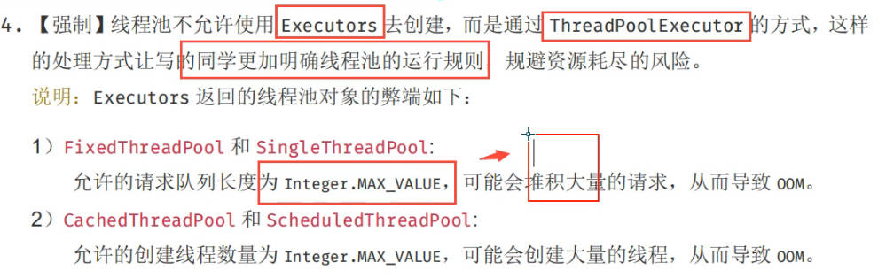   |

```java
//三大方法
public class ExecutorServiceDemo {
    public static void main(String[] args) {
        //ExecutorService threadPool = Executors.newSingleThreadExecutor();//单个线程
        //ExecutorService threadPool = Executors.newFixedThreadPool(5);//创建一个固定的线程池的大小
        ExecutorService threadPool = Executors.newCachedThreadPool();//可伸缩的,遇强则强,遇弱则弱,
        try {
            for (int i = 0; i < 20; i++) {
                //使用线程池之后,使用线程池来创建线程
                threadPool.execute(()->{
                    System.out.println(Thread.currentThread().getName()+" : ok");
                });
            }
        } catch (Exception e) {
            e.printStackTrace();
        } finally {
            threadPool.shutdown();
        }
    }
}
```

### 2、cpu密集型和IO密集型

作用：==最大线程该如何定义？==

- IO密集型
  - 例如：1个程序，有15个大型任务，这15个任务的IO非常占资源，所以至少要有15个线程处理这些IO; 一般设置大于2倍

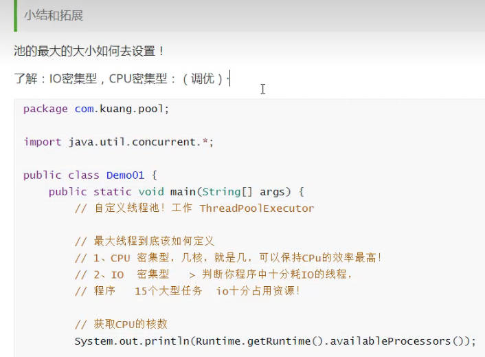

## 10、四大函数式接口

[＜? extends T＞和＜? super T＞](https://blog.csdn.net/qq_41276800/article/details/130200677)

程序员要会： Lambda、链式编程、函数式接口、Stream流式计算

### 1、函数式和Predicate

- Predicate ：一个输入参数，返回1个布尔值
- 函数式：泛型默认Object类型，

| 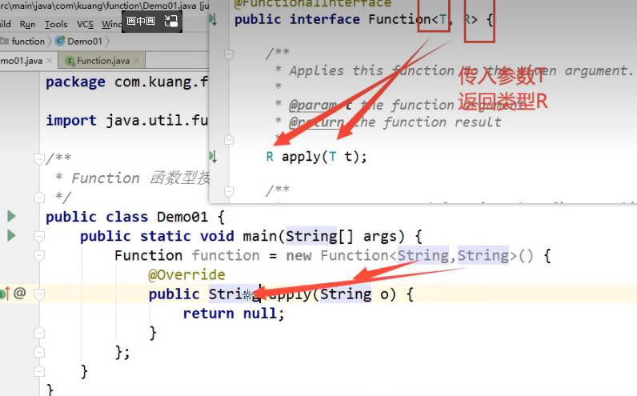 | 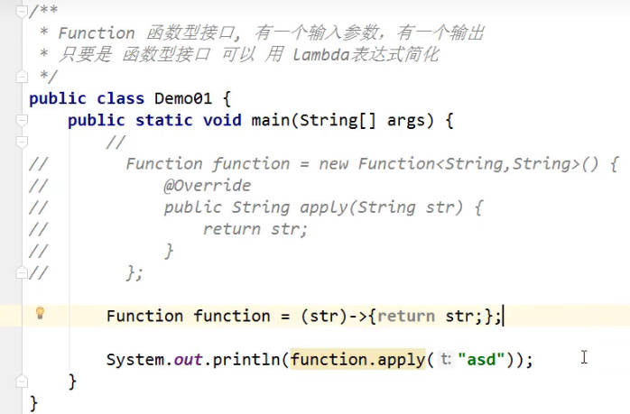 |
| ---------------------------------------------------------- | ------------------------------------------------------------ |

### 2、消费型、供给型

- Consumer：只有输入，没有返回值
- Supplier：没有参数，只有返回值

## 11、Stream流式计算

大数据：存储 + 计算

集合、SQL等本质就是存储东西

==计算都应该交给流来操作== ， `java.util.stream `

- 老程序员：泛型，枚举，反射注解
- 新时代程序员：lambda表达式，链式编程，函数式接口，Stream流式计算

```java
/*
* 题目要求：一分钟完成此题，只能用一行代码实现
* 现在有5个用户，筛选：
* 1、ID必须是偶数
* 2、age必须大于23
* 3、name转为大写
* 4、name字母倒着排序
* 5、只输出一个用户
*/
//老程序员：泛型，枚举，反射注解
//新时代程序员：lambda表达式，链式编程，函数式接口，Stream流式计算
public class StreamDemo {
    public static void main(String[] args) {
        User u1 = new User(1,"a",21);
        User u2 = new User(2,"b",22);
        User u3 = new User(3,"c",23);
        User u4 = new User(4,"d",24);
        User u5 = new User(5,"e",25);
        List<User> list = Arrays.asList(u1,u2,u3,u4,u5); //数据放入集合ArrayList
        //集合就是存储，计算交给Stream流
        //lambda表达式,链式编程,函数式接口,Stream流式计算
        list.stream()   //list转成stream对象
                .filter(u->{return u.getId()%2==0;})    //ID模2
                .filter(u->{return u.getAge()>23;})
                .map(u->{return  u.getName().toUpperCase();})  //转换
                .sorted((uu1,uu2)->{return uu2.compareTo(uu1);})
                .limit(1)
                .forEach(System.out::println);          //打印
    }
}

//有参，无参构造，get，set，toString
@Data
@NoArgsConstructor
@AllArgsConstructor
class User{
    private int id;
    private String name;
    private int age;
```

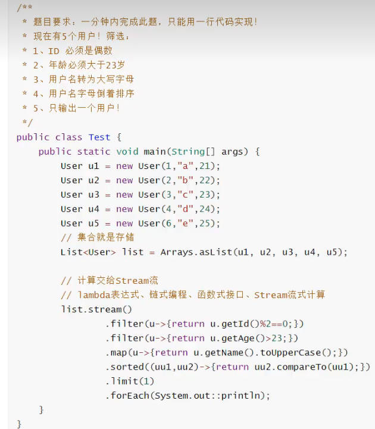

## 12、ForkJoin分支合并

ForkJoin在JDK1.7出现，并行执行任务，用来提高效率； 大数据量才提高效率，几十亿数据量

- 一个线程拆分成多个去操作 （把大任务拆分为小任务，最终结果汇总）
- ==工作窃取==：A没执行完，B执行完了，不会傻傻等，会帮着A执行； 因为里面维护的都是双端队列，可以从上面和下面同时取
- 更牛的用Stream并行流

1. 如何使用forkjoin?
   1. forkjoinpool 通过它执行
   2. forkjoinpool有个方法：`execute(ForkJoinTask<?> task)` ，要传入一个ForkJoinTask
   3. ForkJoinTask有个子类RecursiveTask: 需要写个类继承它，要实现它的方法`compute()`，计算完的返回值
   4. ForkJoinTask有2个方法，fork join

| 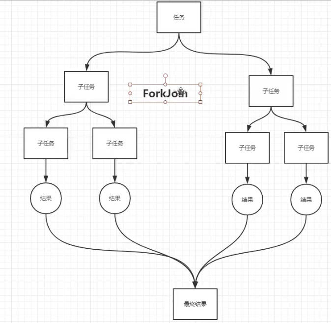 | 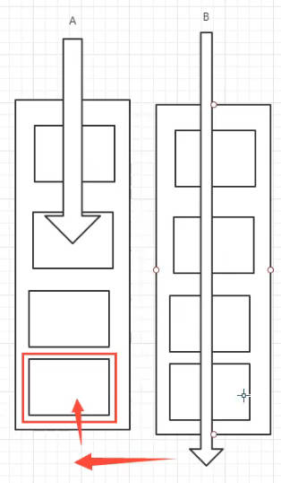 |
| ---------------------------------------------------------- | ------------------------------------------------------------ |
| 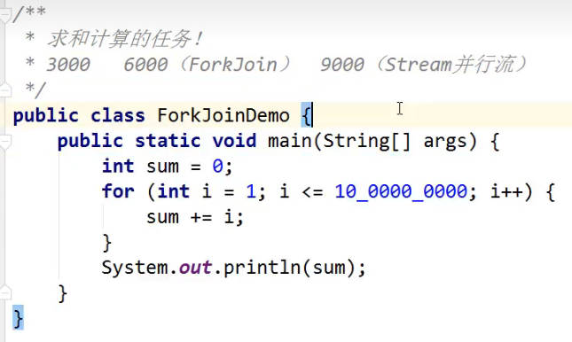 | 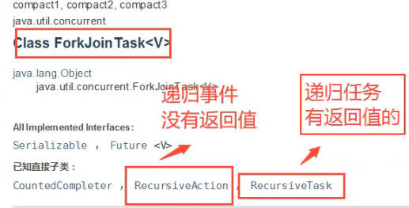   |

```java
//拆分任务
package JUCDemo;
import java.util.concurrent.RecursiveTask;
public class ForkJoinDemo extends RecursiveTask<Long> {
    private Long start; //开始值
    private Long end;   //结束值
    private Long temp = 10000L; //临界值，超过临界值分成2个任务
    public ForkJoinDemo(Long start, Long end) {
        this.start = start;
        this.end = end;
    }
    @Override
    protected Long compute() {
        //小于临界值普通计算方式，大于临界值forkjoin方式
        if ((end-start) < temp ){
            Long sum = 0L;
            for (Long  i = start; i <= end; i++) {
                sum += i;
            }
            return sum;
        }else{
            long middle = (start + end)/2;//中间值,1个任务拆成2个任务
            ForkJoinDemo task1 = new ForkJoinDemo(start,middle);
            task1.fork();//拆分任务,把任务压入线程队列
            ForkJoinDemo task2 = new ForkJoinDemo(middle+1,end);
            task2.fork();//拆分任务,把任务压入线程队列
            return task1.join()+task2.join();
        }
    }
}
```

测试

```java
package JUCDemo;
import java.util.concurrent.ExecutionException;
import java.util.concurrent.ForkJoinPool;
import java.util.concurrent.ForkJoinTask;
import java.util.stream.LongStream;
public class ForkJoinTest {
    public static void main(String[] args) throws ExecutionException, InterruptedException {
        //test1();//5533
        //test2();//3709
        test3();//222
    }
    //第一种方法：普通程序员直接相加
    public static void test1(){
        Long sum = 0L;
        long start = System.currentTimeMillis();
        for (Long i = 1L; i <= 10_0000_0000L; i++) {
            sum += i;
        }
        long end = System.currentTimeMillis();
        System.out.println("sum = "+sum+" 时间 : "+(end-start));
    }
    //第二种方法：厉害点的程序员，ForkJoin，要有一个ForkJoinPool
    public static void test2() throws ExecutionException, InterruptedException {
        long start = System.currentTimeMillis();
        ForkJoinPool forkJoinPool = new ForkJoinPool();  //通过它执行
        ForkJoinTask<Long> task = new ForkJoinDemo(0L,10_0000_0000L); //要计算的任务
        ForkJoinTask<Long> submit = forkJoinPool.submit(task); //submit异步提交,有结果；execute同步的，执行，没结果
        Long sum = submit.get();
        long end = System.currentTimeMillis();
        System.out.println("sum = "+sum+" 时间 : "+(end-start));
    }
    //第三种方法：牛逼的程序员,用Stream并行流
    public static void test3(){
        long start = System.currentTimeMillis();
        //parallel并行计算；
        long sum = LongStream.rangeClosed(0L,10_0000_0000L).parallel().reduce(0,Long::sum);
        long end = System.currentTimeMillis();
        System.out.println("sum = "+sum+" 时间 : "+(end-start));
    }
}
```

## 13、==异步回调==

客户端向服务器发出请求，服务器返回结果需要时间，为了不阻塞，异步调用，ajax；  java的线程也能异步调用,结果用的时候去拿就行了； 其它任务就不需要等待了

==java.util.concurrent ； Future类，实现类CompletableFuture==

- Future：对将来的某个事件的结果进行建模
- 异步调用分三步：异步执行，成功回调，失败回调
  - 没有返回值的异步回调：用runAsync
  - 有返回值的异步回调： 用supplyAsync
    - 成功时：whenComplete，BiConsumer增强版Consumer,有2个参数

| 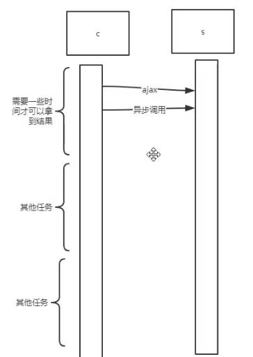 | 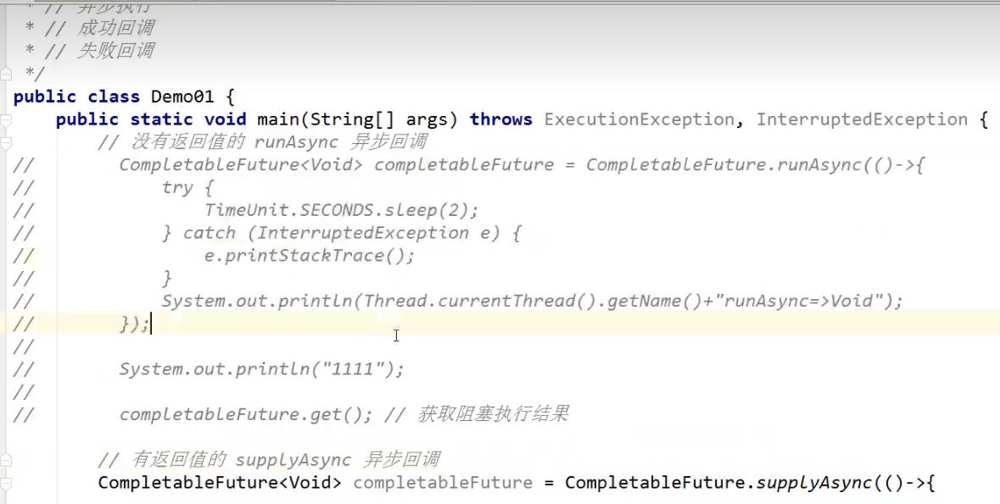 |
| ---------------------------------------------------------- | ---------------------------------------------------------- |

```java
public class FutureDemo {
    public static void main(String[] args) throws Exception {
        //1、没有返回值的runAsync 异步回调; run开头的让CompletableFuture执行异步任务
//        CompletableFuture<Void> completableFuture = CompletableFuture.runAsync(()->{
//            try {
//                TimeUnit.SECONDS.sleep(2);
//            } catch (InterruptedException e) {
//                e.printStackTrace();
//            }
//            System.out.println(Thread.currentThread().getName()+"runAsync-->Void");
//        });
//        System.out.println("1111");
//        completableFuture.get();//获得阻塞执行结果

        //2、有返回值的 supplyAsync 异步回调
        //分为成功和失败的回调
        //成功返回结果； 失败返回的是错误信息
        //CompletableFuture.supplyAsync() :执行一个异步任务
        CompletableFuture<Integer> completableFuture = CompletableFuture.supplyAsync(() -> {
            System.out.println(Thread.currentThread().getName() + "====supplyAsync-->Integer");
            int i = 10 / 0;   //制造失败
            return 1024;
        });
        System.out.println(completableFuture.whenComplete((t, u) -> {
            System.out.println("t-->" + t);//正常的返回结果,看看u是什么
            System.out.println("u-->" + u);//u是错误信息
        }).exceptionally((e) -> {
            System.out.println(e.getMessage());//可获取到错误的返回结果
            return 2233;    //失败返回2233
        }).get());
    }
}
```


## 14、==Volatile==

### 1、JMM

- Volatile是java虚拟机提供的==轻量级同步机制==
  - 保证可见性 : JMM
    - ==JAVA内存模型==，不存在的东西，只是个概念，约定
  - 不保证原子性
  - 禁止指令重排

线程、工作内存； 主内存

| 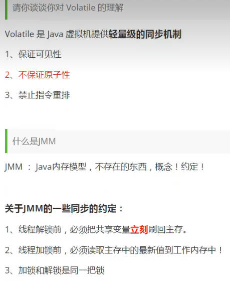 | 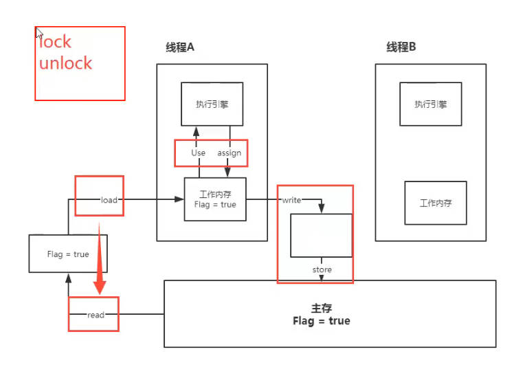 |
| ------------------------------------------------------------ | ---------------------------------------------------------- |


### 2、Volatile

- 保证可见性
- 不保证原子性
  - 用`java.util.concurrent.atomic` 保证原子性

#### 1、禁止指令重排

什么是指令重排： **你写的程序，计算机不是按照你写的那样去执行的**； 

`源代码->编译器优化的重排->指令并行也可能会重排->内存系统也会重拍->执行`

Volatile可以避免指令重排

| 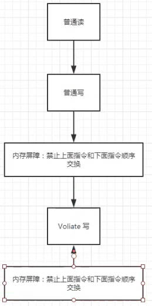 |  |
| ---------------------------------------------------------- | ----- |


### 3、==玩转单例模式==

[java反射实例化对象有什么用](https://blog.csdn.net/text2207/article/details/129315317) [反射破坏单例模式_枚举类解决单例模式破坏](https://www.cnblogs.com/henuliulei/p/14870622.html)  [反射](https://www.jianshu.com/p/0cbc43383b81/)  [java反射机制理解及其用途归纳](https://www.cnblogs.com/bbbing/p/11011424.html)

[javap优缺点 ](https://www.jianshu.com/p/c8b932fe45de)  [JVM之javac、java、javap](https://blog.csdn.net/mrluo735/article/details/134570244)  [Java 反编译工具：JAD](https://blog.csdn.net/qing_gee/article/details/86510704)

1. 单例
   1. 饿汉式 ：浪费资源
   2. DCL懒汉式：用到Volatile ；为了不浪费资源，用的时候才加载(new)
      1. 并发下有问题，加锁：双重检测锁模式（DCL）+Volatile原子性，2个if，1个锁class
      2. lazyMan==null，lazyMan没有创建
   3. 静态内部类实现单例
2. 上面3种都不安全: 有反射，任何代码都不安全
   1. 通过反射可以获取Java任意对象的信息
      1. 反射破坏private ；  解决：`if(lazyMan!=null){}`,判断有创建实例
      2. 不用getInstance()创建对象;  解决：设置一个其它人不知道的标志位,第一次执行后，标志位变成true
      3. 反编译拿到标志位字段，手动改标志位为false； 解决：枚举自带单例模式； 看newInstance()源码
         1. 枚举本身也是一个Class类，javap反编译后也有一个无参构造，代码也骗了你；用更专业的jad：能发现==枚举用了一个有参构造==，2个参数； 研究出==反射确实不能破坏枚举的单例==
   2. 反射不能破坏枚举
3. ==javap优缺点==
   1. javap==反编译后的代码更接近Java源代码==，易于理解和分析，可以获取类的方法、字段、常量池等详细信息
   2. ==无法完全还原源代码==：由于反编译是基于字节码进行的，所以无法完全还原原始的Java源代码。一些语法糖、注释和命名约定可能会丢失或变得不准确
   3. ==只能查看已编译的类文件==：javap 只能用于查看已经编译成字节码的类文件，无法直接查看源代码

| 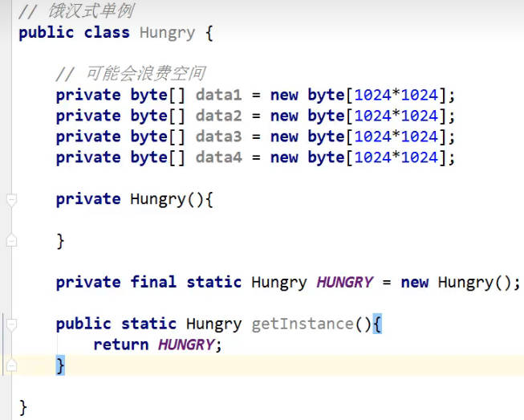 |    |
| ------------------------------------------------------------ | ------------------------------------------------------------ |
|  |    |
|  |  |


### 4、深入理解CAS

原子类的底层用的是CAS，有个方法==compareAndSet()：比较并交换==；2个参数：expect期望，update更新

1. CAS通俗的解释就是：
   1. 比较当前==工作内存中的值和主内存中的值==，如果相同则执行规定操作，否则继续比较直到主内存和工作内存中的值一致为止.

- 如果期望的值达到了，就更新，否则，不更新
- 内存操作，效率很高
- 会存在ABA问题（狸猫换太子）

|  |  |
| ---------------------------------------------------------- | ---------------------------------------------------------- |
|  |                                                            |

### 5、原子引用解决ABA问题

有个期望的值是蛋糕，线程A期望，如果是蛋糕就更新值； 又来了个线程B，它首先把蛋糕换成面包，然后又换成蛋糕；然后B走了，但A不知道蛋糕已经不是以前的蛋糕了，A对这些操作不知情，它去拿这个蛋糕，但蛋糕已经被人动过了。

- 解决：==带版本号的原子操作==；  `AtomicReference<V>`原子引用:设定一个初始值（版本号）
- 用的是==乐观锁==的思想

|  |  |
| ---------------------------------------------------------- | ----- |

ABA问题：==我们希望谁动了这个锁，一定要告诉我们==

```java
public class AbaDemo {
    public static void main(String[] args) {
        AtomicInteger atomicInteger = new AtomicInteger(2020);
        //捣乱的线程
        System.out.println(atomicInteger.compareAndSet(2020, 2021));
        System.out.println(atomicInteger.get());
        System.out.println(atomicInteger.compareAndSet(2021, 2020));
        System.out.println(atomicInteger.get());
        //期望的线程
        System.out.println(atomicInteger.compareAndSet(2020, 66666));
        System.out.println(atomicInteger.get());
    }
}
```

解决：==带版本号的原子操作== :Integer大坑

```java
public class AbaDemo {
    public static void main(String[] args) {
        AtomicStampedReference<Integer> atomic = new AtomicStampedReference<>(1, 1);
        //a线程做完的操作，b要知道; 期望的值1，要改的值6
        new Thread(() -> {
            int stamp = atomic.getStamp(); // 获得版本号
            System.out.println("a1=>" + stamp);
            //加个延时，保证得到的版本号是同一个
            try {
                TimeUnit.SECONDS.sleep(1);
            } catch (InterruptedException e) {
                e.printStackTrace();
            }
            //CAS操作
            Lock lock = new ReentrantLock(true);
            atomic.compareAndSet(1, 2, atomic.getStamp(), atomic.getStamp() + 1);
            System.out.println("a2=>" + atomic.getStamp());  //打印修改后版本号
            //值再改回去
            System.out.println(atomic.compareAndSet(2, 1, atomic.getStamp(), atomic.getStamp() + 1)); //拿到版本号，版本号更新+1
            System.out.println("a3=>" + atomic.getStamp());
        }, "a").start();

        // 乐观锁的原理相同！
        new Thread(() -> {
            int stamp = atomic.getStamp(); // 获得版本号
            System.out.println("b1=>" + stamp);
            try {
                TimeUnit.SECONDS.sleep(2);
            } catch (InterruptedException e) {
                e.printStackTrace();
            }
            System.out.println(atomic.compareAndSet(1, 10, stamp, stamp + 1));
            System.out.println("b2=>" + atomic.getStamp());
        }, "b").start();
    }
}
```

试着改线程池

[ThreadFactoryBuilder](https://www.cnblogs.com/buguge/p/16131838.html)  [ThreadFactoryBuilder ](https://www.cnblogs.com/trekxu/p/10332554.html)  [Java线程池中三种方式创建 ThreadFactory ](https://cloud.tencent.com/developer/article/1948703?areaSource=102001.14&traceId=d5Oy0rPZ555asZb6B7ibm) [如何使用ThreadFactoryBuilder创建Java线程工厂](https://www.python100.com/html/72246.html)

```java
public class AbaDemo {
    public static void main(String[] args) {
        ThreadTest threadTest = new ThreadTest();
        //根据阿里规范，试着建线程池
//        ThreadFactory namedThreadFactory = new ThreadFactoryBuilder().setNameFormat("demo-pool-%d").build();
        ExecutorService singleThreadPool = new ThreadPoolExecutor(
                2,
                5,
                0L,
                TimeUnit.MILLISECONDS,
                new LinkedBlockingQueue<Runnable>(1024),
                Executors.defaultThreadFactory(),   //namedThreadFactory,
                new ThreadPoolExecutor.AbortPolicy());

        singleThreadPool.execute(() -> threadTest.testA());
        singleThreadPool.execute(() -> threadTest.testB());
        singleThreadPool.shutdown();
    }
}

class ThreadTest {
    AtomicStampedReference<Integer> atomic = new AtomicStampedReference<>(1, 1);

    void testA() {
        //a线程做完的操作，b要知道; 期望的值1，要改的值6
        int stamp = atomic.getStamp(); // 获得版本号
        System.out.println("a1=>" + stamp);
        //加个延时，保证得到的版本号是同一个
        try {
            TimeUnit.SECONDS.sleep(1);
        } catch (InterruptedException e) {
            e.printStackTrace();
        }
        //CAS操作
        Lock lock = new ReentrantLock(true);
        atomic.compareAndSet(1, 2, atomic.getStamp(), atomic.getStamp() + 1);
        System.out.println("a2=>" + atomic.getStamp());  //打印修改后版本号
        //值再改回去
        System.out.println(atomic.compareAndSet(2, 1, atomic.getStamp(), atomic.getStamp() + 1)); //拿到版本号，版本号更新+1
        System.out.println("a3=>" + atomic.getStamp());
    }

    void testB() {
        // 乐观锁的原理相同！
        int stamp = atomic.getStamp(); // 获得版本号
        System.out.println("b1=>" + stamp);
        try {
            TimeUnit.SECONDS.sleep(2);
        } catch (InterruptedException e) {
            e.printStackTrace();
        }
        System.out.println(atomic.compareAndSet(1, 10, stamp, stamp + 1));
        System.out.println("b2=>" + atomic.getStamp());
    }
}
```


## 15、各种锁的理解

[乐观锁悲观锁](https://www.bilibili.com/video/BV1V741127P8/?spm_id_from=333.337.search-card.all.click&vd_source=7346303e5e18677d7261c2c0c109ecfd)

### 1、公平锁、非公平锁

### 2、可重入锁

例：有了大门的锁，就有了各个房间的锁

可重入锁就是可以重复进入的锁，也叫==递归锁==。前提是同一把锁，如同一个类、同一个实例、同一个代码块。

|  |  |
| ---------------------------------------------------------- | ---------------------------------------------------------- |

### 3、自旋锁

不断尝试，直到成功为止

### 4、死锁

2个人互相抢夺资源

### 5、乐观锁

[五问乐观锁悲观锁_笔记](https://www.bilibili.com/video/BV1V741127P8/?spm_id_from=333.337.search-card.all.click&vd_source=7346303e5e18677d7261c2c0c109ecfd)  

[悲观锁、乐观锁、可重入锁各种锁及其Java实现](https://www.bilibili.com/video/BV1A54y1n7eE/?spm_id_from=333.337.search-card.all.click&vd_source=7346303e5e18677d7261c2c0c109ecfd)    [乐观锁介绍](https://www.cnblogs.com/zourui4271/p/4890214.html) [4种乐观锁实现方式](https://mikechen.cc/28738.html)  [公平锁/非公平锁，可重入锁，独享锁/共享锁，互斥锁/读写锁 乐观锁/悲观锁，分段锁，偏向锁/轻量级锁/重量级锁，自旋锁](https://www.bilibili.com/video/BV1qB4y1D7jv/?spm_id_from=333.337.search-card.all.click&vd_source=7346303e5e18677d7261c2c0c109ecfd)  [大厂经典面试题](https://www.bilibili.com/video/BV1nY4y1Y7G5/?spm_id_from=333.337.search-card.all.click&vd_source=7346303e5e18677d7261c2c0c109ecfd)

- 悲观锁：如果锁不住资源，别人就会来抢；  修改数据时先锁住，然后再改
- 乐观锁：锁同步资源
  - ==乐观锁应用==：git； push代码到仓库，会默认检查远程仓库版本，如果远程版本比我们版本大，说明有其它人提交过，push会失败，让我们先拉取，合并后版本一样，才能重新提交到仓库

乐观锁是一种并发控制机制，用于解决并发情况下的数据一致性问题，就是读不加锁，写的是时候加锁。

|  |  |
| ---------------------------------------------------------- | ---------------------------------------------------------- |


### 6、mysql各种锁

[全局锁、表锁、行锁、乐观锁、悲观锁，意向共享锁和意向排他锁、临键锁和记录锁](https://www.bilibili.com/video/BV15M4y1i7JL/?spm_id_from=333.337.search-card.all.click&vd_source=7346303e5e18677d7261c2c0c109ecfd)
