## 1、概述

复习： 4种类加载器 => Native方法栈 => 栈帧 => 堆内存调优 => GC算法 => JVM执行引擎

[JVM_bilibili](https://www.bilibili.com/video/BV1iJ411d7jS/?p=14&spm_id_from=pageDriver&vd_source=7346303e5e18677d7261c2c0c109ecfd)  [JVM学习笔记_狂神](https://www.qyyshop.com/info/594825.html)      [ JVM与Java体系结构](https://blog.csdn.net/m0_37450089/article/details/119962665)  [JVM虚拟机](https://blog.csdn.net/weixin_45629285/article/details/115765496)  [JVM虚拟机原理](https://blog.csdn.net/vampiresf/article/details/108760663)  [java虚拟机](https://blog.csdn.net/weixin_43771403/article/details/121288104)  [JVM内存模型](https://zhuanlan.zhihu.com/p/411021919)  [ JVM内存分配和GC](https://blog.csdn.net/CoderLai/article/details/90054471)  [Java内存分析图解](https://blog.51cto.com/u_15697790/5419611)   [ Java虚拟机](https://blog.csdn.net/weixin_45351103/article/details/122413354)[lombok简介](https://blog.csdn.net/qq_44196212/article/details/122319779)  [ 自动生成get、set方法（使用lombok的注解@Getter @Setter）](https://codeleading.com/article/25675145704/)  [方法的签名](https://www.baidu.com/s?ie=UTF-8&wd=方法的签名)
视频：[JVM底层教程](https://www.bilibili.com/video/BV1vv411171F/?spm_id_from=333.337.search-card.all.click&vd_source=7346303e5e18677d7261c2c0c109ecfd)  [性能调优监控工具](https://www.bilibili.com/video/BV19J41197fF/?p=8&vd_source=7346303e5e18677d7261c2c0c109ecfd)  [阿里内部jvm调优工具arthas](https://www.bilibili.com/video/BV1DA411G7fR?p=7&vd_source=7346303e5e18677d7261c2c0c109ecfd)  
双亲委派机制：[GC垃圾回收机制 ](https://www.cnblogs.com/robinAndLaurel/p/9931962.html) [ JVM架构体系](https://www.codenong.com/p146346062466891/)
沙箱安全机制：[java的沙箱安全机制](https://blog.csdn.net/sj8921202/article/details/121494675)  [安全沙箱机制](https://www.finclip.com/news/f/39402.html)  [Java的沙箱机制原理入门](https://www.iteye.com/blog/kevinkevin1979-839400)  [安全模型(沙箱机制) ](https://www.freesion.com/article/87081349826/)
栈：[栈](https://www.jianshu.com/p/d4a990be7097)  [栈与堆](https://www.cnblogs.com/saxonsong/p/14721148.html) [ JVM学习笔记](https://blog.csdn.net/qq_41293397/article/details/126974782)  [浅谈JVM](https://zhuanlan.zhihu.com/p/601618008)
堆：[ JVM调优总结](https://blog.csdn.net/fcclzydouble/article/details/123095908) [ Xmn](https://blog.csdn.net/weixin_39444878/article/details/120128855)
[数据库初始化](https://www.cnblogs.com/E-star/archive/2013/01/16/2863041.html)  [Java初始化](https://www.cnblogs.com/yxnchinahlj/archive/2010/09/21/1832822.html)  [Java初始化](https://www.cnblogs.com/yxnchinahlj/archive/2010/09/21/1832822.html) [Java初始化](https://blog.csdn.net/pterodactyl2007/article/details/83330256)   [JAVA常量池](https://www.cnblogs.com/E-star/archive/2013/01/06/2848025.html)  [Java初始化顺序](https://www.cnblogs.com/miniwiki/archive/2011/03/25/1995615.html) [初始化顺序](https://www.cnblogs.com/mingyao123/p/8494046.html)   [Java对象初始化](https://www.cnblogs.com/xiaoxiaoyihan/p/4934839.html)  [初始化程序](https://recomm.cnblogs.com/blogpost/2863041?page=1)
[JVM启动参数](https://www.cnblogs.com/yinhaiming/articles/2222313.html)

JVM说的最明白(se里的引用传递) <a href="#bottom" name="top" >锚点 </a> [跳转到引用传递](#15、java值传递_引用传递) ：[Java的值传递和引用传递](https://zhuanlan.zhihu.com/p/89794950?utm_id=0)    [彻底明白Java的值传递和引用传递](https://xuliugencn.blog.csdn.net/article/details/83508006?spm=1001.2101.3001.6650.3&utm_medium=distribute.pc_relevant.none-task-blog-2~default~BlogCommendFromBaidu~Rate-3-83508006-blog-84146202.235^v38^pc_relevant_sort_base1&depth_1-utm_source=distribute.pc_relevant.none-task-blog-2~default~BlogCommendFromBaidu~Rate-3-83508006-blog-84146202.235^v38^pc_relevant_sort_base1&utm_relevant_index=6)   [引用传递](https://blog.csdn.net/u010454030/article/details/84146202)  [值传递和引用传递](https://www.cnblogs.com/xiaohu666/p/17335240.html)  [值传递和引用传递](https://www.cnblogs.com/konglxblog/p/16456809.html) [值类型和引用类型](https://blog.csdn.net/xinlingmen/article/details/106279141)  [javap 生成字节码含义](https://blog.csdn.net/qq_23315711/article/details/56668029)  

[简单名、全限定名、描述符、签名、符号引用、直接引用](https://blog.csdn.net/gg1229505432/article/details/121405221)   [全限定名](https://blog.csdn.net/weixin_36873225/article/details/117060872)  [JVM内存模型和类加载运行机制](https://zhuanlan.zhihu.com/p/500205913)  [类的直接超类的权全限定名](https://www.baidu.com/s?ie=UTF-8&wd=类的直接超类的权全限定名) 

[HTML锚点](https://blog.csdn.net/W2279567793/article/details/124180948) [Typora](https://sspai.com/post/54912/) [Front-matter ](https://hexo.io/zh-cn/docs/front-matter) [typora添加页内跳转](https://www.jianshu.com/p/b7eaa6aad326)  [PP/PA材质](https://zhuanlan.zhihu.com/p/31897499)

> 1. 运行时环境
> 2. 类装载器装载完后，里面发生了什么，里面称为==运行时数据区（Runtime类）==
> 3. 只有堆和方法区有垃圾

[JVM执行引擎](https://baijiahao.baidu.com/s?id=1742502358948733088&wfr=spider&for=pc) [执行引擎](https://www.cnblogs.com/tod4/p/17546897.html)  [JVM:执行引擎](https://blog.csdn.net/a1424261303/article/details/126517972)

## 2、JVM体系结构

[自带反编译工具javap](https://blog.csdn.net/LVSONGTAO1225/article/details/131476263)  [4款主流反编译工具](https://mikechen.cc/15822.html) [反编译工具](https://www.27ka.cn/34044.html)  [7个Java反编译器工具](https://baijiahao.baidu.com/s?id=1726712623310495935&wfr=spider&for=pc)  [arthas](https://arthas.aliyun.com/doc/) [IDEA Plugin | arthas ](https://arthas.aliyun.com/doc/idea-plugin.html)

[通俗易懂：字节码与Class文件的关系](https://blog.csdn.net/weixin_45987569/article/details/127852103)  `Class文件的本质是一个十六进制的文件` [Class字节码文件](https://www.cnblogs.com/billyqiu/p/14341860.html)  [从一个class文件深入理解Java字节码结构](https://code84.com/569307.html) [eclipse里打开.class文件为什么能看到源码？](https://www.zhihu.com/question/284044773/answer/877405454)   [.class是字节码,为什么还能显示源码](https://www.baidu.com/s?ie=UTF-8&wd=.class是字节码，为什么还能显示源码)

[Java代码编译和执行的整个过程](https://zhuanlan.zhihu.com/p/32453534)

[iconst、bipush、sipush、ldc指令的区别](https://blog.csdn.net/xiaojin21cen/article/details/106403053)

| 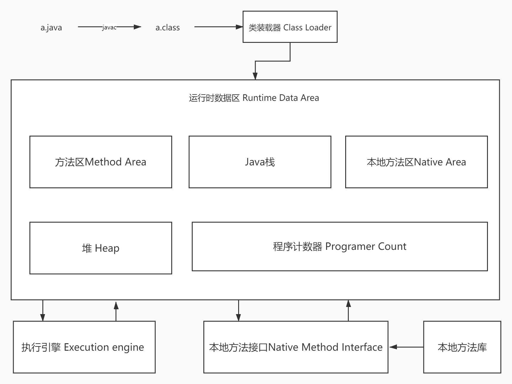 | 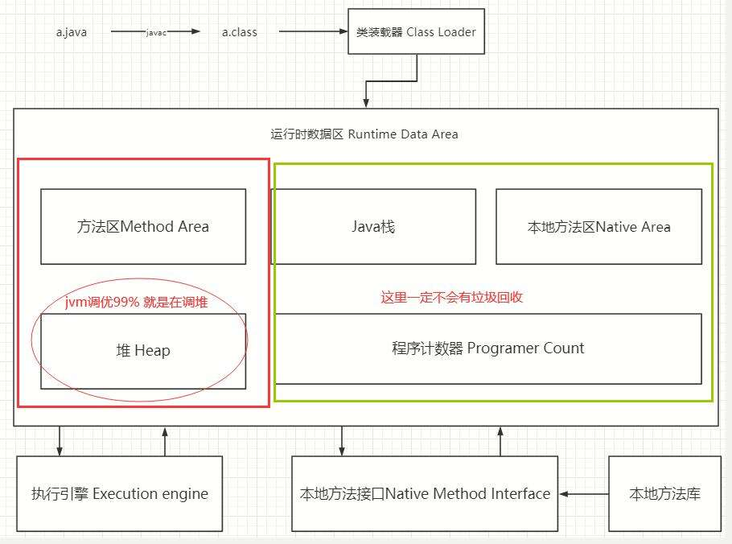 |
| --------------------------------------- | --------------------------------------- |

### ==1、Class文件结构==

[字节码与Class文件的关系](https://blog.csdn.net/weixin_45987569/article/details/127852103)  [class文件](http://www.manongjc.com/detail/61-wnkgeolynyqorlw.html)  [JAVA代码编译流程](https://www.baidu.com/s?ie=utf-8&f=8&rsv_bp=1&tn=baidu&wd=JAVA代码编译流程 书&rn=20&oq=JAVA%E4%BB%A3%E7%A0%81%E7%BC%96%E8%AF%91%E6%B5%81%E7%A8%8B&rsv_pq=cd3e7669000027fc&rsv_t=85b22mbsioGo1VMmFT%2B2rQMVcZFB0rtlg8ZpQ0ckPpVdJojNpZANqdzRJxI&rqlang=cn&rsv_enter=1&rsv_dl=tb&rsv_sug3=6&rsv_sug1=4&rsv_sug7=100&rsv_sug2=0&rsv_btype=t&inputT=3738&rsv_sug4=4181)

[数据结构和数据类型](https://www.zhihu.com/question/21165020)  [数据结构与数据类型的区别](https://cloud.tencent.com/developer/article/1404952?ivk_sa=1024320u) [类型](https://www.baidu.com/s?ie=UTF-8&wd=类型本质是数据结构)  

[JVM插件](https://www.jianshu.com/p/2c068ef285cb)

- **jclasslib Bytecode viewer**:  查看.class字节码文件
- **hexdump for VSCode**: 查看十六进制.class文件

> Class文件主要分为以下几个部分：
>
> 1. 魔数（magic number）
> 2. 版本号（minor&major version）
> 3. 常量池（constant pool）
> 4. 访问标记（access flag）
> 5. 类索引（this class）
> 6. 超类索引（super class）
> 7. 接口表索引（interface）
> 8. 字段表（field）
> 9. 方法表（method）
> 10. 属性表（attribute）

```java
//class文件基本结构
classFile{
    u4 magic; 
    u2 minor_version;
    u2 major_version;
    u2 constant_pool_count;
    cp_info constant_pool[constant_pool_count-1];
    u2 access_flags;
    u2 this_class;
    u2 super_class;
    u2 interfaces_count;
    u2 interfaces[interfaces_count];
    u2 fields_count;
    field_info fields[fields_count];
    u2 methods_count;
    method_info methods[methods_count];
    u2 attributes_count;
    attribute_info attributes[attributes_count];
}

//Class文件中的基本类型是以占用字节数命名的简单数据结构, u1、u2、u4，表示占用1、2、4字节的无符号整数，还有一种数据结构是表（table）
//以 _info 结尾，并以独特的名字标识自己的类型，例如方法表的类型是method_info，常量池的类型就是cp_info（cp指的是constant pool）
//table类型另一个特征是表数据之前会使用一个前置的容量计数器来记录表中元素的个数，便于明确表的范围
```

#### a.魔数

识别一个文件的类型，文件扩展名不行。 png魔数是**89 50 4E 47**(十六进制)，Class文件是**CA FE BA BE**

#### b.常量池(表)

==常量池以表的形式存在==

==对简单数字的操作==：占用字节比较少的整数类型，被枚举成具体的指令，嵌入到了字节码中; 当整型变量==以final修饰==时，它被声明为一个常量，此时==加入常量池==, 常量值不会被重复保存在常量池,例如a,c都100,ac指向常量池中的同一个索引位置

==大的数字==：无法用4个字节表示的类型，例如float、double等类型，记录在常量池，使用这些操作数时，根据索引值到常量池中取

Class文件中，==常量池以表的形式存在==，前置有一个表示常量池表大小的计数器; `这个记录很重要，因为Class文件中没有特定的开始和结束符号，只能通过这个count计数器，才知道对应的表占用多少空间，应该在什么位置结束。`

```java
//常量池结构
{
    u2 constant_pool_count;
    cp_info constant_pool[constant_pool_count-1];
}
```

**constant_pool**中==每一个**cp_info**元素分为两个部分==：

- ==tag==：通常为1个字节，用于表示该常量项的类型； Java支持14种tag，命名的规则是：**CONSTANT_XXX_info**，XXX是具体的常量类型
- ==info==：该常量项的具体内容，根据不同类型的实际数据占用不同的字节长度；

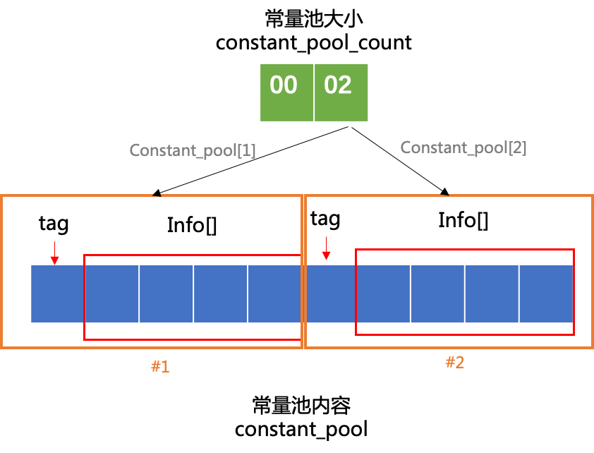

#### c.访问标记

类上的修饰符，如final、abstract等, 用两个字节保存

**00 21**对应**ACC_PUBLIC**以及**ACC_SUPER**，这个类是public类，**ACC_SUPER**代表该类有继承关系。所有类都是Object类的子类

#### d.本类索引（this_class）

**类索引保存的是一个与类相关的索引，既然有索引那么肯定有数据，它指向的数据是常量池**

例如：类索引紧跟访问标记**00 21**之后，也就是对应的**00 07**，指向常量池中索引为7的位置

#### e.超类索引（super_name）

与类索引的查询方法一致

#### f.接口索引（interface）

与前两个索引的查询方法一致，不过这里有一些特殊点，在例子1中，由于该类没有实现任何接口，所以接口表索引为**00 00**

#### g.==字段表==

记录的是类中的字段信息。Class文件中的表的结构，都是以 **==表大小+表内容==** 来表示 ， 字段表其实是一个**嵌套式**的表结构，**field_info**表内部嵌套一个**attributes**。

##### 1.访问标记access_flags

##### 2.字段名索引name_index

```java
{
    u2 fields_count;
    field_info fields[fields_count];
}
//字段表其实是一个嵌套式的表结构，field_info表内部嵌套一个attributes。
//fields_count表示fields中field_info数量,  字段内容field_info内部又细分

{
    u2 access_flags;		//字段访问标记
    //字段名索引，name_index记录的是常量池中的索引，最终可以通过name_index找到一个字符串常量名，也就是字段名。
    u2 name_index;				
    u2 descriptor_index;	//字段类型索引，指向常量池中的一个字符串常量，用简写方式表示	
    u2 attributes_count;
    attribute_info attributes[attributes_count];
}

```

##### 3.字段类型索引descriptor_index

- 基础类型，byte、int、char、float等用一个大写字符，两个特殊的：J long类型，Z boolean类型
- 引用类型使用==L+全类名+；==的方式来表示， 比如字符串类型String的描述符为**Ljava/lang/String**
- **数组类型用"["来表示**，如字符串数组String[]的描述符为“`[Ljava/lang/String;`”，同时该符号也可表示多维数组，如`int[][]`就被表示为`[[I`。

##### 4.属性表attributes与attributes_count

**attributes_count**表示的是字段属性项个数，而**attributes**则是字段属性项集合。

`attributes中由各类的attribute_info组成，attribute_info记录的是具体的属性信息，比较常见的有ConstantValue属性，表示这个字段是一个常量；还有RuntimeVisibleAnnotations属性，表示该字段上标注有运行时注解，比如Spring相关注解`

- 字段表其实是一个**嵌套式**的表结构，**field_info**表内部嵌套一个**attributes**

#### h.方法表

方法表的作用和字段表很类似，用于记录类中定义的方法; 也有一个count记录, **method_info**也是一个嵌套结构

方法表中的**attribute_info**，也就是方法中的**==属性表==**, 比字段表中的属性表复杂， 比如方法有方法体，有声明的抛出异常等，而这些信息，就都存储在方法表里的**attribute_info**里。因此方法中可用的**attribute_info**要更多

- 方法体对应的属性是**Code**，俗称**字节码**； 而异常信息对应的属性名为**Exceptions**

> 1. **字节码是Class文件的一部分**， **字节码记录在Class文件的方法表中的attribute_info的Code属性里。**
> 2. stack（操作数栈），locals（局部变量），LineNumberTable（行号表）和LocalVariableTable（局部变量表），都是JVM运行时需要的信息

#### i.属性表(类)

属性表在前面已经出现过，在字段表中、方法表中，都内嵌了一个属性表。

而这里的属性表，记录的是该类的类属性（注意不是类字段）

==类中有一个属性表，方法中有一个属性表，字段中还是有一个属性表，但它们记录的东西不一样==

- **字段表中的属性表**记录的是字段是否为常量、字段上是否有注解等信息。
- **方法表中的属性表**记录了方法上是否有注解、方法的异常信息声明、字节码等信息。
- Class文件的这个属性表记录有哪些，常见的
  - SourceFile：类的源文件名称。
  - RuntimeVisibleAnnotations：类上标记的注解信息。
  - InnerClasses：记录类中的内部类。

#### j.==总结==

Class文件结构分类：

- 结构信息
  - Class文件格式版本号
  - 各部分的数量及所占空间大小
- 元数据（对应Java源代码中“声明”和“常量”信息）
  - 类 / 继承的超类 / 实现接口的声明信息
  - 域 / 方法 的声明信息
  - 常量池
    运行期注解
- 方法信息（对应Java源代码中“语句”与“表达式”信息）
  - 字节码
  - 异常处理器表
  - 操作数栈 与 局部变量区 的大小
  - 符号信息（如LineNumberTable、LocalVariableTable）

## 3、类加载器及双亲委派机制

[重点：Java类加载器详解](https://www.jianshu.com/p/268a6ebd0f4f) [类加载器有哪些](https://developer.aliyun.com/article/1280599)  [Java加载资源文件时的路径问题](https://www.cnblogs.com/lmtoo/archive/2012/10/18/2729272.html)  [bootstrap-class-loader](https://cn.bing.com/dict/bootstrap-class-loader)  

> 1. 类的反射文件car.class，生成多个实例car1、car2
> 2. ==类加载器工作流程==
>    1. 加载 
>       1. 类的加载: 将 .class 文件加载到内存中，并为之创建一个 Class 对象
>       2. new 创建一个对象时，JVM 先去加载这个类，然后才能创建这个类的对象
>    2. 链接Link
>       1. 将编译好的字节码合并成一个可执行的代码，并为之分配内存空间； 分3步：验证、准备、解析
>    3. 初始化： 为类的静态字段赋予正确的初始值
> 3. 类加载器分4种
>    1. 启动类（根）加载器            jre\lib\rt.jar   root缩写， **引导类加载器**（**bootstrap class loader**），加载 Java 的核心库，用原生代码C++来实现的
>    2. 扩展类加载器                    jre\lib\ ext文件夹
>    3. 系统类加载器（System Classloader）： 加载CLASSPATH环境变量或-classpath 、-cp 命令行指定路径下的类
>    4. 自定义类加载器（Custom Classloader）    rt.jar\com\lang\ClassLoader，实现这个类就是自定义的类加载器
>       1. 通过继承ClassLoader类来自定义类加载器，实现自己的类加载方式: 加载一些特殊的类，比如一些加密的类，或者是一些需要被动态地加载的类等
> 4. 加载、链接、初始化   

| 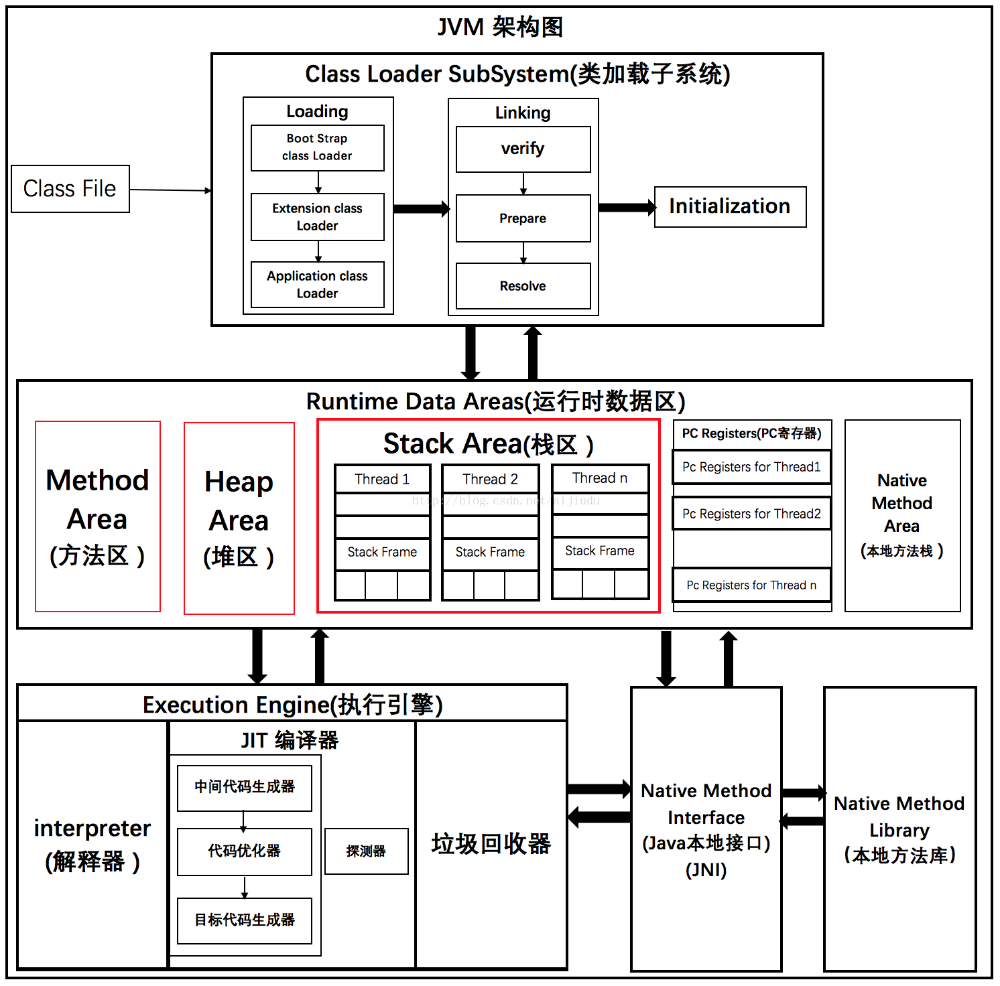                      | 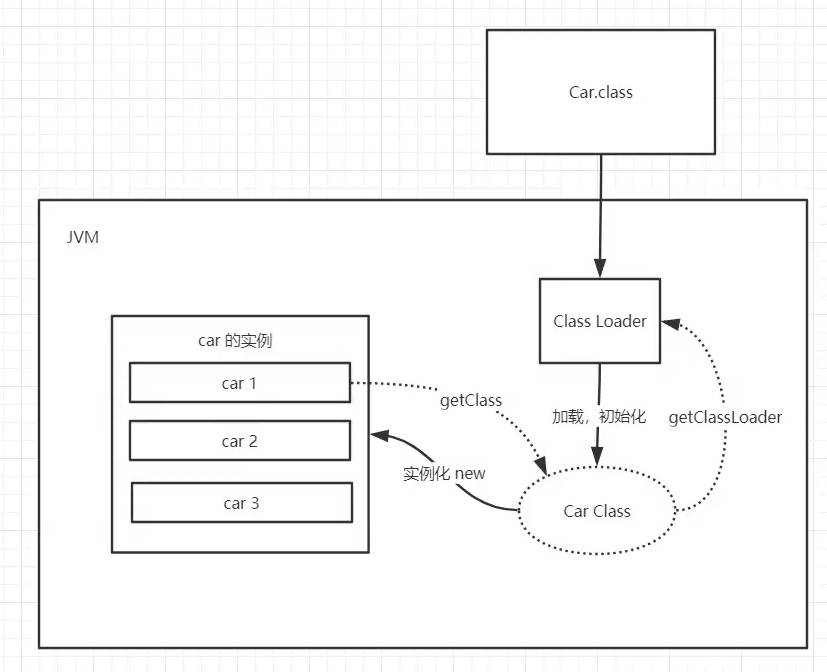 |
| -------------------------------------------------- | -------------------------------------------------- |
| 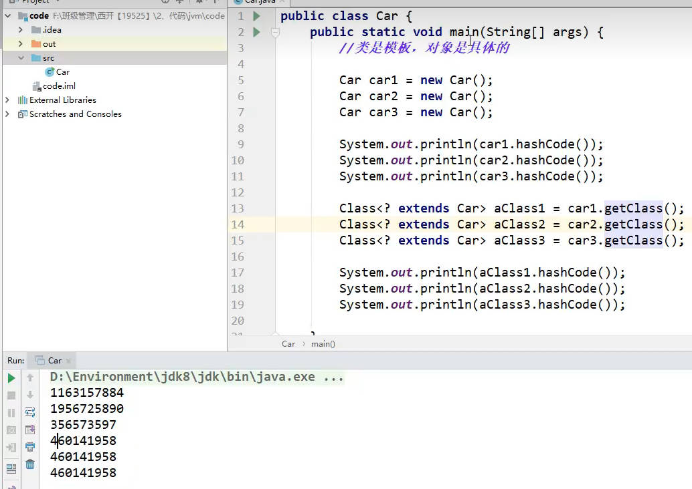 |                                                    |

## 4、沙箱安全机制

[java的沙箱安全机制](https://blog.csdn.net/sj8921202/article/details/121494675)

沙箱是一个限制程序运行的环境

`v1.1增加安全策略(受信任)，指定远程代码对本地资源的访问权限 -> v1.2增加代码签名 -> 最新的加入了域`

## 5、Native、方法区

> 1. Native
>    1. 凡是带了native关键字，就说明java处理不了。他要调用底层的c语言的库
>    2. 进入本地方法栈，调用本地方法接口JNI   java native interface
>    3. JNI作用，扩展java的使用，融合不同语言为java所用
>    4. 诞生！c，c++横行，为了立足，必须调用c库代码
>    5. 在内存区域中专门开辟一块标记区域，Native Methond Stack（本地方法栈） 登记native方法
>    6. 现在调用其他语言，调用其他接口：http、restful、socket、webService等
> 2. PC寄存器
>    1. 程序计数器： Program Counter Register
>    2. 每个线程都有一个程序计数器，==线程私有==，就是一个指针，指向方法区的方法字节码（用来存储指向对象的一条指令，和即将要执行的代码），在执行引擎读取下一条指令时，是一个非常小的空间，几乎可以忽略不记！
> 3. 方法区
>    1. 方法区是被==所有线程共享==，所有字段和方法字节码，以及一些特殊方法，如构造函数，接口代码定义也在此，简单说，所有定义的方法的信息都保存在该区域，次区域属于**共享空间**
>    2. 方法区存：==静态变量（static），常量（final），类信息==（构造方法， 接口定义），运行时的==常量池==存储在方法区！**实例变量存储在堆内存，和方法区无关
>       1. 类Test里面，  name=qinjiang;  字符串qinjiang在常量池， 变量name在方法区； new Test，test1引用地址在栈，具体值在堆，如果name不赋值，就去常量池拿，

| 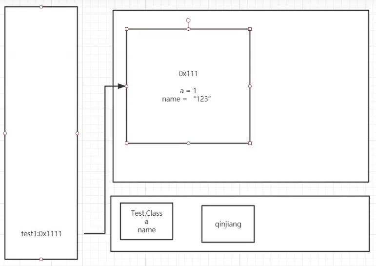 | 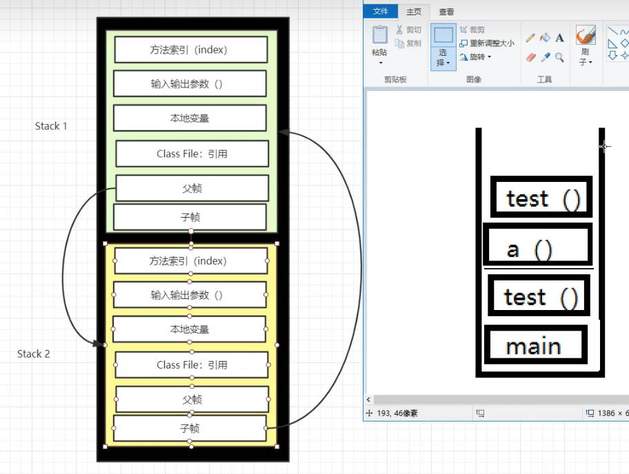 |
| -------------------------------------------------- | -------------------------------------------------- |

## 6、栈

> 1. 程序 = 数据结构 + 算法
> 2. 栈：先进后出； 队列：先进先出,2头开口
>    1. 栈内存，主管程序的运行，==生命周期和线程同步==，线程结束，栈内存也就是释放，对于栈来说，不存在垃圾回收问题，一旦线程结束，栈就over。
>    2. main()方法先执行，后结束
>    3. ==栈里放什么==：8大基本类型 + 对象引用(存一个引用地址) + 实例的方法；数据为线程私有
>    4. 栈帧：==栈的运行以栈帧的形式存在==。 例如：里面放2个方法-方法1、方法2，方法调用要有index索引；方法的参数； Class File类(引用)；【 帧与帧之间是有关系的，上一个、下一个是哪个栈帧,最底的子帧调用上面的栈帧，上面的父帧调用下面的栈帧】
>    5. 程序正在执行的方法，一定在栈的顶部
>    6. new一个类时，往栈里放一个引用名字，往堆里实例化一个类，最后引用指向这个类的实例
>    7. 画出一个对象的实例化过程

## 7、HotSpot和堆

[JVM的内存区域划分以及垃圾回收机制详解](https://www.cnblogs.com/ludashi/p/6694965.html)  [元空间替换持久代](https://blog.csdn.net/JacksonKing/article/details/105517318) [metaspace](https://www.cnblogs.com/colin-xun/p/14184845.html) [JVM内存运行时区域划分](https://www.cnblogs.com/jackion5/p/10629538.html) [JVM内存区域详解](https://zhuanlan.zhihu.com/p/43279292) [JVM运行时内存区域划分](https://www.jianshu.com/p/d188cf916ea5)

> 1. 三种JVM：**Sun公司的HotSpot**、 **Orache JRockit，原先叫Bea JRockit** 、 IBM J9 vm
> 2. 一个jvm只有一个堆内存，堆内存大小是可以调节的！ `Run/Debug Configurations -> VM options`
> 3. 类加载器读取了类文件后，： **类，类的方法，常量，变量**， 保存引用类型的真实对象
> 4. 堆内存细分为3大区域
>    1. 新生区
>       1. 伊甸区eden：所有的对象都是在伊甸园区new出来的
>       2. 幸存区survivor（**动态！**）：垃圾回收没干掉，活下来放到幸存区，幸存区分 0区 / from、  1区 / to
>    2. 老年区
>    3. 永久区
>       1. 常驻内存，存放JDK自带的Class对象，Interface元数据，存储的是java运行时的环境或类信息，不存在垃圾回收！关闭虚拟机，就会释放这个区域的内存
>       2. 元空间逻辑上存在，物理上不存在，物理上只有新生代、老年代
>       3. 一个启动类，加载了大量的第三方jar包，tomcat部署了太多应用，大量动态生成的反射类，可能会导致OOM
>          1. jdk 1.6 ： 永久代，常量池在方法区
>          2. jdk 1.7 ： 永久代，慢慢退化了，去永久代，常量池在堆中
>          3. jdk 1.8 ： 无永久代，常量池在元空间
>    4. 垃圾回收分
>       1. 轻量级(轻GC)：针对新生区，幸存区满用轻GC
>       2. 重量级(full GC)：养老区都满了
>       3. Gc垃圾回收，主要在伊甸园区和养老区
> 5. 堆内存调优

| 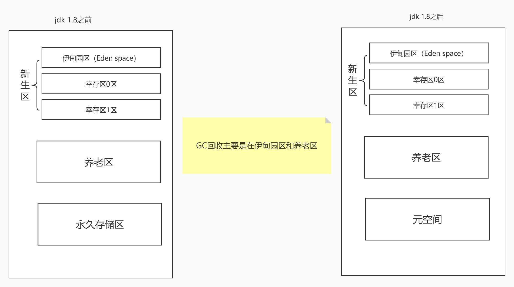 | 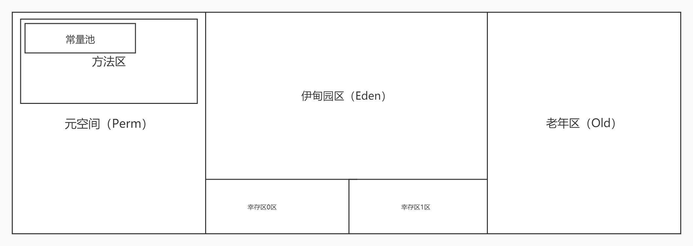 |
| --------------------------------------- | --------------------------------------- |

```java
public class Memory {
    public static void main(String[] args) {
        // 虚拟机试图使用的最大内存
        long maxMemory = Runtime.getRuntime().maxMemory();
        // jvm的初始化总内存
        long totalMemory = Runtime.getRuntime().totalMemory();

        // 默认情况下： 分配的总内存 是 电脑内存的1/4; 初始化内存是电脑的 1/64！
        System.out.println("最大内存 max = " + maxMemory + " 字节; " + (maxMemory / (double) 1024 / 1024) + " MB ");
        System.out.println("总内存 total = " + totalMemory + " 字节; " + (totalMemory / (double) 1024 / 1024) + "MB");

       
        // 我们分配堆空间大小！ 命令
        // -Xms1024m -Xmx1024m -XX:+PrintGCDetails
      
    }
}
```

## 8、Jprofiler分析OOM原因

> 1. 内存快照分析工具！ MAT（eclipse集成的内存快照分析工具），Jprofiler（idea 集成的内存快照分析工具）
> 2. ==Dump内存文件==（转存：堆内存拍个快照），快速定位内存泄露
>    1. ` -Xms1m -Xmx8m -XX:+HeapDumpOnOutOfMemoryError`
>    2. 获取堆中的数据
>    3. 获得大的对象
>    4. References引用、Time哪些东西占用的时间长，左边堆内容、跟cpu相关、线程相关等

| 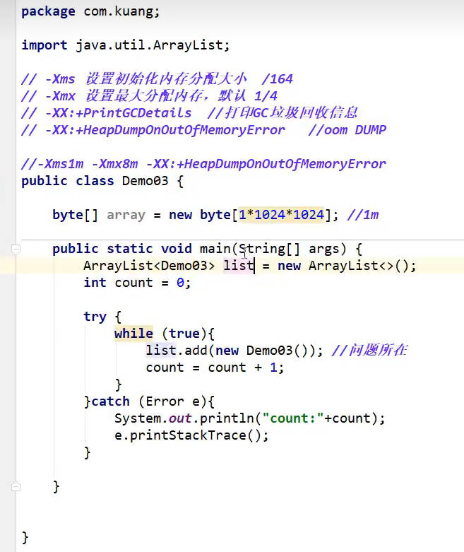 |      |
| -------------------------------------------------- | ---- |

```java
public class Test01 {
    byte[] arr = new byte[1 * 1024 * 1024];

    public static void main(String[] args) {

        ArrayList<Test01> list = new ArrayList<>();

        // -Xms1m -Xmx8m -XX:+HeapDumpOnOutOfMemoryError
        int count=0;
        try {
            while (true) {
                list.add(new Test01());
                count=count+1;
            }
        } catch (Exception e) {
            System.out.println("count:" + count);
            e.printStackTrace();
        }
    }
}
```

## 9、GC_引用计数法

> 1. GC在垃圾回收时，不是对三个区域统一回收。大部分都是，回收新生代
> 2. 轻GC：普通GC，针对新生代，偶尔幸存区(幸存区满)
> 3. 重GC：全局GC，所有的清一遍
> 4. 引用计数法
>    1. 假设对象A用了1次，就加个1，对象B用3次，就加个3，对象C没用，就0，先给每个对象分个计数器，0次的就清除到幸存区

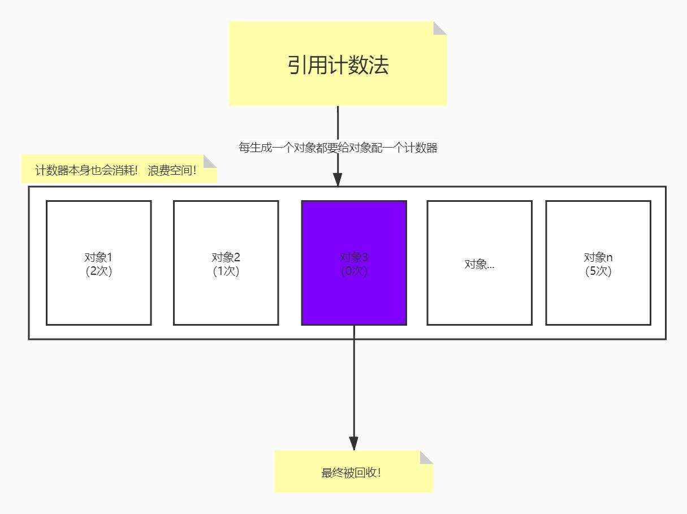

## 10、GC_复制算法

[复制算法](https://www.qyyshop.com/info/594825.html)

> 1. 幸存区是动态的，谁空谁是to
> 2. 复制算法：from区复制到to区
>    1. 第一次GC，绿色的对象移到to区，from区绿色的也移到to，这时from空了，变成to区
>    2. 每一次GC后，伊甸园区、to区都是空的
>    3. from区对象在15次GC后，仍然没有被回收的移到老年区，回收的就被清除
>       1. 好处： 没有内存碎片！
>       2. 坏处：浪费内存空间 ！ 多了一半空间永远是空的(to区)！
>       3. 最佳使用场景： 极端情况下，对象100%存活（对象不会被回收！），这时from复制到to，所有地址要重做一遍，成本很高，所以复制算法适用对象存活度较低！ —> 新生区

| 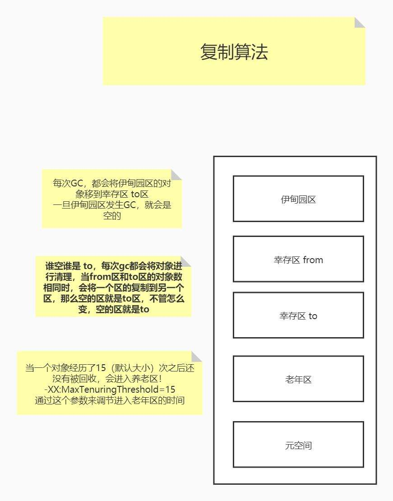 | 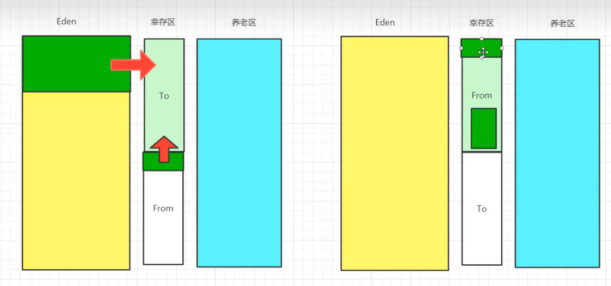 |
| --------------------------------------- | -------------------------------------------------- |

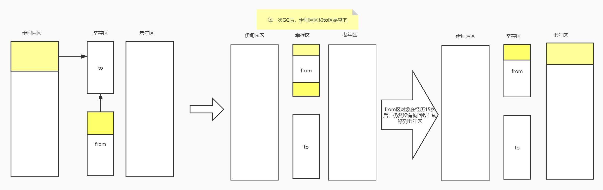

## 11、GC标记压缩清除算法

> 1. 标记：每用一次对象，就标记一次！然后清除！
>    1. 例如：绿色的是活着的对象，对活着的进行标记
> 2. 清除：清除没有标记的对象； GC后，清除过的位置就空出来了
>    1. 好处：不需要额外的空间！
>    2. 坏处：两次扫描严重浪费时间！ 会产生内存碎片
> 3. 压缩：再次扫描，排序

| 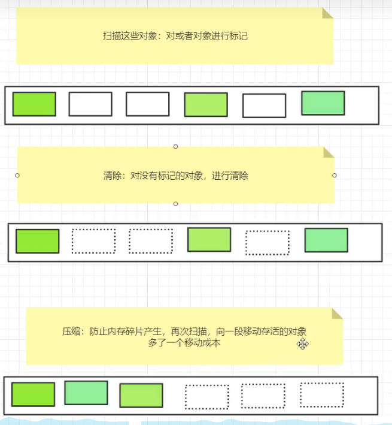 | 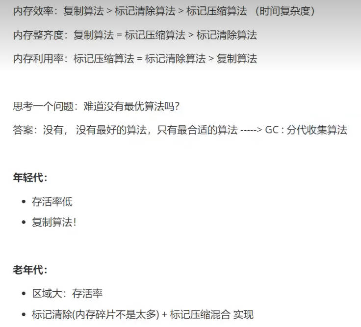 |
| -------------------------------------------------- | -------------------------------------------------- |

## 12、GC算法总结

> 1. 没有最好的算法，只有最适合的算法！ 所以GC也称为：分代收集算法
>    1. 年轻代： 存活率低 使用**复制算法**
>    2. 老年代： 存活率高 使用**标记清除（内存碎片不是很多）+ 标记压缩混合（内存碎片多了之后压缩一次）**

## 13、快速学习-JMM

[JMM和底层实现原理 ](https://www.jianshu.com/p/8a58d8335270)    [JMM(java Memory Model) ](https://www.cnblogs.com/caiyao/p/9358842.html)  [ 缓存一致性问题](https://blog.csdn.net/weixin_54040016/article/details/128656269)  [高速缓存与一致性](https://www.zhihu.com/column/cpu-cache)  [内存8种交互操作 ](https://www.cnblogs.com/null-qige/p/9481900.html)  [深入解析JMM原理](https://blog.csdn.net/jinxinxin1314/article/details/106700414?ops_request_misc=%7b%22request%5fid%22%3a%22161744592816780265434767%22%2c%22scm%22%3a%2220140713.130102334..%22%7d&request_id=161744592816780265434767&biz_id=0&utm_medium=distribute.pc_search_result.none-task-blog-2~all~top_positive~default-1-106700414.first_rank_v2_pc_rank_v29&utm_term=jmm)

> 1. java内存模型 (Java Memory Model )
>    1. 类似于MSI等 **缓存一致性协议**，用于定义数据读写的规则
>    2. ==JMM定义了线程和主内存之间的抽象关系==：线程之间的共享变量存储在主内存（Main Memory）中，每个线程都有一个私有的本地内存（Local Memory），本地内存中存储了该线程以读/写共享变量的副本
>    3. 解决共享对象可见性： voliate关键字
>
> 2. 理解
>
>    1. JVM对应的是==物理机==，它有存放数据的==存储区==：堆、栈等由JVM管理的内存（对应于物理机的内存）、执行==数据计算==的执行单元：线程（对应于物理机的CPU）、==加速线程执行==的**线程本次存储区**：可能会从存储区里分配一块空间来存储线程本地数据，比如栈（对应于物理机的cache）
>    2. 多个处理器共享主内存。为了提升性能，会在每个处理器上增加一个小容量的cache加速数据读写。cache会导致了==缓存一致性问题==； 为了解决缓存一致性问题又引入了一系列==Cache一致性协议==（比如MSI、MESI、MOSI、Synapse、Firefly及Dragon Protocol）来解决CPU本地缓存和主内存数据不一致问题。
>    3. ==JMM类似于缓存一致性协议==， 用于定义数据读写规则
>
> 3. Java内存模型带来的问题
>
>    1. 可见性问题
>       1. 线程从主存中拷贝共享对象obj到它的CPU缓存，把对象obj的count变量改为2。但这个变更对运行在右边CPU中的线程不可见，因为这个更改还没有flush到主存中：要解决共享对象可见性这个问题，我们可以使用java volatile关键字或者是加锁
>    
>       2. 线程中改了，保证同步刷新到主存中，  volatile关键字，其他线程就能拿到最新数据
>    
>       3. 内存8种交互操作
>    
>    2. 竞争现象

| 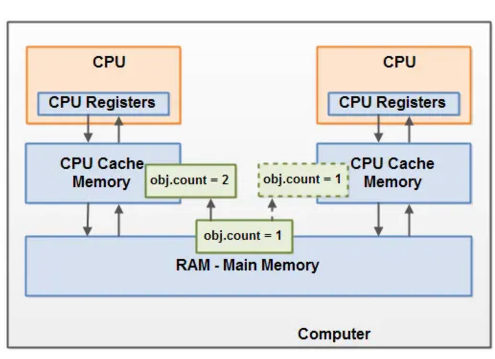 | 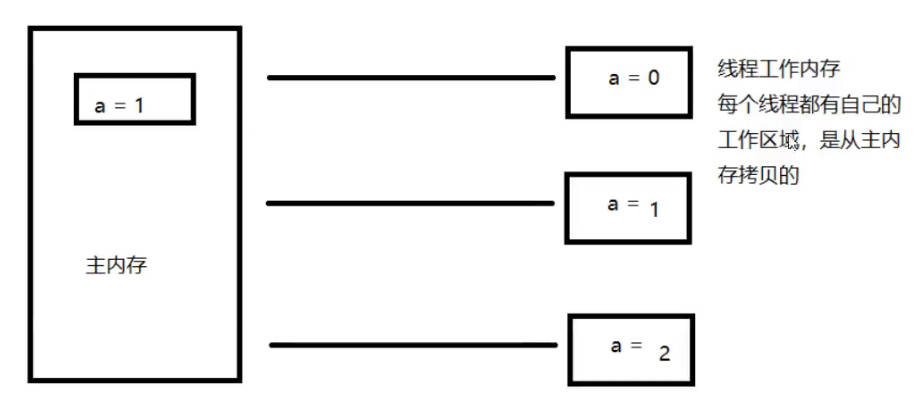 |
| -------------------------------------------------- | -------------------------------------------------- |

## 14、JProfiler

[JProfiler 13.0.4 ](https://softoroom.org/ptopic87788.html)  [ JProfiler 13.0.5 Crack](https://startcrack.co/ej-technologies-jprofiler-crack-serial/)  [ jProfiler](https://blog.csdn.net/munangs/article/details/124262166)   [JProfiler中文帮助文档](https://www.ej-technologies.com/resources/jprofiler/v/13.0/help_zh_CN/doc/heapWalker/overhead.html)   [JProfiler API](https://www.ej-technologies.com/resources/jprofiler/v/13.0/help/api/javadoc/index.html)   [JVM TI ](https://www.cnblogs.com/zhaozhengwu/p/10774743.html)  [JProfiler 最佳实践](https://www.alibabacloud.com/blog/jprofiler-best-practices-powerful-performance-diagnostic-tool_594958)

### 1、介绍

JProfiler处理四个主要问题:

- **方法调用**

  称为"CPU分析"。 分析方法调用可以==了解应用程序正在做什么==，并找到提高其性能的方法

- **分配**

  分析堆上对象的分配、引用链和垃圾回收属于"内存分析"的范畴。 这个功能可以解决内存泄漏，总之使用更少的内存，分配更少的临时对象。

- **线程和锁**

  线程可以持有锁，例如通过在一个对象上做同步。当多个线程协作时，可能会出现死锁，JProfiler可以为你可视化这种情况。 此外，锁可能被争用，这意味着线程在获得锁之前必须等待。通过JProfiler可以深入了解线程及其各种锁情形。

- **高层子系统**

  许多性能问题发生在更高的语义层面。例如，对于JDBC调用，你可能想找出哪条SQL语句是最慢的。 对于这样的子系统，JProfiler提供了"探针"，将特定有效载荷附加到调用树。

### 2、JProfiler架构

- 分析代理 
  -  代理记录数据，UI显示分析数据，UI通过Socket连接到分析代理； 也可以通过[MBean](https://en.wikipedia.org/wiki/Java_Management_Extensions)来控制分析代理
  - 控制分析代理的另一种方法是使用一组预定义的触发器和操作。通过这种方式，分析代理可以在无人看管的模式下运行。 这在JProfiler中被称为"离线分析"，对于自动分析会话非常有用
- 快照
  - UI可以显示实时分析数据，但经常需要保存记录所有分析数据的快照。 快照可以在JProfiler UI中手动保存，也可以通过触发器操作自动保存

### 3、分析JVM

- 要对一个JVM进行分析，JProfiler的分析代理必须被加载到该JVM中。通过两种方式实现： 通过在启动脚本中指定一个`-agentpath` VM参数，或者通过Attach API将代理加载到已经运行的JVM中； 添加VM参数是分析的首选
- JVMTI (JVM Tool Interface) , 是Java 虚拟机所提供的native编程接口

### 4、记录数据

- 标量值和遥测
- 分配记录 ：实时内存
- 内存分析 ：堆遍历器
- 方法调用记录 ：CPU视图
- Monitor记录 ：Monitor & 锁
- 探针记录 ：数据库

### 5、快照

- 从正在被分析的JVM，内部运行的分析代理获取数据的实时会话情形。 JProfiler还支持快照，所有分析数据都被写入了快照文件
- 优势
  - 可以自动化记录分析数据
  - 比较不同分析会话的分析数据 或 查看旧的记录
  - 与他人共享分析数据

## 15、java值传递_引用传递

**pass by reference** ； <a href="#top" name="bottom">返回上面</a>

### 1、==形参与实参==

1. 形参：只有在被==调用期间才会分配内存空间== (生命周期开始)，在方法执行完成后，就会被销毁释放空间
2. 实参：在方法被调用前就已经被初始化，并且在方法被调用时传入

### 2、==Java的数据类型==

1. 数据类型，是对内存的一种抽象表达, 程序由代码文件和静态资源组成 
2. 数据类型实质上是相同类型的数据的存储形式 
3. Java的数据类型: 
   1. 基本类型: 四大类八种类型
   2. 引用类型：引用也叫句柄，引用类型，是在句柄中存放着,实际内容所在地址的==地址值==的一种数据形式, ==引用类型主要包括: 类、接口、数组== ； 
   3. 栈中有基本类型和对象句柄，基本类型又叫值类型，对象句柄又叫引用类型；java中的方法值中传值时，就有了值传递和引用传递
   4. 有了数据类型，JVM对程序数据的管理就规范化了，不同的数据类型，它的存储形式和位置是不一样的

### 3、==JVM内存==

[Java方法区 ](https://baijiahao.baidu.com/s?id=1767025926654459345&wfr=spider&for=pc) [Java方法区](https://mikechen.cc/28971.html) [JVM方法区](https://www.cnblogs.com/tod4/p/17546890.html) 

1. java代码被编译器编译成字节码之后，JVM开辟一片内存空间（也叫运行时数据区），通过类加载器加到到运行时数据区来存储程序执行期间需要用到的数据和相关信息， 由以下几部分组成：栈、堆、方法区、本地方法栈、程序计数器
   1. 栈：
      1. 栈中存栈帧，==每个栈帧对应一个被调用的方法==，方法的调用过程对应栈帧在虚拟机中入栈到出栈的过程
      2. 栈是线程私有的，也就是线程之间的栈是隔离的；当程序中某个线程开始执行一个方法时就会相应的创建一个栈帧并且入栈（位于栈顶），在方法结束后，栈帧出栈
      3. ==栈帧中包括==: 局部变量表（存局部变量：非静态变量、函数形参）、指向运行时常量池的引用、 方法执行完的返回地址、 操作数栈、 附加信息
   2. 堆：
      1. 存储对象本身和数组，JVM只有一个堆，因此，堆被所有线程共享
   3. 方法区：
      1. 所有线程共享
      2. 存储的内容有：类的全路径名、类的直接超类的全限定名(包名+类型)、类的访问修饰符、类的类型（类或接口）、类的直接接口全限定名的有序列表、常量池（字段，方法信息，静态变量，类型引用（class））等
   4. 本地方法栈：
   5. 程序计数器：
2. javac  Hello.java，会生成一个class文件；   javap -v Demo.class 将class文件反编译成字节码

### 4、==数据如何在内存中存储==

1. Java中的数据类型有基本数据类型和引用数据类型
2. 基本数据类型的存储:
   1. 基本数据类型的==局部变量==: 写int age=50；分为两步，变量名及字面量值都==存储在栈中==，而且是真实的内容
      1. 基本数据类型的数据本身不会改变，当局部变量重新赋值时，并不是在内存中改变字面量内容，而是重新在栈中寻找已存在的相同的数据，若栈中不存在，则重新开辟内存存新数据，并且把要重新赋值的局部变量的引用指向新数据所在地址
   2. 基本数据类型的==成员变量==：类中定义的变量,  成员变量名和值都==存储于堆中==，其生命周期和对象的一致
   3. 基本数据类型的==静态变量==: 静态变量名以及值==存储于方法区的运行时常量池中==，静态变量随类加载而加载，随类消失而消失
3. 引用数据类型的存储：
   1. Person per=new Person(); 分2步，`Person per;//定义变量   per=new Person();//赋值`
   2. 执行Person per;时，JVM先在栈的变量表中开辟一块内存存放per变量，在执行per=new Person()时（赋值时），JVM创建一个Person类的实例对象, 并在堆中开辟一块内存存储这个实例，同时把实例的地址值赋值给per变量
   3. 因此，对于引用数据类型的对象/数组，变量名存在栈中，变量值存储的是对象的地址，并不是对象的实际内容

### 5、==值传递和引用传递==

1. 值传递：  在方法被调用时，实参通过形参把它的内容副本传入方法内部，此时==形参接收到的内容是实参值的一个拷贝==，因此在方法内对形参的任何操作，都仅仅是对这个副本的操作，不影响原始值的内容
2. 引用传递：方法调用时，==实参的地址==通过方法调用==被传递给形参==，在方法体内，形参和实参指向同一个内存地址，对形参的操作会影响真实内容

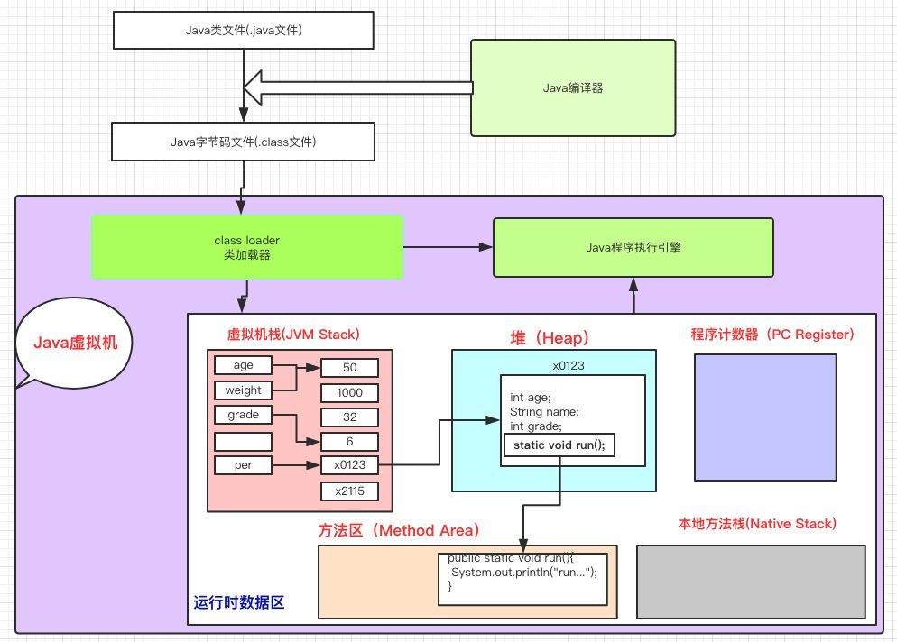

| 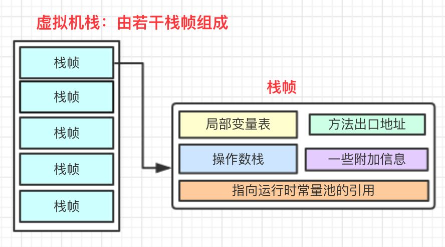          | 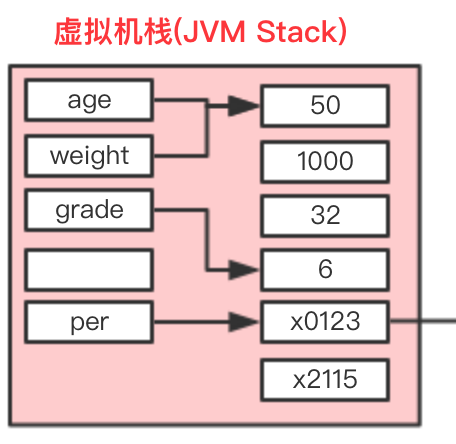 |
| ------------------------------------ | -------------------------------- |
| 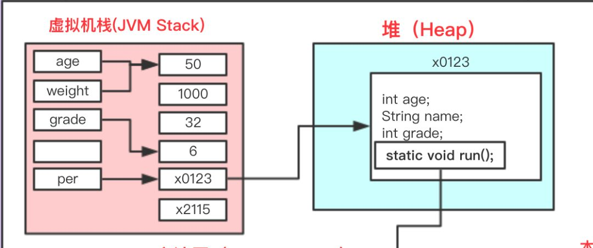 | 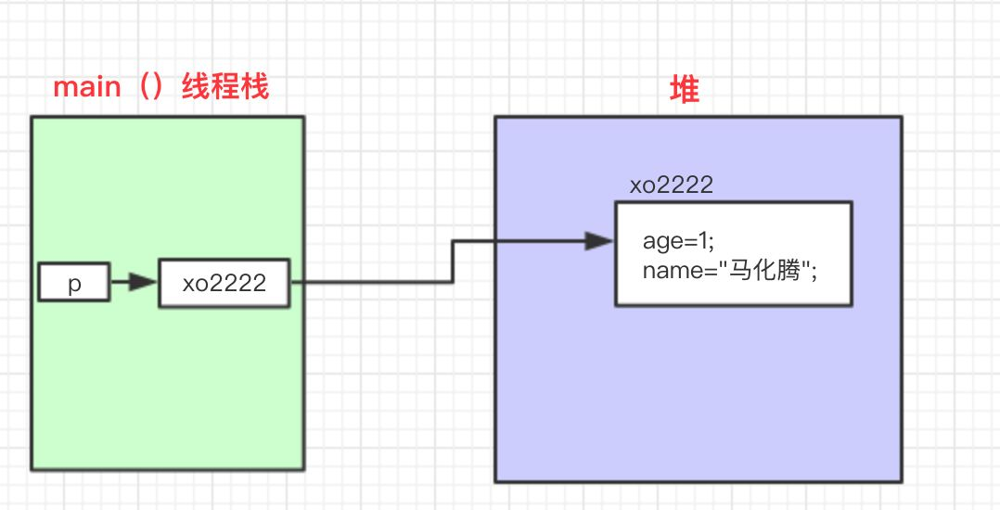        |

## 16、Java代码编译和执行

[Java代码编译和执行的整个过程(二)](https://zhuanlan.zhihu.com/p/32453534)  [(一) ](https://zhuanlan.zhihu.com/p/32453148) [JVM一览](https://www.jianshu.com/p/2c068ef285cb)

Java代码==编译和执行过程==包含三个重要的机制：

- Java源码编译机制
- 类加载机制
- 类执行机制

### 1、源码编译

==生成class文件==

Java ==源码编译==由三个过程组成：

- 分析和输入到符号表
- 注解处理
- 语义分析和生成class文件

最后生成的==class文件组成==：

- 结构信息。包括class文件格式版本号及各部分的数量与大小的信息
- 元数据。对应于Java源码中声明与常量的信息。包含类/继承的超类/实现的接口的声明信息、域与方法声明信息和常量池
- 方法信息。对应Java源码中语句和表达式对应的信息。包含字节码、异常处理器表、求值栈与局部变量区大小、求值栈的类型记录、调试符号信息

### 2、类加载

JVM的类加载是通过ClassLoader及其子类来完成的，类加载分层次关系和加载顺序

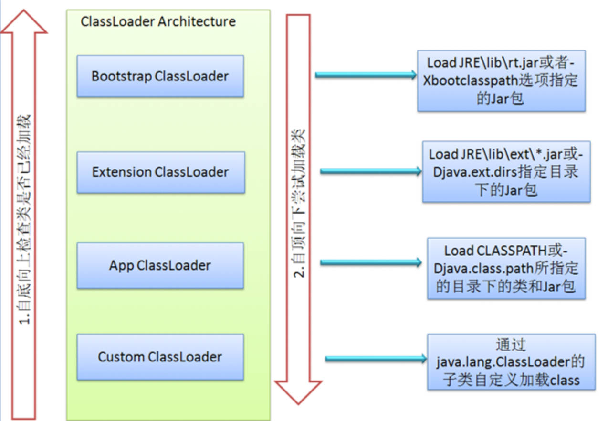

### 3、类执行

JVM基于栈的体系结构来执行class字节码,

- 线程创建后，产生程序计数器（PC）和栈（Stack）
  - 程序计数器存放==下一条要执行的指令==在方法内的偏移量
  - 栈中存放一个个栈帧，每个栈帧对应着每个方法的每次调用
    - 栈帧又有==局部变量区和操作数栈==两部分组成,  一个栈帧包括==局部变量表、操作数栈、返回地址等==
    - 局部变量区用于存放==方法中的局部变量和方法参数==，操作数栈存放==方法执行过程中产生的中间结果==

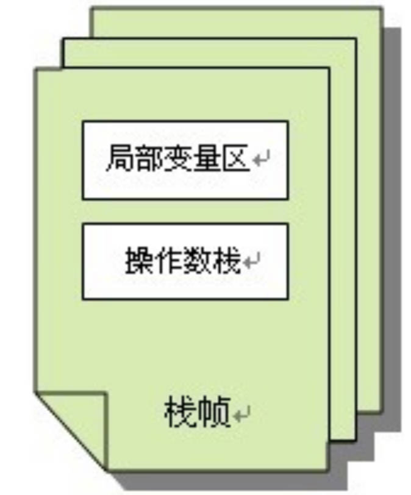
