## 1. Java基础概述

md: [java知识汇总](.\java知识汇总)

`Pandoc是由John MacFarlane开发的标记语言转换工具，可实现不同标记语言间的格式转换，堪称该领域中的“瑞士军刀”。`

教程： [课程](https://www.kuangstudy.com/course)  [JavaSE总结](https://www.bilibili.com/video/BV12J41137hu?p=80&vd_source=7346303e5e18677d7261c2c0c109ecfd)  [狂神说注解和反射](https://www.bilibili.com/video/BV1p4411P7V3?vd_source=7346303e5e18677d7261c2c0c109ecfd)  [狂神说bilibili](https://space.bilibili.com/95256449/channel/seriesdetail?sid=393820)  [JDK1.8 API ](https://www.cnblogs.com/qingjiawen/p/13657514.html)   [Java视频](https://www.bilibili.com/video/BV1CJ411m7gg?spm_id_from=333.999.0.0&vd_source=7346303e5e18677d7261c2c0c109ecfd)  [基本数据类型 ](https://zhuanlan.zhihu.com/p/25439066) 
[UML使用范围](https://www.jianshu.com/p/179f47056d37)  [UML组成结构](https://blog.csdn.net/qiqibei666/article/details/80187286)   

[拒绝访问kuangstudy](https://blog.csdn.net/weixin_46573158/article/details/119389301)

[java中if用法省略大括号](https://blog.51cto.com/u_16175471/6898335):仅当if语句块中只有一条语句时才能这么做。如果if语句块中有多条语句，就不能省略大括号

### 1、比较器迭代器小结

[比较器_YOOTK沐言优拓_李兴华](https://www.bilibili.com/video/BV147411j7ei?p=15&vd_source=7346303e5e18677d7261c2c0c109ecfd)  [迭代器之：fail-fast](https://www.bilibili.com/video/BV1MU4y1U71B/?spm_id_from=333.788&vd_source=7346303e5e18677d7261c2c0c109ecfd)  [Comparator接口](https://www.bilibili.com/video/BV1zD4y1Q7Fw?p=31&spm_id_from=pageDriver&vd_source=7346303e5e18677d7261c2c0c109ecfd)

常用类-其他里有详细笔记

1. 实现==Comparable==接口， 重写方法:`compareTo(T o)`;   Arrays.sort(数组)
2. ==comparator==: 提供专属的比较器实现类， sort(数组，new 实现类())
   1. 参数里的Comparator：要写==实现Comparator接口方法的对象==
3. 集合里==TreeSet 二叉树==(排序必须实现Comparable接口)

### 2、JDK提供的函数式接口

源码方法参数里的，4种类型函数式接口怎么写： 和比较器类似，写实现接口方法的对象

- 匿名内部类：new 实现类()；  或者用lambda表达式； 或者写一个专属的比较器实现类

### 3、泛型

[泛型好处](https://www.bilibili.com/video/BV1zD4y1Q7Fw?p=21&vd_source=7346303e5e18677d7261c2c0c109ecfd)    [Java 泛型](https://www.runoob.com/java/java-generics.html)  [泛型规则](https://www.bilibili.com/video/BV1fu411h7AA/?spm_id_from=333.788&vd_source=7346303e5e18677d7261c2c0c109ecfd)

[泛型基本写法_前端乐哥](https://www.bilibili.com/video/BV1VS4y1U7Pj?p=26&vd_source=7346303e5e18677d7261c2c0c109ecfd)    [Java 泛型  ](https://www.runoob.com/java/java-generics.html)  [方法声明中static后的表示什么意思](https://zhidao.baidu.com/question/489108221655560652.html) 

千锋教育_集合框架里讲的最好 

### 4、Stream

[Stream流操作](https://www.bilibili.com/video/BV1X44y187EB/?spm_id_from=333.337.search-card.all.click&vd_source=7346303e5e18677d7261c2c0c109ecfd)  [Stream流操作](https://www.bilibili.com/video/BV1Ka4y1P7Sb/?spm_id_from=333.337.search-card.all.click&vd_source=7346303e5e18677d7261c2c0c109ecfd)

集合框架里有详细笔记： 用来对集合操作

## 2、常用类

[Overview (Java SE 13 & JDK 13 )](https://docs.oracle.com/en/java/javase/13/docs/api/index.html)

视频： [千锋教育-常用类](https://www.bilibili.com/video/BV1vt4y197nY/?spm_id_from=333.337.search-card.all.click&vd_source=7346303e5e18677d7261c2c0c109ecfd)  [JavaSE阶段常用类](https://www.bilibili.com/video/BV1PX4y167Xc/?spm_id_from=333.337.search-card.all.click&vd_source=7346303e5e18677d7261c2c0c109ecfd) [尚学堂_常用类](https://www.bilibili.com/video/BV1qL411u7eE/?p=147&spm_id_from=pageDriver&vd_source=7346303e5e18677d7261c2c0c109ecfd) [设计原则](https://www.bilibili.com/video/BV1tv41157J5/?p=11&vd_source=7346303e5e18677d7261c2c0c109ecfd)   [Object_toString](https://www.bilibili.com/video/BV1314y1x7WS?p=83&vd_source=7346303e5e18677d7261c2c0c109ecfd)  [内部类](https://www.bilibili.com/video/BV1vt4y197nY/?p=17&spm_id_from=pageDriver&vd_source=7346303e5e18677d7261c2c0c109ecfd)  [常用类](https://www.bilibili.com/video/BV1tA411j7m8/?p=1&vd_source=7346303e5e18677d7261c2c0c109ecfd)  [韩顺平 零基础30天学会Java](https://www.bilibili.com/video/BV1fh411y7R8/?spm_id_from=333.337.search-card.all.click&vd_source=7346303e5e18677d7261c2c0c109ecfd)   

[JDK8包列表](https://www.cnblogs.com/jpfss/p/8662217.html)  [java、javax、sun、org包区别](https://blog.csdn.net/pan_junbiao/article/details/85004464)

[NIO包_*非阻塞通信*](https://www.baidu.com/s?ie=UTF-8&wd=NIO包) [NIO包及工作原理](https://blog.csdn.net/liziyun537/article/details/6654454) [java.rmi_远程方法调用](https://baike.baidu.com/item/java.rmi/5180231?fr=ge_ala) [RPC和RMI](https://www.cnblogs.com/woodx/p/17434511.html) [分布式通讯方式比较（RPC、RMI、JMS、WebService、TIBCO）](https://blog.csdn.net/weixin_41422086/article/details/125544593) [javax.JWS(Java Web Service)_远程调用](https://blog.csdn.net/wangmx1993328/article/details/86646656)

[包装类 ](https://www.cnblogs.com/john1015/p/13870276.html) [八种包装类](https://blog.csdn.net/weixin_57858263/article/details/124613853)  [8大常用类学习](https://search.bilibili.com/all?keyword=Java常用类学习&from_source=webtop_search&spm_id_from=333.999) [Java 集合框架](https://www.runoob.com/java/java-collections.html)  [Git](https://www.bilibili.com/video/BV1FE411P7B3?spm_id_from=333.999.0.0&vd_source=7346303e5e18677d7261c2c0c109ecfd)  [知识汇总](https://www.bilibili.com/video/BV1734y1n7eg?spm_id_from=333.851.b_7265636f6d6d656e64.2&vd_source=7346303e5e18677d7261c2c0c109ecfd)
[Java 设计模式之设计原则](https://blog.csdn.net/liuwg1226/article/details/119656409)    [七大面向对象设计原则](https://zhuanlan.zhihu.com/p/414072591?utm_id=0)  [面向对象设计原则](https://www.cnblogs.com/rainbow-1/p/15626895.html)  [面向对象设计原则](https://www.cnblogs.com/burner/articles/15156104.html) [软件开发：面向对象设计的七大原则](https://www.yii666.com/blog/466016.html) [七大原则](https://www.rstk.cn/news/66188.html?action=onClick) 
[里氏替换](https://baijiahao.baidu.com/s?id=1766755106580910680&wfr=spider&for=pc)  [面向对象](https://www.jianshu.com/p/9c78d4f8ec31)  [里氏替代原理](https://developer.aliyun.com/article/992515)

[常用类](https://tool.4xseo.com/a/24649.html)  

[idea批量修改变量名](https://www.xjx100.cn/news/537014.html?action=onClick) [String常用方法](https://www.cnblogs.com/denghui-study/p/14321047.html)

[java程序员开发中最常用的100个类](https://www.sohu.com/a/234362281_819383)  [20个常用的Java开发类库和API](https://www.tulingxueyuan.cn/tlzx/jsp/767.html)

> 1. 7个面向对象设计原则
>    1. 单一职责：应该有且仅有一个原因引起类的变更， 系统中的每个类都应该只有一个职责
>       1. **JavaEE中的分层框架模式实际上体现了单一职责原则**：  对于用户操作，可以分解存储数据的实体类User，完成数据库操作的DAO类UserDao、完成业务操作的业务类UserService、显示用户信息的页面userList.jsp，甚至增加负责调度的UserServlet
>    2. ==开闭原则== ： 软件实体应当对扩展开放，对修改关闭
>       1. 软件系统中的各种组件，如模块（Modules）、类（Classes）以及功能（Functions）等，应该在不修改现有代码的基础上，引入新功能
>    3. 里氏替换：多态的思想；  所有引用基类的地方必须能透明地使用其子类的对象
>       1. 如果一个程序中所有使用基类的地方都可以用其子类来替换，而程序的行为没有发生变化，那么这个子类就遵守了里氏替换原则。换句话说，一个子类应该可以完全替代它的父类，并且保持程序的正确性和一致性。
>    4. ==依赖倒置==：核心是面向接口编程； 
>       1. **程序中所有的依赖关系都终止于抽象类或者接口**
>       2. 本质就是通过抽象（抽象类或==接口==）使各个类或模块的实现彼此独立，不相互影响，实现模块间的松耦合 面向要求进行依赖
>       3. 例如：现代电脑依赖于插槽（规范）
>    5. 接口隔离
>       1. **建立单一接口，不要建立庞大臃肿的接口，尽量细化接口，接口中的方法尽量少**，  也就是说，要为各个类==建立专用接口==，而不要试图去建立一个很庞大的接口供所有依赖它的类去调用
>       2. 售票窗口排队的人有买票的，有查开车信息，有退票的，不必排在同一窗口中。多开几窗口，每个窗不同功能，让不同需求的人排在不同窗口，可以节约时间和人力
>    6. ==迪米特法则==
>       1. 降低类之间的耦合，  外观模式和中介者模式都是迪米特法则的应用
>       2. 一个对象应该对其他对象保持最少的了解
>          1. 一个类应该对自己需要耦合或调用的类知道得最少，你（被耦合或调用的类）的内部是如何复杂都和我没关系，那是你的事情，我就知道你提供的这么多 public 方法，我就调用这么多，其他的我一概不关心
>       3. 只和朋友通信，不和陌生人说话：  买房找一个中介即可，不用是认识很多卖房人。去医院看病不用自己知道所有科室的位置，找一个导医即可
>    7. 组合/聚合复用
>       1. 当一个类想使用另一个类的功能时，优先使用对象的组合，而不是继承，尽量多使用组合
> 2. 类和类之间的6种关系
>    1. UML：为软件开发的所有阶段提供模型化和可视化支持，UML定义了10种模型图，对应软件设计开发的不同阶段
>    2. 依赖、关联(组合、聚合)、泛化、实现
>       1. 关联：1对1、 1对多、多对多；  聚合组合是1对多的特例，强调整体和部分关系
>          1. 聚合： 强关联；表示整体与部分之间的关系，飞机场上聚合着飞机，飞机场不在，飞机还可以在，部分可以离开整体单独存在
>          2. 组合： 强聚合，整体与部分的生命周期一致，窗口不在，按钮菜单都不在，部分不能离开整体单独存在；聚合箭头空心，组合实心

>  1. Object、Math、Random、File、包装类、Data、String、StringBuffer、StringBuilder
>     1. 基本数据类型在栈，没有方法、属性，要变成对应的引用数据类型
>     2. 包装类：自动装箱和拆箱。因为java面向对象，8大基本类型不是类，要做出一个对应的类。
>  2. java包的位置：  rt.jar
>    3. 基本数据类型在栈，没有方法、属性，要变成对应的引用数据类型
>    4. 装箱：栈里的基本数据类型转换为堆里的对象，基本类型转为引用类型
>    5. 自动装箱拆卸：`Integer integer1=age`  `int age2 = integer1`
>    6. 包装类缓存问题：把-128～127之间数存到缓存，因为操作小数频繁，为了提高效率
>  7. String
>    8. 不可变对象，对象内部成员变量的值无法再改变
>    9. ctrl + F12 查看类所有方法；public native int hashCode(), native说明底层不是java写的，一个java调用非java代码的接口，一个native方法是指该方法的实现由非java语言实现，比如c或c++实现。 
>           1. java本身不能对操作系统底层进行访问和操作，但可通过JNI接口调用其他语言来实现对底层的访问

### 1、Object

- ==getClass==:返回引用中存储的实际对象类型; 2个对象是同一class，那么它们就是同一类型
- toString：返回对象的字符串形式
- equals(): 默认比较2个对象地址是否相同(this==obj)； 可重写，比较2对象内容是否相同
  - if(this\==obj){return true;} 简写为 (this\==obj)

- finalize(): 对象被判定为垃圾对象时，JVM自动调用此方法，==用以标记垃圾对象==，进入回收队列
  - ==System.gc()==;  手动回收，通知JVM执行垃圾回收

### ==2、包装类==

总结：装拆箱、 不同类型相互转换、字符串和基本类型之间转换、Integer缓冲区

[对class文件进行反编译](https://www.cnblogs.com/1998lu/p/9381488.html) [class反编译工具jad、frontEndPlus、jd-gui ](https://blog.csdn.net/PsEmperor/article/details/109247380)

- 基本类型存在栈中，没有方法和属性； 所以sun公司设计了，基本数据类型对应的引用数据类型（基本类型对应的包装类)
- 装箱：基本类型转为包装类引用类型(栈里的基本数据拿到堆里)； 拆箱:堆里拿到栈里,`引用类型转基本类型`
  - ==装箱==： Integer(int value): 用Integer类==构造方法， 也可用valueOf()==
  - ==拆箱==： Number类: ==byteValue==,引用类型转基本类型  ` Integer i1 = new Integer(10);  int i = i1.intValue();`
  - ==自动装箱拆箱==:jdk1.5以后   `Integer i2 = age;   int i3 = i2;`
  - 有6个包装类都继承Number抽象类， xxxValue()，引用类型转基本类型
- 类型转换：基本类型和包装类类型的转换
  - 8种包装类提供==不同类型间的转换==
  - toString(int i, int radix) 重载方法：数字15返回16进制f； 
  - toBinaryString(int i)：二进制形式
  - Integer.parseInt(str)：字符串转int
  
- ==整数缓冲区==:Java预先创建了256个常用的整数包装类对象；
  - 创建了一个数组, Integer cache[], `cache = new Integer[(high - low) + 1];`  valueOf

  - 创建了`-128 到 127`已经实例化好的对象,开发中，这些数字用的频繁，这些对象创建好，进行复用，节省内存消耗

- java反编译工具：将class反编译为java文件
  - XJad、**jd-gui**


| 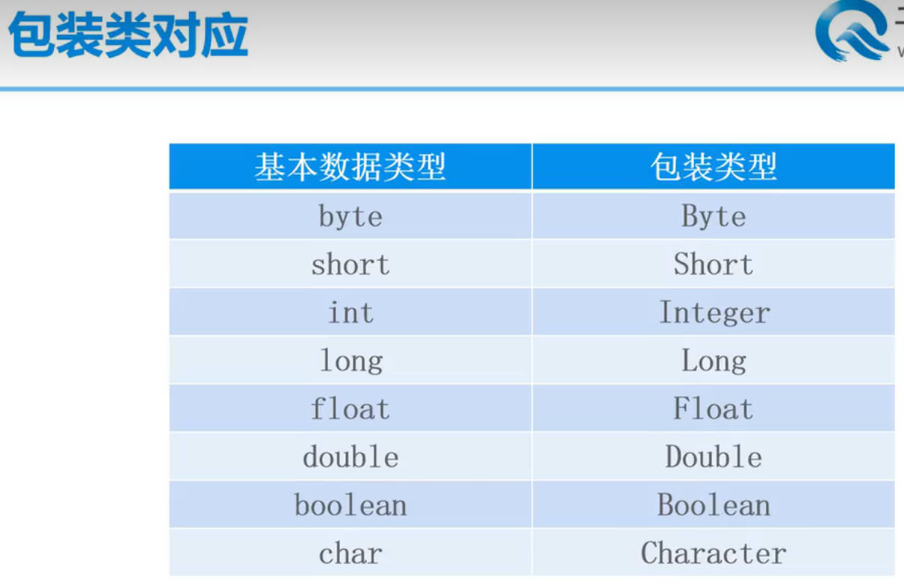 | 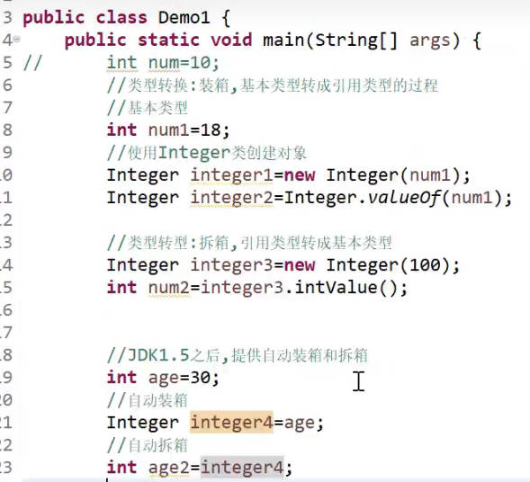 |
| ------------------------------------------------------------ | ------------------------------------------------------------ |
| 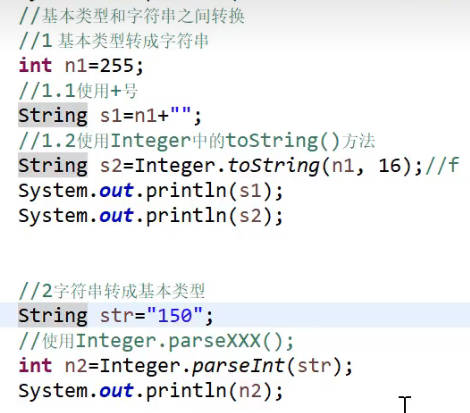 | 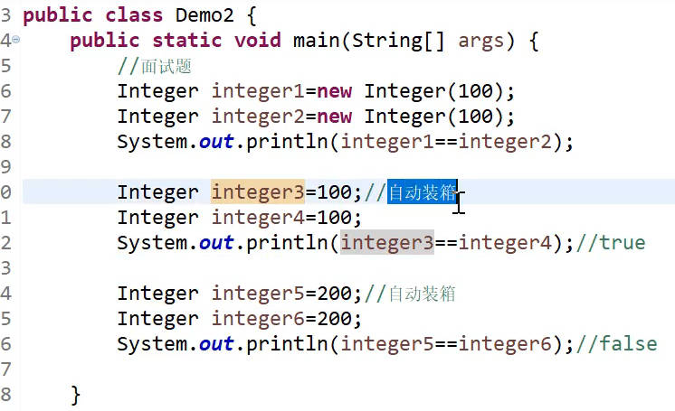 |
| 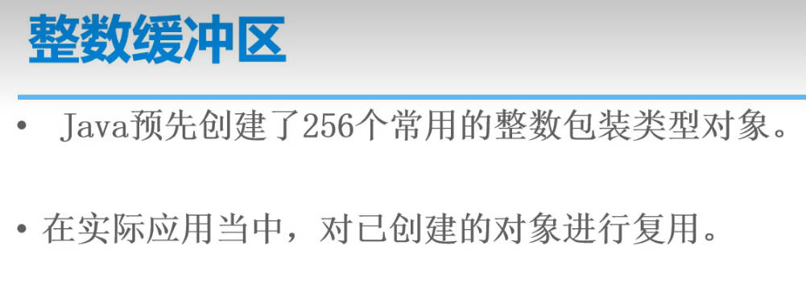 | 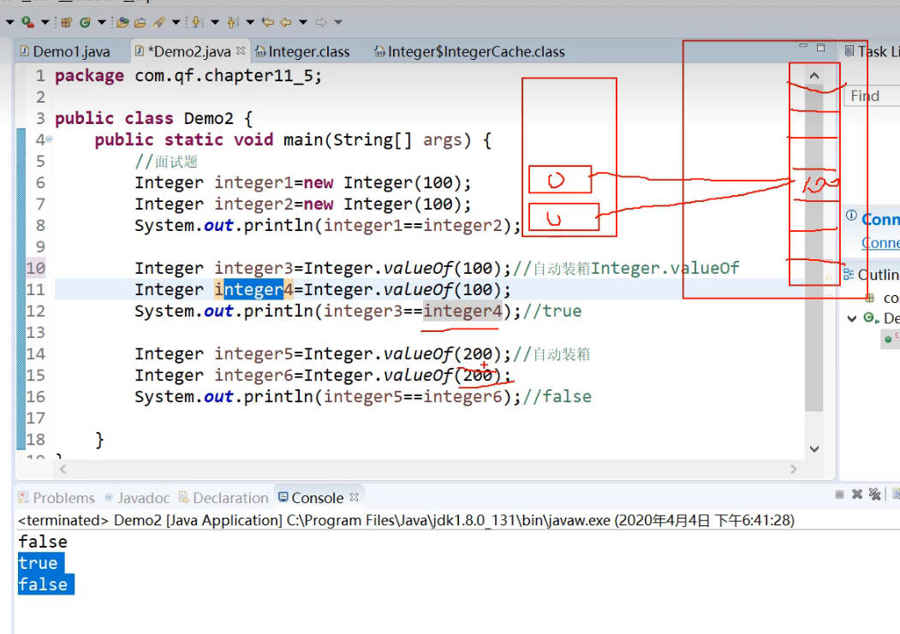 |

#### 2.1 基本类型和字符串转换

### ==3、String==

java.lang.String    [String.Split方法](https://www.cnblogs.com/woaixingxing/p/10838546.html)  [Substring字符串截取](https://baijiahao.baidu.com/s?id=1775559793312657492&wfr=spider&for=pc)

`new String("java")`

- getBytes()：将此 String 编码为 byte 序列，并将结果存储到一个新的 byte 数组
- charAt(int index)：返回某位置字符
- contains(CharSequence s):判断是否包含某字符串
- ==toCharArray==(): 字符串转数组,`Arrays.toString(str.toCharArray())`
- indexOf: 字符串首次出现的位置; `content.indexOf("java", 4)`,跳过前4个字符
- lastIndexOf:字符串最后出现的位置
- ==trim==: 去掉字符串前后空格
- toUpperCase：小写转大写
- endWith: 判断是否以str结尾
- ==replace==: `replace(char oldChar, char newChar)`
- split: 根据空格逗号等拆分字符串， `"[ ,]+"`根据空格或逗号拆分,+正则，空格或,可出现多个
- equals:==比较相等==，`s1.equals(s2)` equalsIgnoreCase忽略大小写比较； 
  - compareTo： ==比较大小==,比较在编码表中的位置: s3.compareTo(s4)  93 - 94

- substring：截取字符串， `str.substring(0, 5);   // 截取从索引位置0到5之前的字符`
  - 参数一：起始索引（beginIndex）：表示截取的起始位置，包括该位置的字符
  - 参数二：结束索引（endIndex）：表示截取的结束位置，不包括该位置的字符


| 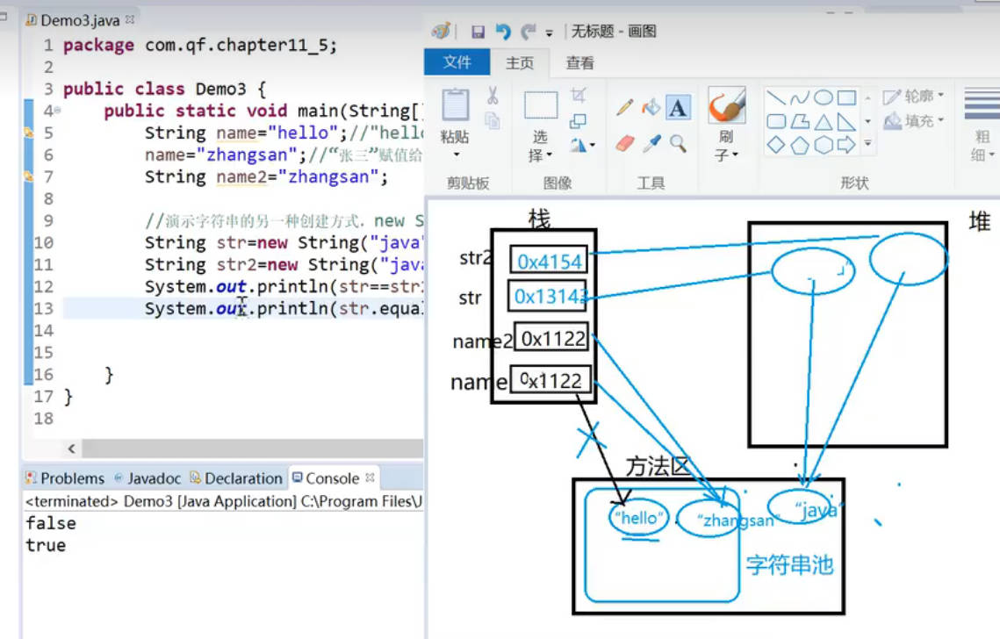 | 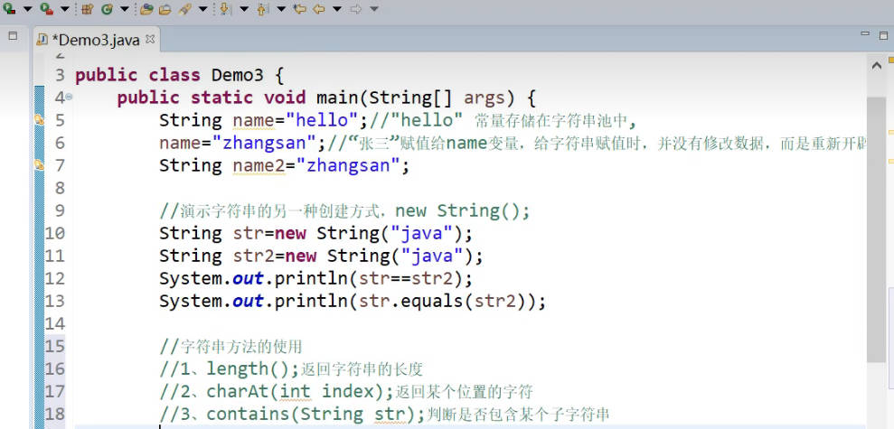 |
| ------------------------------------------------------------ | ------------------------------------------------------------ |
| 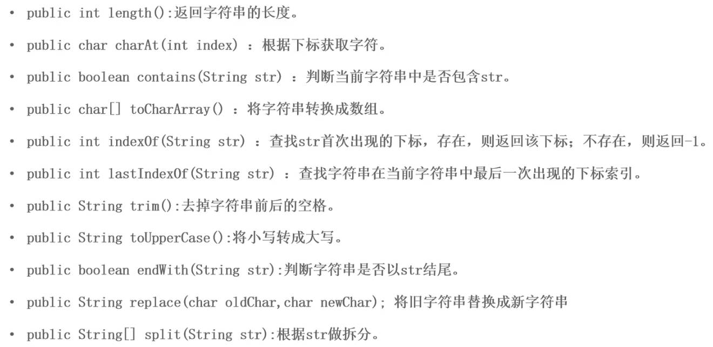 | 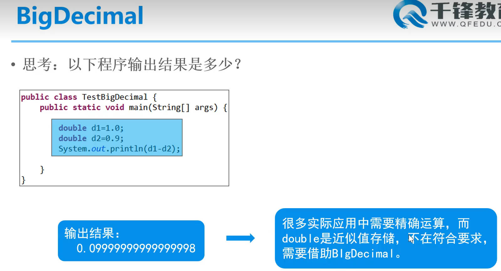 |
| 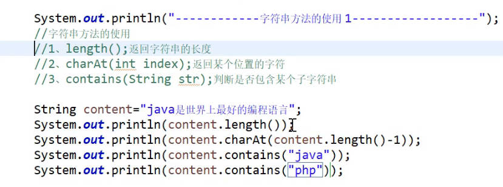 | 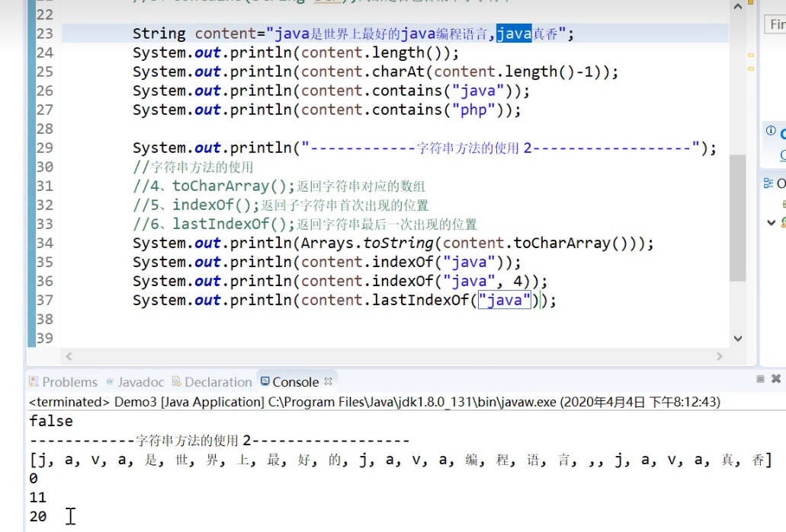 |
| 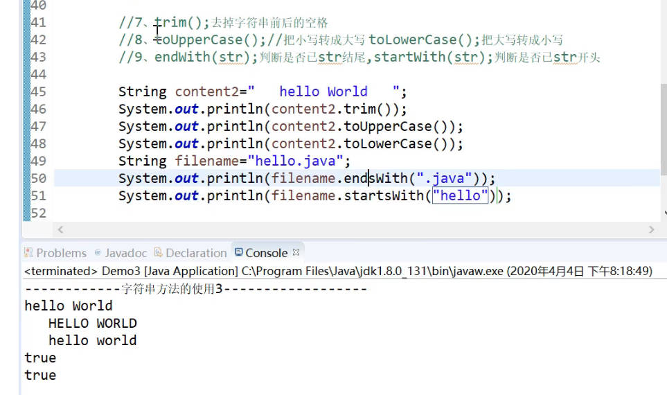 | 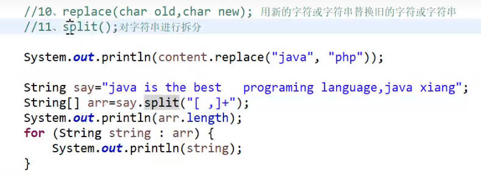 |
| 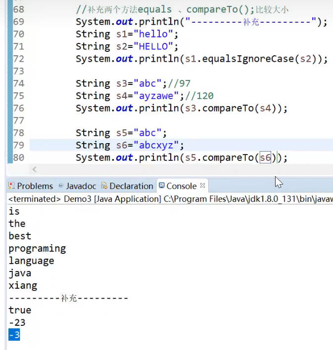 | 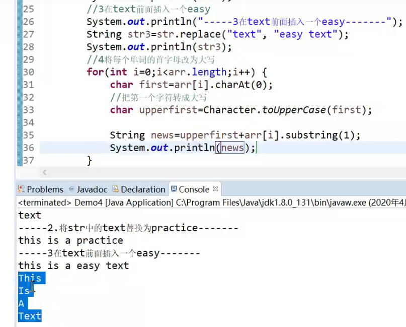 |


#### 1、可变长字符串StringBuilder和StringBuffer

提高string功能的增强类,包含了一个缓冲区

- ==StringBuilder==: 可变长字符串，JDK1.0提供，运行效率慢，线程安全
  - append追加、insert添加、replace替换、delete
- ==StringBuffer==:  可变长字符串，JDK5.0提供，运行效率快，线程不安全 

StringBuilder是处理字符串的手段，最后的目的是转换成String

| 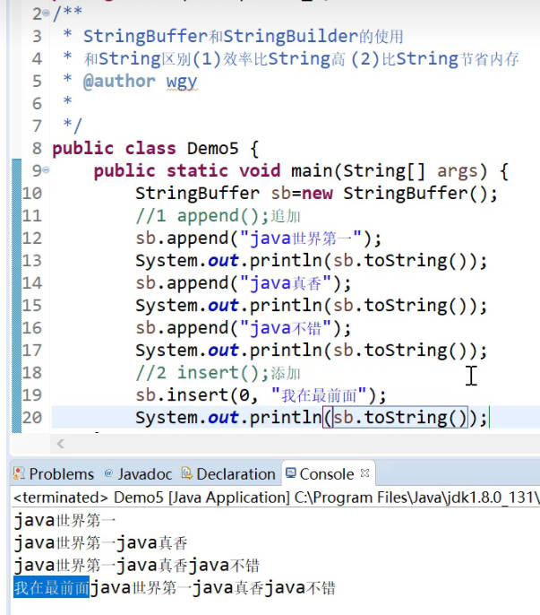 | 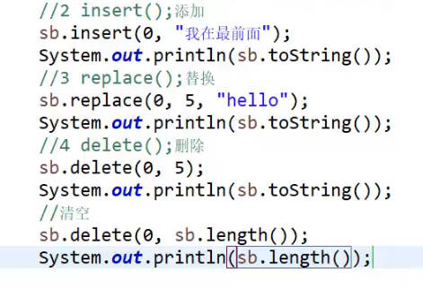 |
| ------------------------------------------------------------ | ------------------------------------------------------------ |


### 4、Math类

java.lang.Math


#### 1、大数操作类

**java.math.BigInteger**类与**java.math.BigDecimal**类，这两个类用于**高精度计算**，前者用于大**整数**的处理类，后者类用于大**小数**的处理类

double存的是近似值

```java
public class Test {
    public static void main(String[] args) {
        BigDecimal bd1 = new BigDecimal("1.0");
        BigDecimal bd2 = new BigDecimal("0.9");
        //减法
        BigDecimal r1 = bd1.subtract(bd2);
        //加法
        BigDecimal r2 = bd1.add(bd2);
        //乘法
        BigDecimal r3 = bd1.multiply(bd2);
        //除法
        BigDecimal r4 = new BigDecimal("1.4")
                .subtract(new BigDecimal("0.5"))
                .divide(new BigDecimal("0.9"));
        //保留2位小数，四舍五入ROUND_HALF_UP
        BigDecimal r5 = new BigDecimal("10").divide(new BigDecimal("3"), 2, BigDecimal.ROUND_HALF_UP); 
    }
}
```

### ==5、Date类==

[Java8新的时间和日期API](https://blog.csdn.net/Blue_Pepsi_Cola/article/details/127701712)

表特定瞬间，精确到毫秒； ==Data类大部分方法被Calendar类中方法取代,更好==

- util.Date
  - Unix时间戳是从1970年1月1日(UTC/GMT的午夜)开始所经过的秒数,不考虑闰秒; unix 69年出现
  - Date():创建Date对象 ； getTime()时间戳
- util.Calendar
- text.SimpleDateFormat

#### 1、Calendar类

构造方法是protected,不能用new创建对象；   java.util.Calendar

- 创建对象: `Calendar instance = Calendar.getInstance();` 
  - get() set();  setTime setTime Date和Calendar之间转换
  - Calendar提供很多常量，用get(int field)方法获取

- 打印时间`calendar.getTime().toLocaleString()`
- 获取年：`int year = calendar.get(Calendar.YEAR);`get(1)也能得到年，但你不知道1是什么含义
  - get需要int参数，calendar提供了很多field，用field获取int，`用1代替Calendar.YEAR,1相当于红绿灯中的flag`

- 修改时间：set

| 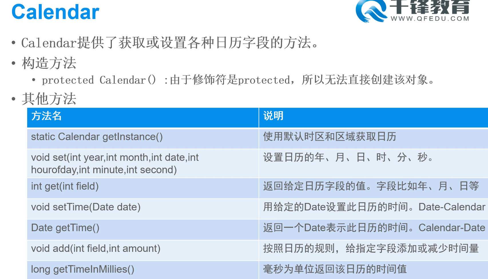 | 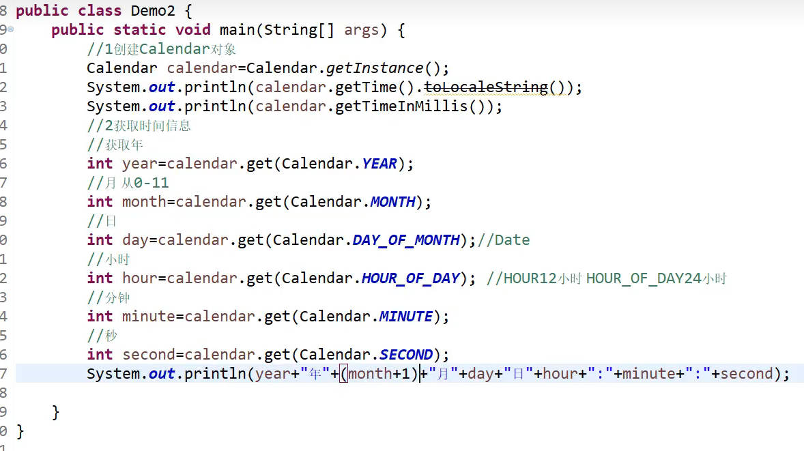 |
| ------------------------------------------------------------ | ------------------------------------------------------------ |
| 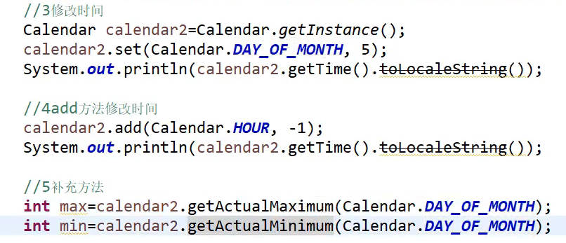 | 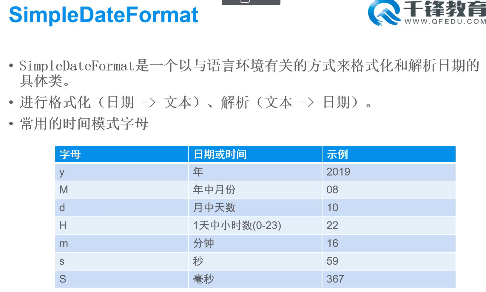 |
| 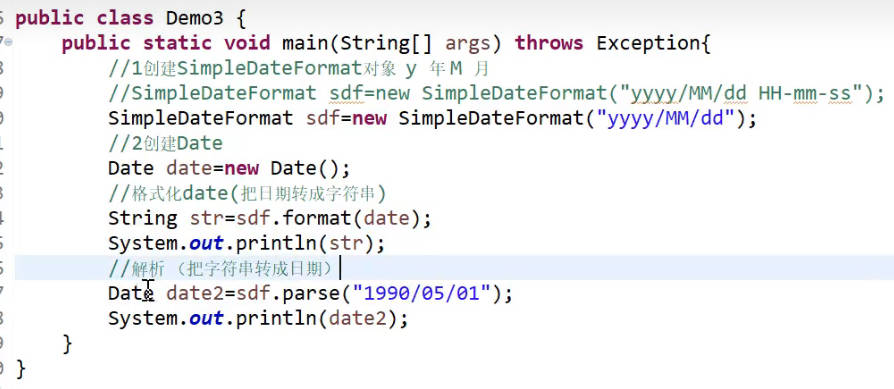 | 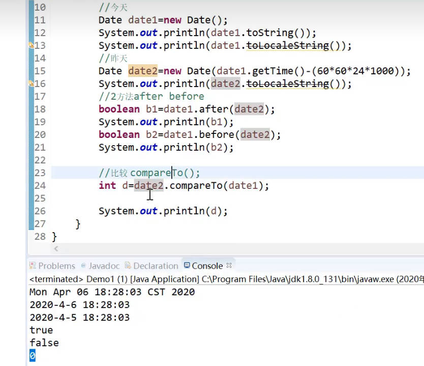 |

#### 2、SimpleDateFormat

- 格式化：==日期转文本== format()   `java.text.SimpleDateFormat`
  - yyyy年：4位数年
  - 创建对象：`new SimpleDateFormat("yyyy年MM月dd日 HH:mm:ss"); ` 时间以这种格式输出
  - 创建Date，格式化Date
- 解析： ==文本转日期== parse()

```java
SimpleDateFormat simpleDateFormat = new SimpleDateFormat("yyyy/MM/dd");
Date date = new Date();
System.out.println(simpleDateFormat.format(date));
System.out.println(simpleDateFormat.parse("2023/12/21"));
```


### 6、System类

构造方法私有，都是静态方法，不用创建对象

| 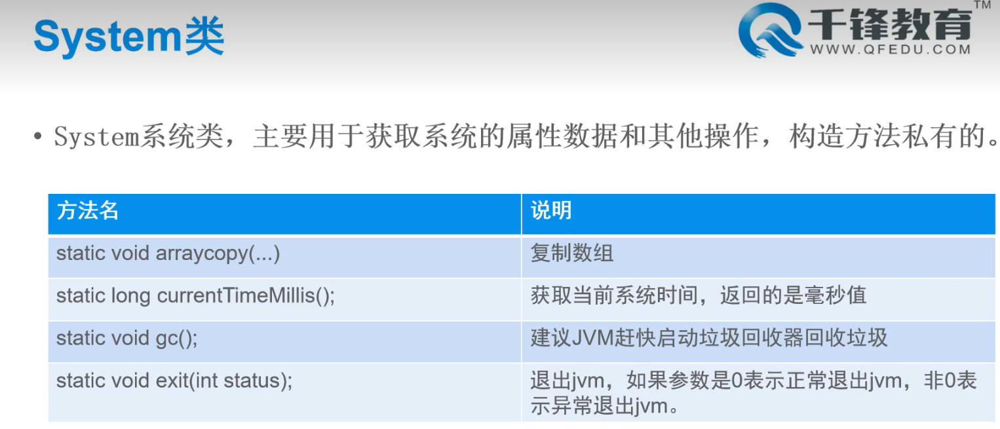 | 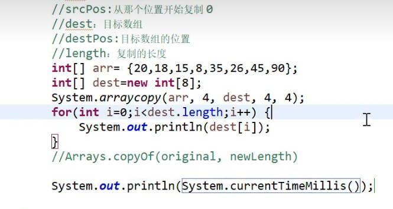 |
| ------------------------------------------------------------ | ------------------------------------------------------------ |

### 7、Random

java.util.Random；  [Random类](https://www.bilibili.com/video/BV1qL411u7eE?p=143&vd_source=7346303e5e18677d7261c2c0c109ecfd)

### 8、File

[java中user.dir到底是啥 ](https://www.jianshu.com/p/28693aad491b)  [java项目路径中正斜杠、反斜杠、双斜杠](http://t.zoukankan.com/guojuboke-p-11983621.html)  [常用类](https://www.bilibili.com/video/BV1tA411j7m8/?p=1&vd_source=7346303e5e18677d7261c2c0c109ecfd)

[创建100个文件](https://blog.csdn.net/tcbdbd/article/details/90260185/)   [递归_打印目录树 ](https://www.bilibili.com/video/BV1qL411u7eE?p=147&vd_source=7346303e5e18677d7261c2c0c109ecfd) [批量创建文件夹与txt文件](https://blog.csdn.net/qq_45311632/article/details/127072150)

==java.io.File==；  增删改查==文件和目录==

- f.createNewFile()、 f.delete() 
- 创建目录树：`File f1 = new File("d:/test/电影/华语");  f1.mkdirs();`
- 访问文件属性

| 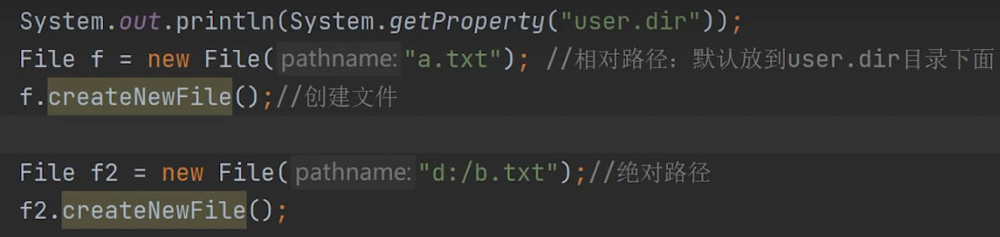 | 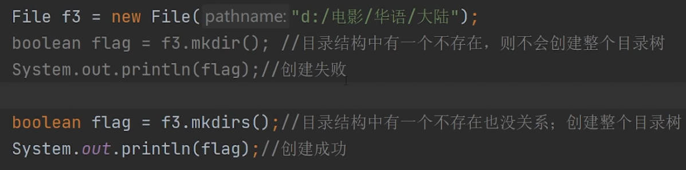 |
| ------------------------------------------------------------ | ------------------------------------------------------------ |

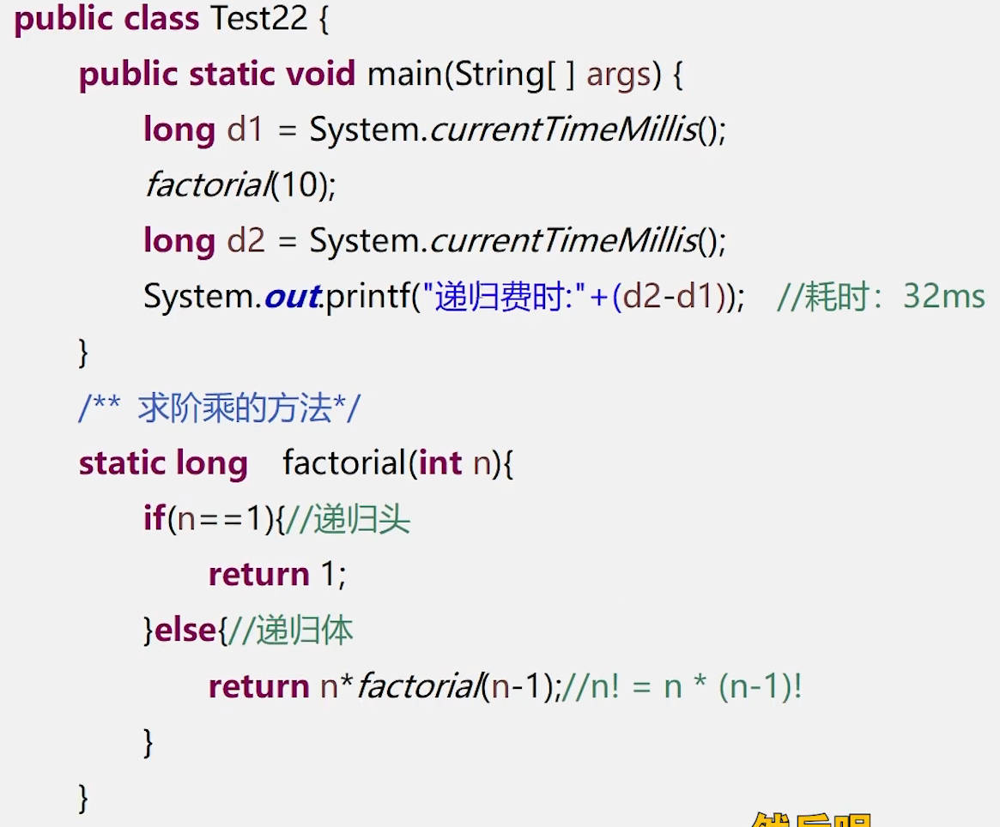

```java
//递归打印目录树
public class Test {
    public static void main(String[] args) {
        File f = new File("d:\\vm");
        printFile(f, 0);
    }

    //level 第几层
    static void printFile(File file, int level) {
        for (int i = 0; i < level; i++) {
            System.out.print("-"); //每层的-循环
        }
        
        System.out.println(file.getName()); //输出文件名

        //如果是目录就继续，是文件就停止
        if (file.isDirectory()) {
            File[] files = file.listFiles(); //列出子目录、子文件
            for (File temp : files) {
                printFile(temp, level + 1);
            }
        }
    }
}
```

- 在java项目中，根据读取文件的来源，采用不同的“杠杠”
  - 读取项目中的文件，即文件在当前项目的某个目录下，路径一般采用正斜杠“/”。
  - 读取window系统的文件，即文件在window系统的资源管理器下，路径可以采用双反斜杠\\\ 或者正斜杠“/”。
  - 读取linux系统的文件，即文件在linux系统的资源管理器下，路径采用正斜杠“/”。

> 注：由上可知，正斜杠“/”在三种方式下皆可用。

### 9、枚举

[都有常量了，为啥还要用枚举](https://www.bilibili.com/video/BV1A34y1v7aL/?spm_id_from=333.337.search-card.all.click&vd_source=7346303e5e18677d7261c2c0c109ecfd)

当需要一些固定不变的数据时，可以将其声明为静态常量，以方便复用；比如定义春夏秋冬

静态常量没有办法限制调用者传什么值进来 （==限制方法的参数==）

枚举能帮助==限定语义==，编译时就能检查值的合理性，并可用于switch，比普通常量更加方便

一个一个列出来

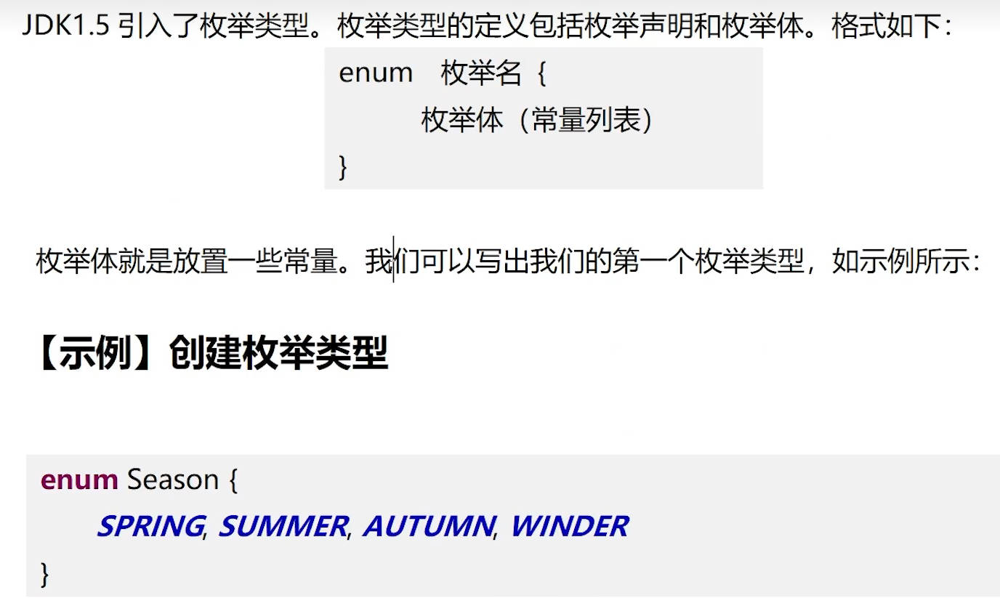


```JAVA
public static final int SPRING = 1;
public static final int SUMMER = 2;
public static final int AUTUMN = 3;
public static final int WINTER = 4;
//定义好后，可以通过类名调用
System.out.println(Season.SPRING);

//但会出一些问题，比如定义一个方法，用来接收四季数值，然后根据数值，执行不同逻辑
//没办法限制调用者传什么值进来，因为参数是int类型,没有范围;只要是int类型就合法
public static  void f(int season){
        switch (season){
            case 1:
                //春天逻辑
        }
    }

//枚举
public enum Season{
        SPRING,
        SUMMER
    }
```

### 10、其他(==比较器迭代器==)

[Comparator接口](https://www.bilibili.com/video/BV147411j7ei/?p=17&spm_id_from=pageDriver&vd_source=7346303e5e18677d7261c2c0c109ecfd)

#### 1.==AutoCloseable接口==

自动关闭，jdk1.7以后才有,==必须结合异常处理才能使用==

[java中带参数的try(){}语法](https://www.cnblogs.com/fanheyan/articles/9663873.html)  [java中带参数的try(){}](https://www.jb51.net/article/239077.htm)

```java
//MessageDemo.java  面向接口编程
interface IMessage {
    public void send(String msg);//消息发送的核心功能
}

class NetMessage implements IMessage {
    public NetMessage() {
        //无参构造：只要实例化对象，就表示要进行消息的发送，则就需要连接网络服务器
        System.out.println("【连接】连接远程服务器，创建消息的发送通道...");
    }

    @Override
    public void send(String msg) {
        System.out.println("【发送】" + msg); //模拟数据发送
    }

    public void close() {
        System.out.println("【关闭】网络消息发送完毕，断开服务器连接...");
    }
}

public class MessageDemo {
    public static void main(String[] args) {
        NetMessage message = new NetMessage();
        message.send("www.baidu.com");
        message.close();

    }
}
//改造后，继承AutoCloseable接口，自动关闭
interface IMessage extends AutoCloseable {  //多继承：继承自动关闭接口
    public void send(String msg);//消息发送的核心功能
}
...
    public static void main(String[] args) {
    	//必须结合异常处理才能使用
        try (NetMessage message = new NetMessage()) {
            message.send("www.baidu.com");
        } catch (Exception e) { }
    }


```

```java
//带资源的try语句（try-with-resource）的最简形式为

try(Resource res = xxx)//可指定多个资源
{
work with res
}

//try块退出时，会自动调用res.close()方法，关闭资源
//不用写一大堆finally来关闭资源,所有实现Closeable的类声明都可以写在里面,最常见于流操作,socket操作,新版的httpclient也可以;

//需要注意的是,try()的括号中可以写多行声明,每个声明的变量类型都必须是Closeable的子类,用分号隔开
```

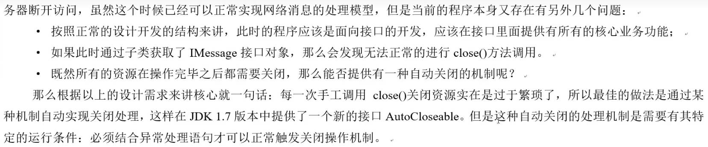

#### 2、Runtime类、Cleaner类

java运行有JVM进程，需要用Runtime类描述当前jvm进程的相关环境，及与之相关的处理操作；

每个jvm进程都自动包含一个Runtime类的实例化对象

| 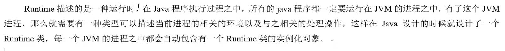 | 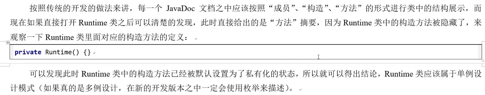 |
| ------------------------------------------------------------ | ------------------------------------------------------------ |


#### 3.对象克隆

- 深克隆：所有与对象有关的引用类型全部克隆
- 浅克隆：只克隆当前类中的基本属性内容

```java

class Emp implements Cloneable {
    private String ename;
    private String job;

    public Emp(String ename, String job) {
        this.ename = ename;
        this.job = job;
    }

    public void setEname(String ename) {
        this.ename = ename;
    }

    @Override
    public String toString() {
        return  "[Emp - " + super.toString() + "] 姓名:" + this.ename + "、职位：" + this.job;
    }

    @Override
    public Object clone() throws CloneNotSupportedException {
        return super.clone();
    }
}

public class StringTest{
    public static void main(String[] args) throws CloneNotSupportedException {
        Emp empA = new Emp("王sir", "软件编程讲师");
        Emp empB = (Emp) empA.clone();
        empB.setEname("hehe");
        System.out.println(empA);
        System.out.println(empB);
    }
}
```

#### 4、Base64加密与解密

jdk1.8以后； java.base基础包下，java.util.Base64 

- Base64不是私人加密处理，都可以加解密，要让加密有意义，最佳做法是执行多次加密，在数据前追加一个盐值（salt）； 电影：模仿游戏； 讲加解密

```java
String message = "www.yootk.com";
Base64.Encoder encoder = Base64.getEncoder();
byte[] bytes = encoder.encode(message.getBytes());  //加密
System.out.println(new String(bytes));

Base64.Decoder decoder = Base64.getDecoder();
byte[] decode = decoder.decode(bytes); 				//解密
System.out.println(new String(decode));
```

```java
//工具类
import java.util.Base64;

public class PasswordUtil {
    private static final int REPEAT = 5;    //重复加密5次
    private static final String SALT = "edu.yootk.com";    //追加操作盐值

    private PasswordUtil() {
    }   //该类方法为staitc

    public static String encrypt(String str) {
        String encodeData = "{" + SALT + "}" + str;     //处理要加密的数据
        Base64.Encoder encoder = Base64.getEncoder();   //多次加密
        for (int i = 0; i < REPEAT; i++) {
            encodeData = encoder.encodeToString(encodeData.getBytes());
        }
        return encodeData;
    }

    public static String decrypt(String str) {
        Base64.Decoder decoder = Base64.getDecoder();
        byte[] data = str.getBytes();
        for (int i = 0; i < REPEAT; i++) {
            data = decoder.decode(data);//多次解密
        }

        String decodeData = new String(data);   //包含有盐值数据
        return decodeData.substring(("{" + SALT + "}").length()); //去掉{edu.yootk.com}
    }
}


//测试
public class StringTest{
    public static void main(String[] args) {
        String message = "www.yootk.com";
        System.out.println(PasswordUtil.encrypt(message));
        System.out.println(PasswordUtil.decrypt(PasswordUtil.encrypt(message)));
    }
}
```

#### 5、UUID

生成不会重复的数据，基于时间(不重复)；

```java
System.out.println(UUID.randomUUID());
System.out.println(UUID.randomUUID().toString());
```

| 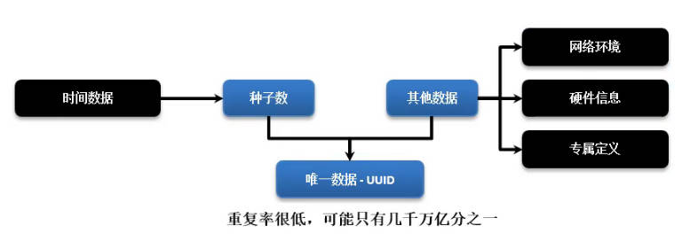 | 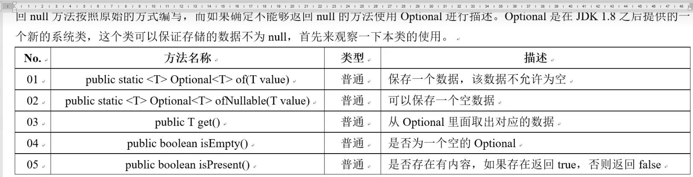 |
| ------------------------------------------------------------ | ------------------------------------------------------------ |

#### 6、Optional类

确定不能返回空的方法用Optional，jdk1.8以后提供

#### 7、ThreadLocal

- Java属于引用数据类型，可实现引用传递，本质是同一堆内存空间，可以同时被多个栈内存指向
- 引用数据类型的传递操作类，利用它实现数据的传输，同时保证多个线程下的数据传输的正确性

#### 8、定时调度

- Timer类：实现线程任务调度
- TimerTask：实现定时处理任务的接口定义

#### 9、Arrays类

全是static方法，构造方法被private封装

#### 10、==比较器==

[比较器_YOOTK沐言优拓_李兴华](https://www.bilibili.com/video/BV147411j7ei?p=15&vd_source=7346303e5e18677d7261c2c0c109ecfd)

- YOOTK沐言优拓_李兴华

实现对象数组排序

##### 1、Comparable接口

小结：

1. 实现Comparable接口，重写compareTo方法
2. 

java.lang.Comparable; ==Comparable接口,类设计时就考虑排序==

返回的小于(-1)，等于(0)，或大于(1)

- 实现Comparable接口， 重写方法`compareTo(T o)`， 定义比较规则
  - Comparator<? super T>  ：Arrays.sort的参数，实现
- Comparable接口为什么加泛型：如果一组对象要比较，这组对象要有相同的类型；限制比较类型；  例如人和狗不能比

```java
import java.util.Arrays;

class Book implements Comparable<Book> {	//实现Comparable,限制为比较Book类型
    private String title;
    private double price;

    public Book(String title, double price) {
        this.title = title;
        this.price = price;
    }

    @Override
    public String toString() {
        return "图书名称：" + this.title + "、图书价格：" + this.price;
    }


    @Override
    public int compareTo(Book o) {		//定义比较规则
        if (this.price > o.price) {
            return 1;
        } else if (this.price < o.price) {
            return -1;
        } else {
            return 0;
        }
    }
}

public class StringTest {
    public static void main(String[] args) {
        Book[] books = new Book[]{
                new Book("java jvm", 91.9),
                new Book("java ", 99.6),
                new Book("go ", 93.6),
        };
        Arrays.sort(books);		//排序
        System.out.println(Arrays.toString(books));
    }
}
```

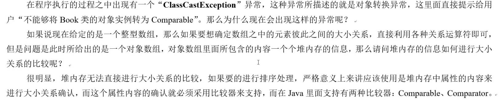

##### 2、Comparator接口

java.util , interface Comparator<T> ,  int compare(T o1, T o2);

`public static <T> void sort(T[] a, Comparator<? super T> c)`

==Comparator接口,类设计时没有考虑排序时用； 需要定义一个专属的比较器实现类==

两种方法：

1. 需要单独写一个Comparator接口对象子类，来实现具体的比较规则 （==提供专属的比较器实现类， sort(数组，new 实现类())==）；  
2. Comparator接口使用了函数式接口，可用lambda表达式
   1. 可以不写专属比较器实现类，用Lambda表达式

```java
import java.util.Arrays;
import java.util.Comparator;

class Book {
    private String title;
    private double price;

    public Book(String title, double price) {
        this.title = title;
        this.price = price;
    }

    public String getTitle() {
        return title;
    }

    public double getPrice() {
        return price;
    }

    @Override
    public String toString() {
        return "图书名称：" + this.title + "、图书价格：" + this.price;
    }

}

class BookComparator implements Comparator<Book> {  //提供专属的比较器实现类
    @Override
    public int compare(Book o1, Book o2) {

        if (o1.getPrice() > o2.getPrice()) {
            return 1;
        } else if (o1.getPrice() < o2.getPrice()) {
            return -1;
        } else {
            return 0;
        }
    }
}

public class StringTest {
    public static void main(String[] args) {
        Book[] books = new Book[]{
                new Book("java jvm", 91.9),
                new Book("java ", 99.6),
                new Book("go ", 93.6),
        };
        Arrays.sort(books,new BookComparator()); 
        System.out.println(Arrays.toString(books));
    }
}

//也可以不写专属比较器实现类，用Lambda表达式
Arrays.sort(books,(o1, o2) -> {
            if (o1.getPrice() > o2.getPrice()) {
                return 1;
            } else if (o1.getPrice() < o2.getPrice()) {
                return -1;
            } else {
                return 0;
            }
        });
```

| 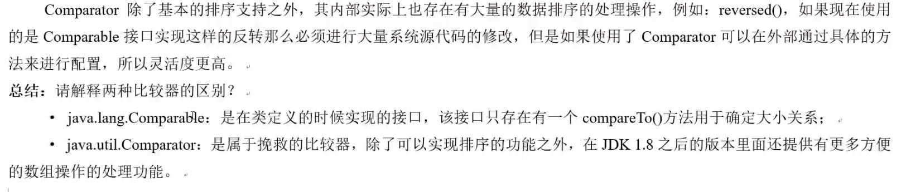 | 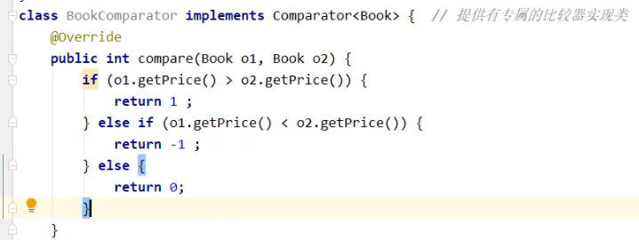 |
| ------------------------------------------------------------ | ------------------------------------------------------------ |


```java
//反转
Comparator<Book> comparator = (o1, o2) -> {
            if (o1.getPrice() > o2.getPrice()) {
                return 1;
            } else if (o1.getPrice() < o2.getPrice()) {
                return -1;
            } else {
                return 0;
            }
        };
Arrays.sort(books,comparator.reversed());
//Arrays.sort(books,comparator);
```

#### 11、==迭代器==

[迭代器](https://www.bilibili.com/video/BV18R4y1t7Hg/?spm_id_from=333.337.search-card.all.click&vd_source=7346303e5e18677d7261c2c0c109ecfd)  [Iterable & Iterator](https://www.bilibili.com/video/BV1gA4y1D7uf/?spm_id_from=333.337.search-card.all.click&vd_source=7346303e5e18677d7261c2c0c109ecfd) 

遍历所有元素

- java.util.Iterator; 有2个方法：hasNext()  next();   ==集合实现的是Iterable接口==
- Iterable，==实现该接口的类，就是可迭代对象==；  Iterator是迭代器
  - 和比较器类似：Comparable  Comparator

| 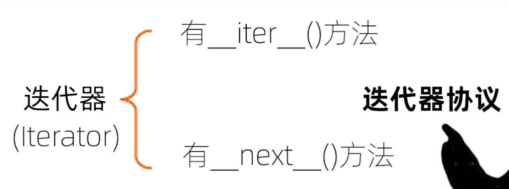 | 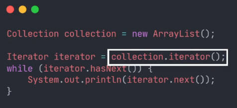 |
| ------------------------------------------------------------ | ------------------------------------------------------------ |


### 11、内部类

[千锋教育-常用类](https://www.bilibili.com/video/BV1vt4y197nY/?spm_id_from=333.337.search-card.all.click&vd_source=7346303e5e18677d7261c2c0c109ecfd)  [JavaSE阶段常用类](https://www.bilibili.com/video/BV1PX4y167Xc/?spm_id_from=333.337.search-card.all.click&vd_source=7346303e5e18677d7261c2c0c109ecfd) [尚学堂_常用类](https://www.bilibili.com/video/BV1qL411u7eE/?p=147&spm_id_from=pageDriver&vd_source=7346303e5e18677d7261c2c0c109ecfd) [设计原则](https://www.bilibili.com/video/BV1tv41157J5/?p=11&vd_source=7346303e5e18677d7261c2c0c109ecfd)   [Object_toString](https://www.bilibili.com/video/BV1314y1x7WS?p=83&vd_source=7346303e5e18677d7261c2c0c109ecfd)  [内部类](https://www.bilibili.com/video/BV1vt4y197nY/?p=17&spm_id_from=pageDriver&vd_source=7346303e5e18677d7261c2c0c109ecfd)  [常用类](https://www.bilibili.com/video/BV1tA411j7m8/?p=1&vd_source=7346303e5e18677d7261c2c0c109ecfd)  [韩顺平 零基础30天学会Java](https://www.bilibili.com/video/BV1fh411y7R8/?spm_id_from=333.337.search-card.all.click&vd_source=7346303e5e18677d7261c2c0c109ecfd)   

### 12、二分法查找

[二分法查找_折半检索](https://www.bilibili.com/video/BV1qL411u7eE?p=108&vd_source=7346303e5e18677d7261c2c0c109ecfd)

==首先要从小到大排序，然后才能用二分法==

- 如果找10，10和中间数比小，就在左边，然后10再和左边中间数比
- 未找到，返回-1

```java
int[] arr={7,8,9,10,11,12,20,30,40,50,90,100};
Arrays.sort(arr);
System.out.println(Arrays.binarySearch(arr, 10));
```

| 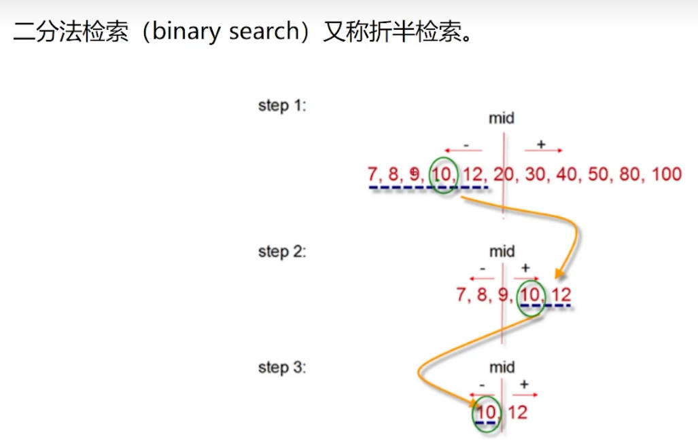 | 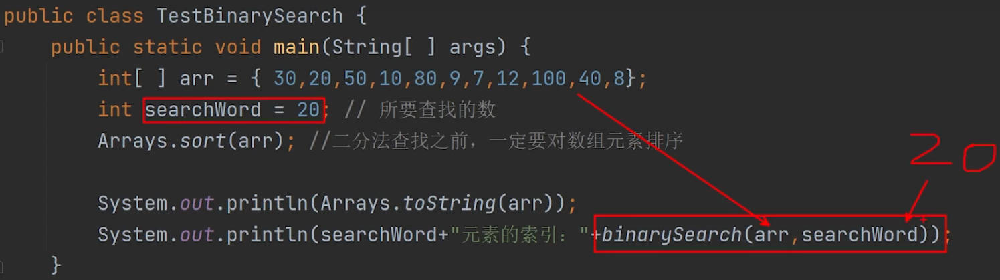 |
| ------------------------------------------------------------ | ------------------------------------------------------------ |


## 3、集合框架

两种：Collection（元素集合）、 Map(键值对)

视频：[集合框架详解](https://www.bilibili.com/video/BV1zD4y1Q7Fw?spm_id_from=333.337.search-card.all.click&vd_source=7346303e5e18677d7261c2c0c109ecfd)  

[Java 集合常见知识点](https://zhuanlan.zhihu.com/p/536495106)   [Java 集合框架](https://blog.csdn.net/tanqingbo/article/details/107328785)  [Java集合框架图析](https://blog.csdn.net/weixin_45670060/article/details/119493975)   [集合详解](https://www.cnblogs.com/csyh/p/12442235.html)  [HashMap使用   ](https://www.bilibili.com/video/BV1zD4y1Q7Fw?p=35&vd_source=7346303e5e18677d7261c2c0c109ecfd)     [集合](https://www.bilibili.com/video/BV1NM41137Yi?p=48&vd_source=7346303e5e18677d7261c2c0c109ecfd)     [JavaSE基础——集合框架](https://www.kuangstudy.com/bbs/1380775553455484930)  [文章 ](https://www.kuangstudy.com/bbs?searchKey=集合框架&cid=&pageNo=1&pageSize=15)  [Java反编译工具--XJad将class文件编译成java](https://www.pianshen.com/article/68821531164/)    [Java集合 Collection、Set、Map、泛型 简要笔记 ](https://www.cnblogs.com/coderzjz/p/13587167.html)

[java常用集合类 ](http://www.mobiletrain.org/about/BBS/116991.html)   [【尚学堂】数据结构 集合 容器](https://www.bilibili.com/video/BV1Nu4y1E7vu/?spm_id_from=333.337.search-card.all.click&vd_source=7346303e5e18677d7261c2c0c109ecfd)

[数据结构之链表](https://zhuanlan.zhihu.com/p/648341058) 

[Collection、Iterable、Iterator](https://www.cnblogs.com/wuhao-0206/p/13062119.html) [ArrayList源码分析](https://www.cnblogs.com/wuhao-0206/p/13062562.html)

- `Java 集合框架主要包括两种类型的容器，一种是集合（Collection），存储一个元素集合，另一种是图（Map），存储键/值对映射`

> 1. 集合框架是一个用来代表和操纵集合的统一架构，
>
>    java的集合主要有**Collection**和**Map**两个接口派生而出，包含了一些子接口和实现类组成了集合框架
>
>    Java 集合， 也叫容器，由两大接口派生而来：一个是 Collection接口，主要用于存放单一元素；另一个是 Map 接口，主要用于存放键值对。
>
>    容器就是用来存放数据，
> 2. ==集合：对象的容器==，定义了对多个对象进行操作的方法，可==实现数组的功能==。 集合位置：==java.util.*包里面==。和数组区别：
>
>    1. 数组长度固定，集合长度不固定
>    2. 数组存基本类型和引用类型，集合只存引用类型(装箱)
>    3. 数组存储基本类型和引用类型，集合只能存储引用类型
>    4. Java是面向对象的语言，对事物的描述都是以对象的形式。为了方便对多个对象的操作就需要对对象进行存储。但是使用数组存储对象与一些弊端，这时就出现了集合
>    5. 集合就像是一个对象的容器，可以动态地存储多个对象，还可以对多个对象进行操作
>    6. Java的集合类可以存储数量不等的多个对象，还可以用于保存具有映射关系的关联数组
> 3. ==Collection==： 代表一组对象，称为"集合"
>    
>    1. 遍历元素：2种方式：增强for、`使用迭代器(专门用来遍历集合)`
>    2. List接口
>    3. Set接口
> 4. 泛型
>    1. 常见形式：泛型类、泛型接口、泛型方法
>    2. 语法：类名<T,...>  T类型占位符，表示一种引用类型
>    3. 提高代码重用性、防止类型转换异常，提高代码安全性

| 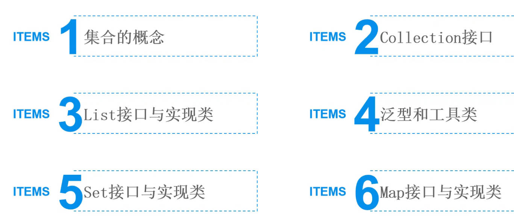 | 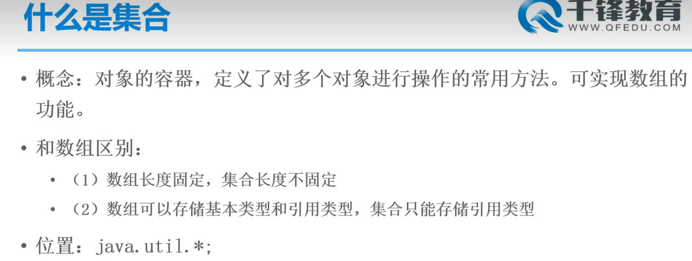 |
| ------------------------------------------------------------ | ------------------------------------------------------------ |
| 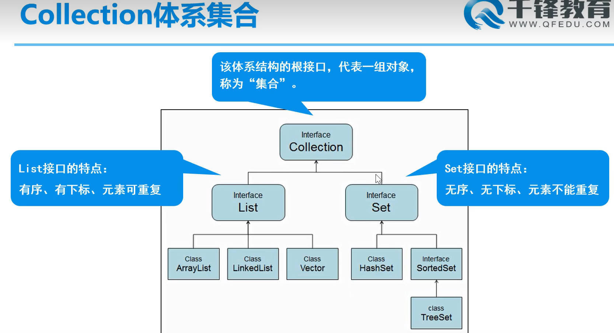 | 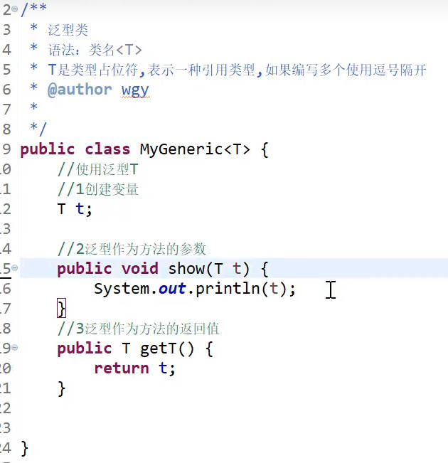 |

```java
Collection collection = new ArrayList();  	//Collection接口使用:无序
//遍历：1、使用增强for。 2、用迭代器Iterator：专门遍历集合。

List list = new ArrayList()					//List子接口使用：有序的Collection
//遍历：for、增强for、迭代器、列表迭代器ListIterator(可向前后遍历，增删改元素)
Iterator it = list.iterator()
//List接口常用实现类:  ArrayList(数组结构)、 Vector、LinkedList(链表结构)
```
### 1、集合

- List实现类：ArrayList数组、 LinkedList链表;   Set实现类：SortedSet排序
- 迭代器iterator()方法遍历Collection

### 2、==Collection==接口(迭代器遍历)

- ==集合的使用==
  - 添加元素: add
  - 删除元素: remove、clear清空
  - 遍历元素：==foreach或迭代器==(专门遍历集合)
  - 判断


Collection是List、Set的父接口

1. removeAll()：删除2个集合中相同的元素

| 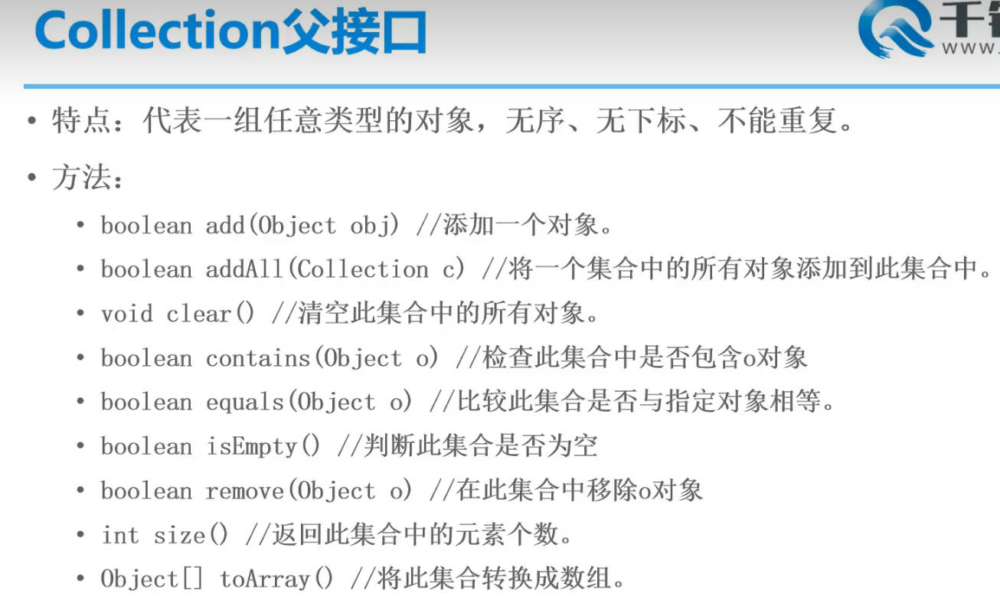 | 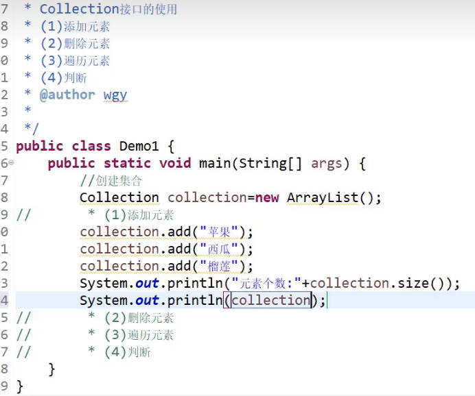 |
| ------------------------------------------------------------ | ------------------------------------------------------------ |
| 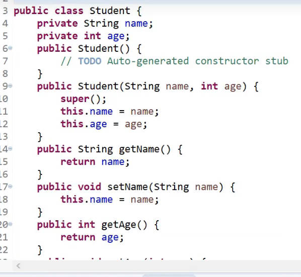 | 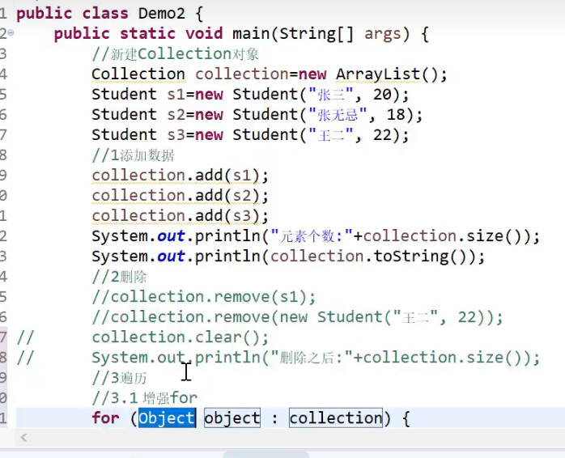 |

```java
public class ArrayListDemo {
    public static void main(String[] args) {
        //创建集合
        ArrayList collection = new ArrayList();
        //1.添加元素
        collection.add("苹果");
        collection.add("西瓜");
        collection.add("芒果");
        System.out.println("元素个数：" + collection.size());
        //2.删除元素
//        collection.remove("西瓜");
//        collection.clear();
        //3.遍历元素: foreach或迭代器(专门遍历集合)
        Iterator it = collection.iterator();    //调用方法，返回值是Iterator
        while (it.hasNext()) {
            String s = (String) it.next();
            System.out.println(s);
            //it.remove(); 删除元素, 不能用collection.remove(s)
        }
        //4.判断
        System.out.println(collection.contains("西瓜"));
        System.out.println(collection.isEmpty());
    }
}
```

#### 1、==List==接口实现类

继承Collection,子接口

- subList：获取集合中一部分，作为子集合
- ==更强的迭代器：listIterator==,可从后向前


```java
public class ListDemo {
    public static void main(String[] args) {
        List list = new ArrayList();
        list.add("apple");
        list.add("小米");
        list.add(0, "三星");
        //1. 删除元素
        list.remove(0);
        //2. 遍历: for、foreach、迭代器Iterator、列表迭代器listIterator
        for (int i = 0; i < list.size(); i++) {
            System.out.println(list.get(i));
        }
        	//foreach
        for (Object o : list) {
            System.out.println(o);
        }
        	//Iterator
        Iterator iterator = list.iterator();
        while (iterator.hasNext()) {
            System.out.println(iterator.next());
        }
        System.out.println("=======================");
        	//listIterator
        ListIterator lit = list.listIterator();
        while (lit.hasNext()) {
            System.out.println(lit.nextIndex() + ":" + lit.next());
        }
        while (lit.hasPrevious()) {
            System.out.println(lit.previousIndex() + ":" + lit.previous());
        }
        //3. 获取元素位置
        System.out.println(list.indexOf("苹果"));
        //4. subList: 返回子集合，含头不含尾
        List subList = list.subList(1, 3);
        System.out.println(subList.toString());
    }
}
```

==List实现类==：

##### a.ArrayList

`数组结构`实现，查询快，增删慢，效率快，线程不安全

==ArrayList源码分析==

##### b.LinkedList

[数据结构之链表](https://zhuanlan.zhihu.com/p/648341058)

实现:`链表结构`双向链表，增删快，查询慢

`LinkedList link = new LinkedList<>();`

##### c.Vector

比较老，已经不用了

数组结构实现，查询快，增删慢，效率慢，线程安全,

遍历用枚举器: Vector特有,jdk1.2之前没迭代器; `public Enumeration<E> elements() {}`

`new Vector<>()`

#### 2、==Set==接口

Collection子接口; 特点：无序、无下标、元素不可重复

`本身没有定义方法，全部继承Collection方法`

`不能new接口，只能new接口的实现类`

- ==TreeSet: 元素对象的类型必须实现Comparable接口，指定排序规则==

|  |  |
| ------------------------------------------------------------ | ------------------------------------------------------------ |


```java
public class StringTest {
    public static void main(String[] args) {
        HashSet<String> set = new HashSet<>();
        set.add("苹果");
        set.add("华为");
        set.add("小米");
        System.out.println(set.size());
        System.out.println(set.toString());

        Iterator<String> iterator = set.iterator();
        while (iterator.hasNext()) {
            System.out.println(iterator.next());
        }
    }
}
```

|  |  |
| ------------------------------------------------------------ | ------------------------------------------------------------ |


##### 1、HashSet

hashset存储结构：==里面是哈希表==（数组+链表+红黑树）实现的集合

- 用HashCode值计算元素的存放位置
- 哈希表类似车站买票窗口：窗口是数组，排队人接着人是链表
- `HashSet<String> set = new HashSet<>();`

##### 2、TreeSet(排序必须实现Comparable接口)

- 实现排序； 类要要实现Comparable接口
- ==TreeSet: 元素对象的类型必须实现Comparable接口，指定排序规则==

里面采用==二叉树方式==实现： *红黑树*（Red Black Tree） 是一种自平衡*二叉*查找树； 一个节点最多有2个子节点，左边比右边小

`TreeSet<String> set = new TreeSet<>();`

- 因为二叉树左边比右边小，2边要比较；所以要实现Comparable接口
  - Person类实现Comparable接口  `class Person implements Comparable<Person>{}`
  - 在Person类里写CompareTo（）比较规则

|  |  |
| ------------------------------------------------------------ | ------------------------------------------------------------ |

###### 1、Comparator比较器

- 自己写比较规则：参数里的Comparator：要写==实现Comparator接口方法的对象==

|  |  |
| ------------------------------------------------------------ | ------------------------------------------------------------ |


### 3、==泛型==

 [泛型好处](https://www.bilibili.com/video/BV1zD4y1Q7Fw?p=21&vd_source=7346303e5e18677d7261c2c0c109ecfd)    [Java 泛型](https://www.runoob.com/java/java-generics.html)  [泛型规则](https://www.bilibili.com/video/BV1fu411h7AA/?spm_id_from=333.788&vd_source=7346303e5e18677d7261c2c0c109ecfd)

[泛型基本写法_前端乐哥](https://www.bilibili.com/video/BV1VS4y1U7Pj?p=26&vd_source=7346303e5e18677d7261c2c0c109ecfd)    [Java 泛型  ](https://www.runoob.com/java/java-generics.html)  [方法声明中static后的表示什么意思](https://zhidao.baidu.com/question/489108221655560652.html)   

泛型类和泛型接口好像都是，实例化时传入的引用类型

- 类型参数化，表示一种引用类型

- ==泛型类==：类名<T>,==T表示一种引用类型，不能是基本类型，可写多个==，占位符; ==使用泛型==T：可用来创建变量、作为方法参数、作为方法返回值
  - 泛型类:`public class MyTest<T>{}`
  - 泛型类创建对象：`MyTest<String> mytest=new MyTest<String>()`
    - `表示创建对象时，MyTest是String类型`
  - 静态属性和静态方法，访问不了类上定义的泛型参数
    - 因为在指定泛型参数具体类型时，是在实例化该类时指定; 和对象有关，静态的访问不了对象实例
    - 静态方法使用泛型，要定义成泛型方法
- ==泛型接口==：接口名<T>, T server(T t) 返回值和参数都是T
  - 泛型接口实现时，知道类型   		`implements Book<Integer>{ }`
  - 泛型接口实现时，不确定类型  创建实现对象时，传一个类型，然后它再给接口     `class StringTest<T> implements Book<T>{ }`

- ==泛型方法==：<T> 返回值类型前面 ; 
  - 泛型方法可定义在普通类中，也可定义在泛型类中
  - `public <T> void show(){}` ; 使用：`public <T> T show(T t){},参数和返回值使用泛型`
  - 使用泛型方法时，不需要像泛型类那样手动指定具体类型，编译器会根据你的调用，自动推导出具体类型 (类型不用传递，由传递的数据决定)

- 作用
  - 提高代码重用性
  - 防止类型转换异常

- 泛型集合： 泛型在集合框架里的使用
  - 用集合时写上泛型：`ArrayList<Student> arr = new ArrayList<>()` 1.7版之后后面的可不写类型

> 泛型：`本质是参数化类型，把类型作为参数传递。`，常见形式有泛型类、泛型接口、泛型方法。 //传递的不再是数据，而是类型：8大基本数据类型、引用类型。 语法：<T,...> T类型占位符，表示一种引用类型。   好处：提高代码重用性、防止类型转换异常，提高代码安全性。
>
> 泛型：主要是约束作用，避免类型转换之间的问题（避免强转）
>
> 泛型提供了编译时类型安全检测机制，该机制允许程序员在编译时检测到非法的类型。
>
> 泛型的本质是参数化类型，也就是说所操作的数据类型被指定为一个参数。

|  |  |
| ------------------------------------------------------------ | ------------------------------------------------------------ |
|  |  |
|  |  |
|  |  |
|  |  |

```java
public class StringTest {
    public static void main(String[] args) {
        MyGen<String> myGen = new MyGen<>();
        myGen.t = "dfjkj";
        System.out.println(myGen.t);

        myGen.test("呵呵");

        TT<String> tt = new TT<String>();
        System.out.println(tt.myInter("速度快的"));
    }
}
//泛型类
class MyGen<T> {
    T t;
    T test(T t) {
        System.out.println(t);
        return t;
    }
}

//泛型接口
interface MyInter<E> {
    E myInter(E e);
}

class TT<E> implements MyInter<E> {
    @Override
    public E myInter(E e) {
        return e;
    }
}

```

#### 1、类型擦除

- 泛型的类型擦除：Type Erasure
  - 在编译阶段，编译器会进行类型检测；可一旦通过编译，编译器就会将泛型给擦除掉（==编译后类型擦除==）；到运行阶段，对于jvm来说便没有了泛型类型的对象，所有的对象都属于普通类
  - 泛型类和泛型方法，经过类型擦除后，其中的==泛型参数会被替换成它的第一个上界==； 没有边界时自然就替换成顶层父类Object
  - 类型擦除的目的：向低版本兼容

- 类型擦除弊端
  - 泛型参数不支持基本类型，只能用引用类型； 因为泛型最终被擦除成具体类型，而Object不能存储基本数据类型的值
  - 运行时只能对原始类型进行类型检测，无法判断带泛型的类型
  - 不能实例化类型参数，因为在运行时无法确定具体类型，也无法知道T是否存在无参构造
  - 不能实例化泛型数组；因为数组本身也有类型

- 类型擦除指的是运行时对于JVM而言，泛型参数被擦除掉了，不代表泛型信息消失了，保存在class文件的字节码中，意味着可以通过反射去恢复这些泛型信息


|  |  |
| ------------------------------------------------------------ | ------------------------------------------------------------ |
|  |  |
|  |  |
|  |  |
|  |  |


#### 2、泛型的不变规则（变型variant）

[＜? extends T＞与＜? super T＞的区别](https://cloud.tencent.com/developer/article/1991493) [java](https://blog.csdn.net/qq_45545968/article/details/122464496) [函数式编程接口Consumer](https://blog.csdn.net/Munger6/article/details/105846186)

- 泛型的不变规则
  - 这些规则描述，==类型构造器如何影响父子类型之间的关系==
  - 用<=表示2个类型的继承关系，用f表示类型构造器，==一个已知的类型被f处理后，就是一个崭新的类型==
    - f可以是泛型、数组、函数/方法
    - 泛型的不变和数组的协变
      - `java泛型默认禁止协变`； 因为如果支持协变，集合里再放入一个其它类型对象，那List\<Dog>中的元素就错了； 为了类型安全考虑，==泛型默认是不变==的
      - 数组支持协变，因为java1.0还没泛型，有安全隐患，在赋值元素时可能抛出运行时异常，添加其它类型会引发运行时异常
    - ==如何让泛型支持协变==,协变后的安全如何保证
      - 泛型支持协变好处：多态
      - 协变：f(Dog)是f(Animal)的子类； 
        - 类型参数前加? extends让java支持协变   `List<? extends Animal>`,这样就能接收各种子类的集合，或者是该类型的子类
        - ？表示不确定的类型,`? extends`声明了类型的上限(上界),表示泛型可接收到的类型，只能是指定的类型，或者是该类型的子类
        - 协变后，添加其它类型会引发运行时异常，泛型为了杜绝隐患，选择一刀切,即：`只要声明了上界，除了null之外，无论是安全还是不安全的类型，一律不准传入给泛型；`; 就是==只准读取，不准写入==，就安全了
          - 可参考集合中的add方法，一旦参数是e，声明上界后，调用参数为e的方法会引发编译错误
          - 可以在定义泛型时，通过extends来限定类型参数，别人要用你的泛型类只能声明指定的类型
        - `设上界，除了限定类型，还能在泛型类中访问上界类型的方法`
          - 因为不声明上界，类型擦除后都是Object，声明后，擦除只会擦除到第一个上界
    - ==逆变和下界，PECS原则==：f(Animal)是f(Dog)的子类
      - 协变后只能读不能写，集合都不能添加元素，这个集合还有什么用?
        - 将Dog集合中开心的狗复制到另一集合中，遍历src，将符合条件的元素添加到dest中；
      - `List<? super Dog>`声明泛型下界；将泛型逆变后，就可接收本类型或父类型的泛型类
      - 协变是只读不写，逆变是只写不读; 
      - PECS原则:Producer Extends consumer Super
      - 如果不理解，看看Collections工具类的copy()方法
      - 协变逆变应用在方法上，声明形参来接收调用者传递的实参
      - java泛型的实现：类型擦除、类型转换指令插入、桥接方法生成
    - 不变：f(Animal)和f(Dog)之间没有关系


|  |  |
| ------------------------------------------------------------ | ------------------------------------------------------------ |
|  |  |
|  |  |
|  |  |
|  |  |
|  |  |
|  |  |
|  |  |
|  |  |
|  |  |
|  |  |

```java
//类型擦除
ArrayList<Integer> integers = new ArrayList();
ArrayList<String> strings = new ArrayList<>();
System.out.println(integers.getClass() == strings.getClass()); //true
```

```java
import java.util.ArrayList;
import java.util.List;

public class Animal {
    public static void main(String[] args) {
        copyHappy(new ArrayList<Dog>(), new ArrayList<Dog>());
        copyHappy(new ArrayList<Dog>(), new ArrayList<二哈>());
    }

    //让src支持协变,以便能接收子类集合;
    public static void copyHappy(List<? super Dog> dest, List<? extends Dog> src) {
        //我们只对src做获取元素的操作，所以协变不能新增元素的限制，不影响使用协变
        //但dest目前只能接收Dog类型的集合，如果传递Dog父类集合会编译失败，不合理，因为将对象放入父类集合是很常见的操作； 用逆变和下界
        //<? super Dog>声明泛型下界，逆变后，就可以接收本类型或父类型的泛型类
        //虽然泛型类可接收父类型的泛型，但给逆变泛型添加元素时，还是只能添加指定类型或指定类型的子类；不要将接收泛型类和添加元素弄混了
        for (Dog dog : src) {
            if (dog.isHappy()) {
                dest.add(dog);
            }
        }
    }
}

class Cat extends Animal {
}

class Dog extends Animal {
    public boolean isHappy() {
        return true;
    }
}

class 二哈 extends Dog {
}

class 萨摩耶 extends Dog {
}
```


#### 3、泛型之桥接方法

泛型参数被擦除，子类的重写方法不就不满足重写规则了？

java为了解决类型擦除和重写的冲突，编译阶段，编译器会为继承（实现）了泛型类（接口）的子类，创建一个合成方法；这个方法称为桥接方法

|  |  |
| ------------------------------------------------------------ | ------------------------------------------------------------ |


> 1. 泛型
>    1. 类型的形参
>       1. 下面黑色图片是TS泛型
>       1. 约束，避免类型转换之间的问题
>       1. ==< >里面类似形参==， 调用时< >里面传入类型（实参）
>       1. 所有泛型方法声明都有一个类型参数声明（尖括号分隔,形参声明），该声明在方法返回类型之前  `public static < E > void printArray( E[] inputArray ){ }`
>       1. <? extends T>表示该通配符所代表的类型是T类型的子类
>       1. <? super  T>   表示该通配符所代表的类型是T类型的父类
>    2. 有界的类型参数：例如，只接受Number或者Number类型
>    3. 泛型类：类名后面添加类型参数声明部分   `public class Box<T>`

1

|  |  |
| ------------------------------------------------------------ | ------------------------------------------------------------ |

#### 4、泛型集合

泛型在集合框架里的使用

- 集合源码里有泛型，用的时候如果没有传递，Java语法允许，相当于Object类型，因为它是所有类父类
  - 意味着集合里可添加任何数据类型，这时往集合里添加的所有数据都变成Object类型，遍历元素时要强转成原来的类型，很容易出现错误
  - 用泛型时，参数是String类型，往集合里添加就只能是String类型元素

|  |  |
| ------------------------------------------------------------ | ------------------------------------------------------------ |


### 4、==Map==接口(存键值对)

> 1. key不允许重复
> 2. 遍历
>    1. foreach： 使用keySet()： 返回所有key的set集合; 先拿到key, value： 用get方法，通过key获取value
>    2. entrySet方法：参数是Entry，是映射对(键值对)
>       1. `Set<Map.Entry<String,String>> entry = map.entrySet()`,得到一个键值对set集合
>       2. 类型也是set集合，set集合里的类型是Map.Entry(是map里的内部接口),Entry里面是键值对
> 3. TreeMap
>    1. 实现了SortMap接口，可以对Key自动排序

- entrySet()：返回映射中包含的映射关系的Set视图, 遍历相关
- keySet():返回所有key的Set集合
- put():添加数据
- get():通过key获取value

|  |  |
| ------------------------------------------------------------ | ------------------------------------------------------------ |
|  |  |

#### 1、Hashtable和Properties属性集

Hashtable虽然不用了，但它的子类Properties常用,和Io里的流关系紧密

#### 2、TreeMap(排序必须实现Comparable接口)

- 实现了SortMap接口，可以对Key自动排序
- 排序必须实现Comparable接口

### 5、Collections工具类

用来操作集合；  `java.util.Collections`

|  |  |
| ------------------------------------------------------------ | ------------------------------------------------------------ |
|  |  |

### 6、属性集合

[视频在最后 ](https://www.bilibili.com/video/BV1Tz4y1X7H7/?spm_id_from=333.999.0.0&vd_source=7346303e5e18677d7261c2c0c109ecfd)   

没有泛型，和流有关，存属性名和属性值  `java.util.Properties `

- getProperty() 
- 加载：load() 
- list() 属性打印到输出流   store() 保存

|  |  |
| ------------------------------------------------------------ | ------------------------------------------------------------ |
|  |  |

### 7、Stream

[Stream流操作](https://www.bilibili.com/video/BV1X44y187EB/?spm_id_from=333.337.search-card.all.click&vd_source=7346303e5e18677d7261c2c0c109ecfd)  [Stream流操作](https://www.bilibili.com/video/BV1Ka4y1P7Sb/?spm_id_from=333.337.search-card.all.click&vd_source=7346303e5e18677d7261c2c0c109ecfd)

- 用来对集合操作； 支持顺序和并行聚合操作的一系列元素

- Stream流动逻辑分三部分：
  - 数据源：把集合做成数据源
  - 数据处理
  - 数据结果

```java
public class StringTest {
    public static void main(String[] args)  {
        List<String> collect = Stream.of("Howareyou?", "JavaStream", "Hello", "Welcome", "Hi", "aloha")
                .filter(text -> text.startsWith("H"))
                .map(text -> text.substring(2))
                .distinct()
                .sorted()
                .collect(Collectors.toList());
        for (String s : collect) {
            System.out.println(s);
        }
    }    
}
```

|  |  |
| ------------------------------------------------------------ | ----- |

## 4、IO流

[I/O流框架](https://www.cnblogs.com/coderzjz/p/13670088.html) [Java 流](https://www.runoob.com/java/java-files-io.html)  [IO模式](https://www.bilibili.com/video/BV1gz4y1C7RK?spm_id_from=333.337.search-card.all.click&vd_source=7346303e5e18677d7261c2c0c109ecfd)  [JavaSE](https://www.bilibili.com/video/BV1464y1U7vp?spm_id_from=333.337.search-card.all.click&vd_source=7346303e5e18677d7261c2c0c109ecfd)   [Stream流debugger](https://blog.csdn.net/studyhard_/article/details/118831364)  [IO详解](https://blog.csdn.net/liwangcuihua/article/details/131050868)

[千锋教育—IO框架视频](https://www.bilibili.com/video/BV1Tz4y1X7H7/?spm_id_from=333.999.0.0&vd_source=7346303e5e18677d7261c2c0c109ecfd)  [在线手册](http://shouce.jb51.net/)  [java.io.InputStream ](https://jdk6.net/io/InputStream.html)   [JavaSE部分IO流](https://www.bilibili.com/video/BV1pW4y1E7yx/?spm_id_from=333.788.recommend_more_video.12&vd_source=7346303e5e18677d7261c2c0c109ecfd)    [马士兵 java IO原理](https://www.bilibili.com/video/BV1E64y1o7kY/?spm_id_from=333.788.recommend_more_video.19&vd_source=7346303e5e18677d7261c2c0c109ecfd) [IO下Channel通道](https://www.bilibili.com/video/BV1gz4y1C7RK?p=32&vd_source=7346303e5e18677d7261c2c0c109ecfd)   [NIO底层](https://www.bilibili.com/video/BV1Wa411Y7xJ/?spm_id_from=333.788.recommend_more_video.2&vd_source=7346303e5e18677d7261c2c0c109ecfd)  [ BIO、NIO、AIO详解](https://blog.csdn.net/qq_40378034/article/details/119710529)  [合集！TCP/IP、网络IO、NIO、Socket、EPOLL、Linux](https://www.bilibili.com/video/BV13Z4y1t7ee/?spm_id_from=333.788.recommend_more_video.5&vd_source=7346303e5e18677d7261c2c0c109ecfd)   [java中的IO与NIO](https://www.nowcoder.com/discuss/384687104322805760)  [ NIO的三要素(Buffer/Channel/Selector)](https://www.freesion.com/article/83751574258/)  [消息驱动、事件驱动、流](https://baijiahao.baidu.com/s?id=1731392987912255228&wfr=spider&for=pc)   [事件驱动模型](https://www.cnblogs.com/linguoguo/p/16029393.html)   [Java容器类总结](https://blog.51cto.com/lishuoboy/5450708)

[黑马Java-IO模式精讲(AIO&BIO&NIO)管道流 ](https://www.bilibili.com/video/BV1gz4y1C7RK/?spm_id_from=333.788.recommend_more_video.4&vd_source=7346303e5e18677d7261c2c0c109ecfd)    [Java中的IO](https://blog.csdn.net/lt_xiaodou/article/details/127228247)

- Java 8中的集合支持一个新的stream 方法,它会返回一个流 。 `*java.util.stream`

==总结：==

- ==字节流==（FileInputStream，FileOutputStream），字节缓冲流（BufferedOutputStream）， 对象流（序列化 ObjectOutputStream）
- ==字符流==（）

> 1. `流：内存和存储设备之间传输数据的通道`,程序运行在内存；  ==分类:==
>    1. 一切的IO流都有2个东西，进来和出去
>    2. ==按流向==：输入/出流，存储设备中的内容读入到内存
>    3. ==按处理的单位==：字节流，以字节为单位，可读写所有数据；  字符流，只读写文本数据
>    4. ==按功能==：节点流，真正读写数据的流； 过滤流，在节点流的基础上增强功能
> 2. 字节流
> 3. 字符流
> 4. 转换流：InputStreamReader、OutputStreamWriter
>    1. 将字节流转为字符流
> 5. File类
>    1. 流可读取写入内容，但删除、重命名等操作要用File类
> 6. FileFilter接口：文件过滤器，例如过滤图片类型
> 7. Properties：属性集合，存储属性名和属性值
> 8. ==管道流==：ByteArrayOutputStream
>    1. BIO：同步阻塞式 ：传统的(io流)方式它的特点是模式简单使用方便，并发处理能力低
>    2. NIO：同步非阻塞: IO 的升级，客户端和服务器端通过 Channel（通道）通讯，实现了多路复用
>       1. NIO的三要素，即Buffer、Channel和Selector
>    3. AIO：是 NIO 的升级:实现了异步非堵塞,异步 IO 的操作基于事件和回调机制

### 1、流的分类

|  |  |
| ------------------------------------------------------------ | ------------------------------------------------------------ |

### 2、==字节流==

[字节数组byte[]](https://blog.csdn.net/allway2/article/details/111682878) [byte](https://blog.csdn.net/zc_ad/article/details/83825688)

> 字节流父类： InputStream、OutputStream; java.io包; `read write`
>
> 1. InputStream，OutputStream是抽象类，不能实例化，只能用它的子类
>    1. 字节流
>       1. 输入流InputStream
>          1. read()返回值是读取的个数、close()
>       2. 输出流OutputStream
>          1. write()、close()
>             1. write参数：指定位置、指定长度去写
>          2. flush:如果没有写到硬盘上，用flush刷新
>    2. ==子类(抽象类的实现类)：文件字节流==： 读写到文件
>       1. -1代表到流的结尾
>       2. InputStream的子类：==FileInputStream==
>          1. 构造器要传name：文件的路径
>          2. `每次只能读1字节`,如果要1次读完就用数组做缓存，： 创建一个变量data(数组)，用来保存读取的字节，用数组缓存  ==Read==
>             1. 读取的是ascii编码，强转为char
>       3. OutputStream的子类：FileOutputStream:    ==Write==
>          1. 每次写1字节
>          2. 写一字符串：用getBytes()获取字符串对应的字节数组
>       4. 字节流复制文件：一边读，一边写
>    3. ==字节缓冲流==：单独的字节流没有缓存，效率低，用字节缓冲流效率高，会创建一个缓冲区
>       1. ==BufferedInputStream==       ==Read==
>       2. BufferedOutputStream       ==Write==
> 2. 对象流

|  |  |
| ------------------------------------------------------------ | ------------------------------------------------------------ |
|  |  |
|  |         |

字节输入流

```java
public class FileInputStreamDemo1 {
    public static void main(String[] args) throws IOException {
        //创建流对象
        FileInputStream fis = new FileInputStream("d://aaa.txt");
        //1.单个字节读取
//        int data = 0;
//        while ((data = fis.read()) != -1) {
//读一个打印一个，ascii码用char强转,效率低
//            System.out.print((char) data);
//        }

        //2.一次读多个，放到数组缓冲区里,缓存3字节
        byte[] buf = new byte[3];
        int count = 0;  //保存读取字节个数； 实际读取的字节个数
        while ((count = fis.read(buf)) != -1) {
            //最后读的可能不是3字节，到底读几个，读count个
            System.out.print(new String(buf, 0, count)); //buf变成字符串输出
        }

        fis.close(); //关闭流
        System.out.println("执行完毕");
    }
}
```

字节输出流

```java
public class FileOutputStreamDemo1 {
    public static void main(String[] args) throws IOException {
        //创建输出流对象，true追加
        FileOutputStream fos = new FileOutputStream("d://bbb.txt",true);
        //1.写1字节
//        fos.write(97);
//        fos.write('b');

        //2.写一个字符串
        String str = "hello world";
        fos.write(str.getBytes()); //getBytes()获取字符串对应的字节数组

        fos.close();
        System.out.println("执行完毕");
    }
}
```

字节流复制文件

```java
import sun.net.www.content.image.png;

import java.io.FileInputStream;
import java.io.FileNotFoundException;
import java.io.FileOutputStream;
import java.io.IOException;

public class StringTest {
    public static void main(String[] args) throws IOException {
        FileInputStream fis = new FileInputStream("d:\\JDK1.6 API帮助文 - 副本.CHM");
        FileOutputStream fos = new FileOutputStream("d:\\222.CHM");
        byte[] data=new byte[1024];
        int count=0;
        //一边读，一边写
        while ((count = fis.read(data)) != -1) {
            fos.write(data,0,count);
        }

        fis.close();
        fos.close();
        System.out.println("复制完毕");
    }
}
```


#### 1、字节缓冲流

BufferedInputStream(缓冲区8k) 、 BufferedOutputStream

|  |  |
| ------------------------------------------------------------ | ------------------------------------------------------------ |


```java
public class StringTest {
    public static void main(String[] args) throws IOException {
        FileOutputStream fos = new FileOutputStream("d:\\fdiu86.txt");
        BufferedOutputStream bos = new BufferedOutputStream(fos);
        for (int i = 0; i < 10; i++) {  //字符串写10次
            bos.write("helloword111111".getBytes()); //写入8K缓冲区 \r\n换行
            fos.flush(); //刷新写到硬盘            
        }
        bos.close();
    }
}
```


```java
//BufferedInputStream读取
public class BufferedInputDemo {
    public static void main(String[] args) throws IOException {
        //1.创建BufferedInputStream流
        FileInputStream fis = new FileInputStream("d://aaa.txt");
        BufferedInputStream bis = new BufferedInputStream(fis);
        
        //2.读取: 自定义缓冲区
        byte[] buf = new byte[3];
        int count=0;
        while ((count = bis.read(buf)) != -1) {
            //String第一个参数为byte[]，第二个为起始数据下标，第三个参数为长度
            System.out.println(new String(buf,0,count));
        }
        //3.关闭
        bis.close();
    }
}

//BufferedOutputStream写入
public class BufferedInputDemo {
    public static void main(String[] args) throws IOException {
        //1.创建BufferedOutputStream流
        FileOutputStream fos = new FileOutputStream("d://ddd.txt");
        BufferedOutputStream bos = new BufferedOutputStream(fos);

        //2.写入
        for (int i = 0; i <10 ; i++) {
            bos.write("hello\r\n".getBytes()); //写入8k缓冲区
            bos.flush();    //刷新到硬盘
        }

        //3.关闭
        bos.close();
    }
}
```


#### ==2、对象流/序列化==

- 序列化：内存中对象==写入文件==； 写一个对象; `对象转化为可存储或传输的字节序列`
- 对象流：把内存中对象存入硬盘，把硬盘中文件读到内存，再形成对象

> 对象流： ObjectOutputStream、ObjectInputStream 把对象写到硬盘上
>
> 1.  `对象转化为可存储或传输的字节序列`
>     1.  类中加序列化版本ID，保证写入和读取的是同一个对象   serialVersionUID
> 2.  序列化：把对象写到硬盘(字节)上                   ==ObjectOutputStream== 中的==writeObject()方法==
>     1.  类要想序列化，必须实现Serializable接口,只是个标记，里面什么都没有
> 3.  反序列化： 文件读取到内存中，重构成对象      ObjectInputStream         readObject
> 4.  序列化注意事项
>     1.  序列化多个对象，可把多个对象放入集合，再序列化

|  |  |
| ------------------------------------------------------------ | ------------------------------------------------------------ |
|  |  |

```java
//Student.class,要想序列化，必须实现Serializable接口,只是个标记，里面什么都没有
@Data
public class Student implements Serializable{
    //类中加版本ID，保证写入和读取的是同一个对象
    private static final long serialVersionUID= 100L;
    private String name;
    private int age;
    public Student(String name, int age) {
        this.name = name;
        this.age = age;
    }
}

//序列化： 写入
public class ObjectOutputDemo {
    public static void main(String[] args) throws IOException {
        //1.创建oos流
        FileOutputStream fos = new FileOutputStream("d://stu.txt");
        ObjectOutputStream oos = new ObjectOutputStream(fos);
        //2.序列化： 写入
        Student stu = new Student("zhanshan", 18);
        oos.writeObject(stu);
        
        oos.close();
    }
}
//反序列化：读取，能读出来对象
public class ObjectInputDemo {
    public static void main(String[] args) throws Exception {
        //1.创建对象流
        FileInputStream fis = new FileInputStream("d://stu.txt");
        ObjectInputStream ois = new ObjectInputStream(fis);
        //2.反序列化：读取
        Student s = (Student)ois.readObject();

        ois.close();
        System.out.println(s.toString());
    }
}
```

### 3、字符编码

[字符编码对比（GBK、Unicode、UTF-8）](https://blog.csdn.net/longqicsdn/article/details/129704802)

- 8859-1： 1字节
- utf8：1个，2个，或3个字节表示


### 4、==字符流==

总结：

- 字节流传递是一个一个字节传递的，中文是3个字节表示，会乱码

> ==字符流的父类==(抽象类)：`Reader、Writer`
>
> 1. 字符流子类：==文件字符流==： 
>    1. `FileReader`    read()
>    2. `FileWriter`    write()
> 2. 字符缓冲流： 
>    1. ==BufferedReader==： 按行读readline()
>    2. BufferedWriter : newline()写入一个行分隔符
> 3. 打印流：  PrintWriter,打印的数据输出到文件

|  |  |
| ------------------------------------------------------------ | ------------------------------------------------------------ |
|  |  |
|  |  |

```java
//读单字符
public class CharDemo1 {
    public static void main(String[] args) throws IOException {
        FileReader fr = new FileReader("d://ccc.txt");
        //读取
        int data=0;
        while ((data = fr.read()) != -1) {
            System.out.print((char) data);
        }
        fr.close();
    }
}

//写入
public class CharDemo2 {
    public static void main(String[] args) throws IOException {
        FileWriter fw = new FileWriter("d://ddd.txt");
        //写10次
        for (int i = 0; i < 10; i++) {
            fw.write("开机速度罚款");
            fw.flush();
        }
        fw.close();
    }
}
```

#### 1、字符缓冲流

```java
//字符缓冲流：读取
public class CharBuffDemo1 {
    public static void main(String[] args) throws IOException {
        FileReader fr = new FileReader("d://ddd.txt");
        BufferedReader br = new BufferedReader(fr);
        //2.读取
//        char[] buf = new char[1024];
//        int count = 0;
//        while ((count = br.read(buf)) != -1) {
//            System.out.println(new String(buf, 0, count));
//        }

        //第二种方式：一行一行读取
        String line=null;
        while ((line=br.readLine())!=null) {
            System.out.println(line);
        }
        br.close();
    }
}
```

|  |  |
| ------------------------------------------------------------ | ------------------------------------------------------------ |


#### 2、打印流

[打印流](https://www.cnblogs.com/niujifei/p/14856035.html) [打印流](https://www.cnblogs.com/ZXF6/p/10610655.html)

PrintStream是字节流，printWriter是字符流

- 封装了print/printLn方法
- printWriter类方法：append,close,flush,print,write写入字符串等
- servlet里面： `HttpServletResponse.getWriter().print(username);`

|  |  |
| ------------------------------------------------------------ | ------------------------------------------------------------ |

### 5、==转换流==

`总结：字节流字符流相互转换； 可设置编码方式` ; 文件编码要和设置的编码一致

- InputStreamReader
- OutputStreamWriter

|  |  |
| ------------------------------------------------------------ | ------------------------------------------------------------ |
|  |  |

文件是字节码，读到内存时要编码才能看懂，字节码转成字符流

### 6、==File类==

`流只能读取写入内容`，==删除、剪切、改文件名字等就没办法==。 java.io.File

- 创建文件夹
- 删除文件夹
- 获取文件信息
- 判断
- 遍历文件夹

|  |  |
| ------------------------------------------------------------ | ------------------------------------------------------------ |
|  |  |
|  |  |

#### 1、文件操作

```java
	 	//1.分隔符
    public static void separator() {
        System.out.println("路径分隔符"+ File.pathSeparator);
        System.out.println("名称分隔符"+ File.separator);
    }

    //2.文件操作
    public static void fileOpe() throws IOException {
        //a.创建文件
        File file = new File("d://zz.txt");
        if (!file.exists()) {
            boolean b = file.createNewFile();
        }
        //b.删除: 直接删除、jvm退出时自动删除
        file.delete();
        file.deleteOnExit();  //Thread.sleep(5000)
        //c.获取文件信息
        //d.判断
    }
```

#### 2、文件夹

```java
public static void directoryOpe() {
        //1.创建文件夹
        File dir = new File("d://zzz/xxx/yyy");
        if (!dir.exists()) {
            System.out.println("创建结果:" + dir.mkdirs());
        }
        //2.删除
        dir.delete();   //删最里面层空目录
        dir.deleteOnExit();
        //3.获取文件夹信息
        //4.判断
        //5.遍历文件夹
        File dir2 = new File("d:\\图片");
        String[] files = dir2.list(); //返回一个数组
        for (String string : files) {
            System.out.println(string);
        }
```

#### 3、FileFilter接口

例如：只要文件夹里jpg文件； list(FilenameFilter filter) 传一个FileFilter接口的实现类； 满足返回true

|  |  |
| ------------------------------------------------------------ | ------------------------------------------------------------ |

#### 4、递归遍历和删除

```java
public class ListDemo {
    public static void main(String[] args) {
        listDir(new File("d://listdemo"));
        delDir(new File("d://listdemo"));
    }

    //1. 递归遍历文件夹
    public static void listDir(File dir) {
        //listFiles得到listdemo下的所有文件和文件夹
        File[] files = dir.listFiles();
        if (files != null && files.length > 0) {
            for (File file : files) {       //file是listdemo里的文件和文件夹
                if (file.isDirectory()) {   //file是文件夹就递归调用,不是就是文件
                    listDir(file);
                } else {
                    System.out.println(file.getAbsoluteFile());
                }
            }
        }
    }

    //2. 递归删除文件夹：要先删文件才能删空目录
    public static void delDir(File dir) {
        File[] files = dir.listFiles();
        if (files != null && files.length > 0) {//文件夹有内容
            for (File file : files) {
                if (file.isDirectory()) {//如果还是文件夹就递归
                    delDir(file);
                } else {//不是文件夹就删除文件
                    System.out.println(file.getAbsolutePath() + "删除：" + file.delete());
                }
            }
        } //删空目录
        System.out.println(dir.delete());
    }
}
```

#### 5、Properties

集合框架里有


## 5、多线程

[多线程视频](https://www.bilibili.com/video/BV1V4411p7EF?spm_id_from=333.999.0.0&vd_source=7346303e5e18677d7261c2c0c109ecfd)  [多线程学习笔记](https://www.kuangstudy.com/bbs/1637296056738148354) [Lamda表达式](https://www.bilibili.com/video/BV1V4411p7EF?p=10&vd_source=7346303e5e18677d7261c2c0c109ecfd)  [FileUtils类](https://blog.csdn.net/sulia1234567890/article/details/120569166)

> 1. 任务：吃饭时玩手机，2个任务
> 2. 多线程：4车道
> 3. 进程：==操作系统中运行的程序就是进程 (程序执行的过程,程序跑起来才叫进程)，一个进程可以有多个线程==。例如看视频有声音、字幕等
>    1. ==句柄==：Windows编程基础，`标识应用程序中的不同对象和同类对象中的不同的实例`
>       1. *==句柄是一种指针,它指向系统中的某个对象==*;  程序使用句柄来访问对象
>    2. main()主线程，系统的入口，用于执行整个程序； gc垃圾回收线程
>    3. 线程的运行由调度器安排，对同一份资源操作时，会存在资源抢夺，需要加入并发控制
> 4. ==线程创建==：Thread、Runnable、Callable

|  |  |
| ------------------------------------------------------------ | ------------------------------------------------------------ |
|  |  |

> 1. 线程：
>    1. 线程实现(重点)：继承Thread类、实现Runnable接口、实现Callable接口
>    2. 线程状态：新建、就绪、运行、阻塞、死亡
>    3. 线程同步(重点)：==多个线程操作一个对象==，如果对象出现不安全情况怎么办？要考虑线程同步，例如取钱
>    4. 线程通信：缓冲区(消息队列)、标志位(红绿灯)
> 2. 静态代理、动态代理
> 3. Lambda表达式：函数式编程，避免内部类定义过多，代码不便阅读

### 1、3种线程实现(有静态代理)

> 1. ==线程创建： 线程3种实现==
>    1. 继承==Thread ： 实现Runnable接口==;  java.lang.Thread   
>       1. Thread类实现Runnable接口    `class Thread implements Runnable`
>       1. ==继承Thread类，重写run()方法，new对象，调用start()开启线程==
>    2. 实现Runnable接口
>       1. 只有一个方法 `void run()`
>       2. `class PrimeRun implements Runnable {}`
>       3. `PrimeRun p = new PrimeRun(143);  new Thread(p).start();`
>    3. 实现Callable接口
> 2. 创建一个新的执行线程有2种方法：查jdk1.8 ->Thread类。自定义线程类：`继承Thread类，重写run(),创建线程对象，调用start()方法启动线程`

#### 1、继承Thread类

```java
public class TestThread extends Thread {
    @Override
    public void run() {						//run线程
        for (int i = 0; i < 200; i++) {
            System.out.println("分支线程--" + i);
        }
    }

    public static void main(String[] args) { //主线程
        //创建一个线程对象，调用start()开启线程
        TestThread testThread = new TestThread();
        testThread.start();

        for (int i = 0; i < 20000; i++) {
            System.out.println("主线程--" + i);
        }

    }
}
```

##### 1、图片下载

从url下载图片：下载方法写好后 => 实现一个线程类来下载。

- commons-io-2.6.jar; src/com/kuang下新建lib，把包拷进来,右键add as library

|  |  |
| ------------------------------------------------------------ | ------------------------------------------------------------ |
|  |  |

```java
//2.使用下载器
public class WebDownDemo extends Thread {
    private String url;
    private String name;

    public WebDownDemo(String url, String name) {
        this.url = url;
        this.name = name;
    }

    @Override
    public void run() {
        WebDownloader downWeb = new WebDownloader();
        downWeb.downloader(url, name);
        System.out.println("下载了文件：" + name);
    }

    //3.创建下载线程
    public static void main(String[] args) {
        WebDownDemo down = new WebDownDemo("https://pic3.zhimg.com/v2-0275fec306d3abb7b4081c3d1118bd0a_r.jpg", "wall.jpg");
        down.start();
    }
}

//1. 下载器
class WebDownloader {
    //下载方法
    public void downloader(String url, String name) {
        try {
            //FileUtils:commons.io包下的类
            FileUtils.copyURLToFile(new URL(url), new File(name));
        } catch (IOException e) {
            e.printStackTrace();
            System.out.println("downloader方法异常");
        }
    }
}
```

#### 2、实现Runnable接口

- runnable：一个对象可以放入多个线程中，避免单继承局限性,方便一个对象被多个线程使用

|  |  |
| ------------------------------------------------------------ | ------------------------------------------------------------ |
|  |  |

```java
public class TestRunnable implements Runnable {
    @Override
    public void run() {
        for (int i = 0; i < 200; i++) {
            System.out.println("重写run，分支线程--" + i);
        }
    }

    public static void main(String[] args) {
        //创建runnable接口的实现类对象
        TestRunnable testRunnable = new TestRunnable();

        //创建线程对象thread，通过线程对象来开启我们的线程，通过线程对象thread代理
        Thread thread = new Thread(testRunnable);
        thread.start();
        //简写为：new Thread(testRunnable).start();

        for (int i = 0; i < 20000; i++) {
            System.out.println("主线程--" + i);
        }

    }
}
```

Runnable接口实现多个线程同时操作一个对象

##### 1、并发问题

```java
//多个线程同时操作同一个对象
//买火车票的例子
//发现问题：多个线程操作同一个资源的情况下，线程不安全，数据紊乱。
//票会拿重复，会拿到-1
public class TestThread implements Runnable{
    //票数
    private int ticketNums = 10;
    @Override
    public void run() {
        while (true){
            if (ticketNums<=0) break;
            //模拟延时,计算机运行太快
            try {
                Thread.sleep(200);
            } catch (InterruptedException e) {
                e.printStackTrace();
            }
            System.out.println(Thread.currentThread().getName()+"拿到了第"+ticketNums--+"票");
        }
    }
    public static void main(String[] args) {
        TestThread ticket =new TestThread();
        new Thread(ticket,"小明").start();
        new Thread(ticket,"独孤剑").start();
        new Thread(ticket,"司马长风").start();
    }
}
```

##### 2、龟兔赛跑

[java 不加else](https://blog.csdn.net/fengyuyeguirenenen/article/details/124442658)  [java的if省略大括号](https://blog.51cto.com/u_16099304/7705641)

- 判断比赛结束，设一flag

```java
//测试怎么是各跑了100步？不是操作同一个对象吗？
public class Race implements Runnable {
    @Override
    public void run() {
        for (int i = 0; i <=100 ; i++) {
            System.out.println(Thread.currentThread().getName()+"-->跑了"+i+"步");
        }
    }

    public static void main(String[] args) {
        Race race = new Race();
        new Thread(race,"乌龟").start();
        new Thread(race,"兔子").start();
    }
}
```


#### 3、实现Callable接口

`java.util.concurrent,  interface Callable<V> ,    V call() throws Exception;` 

下面生产者消费者有线程池笔记：

1. JDK5.0起提供线程池相关API：ExcutorService 和 Executors
   1. ExcutorService：真正的线程池接口，常见子类ThreadPoolExecutor
   2. Executors：工具类，线程池的工厂类，用于创建并返回不同类型的线程池

- 多了个开启服务，关闭服务； 需要返回值
  - 创建服务
  - 执行
  - 获取结果
  - 关闭服务

|  |  |
| ------------------------------------------------------------ | ------------------------------------------------------------ |

很神奇：创建线程池，返回一个`ExecutorService类型 (Interface ExecutorService)`， 执行这个类型的submit方法，又返回一个 （Interface Future） 类型； 

- 就像一个人做衣柜，生成衣柜类，衣柜类又生成另外的类
- 一个类产生另一个类，另一个类又产生另一个类； 愚公移山？儿子生孙子，孙子又生孙子...


```java
//线程创建方式三：实现callable接口,重写call()
public class CallAbleDemo implements Callable<Boolean> {
    private String url;
    private String name;

    public CallAbleDemo(String url, String name) {
        this.url = url;
        this.name = name;
    }

    //下载图片线程的执行体
    @Override
    public Boolean call() {
        WebDownloader webDownloader = new WebDownloader();
        webDownloader.downloader(url, name);
        System.out.println("下载名为" + name);
        return true;
    }
    //创建线程
    public static void main(String[] args) throws ExecutionException, InterruptedException {
        CallAbleDemo t1 = new CallAbleDemo("https://i0.hdslb.com/bfs/banner/ed6acbbedd81b81228ad6794b2026696b9fd1576.jpg", "1.jpg");
        CallAbleDemo t2 = new CallAbleDemo("https://i0.hdslb.com/bfs/banner/227c9bd19a8c39ff23162996b6f855f5eb2c4519.png", "2.png");
        CallAbleDemo t3 = new CallAbleDemo("https://i1.hdslb.com/bfs/face/d310dcbc0b0c5514869b5e7917c4df25e6992d94.jpg", "3.jpg");
        //创建线程池
        ExecutorService ser = Executors.newFixedThreadPool(3);
        //把线程放进线程池
        Future<Boolean> r1 = ser.submit(t1);
        Future<Boolean> r2 = ser.submit(t2);
        Future<Boolean> r3 = ser.submit(t3);
        //获取结果
        boolean rs1 = r1.get();
        boolean rs2 = r2.get();
        boolean rs3 = r3.get();
        //打印结果
        System.out.println(rs1);
        System.out.println(rs2);
        System.out.println(rs3);
        //关闭服务
        ser.shutdown();
    }
}

//1. 下载器
//class WebDownloader {
//    //下载方法
//    public void downloader(String url, String name) {
//        try {
//            FileUtils.copyURLToFile(new URL(url), new File(name));
//        } catch (IOException e) {
//            e.printStackTrace();
//            System.out.println("downloader方法异常");
//        }
//    }
//}
```


#### ==4、静态代理==

[静态代理再理解_spring](https://www.bilibili.com/video/BV1WE411d7Dv?p=18&vd_source=7346303e5e18677d7261c2c0c109ecfd)

总结：==一个接口，2个实现类，其中代理类有参构造传入接口类型作为参数，实现方法里写`this.target = target;`； 之后new对象时传入真实角色实例，这时执行的方法是真实角色的方法==

- Marry接口，2个实现(You、weddingCompany)
- 代理角色参数里，传入真实角色; ` new WeddingCompany(new you()).HappyMarry()`
- 真实角色专注于业务，里面没其它方法
- 真实对象和代理对象都要实现同一接口； 代理对象代理真实角色

1. Thread类也实现Runnable接口，代理实现了Runnable接口的类

|  |  |
| ------------------------------------------------------------ | ------------------------------------------------------------ |
|  |  |

==代理角色== 

```java
class  WeddingCompany implements  Marry{
    //代理谁-》真实目标角色
    private Marry target;
    public WeddingCompany(Marry target){
        this.target=target;
    }
    
    @Override
    public void HappyMarry() {
        this.target.HappyMarry(); //这是真实对象
    }   
}
```

测试

```java
public class Demo7 {
    public static void main(String[] args) {
        You you = new You() ;	//真实对象
        new WeddingCompany(you).HappyMarry(); //代理结婚
        
        //WeddingCompany weddingCompany = new WeddingCompany(new You());
        //weddingCompany.HappyMarry();
    }
}
//对比理解:Thread代理括号内的真实对象，真实对象是Runnable接口，因为Thread也实现Runnable接口
new Thread( new Runnable() ).start()
new Thread( ()->System.out.pringt("i love you") ).start()
new WeddingCompany(new You()).HappyMarry();
```

```java
//共同的接口
public interface StaticProxy {
    void marry();
}
//真实角色
class You implements StaticProxy {
    @Override
    public void marry() {
        System.out.println("你结婚了");
    }
}
//代理角色
class WeddingCompany implements StaticProxy {
    StaticProxy target;

    public WeddingCompany(StaticProxy target) {
        this.target = target;
    }
    @Override
    public void marry() {
        this.target.marry();
    }
}
//测试
class test {
    public static void main(String[] args) {
        WeddingCompany proxy = new WeddingCompany(new You());
        proxy.marry();
    }
}

//代理角色实现里也可这样写，但加入形参后通用性更强，换个类还能用;婚庆公司代理很多人结婚
public void marry() {
        new You().marry();
}
```


#### ==5、Lambda表达式==

[Lamda表达式](https://www.bilibili.com/video/BV1V4411p7EF/?p=10&vd_source=7346303e5e18677d7261c2c0c109ecfd)  [行为参数化](https://www.cnblogs.com/happyflyingpig/p/9042963.html) [Lambda表达式](https://www.bilibili.com/video/BV1Hz4y1K7Bm/?spm_id_from=333.1007.tianma.1-3-3.click&vd_source=7346303e5e18677d7261c2c0c109ecfd) [shell脚本](https://www.bilibili.com/video/BV1kj411176y/?vd_source=7346303e5e18677d7261c2c0c109ecfd)

`很多类只用一次，最开始外部类，为了简化代码，用内部类； 然后匿名内部类；`

|  |  |
| ------------------------------------------------------------ | ------------------------------------------------------------ |
|  |                                                         |

```java
/*
 * 推导Lambda表达式
 * */
public class TestLambda1 {
    //3.静态内部类
    static class Like2 implements ILike {
        @Override
        public void lambda() {
            System.out.println("i like lambda2 静态内部类");
        }
    }

    public static void main(String[] args) {
        ILike like = new Like();    //实现类
        like.lambda();

        like = new Like2();         //静态内部类
        like.lambda();

        //4.局部内部类
        class Like3 implements ILike {
            @Override
            public void lambda() {
                System.out.println("i like lambda3 局部内部类");
            }
        }
        like = new Like3();
        like.lambda();

        //5.匿名内部类:没名字，须借助接口或父类，来创建对象
        like = new ILike() {
            @Override
            public void lambda() {
                System.out.println("i like lambda4 匿名内部类");
            }
        };
        like.lambda();

        //6.用Lambda简化: 因为接口和方法都只有一个，所以类和方法都不用,自动推导，只需要方法里面东西
        like = () -> {
            System.out.println("i like lambda5");
        };
        like.lambda();
    }
}

//1.定义一个函数式接口
interface ILike {
    void lambda();
}
//2.实现类
class Like implements ILike {
    @Override
    public void lambda() {
        System.out.println("i like lambda");
    }
}
```

简化

```java
public class TestLambda1 {
    public static void main(String[] args) {
        //ILove lv = null;  定义接口实现的对象,对象用lambda表达式获得
        
        ILove lv = (int a) -> {
            System.out.println("i love you-->" + a);
        };
        lv.love(3);

        //Lambda再简化1:去掉参数类型
        lv = (a) -> {
            System.out.println("i love you-->" + a);
        };
        lv.love(2);
        //简化2：去掉括号
        lv = a -> {
            System.out.println("i love you-->" + a);
        };
        lv.love(4);
        //简化3：去掉花括号
        lv = a -> System.out.println("i love you-->" + a);
        lv.love(5);
    }
}

//1.定义一个函数式接口
interface ILove {
    void love(int a);
}
```


### 2、线程5个状态

线程的生命周期: ==学习Thread类的一些方法==

- 阻塞：例如sleep()
- 死亡：正常执行完
- 线程状态：new、runnable、blocked、waiting等待、timed_waiting超时等待(过期不候)、terminated

join():==线程插队==； yield()==礼让==

|  |  |
| ------------------------------------------------------------ | ------------------------------------------------------------ |
|  |  |
|  |  |
|  |  |

#### a、线程停止(flag)

==总结： 设一flag==，`实现方法run（）里写while(flag){}执行线程`； ==通过对外提供方法改变标志位==，让线程自己停止

运行到1000停止线程

```java
public class StopDemo implements Runnable {
    private boolean flag = true;

    @Override
    public void run() {
        int i = 0;
        while (flag) {   //一直循环
            System.out.println("run.....Thread" + i++);
        }
    }

    public void stop() {
        this.flag = false;
    }

    public static void main(String[] args) {
        StopDemo stopDemo = new StopDemo();
        new Thread(stopDemo).start(); //线程一直运行
        //运行到1000停止线程
        for (int i = 0; i < 1000; i++) {
            System.out.println("main" + i);
            if (i == 900) {
                stopDemo.stop();
                System.out.println("线程该停止了");
            }
        }
    }
}
```

#### b、线程休眠(sleep)

 停多少秒: Thread.sleep(1000)

- 模拟倒计时

```java
public class SleepDemo {
    public static void main(String[] args) {
        try {
            tenDown(); //2.调用方法
        } catch (InterruptedException e) {
            e.printStackTrace();
        }
    }
    //1.模拟倒计时方法
    public static void tenDown() throws InterruptedException {
        int num =10;
        while (true) {
            Thread.sleep(1000); //每1秒停一下
            System.out.println(num--);
            if (num <= 0) {
                break;
            }
        }
    }
}
```

#### c、礼让(yield)

yield: 线程出来重新竞争，让cpu重新调度； 礼让不一定成功

|  |  |
| ------------------------------------------------------------ | ------------------------------------------------------------ |

```java
//测试礼让线程
//礼让不一定成功，看CPU心情
public class Demo12 {
    public static void main(String[] args) {
        MyYield myYield = new MyYield();
        new Thread(myYield,"a").start();
        new Thread(myYield,"b").start();
    }
}
class MyYield implements Runnable{
    @Override
    public void run() {
        System.out.println(Thread.currentThread().getName()+"线程开始");
        Thread.yield();
        System.out.println(Thread.currentThread().getName()+"线程结束");
    }
}  //没礼让: a开始，a结束； b开始，b结束
/* a线程开始
   b线程开始
   a线程结束
   b线程结束 */
```

#### d、插队(join)

join会让线程阻塞，少用

```java
//测试join方法，想象为插队
//主线程执行到200时，我们的线程来插队
public class JoinDemo implements Runnable{
    @Override
    public void run() {
        for (int i = 0; i < 1000; i++) {
            System.out.println("线程vip来了"+i);
        }
    }
    public static void main(String[] args) throws InterruptedException{
        //启动我们的线程
        JoinDemo testJoin = new JoinDemo();
        Thread thread = new Thread(testJoin);
        thread.start();

        //主线程
        for (int i = 0; i < 500; i++) {
            if (i==200){
                thread.join();//插队:  main0-199, 线程vip来了0-999,main200-499
            }
            System.out.println("main"+i);
        }
    }
}
```

#### e、==线程状态(getState)==

thread.getState();   java.lang.Thread.State 

```java
public class GetStateDemo {
    public static void main(String[] args) throws InterruptedException {
        Thread thread = new Thread(() -> {
            for (int i = 0; i < 5; i++) {//sleep5秒后输出////
                try {
                    Thread.sleep(1000);
                } catch (InterruptedException e) {
                    e.printStackTrace();
                }
                System.out.println("//////////");
            }
        });

        //观察状态
        Thread.State state = thread.getState();
        System.out.pr..............................................................................................................................................................................................................................................................................intln(state);//NEW
        
        //观察启动后状态
        thread.start();
        state = thread.getState();
        System.out.println(state);//RUN

        while (state != Thread.State.TERMINATED) {//只有线程不停止，就一直输出状态
            Thread.sleep(100);
            state = thread.getState();  //更新线程状态
            System.out.println(state);
        }
        //死亡之后的线程不能再次启动
        //thread.start();//报错
    }
}
```

|  |  |
| ------------------------------------------------------------ | ------------------------------------------------------------ |

#### f、线程优先级(setPriority)

Priority: 优先级高不一定先执行，但权重大； 线程执行看cpu调度

```java
//测试线程的优先级
public class PriorityDemo {
    public static void main(String[] args) {
        //主线程优先级
        System.out.println(Thread.currentThread().getName() + "-->" + Thread.currentThread().getPriority());
        MyPriority myPriority = new MyPriority();
        Thread t1 = new Thread(myPriority);
        Thread t2 = new Thread(myPriority);
        Thread t3 = new Thread(myPriority);
        Thread t4 = new Thread(myPriority);
        t1.start();
        t2.setPriority(1);
        t3.setPriority(4);
        t4.setPriority(Thread.MAX_PRIORITY); //10

        t2.start();
        t3.start();
        t4.start();

    }
}
class MyPriority implements Runnable {
    @Override
    public void run() {
        System.out.println(Thread.currentThread().getName() + "-->" + Thread.currentThread().getPriority());
    }
}
```


#### g、==守护线程(setDaemon)==

守护着你，you线程结束，守护线程也开始结束;  `setDaemon(true)`   `thread.setDaemon(true)`

总结：2个类都实现Runnable接口，2个类都实例化，因为虚拟机不用等待守护线程结束，所以用户线程结束后，守护线程就不输出; 守护线程不用管

|  |  |
| ------------------------------------------------------------ | ------------------------------------------------------------ |

```java 
public class DaemonDemo {
    public static void main(String[] args) {
        God god = new God();
        You2 you2 = new You2();
        Thread thread =new Thread(god);
        thread.setDaemon(true);//默认是false表示是用户线程，正常的线程都是用户线程,true守护线程
        thread.start();//上帝守护线程启动
        new Thread(you2).start();
    }
}
class God implements Runnable{
    @Override
    public void run() {
        while (true){
            System.out.println("上帝保佑着你！");
        }
    }
}
class You2 implements Runnable{
    @Override
    public void run() {
        for (int i = 0; i < 10; i++) {
            System.out.println("活着！");
        }
        System.out.println("=======Goodbye World!=======");
    }
}
//用户线程结束后，守护线程还跑了一会儿，因为虚拟机停止需要一段时间
```

### 3、==线程同步（并发、排队、队列+锁）==

`总结：同步方法和同步代码块、同步代码块引起死锁问题、Lock显示定义锁`

发生在多个线程操作同一个资源，也叫==并发==: 同一个对象被多个线程同时操作，例如抢票; 解决办法：排队 

- ==线程同步需要： 队列+锁==
  - 线程同步其实就是一种等待机制，队列(排队)，前面的线程使用完毕，下一个线程再使用
  - ==锁：保证安全==，例如排队上厕所,门上锁; sleep()不会释放锁
  - 并发 -> 排队

|  |  |
| ------------------------------------------------------------ | ------------------------------------------------------------ |

#### 1、三大不安全案例

- 线程不安全的集合： 开10000个线程，把线程名字添加到集合，执行后没有10000个
- 不安全的买票 ：有负数； 例：3个人买10张票
- 不安全的取钱 :100，你取50，老婆取100，剩-50

不安全的买票

```java
//不安全的买票
//线程不安全，有负数,有重复
public class UnSafeBuyTicket {
    public static void main(String[] args) {
        BuyTicket buyTicket = new BuyTicket();
        new Thread(buyTicket,"苦笔的我").start();
        new Thread(buyTicket,"牛逼的你").start();
        new Thread(buyTicket,"可恶的黄牛党").start();
    }
}
class BuyTicket implements Runnable{
    //票
    private int ticketNums=10;      //票数
    boolean flag = true;            //外部停止方式

    @Override
    public void run() {
        while (flag){
            try {
                buy();//买票
            } catch (InterruptedException e) {
                e.printStackTrace();
            }
        }
    }
    private void buy() throws InterruptedException {
        if (ticketNums<=0){      //判断是否有票
            flag=false;          //没票flag改变
            return;
        }
        Thread.sleep(100);//模拟延迟,放大发生的问题
        System.out.println(Thread.currentThread().getName()+"买到了第"+ticketNums--);
    }
}
```

不安全的取钱

```java
//不安全的取钱，两个人去银行取钱，账户
public class Demo18 {
    public static void main(String[] args) {
        Account account = new Account(100, "结婚基金");
        DrawingMoney man = new DrawingMoney(account, "男人", 50);
        DrawingMoney woMan = new DrawingMoney(account, "女人", 100);
        man.start();
        woMan.start();
    }
}

//账户
class Account {
    int money;      //余额
    String name;    //卡名

    public Account(int money, String name) {
        this.money = money;
        this.name = name;
    }
}

//银行：模拟取钱
class DrawingMoney extends Thread {
    Account account;    //账户
    int drawingMoney;   //取了多少钱
    int nowMoney;       //现在手里有多少钱

    public DrawingMoney(Account account, String name, int drawingMoney) {
        super(name);
        this.account = account;
        this.drawingMoney = drawingMoney;
    }

    @Override
    public void run() {
        //判断有没有钱
        if (account.money - drawingMoney < 0) {
            System.out.println(Thread.currentThread().getName() + "取钱失败，余额不足！");
            return;
        }

        //sleep放大问题的发生性
        try {
            Thread.sleep(1000);
        } catch (InterruptedException e) {
            e.printStackTrace();
        }
        //卡内余额=余额-你取的钱
        account.money = account.money - drawingMoney;
        System.out.println(account.name + "余额为：" + account.money);

        //你手里的钱
        nowMoney = nowMoney + drawingMoney;
        System.out.println(Thread.currentThread().getName() + "取出" + drawingMoney + "万元，手中余额为" + nowMoney);

    }
}
```

线程不安全的集合

```java
//线程不安全的集合
public class Demo19 {
    public static void main(String[] args) {
        List<String> list =new ArrayList<>();
        for (int i = 0; i < 10000; i++) {
            //开10000个线程，把线程名字添加到集合
            new Thread(()->{
                list.add(Thread.currentThread().getName());
            }).start();
        }
        //放大问题发生性
        try {
            Thread.sleep(3000);
        } catch (InterruptedException e) {
            e.printStackTrace();
        }
        //集合尺寸
        System.out.println(list.size());
    }
}
```

#### 2、==同步方法、同步块==

[Java 中每个对象都有个锁](https://blog.csdn.net/qq_36838191/article/details/80186718)  [对象锁（监视器锁）](https://blog.csdn.net/weixin_73077810/article/details/130618510)  [类锁用对象锁来实现](https://blog.csdn.net/weixin_28900073/article/details/114227951) [对象都有锁](https://www.baidu.com/s?ie=UTF-8&wd=对象都有锁)

==小结：同步方法加synchronized ； 同步块：synchronized（Obj）{ }==

- ==因为private保证数据只被方法访问，所以对方法提出一套机制== synchronized
- 只读的不用锁，修改的锁
- ==方法加synchronized就变成同步方法==

synchronized控制对"对象"的访问，每个对象对应一把锁

加了synchronized，必须要获得锁才能执行, 方法一旦执行，就独占该锁

==同步块==：锁多个线程操作的对象；==锁的对象是变化的量，需要增删改的对象==。 例如给取钱的账户加锁，锁共享的资源

- `java 中的每一个对象都有一个锁或者叫做监视器`
- 线程可以使用`synchronized来获取对象上的锁`。synchronized关键字可应用在`(粗粒度锁)`或者是`代码块级别`(细粒度锁)
  - **同步方法** :有synchronized修饰的方法
  - **同步代码块**: 有synchronized修饰的代码块； 锁共享的资源
    - ==同步代码块引起死锁==
    - ==Obj：要监视的对象==

|  |  |
| ------------------------------------------------------------ | ------------------------------------------------------------ |
|  |  |

```java
public void run() {
        //把账户加锁，取钱的方法放到同步块里面
        synchronized (account) {
            //判断有没有钱
            if (account.money - drawingMoney < 0) {
                System.out.println(Thread.currentThread().getName() + "取钱失败，余额不足！");
                return;
            }

            //sleep放大问题的发生性
            try {
                Thread.sleep(1000);
            } catch (InterruptedException e) {
                e.printStackTrace();
            }
            //卡内余额=余额-你取的钱
            account.money = account.money - drawingMoney;
            System.out.println(account.name + "余额为：" + account.money);

            //你手里的钱
            nowMoney = nowMoney + drawingMoney;
            System.out.println(Thread.currentThread().getName() + "取出" + drawingMoney + "万元，手中余额为" + nowMoney);
        }
    }
```

#### 3、JUC补充

CopyOnWriteArrayList: ==线程安全的ArrayList==

#### 4、==死锁==

==同步代码块引起死锁==

都在等对方，于是僵住，线程都停止

- `多个线程互相抱着对方需要的资源，然后形成僵持`
  - 拿着这个线程的锁，还要取另一个线程的锁

- ==解决办法：放到同步块外面，只有不是抱对方需要的锁就行了==
- ==死锁的4个必要条件==

|  |  |
| ------------------------------------------------------------ | ------------------------------------------------------------ |
|  |  |

```java
//死锁实例
public class DeadlockDemo {
    public static void main(String[] args) {    //主方法
        Makeup girl1 =new Makeup(0,"灰姑娘");
        Makeup girl2 =new Makeup(1,"白雪公主");
        girl1.start();
        girl2.start();
    }
}

class Lipstick{ //口红
}
class Mirror{   //镜子
}

class  Makeup extends Thread{
    //需要的资源只有一份，用static来保证只有一份
    static Lipstick lipstick =new Lipstick();
    static Mirror mirror = new Mirror();
    int choice;         //选择
    String girlName;    //使用化妆品的女人
    Makeup(int choice,String girlName){
        this.choice=choice;
        this.girlName=girlName;
    }
    @Override
    public void run() {
        //调用化妆方法 makeup()
        try {
            makeup();
        } catch (InterruptedException e) {
            e.printStackTrace();
        }
    }
    //化妆方法,互相持有对方的锁，就是需要拿到对方的资源
    private void makeup() throws InterruptedException {//有死锁的makeup方法
        if (choice==0){ //第一个人抱着口红想获得镜子
            synchronized (lipstick){
                System.out.println(this.girlName+"获得口红的锁");
                Thread.sleep(1000);
                synchronized (mirror){  //1秒后想获得镜子
                    System.out.println(this.girlName+"获得镜子的锁");
                }
            }
        }else { //第二个人抱着镜子想获得口红
            synchronized (mirror){
                System.out.println(this.girlName+"获得镜子的锁");
                Thread.sleep(2000);
                synchronized (lipstick){
                    System.out.println(this.girlName+"获得口红的锁");
                }
            }
        }
    }
    /*private void makeup() throws InterruptedException {//无死锁的makeup方法
        if (choice == 0) {
            synchronized (lipstick) {
                System.out.println(this.girlName + "获得口红的锁");
                Thread.sleep(1000);
            }   
            //解决办法：放到同步块外面，只有不是2个人抱一把锁就行了
            synchronized (mirror) {
                System.out.println(this.girlName + "获得镜子的锁");
            }
        } else {
            synchronized (mirror) {
                System.out.println(this.girlName + "获得镜子的锁");
                Thread.sleep(2000);
            }
            synchronized (lipstick) {
                System.out.println(this.girlName + "获得口红的锁");
            }
        }
    }*/
}
```

#### 5、==Lock锁(可重入锁)==

同步锁：==隐式的定义锁==； lock:==显式的定义同步锁==来实现同步, 和同步锁类似； `不理解看下面代码：lock锁1、2、3`

lock是接口，ReentrantLock类(可重入锁)实现Lock，平时用ReentrantLock就行

- java.util.concurrent.locks ;  Interface Lock; 
- 实现类：==ReentrantLock (可重入锁)==， ReentrantReadWriteLock.ReadLock ， ReentrantReadWriteLock.WriteLock

|  |  |
| ------------------------------------------------------------ | ------------------------------------------------------------ |
|  |                                                              |

```java
import java.util.concurrent.locks.ReentrantLock;
public class LockDemo {
    public static void main(String[] args) {
        TestLock testLock = new TestLock();
        new Thread(testLock, "线程1").start();
        new Thread(testLock, "线程2").start();
        new Thread(testLock, "线程3").start();
    }
}

class TestLock implements Runnable {
    int ticketNum = 10;
    //1、定义lock锁
    private final ReentrantLock lock = new ReentrantLock();

    @Override
    public void run() {
        while (true) {
            try {   //try - finally
                lock.lock();    //2、显式加锁
                if (ticketNum > 0) {    //if-else: 如果大于0，1秒后输出
                    try {
                        Thread.sleep(1000);
                    } catch (InterruptedException e) {
                        e.printStackTrace();
                    }
                    System.out.println(Thread.currentThread().getName() + "获得了第" + ticketNum-- + "张票");
                } else {
                    break;
                }

            } finally {
                lock.unlock();  //3、显式解锁
            }
        }
    }
}
```

### 4、==线程通信==(去饭店吃饭)

[线程通信的四种方式](https://blog.csdn.net/weixin_43786099/article/details/119945831)  [线程之间的通信](https://www.cnblogs.com/xiaowangbangzhu/p/10443103.html) [多线程](https://www.cnblogs.com/duanfu/category/1636848.html)

通信：==一个线程等待时，通知另一个线程工作==; 类似去饭店吃饭，你等待，唤醒厨师去做

用方法wait()等待、notify()唤醒

每个对象都有自己的一把锁

#### 1、生产者消费者问题

例：去麦当劳买鸡，如果没鸡通知厨师去做； ==生产者和消费者是2条线程==

1. `生产者和消费者共享同一资源，并且它们之间相互依赖，互为条件`; synchronized只能实现同步，不能实现线程间通信
   1. ==等待和唤醒==： wait()、notify()     

- 解决方式一：==管程法：用一个缓冲区(池子)==，类似jdbc连接池，生产的资源放池里面让消费者去取用。
- 解决方式二：==信号灯法：用一个标志位==，红灯停，绿灯行

|  |  |
| ------------------------------------------------------------ | ------------------------------------------------------------ |
|  |  |

##### 1、管程法

- 有点难
- ==需要的对象：生产者、消费者、产品、缓冲区==
  - 生产者消费者基础Thread
    - 池：需要一个容器大小， 生产者放入产品， 消费者消费产品 


|  |  |
| ------------------------------------------------------------ | ------------------------------------------------------------ |


```java
//测试：生产者消费者模型-》》利用缓冲区解决：管程法
//生产者 ， 消费者 ， 产品 ， 缓冲区
public class GuanchengDemo {
    //主线程
    public static void main(String[] args) {
        SynContainer container =new SynContainer();
        new Productor(container).start();
        new Consumer(container).start();
    }
}
//1、生产者
class Productor extends Thread {
    SynContainer container;
    public Productor(SynContainer container) {
        this.container = container;
    }
    @Override
    public void run() {//生产
        for (int i = 0; i < 100; i++) {
            container.push(new Chicken(i));
            System.out.println("生产了"+i+"只鸡");
        }
    }
}
//2、消费者
class Consumer extends Thread {
    SynContainer container;
    public Consumer(SynContainer container) {
        this.container = container;
    }
    @Override
    public void run() {
        for (int i = 0; i < 100; i++) {
            System.out.println("消费了-->"+container.pop().id+"只鸡");
        }
    }
}
//3、产品
class Chicken {
    int id;     //产品编号
    public Chicken(int id) {
        this.id = id;
    }
}

//4、缓冲区： 容器
class SynContainer {
    //a、需要一个容器大小
    Chicken[] chickens = new Chicken[10];
    //容器计数器
    int count = 0;

    //b、生产者放入产品
    public synchronized void push(Chicken chicken) {
        //a1、如果容器满了，就需要等待消费者消费
        if (count == chickens.length) {
            //通知消费者消费，生产者等待
            try {
                this.wait();
            } catch (InterruptedException e) {
                e.printStackTrace();
            }
        }
        //a2、如果没有满，我们就需要丢入产品
        chickens[count] = chicken;
        count++;

        //可以通知消费者消费了
        this.notifyAll();
    }

    //c、消费者消费产品
    public synchronized Chicken pop() {
        //判断是否能消费
        if (count == 0) {
            //没鸡时，生产者生产，消费者等待
            try {
                this.wait();
            } catch (InterruptedException e) {
                e.printStackTrace();
            }
        }
        //如果可以消费
        count--;
        Chicken chicken = chickens[count]; //把鸡取出来消费

        //如果吃完了，通知生产者生产
        this.notifyAll();
        return chicken;
    }
}
```


##### 2、信号灯法

用标志位：1个线程运行时，另一个等待；运行完后唤醒另一个线程运行

- ==例如：演员、观众、节目，不需要缓冲区==

|  |  |
| ------------------------------------------------------------ | ------------------------------------------------------------ |

```java
//信号灯法，标志位解决
public class LightDemo {
    //主方法
    public static void main(String[] args) {
        Tv tv = new Tv();
        new Player(tv).start();  //共享的对象放进参数
        new Watcher(tv).start();
    }
}

//1、生产者-->演员表演节目
class Player extends Thread {
    Tv tv;

    public Player(Tv tv) {
        this.tv = tv;
    }

    @Override
    public void run() {
        for (int i = 0; i < 20; i++) {
            if (i % 2 == 0) {
                this.tv.play("亮剑播放中！");
            } else {
                this.tv.play("红楼梦！");
            }
        }
    }
}

//2、消费者-->观众观看节目
class Watcher extends Thread {
    Tv tv;  //共享，都要操作的对象

    public Watcher(Tv tv) {
        this.tv = tv;
    }

    @Override
    public void run() {
        for (int i = 0; i < 20; i++) {
            tv.watch();
        }
    }
}

//3、产品-->节目
class Tv {
    //逻辑： 演员表演，观众等待 T
    //观众观看，演员等待       F
    String voice;           //表演的节目
    boolean flag = true;   //为真，演员表演,为假，演员等待

    //a、演员表演: 判断，判断完唤醒
    public synchronized void play(String voice) {
        if (!flag) {     //为假，演员等待
            try {
                this.wait();
            } catch (InterruptedException e) {
                e.printStackTrace();
            }
        }
        System.out.println("演员表演了：" + voice); //为真，演员表演
        
        //表演完，通知观众观看
        this.notifyAll();       //通知唤醒观众观看
        this.voice = voice;     //更新节目
        this.flag = !this.flag; //flag取反

    }

    //b、观众观看
    public synchronized void watch() {
        if (flag) {    //为真，观众等待
            try {                
                this.wait();
            } catch (InterruptedException e) {
                e.printStackTrace();
            }
        }
        System.out.println("观看了：" + voice); //为假，观众观看
        
        //观看完，通知演员表演
        this.flag = !this.flag;
        this.notifyAll();
    }
}
```


#### 2、线程池

`ExecutorService继承execute方法`  :java.util.concurrent.Executor

- 可以==提高性能==; 例：共享单车，你不用创建，用的时候去取
- ==能管理线程==
- 线程池接口：ExecutorService 和 Executors
- Runnable、Callable都能用线程池
  - Runnable:创建线程池 -> 线程放入线程池 -> 关闭连接


|  |  |
| ------------------------------------------------------------ | ------------------------------------------------------------ |
|  |  |
|  |                                                              |

### 5、JUC并发编程

笔记有另外的md文件

[JUC并发编程](https://www.bilibili.com/video/BV1B7411L7tE/?vd_source=7346303e5e18677d7261c2c0c109ecfd)  [尚硅谷JUC+NIO](https://www.bilibili.com/video/BV1ME411y7Ce/?spm_id_from=333.788.recommend_more_video.19&vd_source=7346303e5e18677d7261c2c0c109ecfd)

- 线程池
- 锁
- 定时器

## 6、网络编程

视频： [网络编程](https://www.bilibili.com/video/BV1LJ411z7vY/?p=3&spm_id_from=pageDriver&vd_source=7346303e5e18677d7261c2c0c109ecfd)       

[netty多路复用原理](https://doc.wendoc.com/b1976f3cd625ef629075cda95c0e639fb91d83a5a.html)   [Netty入门](https://zhuanlan.zhihu.com/p/625907087)  [深入分析 Java IO ](https://www.cnblogs.com/java-chen-hao/p/11081558.html) [netty 的事件驱动](https://www.cnblogs.com/allenwas3/p/12372937.html)    [Netty小白入门](https://zhuanlan.zhihu.com/p/625907087) [什么是事件驱动](https://learn.microsoft.com/zh-cn/training/modules/deploy-real-time-event-driven-app/2-event-driven-example)   [RPC框架](https://blog.csdn.net/weixin_42482896/article/details/127606492)    [RPC 框架  ](https://www.cnblogs.com/xiaotian0422/p/16189206.html) [RPC框架：从原理到选型](https://zhuanlan.zhihu.com/p/558116202)  [IO与NIO](https://www.nowcoder.com/discuss/384687104322805760)   [黑马程序员Netty](https://www.bilibili.com/video/BV1py4y1E7oA?p=53&vd_source=7346303e5e18677d7261c2c0c109ecfd)   [从通信协议到Netty RPC框架打造的Java网络编程](https://www.bilibili.com/video/BV1tK4y1d7VK/?spm_id_from=333.337.search-card.all.click&vd_source=7346303e5e18677d7261c2c0c109ecfd)  [JavaBeans介绍](https://www.cnblogs.com/HuppertWu/p/10746542.html)

[网络编程、Socket类](https://blog.csdn.net/m0_52196529/article/details/127738116)

> 1. InetAddress、InetSocketAdress
>    1. 端口：计算机上一个程序的进程； 0～65535； TCP和UDP*协议*各*有65535个端口*，2^16-1=65535；  tasklist | findstr "8080"  ^sh+esc
>    2. Tcp连接打电话、udp不连接发短信
> 2. Netty事件驱动：底层采用多路复用技术，即Selector; io事件发生时，才进行相应处理
>    1. 两个含义，一是 netty 接收到 socket 数据后，会产生事件，事件在 pipeline 上传播，二是事件由特定的线程池处理
>    2. 在Netty中,   ==多路复用==指主线程通过NIO的==Selector== 轮询所有Channel,当有Channel有数据可读时就触发读事件,并将这些Channel交给Worker线程池处理
> 3. RPC（Remote Procedure Call）即远程过程调用，不同于本地调用，RPC是指调用远端机器的函数或方法，且不需要关心底层的调用细节，如网络协议和传输协议等，对于调用者来说，和调用本地方法没有什么区别

## 7、GUI编程

视频： [GUI编程](https://www.bilibili.com/video/BV1DJ411B75F?p=19&vd_source=7346303e5e18677d7261c2c0c109ecfd)   

[UI编程Java AWT/Swing/SWT/JavaFX](https://blog.csdn.net/jgku/article/details/127861676)   [Java GUI的发展和演化](https://www.51cto.com/article/128100.html)  [JavaGUI](https://baijiahao.baidu.com/s?id=1669208936501092773&wfr=spider&for=pc)   [Java AWT Dialog ](https://www.cnblogs.com/stansonwilliam/archive/2012/10/26/2740476.html)

> 1. 2个大类：AWT、Swing
> 2. AWT是底层，Swing是封装
> 3. panel：不能单独存在

|  |  |
| ------------------------------------------------------------ | ----- |

## 8、注解和反射

视频： [狂神说注解和反射](https://www.bilibili.com/video/BV1p4411P7V3?vd_source=7346303e5e18677d7261c2c0c109ecfd)  

[注解Annotation](https://www.runoob.com/w3cnote/java-annotation.html) [注解和反射](https://www.cnblogs.com/bangbanglife/p/13849257.html) [注解反射](https://www.cnblogs.com/Dream-Shine/p/15767073.html)  [注解Annotation](https://www.runoob.com/w3cnote/java-annotation.html)  [Java反射](https://blog.csdn.net/qq_51515673/article/details/124830558)  [注解详解](https://www.cnblogs.com/ludashi/p/6758115.html)

> 1. Java 注解（Annotation）又称 Java 标注，是 JDK5.0 引入的一种注释机制。
>
>    Java 语言中的类、方法、变量、参数和包等都可以被标注。和 Javadoc 不同，Java 标注可以通过反射获取标注内容。在编译器生成类文件时，标注可以被嵌入到字节码中。Java 虚拟机可以保留标注内容，在运行时可以获取到标注内容 。
>
> 2. 代码里的特殊标记，这些标记可以在编译，类加载，或者运行时被读取。是JDK5.0引入的。

> 1. 注解:开胃菜
>    1. 入门
>    2. 内置注解
>    3. 元注解：负责解释其他的注解，的注解。（定义其他注解）
>    4. 自定义注解
> 2. 反射：重头戏。通过反射机制编程实现对元数据的访问。java是静态语言，因为有了反射，java变成了准动态语言。 反射读取注解
>    1. 反射机制概述
>    2. 创建运行时类的对象：创建对象：new创建对象、克隆对象、用反射创建对象(例如外挂，程序运行时跑进去，用hook钩子改数据)。

[注解和反射](https://www.bilibili.com/video/BV1p4411P7V3/?vd_source=7346303e5e18677d7261c2c0c109ecfd) [外部注释](https://www.w3cschool.cn/intellij_idea_doc/intellij_idea_doc-map52eov.html) [@Nullable和@NotNull](https://www.w3cschool.cn/intellij_idea_doc/intellij_idea_doc-e1mk2emq.html) [注解--@interface](https://blog.csdn.net/m0_45406092/article/details/122560904)  [ lombok 外部注解之日志注解](https://blog.csdn.net/qq_39249094/article/details/121290364) [动态语言 VS 静态语言](https://www.cnblogs.com/Answer-Chao/p/14633361.html)   [ 什么是实体类](https://blog.csdn.net/yaoxibo/article/details/10415101)   [注解的作用 ](https://www.cnblogs.com/whyaza/p/11081590.html)  [反射的作用](https://www.bilibili.com/video/BV1LL4y1v7zU?p=25&vd_source=7346303e5e18677d7261c2c0c109ecfd) [@Retention元注解](https://www.cnblogs.com/unknows/p/10261667.html)

> 1. 注解 + 反射
> 2. 注解:注释 + 解释（给程序解释）
>    1. 内置注解
>    2. 自定义注解
>    3. 元注解： 解释其他注解的注解， 定义
>       1. @Retention：注解在什么地方有效
>    4. 关键是如何读取注解，可以通过反射机制访问这些元数据
> 3. 反射
>    1. 让java静态语言有了动态性，成了准动态语言


#### 1、注解

java.lang.annotation ; 

##### 1、内置注解

[Java内置注解](https://www.cnblogs.com/teabeam/p/17446507.html)

==作用在代码的注解==  `@Deprecated过时、 @SuppressWarnings 镇压警告、 @Override`

##### 2、元注解

4个meta-annotation

==作用在其他注解的注解== `@Target注解使用范围、 @Retention注解在什么地方有效、 @Documented将被包含在javadoc中、 @Inherited子类可继承父类中的该注解`

- @Retention 注解在什么时候有用，注解生命周期； 在源代码有用，在class还有用，在runtime运行时还有用

##### 3、自定义注解

使用@interface，自动继承`java.lang.annotation.Annotation`接口

例如：`ElementType[] value();` 不是方法，==实际上是一个参数==，如果只有一个参数，参数名一般用value

|  |  |
| ------------------------------------------------------------ | ------------------------------------------------------------ |
|  |  |
|  |  |
|  |  |
|  |                                                              |

```java
public class test04 {
    static {
        System.out.println("Main类被加载");
    }
    public static void main(String[] args) throws ClassNotFoundException {
        //1.主动引用
        Son son = new Son();
        //反射也会产生主动引用
        Class.forName("cn.com.reflection.Son");
        //不会产生类的引用的方法
            //子类引用父类的值
        System.out.println(Son.n);
            //数组只是开辟一个内存空间，也不会初始化
        Son[] a = new Son[5];
            //引用常量也不会初始化
        System.out.println(Son.M);
    }
}
class Father {
    static int n = 2;
    static {
        System.out.println("父类被加载");
    }
}
class Son extends Father {
    static {
        System.out.println("子类被加载");
        m = 300;
    }
    static int m = 100;
    static final int M = 1;
}
```


#### 2、反射

md: [java知识汇总](.\java知识汇总)

反射机制==允许程序在执行期==，借助于Reflection API，==取得任何类的内部信息==，并能操作它里面的属性和方法

类加载之后，在堆内存的方法区产生一个Class类型的对象，这个对象包含了完整的类的结构信息

==小结：==

1. 获得Class的几种方式
2. 类的加载过程
   1. 加载：将class字节码加载到内存，将静态数据，转换成方法区的运行时数据；然后生成一个代表这个类的java.lang.Class对象
      1. 类加载器：==引导类、扩展类、系统类、自定义类加载器==；双亲委派机制
   2. 链接
      1. 验证
      2. 准备：为类变量static分配内存并设置默认值
      3. 解析：常量池内的符号引用（常量名）替换为直接引用（地址）
   3. 初始化
      1. 执行类构造器`<clinit>()方法` ,类变量赋值和static代码块语句合并; (相同的变量赋值合并)
      2. ==什么时候会发生类初始化==：主动引用、被动引用(不会发生类的初始化)
3. 获取Class，类的方法、属性、构造方法
4. ==有了Class，动态创建对象,然后调用方法和属性==
5. ==通过反射获取泛型==
6. ==通过反射获取注解信息==

##### 1、反射概述

[笔记](https://www.kuangstudy.com/bbs?searchKey=反射&cid=&pageNo=1&pageSize=15)   [java创建对象的五种方式](https://blog.csdn.net/ngczx/article/details/131212189)  [Java中创建对象](https://mp.weixin.qq.com/s?__biz=MzI5MTQ5NDY1MA==&mid=2247498652&idx=1&sn=849ee21bc02233921100a69c7fff14e7&chksm=ec0d7409db7afd1f7344e6508cc121c2323cfed3952c962edbd1a0a555b75b9f87400c2b2058&scene=27)  [JAVA注解与反射-文章](https://www.kuangstudy.com/bbs/1646506141704249345)  
[Lombok](https://www.cnblogs.com/flytree/p/11386921.html) [Lombok+Idea快速使用](https://www.bilibili.com/video/BV1Fq4y127pz/?spm_id_from=333.337.search-card.all.click&vd_source=7346303e5e18677d7261c2c0c109ecfd)  [lombok使用](https://www.bilibili.com/video/BV1gg4y1v7Mi?p=2&vd_source=7346303e5e18677d7261c2c0c109ecfd)

`java.lang.Class<T> （是类Class Class<T>）  ;   java.lang.reflect `

- 运行时用反射创建类的对象，类似游戏运行时外挂代码可以注入，hook钩子
- 反射机制允许程序在执行期间，==借助Reflection API取得类的内部信息==，并能直接==操作任意对象==的，内部属性及方法
- 加载完类之后，在方法区产生一个Class类型的对象，包含了类的结构信息
- 一个类被加载后，类的整个结构被封装在Class对象中
- Class类的`类`表示正在运行的Java应用程序中的类和接口

> 获取对象
>
> 1. new
> 2. 对象clone： ObjectName obj = obj.clone()
> 3. 反射的Class类的newInstance()方法： ObjectName obj = ObjectName.class.newInstance()
> 4. 反射的Constructor类的newInstance()方法： ObjectName obj = ObjectName.class.getConstructor.newInstance()
> 5. 反序列化（ObjectInputStream）的readObject()方法： try (ObjectInputStream ois = new ObjectInputStream(new FileInputStream(FILE_NAME))) { ObjectName obj = ois.readObject(); }

```js
//动态语言: js;程序运行时，x由字符串变成 a+b
function f(){
    var x = "var a=3; var b=5; alert(a+b)"
    eval(x)
}
```
|  |  |
| ------------------------------------------------------------ | ------------------------------------------------------------ |
|  |  |

##### 2、通过反射获得类的Class

[Class.forName()](https://www.cnblogs.com/xijin-wu/p/5630051.html)  

`java.lang.Class<T> （是类Class Class<T>） `

- 任何class都要装载在虚拟机上才能运行
  - forName是==装载类==用的
  - new是==根据加载到内存中的类创建一个实例==
- 已知类： ==forName==(String className) ： ==返回==与字符串名称的类或接口相关联的 ==类对象==
  - `Class c1 = Class.forName("com.User")`  类装载到JVM
- 已知类的实例:  ==user.getClass()==:  通过类的对象获得class(返回运行时类) 
- ==Class.forname("com.User")==; 通过类的全限定名获得class
- newInstance() : 创建由此 类对象表示的类的新实例
- `一个类被加载后，类的整个结构被封装在Class中` ; 可以通过对象反射求出类的名称 ； 


|  |  |
| ------------------------------------------------------------ | ------------------------------------------------------------ |
|  |  |
```java
package annotation;

public class Test01 {
    public static void main(String[] args) throws ClassNotFoundException {
        //通过反射获取类的Class对象,抛出异常(类出错找不到)
        Class<?> c1 = Class.forName("annotation.User");
        System.out.println(c1);     //class annotation.User, 得到User类的对象
        //一个类被加载后，类的整个结构被封装在Class对象中
    }
}


//实体类:pojo, entity
class User {
    private String name;
    private int id;
    private int age;

    public User() {
    }

    public User(String name, int id, int age) {
        this.name = name;
        this.id = id;
        this.age = age;
    }

    public String getName() {
        return name;
    }

    public void setName(String name) {
        this.name = name;
    }

    public int getId() {
        return id;
    }

    public void setId(int id) {
        this.id = id;
    }

    public int getAge() {
        return age;
    }

    public void setAge(int age) {
        this.age = age;
    }

    @Override
    public String toString() {
        return "User{" +
                "name='" + name + '\'' +
                ", id=" + id +
                ", age=" + age +
                '}';
    }
}
```

##### 3、==获得Class类的几种方式==

[Class类的创建](https://blog.51cto.com/u_15837794/5778065) [创建Class对象](https://www.cnblogs.com/libaowen609/p/12819722.html)  [注解和反射学习笔记](https://www.kuangstudy.com/bbs/1640186583640858626)

2和3节都是讲，怎么获取Class

`Class Class<T>    java.lang.Class<T> `

[Class.forName()](https://www.cnblogs.com/xijin-wu/p/5630051.html)  

`java.lang.Class<T> （是类Class Class<T>） `

- 任何class都要装载在虚拟机上才能运行
  - forName是==装载类==用的
  - new是==根据加载到内存中的类创建一个实例==
- 1.已知类： ==forName==(String className) ： ==返回==与字符串名称的类或接口相关联的 ==类对象==
  - `Class c1 = Class.forName("com.User")`  类装载到JVM
  - ==Class.forname("com.User")==; 通过类的全限定名获得class
- 2.已知类的实例:  ==user.getClass()==:  通过类的对象获得class(返回运行时类) 
- 3.类名.class：`Class cla=Person.class`
- 包装类有一个TYPE属性：`Class c4 = Integer.TYPE`
- 用ClassLoader获取： 
  - `forName(String name,  boolean initialize, ClassLoader loader)`
  - 

- newInstance() : 创建由此 类对象表示的类的新实例
- `一个类被加载后，类的整个结构被封装在Class中` ; 可以通过对象反射求出类的名称 ； 

类名.class、  user.getClass、 Class.forName、Integer.TYPE

|  |  |
| ------------------------------------------------------------ | ------------------------------------------------------------ |
|  |  |

```java
package annotation;

public class Test01 {
    public static void main(String[] args) throws ClassNotFoundException {
        Person person = new Student();
        System.out.println("这个人是：" + person.name);    //这个人是：学生

        //这3个都是Student类的Class对象
        Class<? extends Person> c1 = person.getClass();
        System.out.println(c1.hashCode());      //460141958

        Class<?> c2 = Class.forName("annotation.Student");
        System.out.println(c2.hashCode());      //460141958

        Class<Student> c3 = Student.class;      //类名.class
        System.out.println(c3.hashCode());      //460141958
    }
}


class Person {
    public String name;
    public Person() {
    }
    public Person(String name) {
        this.name = name;
    }
    @Override
    public String toString() {
        return "Person{" +
                "name='" + name + '\'' +
                '}';
    }
}

class Student extends Person {
    public Student() {
        this.name = "学生";
    }
}

class Teacher extends Person {
    public Teacher() {
        this.name = "老师";
    }
}
```

###### 1、哪些类型有Class对象

|  |  |
| ------------------------------------------------------------ | ------------------------------------------------------------ |

##### 4、内存分析

###### 1、类加载-内存分析

Link：将类的数据合并到运行时环境； static变量在link阶段就有默认值

`类的加载load（方法区） -> 链接link（堆） -> 初始化（栈）`

- 类一加载，就生成A类和 Test05类的Class；
- 然后执行main方法，链接时，m初始化：m=0；
- 然后new A(),

|  |  |
| ------------------------------------------------------------ | ------------------------------------------------------------ |
|  |  |
|  |  |

###### 2、什么时候会发生类初始化
类分主动引用和被动引用


###### 3、类加载器

类加载器有三种
如何获得系统类加载器：`ClassLoader.getSystemClassLoader()`

类加载：双亲委派机制：rt包或扩展包里存在了，你写的包里面的就不会加载；

- 例如：你写个java.lang.String包，jvm查到系统类里有，那么你写的类就不会加载

|  |  |
| ------------------------------------------------------------ | ------------------------------------------------------------ |
|  |  |

```java
public class Test01 {
    public static void main(String[] args) {
        ClassLoader systemClassLoader = ClassLoader.getSystemClassLoader();
        System.out.println(systemClassLoader);

        ClassLoader ext = systemClassLoader.getParent();
        System.out.println(ext);

        ClassLoader root = ext.getParent();
        System.out.println(root);
    }
}
```


##### 5、获取运行时类的完整结构

==Class(Class是类)==能干什么：`获取运行时类的对象`,通过反射获取类的：字段、方法、构造器、父类、注解、接口等, 调用用6的步骤

- getFields():   只能找到public属性;   getDeclaredFields() ==找到全部属性==;  getDeclaredField("name") 找到指定属性的值
- getDeclaredMethods() ==获得本类所有方法==; getMethod("setName", String.class) String类型的class
- getDeclaredConstructors() ==获取全部构造器==

|  |  |
| ------------------------------------------------------------ | ------------------------------------------------------------ |
|  |  |

```java
public class Test01 {
    public static void main(String[] args) throws ClassNotFoundException, NoSuchFieldException, NoSuchMethodException {
        Class c1 = Class.forName("com.User");
        //获得类的属性
        Field[] fields = c1.getFields();    //只能找到public属性
        fields = c1.getDeclaredFields();    //找到全部属性
        for (Field field : fields) {
            System.out.println(field);
        }
        Field name = c1.getDeclaredField("name");   //找到指定属性的值

        //获得类的方法
        Method[] methods = c1.getMethods();         //获得本类及其父类的全部public方法
        methods = c1.getDeclaredMethods();          //获得本类所有方法
        for (Method method : methods) {
            System.out.println("method = " + method);
        }
        Method getName = c1.getMethod("getName", null); //获取指定方法,因为重载，所以要加参数
        Method setName = c1.getMethod("setName", String.class); //String类型的class
        System.out.println(getName);
        System.out.println(setName);

        //获得指定构造器
        Constructor[] constructors = c1.getConstructors();  //获取public构造器
        for (Constructor constructor : constructors) {
            System.out.println(constructor);
        }
        constructors = c1.getDeclaredConstructors();        //获取全部构造器
        for (Constructor constructor : constructors) {
            System.out.println(constructor);
        }
        //获取指定的构造器
        Constructor constructor = c1.getDeclaredConstructor(int.class, int.class, String.class);
    }
}
```


##### 6、==动态创建对象,调用方法和属性==


1. ==创建对象==
   1. 有了class的属性、方法、构造器，然后==反射来获得对象（动态的创建对象）== ：==Class.newInstance== (用的无参构造器)
      1. `Class c1 = Class.forName("com.User");`
      2. `User user = (User) c1.newInstance();`  构建的对象都为空,因为它调的是无参构造器
      
   2. ==用有参构造创建对象==
      1. `Class c1 = Class.forName("cn.com.reflection.User");`  获取Class
      2. `Constructor constructor = c1.getDeclaredConstructor(String.class, int.class, int.class);`  获取有参构造器
         1. `getDeclaredConstructor(Class<?>... parameterTypes)`
      3. `User user1 = (User)constructor.newInstance("jacky", 1, 1);` 用有参构造器创建对象
   
2. ==通过反射调用方法==
   1. 创建对象 `User user3 = (User)c1.newInstance();`
   2. 获取方法 `Method setName = c1.getDeclaredMethod("setName", String.class);`，
      1. 参数是方法名、方法参数类型

   3. 用invoke激活方法：`setName.invoke(user3, "jacky");`
      1. 第一个参数：哪个对象的方法； 第二参数：传递方法的参数

3. ==通过反射操作属性==
   1. 创建对象 `User user4 = (User)c1.newInstance();`
   2. 获取属性 `Field name = c1.getDeclaredField("name");`
   3. 给属性赋值 `name.set(user4, "jakcy1");`
      1. 哪个对象的属性、属性赋值


通过反射构造对象newInstance(无参、有参) => 对象==调用方法invoke== => 对象调用属性,关权限检测， set()属性赋值

通过反射获取到类的方法、属性等怎么用？

> 1. 获取Class对象 -> 通过反射构造对象对象 （值都为空，本质上是调用了类的无参构造器且构造器访问权限满足,类如果没有无参构造，通过反射就构造不出对象）
>    1. 调用无参构造器
>    2. 如果没有无参构造，怎么创建对象
>       1. 向构造器传参来实例化对象； `getDeclaredConstructor(String.class, int.class, int.class);  constructor.newInstance("jacky", 1, 1)`
> 2. 通过反射获取一个方法，invoke激活方法
> 3. 通过反射操作属性：private不能访问，方法和属性关权限检测，name.setAccessible(true)

|  |  |
| ------------------------------------------------------------ | ------------------------------------------------------------ |
|  |  |
|  |  |

```java
//动态的创建对象 => 获取方法=>invoke激活方法
public class test07 {
    public static void main(String[] args) throws Exception {
        //获得Class对象
        Class c1 = Class.forName("cn.com.reflection.User");
        //通过newInstance()构造一个对象
        User user = (User)c1.newInstance(); //第一种：本质上调用了无参构造器; 对象值都为空； 类要有无参构造
        System.out.println(user);
        
        //第二种：通过构造器创建对象：向构造器传参来实例化对象
        //public Constructor<T> getDeclaredConstructor(Class<?>... parameterTypes)
        Constructor constructor = c1.getDeclaredConstructor(String.class, int.class, int.class);		//获取构造器
        //向构造器传参来创建实例化对象 ：通过有参构造器创建对象
        User user1 = (User)constructor.newInstance("jacky", 1, 1);
        System.out.println(user1);
        
        //上面通过反射创建了对象
        //接下来通过反射调用普通方法，强转为User类
        User user3 = (User)c1.newInstance();
        //1.通过反射获取一个方法
        Method setName = c1.getDeclaredMethod("setName", String.class);
        //2. invoke : 激活的意思
        //(对象, "方法的值") ：第一个参数：哪个对象的方法； 第二参数：传递方法的参数
        setName.invoke(user3, "jacky");
        System.out.println(user3.getName());
        
        //通过反射操作属性
        User user4 = (User)c1.newInstance();
        Field name = c1.getDeclaredField("name");
        //不能直接操作私有属性，需要关闭程序的安全检测，属性或方法的setAccessible(true)
        name.setAccessible(true);
        name.set(user4, "jakcy1");
        System.out.println(user4.getName());
    }
}
```

##### 7、性能对比

```java
package annotation;
import java.lang.reflect.InvocationTargetException;
import java.lang.reflect.Method;
//分析性能问题
public class Demo12 {
    //1、普通方式调用
    public static void test01(){
        User user = new User();
        long startTime = System.currentTimeMillis();	//开始时间
        for (int i = 0; i < 1000000000; i++) {		//调用user名字10亿次
            user.getName();
        }
        long endTime = System.currentTimeMillis();		//结束时间
        System.out.println("普通方式执行10亿次:"+(endTime-startTime)+"ms");
    }
    //2、反射方式调用
    public static void test02() throws Exception {
        User user = new User();
        Class c1 = user.getClass();
        Method getName = c1.getDeclaredMethod("getName", null);	//反射获取方法
        long startTime = System.currentTimeMillis();
        for (int i = 0; i < 1000000000; i++) {
            getName.invoke(user,null);
        }
        long endTime = System.currentTimeMillis();
        System.out.println("反射方式执行10亿次:"+(endTime-startTime)+"ms");
    }
    //3、反射方式调用,关闭检测
    public static void test03() throws Exception {
        User user = new User();
        Class c1 = user.getClass();
        Method getName = c1.getDeclaredMethod("getName", null);
        getName.setAccessible(true);	//关闭检测
        long startTime = System.currentTimeMillis();
        for (int i = 0; i < 1000000000; i++) {
            getName.invoke(user,null);
        }
        long endTime = System.currentTimeMillis();
        System.out.println("关闭检测执行10亿次:"+(endTime-startTime)+"ms");
    }
    public static void main(String[] args) throws Exception {
        test01();
        test02();
        test03();
    }
}
```

##### 8、反射操作泛型

首先获取方法 => 获取方法的参数化类型`method.getGenericParameterTypes()`、返回值类型 => 判断是不是参数化类型，是，就强转为参数化类型，并获得真实参数（数组） => 打印结果

> - method.getGenericExceptionTypes()：获得泛型参数信息
> - method.getGenericExceptionTypes()：获得泛型异常信息
> - method.getGenericReturnType()：获得泛型返回值类型信息
> - ParameterizedType:表示一种参数化类型,比如Collection< String >
> - GenericArrayType:表示一种元素类型是参数化类型或者类型变量的数组类型
> - TypeVariable:是各种类型变量的公共父接口
> - WildcardType:代表一种通配符类型表达式


```java
package annotation;
import java.lang.reflect.Method;
import java.lang.reflect.ParameterizedType;
import java.lang.reflect.Type;
import java.util.List;
import java.util.Map;

//通过反射获取泛型：获得尖括号里面的String、User， <String, User>
public class Test03 {
    public void method01(Map<String, User> map, List<User> list) {
        System.out.println("method01");
    }
    public Map<String, User> method02() {
        System.out.println("method02");
        return null;
    }

    public static void main(String[] args) throws Exception {
        //获取method01的方法
        Method method = Test03.class.getMethod("method01", Map.class, List.class);
        //获得泛型的返回值信息，返回一个Type类型
        Type[] genericParameterTypes = method.getGenericParameterTypes();
        //输出返回值
        for (Type genericParameterType : genericParameterTypes) {
            System.out.println("#" + genericParameterType);
            //上面只能输出获取的Map和List，要取泛型里面的信息用getActualTypeArguments
            if (genericParameterType instanceof ParameterizedType) {    //判断genericParameterType是不是参数化类型
                //如果是就强转成参数化类型，用getActualTypeArguments()获得真实参数
                Type[] actualTypeArguments = ((ParameterizedType) genericParameterType).getActualTypeArguments();
                //输出
                for (Type actualTypeArgument : actualTypeArguments) {
                    System.out.println(actualTypeArgument);
                }
            }
        }
        
        //获得返回值类型
        System.out.println("method02====================================================");
        method = Test03.class.getMethod("method02", null);
        Type genericReturnType = method.getGenericReturnType();
        if (genericReturnType instanceof ParameterizedType) {
            Type[] actualTypeArguments = ((ParameterizedType) genericReturnType).getActualTypeArguments();
            for (Type actualTypeArgument : actualTypeArguments) {
                System.out.println(actualTypeArgument);
            }
        }
    }
}
```

##### 9、反射操作注解

[MyBatis使用注解进行数据库表增删查改](https://blog.csdn.net/wuzhongrui/article/details/125845924)  [注解和反射学习笔记](https://www.kuangstudy.com/bbs/1640186583640858626)  [KuangStudy](https://www.kuangstudy.com/bbs?searchKey=反射&cid=&pageNo=1&pageSize=15)

`c1.getAnnotations()` => 获取指定注解的值`c1.getAnnotation(Table1.class)` => 获取字段上的注解（先获取指定的Field`c1.getDeclaredField("id")` -> 再获取字段上的注解）

利用注解和反射完成==类和表的映射==
通过注解操作表


```java
package annotation;
import java.lang.annotation.*;
import java.lang.reflect.Field;

public class Test04 {
    public static void main(String[] args) throws Exception{
        //获得反射对象； Student2：有注解的类
        Class c1 = Class.forName("annotation.Student2");
        //通过反射获得注解,输出结果：@annotation.Table1(value=db_student)
        Annotation[] annotations = c1.getAnnotations();
        for (Annotation annotation : annotations) {
            System.out.println(annotation);
        }
        //只想获取注解的value值：db_student
        //getAnnotation(Table1.class) 获取指定注解
        Table1 table1 = (Table1) c1.getAnnotation(Table1.class);
        String value = table1.value();
        System.out.println(value);

        //获取字段上的注解信息： 获得类指定的注解，先获取字段
        Field f = c1.getDeclaredField("id");
        Field1 annotation = f.getAnnotation(Field1.class);
        System.out.println(annotation.columnName());
        System.out.println(annotation.type());
        System.out.println(annotation.length());
    }
}


@Table1("db_student")
class Student2{
    @Field1(columnName = "db_id",type = "int",length = 10)
    private int id;
    @Field1(columnName = "db_age",type = "int",length = 10)
    private int age;
    @Field1(columnName = "db_name",type = "varchar",length = 3)
    private String name;
    //无参有参构造器、get、set方法、toString()
    public Student2() {
    }
    public Student2(int id, int age, String name) {
        this.id = id;
        this.age = age;
        this.name = name;
    }
    @Override
    public String toString() {
        return "Student2{" +
                "id=" + id +
                ", age=" + age +
                ", name='" + name + '\'' +
                '}';
    }
    public int getId() {
        return id;
    }
    public void setId(int id) {
        this.id = id;
    }
    public int getAge() {
        return age;
    }
    public void setAge(int age) {
        this.age = age;
    }
    public String getName() {
        return name;
    }
    public void setName(String name) {
        this.name = name;
    }
}

//自定义注解： 类名的注解
@Target(ElementType.TYPE)
@Retention(RetentionPolicy.RUNTIME)
@interface Table1{
    String value();
}
//属性的注解
@Target(ElementType.FIELD)
@Retention(RetentionPolicy.RUNTIME)
@interface Field1{
    String columnName();
    String type();
    int length();
}

```

## ==9、JUC并发编程==

有单独的md文件

## 10、JVM深入研究

视频： [JVM快速入门](https://www.bilibili.com/video/BV1iJ411d7jS?p=7&vd_source=7346303e5e18677d7261c2c0c109ecfd)

## 11、总结

> 1. 一个简单的聊天：直接看到的技术有：GUI，   后台的技术有：集合、网络编程、多线程


## 12、Java面试题

[JVM 运行时数据区](https://blog.csdn.net/m0_57540801/article/details/117259308)