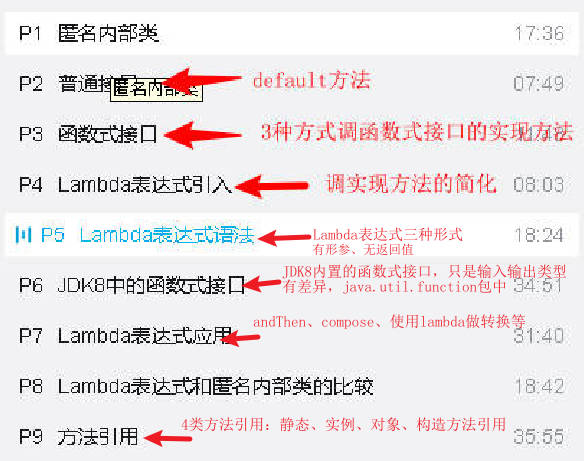
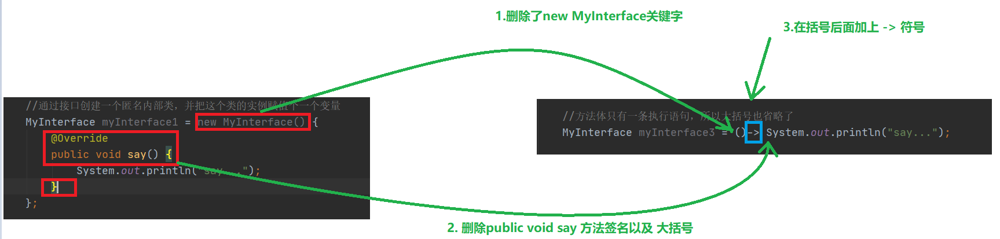
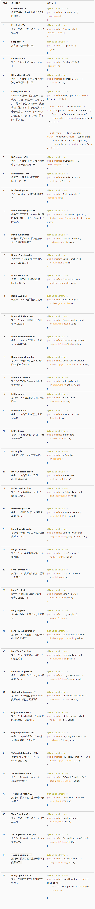

# 函数式接口


## 复习

函数式接口 => Lambda表达式 => java8内置的函数式接口(4大类) => Lambda嵌套使用 => 方法引用（4类）

`行为参数化->简化：匿名类、lambda表达式->将List类型抽象化`



## 1、JDK8中普通接口

注意：在jdk8以前，接口中只能有抽象方法，但是到了jdk8，接口中除了抽象方法，还可以有多个默认方法。
```java
public interface InterfaceDemo {

    public abstract void run();//public 和 abstract 也可以省略

    //默认方法，使用default关键字修饰
    public default void sing(){
        System.out.println("sing .......");
    }

    //默认方法，使用default关键字修饰
    public default void talk(){
        System.out.println("talk .......");
    }
    
    
    //静态方法，可以直接通过接口名来调用
    public static void swim(){
        System.out.println("swim....");
    }


}

public class InterfaceDemoImpl implements InterfaceDemo {


    @Override
    public void run() {
        System.out.println("run.....");
    }

    //注意：sing在接口中是个默认方法，用default关键字修饰，
    //我们在实现类中可以对这个方法进行Override，和可以不进行Override
    @Override
    public void sing() {
        System.out.println("Override sing.....");
    }
    //注意：talk在接口中是个默认方法，用default关键字修饰，
    //我们在实现类中可以对这个方法进行Override，和可以不进行Override
    @Override
    public void talk() {
        System.out.println("Override talk.....");
    }
    
    
}

public class Test1 {
    public static void main(String[] args) {
        InterfaceDemo interfaceDemo=new InterfaceDemoImpl();
        interfaceDemo.run();//输出run.....
        interfaceDemo.sing();//如果在实现类中overwrite了sing方法，这里就会输出Override sing.....否则就会输出sing.....
        interfaceDemo.talk();//如果在实现类中overwrite了talk方法，这里就会输出Override talk.....否则就会输出talk.....
        //直接调用静态方法
        InterfaceDemo.swim();//输出swim....
    }
}

```

## 2、JDK8中的函数式接口

[为什么需要函数式接口](https://baijiahao.baidu.com/s?id=1760851425236581851&wfr=spider&for=pc) [函数式编程优点](https://worktile.com/kb/ask/33650.html) [函数式接口有什么意义](https://www.zhihu.com/question/324013646) [函数式接口](https://blog.csdn.net/m0_46761016/article/details/125165695)  [函数式接口](https://www.cnblogs.com/Kevin-QAQ/p/14176079.html)  [两个最基础的函数式接口](https://cloud.tencent.com/developer/news/636163)  [java8新特性](https://blog.51cto.com/u_15119353/4953734)  
[函数式编程的思维转变 从数据参数化到行为参数化](https://www.bilibili.com/read/cv20877355) [行为参数化](https://jverson.com/2019/02/20/behavior_parameterization/)  [行为参数化](https://zhuanlan.zhihu.com/p/88792788) 
[行为参数化传递代码例子](https://cloud.tencent.com/developer/article/1677648)  [行为参数化例子2](https://www.cnblogs.com/happyflyingpig/p/9042963.html)  [实战-行为参数化](https://www.bilibili.com/video/BV1YV4y1z7Q8/?spm_id_from=333.337.search-card.all.click&vd_source=7346303e5e18677d7261c2c0c109ecfd)  [泛型static＜T＞](https://blog.csdn.net/sinat_16998945/article/details/114667202) [public static  T 与Class ?](https://blog.csdn.net/q610376681/article/details/88542620/)

> 1. 在面向函数编程的语言中，Lambda表达式的类型就是函数，但是**在 Java 中，Lambda表达式的类型是对象**而不是函数，他们必须依赖于一种特别的对象类型——函数式接口。所以说，Java 中的Lambda表达式就是一个函数式接口的对象。我们之前使用匿名实现类表示的对象，都可以使用Lambda表达式来表示
> 2. ==为什么叫函数式接口==
>    1. 为了表示接口就代表这个抽象方法
> 3. 函数式接口的使用
>    1. 可以`作为方法的参数和返回值类型`
>    2. ==函数式接口不同于普通接口==，它最大的作用是为了支持行为参数传递，比如传递Lambda、方法引用、函数式接口对应的实例对象等
> 4. Lambda是一个匿名函数，可以理解为一段可以（像数据一样）传递的代码。可以使代码更简洁更灵活
>    1. **lambda表达式本质上就相当于是function接口的实现类对象**
> 5. ==行为参数化==: 把接口作为函数的参数
>    1. 行为参数化有些类似策略模式，但是更精简。表面来看就是定义一个函数式接口，实现这个接口然后==把函数式接口实现类的实例当做参数加入到方法中==。行为参数化可以很好的应对不断变更的需求，使代码更优雅。`filterApples(appleList, new AppleColorPredicate());`
>    2. 开始是把颜色重量等属性作为参数，很傻，后来是把颜色筛选算法等行为，作为参数

函数式接口: ==有且只有一个抽象方法的接口==，接口中可以包含其他的方法，包括默认方法，静态方法。如果接口中只有一个抽象方法，那么@FunctionalInterface也可以省略

```java
/**
 * 函数式接口
 * @FunctionalInterface
 * 作用：可以检测接口是否是一个函数式接口
 *      是：编译成功
 *      否：编译失败（接口中没有抽象方法，抽象方法的个数大于1）
 */
@FunctionalInterface
public interface MyInterface {
    //定义一个抽象方法
    public abstract void say();

}


//一个实现类
public class MyInterfaceImpl implements MyInterface {
    @Override
    public void say() {
        System.out.println("say...");
    }
}

//测试类
public class Test1 {
    public static void show(MyInterface myInterface){ //传进来实现MyInterface接口的对象
        myInterface.say();
    }

    public static void main(String[] args) {
        //调用show方法，传入MyInterfaceImpl实例
        MyInterface myInterface = new MyInterfaceImpl();
        show(myInterface);	//传进来实现MyInterface接口的对象
        
        
        //调用show静态方法，方法的参数是一个接口，所以可以传递接口的匿名内部类
        show(new MyInterface() {
            @Override
            public void say() {
                System.out.println("say...");
            }
        });
    }
    
}
```
上面测试类中==第一次调用show方法==时候，我们是先定义了一个MyInterface接口的实现类 MyInterfaceImpl，然后创建了一个 MyInterfaceImpl的*实例，作为参数传入show方法*；==第二次调用show方法==时候，我们*传入一个匿名内部类*，下面我们来讲一下==第三种方法==
```java
public static void main(String[] args) {        
        //通过接口创建一个匿名内部类，并把这个类的实例赋值个一个变量
        MyInterface myInterface1=new MyInterface() {
            @Override
            public void say() {
                System.out.println("say...");
            }
        };
        //通过变量调用接口中的say方法
        myInterface1.say();
}
```
## 3、Lambda表达式引入
上面的这种方式我们可以简化为如下代码
```java
public static void main(String[] args) {        
		//这里把匿名内部类的名称，new关键字，以及内部的方法say签名部分都省略了
    	//把实现逻辑传给myInterface2,所以myInterface2.say()知道实现算法是什么
		MyInterface myInterface2=()->{
                System.out.println("say...");
        };
        myInterface2.say();
}
```
当实现方法内部是有一条执行语句的时候，在方法体外部的一对大括号也可以省略
```java
    public static void main(String[] args) {
        //方法体只有一条执行语句，所以大括号也省略了
        MyInterface myInterface3=()-> System.out.println("say...");
        myInterface3.say();
    }
```
上面的代码中，我们通过对内部类一步步简化，最终得到了lambda表达式。这是因为我们的MyInterface是一个函数式的接口，只有一个抽象方法，其实lambda表达式的实现部分就是对我们函数式接口中唯一的一个抽象方法的实现，所以，在lambda表达式中，我们不在需要方法名部分，只需要给出实现部分即可。




## 4、Lambda表达式语法
lambda表达式有三个主要部分构成

- 以小括号()来关闭形参，小括号中可以有放入形参列表，以逗号分开，如果没有形参，小括号中就保持空白
- 小括号()后面紧跟着箭头标记：->
- 箭头标记后是方法的实现部分，可以是一条执行语句，也可以是多条语句组成的代码块；如果是多条语句，需要放在{}中；如果是一条语句，那么{}可以省略
- Lambda表达式提供算法

例1：==有形参、有返回值==
```java
//这里定义了一个有且只有一个抽象方法的接口，此时java会把这个默认当做函数式接口，
//我们可以不使用@FunctionalInterface注解来修饰接口
//这个函数式接口的抽象方法既有入参，也有返回值
public interface InterfaceDemo1 {
    int add(int x,int y);
}


public static void main(String[] args) {

    //1.接口的抽象方法有两个形参，并且都是int类型，方法的实现部分是把两个形参相加后，返回他们的和，这个是完整的写法
    InterfaceDemo1 interfaceDemo1 = (int a,int b) -> { return a+b; };
    System.out.println(interfaceDemo1.add(1, 2));

    //2.接口的抽象方法有两个形参，并且都是int类型，方法的实现部分是把两个形参相加后，返回他们的和
    //由于方法实现部分只有一条语句，所以可以省略大括号，同时return关键字也省略掉
    //注意：如果实现部分是多条执行语句，那么大括号不能省略，函数体部分跟传统的方法写法相同
    InterfaceDemo1 interfaceDemo2 = (int a,int b) ->  a+b;
    System.out.println(interfaceDemo2.add(1, 2));

    //3.接口的抽象方法有两个形参，并且都是int类型，方法的实现部分是把两个形参相加后，返回他们的和
    //由于方法实现部分只有一条语句，所以可以省略大括号，同时return关键字也省略掉
    //这里接口形参的类型也省略掉了，程序会根据函数式接口的抽象方法int add(int x,int y) 自动判断形参类型以及返回值类型
    InterfaceDemo1 interfaceDemo3 = (a,b) ->  a+b;
    System.out.println(interfaceDemo3.add(1, 2));
}
```
例2：==有形参，无返回值==
```java
//定义一个函数式接口，抽象方法有一个入参，没有返回值
@FunctionalInterface
public interface IntefaceDemo2 {
    void sayHello(String name);
}

public static void main(String[] args) {
    //只有一个形参，name放在小括号中
    InterfaceDemo2 interfaceDemo2 = (name) ->System.out.println("hello "+ name);
    interfaceDemo2.sayHello("zhangsan");
    
    //当只有一个形参的时候，小括号也可以省略
    InterfaceDemo2 interfaceDemo3 = name -> System.out.println("hello "+ name);
    interfaceDemo3.sayHello("zhangsan");

}
```
例3：==无形参，有返回值==
```java
@FunctionalInterface
public interface InterfaceDemo3 {
    String run();//这里省略了修饰符 public 和 abstract
}


public static void main(String[] args) {

    //接口的抽象方法没有形参，但是返回类型为String，
    // 在这里我们的方法体部分只有一个字符串"you win..."，并且省略了return关键字
    InterfaceDemo3 interfaceDemo1 = () -> "you win...";
    System.out.println(interfaceDemo1.run());

}
```
## 5、JDK8中提供的函数式接口

四种类型 => BinaryOperator

java.util.function 它包含了很多类，用来支持 Java的 函数式编程，该包中的函数式接口有（参照附件1）
分为四种类型，这里我们重点讲述一下前面六个，因为其余的接口使用方式与前六个类似，只是输入和输出类型有些差异。
对比上面例子1、例子2、例子3，我们自己定义了三个接口InterfaceDemo1、InterfaceDemo2、InterfaceDemo3
我们使用JDK中已经为我们提供的类似的接口来实现我们的程序。
==Int、 Long、 Double等，只是处理不同的类型==

### 1.Consumer：消费型接口
类似上面的IntefaceDemo2，只有输入参数，没有返回结果
```java
    //这里我们给Consumer接口的方法传入了一个字符串
    //我们把这个字符串转换成大写，然后把“hello”和这个字符串拼接在一起
    public static void main(String[] args) {

        Consumer<String> consumer = (name) -> {
            String upperName = name.toUpperCase();
            System.out.println("hello "+ upperName);
        };
        consumer.accept("zhangsan");

    }
```
### 2.Predicate：断言接口
类似上面的InterfaceDemo1，既有输入，也有返回结果
```java
    public static void main(String[] args) {
        //传入一个整型参数，把这个传入的参数与12比较，
        // 如果传入的参数小于12，返回true否则返回false
        Predicate<Integer> predicate = (input) -> input < 12 ? true:false;
        System.out.println(predicate.test(14));

    }
```
### 3.Supplier：供给型接口
类似上面的InterfaceDemo3，没有输入，只有返回结果
```java
    public static void main(String[] args) {
        //没有传入参数，只有一个整型输出结果，计算1加到100的和
        Supplier<Integer> supplier = ()->{
            int result = 0;
            for (int i = 1; i <= 100; i++) {
                result=result+i;
            }
            return result;
        };

        System.out.println(supplier.get());
    }
```
### 4.Function：函数型接口
类似于上面的InterfaceDemo1，既有输入，也有返回结果
```java

    public static void main(String[] args) {
        //如果分数大于90，则返回“优秀”，如果大于等于60小于等于90，返回“及格”，如果小于60返回未及格
        Function<Integer,String> function = (score) -> {
            if(score>90){
                return "优秀";
            }else if(score>=60){
                return "及格";
            }else{
                return "未及格";
            }
        };
        System.out.println(function.apply(99));
    }
```
#### 1、BiFunction

BiFunction：与Function类似，只是==两个输入参数，一个返回结果==

```java
    public static void main(String[] args) {
        BiFunction<Integer,Integer,String> biFunction = (a,b) ->{
          if(a+b>60){
              return "和大于60";
          }else if(a+b<60){
              return "小于60";
          }else {
              return "等于60";
          }
        };

        System.out.println(biFunction.apply(20,20));
    }
```
#### 2、BinaryOperator

BinaryOperator：继承了BiFunction接口，输入参数和返回值类型都相同，注意在这里BinaryOperator.maxBy返回的依然是一个lambda表达式，类型为BinaryOperator

- 提供了2个静态方法, 参数要传一个比较器, 返回一个lanmda表达式

```java

public class Test1 {
    //定义学生类
    static class Student{
        private String name;
        private int score;

        public Student(String name, int score) {
            this.name = name;
            this.score = score;
        }

        public String getName() {
            return name;
        }
        public void setName(String name) {
            this.name = name;
        }
        public int getScore() {
            return score;
        }
        public void setScore(int score) {
            this.score = score;
        }

        @Override
        public String toString() {
            return "Student{" +
                    "name='" + name + '\'' +
                    ", score=" + score +
                    '}';
        }
    };

    public static void main(String[] args) {
	//定义几个学生放进去
        List<Student> students = Arrays.asList(
                new Student("zhangsan", 90),
                new Student("lisi", 80),
                new Student("wangwu", 83),
                new Student("zhaoliu", 87),
                new Student("tianqi", 88)
        );
        
		//a. 定义一个比较器,用BinaryOperator函数式接口时参数要比较器
        Comparator<Student> comparator = Comparator.comparing(Student::getScore);
//       上面Comparator.comparing(Student::getScore);相当于下面的这段代码，定义一个根据学生数的分比较器
//        Comparator<Student> comparator = (student1,student2)->{
        		//如果第一个学生分数大于第二个学生，就返回1
//            if(student1.getScore()>student2.getScore()){
//                return 1;
//            }else if(student1.getScore()<student2.getScore()){
//                return -1;
//            }else{
//                return 0;
//            }
//        };

        //注意：BinaryOperator.maxBy返回的是一个lambda表达式，它的类型是BinaryOperator，也就是BiFunction
        //b.比较器传入BinaryOperator函数式接口
        BinaryOperator<Student> sbo = BinaryOperator.maxBy(comparator);

        //分数最高的学生
        Student studentWithMaxScore = null;
        for (Student s : students) {
            if(studentWithMaxScore == null){
                studentWithMaxScore = s;
            }else{
                //返回一个lambda表达式
                studentWithMaxScore = sbo.apply(studentWithMaxScore,s);
            }
        }
        //c. 打印分数最高的学生
        System.out.println(studentWithMaxScore);
        
         //把上面定义的学生列表按照成绩高到第排序,sort参数，第一个是要排序的列表，第二个比较器(排序算法)
        System.out.println(students);
        Collections.sort(students,(s1,s2)->{
            if(s1.getScore() < s2.getScore()) return 1;
            else if (s1.getScore() > s2.getScore()) return -1;
            else return 0;
        });
        System.out.println(students);
    }
}

```
## 6、Lambda表达式嵌套使用
### 例1：使用andThen

多个lambda连在一块，一个执行完再执行另一个

```java
    public static void main(String[] args) {


        Function<Integer,Integer> f0=(i)->{
            final int k=i-10;	//k=10
            if(k>10){
                return k;
            }else{
                return k+30;	//k=40
            }
        };

        Function<Integer,Integer> f1=(i)->{		//i=40
            final int k=i*2;//注意在lambda表达式中的变量必须使用final修饰，或者相当于使用final（定以后不再修改），这里使用final修饰
            if(k>10){
                return k;	//k=80
            }else{
                return k+100;
            }
        };

        Function<Integer,String> f2=(i)->{	//i=80
            int k=i+10;//注意在lambda表达式中的变量必须使用final修饰，或者相当于使用final（定以后不再修改），这里没有使用final，但是定义后没有修改过变量k的值
            return "hello "+ k;
        };

        //这里f0，f1，f2是从左到右的顺序执行，最后的apply函数中的20是最左侧f0的入参。
        //f0.andThen(f1)是把f0的返回值作为f1的入参
        // 同理，andThen(f1).andThen(f2)是把f1的返回值作为f2的入参
        //f0的结果作为参数传给f1
        System.out.println(f0.andThen(f1).andThen(f2).apply(20));

    }
```
### 例2：使用compose

andthen从前往后执行，compose相反，从后往前

```java
    public static void main(String[] args) {

        Function<Integer,Integer> f4=(a)-> a+5;
        Function<Integer,Integer> f5=(b)-> b*3;
        //f4.compose(f5).apply(7) 先执行f5，并且参数7作为f5的输入参数
        //在执行f5后，把得到的结果作为f4的输入参数进行计算
        //可以看出compose的执行顺序和andThen正好相反
        System.out.println(f4.compose(f5).apply(7));

    }
```
### 例3：通过接口,返回lambda表达式

把lambda封装在一个函数中

```java
public class Test {

    //定义一个静态方法，返回Lambda表达式，类型是Comparator<String>
    public static Comparator<String> getComparator(){

        //方法的返回值类型是一个接口,那么我们可以返回这个接口的匿名内部类
        /*return new Comparator<String>() {
            @Override
            public int compare(String o1, String o2) {
                //按照字符串的降序排序
                return o2.length()-o1.length();
            }
        };*/

        //使用lambda表达式优化代码
        return (s1,s2)->s1.length()-s2.length();
    }

    public static void main(String[] args) {
        //创建一个字符串数组
        String[] arr = {"aaa","bbbbbb","cccc","ddddddd"};
        //输出排序前的数组
        System.out.println(Arrays.toString(arr));//[aaa, bbbbbb, cccc, ddddddd]
        //调用Arrays中的sort方法,对字符串数组进行排序（排序规则是字符串的长度）
        Arrays.sort(arr,getComparator());
        //输出排序后的数组(升序)
        System.out.println(Arrays.toString(arr));//[aaa, cccc, bbbbbb, ddddddd]
    }
}

```
上面这段代码是根据字符串长度做升序排序，若要根据长度降序，如何修改一下代码实现这个需求呢？

### 例4：处理条件分支
```java
@FunctionalInterface
public interface BranchHandler {

    /**
     * 分支操作
     *
     * @param thandler 为true时要进行的操作
     * @param fhandler 为false时要进行的操作
     * @return void
     **/
    void handle(Runnable thandler, Runnable fhandler);

    /**
     * 参数为true或false时，分别进行不同的操作
     *
     * @param b
     * @return BranchHandler
     **/
    public static BranchHandler isTureOrFalse(boolean b){
        return (th, fh) -> {
            if (b){
                th.run();
            } else {
                fh.run();
            }
        };
    }
}

//测试类
public class Test {
    public static void main(String[] args) {
        BranchHandler.isTureOrFalse(false).handle(
                ()-> System.out.println("入参为true的分支"),
                ()-> System.out.println("入参为false的分支")
        );
    }
}

```
### 例5：使用lambda表达式做转换

例如：输入员工列表，输出员工姓名列表

```java
//定义一个员工类
public class Employee {
    private String name;
    private double salary;
    public Employee(String name,double salary) {
        this.name = name;
        this.salary = salary;
    }
    public String getName() {
        return name;
    }
    public void setName(String name) {
        this.name = name;
    }
    public double getSalary() {
        return salary;
    }
    public void setSalary(double salary) {
        this.salary = salary;
    }
}

//测试类
public class Test {

    public static <T, R> List<R> map(List<T> list, Function<T, R> fun){
        List<R> returnList = new ArrayList<>(list.size());
        for (T e : list) {
            returnList.add(fun.apply(e));
        }
        return returnList;
    }

    //输入员工列表，输出员工姓名列表
    public static void main(String[] args) {
        List<Employee> employees = Arrays.asList(
                new Employee("老张",4000),
                new Employee("小李",2000),
                new Employee("老王",3000),
                new Employee("小刘",3200),
                new Employee("小胖",3900));
        List<String> nameList = map(employees, (employee -> employee.getName()));
        System.out.println(nameList);//[老张, 小李, 老王, 小刘, 小胖]
    }
}

```
## 7、Lambda表达式对比匿名内部类
| **比较项** | **Lambda** | **匿名类** |
| --- | --- | --- |
| this关键字 | lambda表达式所在的类对象 | 匿名类对象本身 |
| 是否可以定义与外层类相同的变量 | 不可以 | 可以 |
| 实现方式 | 函数调用 | 编译出一个类 |
```java
//使用匿名内部类
//1.在匿名内部类内部可以覆盖外层定义的变量
//2.在匿名内部类的内部，this是指这个匿名内部类生成的对象实例
public class Test {

    public static void testAnonclass() {
        String nonFinalVariable = "Non Final Variable";//外部类定义的非final修饰的变量(使用final测试结果不变)
        String variable = "Outer Method Variable";//外部类定义的非final修饰的变量(使用final测试结果不变)
        new Thread(new Runnable() {
            String variable = "Runnable Class Member";//内部类定义的非final修饰的变量(使用final测试结果不变)
            public void run() {
                String variable = "Run Method Variable";//内部类中方法内部定义的非final修饰的变量(使用final测试结果不变)

                System.out.println("->" + nonFinalVariable);//->Non Final Variable
                System.out.println("->" + variable);//->Run Method Variable
                System.out.println("->" + this.variable);//->Runnable Class Member
                System.out.println("this->" + this.getClass().getName());//->Test$1
            }
        }).start();
    }

    public static void main(String[] args) {
        testAnonclass();
    }
}
```
```java
//使用lambda表达式
//1.不能在lambda中覆盖外部同名的变量
//2.lambda表达式中的this是指lambda表达式所在的类的实例
public class TestLambda {
    public String variable = "Class Level Variable";

    public static void main(String[] arg) {
        new TestLambda().lambdaExpression();
    }
    public void lambdaExpression(){
        String variable = "Method Local Variable";
        String nonFinalVariable = "This is non final variable";
        new Thread (() -> {
            //下面这行如果不注释掉会编译报错，因为在lambda中不允许覆盖外层代码定义的变量
//            String variable = "Run Method Variable";
            System.out.println("->" + nonFinalVariable);//->This is non final variable
            System.out.println("->" + variable);//->Method Local Variable
            System.out.println("->" + this.variable);//->Class Level Variable
            System.out.println("this->" + this.getClass().getName());//->TestLambda
        }).start();
    }
}
```

## 8、方法引用
### 1、使用场景
我们用Lambda表达式来实现匿名方法。但有些情况下，我们用Lambda表达式仅仅是调用一些已经存在的方法，除了调用动作外，没有其他任何多余的动作，在这种情况下，我们倾向于==通过方法名来调用==它，而Lambda表达式可以帮助我们实现这一要求，它使得Lambda在==调用那些已经拥有方法名的方法==的代码更简洁、更容易理解。方法引用可以理解为Lambda表达式的另外一种表现形式。
用方法引用有条件的，不是随便就能引用

### 2、方法引用分类
| **类型** | **语法** | **对应Lambda表达式** |
| --- | --- | --- |
| 静态方法引用 | 类名::staticMethod | (args) -> 类名.staticMethod(args) |
| 实例方法引用 | inst::instMethod | (args) -> inst.instMethod(args) |
| 对象方法引用 | 类名::instMethod | (inst,args) -> inst.instMethod(args) |
| 构建方法引用 | 类名::new | (args) -> new 类名(args) |

#### 8.2.1.静态方法引用
例1：（根据对象的某字段排序）
要求把一个Employee对象的数组按照工资来排序。

```java
//定义一个Employee类
public class Employee {
    private String name;
    private Integer salary;
    public Employee(String name,Integer salary) {
        this.name = name;
        this.salary = salary;
    }
    public String getName() {
        return name;
    }
    public void setName(String name) {
        this.name = name;
    }
    public Integer getSalary() {
        return salary;
    }
    public void setSalary(Integer salary) {
        this.salary = salary;
    }

    @Override
    public String toString() {
        return "Employee{" +
                "name='" + name + '\'' +
                ", salary=" + salary +
                '}';
    }

    //定义一个根据salary的静态比较方法
    public static int compareBySalary(Employee e1,Employee e2){
        return e1.getSalary().compareTo(e2.getSalary());
    }

}

```
```java
//测试类
//1.有lambda表达式
//2.已经存在静态方法
//3.静态方法签名（入参和出参）符合函数式接口中抽象方法的要求
public class Test {

    public static void main(String[] args) {
        //定义数组
        Employee[] employees = {
                new Employee("小张",3000),
                new Employee("小王",4000),
                new Employee("小李",2000),
                new Employee("老武",5000),
                new Employee("小明",1000),
        };
        for (Employee employee : employees) {
            System.out.println(employee);
        }
        System.out.println("==============");
        //方式1.第二个参数传入lambda表达式（目标类型是函数式接口Comparator）
        Arrays.sort(employees,(a,b)->a.getSalary().compareTo(b.getSalary()));
        for (Employee employee : employees) {
            System.out.println(employee);
        }
        System.out.println("==============");
        //方式2.第二个参数传入lambda表达式，并且调用Employee的静态方法compareBySalary比较
        Arrays.sort(employees,(a,b)->Employee.compareBySalary(a,b));
        for (Employee employee : employees) {
            System.out.println(employee);
        }
        System.out.println("==============");
        //方式3.第二个参数使用方法引用
        //注意：sort方法的第二个参数要求函数式接口Comparator类型，
        //此时，Employee的静态方法compareBySalary的传入参数类型，个数
        //以及方法的返回值的类型都与接口Comparator一模一样
        Arrays.sort(employees,Employee::compareBySalary);
        for (Employee employee : employees) {
            System.out.println(employee);
        }
        System.out.println("==============");

    }
}

```
例2：（整数列表排序）
```java
public class Test {
	public static void main(String[] args) {
        List<Integer> list = Arrays.asList(2, 4, 1, 6, 8, 3);
        System.out.println(list);//[2, 4, 1, 6, 8, 3]
        list.sort(Integer::compare);//静态方法引用
        System.out.println(list);//[1, 2, 3, 4, 6, 8]
    }
}
```
#### 8.2.2.实例方法引用
实例方法引用，顾名思义就是调用已经存在的实例的方法，与静态方法引用不同的是类要先实例化，静态方法引用类无需实例化，直接用类名去调用。
```java
public class User {
    private String name;
    private Integer age;

    public User(String name, Integer age) {
        this.name = name;
        this.age = age;
    }

    @Override
    public String toString() {
        return "User{" +
                "name='" + name + '\'' +
                ", age=" + age +
                '}';
    }

    public String getName() {
        return name;
    }

    public void setName(String name) {
        this.name = name;
    }

    public Integer getAge() {
        return age;
    }

    public void setAge(Integer age) {
        this.age = age;
    }
}

```
```java
public class Test {

    public static void main(String[] args) {
       
        User user = new User("欧阳峰",18);
        Supplier<String> supplier = () -> user.getName();
        System.out.println("Lambda表达式输出结果：" + supplier.get());

        Supplier<String> supplier2 = user::getName;//这里使用实例方法引用
        System.out.println("实例方法引用输出结果：" + supplier2.get());

    }
}
```
#### 8.2.3.对象方法引用

==要求==比实例方法引用==更加严格==

若Lambda参数列表中的第一个参数是实例方法的调用者，而第二个参数是实例方法的参数时，可以使用对象方法引用。（符合上面这种情况才可以，对象方法引用形式上类似于静态方法引用）
我们看看String类的equals方法是“aaa”.equals("bbbb")

```java
public class Test {

    public static void main(String[] args) {

      //lambda表达式
      BiPredicate<String,String> bp = (x, y) -> x.equals(y);
      //对象方法引用
      BiPredicate<String,String> bp1 = String::equals;

      boolean test = bp1.test("xy", "xx");
      System.out.println(test);//false

    }
}

```
BiPredicate的test()方法接受两个参数，x和y，具体实现为x.equals(y)，满足Lambda参数列表中的第一个参数是实例方法的调用者，而第二个参数是实例方法的参数，因此可以使用对象方法引用。

#### 8.2.4.构造方法引用

就是创建对象（分别调用不同的构造函数）

需要调用的构造器的参数列表要与函数式接口中抽象方法的参数列表保持一致。
```java
public class User {
    private String name;
    private Integer age;

    public User(String name, Integer age) {
        this.name = name;
        this.age = age;
    }
    public User() {

    }
    public User(String name) {
        this.name = name;
    }
    @Override
    public String toString() {
        return "User{" +
                "name='" + name + '\'' +
                ", age=" + age +
                '}';
    }

    public String getName() {
        return name;
    }

    public void setName(String name) {
        this.name = name;
    }

    public Integer getAge() {
        return age;
    }

    public void setAge(Integer age) {
        this.age = age;
    }
}

```
```java
public class Test {

    public static void main(String[] args) {
        //使用lambda创建一个User对象（无参数）
        Supplier<User> userSupplier1 = ()-> new User();
        User user1 = userSupplier1.get();
        user1.setName("user1");
        user1.setAge(11);
        System.out.println(user1);//User{name='user1', age=11}

        //使用构造方法引用创建一个User对象(无参数)
        Supplier<User> userSupplier2 = User::new;
        User user2 = userSupplier2.get();
        user2.setName("user2");
        user2.setAge(12);
        System.out.println(user2);//User{name='user2', age=12}

        //使用构造方法引用创建一个User对象（传入两个参数）
        BiFunction<String,Integer,User> userBiFun1 = (name,age)->new User(name,age);
        User user3 = userBiFun1.apply("user3", 13);

        System.out.println(user3);//User{name='user3', age=13}

        //使用方法引用创建一个User对象（传入两个参数）
        BiFunction<String,Integer,User> userBiFun2 = User::new;
        User user4 = userBiFun2.apply("user4", 14);

        System.out.println(user4);//User{name='user4', age=14}
        
        Function<String,User> fun5 = User::new;
        User user5 = fun5.apply("user5");

        System.out.println(user5);//User{name='user5', age=null}        
    }
}
```

## 附件1：
这个列表是在jdk8中的java.util.function包中的函数式接口列表，还有一些其他的函数式接口没有在这个包中，例如java.util.Comparator,java.lang.Runnable等等。


