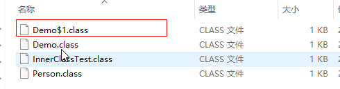

# 匿名内部类

## 01.普通类使用场景

```java
public abstract class Person {
    public abstract void talk();
}

public class Child extends Person {
    public void talk() {
        System.out.println("说些什么.....");
    }
}

public class Demo {
    public static void main(String[] args) {
        Person p = new Child();
        p.talk();
    }
}
```
可以看到，我们用Child继承了Person类，然后实现了Child的一个实例，将其向上转型为Person类的引用，但是，如果此处的Child类只使用一次，那么将其编写为独立的一个类岂不是很麻烦？这个时候就引入了匿名内部类。


## 02.匿名内部类使用场景

匿名内部类也就是没有名字的内部类，因为没有名字，所以匿名内部类只能使用一次，它通常用来简化代码编写，匿名内部类一般直接在new实例的同时给出实现部分，针对抽象类和接口使用匿名内部类。

## 03.在抽象类上使用匿名内部类
```java
public abstract class Person {
    public abstract void talk();
}
 
public class Demo {
    public static void main(String[] args) {
        Person p = new Person() {
            public void talk() {
                System.out.println("说些什么....");
            }
        };
        p.talk();
    }
}
```
可以看到，我们直接将抽象类Person中的方法在大括号中实现了，这样便可以省略一个类的书写。

## 04.在接口上使用匿名内部类
```java
public interface Person {
    public void talk();
}
 
public class Demo {
    public static void main(String[] args) {
        Person p = new Person() {
            public void talk() {
        
                System.out.println("说些什么......");
            }
        };
        p.talk();
    }
}
```
由上面的例子可以看出，只要一个类是抽象的或是一个接口，那么其子类中的方法都可以使用匿名内部类来实现
最常用的情况就是在多线程的实现上，因为要实现多线程必须继承Thread类或是实现Runnable接口。

## 05.Runnable接口的匿名内部类实现
```java
public class Demo {
    public static void main(String[] args) {
        Runnable r = new Runnable() {
            public void run() {
                for (int i = 1; i <= 5; i++) {
                    System.out.print(i + " ");
                }
            }
        };
        Thread t = new Thread(r);
        t.start();
    }
}
```

## 06.匿名内部类的实现原理

使用javap把class文件反编译成字节码

```java
D:\study\demo\out\production\demo\com\example\demo\innerclass>javap -v Demo.class
```

字节码内容如下：

```java

Classfile /D:/study/demo/out/production/demo/com/example/demo/innerclass/Demo.class
  Last modified 2022-6-15; size 617 bytes
  MD5 checksum ff5f583b9b881d74f136f139e3625fc7
  Compiled from "Demo.java"
public class com.example.demo.innerclass.Demo
  minor version: 0
  major version: 52
  flags: ACC_PUBLIC, ACC_SUPER
Constant pool:
   #1 = Methodref          #6.#23         // java/lang/Object."<init>":()V
   #2 = Class              #24            // com/example/demo/innerclass/Demo$1
   #3 = Methodref          #2.#23         // com/example/demo/innerclass/Demo$1."<init>":()V
   #4 = Methodref          #25.#26        // com/example/demo/innerclass/Person.talk:()V
   #5 = Class              #27            // com/example/demo/innerclass/Demo
   #6 = Class              #28            // java/lang/Object
   #7 = Utf8               InnerClasses
   #8 = Utf8               <init>
   #9 = Utf8               ()V
  #10 = Utf8               Code
  #11 = Utf8               LineNumberTable
  #12 = Utf8               LocalVariableTable
  #13 = Utf8               this
  #14 = Utf8               Lcom/example/demo/innerclass/Demo;
  #15 = Utf8               main
  #16 = Utf8               ([Ljava/lang/String;)V
  #17 = Utf8               args
  #18 = Utf8               [Ljava/lang/String;
  #19 = Utf8               p
  #20 = Utf8               Lcom/example/demo/innerclass/Person;
  #21 = Utf8               SourceFile
  #22 = Utf8               Demo.java
  #23 = NameAndType        #8:#9          // "<init>":()V
  #24 = Utf8               com/example/demo/innerclass/Demo$1
  #25 = Class              #29            // com/example/demo/innerclass/Person
  #26 = NameAndType        #30:#9         // talk:()V
  #27 = Utf8               com/example/demo/innerclass/Demo
  #28 = Utf8               java/lang/Object
  #29 = Utf8               com/example/demo/innerclass/Person
  #30 = Utf8               talk
{
  public com.example.demo.innerclass.Demo();
    descriptor: ()V
    flags: ACC_PUBLIC
    Code:
      stack=1, locals=1, args_size=1
         0: aload_0
         1: invokespecial #1                  // Method java/lang/Object."<init>":()V
         4: return
      LineNumberTable:
        line 3: 0
      LocalVariableTable:
        Start  Length  Slot  Name   Signature
            0       5     0  this   Lcom/example/demo/innerclass/Demo;

  public static void main(java.lang.String[]);
    descriptor: ([Ljava/lang/String;)V
    flags: ACC_PUBLIC, ACC_STATIC
    Code:
      stack=2, locals=2, args_size=1
         0: new           #2                  // class com/example/demo/innerclass/Demo$1
         3: dup
         4: invokespecial #3                  // Method com/example/demo/innerclass/Demo$1."<init>":()V
         7: astore_1
         8: aload_1
         9: invokevirtual #4                  // Method com/example/demo/innerclass/Person.talk:()V
        12: return
      LineNumberTable:
        line 5: 0
        line 10: 8
        line 11: 12
      LocalVariableTable:
        Start  Length  Slot  Name   Signature
            0      13     0  args   [Ljava/lang/String;
            8       5     1     p   Lcom/example/demo/innerclass/Person;
}
SourceFile: "Demo.java"
InnerClasses:
     static #2; //class com/example/demo/innerclass/Demo$1

```

查看我们的class输出目录，有一个叫做Demo$1.class的类，这个就是匿名内部类编译出来的类。


