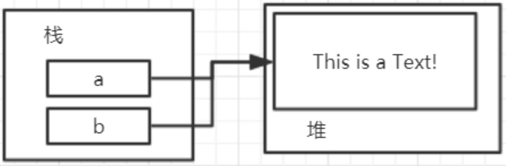
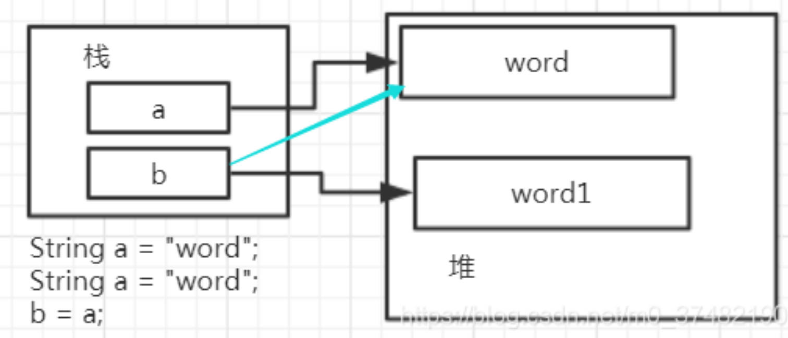
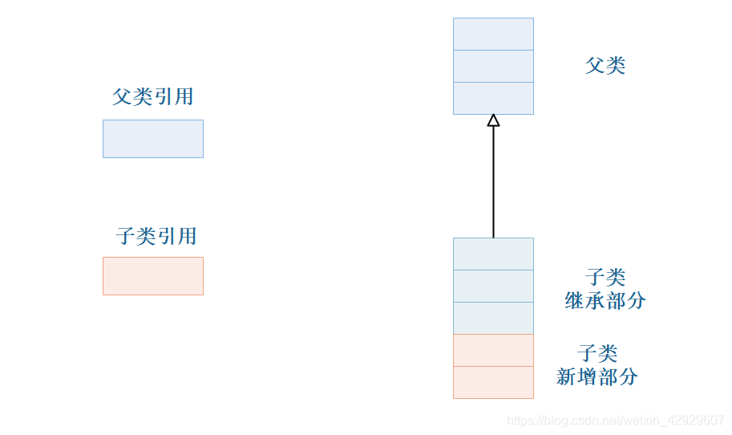
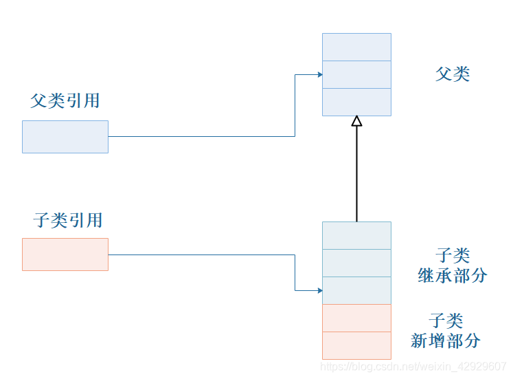
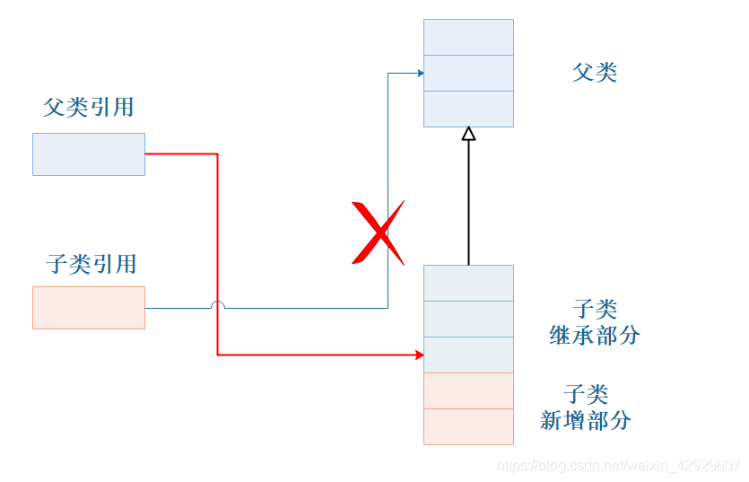
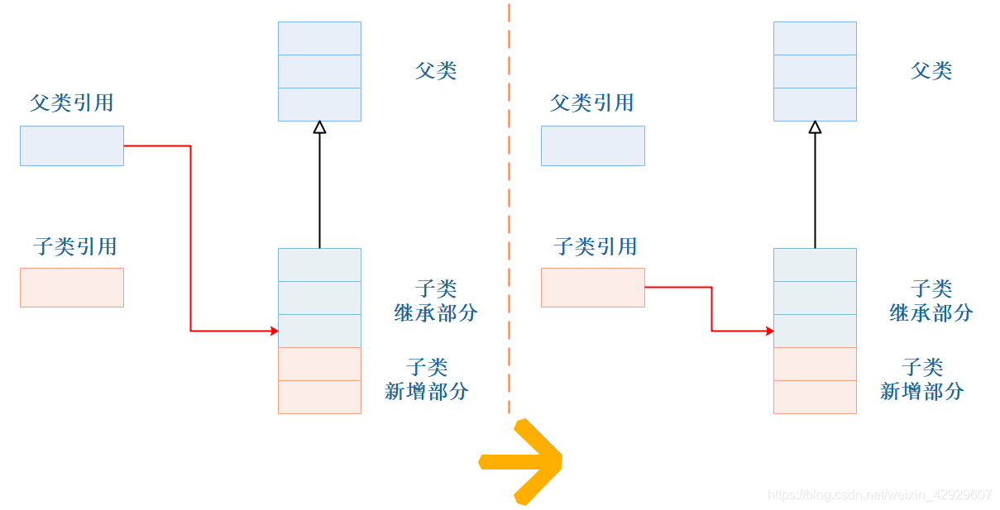

# ==类接口对象==

流程图参考： [如何写代码](..\..\..\编程语言\软件架构\软件架构)

## 类和接口开发时的主要用处

[类和接口开发时的主要用处_百度搜索](https://www.baidu.com/s?ie=UTF-8&wd=%E7%B1%BB%E5%92%8C%E6%8E%A5%E5%8F%A3%E5%BC%80%E5%8F%91%E6%97%B6%E7%9A%84%E4%B8%BB%E8%A6%81%E7%94%A8%E5%A4%84)  

类用于==创建具体对象、封装数据和行为==；接口用于==定义统一规范、支持多态和解耦==。 开发中，==类负责“怎么实现”，接口负责“能做什么”==，两者配合能写出易扩展、易维护的代码。

### 类的主要用处

- 实例化对象：类是创建具体对象的模板，通过 `new` 生成实例，保存状态并提供方法。
- 封装数据与逻辑：将属性（成员变量）和操作（方法）打包，通过访问修饰符控制外部访问。
- 代码复用：通过继承，子类复用父类通用实现，减少重复代码。
- 实现多态：父类引用指向子类对象，运行时调用实际类型方法，便于扩展。

### 接口的主要用处

- 定义契约/规范：只声明方法签名，不写实现，强制实现类遵循统一标准。
- ==解耦设计==：`上层模块只依赖接口，不依赖具体实现`，替换底层实现时上层代码无需改动。
- 支持多实现：一个类可实现多个接口，突破单继承限制，组合多种能力。
- 定义扩展点：插件化系统中，第三方按接口契约实现，即可直接接入系统运行。

### 怎么选

- 要解耦、定义标准、跨体系能力 → 用接口。
- 要抽共性、统一流程、复用代码 → 用抽象类。
- 有明确状态和具体对象 → 用普通类。

> 简单记：接口管“做什么”，抽象类管“怎么做”，类管“具体做”。

接口和抽象类都管“怎么做”，可以看看接口和抽象类怎么区分或者抽象类和普通类怎么选

## 类、接口和对象在开发时的用处

### 一句话先理清三者关系

**类是图纸，对象是照图纸造出来的实物，接口是不依赖具体图纸的“能力契约”**。开发时，类负责“定义数据和行为”，对象负责“在运行时承载状态、被传递和被调用”，接口负责“约定能做什么、把调用方和实现方隔开”。

------

### 一、类（class）：定义结构 + 复用逻辑

类是编译期的概念，是字段（数据）和方法（行为）的封装单元。

#### 开发中的实际用处

**1）封装数据，避免“散装参数”**

没有类的时候，一个用户信息可能散落在一堆变量里：

```java
String username = "tom";
String email = "tom@example.com";
int age = 20;
```

有了类，它们成为一个有名字、有约束的整体：

```java
public class User {
    private Long id;
    private String username;
    private String email;
    private int age;

    public boolean isAdult() {
        return age >= 18;
    }
    // getter / setter
}
```

方法签名从 `void f(String, String, int, boolean, ...)` 变成 `void f(User user)`，可读性和可维护性完全不同。

**2）承载业务规则，让数据和行为待在一起**

“成年才能下单”这条规则，写在 `User.isAdult()` 里，比散落在各个 Service 中 `if (user.getAge() >= 18)` 更内聚。改规则只改一处。

**3）作为分层架构的骨架**

在 Spring Boot 项目里，几乎每一层都是一个类：

| 类类型                  | 职责                       |
| ----------------------- | -------------------------- |
| `Entity`（如 `User`）   | 映射数据库表，承载领域数据 |
| `DTO` / `VO`            | 传输入参 / 输出视图        |
| `Controller`            | 接收请求、参数校验         |
| `Service`               | 业务逻辑、事务边界         |
| `Mapper` / `Repository` | 数据访问                   |
| `Config`                | 装配 Bean、跨域、拦截器    |
| `Utils`                 | 无状态工具方法             |

**4）继承与多态，减少重复代码**

```java
public abstract class AbstractNotifier {
    public void notify(String msg) {
        validate(msg);
        doSend(msg);
        recordLog(msg);
    }
    protected abstract void doSend(String msg);
    protected void validate(String msg) { /* 通用校验 */ }
}
```

模板方法把“流程固定、步骤可变”的逻辑固化在父类，子类只写差异部分。

**5）控制可见性，划清边界**

`private` 字段 + `public` 方法，外部只能通过受控入口修改状态，避免对象被随意改成非法值。`final`、`static`、内部类、枚举也都在这个层面发挥作用（枚举尤其适合表示状态、类型码）。

------

### 二、对象（object）：运行时的实际工作单元

对象是 `new` 出来的实例，是类在内存中的具体存在。

#### 开发中的实际用处

**1）承载“每一次请求/每一个业务实体”的独立状态**

同一个 `User` 类，可以有成千上万个对象，各自 id、姓名不同。Web 应用中每个请求处理过程中创建的 DTO、上下文对象，都是对象在“临时记账”。

**2）通过引用传递，避免大对象复制**

```java
void process(User user) { ... }   // 传引用，不复制整个对象
```

这也是为什么要注意**共享可变对象**的风险：多个线程持有同一个对象引用并修改它，就需要加锁或改用不可变对象。

**3）依赖注入的基本单位**

Spring 的核心就是“管理对象的生命周期和依赖关系”：

```java
@Service
public class UserService {
    private final UserMapper userMapper;   // 依赖的是对象
    public UserService(UserMapper userMapper) {
        this.userMapper = userMapper;      // 容器把对象注进来
    }
}
```

你写的是类，容器跑起来给你的是对象。理解这一点，才真正理解 `@Autowired`、单例作用域、循环依赖这些东西在说什么。

**4）实现“同一份代码，不同数据”的复用**

```java
List<User> users = List.of(
    new User("tom", "tom@a.com"),
    new User("jerry", "jerry@a.com")
);
users.forEach(u -> System.out.println(u.getUsername()));
```

类写一次，对象造无数个，这是面向对象复用价值的直接体现。

**5）作为多态的载体**

```java
AbstractNotifier n = new SmsNotifier();   // 声明是父类，实际是子类对象
n.notify("验证码 123456");                 // 运行时决定调哪个实现
```

变量类型是抽象的，对象是具体的——这正是“面向抽象编程”的落地点。

**6）生命周期与资源管理**

对象有创建、使用、销毁的过程。数据库连接、文件流、线程池都是对象，用完必须释放（`try-with-resources`、`close()`），否则泄漏。GC 能回收内存，但回收不了连接池里的连接、外部文件句柄。

------

### 三、接口（interface）：定契约、解耦、开扩展

接口只声明“能做什么”，不规定“怎么做”。

#### 开发中的实际用处

**1）解耦：调用方只依赖接口，不依赖实现**

```java
public interface PaymentService {
    PayResult pay(Order order);
}

@Service
public class OrderService {
    private final PaymentService payment;   // 依赖接口
    public OrderService(PaymentService payment) {
        this.payment = payment;
    }
}
```

`OrderService` 不知道也不关心是支付宝、微信还是模拟支付。换实现不需要改 `OrderService` 一行代码——这就是依赖倒置原则（DIP）。

**2）多实现 + 运行时切换（策略模式）**

```java
@Service
public class AlipayService implements PaymentService { ... }

@Service
public class WechatPayService implements PaymentService { ... }
```

配合 Spring 的 `Map<String, PaymentService>` 注入，可以按支付类型动态选实现：

```java
private final Map<String, PaymentService> registry;  // key 为 bean 名
```

新增一种支付方式，只加一个实现类，不动原有代码——符合开闭原则。

**3）定义扩展点，让框架能回调你的代码**

你在 Spring Boot 里写的这些，本质都是“实现框架定义的接口”：

- `HandlerInterceptor`：拦截请求
- `WebMvcConfigurer`：配置 MVC
- `CommandLineRunner`：启动后执行
- `Comparator`、`Iterable`、`Runnable`：JDK 提供的扩展点

框架面向接口编程，你提供实现，框架在合适的时机回调。这是所有“插件化”“SPI”的基础。

**4）便于单元测试（Mock）**

```java
@MockBean PaymentService payment;   // 测试时替换成假实现
```

依赖接口才能轻松替换成桩对象，把被测单元隔离出来。如果直接 `new AlipayService()`，测试时无法替换，只能真调外部支付网关。

**5）表达“能力”而非“身份”（比继承更灵活）**

```java
public interface Serializable {}
public interface Comparable<T> { int compareTo(T o); }
```

一个类只能继承一个父类，但能实现多个接口。`SortedList` 既是 `List` 又是 `Collection`，靠接口实现多重类型。

**6）函数式接口 + Lambda，简化代码**

```java
@FunctionalInterface
public interface Predicate<T> { boolean test(T t); }

users.stream().filter(u -> u.getAge() >= 18).collect(Collectors.toList());
```

`Runnable`、`Callable`、`Supplier`、`Consumer` 都是函数式接口，让“把行为当参数传”变得非常轻量。

**7）接口默认方法，平滑升级 API**

```java
public interface PaymentService {
    PayResult pay(Order order);
    default boolean supportRefund() { return true; }   // 新增方法不破坏已有实现
}
```

------

### 四、三者如何协作：一个完整的小例子

```java
// 1. 接口：定义契约
public interface Notifier {
    void send(String target, String content);
}

// 2. 类：实现契约（可多个）
public class SmsNotifier implements Notifier {
    @Override
    public void send(String target, String content) {
        System.out.println("短信 -> " + target + " : " + content);
    }
}

public class EmailNotifier implements Notifier {
    @Override
    public void send(String target, String content) {
        System.out.println("邮件 -> " + target + " : " + content);
    }
}

// 3. 类：只依赖接口
public class AlertService {
    private final List<Notifier> notifiers;
    public AlertService(List<Notifier> notifiers) {
        this.notifiers = notifiers;
    }
    public void alert(String target, String content) {
        for (Notifier n : notifiers) {
            n.send(target, content);      // 多态调用
        }
    }
}

// 4. 对象：运行时组装
public class Demo {
    public static void main(String[] args) {
        AlertService svc = new AlertService(
            List.of(new SmsNotifier(), new EmailNotifier())   // 造对象
        );
        svc.alert("13800000000", "服务器负载过高");
    }
}
```

- **接口** `Notifier`：约定“能发送”，不关心怎么发。
- **类** `SmsNotifier` / `EmailNotifier` / `AlertService`：定义具体结构和逻辑。
- **对象**：`new` 出来的三个实例，在 `main` 里被组装、传递、调用。

在 Spring 项目里，第 4 步的“手动组装”由容器完成，其余完全一样。

------

### 五、常见误区

| 误区                                                       | 说明                                                         |
| ---------------------------------------------------------- | ------------------------------------------------------------ |
| 把类当“数据结构”用，全是 getter/setter，逻辑全堆在 Service | 贫血模型。适当把规则放回对象里（如 `order.cancel()`），逻辑更内聚 |
| 滥用继承                                                   | 继承是“is-a”，耦合父类实现。多数场景**组合 + 接口**优于继承  |
| 接口只有一个实现就“过度设计”                               | 不一定。接口是为了**隔离变化**和**便于测试**；但确实不要为不可能的变化提前抽象 |
| 忘记对象是引用语义                                         | 传参不复制，方法里改了对象外部也看得到；需要隔离时要拷贝（`clone`、构造器复制、DTO 转换） |
| 忽略对象生命周期                                           | 连接、流、线程池等对象必须显式释放；`static` 持有大对象容易造成内存泄漏 |
| 到处 `new` 依赖对象                                        | 导致难以替换和测试。交给 Spring 容器管理，或至少通过构造器传入 |
| 接口里写太多默认方法变成“抽象类替身”                       | 接口应保持契约纯粹，通用实现放抽象类或工具类                 |

------

### 六、一张对照表

| 维度         | 类                             | 接口                         | 对象                           |
| ------------ | ------------------------------ | ---------------------------- | ------------------------------ |
| 存在阶段     | 编译期定义                     | 编译期定义                   | 运行期存在                     |
| 核心作用     | 封装数据 + 行为，作为模板      | 约定能力，隔离实现           | 承载状态，被传递和调用         |
| 能否实例化   | 可以（非抽象）                 | 不能（需实现类）             | 本身就是实例                   |
| 关系         | 实现接口、继承类               | 被类实现                     | 由类创建                       |
| 典型开发用途 | Entity、Service、Config、Utils | SPI、策略、回调、扩展点      | 请求上下文、Bean、集合元素     |
| 关键原则     | 高内聚、封装、单一职责         | 面向抽象、开闭原则、依赖倒置 | 生命周期管理、避免共享可变状态 |

------

**一句话收尾**：写代码时，先用**接口**想清楚“系统需要哪些能力、边界在哪”，再用**类**把能力和数据结构落地，最后在运行时靠**对象**把这些能力组装起来跑通业务流程。三者配合得好，代码就表现为“改动小、易测试、好扩展”；配合得差，就容易出现“改一处崩三处、没法写单测、逻辑到处复制”。

如果你想更具体一点，我可以拿你手上的 Spring Boot 项目举例，把某个业务场景（比如订单支付、消息通知、文件存储）按“接口 + 多实现 + 对象组装”重构一遍，对比重构前后的代码差异。

## ==类只依赖接口是什么意思==

[类只依赖接口是什么意思_百度搜索](https://www.baidu.com/s?ie=UTF-8&wd=%E7%B1%BB%E5%8F%AA%E4%BE%9D%E8%B5%96%E6%8E%A5%E5%8F%A3%E6%98%AF%E4%BB%80%E4%B9%88%E6%84%8F%E6%80%9D)  

[Java 中多态怎么编写解耦的业务层](https://www.php.cn/faq/3183653.html)   [依赖抽象，不依赖具体实现_依赖接口不依赖实现](https://blog.csdn.net/C18298182575/article/details/139837779)   [类、接口的几种关系](https://blog.csdn.net/qq_43408238/article/details/108139499)  

[依赖倒置原则_百度百科](https://baike.baidu.com/item/%E4%BE%9D%E8%B5%96%E5%80%92%E7%BD%AE%E5%8E%9F%E5%88%99/6189149)   [如何维护海量模块依赖关系](https://zhuanlan.zhihu.com/p/514528115)  

类只依赖接口，意思是==这个类在代码里只“认识”接口类型，不直接依赖具体的实现类。 字段类型、方法参数、返回值都声明为接口==，具体实现类通过构造器、setter或工厂在运行时注入，编译期不留实现类痕迹。

### 核心含义

1. 只认契约，不认实现：类知道接口定义了哪些方法，但不关心具体逻辑。如 `OrderService` 依赖 `PaymentStrategy` 接口，而非 `WechatPayment` 类。
2. 具体实现被“隔离”：实现类变化不影响调用方。从 Oracle 切到 MySQL，只需新增 `MysqlOperator` 实现接口并注入，业务类代码零改动。
3. 创建逻辑外移：==类不做 new 具体实现，由工厂、容器或依赖注入框架负责创建和选择==，符合开闭原则。

### 代码示例

```java
// 定义接口
public interface MessageSender {
    void send(String message);
}

// 具体实现
public class EmailSender implements MessageSender {
    public void send(String message) { /* 发送邮件 */ }
}

// 业务类只依赖接口
public class MessageService {
    private final MessageSender sender;  // 接口类型，非具体类

    public MessageService(MessageSender sender) {  // 构造器注入接口
        this.sender = sender;
    }

    public void notify(String msg) {
        sender.send(msg);  // 只调用接口方法
    }
}
```

`MessageService` 不知道存在 `EmailSender`，替换成短信或推送实现，业务类不用改。

### ⚠️ 要注意的边界

- 不是所有类都要配接口：99% 场景只有一个实现类时，硬加接口增加维护负担，小团队可直接用实现类。
- ==本质是“依赖抽象”==：接口只是抽象的一种形式，抽象类同样能实现此目的，核心是依赖稳定抽象，而非多变细节。
- 这是依赖倒置原则的体现：高层模块和低层模块都依赖抽象，抽象不依赖细节，细节依赖抽象。

> 依赖倒置原则是面向对象设计六大原则之一，核心目的就是降低模块间耦合，让系统更容易扩展和维护。

接口和抽象类都能实现依赖抽象，可以看看接口和抽象类怎么选或者依赖倒置原则怎么用

## 接口的代理类是什么意思

[接口的代理类是什么意思_百度搜索](https://www.baidu.com/s?ie=UTF-8&wd=%E6%8E%A5%E5%8F%A3%E7%9A%84%E4%BB%A3%E7%90%86%E7%B1%BB%E6%98%AF%E4%BB%80%E4%B9%88%E6%84%8F%E6%80%9D)  

接口的代理类，就是==为某个接口动态生成一个“替身”实现类，它本身不写业务逻辑，而是在调用前后插入额外操作，再转发给真正的实现类。==

### 核心作用

代理类与真实类实现同一接口，客户端面向接口编程，不感知代理存在。代理在方法调用前后做日志、权限校验、延迟加载、监控等，再调用真实对象方法。

### 两种实现方式

1. 静态代理：手动编写代理类，实现同一接口，持有真实对象引用。简单直观，但每个接口需写一个代理类，类数量膨胀。
2. 动态代理：运行时自动生成代理类，无需手写。Java 原生支持基于接口的 JDK 动态代理{id="entity_1"}，依赖 `java.lang.reflect.Proxy` 和 `InvocationHandler`，用 `Proxy.newProxyInstance()` 传入类加载器、接口数组和调用处理器生成代理对象。

### 关键细节

- JDK 动态代理要求：被代理对象必须实现至少一个接口，代理类在运行时生成并实现这些接口。
- 调用流程：调用代理方法时，进入 `InvocationHandler.invoke()`，可写前置逻辑，再通过 `method.invoke(真实对象, args)` 调用原方法，最后做后置处理。
- 常见应用：Spring AOP{id="entity_2"} 用动态代理实现切面；MyBatis 用动态代理生成 Mapper 实现类，接口直接可用。

> 理解上可把它当“中间人”：客户端找中间人办事，中间人先做准备工作，再转交真正做事的人，最后把结果带回。

代理类的用法和原理都清楚了，可以接着看看静态代理和动态代理怎么选或者InvocationHandler.invoke()怎么写

## 代理类理解

问题： 代理类，就是为某个接口动态生成一个“替身”实现类，它本身不写业务逻辑，而是在调用前后插入额外操作，再转发给真正的实现类，前面的话怎么理解

## 先把这句话拆成四个动作

你描述的其实是一条完整的调用链，可以拆成四个关键词：

> **替身**（代理类实现同一个接口，能冒充真身）→ **不写业务逻辑**（它不关心“下单”本身怎么算）→ **前后插入额外操作**（开事务、打日志、鉴权、缓存）→ **转发给真身**（最后还是要真实现类干活）

用一句话概括：**代理类是站在真实现类前面的“关卡”，它不改业务，只负责在业务发生前后做手脚，然后把活交还给真身。**

------

### 一、为什么“替身”能冒充真身？——靠接口

这是理解代理的第一块基石。因为代理类和真实现类**实现同一个接口**，所以调用方拿着接口类型的引用，根本分不清自己拿到的是真身还是替身：

```java
public interface OrderService {
    void createOrder(Order order);
}

// 真身：写业务逻辑
public class OrderServiceImpl implements OrderService {
    @Override
    public void createOrder(Order order) {
        // 校验库存、扣款、写订单表……真正的业务
        System.out.println("订单已创建: " + order.getId());
    }
}
```

调用方只认接口：

```java
OrderService service = ...;   // 可能是真身，也可能是代理
service.createOrder(order);   // 调用方代码完全一样
```

**这就是“替身”的意义**：对调用方透明。调用方不需要知道中间多了一层，也不需要改一行代码。

------

### 二、“不写业务逻辑”到底指什么？

这句话容易被误解成“代理类什么都不干”。准确说法是：

- **代理类不实现业务规则**：它不知道订单怎么算价、库存怎么扣。
- **代理类实现的是“横切逻辑”**（cross-cutting concern）：事务、日志、权限、缓存、重试、限流、耗时统计。

这些逻辑的特点是：**跟具体业务无关，但每个业务方法都需要**。如果把它们写进 `OrderServiceImpl`，那 `UserService`、`PayService` 里还得再抄一遍，于是就有了代理。

对比一下就很清楚：

```java
// 不用代理：业务逻辑和横切逻辑搅在一起
public void createOrder(Order order) {
    long start = System.currentTimeMillis();          // 横切
    if (!authService.hasPermission("order:create"))   // 横切
        throw new ForbiddenException();
    connection.setAutoCommit(false);                  // 横切
    try {
        // ...真正的业务...                            // 业务
        connection.commit();
    } catch (Exception e) {
        connection.rollback(); throw e;
    } finally {
        log.info("耗时 {}ms", System.currentTimeMillis() - start);  // 横切
    }
}
```

用代理之后，业务方法只剩“真正的业务”，横切的都挪到代理里去了。

------

### 三、手写一个最小代理，看清“插入 + 转发”

#### 静态代理（先理解概念）

```java
public class OrderServiceProxy implements OrderService {

    private final OrderService target;   // 持有真身

    public OrderServiceProxy(OrderService target) {
        this.target = target;
    }

    @Override
    public void createOrder(Order order) {
        // ===== 调用前：插入额外操作 =====
        long start = System.currentTimeMillis();
        System.out.println("[代理] 开始鉴权、开启事务");

        // ===== 转发给真身 =====
        target.createOrder(order);

        // ===== 调用后：插入额外操作 =====
        System.out.println("[代理] 提交事务，耗时 "
                + (System.currentTimeMillis() - start) + "ms");
    }
}
```

使用：

```java
OrderService real = new OrderServiceImpl();
OrderService proxy = new OrderServiceProxy(real);   // 包一层
proxy.createOrder(order);   // 调用方无感
```

执行顺序一目了然：

```
[代理] 开始鉴权、开启事务
订单已创建: 1001          ← 真身的输出
[代理] 提交事务，耗时 12ms
```

**这就是那句话的全部含义**：前插 → 转发 → 后插。

#### 静态代理的问题

`OrderServiceProxy` 只能代理 `OrderService`。如果有 100 个接口，就要写 100 个代理类，而且横切逻辑还得复制 100 遍。所以实际开发用的是**动态代理**——运行期自动生成代理类。

------

### 四、动态代理：运行期自动生成“替身”

#### JDK 动态代理（基于接口）

```java
public class LogHandler implements InvocationHandler {

    private final Object target;   // 真身，可以是任何对象

    public LogHandler(Object target) {
        this.target = target;
    }

    @Override
    public Object invoke(Object proxy, Method method, Object[] args) throws Throwable {
        long start = System.currentTimeMillis();
        System.out.println("[动态代理] 调用前: " + method.getName());

        Object result = method.invoke(target, args);   // ← 转发给真身

        System.out.println("[动态代理] 调用后: " + method.getName()
                + " 耗时 " + (System.currentTimeMillis() - start) + "ms");
        return result;
    }
}
```

生成并使用：

```java
OrderService real = new OrderServiceImpl();

OrderService proxy = (OrderService) Proxy.newProxyInstance(
        real.getClass().getClassLoader(),
        real.getClass().getInterfaces(),   // 关键：必须是接口
        new LogHandler(real)
);

proxy.createOrder(order);   // 实际走的是 LogHandler.invoke()
```

`Proxy.newProxyInstance` 会在内存里生成一个类似 `$Proxy0` 的类，它实现了 `OrderService`，每个方法体都是“调用 handler 的 invoke”。**这个类你不用手写，是 JVM 运行期造出来的**——这就是“动态生成替身实现类”。

注意 JDK 动态代理的硬约束：**目标必须有接口**，代理对象只能被转成接口类型，不能转成 `OrderServiceImpl`。

#### CGLIB / 子类代理（没有接口时）

如果目标类没有接口，就改用“继承”的方式做替身：生成一个子类，覆写方法，在覆写的方法里插入逻辑再 `super.xxx()` 调父类。Spring 里由 CGLIB（Spring 5 后已内联为 `spring-core` 的一部分）完成。

这带来两个直接后果，也是很多坑的根源：

- 目标类不能是 `final`，方法也不能是 `final`（否则没法覆写）。
- `private`、`static` 方法不会被代理（不属于继承体系的可覆写范围）。

------

### 五、Spring 里你天天在用代理，只是没察觉

| 场景                        | 代理在干什么                                                 |
| --------------------------- | ------------------------------------------------------------ |
| `@Transactional`            | 事务代理：方法前 `begin`，正常返回 `commit`，抛异常 `rollback`，最后转发给真方法 |
| Spring AOP（`@Aspect`）     | 你写的 `@Before` / `@Around` / `@After` 就是“前后插入的操作” |
| `@Cacheable`                | 代理先查缓存，命中就直接返回（**根本不转发给真身**），未命中才调用并回填 |
| `@Async`                    | 代理把任务丢进线程池，立即返回，真方法在别的线程执行         |
| `@Retryable`                | 代理捕获异常后按策略重试，反复转发给真身                     |
| MyBatis 的 `Mapper` 接口    | 接口没有实现类，`MapperProxy` 动态生成实现，把方法调用翻译成 SQL 执行 |
| OpenFeign 的 `@FeignClient` | 动态代理把接口方法调用翻译成 HTTP 请求发给远端服务           |
| Mockito 的 `@MockBean`      | 生成替身，返回你预设的假数据，不执行真实逻辑                 |

看 `@Transactional` 就很能说明问题：你从来没写过 `connection.setAutoCommit(false)`，但事务生效了——因为 Spring 给你注入的 `UserService` **不是 `UserServiceImpl` 本身，而是包了事务逻辑的代理对象**。

用伪代码表达 Spring 事务代理的骨架：

```java
public Object invoke(Object proxy, Method method, Object[] args) throws Throwable {
    TransactionStatus status = txManager.begin();     // 前插：开事务
    try {
        Object result = method.invoke(target, args);  // 转发：真正的业务
        txManager.commit(status);                     // 后插：提交
        return result;
    } catch (Exception e) {
        txManager.rollback(status);                   // 后插：回滚
        throw e;
    }
}
```

**业务代码一行没改，行为却变了**——这就是代理的威力。

------

### 六、几个必须知道的坑

**1）自调用失效（最高频）**

```java
@Service
public class OrderService {

    public void batchCreate(List<Order> orders) {
        for (Order o : orders) {
            createOrder(o);   // ← this.createOrder()，不走代理！
        }
    }

    @Transactional
    public void createOrder(Order order) { ... }
}
```

代理包在对象外面，`this` 指向的是真身而不是代理。内部方法直接调用绕过了代理，`@Transactional` 不生效。解决办法：注入自己（`@Autowired OrderService self`）、用 `AopContext.currentProxy()`，或把方法拆到另一个 Bean。

**2）代理对象类型转换报错**

JDK 动态代理下，`OrderServiceImpl` 的代理对象**不是** `OrderServiceImpl` 的子类型：

```java
OrderServiceImpl s = (OrderServiceImpl) context.getBean("orderService");
// ClassCastException：$Proxy 无法转成实现类
```

所以**依赖注入永远写接口类型**，别写实现类类型。这也是“面向接口编程”在工程上的现实收益之一。

**3）`final` / `private` 方法上的注解不生效**

CGLIB 无法覆写 `final` 类和方法；`private`、`static` 方法本来也不在多态范围内。`@Transactional` 标在 `private` 方法上等于没标。

**4）代理是有成本的**

每次调用多一层方法跳转和反射（`method.invoke`），单次开销很小，但在超高频循环里可感知。JDK 代理和 CGLIB 性能差异在现代 JVM 上已不大，不必过度纠结。

**5）多层代理叠加时顺序难排查**

事务、日志、缓存代理叠在一起，执行顺序由切面 `@Order` 决定。出问题时（比如缓存没命中就开了事务）需要理清顺序。

------

### 七、代理 vs 装饰器 vs 继承

这三个容易混，简单区分：

| 方式       | 目的                       | 是否改变接口         | 典型例子                                              |
| ---------- | -------------------------- | -------------------- | ----------------------------------------------------- |
| **代理**   | 控制/增强访问，调用方无感  | 不改变，实现同一接口 | Spring AOP、事务、Feign                               |
| **装饰器** | 叠加新功能，通常返回新对象 | 可能扩展接口         | `BufferedInputStream`、`Collections.unmodifiableList` |
| **继承**   | 复用并扩展父类行为         | 编译期固定           | `ArrayList` 扩展                                      |

代理和装饰器代码结构几乎一样（都持有被包装对象），区别在**意图**：代理强调“替身 + 透明”，装饰器强调“层层加料 + 显式组合”。

------

### 八、回到你那句话

> 代理类，就是为某个接口动态生成一个“替身”实现类，它本身不写业务逻辑，而是在调用前后插入额外操作，再转发给真正的实现类。

这句话基本准确，只有一处值得补严：

- **“为某个接口”→ 更准确是“为某个类型”**。有接口时可用 JDK 动态代理，没接口时 Spring 会用 CGLIB 生成子类代理。
- **“不写业务逻辑”→ 准确说是“不写业务规则，但写横切逻辑”**。代理里的事务、缓存、鉴权本身也是代码逻辑，只是它与具体业务无关、可复用于任意业务。
- 另外还有一类情况是**不转发**：缓存命中直接返回、鉴权失败直接抛异常、`@Async` 交给别的线程——代理拥有“是否放行”的决定权，这也是代理比“单纯加日志”更强的地方。

**修正后的完整表述**：

> 代理类是目标对象（类或接口）的替身，它与目标拥有相同类型因而对调用方透明；它不承载业务规则，只承载与业务无关的横切逻辑，并掌握“是否、何时、如何把调用转发给真身”的控制权。

------

如果你想动手验证，我可以给你写一个**可运行的完整 Demo**：手写一个 JDK 动态代理模拟 `@Transactional`，打印出“开事务 → 执行业务 → 提交/回滚”的完整时序，再对比 Spring 真实代理对象（`getClass()` 输出 `$Proxy` 或 `$$EnhancerBySpringCGLIB$$`）的差异。要不要来一份？

# 面向对象

> 用类组织代码,用对象组织数据：  **类组织行为，对象组织数据**
>
> - **类回答"这类东西能做什么、必须满足什么规则"，对象回答"此刻这个具体的东西是什么状态"。** 
> - 代码按类分层分职责，数据按对象聚合带约束，程序的可读性和可维护性基本就立住了

## OOP核心思想

[用类组织代码,用对象组织数据_百度搜索](https://www.baidu.com/s?ie=UTF-8&wd=%E7%94%A8%E7%B1%BB%E7%BB%84%E7%BB%87%E4%BB%A3%E7%A0%81%EF%BC%8C%E7%94%A8%E5%AF%B9%E8%B1%A1%E7%BB%84%E7%BB%87%E6%95%B0%E6%8D%AE) 

[类和对象_百度百科](https://baike.baidu.com/item/%E7%B1%BB%E5%92%8C%E5%AF%B9%E8%B1%A1/1394902)  [类和对象](https://cloud.tencent.com/developer/article/2488605)   

[面向对象表示法：如何用类、对象与方法组织知识](https://photoshoptea.blog.csdn.net/article/details/160091455)  [C++代码组织方式](https://baijiahao.baidu.com/s?id=1793515858704589002&wfr=spider&for=pc)  

“用类组织代码，用对象组织数据”是面向对象编程（OOP）的核心思想。这种范式通过将现实世界的事物抽象为“类”，并将具体的实例化为“对象”，从而实现代码的高内聚、低耦合以及数据的结构化存储。

以下是基于主流编程语言（如 Java、C++、Python）的实现逻辑与核心要点：

### 核心概念解析

*   类（Class）—— 代码的组织者
    *   定义：类是对象的模板或蓝图，它定义了某一类事物共有的属性（数据）和行为（方法/函数）。
    *   作用：类将相关的逻辑代码封装在一起，实现了代码的模块化和复用。类本身不占用内存存储具体数据，只定义结构 。
    *   组成：
        *   成员变量：描述状态（如学生的姓名、年龄）。
        *   成员方法：描述行为（如学生选课、计算成绩）。

*   对象（Object）—— 数据的载体
    *   定义：对象是类的具体实例，是实际存在的实体。
    *   作用：对象在内存中分配空间，用于存储具体的数据值。每个对象拥有独立的数据状态，但共享类中定义的方法代码 。
    *   特性：对象具有唯一性，即使由同一个类创建，不同对象的数据也是独立的 。

### 实现步骤与示例

以“学生管理系统”为例，展示如何用类组织代码逻辑，用对象存储具体学生数据。

第一步：设计类（组织代码）
定义一个 `Student` 类，包含属性（数据字段）和方法（操作逻辑）。

```java
// Java 示例
public class Student {
    // 1. 属性（数据结构的定义）
    private String name;
    private int age;
    private double score;

    // 2. 构造方法（初始化数据的入口）
    public Student(String name, int age, double score) {
        this.name = name;
        this.age = age;
        this.score = score;
    }

    // 3. 行为（操作数据的逻辑）
    public void study() {
        System.out.println(name + " is studying.");
    }

    public double getScore() {
        return score;
    }
    
    // Getter/Setter 用于受控访问数据（封装）
    public String getName() { return name; }
}
```

第二步：实例化对象（组织数据）
通过类创建具体的对象，每个对象存储一份独立的学生数据。

```java
public class Main {
    public static void main(String[] args) {
        // 创建对象：在堆内存中分配空间，存储具体数据
        Student stu1 = new Student("张三", 20, 85.5);
        Student stu2 = new Student("李四", 21, 92.0);

        // 通过对象访问数据
        System.out.println(stu1.getName()); // 输出: 张三
        System.out.println(stu2.getScore()); // 输出: 92.0
                // 调用对象的行为
        stu1.study(); // 输出: 张三 is studying.
    }
}
```

### 关键优势

*   封装性（Encapsulation）
    *   将数据（属性）和操作数据的方法绑定在类中，并通过访问修饰符（如 `private`）隐藏内部实现细节，仅暴露必要的接口。这保护了数据的完整性，防止外部随意修改 。
*   代码复用与维护
    *   类作为模板，可以一次性定义逻辑，多次实例化对象。当需要修改业务逻辑时，只需修改类中的方法，所有该类的对象自动生效，降低了维护成本 。
*   内存效率
    *   在 C++ 等语言中，对象只存储成员变量，成员函数的代码存储在公共的代码段。多个对象共享同一份方法代码，仅通过 `this` 指针区分当前操作的是哪个对象的数据，节省了内存空间 。

### 注意事项

*   类与对象的区别：类是抽象的、静态的定义；对象是具体的、动态的实例。类不占数据内存，对象占数据内存 。
*   单一职责原则：在设计类时，应确保一个类只负责一项明确的任务，避免创建“万能类”，以保持代码结构的清晰 。
*   初始化：创建对象时，务必通过构造方法或初始化块对数据进行初始赋值，避免使用未定义的默认值导致逻辑错误 。

面向对象的核心思想清楚了，要不要再看看继承和多态如何实现代码复用?或者封装性如何防止数据被随意修改?

## 类组织代码，用对象组织数据

这句话其实是面向对象设计最凝练的一句口诀：**类是"行为+约束"的模板，对象是"状态+身份"的容器**。代码靠类来切分职责，数据靠对象来聚合意义。

### 类组织代码：把"做什么"收拢到一处

类存在的意义不是"少写几个函数"，而是给行为划出**内聚的边界**：

- **封装**：把操作同一份数据的函数绑在一起，外部只看到接口，看不到实现。改内部逻辑时，不会波及调用方。
- **职责单一**：一个类只负责一件事。`OrderService` 管下单流程，`PriceCalculator` 管计价，`NotificationSender` 管通知——出问题一眼就知道去哪儿找。
- **抽象与替换**：类（或接口/抽象基类）定义契约，具体实现可插拔。存储从 MySQL 换成 Redis，业务代码不用动。
- **层次清晰**：领域层、应用层、基础设施层各自成类，依赖方向单向，避免"任何函数都能调任何函数"的泥潭。

### 对象组织数据：让状态有结构、有身份

散落的变量和裸字典的问题在于：**数据之间的关系只存在于程序员的脑子里**。对象把这些关系显式化：

- **聚合**：`user_id`、`name`、`email` 属于同一个实体，就该是一个 `User` 对象，而不是三个并行传递的参数。
- **不变量**：对象可以在构造和修改时保证合法性（年龄不能为负、订单金额与明细一致），脏数据进不来。
- **身份与生命周期**：两个字段值完全相同的对象可以是不同的实体（`id` 区分），对象天然承载"这是哪一个"。
- **上下文传递**：把一个对象传给函数，胜过传五个参数；新增字段时函数签名不用改。

### 一个直观的重构对比

**之前：数据散落，逻辑分散**

```python
def calc_total(items, discount, tax_rate):
    total = 0
    for it in items:
        total += it["price"] * it["qty"]
    total *= (1 - discount)
    return total * (1 + tax_rate)

def print_invoice(items, discount, tax_rate, customer):
    t = calc_total(items, discount, tax_rate)
    print(f"{customer['name']} 应付 {t}")
```

`items` 是裸字典列表，`discount` 和 `tax_rate` 到处传，谁都能传错。

**之后：类组织行为，对象组织数据**

```python
class Money:
    def __init__(self, amount: Decimal):
        if amount < 0:
            raise ValueError("金额不能为负")
        self.amount = amount

class LineItem:
    def __init__(self, product, qty: int, unit_price: Decimal):
        self.product, self.qty, self.unit_price = product, qty, unit_price

    @property
    def subtotal(self) -> Money:
        return Money(self.unit_price * self.qty)

class Order:
    def __init__(self, customer, items: list[LineItem], tax_rate: Decimal):
        self.customer, self.items, self.tax_rate = customer, items, tax_rate

    def total(self) -> Money:
        base = sum((it.subtotal.amount for it in self.items), Decimal(0))
        return Money(base * (1 + self.tax_rate))

    def invoice_text(self) -> str:
        return f"{self.customer.name} 应付 {self.total().amount}"
```

变化在于：计价逻辑归到 `Order`（行为内聚），金额、行项目各自成对象（数据有结构、有校验），`Money` 甚至能自己处理精度与运算。调用方只需要 `order.invoice_text()`。

### 几点实践上的提醒

**别为了 OOP 而 OOP。** 一段一次性的脚本、纯数据转换流水线，用函数 + 数据结构（甚至 `dataclass`/`namedtuple`）更轻。类的好处在于"有多份状态 + 多种行为 + 需要扩展"时才会兑现。

**避免贫血模型。** 如果类只有字段和 getter/setter，所有逻辑都写在外部 `XxxService` 里，那等于只用了类当结构体，封装没起作用。核心业务规则应尽量放回对象内部（充血模型），Service 负责编排流程。

**数据与行为分离也是一种合理选择。** 函数式风格里，数据是不可变的记录，行为是纯函数，好处是易测试、易并发。很多现代代码库是混合的：领域对象封装核心不变量，外围用纯函数做处理。判断标准是**哪一方改动更频繁**——行为常变就偏向类，数据结构稳定、算法多变就偏向函数。

**优先用组合而非继承。** 继承层次一深就难维护；把能力做成小对象注入进来，灵活度和可测试性都更好。

**类要"小而内聚"。** 一个 2000 行的 `Manager` 类只是把过程式代码换了个地方放。拆分的依据是"变更原因是否相同"——会因为不同需求被修改的职责，就该分属不同的类。

一句话收束：**类回答"这类东西能做什么、必须满足什么规则"，对象回答"此刻这个具体的东西是什么状态"。** 代码按类分层分职责，数据按对象聚合带约束，程序的可读性和可维护性基本就立住了。

------

你当前在用什么语言？我可以按你的技术栈给一份更贴地的代码示例。

## 创建对象为什么要调用构造器

创建对象时调用构造器，是为了==让对象在诞生那一刻就完成初始化，保证它一开始就处于可用状态。== 如果只分配内存而不初始化，对象里的成员变量会停留在默认值（如 `null`、`0`、`false`），后续必须手动赋值才能用，容易遗漏，也会让代码变得松散。

### 🧱 构造器到底做了什么

1. 初始化成员变量：把创建对象时传入的参数赋给对象的字段，比如 `new Person("张三", 20)` 会让这个对象一开始就有名字和年龄，而不是空壳。
2. 执行必要的设置逻辑：可以在构造器里做参数校验、建立对象间关系、调用内部方法等，确保对象创建后不会处于“半成品”状态。
3. 保证每个对象都经过统一流程：构造器由系统在 `new` 时自动调用，你不需要记得手动调 `init()`，避免了忘记初始化的风险。

### 🔄 调用时机和顺序

1. 内存分配之后、返回引用之前：JVM 先为对象分配内存，然后自动调用对应的构造器完成初始化，最后返回对象引用。
2. 父类构造器先执行：创建子类对象时，会先沿着继承链调用父类构造器，确保父类的成员也正确初始化，再执行子类自己的构造逻辑。
3. 构造器可以重载：根据参数列表不同，可以定义多个构造器来支持不同的初始化方式，比如无参、带姓名、带姓名和年龄等。

### ⚠️ 需要注意的点

- 如果类里没有定义任何构造器，编译器会自动生成一个无参默认构造器；但一旦你定义了带参构造器，默认无参构造器就不会再自动生成，这时 `new ClassName()` 会报错。
- 构造器不能被直接调用，只能通过 `new` 触发，且在整个对象生命周期里只执行一次。
- 对于 `final` 字段或引用类型成员，必须在构造器里完成赋值，否则编译不过，这也是构造器不可替代的原因之一。

构造器的作用机制挺有意思，要不要继续看看为什么构造器不能被显式调用?或者父类构造器先执行的原因是什么?

# 方法

## return表示方法结束

return 确实表示方法的结束，一旦执行到 return，当前方法立即终止，控制权交还给调用处，return 之后的代码不再执行。

### return 的两种核心用法

1. 结束方法并返回一个值：方法有返回类型（如 `int`、`String`）时，必须用 `return 值;` 返回匹配类型的数据，如 `return a + b;` 先计算表达式再返回结果。
2. 结束方法但不返回数据：`void` 类型方法用 `return;` 直接退出，常用于提前结束，如条件不满足时终止执行。

### 关键细节

- return 后的代码不可达：执行到 return 后，方法立刻结束，后续代码无效。
- 多返回值（Python）：Python 中 `return a, b` 返回元组，可拆包接收。
- 无 return 时：Python 函数默认返回 `None`；C 语言非 void 函数省略 return 则可能产生未定义行为。

> 注意：`return` 结束的是当前方法，而 `break` 只结束当前循环、`continue` 跳过本次循环进入下一次，三者作用范围不同。

return 的用法确实很关键，要不要继续看看return和break有什么区别?或者Python中return可以返回多个值吗?

## 类里的非静态方法

[类里的非静态方法_百度搜索](https://www.baidu.com/s?ie=UTF-8&wd=%E7%B1%BB%E9%87%8C%E7%9A%84%E9%9D%9E%E9%9D%99%E6%80%81%E6%96%B9%E6%B3%95)  

类里的非静态方法（也叫实例方法）就是没有 `static` 修饰的方法，它属于对象，必须通过 `new` 创建实例后才能调用。 这是它与静态方法最核心的区别。

### 关键特点

1. 归属对象：==非静态方法属于类的实例，不属于类本身==。每个对象都有自己的实例方法，能访问和修改对象的实例变量。
2. 调用方式：必须先创建对象，再通过对象调用，如 `Test obj = new Test(); obj.myMethod();`。
3. 访问权限：非静态方法可以自由访问类的静态成员和实例成员（变量和方法），也能使用 `this` 和 `super` 关键字。
4. 生命周期：与对象共存亡。对象被创建时方法可用，对象被垃圾回收后方法也随之不可用。

### 与静态方法的对比

| 特性                | 非静态方法    | 静态方法      |
| ------------------- | ------------- | ------------- |
| 归属                | 对象实例      | 类本身        |
| 调用                | `对象.方法()` | `类名.方法()` |
| 访问实例变量        | 可以          | 不可以        |
| 使用 `this`/`super` | 可以          | 不可以        |
| 重写（Override）    | 可以          | 不可以        |

### 容易踩的坑

- 静态方法里不能直接调用非静态方法：静态方法属于类，不依赖对象，而非静态方法需要对象才能调用。必须先创建实例，再通过实例调用。
- 不要滥用静态方法：如果方法需要操作对象状态（如修改对象的属性），就必须用非静态方法。强行改成静态会导致代码难以测试和维护，也不符合面向对象封装和多态的原则。

非静态方法和静态方法的调用规则挺有意思，要不要再看看为什么静态方法不能直接调用非静态方法?或者非静态方法能访问静态变量吗?

## 类里的非静态方法可相互调用

[类里的非静态方法可相互调用_百度搜索](https://www.baidu.com/s?ie=UTF-8&wd=%E7%B1%BB%E9%87%8C%E7%9A%84%E9%9D%9E%E9%9D%99%E6%80%81%E6%96%B9%E6%B3%95%E5%8F%AF%E7%9B%B8%E4%BA%92%E8%B0%83%E7%94%A8)  

可以，同一个类里的非静态方法之间可以直接相互调用。 比如在 `method1()` 里直接写 `method2()` 就行，不需要创建对象，也不需要额外修饰符。

### 为什么能直接调

非静态方法属于对象实例，调用时 JVM 会隐式传入当前对象的 `this` 引用，所以方法内部能直接拿到同一个对象上的其他非静态方法，本质就是 `this.method2()` 的简写。

### 调用规则速览

静态方法和类一起加载，出来的时间早； 非静态方法是对象创建以后才存在

1. 非静态调非静态（同类）：直接写方法名调用。
2. 非静态调静态（同类）：也可以直接调用。
3. 静态调非静态（同类）：不行，必须先 `new` 对象再通过对象调用。

```java
public class Example {
    public void method1() {
        method2();  // 直接调用，等价于 this.method2()
    }

    public void method2() {
        System.out.println("Method 2 is being called.");
    }
}
```

> 静态方法不能直接调非静态方法，因为静态方法属于类、没有 `this` 引用，而非静态方法必须绑定到具体对象实例上才能执行。

非静态方法调用规则清楚了，要不要再看看静态方法能调用非静态方法吗?或者非静态方法能访问静态变量吗?

## 非静态和静态方法相互调用规则

核心规则只有一条：**静态方法里没有 `self`/`this`，所以它想调用实例方法，必须先拿到一个实例引用；反过来，实例方法调用静态方法毫无障碍。** 所有细节都是这条规则的推论。

### 调用矩阵

| 调用方 ↓ / 被调方 → | 实例方法                                                     | 静态方法                           |
| ------------------- | ------------------------------------------------------------ | ---------------------------------- |
| **实例方法**        | `self.m()`                                                   | `self.s()` 或 `ClassName.s()`      |
| **静态方法**        | `obj.m()`  （obj 须是参数或内部创建）<br />`self.m()`  NameError | `ClassName.s2()` <br />裸名 `s2()` |

### 一、实例方法调静态方法：随便调

静态方法本质是"放在类命名空间里的普通函数"，实例方法通过 `self` 或类名都能拿到它，而且拿到的就是函数本身，不做绑定：

```python
class Greeter:
    def __init__(self, name):
        self.name = name

    def greet(self):
        return f"Hello, {self.name}"

    @staticmethod
    def shout(msg):
        return msg.upper()

    def greet_loudly(self):
        return self.shout(self.greet())        # ✅ 也可以写 Greeter.shout(...)

g = Greeter("Ann")
g.greet_loudly()          # 'HELLO, ANN'
Greeter.shout is g.shout  # True —— 不是 bound method，没有 self 被绑进去
```

因为不绑定，`self.shout` 每次都是同一次属性查找的结果，没有额外开销，也不存在"忘记传 self"的问题。

### 二、静态方法调实例方法：必须显式传实例

静态方法体内没有 `self` 这个变量，所以任何 `self.xxx` 都是 `NameError`。要调实例方法，只有三条路：

```python
class Greeter:
    # 1) 把实例作为参数传进来（最常见）
    @staticmethod
    def loud_greet(obj):
        return obj.greet().upper()     # ✅ 通过参数拿到实例

    # 2) 在静态方法内部自己造一个实例
    @staticmethod
    def demo():
        tmp = Greeter("Bob")
        return tmp.greet()             # ✅

    # 3) 根本不需要实例 → 那它本来就该是静态方法
    @staticmethod
    def normalize(s):
        return s.strip().lower()       # ✅ 纯函数，不碰状态
```

注意第 1 种写法里参数名不要叫 `self`，虽然语法上完全合法（`self` 只是普通名字），但会让人误以为它是实例方法。

### 三、静态方法调静态方法：必须用类名限定

这是个高频坑。类体不是方法体的作用域，方法内部的名字解析走的是"局部 → 外层函数 → 模块全局 → 内置"，**类作用域不在链条上**：

```python
class C:
    @staticmethod
    def a():
        return C.b() + 1        # ✅ 用类名限定

    @staticmethod
    def b():
        return 2
```

如果写成裸名 `b()`，会去模块全局找 `b`：找不到就 `NameError`，**更糟的是模块里恰好有个同名函数时会静默调错**。所以静态方法之间互调，一律 `ClassName.other()`。

### 四、继承与多态：`self.s()` 和 `ClassName.s()` 不一样

静态方法同样被继承、可被覆盖，但**通过谁访问决定了是否走 MRO**：

```python
class Base:
    @staticmethod
    def tag():
        return "base"

    def describe(self):
        return self.tag()          # 走 type(self) 的 MRO → 多态生效

class Sub(Base):
    @staticmethod
    def tag():
        return "sub"

Sub().describe()      # 'sub'   ← 子类版本
Base.tag()            # 'base'  ← 写死在 Base 上，永不多态
```

推论：在父类的静态方法里用 `Base.helper()` 硬编码类名，子类无法替换；想要"静态但可多态"，应该用 `@classmethod` 拿 `cls`：

```python
class Base:
    @classmethod
    def make(cls):
        return cls()               # 子类调用时 cls 是子类
```

### 五、`super()` 在静态方法里会炸

无参 `super()` 依赖编译期为**实例方法**生成的 `__class__` 闭包单元格，静态方法没有这个单元格：

```python
class P:
    @staticmethod
    def f():
        super().g()     # ❌ RuntimeError: super(): __class__ cell not found
```

解决办法是显式传参 `super(P, cls).g()`（此时通常该改成 classmethod），或者直接 `P.g()`。

### 六、其他语言的对应规则

**Java / C#**：静态上下文没有 `this`，静态方法调实例方法必须持有对象引用 `obj.m()`；实例方法调静态方法可直接写方法名（也可写 `ClassName.m()`）。静态方法不参与多态——子类同名静态方法是**隐藏（hiding）**而非重写，通过父类引用调用仍执行父类版本。静态方法可以访问传入对象的 `private` 成员（同一类内允许）。

**C++**：静态成员函数没有 `this` 指针，只能通过对象/引用/指针调用非静态成员；类内其他成员调用静态函数可直接写名字。同样不支持虚函数（不能是 `virtual`）。

**JavaScript**：`static` 方法挂在构造函数上而非原型上，实例方法里要用 `ClassName.s()` 调用（`this.s()` 不行，因为原型上找不到）；静态方法里的 `this` 指向类本身而非实例，所以也调不到实例方法，除非显式传入实例。

### 七、常见坑清单

- 静态方法里写 `self.attr` / `self.method()` → `NameError`（Python）或编译错误（Java/C++）。
- 静态方法互调用裸函数名 → 静默调到模块级同名函数。
- 静态方法里用无参 `super()` → `RuntimeError`。
- 把需要访问实例状态的方法误标成 `@staticmethod`，导致到处传实例参数，等于手写了一遍 `self`。
- 用 `Parent.static()` 而非 `self.static()`，导致子类覆盖失效。
- 实例方法 ↔ 静态方法相互递归时忘了终止条件，栈溢出（这类互递归本身合法，只要静态方法手里有实例）。
- 混淆 `obj.static()` 与 `obj.instance()` 的返回性质：前者是普通函数，后者是每次新生成的绑定方法（`obj.f is obj.f` 为 `False`）。

### 八、设计上的取舍

如果某个方法需要读改实例状态，就别做成静态方法；如果只是"逻辑上和类相关、但不碰状态"的工具函数，做成静态方法并让它**不主动去调实例方法**——反过来由实例方法调用它，依赖方向更干净。静态方法反向调用实例方法，往往意味着职责放错了位置：这段逻辑可能本该是实例方法，或者应该拆成接收明确参数（而非整个对象）的纯函数。

------

顺带一提，`@classmethod` 和 `@staticmethod` 的取舍（尤其是工厂方法、可覆盖性）差别挺大，需要我展开对比一下吗？

# 重载

[方法重载_百度百科](https://baike.baidu.com/item/%E6%96%B9%E6%B3%95%E9%87%8D%E8%BD%BD/2344236?fr=aladdin)  

方法重载： 

- ==同一个类==中定义==多个同名方法==，要求这些方法的==参数类型、个数或顺序不同==。
- 调用时，Java编译器通过检查`参数类型和个数`匹配对应方法，实现同名方法处理不同类型数据的需求

## 生活中例子解释重载

[用生活中例子解释重载_百度搜索](https://www.baidu.com/s?ie=UTF-8&wd=%E7%94%A8%E7%94%9F%E6%B4%BB%E4%B8%AD%E4%BE%8B%E5%AD%90%E8%A7%A3%E9%87%8A%E9%87%8D%E8%BD%BD)  

重载就像同一个动作，根据你给的东西不同，自动换一种做法。比如喊“做奶茶”，什么都不说就做默认口味，说“加珍珠”就做珍珠奶茶，给的信息不同，做的事就不一样，但话还是同一句。

### 最直观的例子：奶茶店

你站在柜台前说“做奶茶”，店员会按你说的内容来操作：

1. 无参数：说“做奶茶”，店员做一杯默认原味。
2. 一个参数：说“做奶茶，加珍珠”，店员做珍珠奶茶。
3. 两个参数：说“做奶茶，加椰果，少糖”，店员按这个配方做。

方法名都是“做奶茶”，但参数不同，执行结果不同。这就是重载。

### 点餐的例子

在面馆点“牛肉面”，也有类似情况：

- 说“来碗牛肉面”，普通一碗。
- 说“来碗加蛋加辣的牛肉面”，升级版。
- 说“来碗不要香菜的牛肉面”，按你的要求调整。

同一个“点牛肉面”动作，参数不同，响应不同。

### 家里喊“打开”的例子

在家喊“打开”，不同对象反应不同：

1. 对智能音箱说“打开”，开客厅灯。
2. 对电视说“打开”，电视亮起播放节目。
3. 对车钥匙说“打开”，车门解锁。

同一个“打开”指令，对象不同，执行的操作不同，这就是重载。

### 代码里的样子

```java
// 同一个方法名，参数不同
void makeCoffee() {... }              // 默认美式
void makeCoffee(String type) {... }   // 指定类型
void makeCoffee(String type, boolean foam) {... }  // 加奶泡
```

调用时传几个参数、传什么类型，编译器自动选对应版本。

### 一个容易踩的坑

重载只看参数列表（个数、类型、顺序），返回值不同不能构成重载。比如 `int f()` 和 `void f()` 参数一样，编译器不知道你调的是哪个，直接报错。

### 和重写别搞混

- 重载：同一个类里，方法名一样，参数不一样。
- 重写：子类和父类之间，方法名和参数都一样，子类重新实现。

一句话记忆：重载是“同名不同参”，方便调用；重写是“子类改父类的方法”，实现多态。

重载的规则里，参数不同就能区分，要不要看看参数类型必须是基本类型吗?或者参数顺序不同算重载吗?

## 方法重载和泛型对比

[方法重载和泛型对比_百度搜索](https://www.baidu.com/s?ie=UTF-8&wd=%E6%96%B9%E6%B3%95%E9%87%8D%E8%BD%BD%E5%92%8C%E6%B3%9B%E5%9E%8B%E5%AF%B9%E6%AF%94)  

方法重载和泛型是两种不同的代码复用机制：重载是在编译期按参数列表区分多个同名方法，泛型是把类型参数化，让一份代码支持多种类型。两者解决“多类型处理”的角度不同，可以配合使用，但不能互相替代。

### 🧩 核心区别

1. 解决思路不同：重载靠“写多个方法”硬编码每种参数组合，如 `add(int, int)`、`add(double, double)`；泛型只写一份 `add(T a, T b)`，调用时由编译器推断具体类型。

2. 类型安全层次不同：重载的匹配在编译期完成，但每个重载方法内部仍是固定类型；泛型把类型检查提前到编译期，避免运行时 `ClassCastException`，如 `List<String>` 添加 `Integer` 直接编译报错。

3. 适用范围不同：重载只能作用于方法（含构造方法）；泛型可修饰类、接口、方法、集合等，覆盖面更广。

4. 扩展性不同：重载每新增一种类型就得新增一个方法，代码膨胀；泛型新增类型无需改动原有代码，直接实例化新类型参数即可。

### ⚙️ 两者配合的典型场景

泛型类里常需重载来处理“泛型实例”和“内部类型参数”两种比较逻辑。如 `MyGen<T>` 同时定义 `AbsCompare(T obj)` 和 `AbsCompare(MyGen<T> myGen)`，编译器按实参类型自动选择对应方法。

### ⚠️ 容易踩的坑

- 只改返回类型不算重载：方法签名由方法名+参数列表组成，返回类型不同但参数相同会编译报错。
- 泛型方法不能重载为“非泛型泛化方法”：两者形参匹配规则冲突，易造成调用混乱。
- 静态方法只能通过泛型方法实现泛化：静态泛型方法无法与非泛型静态方法构成重载对比。
- Go 等语言不支持重载：Go 的函数签名由名称+参数类型+接收者类型唯一确定，同名方法参数不同直接编译失败，一般用泛型或变参替代。

### 📌 怎么选

- 参数类型组合固定、数量有限（如 `int`、`double`、`String`）→ 用重载更直观。
- 类型不确定、未来可能扩展，或逻辑完全一致 → 用泛型更简洁安全。
- 泛型类中需同时支持“与内部类型比较”和“与另一个泛型实例比较” → 两者结合使用。

方法重载和泛型各有适用场景，可以看看泛型类中重载方法如何定义?或者泛型方法和非泛型方法如何共存?

# 封装

[属性私有化：面向安全与封装的现代编程实践](https://cloud.baidu.com/article/3892134)  [封装优势和劣势](https://blog.csdn.net/weixin_68522070/article/details/145980371)  [封装的优点](https://blog.csdn.net/m0_60614375/article/details/141226008)  

[Java中为什么要属性私有化](https://blog.51cto.com/u_16213301/12234484?)  

[python类及三大特性](https://www.cnblogs.com/saneri/p/19218385)  

## 属性私有的优点

[封装的属性私有有什么优点_百度搜索](https://www.baidu.com/s?ie=UTF-8&wd=%E5%B0%81%E8%A3%85%E7%9A%84%E5%B1%9E%E6%80%A7%E7%A7%81%E6%9C%89%E6%9C%89%E4%BB%80%E4%B9%88%E4%BC%98%E7%82%B9)  

属性私有化的核心优点就是保护数据、提升代码的可维护性，并降低模块间的耦合度。 简单说，就是把属性藏起来，不让外部直接乱改，只能通过你提供的公开方法（比如 getter/setter）去操作，这样数据更安全，代码也更抗折腾。

### 🔒 数据安全与完整性

- 防止非法赋值：外部不能直接 `obj.age = -100` 这种乱搞。通过 setter 方法加校验逻辑，比如年龄必须在 0~150 之间，不合法直接拒绝，保证对象状态始终合理。
- 保护敏感信息：像密码、余额这类核心数据，私有化后外部无法直接读取或篡改，只能通过受控接口操作。

### 🧩 可维护性与低耦合

- 隐藏实现细节：外部只跟公开方法打交道，不需要知道内部怎么存数据。比如把 `age` 从 `int` 改成 `Date` 类型，只要改 getter/setter 内部逻辑，调用方的代码完全不用动。
- 隔离变化：内部逻辑随便重构，只要公开接口不变，外部代码就不会崩，大大降低维护成本。

### 🎯 接口清晰与灵活性

- 明确内外边界：私有属性标明“这是我的内部实现”，公开方法标明“这是对外契约”，代码意图一目了然，协作更顺畅。
- 支持只读或只写：只提供 getter 不提供 setter，属性就变成只读；反过来就是只写。这种细粒度控制公开属性做不到。
- 附加逻辑：在 setter 里加日志、触发状态变更、做加密处理等，操作属性时自动执行，不用外部操心。

### ⚠️ 需要注意的边界

- 过度封装有代价：每个属性都写 getter/setter 会产生大量样板代码，简单场景反而显得啰嗦。可以借助 Lombok 这类工具简化，或只对真正需要控制的属性做私有化。
- 不是绝对安全：Python 的私有化靠名称改写（`__balance` 变 `_BankAccount__balance`），外部仍能强行访问；Java 的反射也能绕过。私有化更多是规范约束，不是绝对防线。

私有化确实能带来不少好处，不过setter里加日志怎么实现?或者Lombok的@Accessors有什么用?

# 重写

## 引用类型

[好：父类与子类的引用赋值关系](https://blog.csdn.net/weixin_42929607/article/details/107168033)  

[java引用是存在栈中吗_百度搜索](https://www.baidu.com/s?ie=utf-8&f=8&rsv_bp=1&tn=baidu&wd=java%E5%BC%95%E7%94%A8%E6%98%AF%E5%AD%98%E5%9C%A8%E6%A0%88%E4%B8%AD%E5%90%97&oq=%25E5%25BC%2595%25E7%2594%25A8%25E6%2598%25AF%25E5%258F%2598%25E9%2587%258F%25E5%2590%2597&rsv_pq=afde9028000408ce&rsv_t=4db1%2FzrPEQr4C%2F1A%2BmKFbN2MhhBUmQ%2FuPskJsbqVVdGNxwdgG1eVwBbeI1w&rqlang=cn&rsv_enter=1&rsv_dl=tb_enter&rsv_sug3=42&rsv_sug1=17&rsv_sug7=100&rsv_btype=t&inputT=69220&rsv_sug4=69221)  

[深入了解java引用](https://developer.aliyun.com/article/856783)  [好：深入了解引用类型](https://cloud.tencent.com/developer/article/2511786)  

引用就像是一个对象的名字或者别名，一个对象在内存中会请求一块空间来保存数据，根据对象的大小，它可能需要占用的空间大小也不等。访问对象的时候，我们不会直接是访问对象在内存中的数据，而是通过引用去访问。

引用也是一种数据类型，我们可以把它想象为类似 C++ 语言中指针的东西，它指示了对象在内存中的地址——只不过我们不能够观察到这个地址究竟是什么。 　

如果我们定义了`不止一个引用指向同一个对象`，那么`这些引用是不相同的，因为引用也是一种数据类型，需要一定的内存空间（栈）来保存`。但是它们的值是相同的，都指示同一个对象在内存（堆）的中位置

|  |  |
| ------------------------------------------------------------ | ------------------------------------------------------------ |

a 和 b 是不同的两个引用，我们使用了两个定义语句来定义它们。但它们的值是一样的，都指向同一个对象 “This is a Text!”。

但要注意 String 对象的值本身是不可更改的 (像 b = “World”; b = a; 这种情况不是改变了 “World” 这一对象的值，而是改变了它的引用 b 的值使之指向了另一个 String 对象 a)。 

开始b 的值为所指向的“word1”，然后 b=a; 使 b 指向了蓝线所指向的”word“

---

---

Java引用不一定都存放在栈中，具体要看引用变量的类型和声明位置。 局部变量中声明的引用（如方法内的 `String s = new String("x")`）确实存放在栈中，但静态引用存放在方法区，实例变量引用则随对象一起存放在堆中。

### 三种情况的具体存放位置

1. 局部引用变量：方法内声明的引用变量，存放在栈帧的局部变量表中。对象本身在堆中，栈中的引用只是指向堆对象的内存地址。

2. 实例变量引用：类中声明的非静态引用类型字段，随对象实例一起存放在堆中。因为对象在堆中，其字段（包括引用类型字段）也在堆中。

3. 静态变量引用：带 `static` 修饰的引用类型变量，其引用本身存放在方法区（Metaspace），但指向的对象实体仍然在堆中。

> 容易混淆的是：很多人笼统认为“引用类型变量存在栈中”，其实这个说法只对局部变量成立。判断存放位置不能只看类型，还要看变量在哪里声明。

### 为什么要区分

理解这个区分对排查内存问题很有帮助。方法结束后，栈中的局部引用变量立即销毁，但堆中的对象不会立刻消失，只有没有任何引用指向它时才会被GC回收。而静态引用会让对象一直存活，直到类卸载。

Java引用的存放规则挺有意思，要不要继续看看为什么局部变量引用存栈而静态引用存方法区?或者堆中对象的引用字段和普通字段有何区别?

## 引用是变量吗

[c++变量和引用的区别](https://blog.csdn.net/sinat_20277079/article/details/154020815)  [C++ 引用](https://www.runoob.com/cplusplus/cpp-references.html)  [C++引用](https://cloud.tencent.com/developer/article/2387099)  [引用类型_百度百科](https://baike.baidu.com/item/%E5%BC%95%E7%94%A8%E7%B1%BB%E5%9E%8B/2889743?fr=aladdin)  [C++引用](https://baike.baidu.com/item/C%2B%2B%E5%BC%95%E7%94%A8/463646)  

引用不是变量，但具体含义取决于编程语言。

C++ 中的引用：是已存在变量的别名，本身不独立存在，不占内存空间，必须初始化且不能改绑。语法上不是变量，只是给原变量起了个新名字。

Python 中的引用：变量本身就是对对象的引用，变量存的是对象地址。此语境下“变量”和“引用”是同一概念的两面。

Java 中的引用：引用类型变量存储对象地址，变量本身是引用，但基本类型变量存的是值本身。

> 关键区别：C++ 引用是“别名”，不能重新绑定；Python/Java 的引用变量可以随时指向新对象，更像指针的受限版。

你之前问过 C++ 指针和引用的关系，若在 C++ 语境下，引用不是变量，而是变量的别名；底层实现常为 const 指针，但语法和语义上不引入新变量。

引用在不同语言里含义不同，要不要继续看看C++引用和指针有什么区别?或者Python中变量名和引用有什么关系?

## 父类引用指向子类对象

[好：父类与子类的引用赋值关系](https://blog.csdn.net/weixin_42929607/article/details/107168033)  

[父类引用指向子类对象,是不是子类对象指向父类地址_百度搜索](https://www.baidu.com/s?ie=UTF-8&wd=%E7%88%B6%E7%B1%BB%E5%BC%95%E7%94%A8%E6%8C%87%E5%90%91%E5%AD%90%E7%B1%BB%E5%AF%B9%E8%B1%A1%EF%BC%8C%E6%98%AF%E4%B8%8D%E6%98%AF%E5%AD%90%E7%B1%BB%E5%AF%B9%E8%B1%A1%E6%8C%87%E5%90%91%E7%88%B6%E7%B1%BB%E5%9C%B0%E5%9D%80)  

[父类指针指向子类对象的问题](https://blog.csdn.net/yi_chengyu/article/details/120911770)   [彻底搞懂父类引用指向子类对象](https://developer.aliyun.com/article/1251016)  

父类引用指向子类对象时，==栈里的父类引用变量==存的是==堆上子类对象的内存地址==，即“父类引用 → 子类对象”，而非“子类对象指向父类地址”。

### 关键理解点

1. ==引用与对象的关系==：`Father f = new Son();` 中，`f` 是父类类型的引用变量，它持有堆内存中子类对象的地址，只是编译时按父类类型检查能调用哪些方法。

2. ==子类对象内部的结构==：子类对象在堆内存中，确实包含父类部分的成员变量和方法信息，但这是对象内存布局的问题，不是“子类对象指向父类地址”。子类对象本身是一个完整对象，其内部有父类部分的“切片”。

3. ==能调用的方法取决于引用类型==：`f` 只能调用父类中定义过的方法，但运行时若该方法被重写，实际执行子类版本，即“编译看左边，运行看右边”。

4. ==子类引用指向父类对象是不允许的==：`Son s = new Father();` 编译报错，父类对象中没有子类新增的成员，直接赋值不安全。

> 若想用子类引用操作该对象，需强制向下转型 `Son s = (Son) f;`，前提是 `f` 确实指向一个子类实例，否则运行时会抛 `ClassCastException`，建议先用 `instanceof` 判断。

搞清楚了引用和对象的关系，可以再深入看看为什么编译时只能调用父类方法?或者强制转型后能访问哪些新增成员?

|                      |  |
| ---------------------------------------------------------- | -------------------------------------- |
|  |  |

## ==方法重写==

[封装 继承 多态](https://blog.csdn.net/qing_shui_cou/article/details/146462182)   

[Java 重写(Override)与重载(Overload) | 菜鸟教程](https://www.runoob.com/java/java-override-overload.html)  

[类的继承、方法的重写、匿名对象与抽象类](https://www.cnblogs.com/haoyujun135/p/11328161.html)  

方法重写时，==父类引用指向子类对象，这是多态的核心表现==，而不是“父对象作为子对象的类型”。 实际是`子类对象被父类类型的引用指向，运行时动态绑定到子类的重写方法`。

### 核心机制

1. 语法形式：`父类类型 引用名 = new 子类类型();`，如 `Animal a = new Dog();`。
2. 编译时：引用类型（父类）决定能调用哪些方法，父类中不存在的方法不能通过该引用调用。
3. 运行时：若子类重写了该方法，实际执行的是子类版本，即动态绑定。

### 关键规则

- 前提条件：必须有继承关系，子类重写父类方法，父类引用指向子类对象，三者缺一不可。
- 调用范围：父类引用只能调用父类中定义的方法；子类特有方法无法通过父类引用调用，需向下转型。
- 字段与静态方法：成员变量和静态方法不参与动态绑定，访问由引用类型决定，不存在“重写”。

### 常见误区

- 这不是“父对象变成子对象”，而是子类对象向上转型，被当作父类类型看待。
- 构造方法、静态方法、私有方法和 final 方法不能被重写。
- 父类构造方法中调用被重写的方法，也会触发动态绑定，但此时子类字段可能尚未初始化，易出问题，应避免这种写法。

### 实际价值

这种机制让代码面向抽象编程，如==方法参数声明父类类型，即可接收所有子类对象==，实现参数统一化，遵循开闭原则，扩展时无需修改原有代码。

动态绑定是多态核心，可以继续了解为什么字段和静态方法不参与动态绑定?或者父类引用调用子类方法时，编译和运行时有什么不同?

## ==父类引用指向子类对象==

“父类引用指向子类对象”是 Java 多态最核心的一句话表述，也叫**向上转型（upcasting）**。它的意思是：声明变量时用的是父类（或接口）类型，但 `new` 出来的实际对象是子类实例。

```java
Animal a = new Dog();   // 父类引用 a，指向子类对象 Dog
```

### 一、为什么能这么写

子类 is-a 父类（Dog 是一种 Animal），所以把 Dog 赋给 Animal 类型的变量是安全的，编译器允许，而且不需要强制转换。反过来（子类引用指向父类对象）是不允许的，必须强转且有运行时风险。

### 二、关键机制：静态类型 vs 动态类型

- **静态类型（编译期）**：`a` 的==声明==类型是 `Animal`。编译器只按 `Animal` 里有什么来检查语法——`a` 能调用哪些方法、能访问哪些字段，由父类决定。
- **动态类型（运行期）**：堆里真正的对象是 `Dog`。JVM 在调用**实例方法**时，会根据对象的真实类型去查找方法实现，这就是==**动态绑定（晚绑定）**==。

```java
class Animal {
    String name = "动物";
    void speak() { System.out.println("..."); }
}

class Dog extends Animal {
    String name = "狗";
    void speak() { System.out.println("汪汪"); }
    void fetch() { System.out.println("捡球"); }   // 子类特有
}

Animal a = new Dog();
a.speak();          // 汪汪 —— 动态绑定，调到 Dog 的实现
System.out.println(a.name);  // 动物 —— 字段不参与多态，按静态类型取
// a.fetch();       // 编译报错：Animal 里没有 fetch
```

一句话总结：**方法看对象（运行时），字段和静态方法看引用（编译时）**。

### 三、带来的好处

1. **统一处理，消除类型判断**。容器里可以放各种子类，遍历时统一调用父类方法：

```java
List<Animal> list = new ArrayList<>();
list.add(new Dog());
list.add(new Cat());
for (Animal a : list) a.speak();   // 各自执行自己的实现
```

1. **面向抽象编程、便于扩展**。新增 `Bird` 不用改已有代码，符合开闭原则。方法参数、返回值用父类/接口类型，调用方与具体实现解耦：

```java
void feed(Animal a) { a.eat(); }   // 传 Dog、Cat 都可以
```

1. **框架设计的基石**。Spring 的 `@Autowired` 注入接口、JDBC 的 `Connection`/`ResultSet`、Servlet 的 `HttpServlet`、策略模式、模板方法模式，本质都是“父类/接口引用指向子类对象”。

### 四、限制与坑

- **不能直接调用子类特有成员**，需要用 `instanceof`（或模式匹配）判断后**向下转型**：

```java
if (a instanceof Dog d) {   // Java 16+ 模式匹配
    d.fetch();
}
// 强转不检查会抛 ClassCastException
```

- **静态方法、私有方法、字段不参与多态**。父类静态方法被子类“隐藏”而非重写，调用由引用的静态类型决定。
- **重写要遵守规则**：签名一致，返回值协变，访问权限不能更严，不能抛出更宽的受检异常。
- **构造期多态失效**：父类构造器里调用被子类重写的方法，子类字段尚未初始化，容易得到 `null`/0 值。
- **`super` 与 `this`**：子类方法中 `super.speak()` 显式调父类实现，`this` 始终指向真实对象。

### 五、和泛型的关系

泛型里也有类似表达，但语义不同——泛型是编译期类型擦除层面的约束：

```java
List<? extends Animal> list = new ArrayList<Dog>();  // 通配符，只读
```

这里不能往里 `add(new Dog())`（除 null），因为编译器无法确定具体子类型，这与上面“父类引用指向子类对象”是两个维度的概念，别混为一谈。

**小结**：父类引用指向子类对象 = 用抽象类型做“句柄”，用具体子类做“实现”，靠动态绑定让同一行代码在不同对象上表现出不同行为，这就是 Java 多态的实现方式。

------

需要我帮你整理一份多态的常见面试题和示例代码吗？

## 重写修饰符范围可以扩大但不能缩小

[重写修饰符范围可以扩大但不能缩小_百度搜索](https://www.baidu.com/s?ie=UTF-8&wd=%E9%87%8D%E5%86%99%E4%BF%AE%E9%A5%B0%E7%AC%A6%E8%8C%83%E5%9B%B4%E5%8F%AF%E4%BB%A5%E6%89%A9%E5%A4%A7%E4%BD%86%E4%B8%8D%E8%83%BD%E7%BC%A9%E5%B0%8F)  

重写方法时，子类访问修饰符范围只能扩大或保持不变，绝不能缩小。这是Java编译器强制规则，非编码风格建议，旨在保障多态安全与里氏替换原则{id="entity_1"}。

### 权限大小关系

访问权限从大到小：`public` > `protected` > `default`（包私有）> `private`。

### 父类权限对应的合法子类范围

1. 父类是`public`：子类必须用`public`，改`protected`、`default`或`private`直接编译报错。
2. 父类是`protected`：子类可用`protected`或`public`，不能降为`default`或`private`。
3. 父类是`default`（包私有）：子类可保持`default`，或升为`protected`、`public`，但不能是`private`。
4. 父类是`private`：不参与继承，子类同名方法只是独立定义，不算重写。

### 为什么不能缩小

多态调用依赖父类声明权限。如`Animal a = new Dog(); a.sound();`，编译器只认`Animal`中`sound()`的权限。若父类是`public`而子类改成`protected`，外部代码通过父类引用调用时，编译期直接报错`Cannot reduce the visibility`，非运行时异常，是根本编译不过。

### 补充要点

- 接口和抽象方法：接口方法默认`public abstract`，实现类必须显式写`public`；抽象方法声明为`public`时，子类实现也必须是`public`。
- `static`和`final`方法：不参与重写。`static`方法是隐藏，`final`方法禁止覆盖，加`@Override`会编译失败。
- 异常声明：与访问修饰符相反，重写方法抛出的受检异常范围可以缩小但不能扩大。
- 推荐加`@Override`：让编译器提前校验签名和权限是否匹配，能捕获拼写错误、签名不匹配等静默风险。

重写规则里还有不少细节，比如final方法的子类能否重写?或者异常声明缩小规则怎么理解?

# 多态

## 多态的核心

[多态](https://www.cnblogs.com/baiye123/p/18180070)  [多态，父类引用子类的对象](https://cloud.tencent.com/developer/article/2307164)  [多态](https://baijiahao.baidu.com/s?id=1761211853103614695&wfr=spider&for=pc)  

[多态](https://blog.csdn.net/weixin_52883981/article/details/127037197)  

[java中的多态性](https://www.cnblogs.com/541wsy/p/12518449.html)   [多态](https://cloud.tencent.com/developer/article/1966333)  [什么是多态](https://blog.csdn.net/jiarry/article/details/139921492)  

多态的核心是父类引用指向子类对象， 多态说的是同==一个父类类型的引用==变量，在==运行时可以指向不同子类对象==，从而调用出不同的行为。

比如 `Animal a = new Dog();` 和 `Animal a = new Cat();`，这里的 `a` 是父类 `Animal` 类型的引用，它可以在不同时刻指向 `Dog` 或 `Cat` 对象，调用 `a.eat()` 时根据实际对象类型执行对应子类的实现。

### 多态成立的三个必要条件

1. 要有继承或实现关系：子类继承父类，或类实现接口。
2. 子类重写父类的方法：只有重写的方法才能在运行时动态绑定到子类的实现。
3. 父类引用指向子类对象：即向上转型，语法为 `父类类型 变量名 = new 子类类型();`。

### 编译看左边，运行看右边

这是多态最核心的运行机制：

- 编译阶段：编译器检查引用变量声明类型（左边）是否有该方法，如果父类没有定义该方法，编译会报错。
- 运行阶段：JVM 根据实际对象类型（右边）调用对应重写的方法。

```java
Animal a = new Dog();
a.eat();  // 编译时看 Animal 有 eat()，运行时实际执行 Dog 的 eat()
```

> 需要注意：成员变量和静态方法没有多态特性，它们只看引用类型（左边），只有非静态、非 final、非 private 的实例方法才支持动态绑定。

### 向上转型与向下转型

- 向上转型：`Animal a = new Dog();`，自动完成，但父类引用无法调用子类独有的方法，比如 `Dog` 的 `barks()` 方法。
- 向下转型：把父类引用强制转回子类类型，可以调用子类特有方法，但必须先用 `instanceof` 校验，否则可能抛出 `ClassCastException`。

```java
if (a instanceof Dog) {
    Dog d = (Dog) a;
    d.barks();  // 安全调用子类特有方法
}
```

### 多态的实际价值

多态不只是语法特性，它让代码面向抽象编程，核心好处是：

1. 解耦：方法参数声明为父类类型，就能接收所有子类对象，无需为每个子类写重载方法。
2. 可扩展：新增子类时不需要修改已有代码，符合开闭原则。
3. 统一管理：用 `List<Animal>` 可以统一存储不同子类对象，遍历时自动执行各自实现。

简单说，多态就是“同一个接口，多种形态”，让代码更灵活、更易维护。

多态的运行机制挺有意思，要不要继续看看为什么成员变量没有多态?或者instanceof 是怎么判断类型的?

# 修饰符

## 从内存角度理解静态属性和静态方法

[从内存角度理解静态属性和静态方法_百度搜索](https://www.baidu.com/s?ie=UTF-8&wd=%E4%BB%8E%E5%86%85%E5%AD%98%E8%A7%92%E5%BA%A6%E7%90%86%E8%A7%A3%E9%9D%99%E6%80%81%E5%B1%9E%E6%80%A7%E5%92%8C%E9%9D%99%E6%80%81%E6%96%B9%E6%B3%95)  [静态方法_百度百科](https://baike.baidu.com/item/%E9%9D%99%E6%80%81%E6%96%B9%E6%B3%95/9355459)  

[好： static，静态属性，静态方法，静态代码块](https://blog.csdn.net/qq_65231448/article/details/126082231)     [static（含义、用法及静态修饰的优先顺序）](https://cloud.tencent.com/developer/article/2511793)  [静态属性、静态方法、静态代码块](https://blog.csdn.net/weixin_43821892/article/details/90054868)  

[静态属性和静态方法](https://www.jb51.net/article/264962.htm)  [从JVM内存管理的角度谈谈静态方法和静态属性](https://cloud.tencent.com/developer/article/1998002)   [解析类方法与静态方法](https://blog.51cto.com/u_15288375/13318564?)  

静态属性和静态方法都存放在方法区（Method Area），属于类本身，全局只有一份，与对象实例无关。

### 内存位置对比

1. 静态属性（类变量）：类加载时在方法区分配内存，所有对象共享同一份，不随对象创建而复制。
2. 静态方法（类方法）：方法字节码在类加载时进入方法区，调用时在栈帧中执行，不依赖对象实例。
3. 实例属性：每个对象在堆中独立持有，互不影响，随对象回收销毁。
4. 实例方法：方法定义同样在方法区共用，但调用时隐式传入 `this` 指向具体对象。

### 核心机制

- 静态方法没有 `this`：调用时不传对象引用，所以无法直接访问实例属性，只能访问静态成员。
- 静态属性生命周期：随类加载而初始化，类卸载才销毁，常驻内存，相当于 C 语言的全局变量。
- 访问方式：推荐用 `类名.属性` 或 `类名.方法` 调用，用对象调用也会被编译器转换为类名调用。

### 实际使用注意

- 静态方法中想访问实例成员，必须先创建对象或通过参数传入对象引用。
- 静态变量生命周期长，若持有大量数据或外部资源引用，可能导致内存泄漏。
- 静态方法内部使用共享可变状态时，多线程并发可能产生数据污染，需要同步处理。

静态方法和属性的内存机制清楚了，要不要再看看静态方法内部如何访问实例属性?或者静态变量内存泄漏的典型场景是什么?

# 泛型

## 泛型就是类型参数化

[泛型就是类型参数化_百度搜索](https://www.baidu.com/s?ie=UTF-8&wd=%E6%B3%9B%E5%9E%8B%E5%B0%B1%E6%98%AF%E7%B1%BB%E5%9E%8B%E5%8F%82%E6%95%B0%E5%8C%96)  [泛型_百度百科](https://baike.baidu.com/item/%E6%B3%9B%E5%9E%8B/4475207)  

[泛型（参数化类型）](https://www.cnblogs.com/ibear/p/12490971.html)  [泛型（泛型擦除）](https://developer.aliyun.com/article/902971)    [泛型（参数化类型）](https://blog.csdn.net/weixin_44374928/article/details/144251438)  [泛型 ](https://www.cnblogs.com/yi-ji/p/14490956.html)  [泛型](https://www.zhihu.com/question/272185241/answer/84346168908)  

[类型参数化](https://blog.csdn.net/pangzimin/article/details/156853136)  

泛型确实就是“类型参数化”，这是它最核心的定义。简单说，就是==把类型本身当作参数来传递==，定义代码时先用占位符（如 `T`）顶着，使用时再传入具体类型，让同一套逻辑能适配多种类型，同时保留类型安全检查。

### 怎么理解“类型参数化”

类比方法参数更易理解：定义方法时有形参，调用时传实参。泛型同理，只是把“值”换成“类型”。如 `List<String>`，`String` 就是传给 `List` 的类型实参，告诉编译器这个列表只能存字符串。

### 核心价值

1. 类型安全：错误在编译期就暴露，不用等到运行时抛 `ClassCastException`。
2. 代码复用：一份代码可生成多种类型的版本，不必为每种类型重复写。
3. 减少强制转换：取数据时编译器已知类型，无需手动向下转型。

### 需要注意

- 泛型是编译时机制，运行时类型信息常被擦除（Java 中叫“类型擦术”），因此不能依赖运行时泛型判断，也不会因泛型而变快。
- 不是所有语言实现方式相同：Java 用类型擦除，C运行时保留类型信息，C++ 模板在编译期实例化，Go 到 1.18 才支持泛型。

### 常见应用

- 泛型类：如 `Box<T>`，定义时用 `T` 占位，实例化时指定具体类型。
- 泛型方法：如 `public <T> T identity(T arg)`，方法独立于类使用类型参数。
- 泛型接口：如 `GenericInterface<T>`，让不同业务对象共享相同逻辑。
- 泛型约束：如 `<T extends Number>`，限制类型参数范围，只能传 `Number` 或其子类。

泛型是“用抽象类型占位符，多处安全复用”的编程范式，核心价值在于复用性和类型安全，而非炫技或追求运行速度。

泛型类型擦除是关键概念，要不要继续了解类型擦除具体是怎么工作的?或者泛型约束有哪些常见类型限定?

# 内存

[java中的栈、堆、方法区](https://blog.csdn.net/NakajimaFN/article/details/125916509)  [java对象引用存在堆还是栈](https://blog.51cto.com/u_16213421/11037104?)  [Java中堆内存和栈内存](https://www.cnblogs.com/lxmyhappy/p/6752903.html)  [Java里的堆](https://www.cnblogs.com/sos-blue/p/4240288.html)  [java里引用存在栈上吗](https://blog.51cto.com/u_16213331/8882618?)  