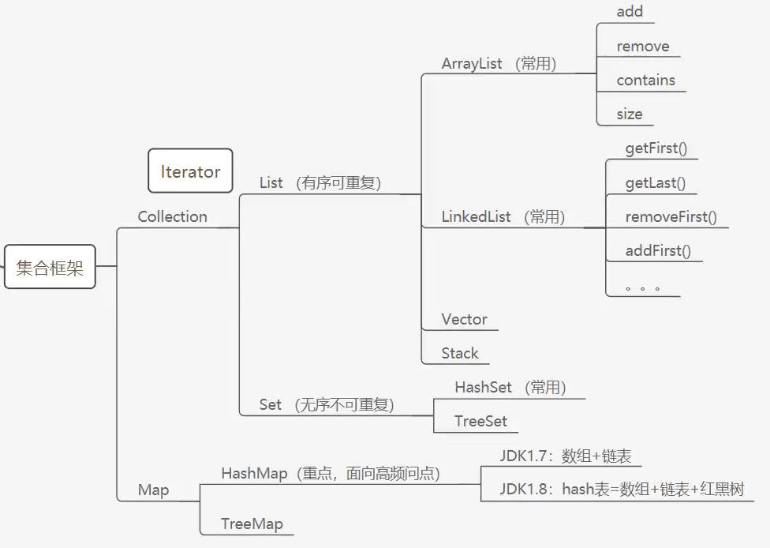
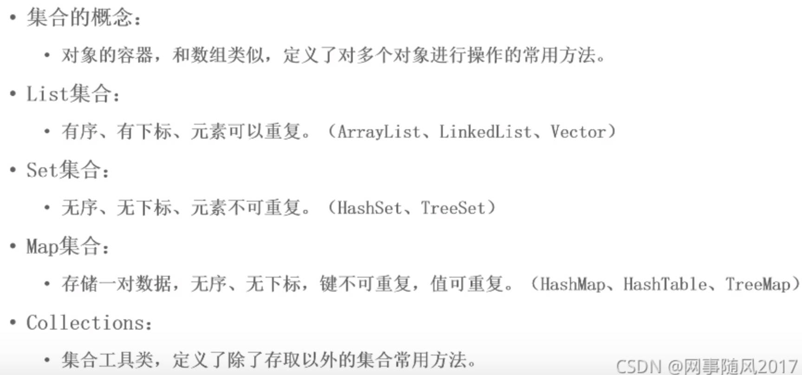

视频： [集合框架](https://www.bilibili.com/video/BV1zD4y1Q7Fw/?spm_id_from=333.337.search-card.all.click&vd_source=7346303e5e18677d7261c2c0c109ecfd) 

知识库： [Java数据结构 | 菜鸟教程](https://www.runoob.com/java/java-data-structures.html)  

工具类： [Collections 工具类](https://developer.aliyun.com/article/1614260)  [java.util](https://baike.baidu.com/item/java.util/5180624)  [Java集合](https://cloud.tencent.com/developer/article/2425499)  

[集合工具类（Collections）](https://cloud.tencent.com/developer/article/2106834)  

Java 提供了丰富的==数据结构==来处理和组织数据

|  |  |
| ------------------------------------------------------- | ------------------------------------------------------- |
|                                                    |                                                    |
|                                                         |                                                         |
|                                                         |                                                         |

