## 1、JavaWeb概述

md： [JavaWeb知识扩展](.\JavaWeb知识扩展)

==小结：==

1. 映射： ==把开发好的java类部署到web服务器中（web.xml中，servlet类映射到url-pattern[url请求路径:/kuang]），==`根据请求路径调用某个servlet类的doget方法`
   1. ==为什么需要映射==：浏览器需要找到java里的类：我们写的是JAVA程序，但是要通过浏览器访问，而浏览器需要连接web服务器， 所以我们需要再web服务中注册我们写的Servlet，还需要给一个浏览器能够访问的路径(让浏览器找到我们java程序的发布目录)
2. 为什么要指定artifacts：==访问一个网站，需指定一个文件夹名字（即网站根目录）==，idea接管tomcat，没有默认去找tomcat配置里的 appBase="webapps"，需要在idea里手动指定artifacts
   1. Artifacts是maven中的一个概念，表示某个==module要如何打包==，例如war exploded、war、jar、ear等等这种打包形式；

视频：[狂神说JavaWeb](https://www.bilibili.com/video/BV12J411M7Sj?spm_id_from=333.999.0.0&vd_source=7346303e5e18677d7261c2c0c109ecfd)    [黑马程序员JavaWeb基础教程](https://www.bilibili.com/video/BV1Qf4y1T7Hx/?spm_id_from=333.788.recommend_more_video.0&vd_source=7346303e5e18677d7261c2c0c109ecfd) 

资料：[Java学习之JavaWeb](https://blog.csdn.net/weixin_41995541/article/details/119716580) [Javaweb三大组件Servlet，Filter，Listener](https://blog.csdn.net/weixin_41544662/article/details/128147204) [Java Web](https://baike.baidu.com/item/Java Web/1611944?fr=aladdin) [JavaWeb基础](https://www.it610.com/article/1291738192050987008.htm) [ java web体系结构](https://blog.csdn.net/weixin_36364044/article/details/114213390)  [JavaWeb的框架](https://blog.csdn.net/w_1106/article/details/111600400) [主流Java Web开发框架](http://c.biancheng.net/view/8115.html) [Java中常见的5种WEB服务器](https://blog.csdn.net/xiaoxijinger/article/details/122210674) [ J2EE Frameworks](https://blog.csdn.net/dgiszz/article/details/299985)   [grails企业web应用开发与部署](https://max.book118.com/html/2021/1110/5301142133004103.shtm)  [web.xml头文件](https://blog.csdn.net/zzy7075/article/details/61918776)  [ Warning:java: 源值1.5已过时, 将在未来所有发行版中删除](https://blog.csdn.net/wenanfen/article/details/128160452)    [web应用开发入门](https://blog.csdn.net/m0_54435916/article/details/126582895) 

[ Github无法访问](https://blog.csdn.net/qq_41839588/article/details/130051873) [github打不开](https://zhuanlan.zhihu.com/p/489362379?utm_id=0)  [查询](https://site.ip138.com/mvnrepository.com/beian.htm)  [元动力-java](https://www.ydlclass.com/ui/learningPath) 

[Maven博客园](https://www.cnblogs.com/lenve/p/12047793.html)  [Maven生命周期](https://baike.baidu.com/item/Maven/6094909?fr=aladdin)  [Notepad++ 标记筛选内容](https://blog.csdn.net/GNNUXXL/article/details/130389364)
[Find Usages（查找引用）](https://blog.csdn.net/lvhdbb/article/details/98350477)  [IDEA 查看类及属性的调用链](https://blog.csdn.net/m0_38039437/article/details/105370340)  [idea 精准查找方法](https://www.cnblogs.com/xsdf/p/11721669.html)  

[重构第9天：提取接口(Extract Interface)](https://www.cnblogs.com/yplong/p/5300096.html)
[在线工具](https://tool.ip138.com/)

java web服务器：

[Java中最常见的5种Web服务器](https://cloud.tencent.com/developer/article/1415178) [web服务器](https://cloud.tencent.com/developer/article/1705092) [Java顶级Java应用程序服务器](https://www.bilibili.com/read/cv21941240/)

> JavaWeb准备：
>
> 1. web服务器分开处理静态和动态资源
> 2. web应用程序：可以提供浏览器访问的程序。
> 3. web应用由多部分组成(静态、动态web)
>    1. html,css,js
>    2. jsp,servlet
>    3. java程序
>    4. jar包
>    5. 配置文件（Properties）
> 4. Javaweb三大组件：Servlet，Filter，Listener
>    1. Servlet中转处理容器，连接客户端和服务器端的信息交互和处理
>    2. Filter拦截用户请求，在服务器作出响应前，拦截后修改request和response，实现开发者想得到的功能
>    3. Listener监听器，对ServletContext，HttpSession，ServletRequest三大域对象的创建和销毁事件监听，还有就是对域对象属性的操作监听，当监听这些事件发生是就会进行一些适当的操作
> 5. idea当前行颜色:caret row
>
> 

### 1、Tomcat

小结：

1. 核心配置：conf->server.xml；
   1.  ==startup.bat启动Tomcat==； 
   2.  进Server Status看角色设置
   3.  Tomcat服务器的web目录：webapps
2. web.xml :**web项目**的配置文件

[Apache Tomcat®](https://tomcat.apache.org/)  [Jar包与war包](https://www.cnblogs.com/john1015/p/16128805.html)  [Http2.0](https://blog.csdn.net/weixin_43966635/article/details/117870300) [ http 2.0](https://blog.csdn.net/Huangjiazhen711/article/details/127221977)  [HTTP/3](https://baijiahao.baidu.com/s?id=1750176201381484457&wfr=spider&for=pc)  [HTTP3](https://www.leixue.com/tag/http3)  [网站启用HTTP/3](https://www.zhihu.com/question/419107163)  [tomcat9.exe](https://blog.csdn.net/qq_29535381/article/details/86231506)

[tomcat-users.xml 角色配置文件](https://www.cnblogs.com/TheGCC/p/14153635.html)  [web.xml](https://www.jianshu.com/p/7f834dd090fe) [web.xml](https://www.cnblogs.com/Timeouting-Study/p/16078770.html) [Web.xml](https://www.cnblogs.com/konbluesky/articles/1925295.html)  [web.xml配置文件详解](https://www.cnblogs.com/Y-oung/p/8401549.html) [web.xml详细配置](https://www.cnblogs.com/crhdyl/p/5351524.html)


**为什么必须要先安装WEB服务器**: 任何WEB资源，想被远程计算机访问，都必须有一个与之对应的**网络通信程序**，当用户来访问的时候，这个网络程序读取WEB资源，并且把数据发送给来访者

> 1. web应用程序编写完毕后，若想提供给外界访问，需要一个服务器统一管理。`web服务器是一种被动操作，处理用户请求和给用户响应信息。`
> 2. Tomcat 是一个免费的[开源](https://baike.baidu.com/item/开放源代码/114160?fromModule=lemma_inlink)的[Web](https://baike.baidu.com/item/Web/150564?fromModule=lemma_inlink) 应用服务器，属于轻量级应用服务器
>    1. Tomcat 实际上==运行JSP 页面和Servlet==，能处理html，另外它还是一个Servlet和JSP容器
>    2. Tomcat是一个JSP和Servlet的容器。`处理静态HTML和动态(JSP页面和Servlet)`
>    3. JSP:HTML中嵌入java代码
>    4. tomcat9.exe 是服务的运行程序，相当于运行 startup.bat，tomcat9w是图形化界面
> 3. 下载Tomcat， 解压即可  启动：startup.bat
>    1. work：tomcat服务器工作的目录； IDEA中使用tomcat的会在IDEA的tomcat中生产一个work目录
>    1. webapps里面web-inf: 头文件
>    1. web.xml用来初始化工程配置信息;   web.xml并不是必须的
>       1. **web项目**的配置文件，一般的web工程都会用到web.xml来配置，主要用来配置Listener，Filter，Servlet等
>       1. 描述servlet/JSP应用的各个方面的元素，如servlet注册、servlet映射以及监听器注册
> 4. ==核心配置：conf->server.xml==     
>    1. 默认端口：tomcat：8080   mysql：3306  http：80   https：443
> 5. http2.0： 客户端与web服务器连接后，可以获得多个web资源，http/1.0只能获得一个

|  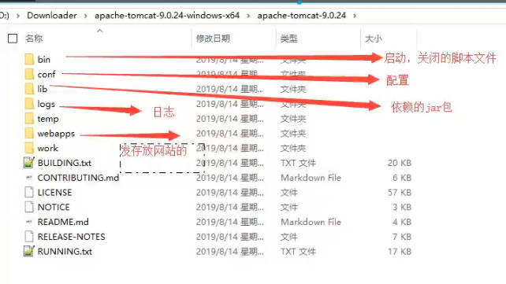  |  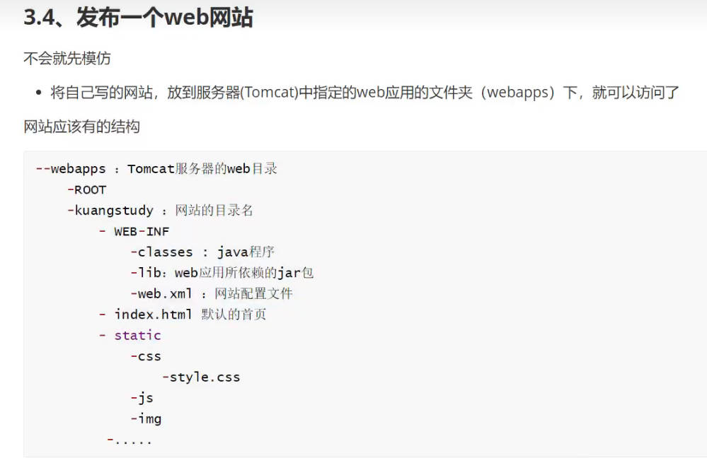  |
| :----------------------------------------------------------: | :----------------------------------------------------------: |
|  |  |

#### 1、==Tomcat核心==

Tomcat的核心分为3个部分:

1. Web容器---处理静态页面
2. catalina --- 一个[servlet](https://so.csdn.net/so/search?q=servlet&spm=1001.2101.3001.7020)容器-----处理servlet
3. JSP容器，它就是把jsp页面翻译成一般的servlet

IDEA TOMCAT日志信息中文乱码：Tomcat -> conf---->logging.properties,改`java.util.logging.ConsoleHandler.encoding = GBK`

### 2、HTTP

[计算机网络](https://www.bilibili.com/video/BV1ud4y127BZ/?spm_id_from=333.337.search-card.all.click&vd_source=7346303e5e18677d7261c2c0c109ecfd) [MIME](https://www.bilibili.com/video/BV1784y1B79y/?spm_id_from=333.337.search-card.all.click&vd_source=7346303e5e18677d7261c2c0c109ecfd)  [JavaWeb笔记](https://www.kuangstudy.com/bbs/1510263012458901506) [HTTP请求全过程](https://blog.csdn.net/ailunlee/article/details/90600174)  [HTTP请求之Referer和Referrer-policy](https://www.jianshu.com/p/a86a38b6f1b8)

HTTP是一个简单的请求-响应协议,请求和响应消息的头以[ASCII](https://baike.baidu.com/item/ASCII/309296?fromModule=lemma_inlink)形式给出， 消息内容类似[MIME](https://baike.baidu.com/item/MIME/2900607?fromModule=lemma_inlink)报文格式-   

- http1.0 : HTTP/1.0 ：客户端和WEB服务器建立连接后，只能获得一个WEB资源
- http2.0 : HTTP/1.1 ：客户端和WEB服务器建立连接后，可以获得多个WEB资源

#### 1、Http请求

> 1. 一个HTTP请求报文4个部分组成
>    1. 请求行（request line）
>    2. 请求头（headers）
>    3. 空行（blank line）
>    4. 请求数据（request body）

#### 2、Http响应

响应体、响应状态码400

### 3、 ==Maven==

==小结==： [Maven下载](https://maven.apache.org/)

Maven包下载： [Maven Repository](https://mvnrepository.com/)  

- maven: 让一个东西自动帮我==导入和配置==这个jar包；  项目架构管理工具
- 下载maven ： `apache-maven-3.6.1-bin.zip` ； ==配置文件 settings.xml==； 
  - 配置maven环境变量  
  - 配置`<mirrors>`下载镜像(远程仓库)
  - 本地仓库：`<localRepository>D:\Environment\apache-maven-3.6.1\maven-repo</localRepository>`


[新创建maven工程都会恢复默认相关maven设置](https://blog.csdn.net/weixin_43807112/article/details/109167304)  [ idea新建maven项目设置地址改变问题](https://blog.csdn.net/parecycest/article/details/116310140)   [maven仓库服务 aliyun](https://developer.aliyun.com/mvn/guide)   [Maven 官网](https://maven.apache.org/)   [Maven的安装与配置](https://www.cnblogs.com/zhangzhixi/p/14193053.html)  [解决Maven项目中某些配置文件无法导出或生效的问题](https://blog.csdn.net/qq_46370017/article/details/124690911)   [Maven  ](https://www.jianshu.com/p/311cdde1da26) [idea项目结构中不显示out文件夹](https://blog.csdn.net/Microhoo_/article/details/127107931)
问题解决： [Unable to import maven project-换maven版本 ](https://www.jianshu.com/p/8ec58f415594)
私有库搭建： [Nexus基础](https://www.bilibili.com/video/BV1vh411h7Jo/?spm_id_from=333.337.search-card.all.click&vd_source=7346303e5e18677d7261c2c0c109ecfd) [Nexus](https://www.oschina.net/p/nexus?hmsr=aladdin1e1)   [搭建maven私服](https://www.jb51.net/article/150483.htm)

[nuxeo:内容管理平台](https://github.com/nuxeo/nuxeo)  [ Maven Repository](https://blog.csdn.net/pfdvnah/article/details/104600101/) [mvnrepository](https://blog.csdn.net/seashouwang/article/details/115555506)

> 1. 在Javaweb开发中，需要使用大量的jar包，我们手动去导入；
>    1. maven: 让一个东西自动帮我导入和配置这个jar包
> 2. Maven（==项目架构管理工具==， java包管理工具 ）：JavaWeb开发中，需要大量依赖jar包，用maven导入。
>    1. ==Maven核心思想==：约定大于配置，有约束，不要违反。目录结构按照规范
>    2. 自动导入和配置jar包
>    3. 下载:[Download](https://maven.apache.org/download.html)**,** [Install](https://maven.apache.org/install.html)**,** [Configure](https://maven.apache.org/configure.html)**,** [Run](https://maven.apache.org/run.html) **Maven**  [apache-maven-3.9.3-bin.zip](https://dlcdn.apache.org/maven/maven-3/3.9.3/binaries/apache-maven-3.9.3-bin.zip)
>    4. 下载完解压即可, ==配置文件 settings.xml==（配置mirrors下载镜像）；  mvn -version
>       1. ==配置环境变量==：M2_HOME： bin目录    MAVEN_HOME： maven目录  ；   Path： %MAVEN_HOME%\bin
>       2. ==远程仓库==：`settings.xml` -> 配置aliyun镜像仓库
>       3. maven-repo ==建立本地仓库==：不需要每次都下载， settings.xml => localRepository ;   `<localRepository>D:\Environment\apache-maven-3.6.1\maven-repo</localRepository>`
> 3. 私有库
>    1. Nexus 是一个强大的 Maven 仓库管理器

| 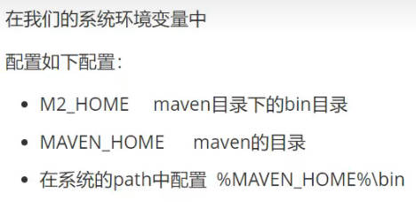 | 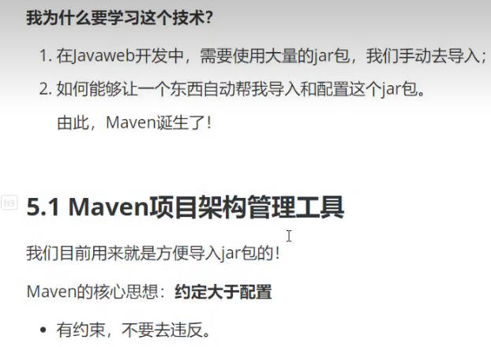 |
| :--------------------------------------------------------: | ---------------------------------------------------------- |

#### IDEA中使用Maven

md： [JavaWeb知识扩展](.\JavaWeb知识扩展)

小结：

1. 通过模板创建maven项目：maven模板=>GAV =>BUILD SUCCESS
   1. ==创建maven空项目==： 空的maven不支持web，要添加框架支持，具体参考==JSP语法视频==
      1. 标记文件夹： 创建后java目录右键，==mark Directory as $\to $ sources root==
      2. `project structure`配置: `^+alt+sh+s`
2. ==idea中配置tomcat==： Add Configurations...  -> Tomcat server -> local
   1. artifacts: webapp打包，相当于IDEA下网站根目录
3. ==pom.xml==是Maven的核心配置文件

[Maven下导入jar包](https://blog.csdn.net/iijik55/article/details/124312204)  [Idea配置项目的tomcat时候没有Artifacts](https://blog.csdn.net/qq_28245905/article/details/121467743) [idea配置Tomcat时没有Artifacts](https://www.jb51.net/article/247617.htm)

> 1. 创建一个==mavenWeb项目==
>    1. maven -> 勾选Create from archetype使用maven模板（==maven-archetype-webapp==）。maven->GAV(组id：com.kuang  项目名：javaweb-01-maven 版本) ->maven本地仓库 -> 点击右下角弹出的：自动导入包；  BUILD SUCCESS项目搭建成功
>    2. pom.xml： 里面报红说明没下载成功，
>    3. 启动idea，创建一个mavenWeb项目：maven-archetype-webapp ， 组id：com.kuang ， artifacts项目名
>    4. 项目目录：main放源代码，web-inf放web配置，新建java源码目录，resources资源目录
>    5. `project structure`配置: libraries插件库，problems项目问题, excluded folders:java->class目录
> 2. ==idea中配置tomcat==： Add Configurations... ;  
>    1. 必须创建一个artifacts：Deployment->add war
>       1. **项目的“部署包”或“构件”**‌。Artifacts 是 IDEA 里把你写的代码、依赖库和资源文件按标准结构组装成的可部署单元，本质是“打包配置”或“组装说明书”，而非项目本身
>    2. 为什么要指定artifacts：==访问一个网站，需指定一个文件夹名字（即网站根目录）==，idea接管tomcat，没有默认去找tomcat配置里的 appBase="webapps"，需要在idea里手动指定artifacts
>       1. Artifacts是maven中的一个概念，表示某个==module要如何打包==，例如war exploded、war、jar、ear等等这种打包形式；
>       2. 好奇这个带不带exploded的有什么差别不？exploded 在这里你可以理解为展开，不压缩的意思。也就是war、jar等产出物没压缩前的目录结构。
>    3. 虚拟路径映射
> 3. IDEA ==MAVEN侧边栏==：Lifecycle:maven命令，Dependencies项目依赖
>    1. *junit*是一个Java单元测试框架，用于编写和运行可重复的测试
> 4. ==pom.xml==是==Maven的核心配置文件==， 要导的包都写在这里。 Maven项目对象模型(POM)，通过一小段描述信息来管理项目的构建
>    1.  Maven高级之处在于：会导入jar包所依赖的其他jar包
>    2.  在build中配置resource： main下java目录约定只能写java，如果写个xml导不出
>    3.  iml文件是idea的识别文件
> 5. ==手动导入jar包到maven==
>    1. 把jar包直接放到本地仓库相应目录
>    2. 项目设置->libraries里手动加入包
> 6. 改代码颜色：`Editor > Color Scheme > Java`

| 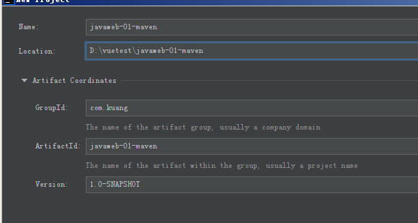 | 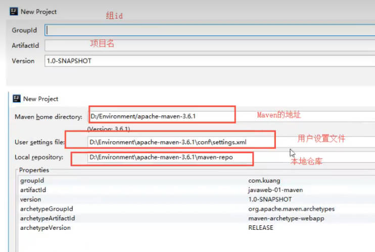   |
| ---------------------------------------------------------- | ------------------------------------------------------------ |
| 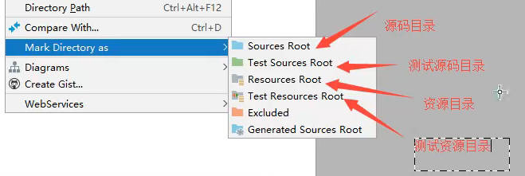 | 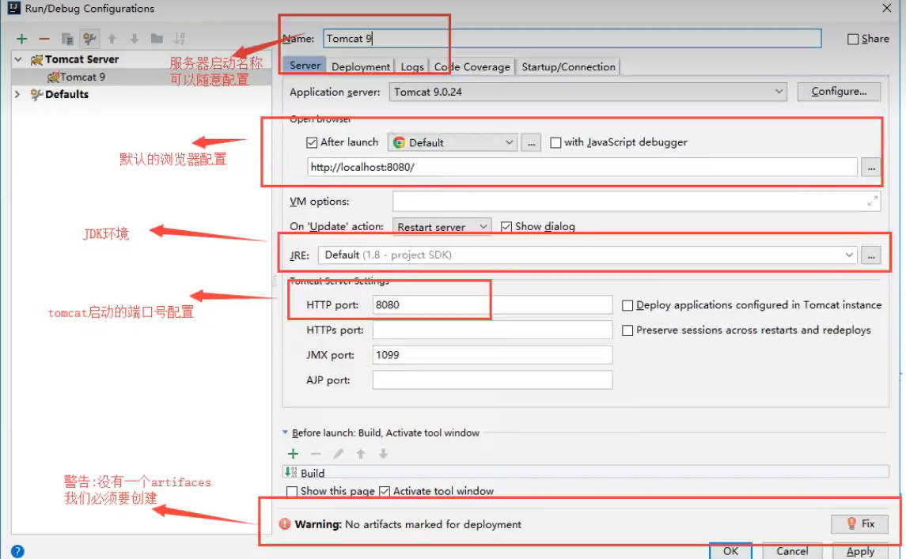   |
| 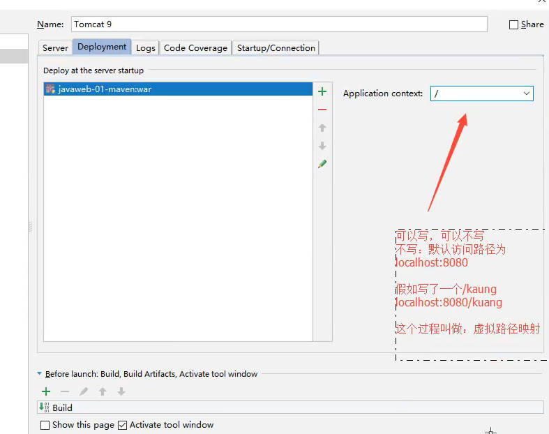 | 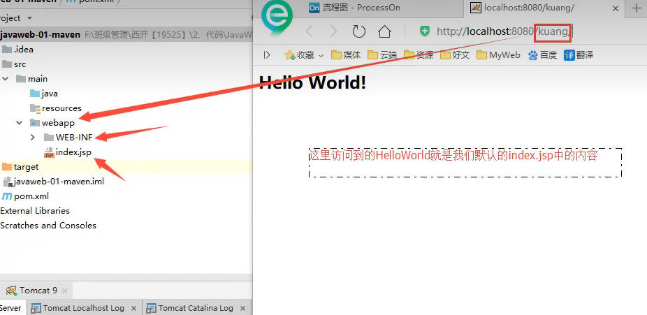   |
| 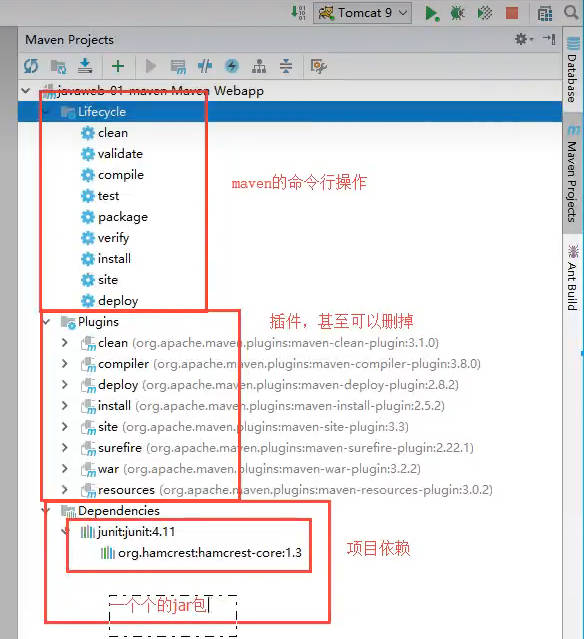 | 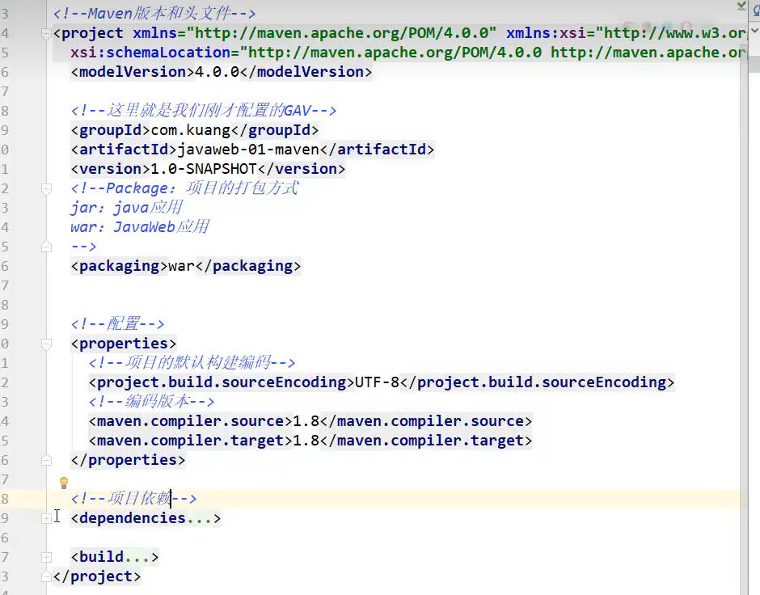   |
| 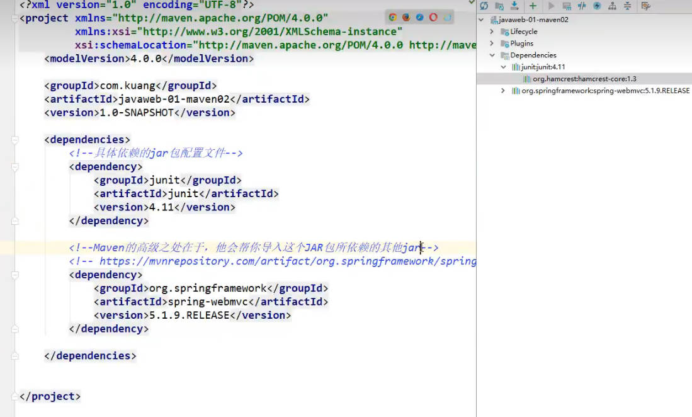 | 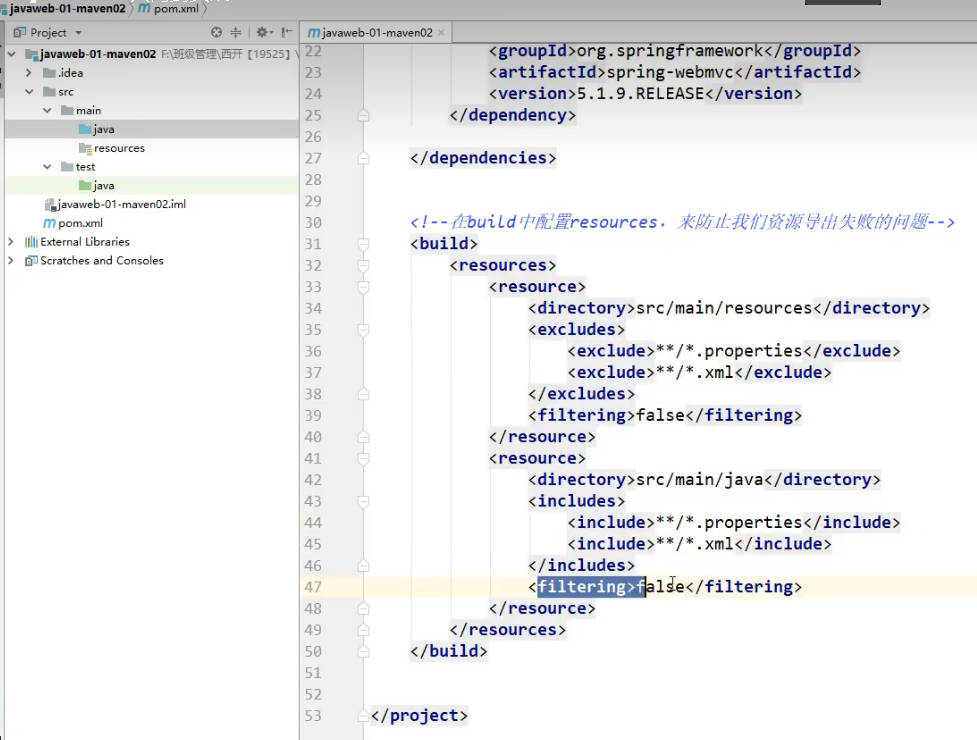 |

以后遇到写的配置文件，无法导出或生效，解决方案： 

- java目录只能写java，如果写个a.xml，就导不出

```xml
<!--在build中配置resources，来防止我们资源导出失败的问题-->
    <build>
        <resources>
            <resource>
                <directory>src/main/resources</directory>
                <includes>
                    <include>**/*.properties</include>
                    <include>**/*.xml</include>
                </includes>
                <filtering>true</filtering>
            </resource>
            <!--以上部分不写也可以默认导出,但下面的java目录先下的配置文件无法导出,必须配置-->
            <resource>
                <directory>src/main/java</directory>
                <includes>
                    <include>**/*.properties</include>
                    <include>**/*.xml</include>
                </includes>
                <filtering>true</filtering>
            </resource>
        </resources>
    </build>
```

#### 解决遇到的问题

| 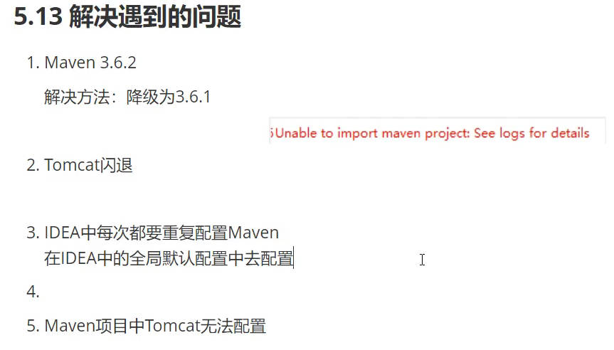 |  |
| ---------------------------------------------------------- | ----- |

### 4、 Servlet

小结：

1. maven父项目（空） > 子项目：新建module
   1. web.xml最新的头文件
2. 编写servlet程序
   1. 继承HttpServlet，重写doget方法：  `public class HelloServlet extends HttpServlet `
   2. 配置servlet映射: WEB-INF/web.xml
      1. xml中注册servlet：==一个servlet对应一个class类==
      2. servlet的映射路径(请求路径)
3. servlet重点就一个方法：`public void service(ServletRequest req, ServletResponse res)` ;有2个参数，req、res

> servlet映射：将servlet类与URL（前端访问服务器的链接）一一对应。
>
> - 比如我们访问 http://localhost:8080/Hello/ServletDemo01,一般情况下末端的ServletDemo01肯定不是一个静态的资源文件，这个URL肯定是调用了后端的某个servlet类
> - 假设为ServletDemo01.java文件中Servlet类。那么把http://localhost:8080/Hello/ServletDemo01 ,与ServletDemo01.java中的Servlet类绑定的过程就称为servlet映射

==手动导入jar包到maven==

[流行框架的一些替代技术](https://blog.csdn.net/IT_lollipop/article/details/53155738)  [再见了SpringMVC！这个框架直接干掉了Servlet](https://blog.csdn.net/QAQFyl/article/details/111314699)  [ 狂神说JavaWeb-Servlet篇 ](https://blog.csdn.net/weixin_45064346/article/details/125723563) [狂神说JavaWeb入门到实战--Servlet](https://bloghut.blog.csdn.net/article/details/120778094?spm=1001.2101.3001.6650.18&utm_medium=distribute.pc_relevant.none-task-blog-2~default~BlogCommendFromBaidu~Rate-18-120778094-blog-125723563.235^v38^pc_relevant_sort_base1&depth_1-utm_source=distribute.pc_relevant.none-task-blog-2~default~BlogCommendFromBaidu~Rate-18-120778094-blog-125723563.235^v38^pc_relevant_sort_base1&utm_relevant_index=19)  [Web.xml详解](https://www.cnblogs.com/konbluesky/articles/1925295.html) [IDEA中解决中文乱码问题的方法](https://blog.csdn.net/woshishq1210/article/details/129499050)  [](https://blog.csdn.net/m0_61297951/article/details/127285430)  [Servlet-菜鸟教程](https://www.runoob.com/servlet/servlet-intro.html)
[java方法头的定义](https://blog.51cto.com/u_16099355/6979734) [Javascipt变量提升作用域](https://blog.csdn.net/yalywq/article/details/123647464)

[HttpServlet的两个Service方法区别](https://blog.csdn.net/anxinliu2011/article/details/7516198?spm=1001.2101.3001.6650.1&utm_medium=distribute.pc_relevant.none-task-blog-2~default~BlogCommendFromBaidu~Rate-1-7516198-blog-95282443.235^v38^pc_relevant_sort_base1&depth_1-utm_source=distribute.pc_relevant.none-task-blog-2~default~BlogCommendFromBaidu~Rate-1-7516198-blog-95282443.235^v38^pc_relevant_sort_base1&utm_relevant_index=2)  [httpservlet类中两个service方法](https://www.cnblogs.com/cold-windy/p/11071812.html)

[图片验证码servlet项目](https://blog.csdn.net/m0_70083523/article/details/127759314) [Servlet API](https://blog.csdn.net/m0_60494863/article/details/125142108) [Servlet及相关类和接口](https://www.cnblogs.com/Y-oung/p/8419644.html) [Servlet总结](https://www.cnblogs.com/huangfox/archive/2011/10/21/2219872.html)

[Module xx is imported from Maven](https://blog.csdn.net/lishuoboy/article/details/104131809)  [IDEA右键New没有New Servlet](https://blog.csdn.net/u013073869/article/details/122888014?utm_medium=distribute.pc_relevant.none-task-blog-2~default~baidujs_baidulandingword~default-0-122888014-blog-126020716.235^v38^pc_relevant_sort_base1&spm=1001.2101.3001.4242.1&utm_relevant_index=3)
[SpringMvc-改良替换servlet(controller)](https://blog.csdn.net/fhxjava/article/details/128977483)   [SpringMVC框架的基本应用(替代Servlet)](https://blog.csdn.net/chinatopno1/article/details/105106249?spm=1001.2101.3001.6650.1&utm_medium=distribute.pc_relevant.none-task-blog-2~default~CTRLIST~Rate-1-105106249-blog-128977483.235^v38^pc_relevant_sort_base1&depth_1-utm_source=distribute.pc_relevant.none-task-blog-2~default~CTRLIST~Rate-1-105106249-blog-128977483.235^v38^pc_relevant_sort_base1&utm_relevant_index=2)

==问题：== [IDEA中Maven项目 子项目中缺少parent标签及无web框架问题解决](https://www.cnblogs.com/aowei/p/16721363.html)   [maven项目的target中没有lib文件夹](https://blog.csdn.net/qq_55862497/article/details/130117459)  [解决tomcat启动警告"至少有一个JAR被扫描用于TLD但尚未包含TLD"](https://www.cnblogs.com/sunang/p/16943573.html)   [至少有一个](https://www.cnblogs.com/konley/p/16815809.html)

- HttpServlet.service()有自己的doget方法，我们不是我们想要的，要重写方法

```java
//public void service（ServletRequest  req，ServletResponse response）方法由tomcat自动调用，它将接收的客户端请求转交给HttpServlet中的另一个protected void service（HttpServletRequest  req，HttpServletResponse res）方法，

//保护类型的service方法再把将请求分发给doPost（）、doGet（）方法进行下一步处理。所以我们可以重写受保护的service（）方法来代替doPost（）和doGet（）方法
```

==servlet要导入的包：==

```xml
<dependencies>
        <!-- Servlet 依赖 -->
        <dependency>
            <groupId>javax.servlet</groupId>
            <artifactId>javax.servlet-api</artifactId>
            <version>4.0.1</version>
            <scope>provided</scope>
        </dependency>
        <!-- JSP 依赖 -->
        <dependency>
            <groupId>javax.servlet.jsp</groupId>
            <artifactId>javax.servlet.jsp-api</artifactId>
            <version>2.3.3</version>
            <scope>provided</scope>
        </dependency>	
    </dependencies>
```

==小结：==

1. 编写一个类，==实现servlet接口==，2、==把开发好的java类部署到web服务器中（web.xml中，servlet类映射到url-pattern[url请求路径:/kuang]），==`根据请求路径调用某个servlet类的doget方法`
   1. 请求路径 > 映射到哪个servlet类 > 执行这个类的doget()方法
      1. 根据url，找到映射的servlet类，执行方法
   2. ==把实现了servlet接口的java程序叫servlet==
   3. 需要导入servlet依赖包 `javax.servlet-api ,javax.servlet.jsp-api` 

> 1. Servlet
>    1. 接收用户请求、响应给客户端内容、重定向或转发
>    2. sun公司开发动态web的技术,sun在这些API中提供一个==接口叫：servlet==，开发一个servlet程序，2步骤：
>       1、编写一个类，==实现servlet接口==，2、==把开发好的java类部署到web服务器中==
>    3. ==把实现了servlet接口的java程序叫servlet==
>    4. ==serlvet接口sun公司有2个默认的实现类：HttpServlet、GenericServlet==。
>       1. HttpServlet里实现了servlet的service方法，
>       
>       1. Servlet需要一个映射:一个servlet对应一个mapping(映射,/kuangshen)
>       
>       1. servlet是一个类，里面写get、post等方法，输入一个网址，就是输入servlet映射，然后会调用servlet，执行里面的get方法
>          1. 映射对应一个servlet-name，name有一个对应的注册servlet，会找servlet类
>          2. 中文乱码：`resp.setCharacterEncoding("utf-8");`
> 2. maven中添加servlet、jsp依赖。  `artifact /ss 虚拟路径映射`
> 3. 多个servlet互不影响

#### HelloServlet

1. ==maven父子工程==：先建一个空的maven项目，删src目录，pom.xml里加入servlet、jsp依赖 =>new module(==maven-archetype-webapp==模块).（Maven父子工程：子工程是父工程的modules）
   1. 父pom.xml里有<modules>,子有<parent>，父项目里的jar包子项目可直接使用，子的jar包父不能使用
   1. ==父子工程==： 即maven项目下，加入一个webapp模块
2. Maven环境优化
   1. 修改web.xml为最新
   2. 将maven结构搭建完整(添加java、resources目录)
   3. 子项目main目录下新建java、resources

==web.xml最新的头==:  [web.xml 文件头](https://www.cnblogs.com/jhxxb/p/10573843.html)

```xml
<?xml version="1.0" encoding="UTF-8"?>
<web-app xmlns="http://xmlns.jcp.org/xml/ns/javaee"
         xmlns:xsi="http://www.w3.org/2001/XMLSchema-instance"
         xsi:schemaLocation="http://xmlns.jcp.org/xml/ns/javaee
                      http://xmlns.jcp.org/xml/ns/javaee/web-app_4_0.xsd"
         version="4.0"
         metadata-complete="true">
</web-app>
```

3. 编写一个servlet
   1. 编写一个普通类，实现Servlet接口 ：继承HttpServlet，重写方法
4. ==编写Servlet映射 (web.xml)==,注册servlet
   1. ==为什么需要映射==：浏览器需要找到java里的类：我们写的是JAVA程序，但是要通过浏览器访问，而浏览器需要连接web服务器， 所以我们需要再web服务中注册我们写的Servlet，还需要给一个浏览器能够访问的路径(让浏览器找到我们java程序的发布目录)
   1. xml中注册servlet：==一个servlet对应一个class类==; servlet的映射路径(请求路径)
5. 配置Tomcat
6. 测试

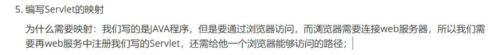

| 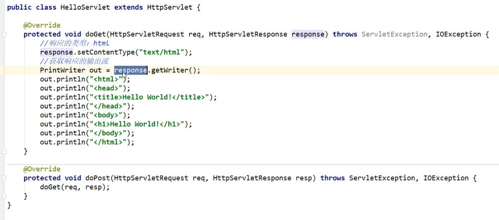 | 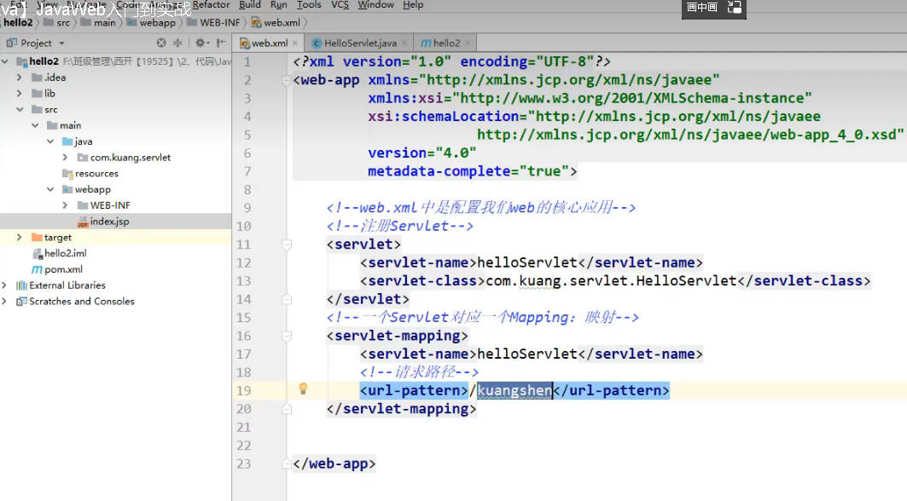 |
| ---------------------------------------------------------- | ---------------------------------------------------------- |
| 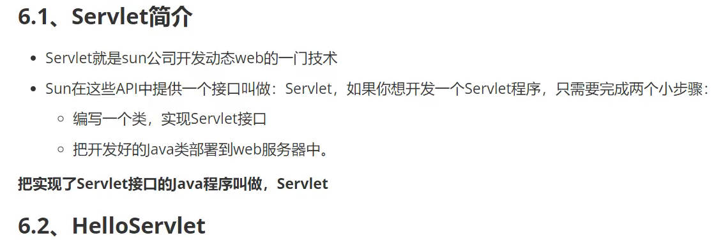 | 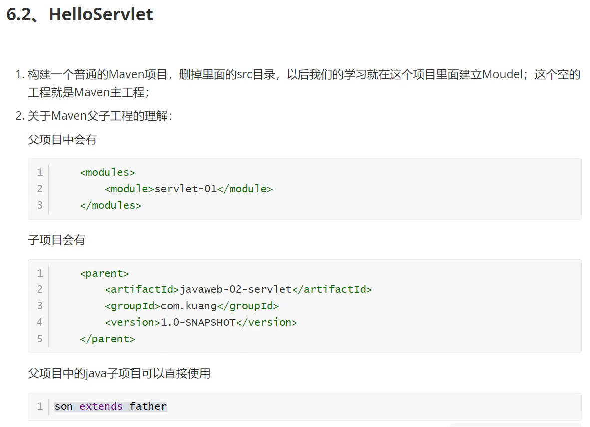 |
| 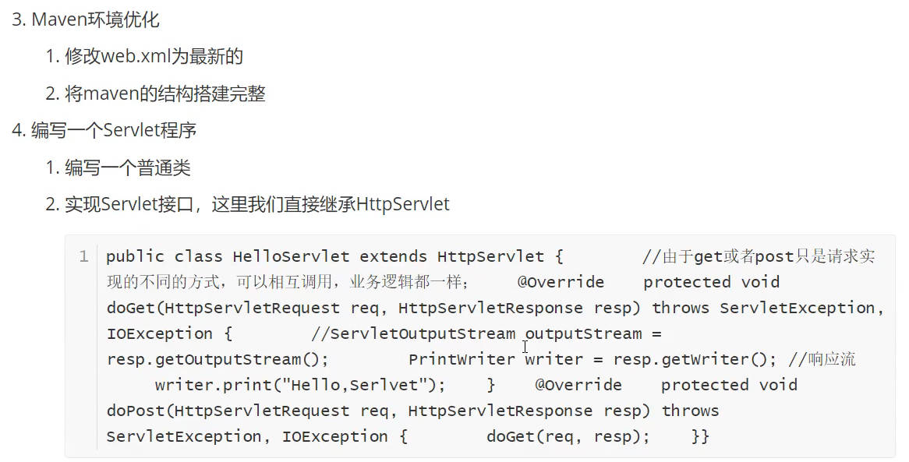 | 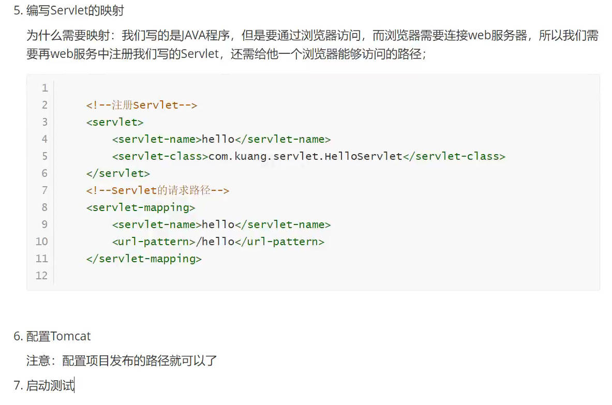 |
| 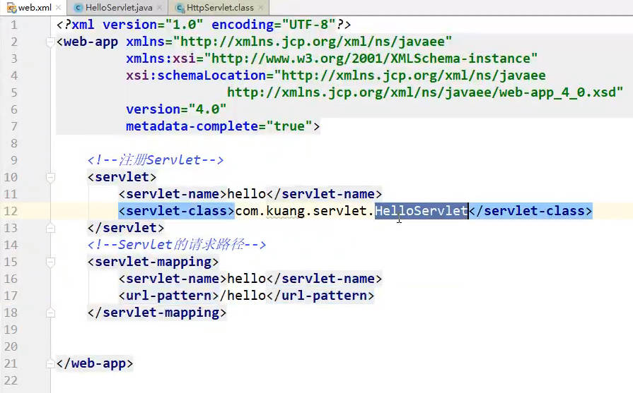 | 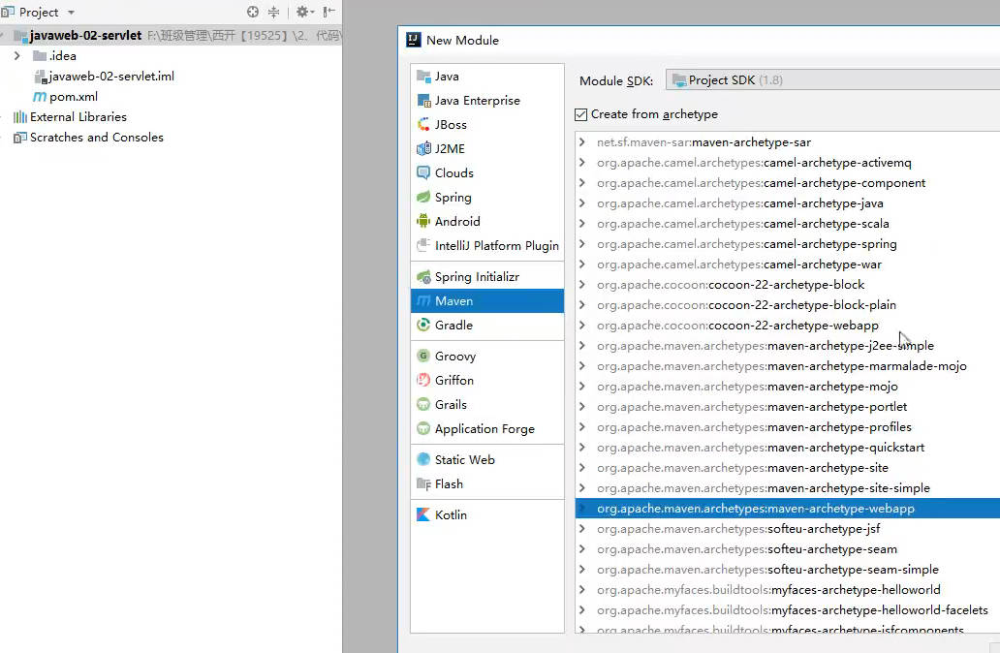 |

servlet实现类：

```java
public class HelloServlet extends HttpServlet {
    @Override
    protected void doGet(HttpServletRequest req, HttpServletResponse resp) throws ServletException, IOException {
        //ServletOutputStream outputStream = resp.getOutputStream();
        PrintWriter writer = resp.getWriter();    //响应流
        writer.print("Hello,servlet");
    }

    @Override
    protected void doPost(HttpServletRequest req, HttpServletResponse resp) throws ServletException, IOException {
        super.doPost(req, resp);
    }
}
```

编写==servlet的映射==：为什么需要映射：我们写的是java程序，但是要通过浏览器访问，而浏览器需要访问连接web服务器，所有我们需要在web服务器中注册我们写的servlet，还需要给他一个浏览器能够访问的路径。

```xml
<?xml version="1.0" encoding="UTF-8"?>
<web-app xmlns="http://xmlns.jcp.org/xml/ns/javaee"
         xmlns:xsi="http://www.w3.org/2001/XMLSchema-instance"
         xsi:schemaLocation="http://xmlns.jcp.org/xml/ns/javaee
                  http://xmlns.jcp.org/xml/ns/javaee/web-app_4_0.xsd"
         version="4.0"
         metadata-complete="true">
<!--注册servlet-->
    <servlet>
        <servlet-name>hello</servlet-name>
        <servlet-class>com.meryl.servlet.HelloServlet</servlet-class>
    </servlet>
<!--servlet的请求路径-->
    <servlet-mapping>
        <servlet-name>hello</servlet-name>
        <url-pattern>/hello</url-pattern>
    </servlet-mapping>
    
</web-app>
```

#### Servlet原理

浏览器向web容器发出http请求， 第一次访问生成target目录class文件，把class文件变成servlet，所有第一次很慢；同时==web容器产生2个对象：请求、响应；servlet里的service方法处理请求和响应,实现我们自己写==； service运行完后返回到web容器；web容器拿到响应返回给浏览器

Servlet由Web服务器tomcat(web容器)调用，web服务器在收到浏览器请求后，【tomcat产生请求响应对象，请求对象参数传给Servlet方法service处理，【service方法由我们自己的实现类来重写】结果传给响应对象，再传回给tomcat】下图：

| 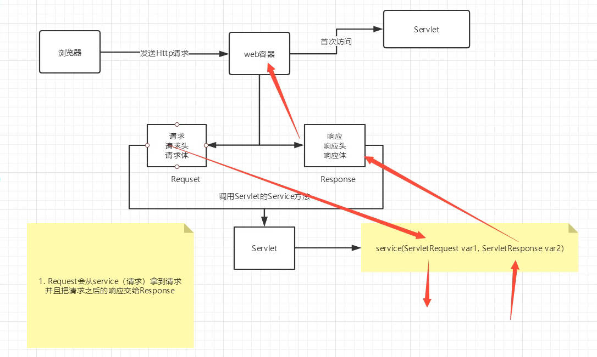   | 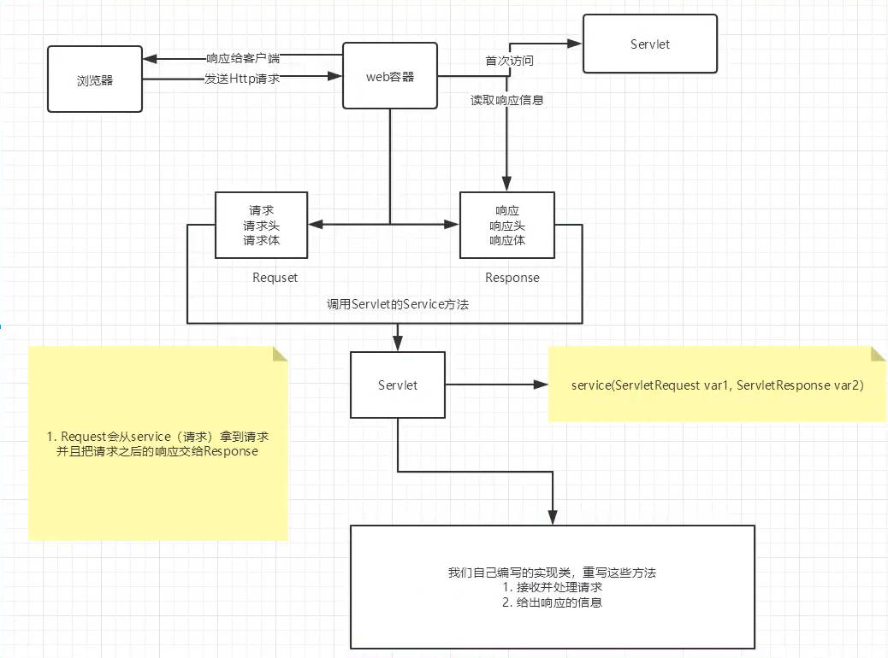 |
| ------------------------------------------------------------ | ---------------------------------------------------------- |
| 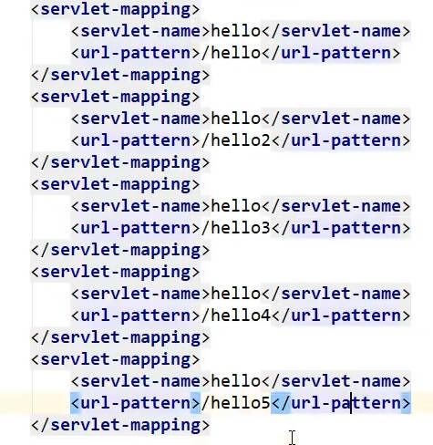 | 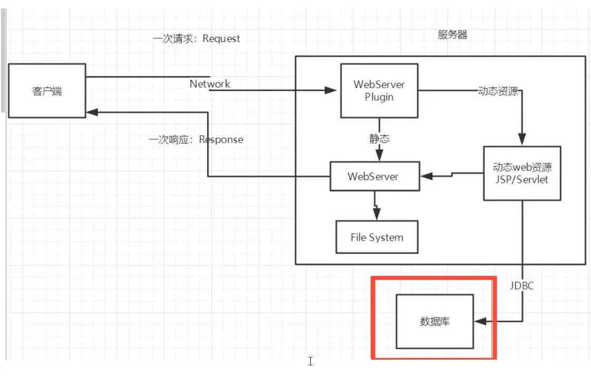 |
| 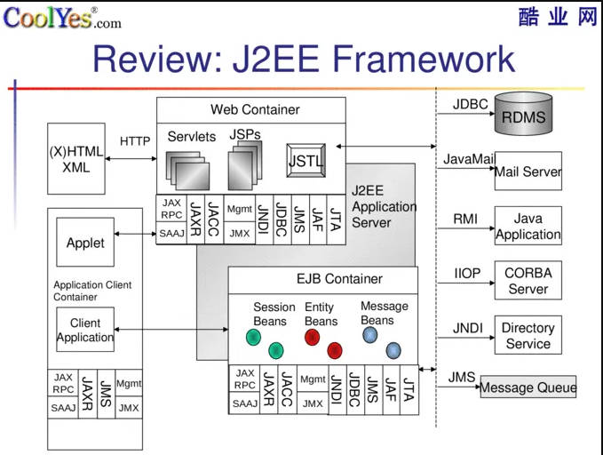   | 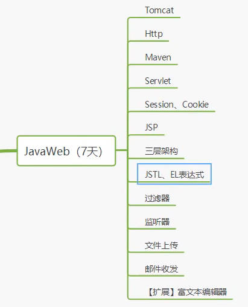 |

mapping问题：

==一个Servlet可指定多个映射路径==、`/*、/hello/*`

指定后缀或前缀：`*.do `; *前面不能加项目映射的路径

#### ServletContext

[狂神说JavaWeb-Servlet](https://blog.csdn.net/weixin_45064346/article/details/125723563)  [ServletContext对象](https://www.jianshu.com/p/8f3635755973)   [Javaweb 学习](https://blog.csdn.net/qq_44213041/article/details/123112837)  [ javaweb](https://blog.csdn.net/Prince140678/article/details/120541443)

[web.xml配置文件详解](https://www.cnblogs.com/Y-oung/p/8401549.html)

> 1. 上下文：用一个中间对象把上下连接起来
>    1. servlet之间通信用
> 2. ServletContext： servlet上下文；==web容器在启动的时候，它会为每个web程序都创建一个对应的ServletContext对象，它代表了当前的web应用（这个网站由这个ServletContext对象来管理）==
>    1. 上下文对象：web容器启动时创建
>    2. 多个servlet交互时：例如淘宝登录信息会被用到很多页面
>    3. ServletContext对象应用：
>       1. 共享数据 : 这个Servlet中保存的数据，可以在另外一个servlet中拿到
>       2. 获取初始化参数
>       3. 请求转发：不是重定向
>       4. 读取资源文件：.properties文件
>    4. 多个servlet互不影响，没办法进行通信，servletcontext凌驾于所有servlet之上，所有servlet通过它进行存取

| 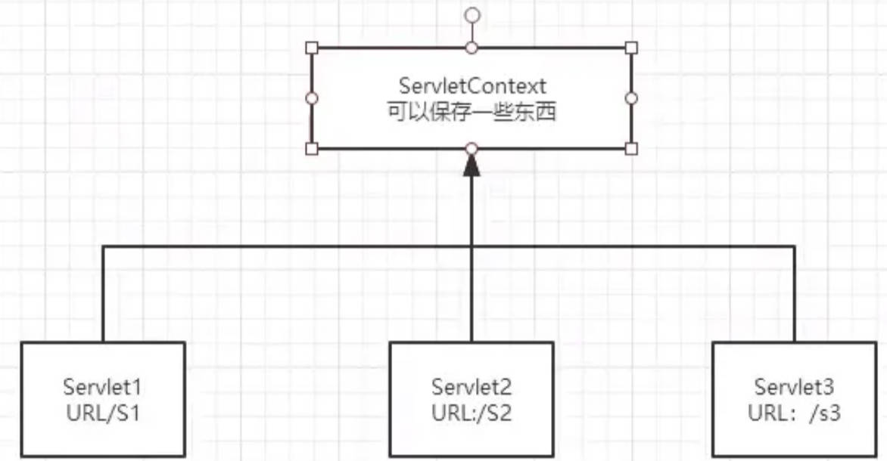 | 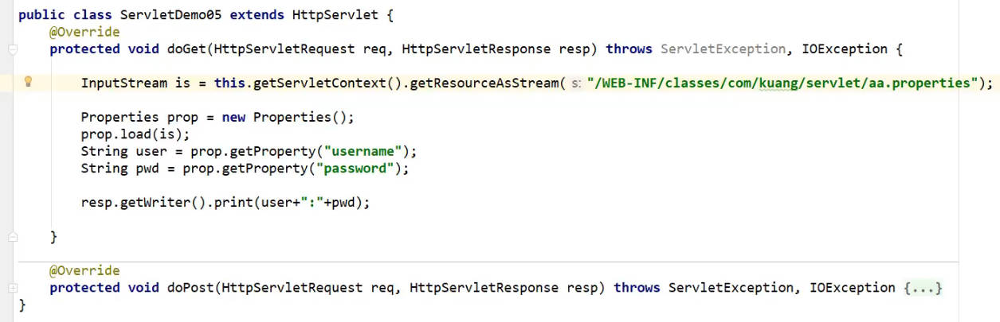 |
| ---------------------------------------------------------- | ---------------------------------------------------------- |
|                                                       |                                                       |

##### 1、共享数据

- 将一个数据保存在了ServletContext对象
  -  `ServletContext context = this.getServletContext(); context.setAttribute("username",username)`

- 会用session替换上下文对象

==创建一个放数据的类==：servlet

```java
public class DemoServlet1 extends HttpServlet {
    @Override
    protected void doGet(HttpServletRequest req, HttpServletResponse resp) throws ServletException, IOException {
        //this.getInitParameter() 初始化参数
        //this.getServletConfig() Servlet配置
        //this.getServletContext() Servlet上下文
        
         //在一个servlet里： 获得ServletContext对象，往里面放数据
        ServletContext context = this.getServletContext();
        
        String username = "小明"; //数据
        context.setAttribute("username",username); //将一个数据保存在了ServletContext
    }
}
```
- ==在另一个servlet里将数据取出来==； 要先访问有数据的servlet，才会把数据放入ServletContext

```java
  public class GetServlet extends HttpServlet {
      @Override
      protected void doGet(HttpServletRequest req, HttpServletResponse resp) throws ServletException, IOException {
          resp.setCharacterEncoding("gbk");
          ServletContext context = this.getServletContext();
          String username = (String) context.getAttribute("username");
          resp.getWriter().print(username);
      }
  }
```


| 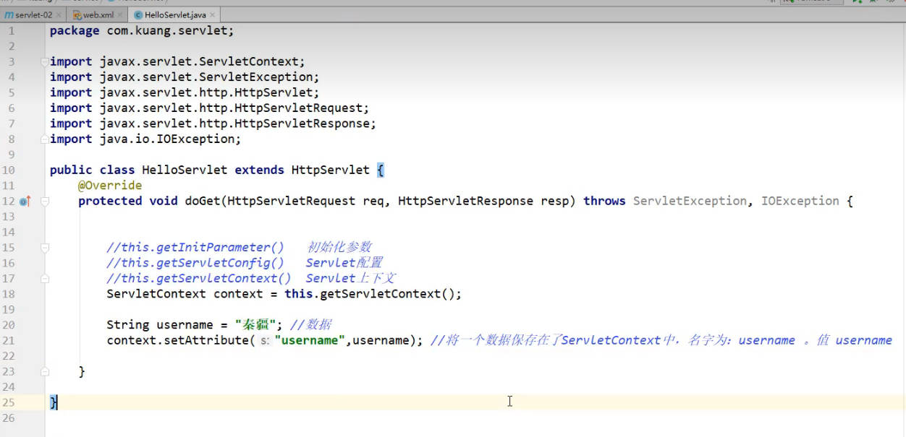 | 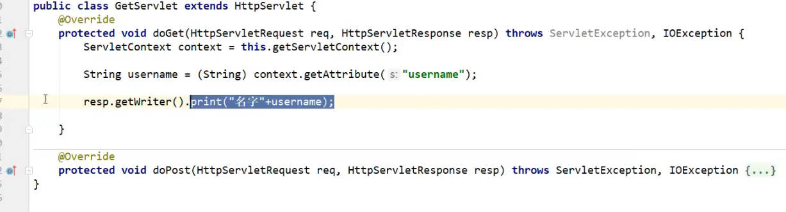 |
| ------------------------------------------------------------ | ------------------------------------------------------------ |

- web.xml中注册servlet

##### 2、获取初始化参数

##### 3、请求转发(路径不变)

请求转发会用request，不用上下文和重定向
请求转发: 就是页面跳转（==转发时路径不变==），==重定向(路径会变)==,vue路由

`RequestDispatcher requestDispatcher = context.getRequestDispatcher("/demo4");  //转发的请求路径
  requestDispatcher.forward(req,resp); 										//调用forward实现请求转发；`

##### 4、读取资源文件

[JavaWeb学习笔记](https://www.codenong.com/cs106262906/) 
读取资源文件可用类加载、反射等去做，不用上下文
==读取db.properties等文件==; 因为是web应用，没办法保证绝对地址

- target打包后，资源文件在WEB-INF/classes下，叫classpath类路径；  [JAVA项目中CLASSPATH路径详解](https://www.cnblogs.com/hibou/p/8324276.html)
  - java项目src/main下的java、resources文件夹, 都在类路径里面

`Properties properties = new Properties();` db.properties文件，一般建在resources目录下，在java源代码目录下，会出现资源导出失败问题(java目录默认只能导出java文件,xml、properties都导不出)，要在pom.xml中配置。

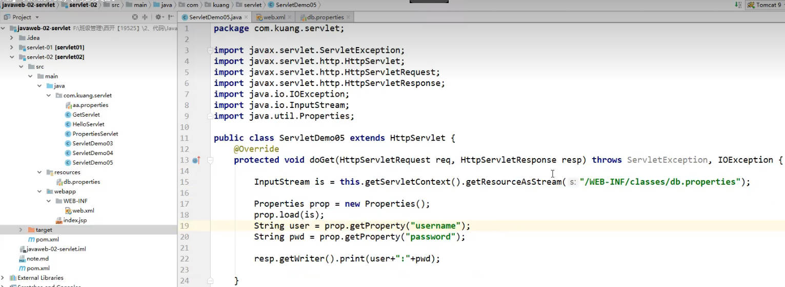

#### ==Response==

- servlet重点就一个方法：`public void service(ServletRequest req, ServletResponse res)` ;有2个参数，req、res

> 1. ==web服务器接收到客户端的http请求，针对这个请求，分别创建一个代表请求的HttpServletRequest对象，代表响应的HttpServletResponse==
> 2. HttpServletRequest
> 3. HttpServletResponse： 主要是add、set、get方法

| 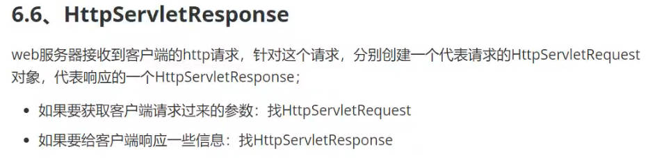 | 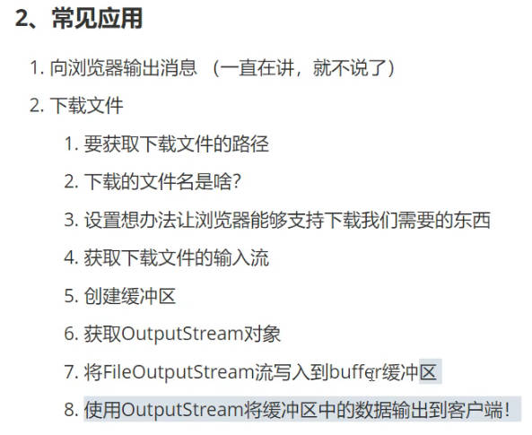 |
| ---------------------------------------------------------- | ---------------------------------------------------------- |


##### 1、Response下载文件

[ Servlet](https://blog.csdn.net/weixin_51650252/article/details/125859157)    [文件下载](https://blog.csdn.net/weixin_46525129/article/details/127396206) [Response下载文件](https://blog.csdn.net/Silly011/article/details/125710329) [java输入输出流操作](https://blog.51cto.com/u_13446/6347841)  [Request和Response](https://www.codenong.com/cs106064937/)   

下载文件：

> 1. 要获取下载文件的路径（url）
> 2. 下载的文件名是啥？
> 3. 让网站下载东西
> 4. 获取下载文件的输入流
> 5. 创建缓冲区
> 6. 获取OutputStream对象
> 7. 将FileOutputStream流写入到buffer缓冲区
> 8. 使用OutputStream将缓冲区中的数据输出到客户端

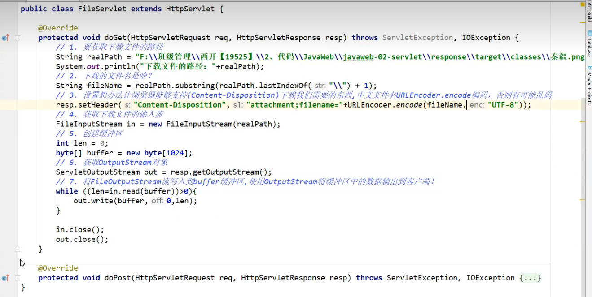

##### 2、Response验证码实现

[验证码历史](https://baijiahao.baidu.com/s?id=1769276797521633522&wfr=spider&for=pc) [破解滑动验证码](https://baijiahao.baidu.com/s?id=1724870502967348866&wfr=spider&for=pc) [java滑动验证码代码](https://blog.51cto.com/u_14457/7735084)  [拼图验证码](https://www.cnblogs.com/yaohonv/p/swipecaptcha.html) 

[ Servlet_httpservletresp的outputstream](https://blog.csdn.net/weixin_51650252/article/details/125859157) [Request和Response](https://www.codenong.com/cs106064937/)

[java OpenCV滑动拼图验证码](https://www.cnblogs.com/interdrp/p/14371171.html)  [使用java + selenium + OpenCV破解腾讯防水墙滑动验证码](https://www.cnblogs.com/interdrp/p/14371095.html)  [Opencv|极客教程 ](https://geek-docs.com/opencv) [selenium + python自动化测试环境搭建](https://www.cnblogs.com/fnng/archive/2013/05/29/3106515.html) [2023年5家主流网络验证码技术与应用对比](https://baijiahao.baidu.com/s?id=1760881135177510149&wfr=spider&for=pc) [滑动拼图验证码的原理和破解](https://www.xjx100.cn/news/547422.html?action=onClick) [滑动拼图行为验证码](https://blog.csdn.net/yuzaosong/article/details/125874118) 

```java
//把随机数放到图片中
public class ImageServlet extends HttpServlet {
    @Override
    protected void doGet(HttpServletRequest req, HttpServletResponse resp) throws ServletException, IOException {
        //如何让浏览器3秒自动刷新一次
        resp.setHeader("refresh", "3");
        //在内存中创建一个图片,设置图片宽高颜色
        BufferedImage image = new BufferedImage(80, 20, BufferedImage.TYPE_INT_RGB);
        //得到2D图片，就是画笔，用来画图片
        Graphics2D g = (Graphics2D) image.getGraphics();
        //设置图片背景颜色
        g.setColor(Color.white);
        g.fillRect(0, 0, 80, 20);

        //给图片写数据，setColor()给画笔换个颜色
        g.setColor(Color.blue);
        g.setFont(new Font(null, Font.BOLD, 20));
        //把随机数放进去，画出来
        g.drawString(makeNum(), 0, 20);

        //告诉浏览器这个请求用图片方式打开
        resp.setContentType("image/png");
        //网站存在缓存，不让浏览器缓存
        resp.setDateHeader("expires", -1);
        resp.setHeader("Cache-Control", "no-cache");
        resp.setHeader("Pragma", "no-cache");

        //把图片写给浏览器
        ImageIO.write(image, "jpg", resp.getOutputStream());
    }

    //生成随机数
    private String makeNum() {
        //保证是7位数，随机数不足7位用0填充
        Random random = new Random();
        String num = random.nextInt(9999999) + "";
        StringBuffer sb = new StringBuffer();
        for (int i = 0; i < 7 - num.length(); i++) {
            sb.append("0");
        }
        num = sb.toString() + num;
        return num;
    }
}
```

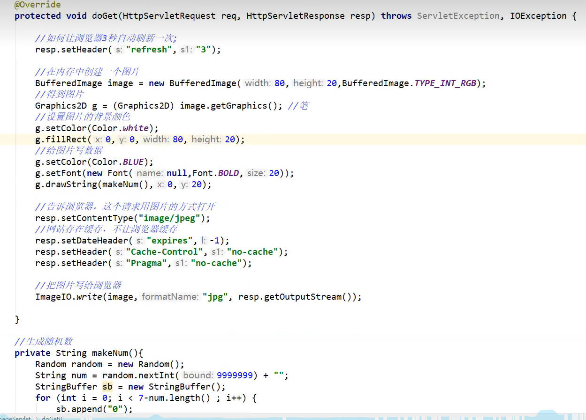

##### 3、==Response重定向== 

[请求转发url与请求重定向url的使用区别](https://blog.csdn.net/weixin_48033662/article/details/128165975)

一个web资源收到客户端请求后，它会通知 客户端去访问另外一个web资源，这个过程叫重定向；例如用户登录跳转 `resp.sendRedirect("/img")`

- 表单提交的路径，要用项目的类路径，用jsp

| 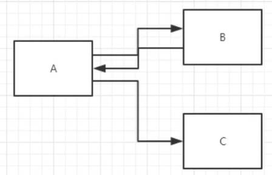   | 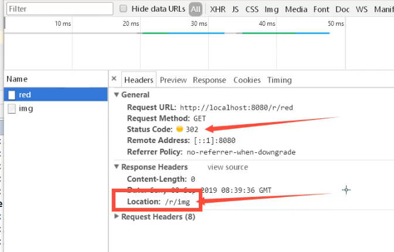   |
| ------------------------------------------------------------ | ------------------------------------------------------------ |
| 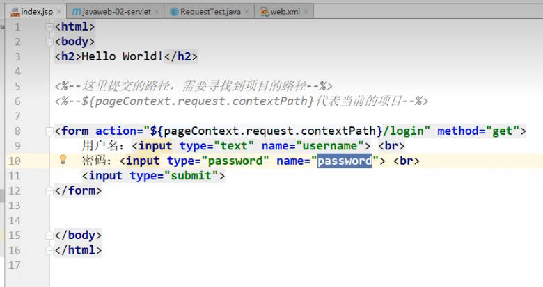 | 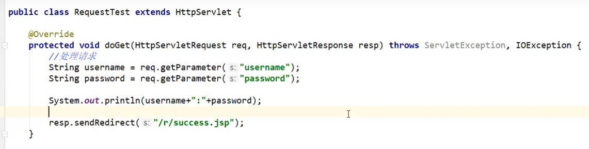 |

重定向和转发的区别:

相同点：

- 页面都会跳转

不同点：

- 请求转发的时候，url不会产生变化	307
- 重定向的时候，url会发生变化    302

**登录表单**:

> 1. 登录输入的用户名密码进入请求，doget方法处理登录重定向

index.jsp

```jsp
<%--
  Created by IntelliJ IDEA.
  User: spears
  Date: 2023/7/16
  Time: 22:54
  To change this template use File | Settings | File Templates.
--%>
<%@ page contentType="text/html;charset=UTF-8" language="java" %>
<html>
<head>
    <title>Title</title>
</head>
<body>
<h1>登录</h1>
<form action="${pageContext.request.contextPath}/login" method="post">
    <p>用户名：<input type="text" name="username"></p>
    <p>密码：<input type="password" name="password"></p>
    <p>
        <input type="submit">
        <input type="reset">
    </p>
</form>
</body>
</html>

```

servlet

```java
public class FormRequest extends HttpServlet {
    @Override
    protected void doGet(HttpServletRequest req, HttpServletResponse resp) throws ServletException, IOException {
        doPost(req, resp);
    }

    @Override
    protected void doPost(HttpServletRequest req, HttpServletResponse resp) throws ServletException, IOException {
        System.out.println("进入post请求了");
        //处理乱码
        req.setCharacterEncoding("utf-8");
        resp.setCharacterEncoding("utf-8");
        String username = req.getParameter("username");
        String password = req.getParameter("password");
        if (username.equals("admin") && password.equals("123456")) {
            System.out.println("登陆成功");
            //转发
            //转发：服务器把这个请求转向另外一个Servlet去处理； （地址栏不会变）
            //RequestDispatcher ,需要使用RequestDispatcher来进行处理，我们需要获得这个类，参数为要转发到的页面
            //req.getRequestDispatcher("/page/success.jsp").forward(req, resp);
            resp.sendRedirect("http://www.baidu.com");
        } else {
            System.out.println("登陆失败");
        }
    }
}
```


##### 4、中文乱码

[JavaWeb中的乱码](https://blog.csdn.net/SuperBlueMe/article/details/79109823) [response设置编码](http://www.easyaq.com/post/13029.html) [Tomcat运行时在IDEA控制台输出信息中文乱码](https://blog.csdn.net/qq_45929019/article/details/128464519)  [tomcat控制台中文乱码问题](https://blog.csdn.net/weixin_56556411/article/details/126134355?spm=1001.2101.3001.6650.3&utm_medium=distribute.pc_relevant.none-task-blog-2~default~CTRLIST~Rate-3-126134355-blog-128464519.235^v38^pc_relevant_sort_base1&depth_1-utm_source=distribute.pc_relevant.none-task-blog-2~default~CTRLIST~Rate-3-126134355-blog-128464519.235^v38^pc_relevant_sort_base1&utm_relevant_index=6)

[解决乱码setCharacterEncoding("UTF-8")不生效的问题](https://www.cnblogs.com/inkyi/p/15194653.html)  [ java web开发中的编码设置问题](https://blog.csdn.net/NaXieNianWoMenYiQ/article/details/87947746)   [JavaWeb中的乱码码问题解决](https://blog.csdn.net/SuperBlueMe/article/details/79109823)  [URLEncoder.encode()解决中文乱码](https://blog.csdn.net/weixin_47769142/article/details/107253414)  [中文乱码处理](https://www.cnblogs.com/liyuelian/p/17125012.html)

###### 1、response.setCharacterEncoding(“utf-8)

该方法设置的是向response写入的字符的编码,如

```java
response.setCharacterEncoding("Content-type","text/html;charset=utf-8")
response.getWriter().write("你好,JavaWeb!");
```

上面代码表示向响应体中写入的字符的编码是utf-8
此时,浏览器中访问该代码所在的页面依然会出现乱码,因为,response向浏览器响应后,浏览器并不知道”你好,JavaWeb!”是UTF-8的格式,因为我们的系统默认是GBK编码,此时必然会出现乱码,需要将浏览器的编码手动设置成utf-8的格式才能正常的显示中文.

###### 2、response.setHeader(“Content-type”,”text/html;charset=utf-8”)

```java
response.setHeader("Content-type","text/html;charset=utf-8");
response.getWriter().write("你好啊,JavaWeb!");
```

以上通过向Response添加响应头的方式，浏览器在收到该响应的时候，会自动的使用 utf-8 的编码方式显示，而且在调用setHeader(“Content-type”,”text/html;charset=utf-8”) 以后会自动执行setCharacterEncoding(“utf-8”)这样就不会出现乱码了。

**tips**：常见字符编码：iso-8859-1(不支持中文)、gb2312、gbk、gb18030(系统默认编码，中国的国标码)、utf-8(万国码，支持全世界的编码，所以我们使用这个)

###### 3、IDEA tomcat控制台输出乱码

原因：IDEA编码与Tomcat编码不一致导致


#### ==Request==

HttpServletRequest代表客户端的请求，用户通过Http协议访问服务器，==Http请求中的所有信息会被封装到HttpServletRequest==，通过这个HttpServletRequest的方法，获得客户端的所有信息

##### 1、获取前端传递的参数

获取form表单的输入信息

session、cookie、上下文、request都能保存东西，`req.setAttribute() 往里面放东西`

| 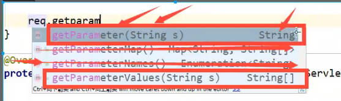 | 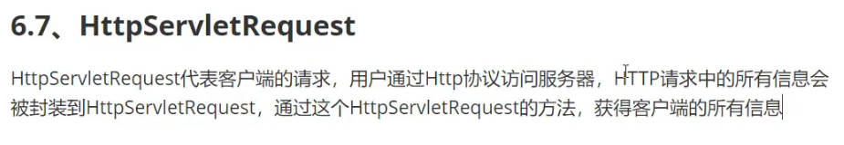 |
| ------------------------------------------------------------ | ---------------------------------------------------------- |

##### 2、请求转发

`req.getRequestDispatcher("/page/success.jsp").forward(req,resp);`  和ServletContext的转发一样，一般用request的请求转发

### 5、Cookie

小结： `Cookie[] cookies = req.getCookies()`

1. 会话: 用户打开一个浏览器到关闭浏览器，这个过程称为会话
   1. 有状态会话: 客户端再次访问服务端时，服务端知道客户端曾经来过
   2. ==保存会话的2种技术：cookie、session==
2. 逻辑：
   1. 服务端从客户端请求获取cookie
      1. 如果cookie不存在，就设置cookie键值对
      2. 如果cookie存在，就获取键值对
   2. 浏览器关闭，会话结束，cookie就没了，可设置有效期等，setMaxAge
   3. 中文乱码：cookie的中文乱码用utf8编码解码

[javaweb](https://www.cnblogs.com/webclub/p/15014990.html)  [Java Web 笔记 ](https://www.ngui.cc/el/2954608.html?action=onClick) [一个cookie代表一个键值对](https://www.it1352.com/2697021.html)  [Cookie/Session ](https://www.cnblogs.com/wl3pb/p/14552778.html)

将多个键值对存储到一个 cookie 中是没有意义的，因为根据定义一个 cookie 代表一个键值对.
因为cookie 的工作原理.它不是标准的 JS 字符串:当您设置它时，它包含的 cookie 定义附加到现有 cookie 的列表中.也就是说，您不能使用此 API 同时设置两个cookie

`设置cookie键值对，取出并显示键值对` ，cooke只能存键值对，不能存对象

```java
public class CookieDemo01 extends HttpServlet {
    @Override
    protected void doGet(HttpServletRequest req, HttpServletResponse resp) throws ServletException, IOException {
        req.setCharacterEncoding("UTF-8");
        //resp.setCharacterEncoding("UTF-8");  向响应体中写入的字符的编码是utf-8
        //向Response添加响应头，浏览器在收到该响应的时候，会自动的使用 utf-8 的编码方式显示
        resp.setHeader("Content-Type", "text/html;charset=UTF-8");

        //1. 想要客户端返回字符串，需要一个输出对象，只是打印一些字
        PrintWriter out = resp.getWriter();
        //2. 服务端从客户端请求获取cookie
        Cookie[] cookies = req.getCookies();

        //判断cookie存不存在,存在就取出cookie的键值对
        //2.1  如果cookie存在
        if (cookies != null) {
            out.write("上次访问时间:");
            //遍历cookie元素
            for (int i = 0; i < cookies.length; i++) {
                Cookie cookie = cookies[i];
                //拿到cookie，对它做一些操作:获取cookie的名字和值
                if (cookie.getName().equals("lastLoginTime")) {
                    String value = cookie.getValue();
                    //值是字符串,把它转为date： 解析成长整型long数字
                    long l = Long.parseLong(value);
                    //再变成对象，new一个Date就行了
                    Date date = new Date(l);
                    out.write(date.toLocaleString());//变成字符串
                }
            }
        } else {
            out.write("这是您第一次访问本站");
        }
		
        //2.2 如果cookie不存在： 第一次访问
        //第一次访问，服务端给客户端发cookie,以后仍会执行这段代码：更新时间
        //System.currentTimeMillis()获取时间，想转字符串加""就行了
        //设置cookie键值对
        Cookie cookie = new Cookie("lastLoginTime", System.currentTimeMillis() + "");
        cookie.setMaxAge(24*60*60); //cookie有效期1天
        resp.addCookie(cookie);
    }
}
//URLEncoder.encode("多少积分开机速度","utf-8");
//URLDecoder.decode(cooki.getValue(), "utf-8");
```
| 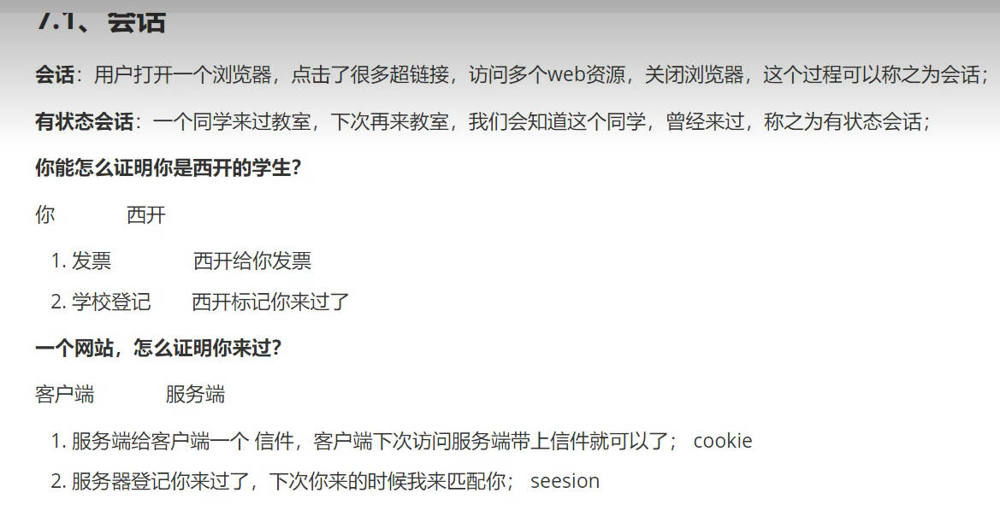 | 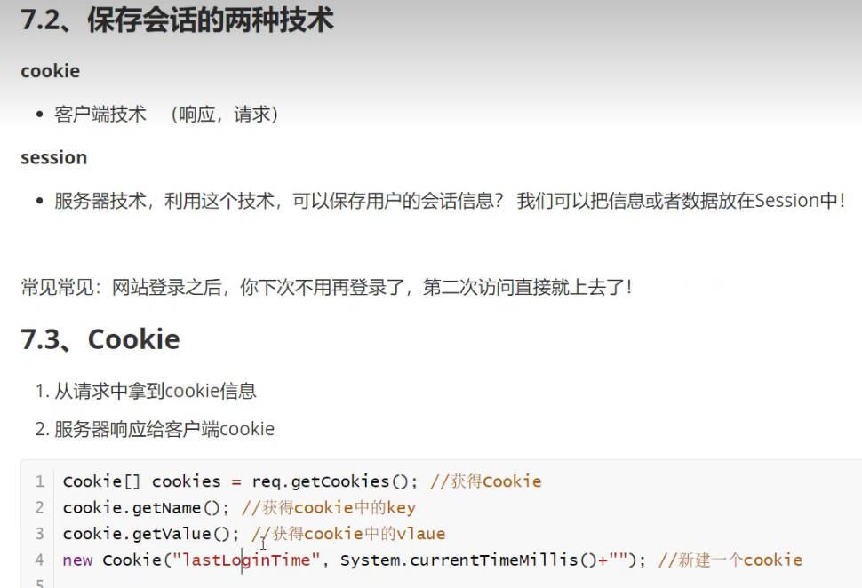   |
| ---------------------------------------------------------- | ------------------------------------------------------------ |
| 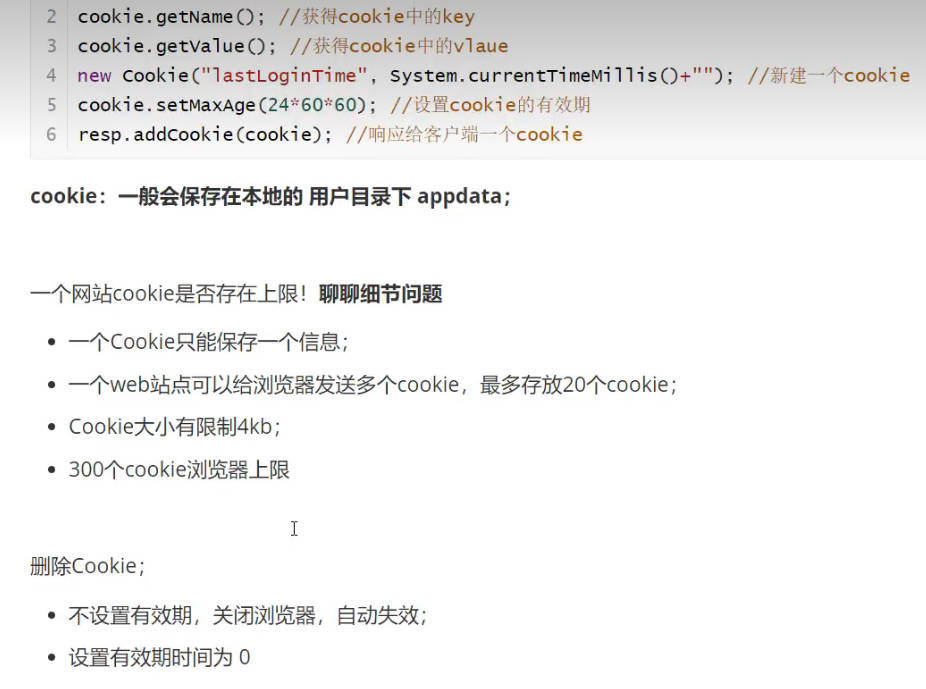 | 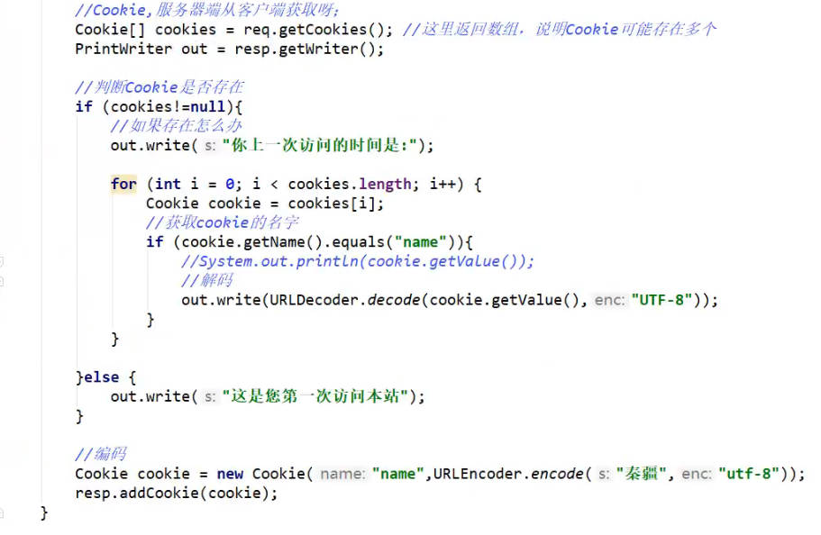 |

### 6、==Session(重点)==

[Cookie和Session](https://www.kuangstudy.com/bbs/1410463932639916033) [Cookie和Session](https://www.kuangstudy.com/bbs/1574793388141027330) [Servlet](https://www.kuangstudy.com/bbs/1374621834221232129)

小结： `HttpSession session = req.getSession()`

1. 服务器给每个用户（浏览器）创建一个Session对象，只要浏览器没关，这个Session就存在; 
   1. 只要客户端一旦连接上服务器，服务器就会自动产生Session，一个连接对应一个session，session可以在一个会话中传递信息
   2. 通过setAttribute设置值，getAttribute获得值
   3. Session由服务器控制，如果服务器重启了，信息就会丢失
   4. Session也存在浏览器cookie里，Expires/Max-Age里显示：Session
   5. session注销：`session.invalidate();   手动注销session`  ; 或者在web.xml里让会话自动过期
2. 怎么用
   1. 从请求得到Session `HttpSession session = req.getSession()`
   2. 1个servlet里存Session ：`session.setAttribute("name","秦王");`，另一个Servlet里取 :`Object name = session.getAttribute("name");`
   3. 可存对象 : `session.setAttribute("name",new Person());`
3. servletContext中间又加了一层，作用域比session更高， jsp里会改名字：ApplicationContext
   1. 2个session获取共享资源,例如统计访问用户，session里没法存；用更高的应用级别：ServletContext,jsp里会改名字ApplicationContext

`得到Session -> 给Session中存东西`
Session也从请求中拿，

> 1. 会话：用户打开一个浏览器，点击了很多超链接，访问多个web资源，关闭浏览器，这个过程可以称之为==会话 『打开浏览器到关闭浏览器』==
>    1. 有状态会话：一个同学来过教室，下次再来教室，我们会知道这个同学曾经来过，称之为有状态会话
>       1. ==服务端给客户端一个信件==，客户端下次访问服务器带上信件就可以了：cookie
>          1. 信息保存在客户端
>       2. ==服务器登记你来过了==，下次来的时候我来匹配你：session
>          1. 信息保存在服务端
>    2. 保存会话的2种技术
>       1. cookie： javax.servlet.http 下的 Cookie包
>       2. session：保存用户的会话信息，把信息或者数据放在session中
> 2. Session
>    1. 服务器会给每一个用户(浏览器)创建一个Session对象
>    2. 一个session独占一个浏览器，只要浏览器没有关闭，这个session就存在
>    3. 用户登录之后，整个网站它都可以访问！–>保存用户的信息；保存购物车的信息
> 3. 区别
>    1. Cookie是把用户的数据写给用户的浏览器， 浏览器保存，可以保存多个
>       1. 服务器发给cookie，每次请求时带上cookie，你来了，我知道了
>    2. Session是服务器保存，相当于一个类对象，用于保存重要信息。
>       1. 请求时，服务器登记一个session，SessionID每个用户唯一，用户拿到的是SessionID，服务器中的session存东西

得到session -> 获取session中属性，给session存东西(能存对象)

用户拿到sessionID

2个session获取共享资源,例如统计访问用户，session里没法存；用更高的应用级别：ServletContext,jsp里会改名字ApplicationContext

```java
public class SessionDemo01 extends HttpServlet {
    @Override
    protected void doGet(HttpServletRequest req, HttpServletResponse resp) throws ServletException, IOException {
        //解决乱码问题
        req.setCharacterEncoding("utf-8");
        resp.setCharacterEncoding("utf-8");
        resp.setContentType("text/html;charset=utf-8");

        //得到Session,也从请求拿
        HttpSession session = req.getSession();
        //给Session中存东西,后台打印
        session.setAttribute("name","秦王");
        Object name = session.getAttribute("name");
        System.out.println(name);
        //获取Session的ID
        String sessionId = session.getId();

        //Session如果不是新建的就打印创建成功
        if (session.isNew()) {
            resp.getWriter().write("Session创建成功，ID：" + sessionId);
        } else {
            resp.getWriter().write("Session已经存在，ID：" + sessionId);
        }
    }
}
//session.removeAttribute("name"); 取消
//session.invalidate();   手动注销session
//自动注销在web.xml中配置<session-config>
```


| 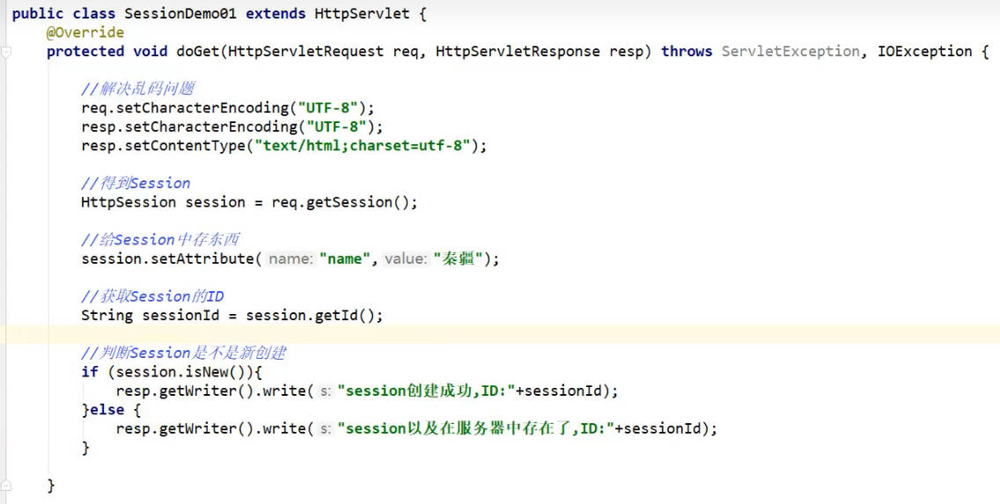   |  |
| ------------------------------------------------------------ | ------------------------------------------------------------ |
|    |    |
|    |  |
|  |                                                              |


### 7、 JSP原理

小结：

1. JSP原理
   1. tomcat的work目录里面，java转换为class文件，这是tomcat的；
   2. 在idea中使用tomcat，会在idea中产生一个work目录 `用户/spears/.Intelijidea/system/tomcat`
      1. `jsp页面转换成了java类`，工作空间里有转换后的java源代码,jsp本质就是一个servlet
         1. ==写jsp可以看作是写servlet==
      2. `HttpJspBase extends HttpServlet implements HttpJspPage: jspInit()、_jspDestroy()、_jspService()`
      3. 浏览器向服务器发送请求，不管访问什么资源，其实都是在访问servlet

知识库： [JSP 语法 ](https://www.runoob.com/jsp/jsp-syntax.html)

[cookie-jstl笔记](https://www.cnblogs.com/webclub/p/15014990.html)  [使用maven添加HttpJspBase所在的依赖](https://www.cnblogs.com/mryx/p/14256771.html)  

> 问题： 既然现在不用jsp渲染servlet,那么用什么渲染servlet？ 
>
> - ==前后端分离==：目前更主流。==Servlet 只负责提供 JSON 接口，页面由 Vue、React 等框架渲染==，后端不再管视图，实现前后端完全解耦。
> - 前后端分离除了用servlet：
>   - Spring MVC / Spring Boot： 最主流的 Java 后端方案。用 `@RestController` + `@RequestMapping` 定义 RESTful 接口，==返回对象自动序列化成 JSON==，配合 Jackson 等库处理数据。
>     - ==常规 Web 项目==：直接用 Spring Boot，生态完善，和 Vue、React 配合很成熟，毕设和企业项目都够用。
>     - ==多端复用==：后端数据同时给 Web、App、小程序用，RESTful API 是通用解，客户端按需接入。
>     - ==实时性要求高==：聊天、股票行情、在线协作，用 WebSocket 做双向推送。
>     - ==内部服务间调用==：微服务场景下，gRPC 性能更好，但对外仍建议用 REST 或 GraphQL 暴露接口

- Servlet是标准接口，不是框架。 Spring MVC等框架底层仍基于Servlet API实现。
- ‌==JSP本质是Servlet的简化写法==，最终会被容器转换成Servlet运行

> 1. JSP（Java server  pages）：java服务端页面，和servlet一样，用于动态web技术，写jsp就像在写html
>    1. HTML只给用户提供静态数据, 动态的要处理servlet类
>    3. JSP页面可以嵌入Java代码，为用户提供动态数据
> 2. ==浏览器向服务器提交请求，不管访问什么资源，其实都是在访问servlet==。JSp最终也会被转换成为一个Java类（访问页面时才转换）。源码分析：==JSP本质上就是一个Servlet==， 别人帮忙做的封装，为了方便
> 3. jsp原理
>    1. ==tomcat的work目录==，IDEA中tomcat工作空间：`用户/spears/.Intelijidea/system/tomcat`/*/org/apache/jsp; 发现jsp页面转换成了java类，工作空间里有转换后的java源代码,jsp本质就是一个servlet 
>       1. 转换后java类，内置有对象，可以拿来用； `servletContext改名为applicationContext, page=this代表当前页`
>    2. ==浏览器向服务器发送请求，不管访问什么资源，其实都是在访问Servlet==
>    3. 在jsp页面中： 只要是java代码就会原封不动的输出；  如果是HTML代码，就会被转换成为`out.write("")`这样的格式，输出到前端

`public abstract class HttpJspBase extends HttpServlet implements HttpJspPage` HttpJspBase继承HttpServlet，所以JSP本质上就是一个Servlet


|    |    |
| ------------------------------------------------------------ | ------------------------------------------------------------ |
|  |  |
|  |    |


#### 1、JSP语法 

[tomcat热部署](https://www.cnblogs.com/youxin/p/7856541.html)  [tomcat热部署不生效问题](https://blog.csdn.net/weixin_42325659/article/details/105450766)  [tomcat热更新](https://blog.csdn.net/m0_71837135/article/details/130940908) [Update action与frame deactivation的区别](https://blog.csdn.net/weixin_42873590/article/details/123460688)

> 1. 建一个maven项目，不用模板，项目右键添加框架支持(add Framework Support)，web application
>    1. 添加jsp依赖
>    2. tomcat热更新，在edit configurations > server >选update classes and resources  
> 2. 脚本语言： 
>    1. ==脚本片段==： ==<%==  %>  写多行java代码 
>    2. ==JSP表达式==： `<%= ` %>  
>       1. 将程序结果输出到客户端： 先被转化成String，然后插入到表达式出现的地方
>       2. ==EL表达式==：${ }, 等价<%= %>,方便，取值常用
>    3. ==JSP声明==：<%! %> ； ==声明变量、方法,供后面java调用==
>       1. 原理：其他的都是_jspService方法内部的变量，声明其实是声明全局变量
>       1. 定义在类中，没有在_jspService方法内，作用域更高
>    4. ==jsp指令==：==<%@== directive attribute="value" %>   ， 设置整个JSP页面相关的属性
>       1. ==Page==指令：<%@ page ... %>  ， 为容器提供当前页面的使用说明， 定义网页依赖属性，比如脚本语言、error页面、缓存需求等等
>       2. ==Include==指令：<%@ include ... %>  ， 包含其他文件,`提取公共页面(网站的头尾)`
>       3. ==Taglib==指令：<%@ taglib ... %>  ，引入自定义标签集合， 引入标签库的定义
>    5. 注释：<%--jsp注释--%> jsp注释不会显示在页面中；  `<!-- html注释 -->` 网页源代码里面会显示
> 3. jsp标签
>    1. ==<jsp:==include  />
>    2. ==JSP行为==： <jsp:action_name attribute="value" /> 
>       1. 使用XML语法结构控制servlet引擎,行为标签只有一种语法格式，严格遵守XML标准
>       2. JSP动作元素在请求处理阶段起作用, 可以动态地插入文件、重用JavaBean组件、把用户重定向到另外的页面、为Java插件生成HTML代码
> 4. JSP隐含对象： 九个自动定义的变量(==内置对象==)

```jsp
<body>
<%--脚本片段：可拆分--%>
<%= new java.util.Date()%>
<% for (int i = 0; i < 5; i++) %>

<%--声明全局变量--%>
<%!
    static{
        System.out.println("Loading Servlet!");
    }
    private  int globaVar=0;
    public void apple(){
        System.out.println("apple方法");
    }
%>
<%@page %>
</body>
```


|    |  |
| ------------------------------------------------------------ | ---------------------------------------------------------- |
|  |  |

#### 2、JSP 9个内置对象及作用域

request:客户端向服务器发送请求，产生的数据，==用户看完就没用了==，比如：新闻；
session:客户端向服务器发送请求，产生的数据，==用户看完一会还有用==，比如：购物车；
application:客户端向服务器发送请求，产生的数据，==一个用户用完了，其他用户还可能使用==，比如：聊天数据；

- 存取东西在不同的作用域： 请求域、session、context
- ==重点四个作用域==：PageContext: page、request、session 、application

```jsp
<%
    pageContext.setAttribute("name1","张三");   	//保存的数据只在一个页面中有效
    request.setAttribute("name2","李四");         //保存的数据在只在一次请求中有效，请求转发会携带这个数据
    session.setAttribute("name3","王五");         //保存的数据在只在一次会话中有效，从打开浏览器到关闭浏览器
    application.setAttribute("name4","法外狂徒");  //保存的数据在只在服务器中有效，从打开服务器到关闭服务器
%>
```

JSP代码都写在jsp文件里，放在==web==应用目录下

|    |  |
| ------------------------------------------------------------ | ---------------------------------------------------------- |
|    |  |
|  |                                                            |


#### 3、JSP标签、JSTL标签、EL表达式

[jsp中使用jstl报错](https://blog.csdn.net/qq_41033385/article/details/99738049)  [JSTL标签报错](https://www.cnblogs.com/zjz0818/p/15200284.html)     [http://java.sun.com/jsp/jstl/core报错 ](https://blog.csdn.net/wenbin1016/article/details/104559318)   [JSTL标签](https://blog.csdn.net/MrTumnus/article/details/119635318)

[EL表达式详解](https://www.cnblogs.com/niuchuangfeng/p/9135243.html)   [EL表达式](https://www.cnblogs.com/chacha-z/p/10709795.html)

> 1. 导入依赖:javax.servlet-api、 avax.servlet.jsp-api、jstl-api、standard
> 2. ==jsp标签==: <jsp: >
>    1. 3个： `<jsp:include> forward param转发的网址带参数`
> 3. EL表达式： ${ }  `Expression Language表达式语言`
>    1. 获取数据、执行运算、获取web开发的常用对象、调用java方法
>    2. 为了使JSP写起来更加简单。表达式语言的灵感来自于 ECMAScript 和 XPath 表达式语言，它提供了在 JSP 中简化表达式的方法，让Jsp的代码更加简化
>    3. 主要用于替换JSP页面中的脚本表达式<%= 变量或表达式 %>，以从各种类型的web域 中检索java对象、获取数据
>    4. ==EL主要作用==
>       1. 获取数据
>       2. 执行运算
>       3. 获取web开发常用对象
>       4. 调用Java方法
> 4. ==JSTL==：  <c: >
>    1. Java server pages standarded tag library，即==JSP标准标签库==
>    2. JSTL是一个JSP标签集合，它封装了JSP应用的通用核心功能
>    3. ==引入jstl核心标签库==：`<%@ taglib prefix="c" uri="http://java.sun.com/jsp/jstl/core" %>`
>    4. 根据JSTL标签所提供的功能，==分为5个类别==
>       1. 核心标签
>       2. 格式化标签
>       3. SQL 标签
>       4. XML 标签
>       5. JSTL 函数

`<form action="core.jsp" method="get",将表单数据提交到core.jsp,再通过这个页面获取提交数据`

- 把JSTL表达式依赖jstl-api、 standard标签库复制到tomcat的lib目录下

|    |  |
| ------------------------------------------------------------ | ---------------------------------------------------------- |
|    |  |
|  |                                                       |

#### 4、==JavaBean==

[JavaBean 和 实体类](https://www.cnblogs.com/zou-ma/p/16079507.html)   [ Java中 PO VO BO DTO DAO 和 POJO 的概念及区别](https://blog.csdn.net/weixin_45525272/article/details/123438712)    [PO、BO、VO、DTO、POJO、DAO概念及其作用和项目实例图](https://blog.csdn.net/weixin_43139560/article/details/121996757)   [POJO](https://baike.baidu.com/item/POJO/3311958?fr=aladdin#3)  [ VO、PO、DTO、BO、POJO、JavaBean、Entity](https://blog.csdn.net/qq_41570658/article/details/120957087)  [Java中 PO VO BO DTO DAO 和 POJO _百度 ](https://www.baidu.com/s?ie=UTF-8&wd=Java中 PO VO BO DTO DAO 和 POJO 关系图)   [pojo、entity、vo三种类的区别](https://blog.csdn.net/qq_48642405/article/details/121872704)

[javaBean](https://www.cnblogs.com/webclub/p/15033944.html)

也叫实体类，一般用来和数据库的字段做映射

> 1. JavaBean： 通常叫==实体类==； 特殊的 Java 类，使用 Java 语言书写，并且遵守 JavaBean API 规范； JavaBean 与其它 Java 类区别
>    1. JavaBean 是普通的 Java 类。实体类属于javabean
>    2. 提供一个默认的无参构造函数
>    3. 需要被序列化并且实现了 Serializable 接口
>    4. 可能有一系列可读写属性
>    5. 可能有一系列的 getter 或 **setter** 方法
> 2. 实体类
>    1. 为了让程序员在对数据库操作的时候不用写SQL语句，实体类就是把对某一个表的操作全写在一个类中

|  |  |
| ---------------------------------------------------------- | ---------------------------------------------------------- |

### 8、 MVC框架

[MVC 模式(runoob.com)](https://www.runoob.com/design-pattern/mvc-pattern.html)

小结：

- 控制器：就是servlet
  - 控制器作用于模型和视图上。它控制数据流向模型对象，并在数据变化时更新视图。它使视图与模型分离开
- 视图层：JSP
- 模型：控制业务操作，增删改查数据
  - 业务层操作Dao层，Dao通过jdbc操作数据库
  - javaBean（pojo、entity、细分很多vo、dto等）
  - 模型代表一个存取数据的对象或 JAVA POJO。它也可以带有逻辑，在数据变化时更新控制器
- jsp也是servlet，都可以写java代码，为了易于维护和使用
  - servlet专注于处理请求，控制视图跳转（重定向或转发）
  - jsp专注于显示数据

[EJB_从拥抱到抛弃](https://baike.baidu.com/item/EJB?fromModule=lemma_inlink)   [**早些年三层架构** ](http://www.taodudu.cc/news/show-4338175.html?action=onClick)  [MVC三层架构 ](https://www.cnblogs.com/xiafrog/p/14343553.html)  [Java Web ](https://www.ngui.cc/el/2954608.html?action=onClick)

- 后期增加层后，servlet把响应给客户端数据，交给业务层处理（例如登录等业务）

> 1. ==Model==：实体类和数据库中对应的字段   view：Jsp页面   Controller：就是servlet，负责控制跳转页面
>    1. 业务处理：业务逻辑（Service——处理登录等业务）
>    2. 数据持久层：CRUD（Dao）
> 2. ==view==：jsp页面
>    1. 展示数据
>    2. 提供链接发起Servlet请求（a，form，img等）
> 3. ==Controller==（Servlet负责跳转页面）
>    1. 接收用户请求（请求参数，Session信息等）
>    2. 交给业务层处理对应的代码
>    3. 控制视图跳转
>       1. 登录 --->接收用户的登录请求 --->处理用户的请求（获取用户登录的参数，username,password）--->交给业务层处理登录业务（判断用户名密码是否正确，还有事务(回滚)) --->Dao层查询用户名和密码是否正确--->数据库
> 4. MVC
>    1. ==早期==：servlet --->CRUD--->数据库 ； 用户直接访问控制层、控制层就可以直接操作数据库 ； 
>       1. jdbc代码写在servlet处理请求中，臃肿，不利于维护
>       2. servlet：处理请求、响应、视图跳转、处理JDBC、处理业务代码、处理逻辑代码
>    2. ==后期==：加了JDBC层，操作JDBC就可以了，业务层（登录查询等业务）也从servlet分离,DAO层(数据访问对象)操作数据库，实体类所有人都会用到，所以提出来作为公共模块
> 5. 使用 “轻量级”技术以代替复杂的EJB的运动。这些技术包括[Hibernate](https://baike.baidu.com/item/Hibernate?fromModule=lemma_inlink)（用于提供[数据持久化](https://baike.baidu.com/item/数据持久化/5777076?fromModule=lemma_inlink)和对象-关系映射）及[Spring](https://baike.baidu.com/item/Spring?fromModule=lemma_inlink)框架（用于封装业务逻辑）

```java
登录--->接受用户的登录请求--->处理用户的请求（获取用户登录的参数，username、password）---
>交给业务层处理登录业务（判断用户名密码是否正确：事务）--->Dao层查询用户名和密码是否正确---
>数据库
```

|  |  |
| ------------------------------------------------------------ | ---------------------------------------------------------- |
|    |  |

#### 1、 过滤器Filter

小结：

- 过滤器用来过滤垃圾请求、处理乱码等
- servlet需要req、resp，过滤器也需要这2个对象才能处理它们，所以过滤器和servlet一模一样
  - servlet实现servlet接口，过滤器实现过滤器接口

[ mysql-connector-java各版本及与mysql、JDK版本的对应](https://blog.csdn.net/dylgs314118/article/details/102677942)

> 1. 过滤器
>    1. 用来过滤网站数据，减少代码（例如中文乱码本来每个请求都要写）  例如处理中文乱码、登录验证、处理垃圾请求
>    1. 请求前加一层过滤器
>    1. ==实现Filter接口==，重写对应的方法即可
> 2. 过滤器为什么会过滤请求和响应
>    1. 想过滤什么，就把要过滤的对象作为参数传进来
>    2. 因为Filter接口的doFilter方法参数是请求和响应对象
>    3. `doFilter(ServletRequest servletRequest, ServletResponse servletResponse, FilterChain filterChain)`
> 3. chain
>    1. `filterChain.doFilter(servletRequest,servletResponse);//chain链，让请求继续走，如果不写，程序到这里就被拦截停止`
> 4. ==过滤特定请求==
>    1. web.xml里注册Filter，==配置过滤哪些请求==

Filter开发步骤：

1. ==导包==
   1. servlet-api、jsp-api、jstl、standard标签库、mysql-connector-java连数据库

2. ==编写过滤器==
   1. `main/java/filter/CharactEncodingFilter.java`： 建个包，里面写个java文件，==实现过滤器接口==
   1. 导包不要错 `implements Filter,   import javax.servlet.*` ,要选servlet的过滤器
   1. 重写3个方法：init初始化、dofilter、destroy销毁
3. ==要过滤的Servlet==
   1. main/java/servlet/ShowServlet.java

4. web.xml里面注册servlet、Filter(==配置过滤哪些请求==)

|    |  |
| ------------------------------------------------------------ | ------------------------------------------------------------ |
|    |    |
|  |                                                              |

```xml
<?xml version="1.0" encoding="UTF-8"?>
<project xmlns="http://maven.apache.org/POM/4.0.0"
         xmlns:xsi="http://www.w3.org/2001/XMLSchema-instance"
         xsi:schemaLocation="http://maven.apache.org/POM/4.0.0 http://maven.apache.org/xsd/maven-4.0.0.xsd">
    <modelVersion>4.0.0</modelVersion>

    <groupId>org.example</groupId>
    <artifactId>javaweb-maven</artifactId>
    <version>1.0-SNAPSHOT</version>    
    <dependencies>
        <!-- Servlet 依赖 -->
        <dependency>
            <groupId>javax.servlet</groupId>
            <artifactId>javax.servlet-api</artifactId>
            <version>4.0.1</version>
            <scope>provided</scope>
        </dependency>
        <!-- JSP 依赖 -->
        <dependency>
            <groupId>javax.servlet.jsp</groupId>
            <artifactId>javax.servlet.jsp-api</artifactId>
            <version>2.3.3</version>
            <scope>provided</scope>
        </dependency>
        <!-- JSTL 表达式依赖 -->
        <dependency>
            <groupId>javax.servlet.jsp.jstl</groupId>
            <artifactId>jstl-api</artifactId>
            <version>1.2</version>
        </dependency>
        <!-- standard 标签库 -->
        <dependency>
            <groupId>taglibs</groupId>
            <artifactId>standard</artifactId>
            <version>1.1.2</version>
        </dependency>
		<!-- connector 连接数据库 -->
        <dependency>
            <groupId>mysql</groupId>
            <artifactId>mysql-connector-java</artifactId>
            <version>5.1.47</version>
        </dependency>


    </dependencies>
</project>
```

web.xml: 过滤特定请求：web.xml里注册Filter，配置过滤哪些请求

```xml
<?xml version="1.0" encoding="UTF-8"?>
<web-app xmlns="http://xmlns.jcp.org/xml/ns/javaee"
         xmlns:xsi="http://www.w3.org/2001/XMLSchema-instance"
         xsi:schemaLocation="http://xmlns.jcp.org/xml/ns/javaee http://xmlns.jcp.org/xml/ns/javaee/web-app_4_0.xsd"
         version="4.0">
    <servlet>
        <servlet-name>showServlet</servlet-name>        
        <!-- 要过滤的Servlet -->
        <servlet-class>com.kuang.servlet.ShowServlet</servlet-class>
    </servlet>
    <servlet-mapping>
        <servlet-name>showServlet</servlet-name>
        <url-pattern>/servlet/show</url-pattern>
    </servlet-mapping>
    <servlet-mapping>
        <servlet-name>showServlet</servlet-name>
        <url-pattern>/show</url-pattern>
    </servlet-mapping>

    <filter>
        <filter-name>CharacterEncodingFilter</filter-name>
        <filter-class>com.kuang.filter.CharactEncodingFilter</filter-class>
    </filter>
    <filter-mapping>
        <!-- 过滤特定请求：web.xml里注册Filter，配置过滤哪些请求 -->
        <!-- 只要是/servlet的任何请求，都会经过这个过滤器 -->
        <filter-name>CharacterEncodingFilter</filter-name>
        <url-pattern>/servlet/*</url-pattern>
    </filter-mapping>
</web-app>
```

过滤器：

```java
public class CharactEncodingFilter implements Filter {
    @Override
    //初始化：web服务器启动，就已经初始化了，随时等待过滤对象出现！
    public void init(FilterConfig filterConfig) throws ServletException {
        System.out.println("CharactEncodingFilter初始化");
    }

    @Override
    public void doFilter(ServletRequest request, ServletResponse response, FilterChain chain) throws IOException, ServletException {
        //过来的和回去的都转换编码
        request.setCharacterEncoding("utf-8");
        response.setCharacterEncoding("utf-8");
        response.setContentType("text/html;charset=utf-8");

        System.out.println("CharactEncodingFilter执行前");
        //chain链，可以有很多过滤器，通过它放行对象，不写过滤器就停了
        //让请求继续走，如果不写，程序到这里就被拦截停止
        chain.doFilter(request, response);
        System.out.println("CharactEncodingFilter执行后");
    }
    @Override
    //销毁：web服务器关闭的时候，过滤器会销毁
    public void destroy() {
        System.out.println("CharactEncodingFilter销毁");
    }
}
```


#### 2、 监听器

> 1. 监听器： ==实现一个监听器的接口==,例如关窗口（收到点击事件，执行动作）;创建会话触发事件；有很多监听器
>    1. ==GUI中大量应用==：统计session，当前多少人在线；
>    1. 有很多监听器，例如事件监听，awt监听等
> 2. 监听器GUI中理解
> 3. 技巧：
>    1. 1个接口有很多方法，如果使用要重写很多方法； 可以加一层（1个子类），只重写需要的方法   [适配器模式](https://www.cnblogs.com/MrRightZhao/p/10784106.html)

监听器开发：

1. 编写监听器类
2. web.xml中注册监听器
3. jsp页面取监听器

|    |    |
| ------------------------------------------------------------ | ------------------------------------------------------------ |
|  |  |

#### 3、Filter实现权限拦截

用户登录之后才能进入主页，用户注销后就不能进入主页了

1.==判断用户是否登录成功==: 用户登录之后，向Session中放入用户的数据，并跳转到成功页面
2.==拦截判断==： 进入主页的时候要判断用户是否已经登录；

#### 4、JDBC事务

Junit单元测试: 以前测试用psvm，main方法执行， 如果没有main方法还想测试,就用Junit;

-  ==方法上加注解：@Test==
  在想执行的方法前面加一个注解@Test就可以直接运行，测试的时候不需要先写一个类。

#### 5、 原生Web应用开发

> 1. JDBC事务：要么都成功，要么都失败。
> 2. ACID原则：保证数据的安全
>    1. 开启事务
>    2. 事务提交
>    3. 事务回滚
>    4. 关闭事务
> 3. 超市订单管理系统smbms

## 2、SSM框架

[千锋教育_MyBatis](https://www.bilibili.com/video/BV19t4y1X7kw/?spm_id_from=333.999.0.0&vd_source=7346303e5e18677d7261c2c0c109ecfd)  [狂神说Java_Mybatis](https://www.bilibili.com/video/BV1NE411Q7Nx/)  [Spring5_IDEA版](https://www.bilibili.com/video/BV1WE411d7Dv/) [SpringMVC](https://www.bilibili.com/video/BV1aE41167Tu/)

## 3、微服务开发

[SpringBoot_IDEA版](https://www.bilibili.com/video/BV1PE411i7CV/)

## 4、常用中间件

[Redis](https://www.bilibili.com/video/BV1S54y1R7SB/)  [ElasticSearch7.6.x](https://www.bilibili.com/video/BV17a4y1x7zq/)  [RabbitMQ](https://www.bilibili.com/video/BV1dX4y1V73G/)  [千锋教育kafka](https://www.bilibili.com/video/BV1Xy4y1G7zA/?spm_id_from=333.337.search-card.all.click)  [尚硅谷MyCat2](https://www.bilibili.com/video/BV1iT41157JX/?spm_id_from=333.337.search-card.all.click)  [ShardingJDBC](https://www.bilibili.com/video/BV1ei4y1K7dn/)

## 5、服务网格架构

[服务网格架构](https://www.cnbugs.com/post-4195.html)  [服务网格ServiceMesh详解(定义作用及架构组件)](https://mikechen.cc/21922.html)  [ 服务网格技术浅析](http://news.sohu.com/a/687622218_121036026)

## 6、项目实战

### 1、开源项目

[skywalking](https://www.cnblogs.com/jackion5/p/10604189.html)

### 2、单元测试

[Mockito简介](https://www.cnblogs.com/satire/p/14846492.html)  [Mockito + Junit 5入门](https://www.bilibili.com/video/BV15S4y1F7Xr/?spm_id_from=333.337.search-card.all.click&vd_source=7346303e5e18677d7261c2c0c109ecfd)  [jacoco代码测试覆盖率](https://www.bilibili.com/video/BV1tr4y1i7f1/?spm_id_from=333.788.recommend_more_video.10&vd_source=7346303e5e18677d7261c2c0c109ecfd)  [软件测试视频教程全集](https://www.bilibili.com/video/BV1va41137AY/?spm_id_from=333.788.recommend_more_video.0&vd_source=7346303e5e18677d7261c2c0c109ecfd)  [Java+selenium3 web自动化测试](https://www.bilibili.com/video/BV18E411P7Uu/?spm_id_from=333.999.0.0&vd_source=7346303e5e18677d7261c2c0c109ecfd)  [测试Udemy](https://www.bilibili.com/video/BV1XP4y1Y7H6/?spm_id_from=333.337.search-card.all.click&vd_source=7346303e5e18677d7261c2c0c109ecfd)  [单元测试-SpringBootTest和Mock测试](https://www.bilibili.com/video/BV1DD4y1j7xb/?spm_id_from=333.337.search-card.all.click&vd_source=7346303e5e18677d7261c2c0c109ecfd)  [打桩与 mock 静态方法](https://www.bilibili.com/video/BV1Pm4y1d7mq/?spm_id_from=333.337.search-card.all.click&vd_source=7346303e5e18677d7261c2c0c109ecfd)  [junit+反射+注解+mysql](https://www.bilibili.com/video/BV1vJ411W76t/?spm_id_from=333.337.search-card.all.click)  [Junit4， Junit5， Jupiter之间的联系](https://blog.csdn.net/weixin_45876795/article/details/111059031)

|    |  |
| ------------------------------------------------------------ | ---------------------------------------------------------- |
|  |                                                       |

### 3、构建工具

[构建工具的进化：ant, maven, gradle](https://zhuanlan.zhihu.com/p/24429133)   [Ant学习笔记](https://zhuanlan.zhihu.com/p/449010790)    [IDEA使用ANT](https://www.cnblogs.com/Jeely/articles/13032691.html)

### 4、实战

[项目下载、运行、配置、构建、打包、部署](https://www.bilibili.com/video/BV1uK411p7Bp/?spm_id_from=333.788.recommend_more_video.10&vd_source=7346303e5e18677d7261c2c0c109ecfd)

[KuangSimpeBBS: 社区开源版本，基于Springboot](https://toscode.mulanos.cn/kuangstudy/kuang_simple_bbs#如何加入狂神的小社区)

## 7、技术栈


### 1、JAVA技术栈

[狂神说_学习顺序](https://gitee.com/kuangstudy/kuang_livenote/tree/master)  [后台技术栈/架构师之路/全栈开发 ](https://github.com/frank-lam/fullstack-tutorial) [javastacks: Java技术栈](https://github.com/javastacks/javastack)  [Java技术栈](https://github.com/javastacks/javastack) [技术栈](https://github.com/search?q=技术栈&type=repositories)

[JWT(JSON Web Tokens)跨域认证](https://www.cnblogs.com/limengda/p/11127712.html) [JWT](https://www.cnblogs.com/moonlightL/p/10020732.html) 

[狂神说_如何分析开源项目](https://www.bilibili.com/video/BV1T7411L74W/?vd_source=7346303e5e18677d7261c2c0c109ecfd)

[狂神说_Java/前端/Go/大数据/C学习路线](https://www.bilibili.com/read/cv14023271/?spm_id_from=333.999.0.0)  [Java全栈学习路线](https://wbq587.blog.csdn.net/article/details/127133435?spm=1001.2101.3001.6650.8&utm_medium=distribute.pc_relevant.none-task-blog-2~default~BlogCommendFromBaidu~Rate-8-127133435-blog-107575786.235^v38^pc_relevant_sort_base1&depth_1-utm_source=distribute.pc_relevant.none-task-blog-2~default~BlogCommendFromBaidu~Rate-8-127133435-blog-107575786.235^v38^pc_relevant_sort_base1&utm_relevant_index=14) [Java全栈学习路线](https://wbq587.blog.csdn.net/article/details/127133435?spm=1001.2101.3001.6650.8&utm_medium=distribute.pc_relevant.none-task-blog-2~default~BlogCommendFromBaidu~Rate-8-127133435-blog-107575786.235^v38^pc_relevant_sort_base1&depth_1-utm_source=distribute.pc_relevant.none-task-blog-2~default~BlogCommendFromBaidu~Rate-8-127133435-blog-107575786.235^v38^pc_relevant_sort_base1&utm_relevant_index=14) [狂神Java全栈学习路线](https://blog.csdn.net/wulei2921625957/article/details/107575786)  [Java学习路线图](https://www.cnblogs.com/XJT2018/p/14457779.html) 
[Road 2 Coding-编程自学路线和自学编程资源大聚合](https://www.ahhhhfs.com/13710/) [艾媒报告中心-全球行业研究报告下载 ](https://www.ahhhhfs.com/44132/)  [软件开发](https://www.letianbiji.com/)  [技术类书籍列表 ](https://www.ahhhhfs.com/26305/) [31天孤尽代码规范与效能提升训练营](https://www.ahhhhfs.com/24783/)  [优质计算机书籍](https://www.ahhhhfs.com/19106/)

[TableConvert在线表格转换](https://www.ahhhhfs.com/18767/) [CodeTome-编程入门自学工具](https://www.ahhhhfs.com/46858/)

[Engineering Blogs大神博客](https://engineeringblogs.xyz/)

#### 1、Idea

[插件](https://blog.csdn.net/qq_43591235/article/details/127466120) [UML类图插件](https://baijiahao.baidu.com/s?id=1728907866202978067&wfr=spider&for=pc) [插件](https://baijiahao.baidu.com/s?id=1756342056255005142&wfr=spider&for=pc) [IDEA源码阅读利器](https://www.ngui.cc/el/3562480.html?action=onClick)

### 2、对象存储

[云计算：对象存储概述](http://www.taodudu.cc/news/show-6516686.html?action=onClick)  [对象存储-紫光云](https://www.unicloud.com/document/show-18822039.html) [MinIO【对象存储服务】](https://www.cnblogs.com/Rover20230226/p/17529428.html)  [云对象存储](https://www.baidu.com/s?ie=UTF-8&wd=云对象存储)  [块存储、文件存储、对象存储这三者的本质差别](https://www.zhihu.com/question/21536660)  

### 3、微服务

[微服务技术栈](https://gitee.com/lzh_gitee/spring-cloud-kuang)  [Spring Cloud微服务](https://github.com/yinjihuan/spring-cloud) [java技术栈](https://github.com/jason1210/java-bucket)

| **微服务技术条目**                     | 落地技术                                                     |
| -------------------------------------- | ------------------------------------------------------------ |
| 服务开发                               | SpringBoot、Spring、SpringMVC等                              |
| 服务配置与管理                         | Netfix公司的Archaius、阿里的Diamond等                        |
| 服务注册与发现                         | Eureka、Consul、Zookeeper等                                  |
| 服务调用                               | Rest、PRC、gRPC                                              |
| 服务熔断器                             | Hystrix、Envoy等                                             |
| 负载均衡                               | Ribbon、Nginx等                                              |
| 服务接口调用(客户端调用服务的简化工具) | Fegin等                                                      |
| 消息队列                               | Kafka、RabbitMQ、ActiveMQ等                                  |
| 服务配置中心管理                       | SpringCloudConfig、Chef等                                    |
| 服务路由(API网关)                      | Zuul等                                                       |
| 服务监控                               | Zabbix、Nagios、Metrics、Specatator等                        |
| 全链路追踪                             | Zipkin、Brave、Dapper等                                      |
| 数据流操作开发包                       | SpringCloud Stream(封装与Redis，Rabbit，Kafka等发送接收消息) |
| 时间消息总栈                           | SpringCloud Bus                                              |
| 服务部署                               | Docker、OpenStack、Kubernetes等                              |

### 4、分布式

[HADOOP大数据技术栈](https://www.jianshu.com/p/7aa2066189fd)  [Hadoop大数据技术栈](https://baijiahao.baidu.com/s?id=1761445639247641789&wfr=spider&for=pc) [大数据必备的技术栈](https://blog.csdn.net/weixin_51689029/article/details/131074623) [大数据必备的技术栈](https://www.zhihu.com/question/428882646/answer/3134510675) [大数据技术栈发展史](https://www.cnblogs.com/dennyzhangdd/p/17283402.html)

[9张脑图梳理下分布式数据计算系统](https://blog.csdn.net/wujiandao/article/details/86670296)  [分布式数据计算](https://zhuanlan.zhihu.com/p/55845064)  [搞懂分布式](https://www.xiaohongshu.com/explore/62bac8ab0000000002002c3e) 

[hadoop](https://cloud.tencent.com/developer/article/1678881) 

[分布式系统的技术栈](https://www.cnblogs.com/hlc-123/p/17408932.html) [分布式系统的技术栈](https://zhuanlan.zhihu.com/p/643251969) [阿里资深架构师整理分享的分布式系统架构](https://blog.csdn.net/weixin_60707895/article/details/131811715)

> 1. Hadoop是一个大数据生态圈，类似于spring， Hadoop三大组件：HDFS、YARN、MapReduce。

### 5、大数据

[大数据（Bigdata）常用技术栈](https://www.itguest.com/post/fgdbd2b6.html) [Java大数据技术栈书籍](https://github.com/lijasonvip/Books_Reading)  [大数据学习思维导图](https://www.baidu.com/s?ie=utf-8&f=8&rsv_bp=1&tn=baidu&wd=大数据学习思维导图&rn=20&oq=%E5%A4%A7%E6%95%B0%E6%8D%AE%E6%80%9D%E7%BB%B4%E5%AF%BC%E5%9B%BE&rsv_pq=93f7a1780001630d&rsv_t=6dedKwCiUDgcXGoUQfGZEw9yL%2FIMTpq64XIp8hPw131vCs1tMN2IGqGLUaM&rqlang=cn&rsv_enter=1&rsv_dl=tb&rsv_btype=t&inputT=7387&rsv_sug3=35&rsv_sug1=29&rsv_sug7=100&bs=大数据思维导图)  [大数据平台架构及主流技术栈](http://www.taodudu.cc/news/show-5081399.html?action=onClick)
视频：[大数据开发技术Hadoop_千锋](https://www.bilibili.com/video/BV18y4y1G7JA/?spm_id_from=333.337.search-card.all.click&vd_source=7346303e5e18677d7261c2c0c109ecfd) 

[大数据导航-大数据工具-大数据平台-数据通](http://hao.datatong.com/)  [可视化大数据交互前端动态模板 HTML开源前端源码 ](https://www.ahhhhfs.com/16314/)

1. Hadoop：分布式存储和计算框架，包括HDFS和MapReduce。
2. Spark：基于内存的分布式计算框架，支持批处理、流处理和机器学习等多种计算模式。
3. Hive：基于Hadoop的数据仓库工具，支持SQL查询和数据分析。
4. Pig：基于Hadoop的数据流编程语言，用于数据处理和分析。
5. HBase：基于Hadoop的分布式NoSQL数据库，适用于海量数据的存储和查询。
6. Cassandra：分布式NoSQL数据库，适用于高可用性和高扩展性的应用场景。
7. Kafka：分布式消息队列系统，用于实时数据流处理和消息传递。
8. Flink：基于流处理的分布式计算框架，支持批处理和流处理。
9. Elasticsearch：分布式搜索和分析引擎，用于全文搜索和数据分析。
10. ZooKeeper：分布式协调服务，用于管理分布式系统的配置和状态信息

### 6、人工智能

[人工智能学习路线图](https://github.com/xiaochengcike/Ai-learn)  [人工智能架构](https://www.processon.com/view/607700967d9c08283dc6c71f)

[技术栈_人工智能-大数据-云计算](https://www.cnblogs.com/ytwang/p/14638177.html)  [人工智能技术栈与学习路线：机器学习 深度学习 视觉 NLP 推荐系统](https://www.xjx100.cn/news/692254.html?action=onClick)  [人工智能](http://www.taodudu.cc/news/show-5210814.html?action=onClick)

[嵌入式AI](https://www.zhihu.com/question/593773969) [AI技术栈](https://www.jianshu.com/p/21118673e3fd) [开发者备忘清单 速查表-Quick Reference ](https://www.ahhhhfs.com/33131/) [Quick Reference ](https://wangchujiang.com/reference/index.html)

[咕泡人工智能深度学习高薪就业班 P5第5期2022年](https://www.ahhhhfs.com/26354/)

[人工智能实战就业(面试)学习路线图](https://www.ahhhhfs.com/44010/)  [通往AGI之路 - 飞书云文档](https://waytoagi.feishu.cn/wiki/QPe5w5g7UisbEkkow8XcDmOpn8e)

[ChatGPT学习精华内容汇总](https://www.ahhhhfs.com/39976/)

[MirrorSite-常用网站镜像网站地址](https://www.ahhhhfs.com/46823/)

### 7、数据分析

[数据分析思维导图](https://zhuanlan.zhihu.com/p/567761684) 


### 8、设计模式

[一文掌握设计模式（定义+UML类图+应用） ](https://www.cnblogs.com/dennyzhangdd/p/17462931.html) [23种设计模式 ](https://www.bilibili.com/video/BV1mc411h719?spm_id_from=333.999.0.0&vd_source=7346303e5e18677d7261c2c0c109ecfd)

### 9、技术名词

[01-IO模型（BIO、NIO、AIO）](https://blog.csdn.net/KAIZ_LEARN/article/details/115693290)  [序列化](https://zhuanlan.zhihu.com/p/40462507)  [java对象的序列化和反序列化](https://bbs.huaweicloud.com/blogs/254865)  [Eureka和zookeeper的区别](https://www.cnblogs.com/jichi/p/12797557.html)  [spring-configuration-processor](https://www.cnblogs.com/dawnHouse/p/15469906.html)  [Redis是什么](https://www.cnblogs.com/powertoolsteam/p/redis.html)  [spring-boot-starter](https://github.com/mybatis/spring-boot-starter/blob/master/mybatis-spring-boot-autoconfigure/src/site/zh/markdown/index.md) 

[狂神说JavaPOI操作表格](https://bloghut.blog.csdn.net/article/details/122361631?spm=1001.2101.3001.6650.4&utm_medium=distribute.pc_relevant.none-task-blog-2~default~CTRLIST~Rate-4-122361631-blog-88368779.235^v38^pc_relevant_sort_base1&depth_1-utm_source=distribute.pc_relevant.none-task-blog-2~default~CTRLIST~Rate-4-122361631-blog-88368779.235^v38^pc_relevant_sort_base1&utm_relevant_index=9)

### 10、静态资源

[图标库](https://iconpark.oceanengine.com/official) [图片管理软件](https://zhuanlan.zhihu.com/p/151061991?from_voters_page=true&ivk_sa=1024320u) [学生党必备精品资料](https://www.ahhhhfs.com/31467/) 

### 11、linux技术栈

[Linux技术栈](https://github.com/g0dA/linuxStack)

### 12、中间件

#### 1、分布式消息中间件

[四种消息中间件ActiveMQ、RabbitMQ、RocketMQ、Kafka](https://zhuanlan.zhihu.com/p/553890417) 

##### 1、RabbitMQ

[RabbitMQ狂神说视频](https://www.bilibili.com/video/BV1dX4y1V73G/?p=44&vd_source=7346303e5e18677d7261c2c0c109ecfd) 

##### 2、Kafka

#### 2、负载均衡中间件

##### 1、Nginx

##### 2、LVS

##### 3、KeepAlive

##### 4、CDN

#### 3、缓存中间件

##### 1、Redis

> 虽然毛子占中国领土，分裂外蒙，但现实是高层在慢慢和发达国家脱钩，整天给穷国家送钱，而且产业转移已经开始几年了，回不了头；大家都是普通人，俄乌打快2年了，战场上死的是普通人还是有钱有权的？毛子强制征兵都几次了，真打起仗前几年肯定先死的普通人，14亿人有多少能润出去逃命？ 敌人的敌人是朋友，乱世人命如草芥,大家还是早点挣钱润吧，口嗨改变不了什么。

[狂神说_Redis视频](https://www.bilibili.com/video/BV1S54y1R7SB/?vd_source=7346303e5e18677d7261c2c0c109ecfd)  [NoSql之Redis详细笔记](https://blog.csdn.net/zhangchen124/article/details/119463772)
[Redis菜鸟教程](https://www.runoob.com/redis/redis-intro.html) [一文搞懂redis](https://www.zhihu.com/tardis/bd/art/487583440?source_id=1001)  [Redis概述](https://baijiahao.baidu.com/s?id=1709434115196257961&wfr=spider&for=pc) [Redis是什么](https://www.cnblogs.com/powertoolsteam/p/redis.html) [Redis详解](https://www.bilibili.com/read/cv15487351/)


##### 2、MemCache

#### 4、数据库中间件

[阿里UDSL_统一数据服务平台](https://cloud.tencent.com/developer/article/1919744) [统一数据服务架构](https://cloud.tencent.com/developer/article/1919744)  [数据中台架构策略(下)——数据服务](https://zhuanlan.zhihu.com/p/429067047)  [阿里大数据架构师](https://blog.51cto.com/u_16099280/7065679)  [大数据soa架构 ](https://blog.51cto.com/u_16213614/7290537)

##### 1、Mycat

##### 2、ShardingJdbc

### 13、软件架构图

[软件各种架构图](https://blog.51cto.com/u_9597987/3495799) [架构图中学大型网站建设](https://blog.51cto.com/u_15069442/4872591)

### 14、分布式事务

[七种常见分布式事务详解（2PC、3PC、TCC、Saga、本地事务表、MQ事务消息、最大努力通知）](https://blog.csdn.net/a745233700/article/details/122402303)  [5种分布式事务方案](https://www.cnblogs.com/chengxy-nds/p/14046856.html)  [分布式事务](https://zhuanlan.zhihu.com/p/610552000) 

### 15、服务器

#### 1、图片服务器

[阿里oss图片服务器](https://blog.csdn.net/mtb278750/article/details/130491008)  

#### 2、文件服务器

[用FastDFS一步步搭建文件管理系统 ](https://www.cnblogs.com/chiangchou/p/fastdfs.html)  [MinIO](https://cloud.tencent.com/developer/article/2079192) [HDFS多机房](https://zhuanlan.zhihu.com/p/614845144)

[大数据HDFS](https://baijiahao.baidu.com/s?id=1695628271010486645&wfr=spider&for=pc)

淘宝-Tfs，goole-Gfs

#### 3、流媒体服务器

[B站功能框架图](https://zhuanlan.zhihu.com/p/183067485) [私人流媒体服务器PLEX](https://blog.csdn.net/u010567698/article/details/128773729)  [java流媒体服务器](https://blog.51cto.com/u_14256/6800737)

#### 4、实时通信服务器

#### 5、群发服务器

### 16、数据结构与算法

[动画的形式学算法](https://github.com/myttian/LeetCodeAnimation) [LeetCode-全球极客挚爱的技术成长平台](https://leetcode.cn/)

