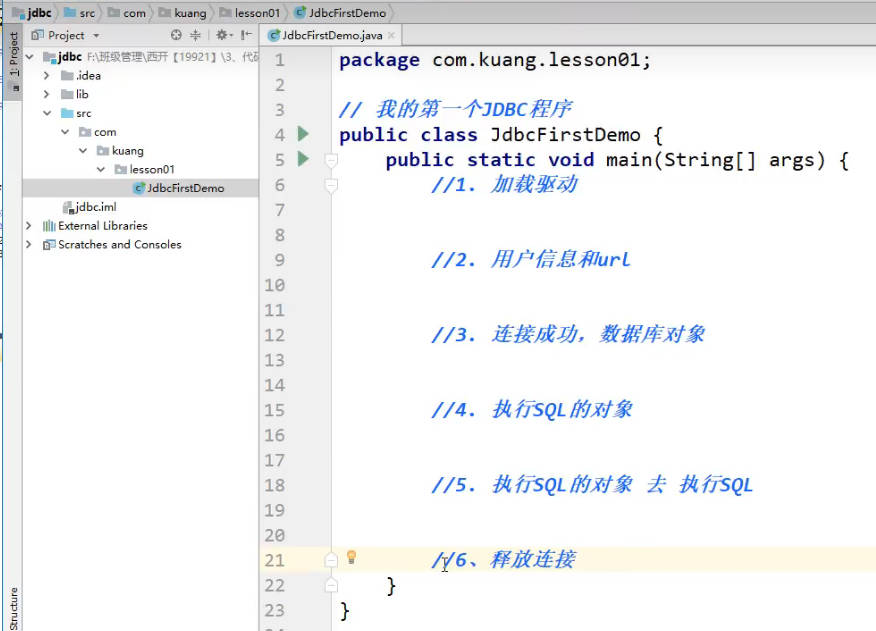
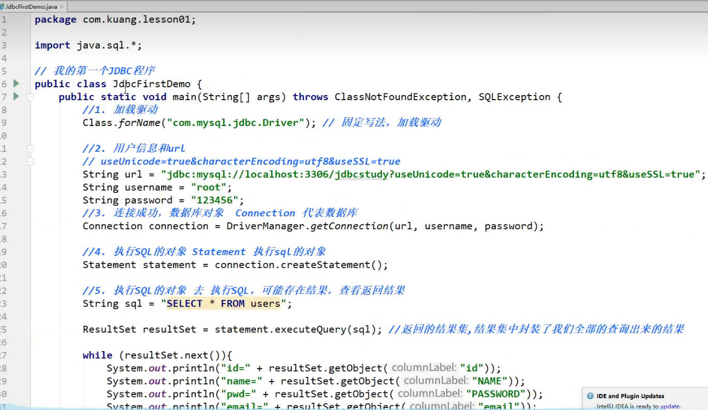
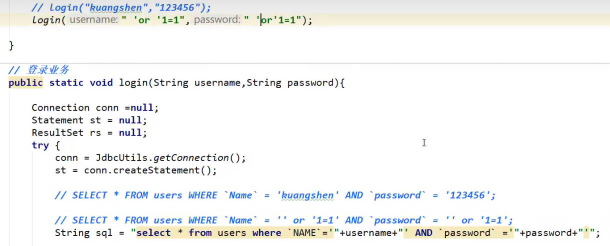
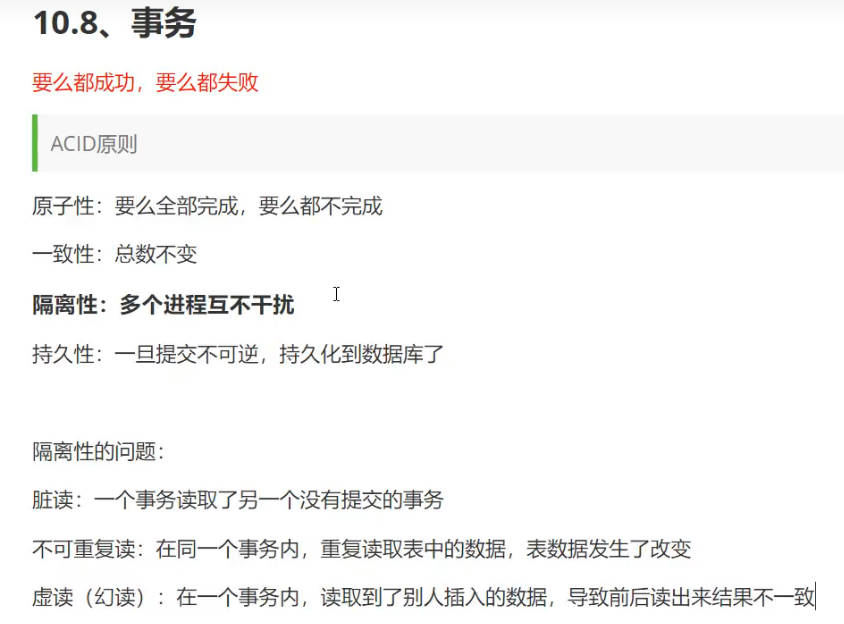
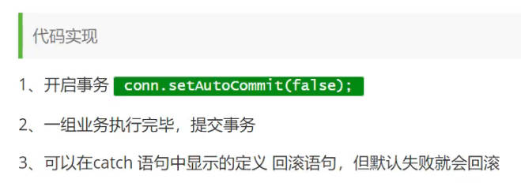
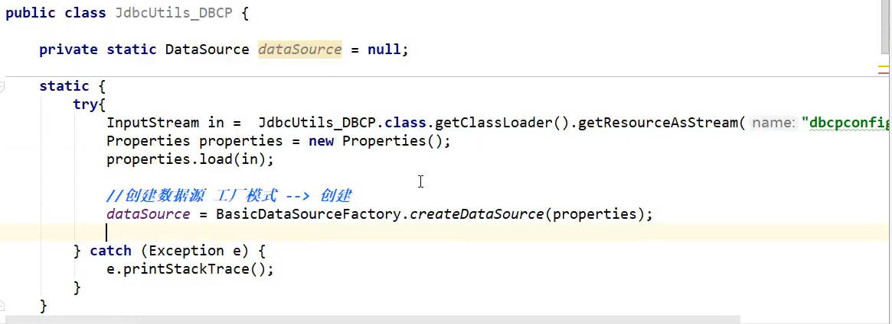
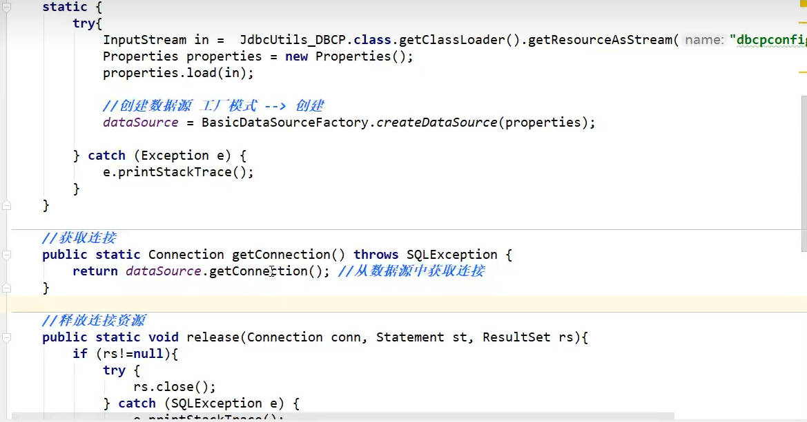

## 1、JDBC

[SQL编程创建100万条数据测试索引](https://www.bilibili.com/video/BV1NJ411J79W?p=31&vd_source=7346303e5e18677d7261c2c0c109ecfd)   [mysql中批量插入数据(1万、10万、100万、1000万、1亿级别)](https://www.jb51.net/article/259297.htm) [批量插入百万级数据](https://blog.csdn.net/qq_42055933/article/details/126238710) [批量数据插入](https://www.cnblogs.com/bigjor/p/13994916.html)  [Mysql百万数据量级数据快速导入Redis ](https://zhuanlan.zhihu.com/p/106135110) 

### 1、复习

`  加载驱动 -> 用户信息和url -> 连接成功,返回数据库对象connection -> 获取执行SQL的对象statement -> 执行SQL语句,返回结果集resultSet -> 遍历出来 -> 释放连接`

- statement对象: 1、==提取工具类==： 否则大量代码要重复写    2、jdbc的信息==配置文件==：解耦
- 连接池

`重点：statement对象 => PreparedeStatement对象 => 数据库连接池`

==视频==： [MYSQL基础](https://www.bilibili.com/video/BV1NJ411J79W?p=31&vd_source=7346303e5e18677d7261c2c0c109ecfd)          

[MySQL学习(三) ](https://www.cnblogs.com/lmx-181028/p/12288441.html)[MySQL学习](https://www.cnblogs.com/lmx-181028/p/12289449.html) [MySQL学习(二) ](https://www.cnblogs.com/lmx-181028/p/12287234.html) [MySQL学习(一) ](https://www.cnblogs.com/lmx-181028/p/12286699.html)  [ JDBC 数据库操作](https://blog.csdn.net/qq_25884515/article/details/106090465)
[sqlyog-community下载](https://github.com/webyog/sqlyog-community/wiki/Downloads)  [ navicat 激活](https://github.com/shuhongfan/NavicatCracker) [Navicat Premium 16无限试用](https://www.cnblogs.com/zktww/p/16229690.html)  
[Mysql忘记密码](https://www.cnblogs.com/DevilCisco/p/17035975.html) [Mysql找回密码报错](https://www.jianshu.com/p/5a0b132238ed)
[MySQL  Connector/J](https://dev.mysql.com/downloads/connector/j/)     [Maven Repository: mysql-connector](https://mvnrepository.com/search?q=mysql-connector)
[java工具类](https://www.baidu.com/s?ie=UTF-8&wd=java工具类)     [sql什么时候用单引号、反引号、不用引号 ](https://blog.csdn.net/qq_52489359/article/details/128127781)  [java.sql包中主要类的作用](https://blog.51cto.com/u_16099232/6311979)  [Java中各个包的主要作用](https://www.cnblogs.com/efforts-will-be-lucky/p/7405815.html)  
数据库接口：[ JDBC详细介绍](https://blog.csdn.net/kaisadadiniubi/article/details/129051093)  [ODBC开放数据库互连](https://baike.baidu.com/item/开放数据库互连/10418782?fr=ge_ala)  [Python DB-API](https://geek-docs.com/python-database/python-mysql/t_lib_101_python_data_access_python_mysql_introduction.html)

数据库查询语言：[QL](https://www.cnblogs.com/Cl0ud/p/15807860.html) [QL语言参考](https://www.cnblogs.com/macter/p/16190606.html) [QL](https://blog.csdn.net/zerolsy/article/details/2123617)  [QL](https://cloud.tencent.com/developer/article/1139685)  [QL](https://www.cnblogs.com/macter/p/16191209.html)

数据库：[H2嵌入式数据库引擎](https://www.oschina.net/p/h2?hmsr=aladdin1e1) 

[java_JDBC](https://www.cnblogs.com/lzj-learn/p/11672609.html)  [DataGrip数据库资源管理器](https://weibo.com/ttarticle/p/show?id=2309404726968129290379&sudaref=www.baidu.com) [DataGrip 2022.2](https://blog.51cto.com/zhongmayisheng/5507480) [DataGrip 2021.2 ](https://www.evget.com/article/2021/8/11/42742.html) [DataGrip 2021.2 ](https://www.jetbrains.com/datagrip/whatsnew/2021-2/) [数据库开发-NineData](https://www.ninedata.cloud/sql) [免费数据源并生成测试数据](https://docs.ninedata.cloud/quick_start/demo_datasource/) [ChunJun支持异构数据源DDL转换与自动执行](https://www.bilibili.com/video/BV1eR4y1P7AH/?spm_id_from=333.337.search-card.all.click&vd_source=7346303e5e18677d7261c2c0c109ecfd)

### 2、数据库驱动

[JDBC驱动程序](https://baike.baidu.com/item/JDBC驱动程序/20866650?fr=ge_ala)  [JDBC](https://blog.csdn.net/kaisadadiniubi/article/details/129051093)  [java 和 javax](https://www.yzktw.com.cn/post/1312869.html)

SUN公司为了简化开发人员的（对数据库的统一）操作，提供了一个（Java操作数据库的）规范，俗称==JDBC(java database connectivity,  java数据库连接)==。
规范的实现由厂商去做，对于开发人员，只需要掌握JDBC接口的操作
需要java.sql和javax.sql包，JDK自带
还需要导入一个数据库驱动包： `mysql-connector-java-5.1.47.jar`

- jdbc： 是执行SQL语句的Java API，由类和接口组成
- JDBC为Java程序操作不同的数据库提供了统一的接口，避免了细节
- 接口实现由厂商做，对于开发人员，只需要掌握JDBC接口的操作

### 3、第一个JDBC程序

1. 创建测试数据库
   ```````sql
   CREATE DATABASE jdbcStudy CHARACTER SET utf8 COLLATE utf8_general_ci;
   
   USE jdbcStudy;
   
   CREATE TABLE users(
       id INT PRIMARY KEY,
       NAME VARCHAR(40),
       PASSWORD VARCHAR(40),
       email VARCHAR(60),
       birthday DATE
   );
   
   INSERT INTO users(id,NAME,PASSWORD,email,birthday) 
   VALUES(1,'zhansan','123456','zs@sina.com','1980-12-04'),
   (2,'lisi','123456','lisi@sina.com','1981-12-04'),
   (3,'wangwu','123456','wangwu@sina.com','1979-12-04');
   ```````

2. 导入数据库驱动
   idea项目里面创建lib目录，将mysql-connector-java-5.0.8-bin.jar包复制进去，右键，选中`ADD as Library`

3. 编写测试代码
   `  加载驱动 -> 用户信息和url -> 连接成功,返回数据库对象connection -> 获取执行SQL的对象statement -> 执行SQL语句,返回结果集resultSet -> 遍历出来 -> 释放连接`

步骤总结：
1、加载驱动	`Class.forName("com.mysql.jdbc.Driver")`，Driver里面就是个静态代码块，注册就是激活它，拿到静态代码，标准写法是`DriverManager.registerDriver(new Driver());`

2、连接数据库 :用DiverManger类，拿到==数据库对象== ，数据库能干的它都能干 `Connection connection = DriverManager.getConnection(url, name, password);`

3、获得==执行sql的对象==: 用Statement	` Statement statement = connection.createStatement();`

4、获得返回的结果集对象：ResultSet	`ResultSet resultSet = statement.executeQuery(sql)` ； 在不知列类型时，用getObject()

5、释放连接：`resultSet.close();  Statement; Connection `   

遍历结果集：

> 1. resultSet.beforeFirst(); //移动到最前面 
> 2. resultSet.afterLast();    //移动到最后面 
> 3. resultSet.next();    //移动到下一个数据 
> 4. resultSet.previous();    //移动到前一行 
> 5. resultSet.absolute();    //移动到指定行

|  |  |
| ---------------------------------------------------- | ---------------------------------------------------- |

```java
package com.kuang.lesson01;

import java.sql.*;

public class JdbcFirstDemo {
    public static void main(String[] args) throws ClassNotFoundException, SQLException {
        //1、加载驱动
        Class.forName("com.mysql.jdbc.Driver");//固定写法，加载驱动

        //2、用户信息和url
        //useUnicode支持中文编码，characterEncoding中文字符集，useSSL使用安全连接
        String url = "jdbc:mysql://localhost:3306/jdbcstudy?useUnicode=true&characterEncoding=utf8&useSSL=true";
        String name = "root";
        String password = "123456";

        //3、连接Db（用固定的类DriverManager），返回数据库对象 
        Connection connection = DriverManager.getConnection(url, name, password);

        //4、获取执行SQL的对象  Statement：是执行SQL的对象
        Statement statement = connection.createStatement();

        //5、执行SQL的对象 去 执行SQL，可能存在结果，查看返回结果
        String sql = "SELECT * FROM users";

        ResultSet resultSet = statement.executeQuery(sql);//执行sql，返回结果集，结果集中封装了查询出来的结果，用遍历取出来

        while(resultSet.next()){
            System.out.println("id = "+resultSet.getObject("id"));
            System.out.println("name = "+resultSet.getObject("NAME"));
            System.out.println("password = "+resultSet.getObject("PASSWORD"));
            System.out.println("email = "+resultSet.getObject("email"));
            System.out.println("birthday = "+resultSet.getObject("birthday"));
            System.out.println("================================================");
        }

        //6、释放连接,关闭3个对象
        resultSet.close();
        statement.close();
        connection.close();
    }
}
```

### 4、JDBC中用到的对象

[ jdbc注册驱动本质](https://blog.csdn.net/weixin_45636641/article/details/102909660)  [jdbc为什么要注册驱动](https://blog.csdn.net/weixin_49983304/article/details/123237552)

DiverManger

```java
        //标准写法：DriverManager.registerDriver(new com.mysql.jdbc.Driver()); Driver里是静态代码块，		里面有注册驱动,一注册就执行，所以不用标准写法
		Class.forName("com.mysql.jdbc.Driver");//固定写法，加载驱动,放到类模板里 (反射)
        Connection connection = DriverManager.getConnection(url, name, password);
        //conection 代表数据库
        //数据库设置自动提交
        //事务提交 事务回滚
        connection.rollback();
        connection.commit();
        connection.setAutoCommit();
```

URL

```java
String url = "jdbc:mysql://localhost:3306/jdbcstudy?useUnicode=true&characterEncoding=utf8&useSSL=true";

//mysql  -- 3306
//协议：//主机地址：端口号/数据库？参数1&参数2&参数3

//oralce -- 1521
//jdbc：orcale:thin:@localhost:1521:sid
```

Statement 执行SQL的对象 PrepareStatement执行SQL的对象
```java
String sql = "SELECT * FROM users";//编写SQL

statement.executeQuery();//查询操作返回结果集ResultSet
statement.execute();//执行任何SQL，有判断过程，效率会低
statement.executeUpdate();//更新、插入、删除、都是用这个，返回一个受影响的行数
```
ResultSet查询的结果集：封装了所有的查询结果, 获得指定的数据类型
```java
resultSet.getObject();//在不知道列类型的情况下使用
//如果知道列的类型就使用指定的类型
resultSet.getString();
resultSet.getInt();
resultSet.getFloat();
resultSet.getDate();
resultSet.getObject();
```

遍历，指针
```java
resultSet.beforeFirst(); //移动到最前面
resultSet.afterLast();    //移动到最后面
resultSet.next();    //移动到下一个数据
resultSet.previous();    //移动到前一行
resultSet.absolute();    //移动到指定行
```

释放资源
```java
//耗资源，用完关掉
resultSet.close();
statement.close();
connection.close();
```

### 5、statement对象

[getResourceAsStream的用法](https://my.oschina.net/cloudcoder/blog/275402)

数据库核心是增、删、改、查， 只有这些代码会变，其它连接db、创建数据库对象等只操作一次就行了

statement对象用于向数据库发送SQL语句，想完成对数据库的增删改查，只需要通过这个对象先该数据发送增删改查语句即可

Statement对象的==executeUpdate方法==，发送增、删、改sql语句，执行完后，会返回一个整数（即增删改语句导致了数据库几行数据发送了变化）。这个整数就是行数

Statement.==executeQuery方法==用于向数据库发送查询语句，executeQuery方法返回代表查询结果的Result对象。

> 1. 代码实现
>    1. 提取工具类： 否则大量代码要重复写
>       1. 读取配置文件
>       2. 加载驱动
>       3. 定义连接方法
>       4. 定义释放资源方法
>    2. jdbc的信息配置文件：解耦; 配置类写到一个单独文件
>       1. 通过类的反射拿到输入流：`JdbcUtils.class.getClassLoader().getResourceAsStream("db.properties");`
>       2. 流读到Properties对象: `new Properties().load(in);`
>       3. 从Properties对象中取出某个资源: `properties.getProperty("driver");`
>    3. 测试代码

jdbc的==信息配置文件==：db.properties， 一定要放在src目录下

```properties
driver=com.mysql.jdbc.Driver
url=jdbc:mysql://localhost:3306/jdbcstudy?useUnicode=true&characterEncoding=utf8&useSSL=true
username=root
password=123456
```

==提取工具类==： 创建db对象也写在工具类里，测试时就没对象释放，所以没写在工具类里
读配置文件，加载驱动,定义连接db方法、释放资源方法

```java
package com.kuang.utils;

import java.io.InputStream;
import java.sql.*;
import java.util.Properties;

public class JdbcUtils {
    //try里面的变量提升作用域
    private static String driver = null;
    private static String url = null;
    private static String username = null;
    private static String password = null;

    //读配置文件，驱动只加载一次
    static {
        try {
            //读取配置文件db.properties： 反射获取类加载器资源，返回一个输入流
            InputStream in = JdbcUtils.class.getClassLoader().getResourceAsStream("db.properties");
            //流读到Properties对象
            Properties properties = new Properties();
            properties.load(in);
            //拿出资源,对象赋值给变量
            driver = properties.getProperty("driver");
            url = properties.getProperty("url");
            username = properties.getProperty("username");
            password = properties.getProperty("password");

            //驱动只加载一次
            Class.forName(driver);
        } catch (Exception e) {
            e.printStackTrace();
        }
    }

    //定义连接db方法
    public static Connection getConnection() throws SQLException {
        return DriverManager.getConnection(url, username, password);
    }

    //释放资源方法,顺序是：倒着释放
    public static void release(Connection conn, Statement st, ResultSet rs) {
        if (rs != null) {
            try {
                rs.close();
            } catch (SQLException e) {
                e.printStackTrace();
            }
        }
        if (st != null) {
            try {
                st.close();
            } catch (SQLException e) {
                e.printStackTrace();
            }
        }
        if (conn != null) {
            try {
                conn.close();
            } catch (SQLException e) {
                e.printStackTrace();
            }
        }
    }
}
```

==测试代码==

```java
package com.kuang;

import com.kuang.utils.JdbcUtils;
import java.sql.Connection;
import java.sql.ResultSet;
import java.sql.SQLException;
import java.sql.Statement;

public class Lesson04 {
    public static void main(String[] args) {
        //try里面的变量最后释放不到，要提升作用域
        Connection conn = null;
        Statement st = null;
        ResultSet rs = null;
        try {
            conn = JdbcUtils.getConnection();   //创建数据库对象: conn
            st = conn.createStatement();        //执行sql对象: st
            String sql = "INSERT INTO users(id,`NAME`,`PASSWORD`,`email`,`birthday`)" +
                    "VALUES(6,'kuangshen','123456','24736743@qq.com','2020-01-01')";
            int i = st.executeUpdate(sql);      //执行sql
            if (i > 0) {
                System.out.println("插入成功");
            }
        } catch (SQLException e) {
            e.printStackTrace();
        } finally {
            JdbcUtils.release(conn, st, rs);    //释放资源,rs没用，可用null代替
        }
    }
}
```


### 6、SQL注入

sql存在漏洞，会被攻击导致数据泄露,SQL会被拼接or， 保证or后面的为真； 本质是 拼接sql语句

```java
package com.kuang;

import com.kuang.utils.JdbcUtils;

import java.sql.Connection;
import java.sql.ResultSet;
import java.sql.SQLException;
import java.sql.Statement;

public class Sql注入 {
    public static void main(String[] args) {
        //正常登录: login("zhansan", "123456")
        login("' or '1=1", "' or '1=1");
    }

    public static void login(String username, String password) {
        //提升变量作用域
        Connection conn = null;
        Statement st = null;
        ResultSet rs = null;
        try {
            conn = JdbcUtils.getConnection();   //创建数据库对象
            st = conn.createStatement();        //执行sql对象
            //拼接成这样：select * from users where 'NAME' = 'kuangshen' and 'PASSWORD' = '123456'
            //用户名和密码是用户传进来的
            String sql = "SELECT * FROM users WHERE `NAME` = '" + username + "' AND `PASSWORD`= '" + password + "'";  //形参：username
            rs = st.executeQuery(sql);      //执行sql
            while (rs.next()) {
                System.out.println(rs.getString("NAME"));
                System.out.println(rs.getString("password"));
            }
        } catch (SQLException e) {
            e.printStackTrace();
        } finally {
            JdbcUtils.release(conn, st, rs);    //释放资源
        }

    }
}
```

name等于空或1=1，name永远为true



### 7、PreparedStatement对象

可以防止SQL注入，效率更好; 操作数据库：==增、删、改、查==；   **sql参数从sql语句分离了**，用?占位
PreparedStatement防止sql注入的本质是，把传递进来的参数当作字符

没有创建执行sql对象，直接prepareStatement(sql):先预编译sql，然后手动给参数赋值, 这样sql语句就填充完整了； 接着执行sql语句`executeUpdate()`

```java
package com.kuang.utils;

import java.sql.Connection;
import java.sql.PreparedStatement;
import java.sql.SQLException;
import java.util.Date;

public class Lesson04 {
    public static void main(String[] args) {
        Connection conn = null;
        PreparedStatement st = null;
        try {
            conn = JdbcUtils.getConnection();   //db对象

            //区别: 使用?占位符代替参数, `不是单引号。   sql参数从sql语句分离了
            String sql = "insert into users(id,`NAME`,`PASSWORD`,`email`,`birthday`) values(?,?,?,?,?)";
            st = conn.prepareStatement(sql);    //预编译sql，先写sql，不执行
            //手动给参数赋值, 不知道参数具体类型用setObject,index下标，具体值
            st.setInt(1, 7);
            st.setString(2, "lenstar");
            st.setString(3, "123456");
            st.setString(4, "1412265423@qq.com");
            //注意点：sql.Date 数据库 转换为sql支持的时间： java.sql.Date()
            //  util包下的Date类   new Date().getTime() 获得java时间戳
            st.setDate(5, new java.sql.Date(new Date().getTime()));

            //执行sql
            int i = st.executeUpdate();
            if (i > 0) {
                System.out.println("插入成功");
            }
        } catch (SQLException e) {
            e.printStackTrace();
        } finally {
            JdbcUtils.release(conn, st, null);

        }
    }
}
```

### 8、使用IDEA连接数据库

IDEA右侧Database， 点+号，进入`Data Sources and Drivers` 加Data Source =>MySQL

### 9、JDBC操作事务

|  |  |
| ---------------------------------------------------- | ---------------------------------------------------- |

```sql
/*创建账户表*/
CREATE TABLE account(
  id INT PRIMARY KEY AUTO_INCREMENT,
  NAME VARCHAR(40),
  money FLOAT
);

/*插入测试数据*/
insert into account(name,money) values('A',1000);
insert into account(name,money) values('B',1000);
insert into account(name,money) values('C',1000);

```

```java
public class TestTransaction {
    public static void main(String[] args) {
        Connection conn = null;
        PreparedStatement st = null;
        ResultSet rs = null;
        try {
            conn = JdbcUtils.getConnection();
            //关闭数据库的自动提交，就会自动开启事务
            conn.setAutoCommit(false);  //开启事务

            //事务：A减100，B加100
            String sql1 = "update account set money = money-100 where name = 'A'";
            st = conn.prepareStatement(sql1);
            st.executeUpdate();

            //int x = 1 / 0;  测试失败时用
            
            String sql2 = "update account set money = money+100 where name = 'B'";
            st = conn.prepareStatement(sql2);
            st.executeUpdate();

            //业务完毕，提交事务
            conn.commit();
            System.out.println("成功！");

        } catch (SQLException e) {
            try {
                conn.rollback();//如果失败则回滚事务;失败会自动回滚，可不显式写出来
            } catch (SQLException e1) {
                e1.printStackTrace();
            } finally {
                JdbcUtils.release(conn, st, rs);
            }
        }
    }
}
```

### 10、数据库连接池

1. JDBC中学到了，连数据库，首先自己通过用户名密码等连
2. 工具类里设置连接
3. 连接池

[笔记](https://www.cnblogs.com/lmx-181028/p/12289449.html)  [数据源与数据库](https://www.cnblogs.com/richard-c-java/p/3601863.html)  [数据库与数据源的区别](http://www.5ityx.com/cate102/273505.html)  [开源数据源网站](https://www.cnblogs.com/focusHots/p/12850908.html)  
[数据库连接池技术--C3P0、DBCP、druid](https://www.cnblogs.com/xiaofeng338/p/13564088.html)      [DBCP，C3P0,Druid](https://blog.csdn.net/ly823260355/article/details/88832776)  [常用的数据库连接池](https://baijiahao.baidu.com/s?id=1764850028489117514&wfr=spider&for=pc)  [连接池](https://www.cnblogs.com/lvjingying/p/15184642.html)   [ Apache 项目列表](https://www.apache.org/index.html#projects-list)
[数据库型数据源](http://support.supermap.com.cn/DataWarehouse/WebDocHelp/iDesktopX_10i/Features/TechDocument/SDX/AboutDatabaseSource.html)   [Javaweb配置常用的数据源配置 ](https://www.jianshu.com/p/e9dfdf16316e)
[106个数据分析师专用数据源](https://zhuanlan.zhihu.com/p/62090137)   [有哪些好的数据来源或者大数据平台](https://www.zhihu.com/question/27798279/answer/2690361749)

[springboot实现多数据源配置Druid/Hikari](https://blog.csdn.net/qq1017794482/article/details/128485480)  [Spring动态数据源](https://www.cnblogs.com/xiaobaibuai/p/16788641.html)

数据源（Data Source），数据的来源，数据源中存储了建立数据库连接的信息
==*数据源*定义连接到实际*数据库*的路径==,数据源中并无真正的数据，仅仅记录连接到哪个数据库,以及如何连接

dbcp连接池常用基本配置属性:

| 属性                       | 默认值 | 说明                                                         |
| -------------------------- | ------ | ------------------------------------------------------------ |
| initialSize                | 0      | 连接池启动时创建的初始化连接数量                             |
| maxActive                  | 8      | 连接池中可同时连接的最大的连接数                             |
| ==maxIdle==                | 8      | ==最大空闲连接数，超过maxWait释放==，设置为负数表示不限制    |
| minIdle                    | 0      | 最小空闲连接数，低于这个数量会被创建新的连接。该参数越接近maxIdle，性能越好，因为连接的创建和销毁，都是需要消耗资源的；但是不能太大。 |
| maxWait                    | 无限制 | ==最大等待时间==，当没有可用连接时，连接池等待连接释放的最大时间，超过该时间限制会抛出异常，如果设置-1表示无限等待 |
| poolPreparedStatements     | false  | 开启池的Statement是否prepared                                |
| maxOpenPreparedStatements  | 无限制 | 开启池的prepared 后的同时最大连接数                          |
| minEvictableIdleTimeMillis |        | 连接池中连接，在时间段内一直空闲， 被逐出连接池的时间        |
| removeAbandonedTimeout     | 300    | 超过时间限制，回收没有用(废弃)的连接                         |
| removeAbandoned            | false  | 超过removeAbandonedTimeout时间后，是否进 行没用连接（废弃）的回收 |

JUC并发里有讲线程池： 

- ==阻塞队列==：侯客区座位等待办业务；   
- ==拒绝策略==：最大线程池满了，阻塞队列也满了，再来了直接走
- 超时不候：345窗口，1个小时都没人来办业务，就关闭释放

#### 1、概述

==编写连接池，只需要实现一个接口 DateSourece==，连接池：DBCP、C3P0、Druid等

使用了这些数据连接池之后，在项目开发中就不需要编写连接数据库的代码了！

#### 2、DBCP

1. 导2个jar包
2. ==配置文件==： dbcpconfig.properties； 里面设db用户名密码等
3. ==创建工具类==：JdbcUtils_DBCP ； 写连接方法、释放方法
   1. 创建数据源 `dataSource = BasicDataSourceFactory.createDataSource(properties);`
   2. 从数据源连接数据库 `dataSource.getConnection()`
4. 测试

需要==导入的2个jar包==：copy到lib目录下
==commons-dbcp-1.4 、 commons-pool-1.6==

- ==怎么添加jar包到idea==：
  - copy到项目lib目录下，没有lib目录就自己建一个； 
  - 然后在项目结构里Libraries; 点-号移除掉；
  - 在项目lib右键，`Add as Library`; 重新添加到lib

dbcpconfig.properties的==配置文件==：password下面的都可以不要

```properties
#连接设置
driverClassName=com.mysql.jdbc.Driver
url=jdbc:mysql://localhost:3306/jdbcstudy?useUnicode=true&characterEncoding=utf8&useSSL=true
username=root
password=123456
#初始化连接
initialSize=10

#最大连接数量
maxActive=200

#最大空闲连接
maxIdle=20

#最小空闲连接
minIdle=5

#超时等待时间以毫秒为单位 6000毫秒/1000等于60秒
maxWait=60000

#JDBC驱动建立连接时附带的连接属性属性的格式必须为这样：[属性名=property;] 
#注意："user" 与 "password" 两个属性会被明确地传递，因此这里不需要包含他们。
connectionProperties=useUnicode=true;characterEncoding=UTF8

#指定由连接池所创建的连接的自动提交（auto-commit）状态。
defaultAutoCommit=true

#driver default 指定由连接池所创建的连接的只读（read-only）状态。
#如果没有设置该值，则“setReadOnly”方法将不被调用。（某些驱动并不支持只读模式，如：Informix）
defaultReadOnly=

#driver default 指定由连接池所创建的连接的事务级别（TransactionIsolation）。
#可用值为下列之一：（详情可见javadoc。）NONE,READ_UNCOMMITTED, READ_COMMITTED, REPEATABLE_READ, SERIALIZABLE
defaultTransactionIsolation=READ_UNCOMMITTED
```

==工具类JdbcUtils_DBCP==：  工厂模式创建数据源对象，用数据源连接数据库

DBCP有，我们不需要写的代码：连接数据库、驱动加载、获取连接getConnection(url,username,password)

要写的：读配置文件 -> 创建数据源 -> 从数据源获取连接(数据源自带连接) -> 释放连接

```java
package com.kuang.lesson02.utils;

import org.apache.commons.dbcp.BasicDataSourceFactory;

import javax.sql.DataSource;
import java.io.InputStream;
import java.sql.Connection;
import java.sql.ResultSet;
import java.sql.SQLException;
import java.sql.Statement;
import java.util.Properties;

public class JdbcUtils_DBCP {
    //数据源提升作用域
    private static DataSource dataSource = null;

    static {
        try {
            //1. 读入配置文件
            //读取配置文件dbcpconfig.properties： 获取类加载器资源，返回一个输入流
            InputStream in = JdbcUtils_DBCP.class.getClassLoader().getResourceAsStream("dbcpconfig.properties");
            //流读到Properties,拿出资源
            Properties properties = new Properties();
            properties.load(in);
            
            //2. 创建数据源,工厂模式-->创建对象用，返回一个数据源
            //dataSource提升作用域
            dataSource = BasicDataSourceFactory.createDataSource(properties);
        } catch (Exception e) {
            e.printStackTrace();
        }
    }

    //3. 从数据源连接数据库
    public static Connection getConnection() throws SQLException {
        return dataSource.getConnection();  //数据源里面自带连接数据库
    }

    //释放资源方法,顺序是：倒着释放
    public static void release(Connection conn, Statement st, ResultSet rs) {
        if (rs != null) {
            try {
                rs.close();
            } catch (SQLException e) {
                e.printStackTrace();
            }
        }
        if (st != null) {
            try {
                st.close();
            } catch (SQLException e) {
                e.printStackTrace();
            }
        }
        if (conn != null) {
            try {
                conn.close();
            } catch (SQLException e) {
                e.printStackTrace();
            }
        }
    }
}
```

测试代码:只需要换数据源连接和关闭 ， JdbcUtils_DBCP

```java
package com.kuang.lesson02;

import com.kuang.lesson02.utils.JdbcUtils_DBCP;
import java.sql.*;

public class TestDBCP {
    public static void main(String[] args) {
        //try里面的变量提升作用域
        Connection conn = null;
        Statement st = null;
        ResultSet rs = null;
        try {
            conn = JdbcUtils_DBCP.getConnection();   //创建数据库对象:只用换数据源连接
            st = conn.createStatement();        //执行sql对象
            String sql = "INSERT INTO users(id,`NAME`,`PASSWORD`,`email`,`birthday`)" +
                    "VALUES(8,'kuangshen','123456','24736743@qq.com','2020-01-01')";
            int i = st.executeUpdate(sql);      //执行sql
            if (i > 0) {
                System.out.println("插入成功");
            }
        } catch (SQLException e) {
            e.printStackTrace();
        } finally {
            JdbcUtils_DBCP.release(conn, st, rs);    //释放资源,rs没用，可用null代替
        }
    }
}
```

|  |  |
| ---------------------------------------------------- | ---------------------------------------------------- |

#### 3、C3P0

小结：

1. 导2个jar包
2. ==配置文件==： c3p0-config.xml ； 可配置多个数据源
3. ==创建工具类==：JdbcUtils_DBCP ； 写连接方法、释放方法
   1. 创建数据源 `dataSource = BasicDataSourceFactory.createDataSource(properties);`
   2. 从数据源连接数据库 `dataSource.getConnection()`
4. 测试

==需要用到的jar包==:
c3p0-0.9.5.5、 mchange-commons-java-0.2.19

c3p0-config.xml 的配置文件:可配置多个数据源

```xml
<c3p0-config>
    <!-- 使用默认的配置读取连接池对象 -->
    <default-config>
        <!--  连接参数 -->
        <property name="driverClass">com.mysql.cj.jdbc.Driver</property>
        <property name="jdbcUrl">jdbc:mysql:///bd2?serverTimezone=UTC&amp;useSSL=false</property>
        <property name="user">root</property>
        <property name="password">xxxxxxx</property>

        <!-- 连接池参数 -->
        <!--初始化申请的连接数量-->
        <property name="initialPoolSize">5</property>
        <!--最大的连接数量(池子中最大的数量是10个)-->
        <property name="maxPoolSize">8</property>
        <!--超时时间3000表示，如果出错，3s后报错-->
        <property name="checkoutTimeout">3000</property>
    </default-config>

    <!--
    C3P0的命名配置
    如果在代码中"ComboPooledDataSource ds = new ComboPooledDataSource("MySQL");" 表示使用的是name是mysql的配置信息来创建数据源
    -->
    <named-config name="MySQL">
        <!--  连接参数 -->
        <property name="driverClass">com.mysql.jdbc.Driver</property>
        <property name="jdbcUrl">jdbc:mysql://localhost:3306/jdbcstudy?useUnicode=true&amp;characterEncoding=utf8&amp;useSSL=true</property>
        <property name="user">root</property>
        <property name="password">123456</property>

        <!-- 连接池参数 -->
        <property name="acquireIncrement">5</property>
        <property name="initialPoolSize">8</property>
        <property name="maxPoolSize">8</property>
        <property name="checkoutTimeout">1000</property>
    </named-config>
</c3p0-config>


```

工具类JdbcUtils_C3P0：

```java
package com.kuang.lesson02.utils;

import com.mchange.v2.c3p0.ComboPooledDataSource;
import java.sql.*;

public class JdbcUtils_C3P0 {
    private static ComboPooledDataSource dataSource = null;

    static {
        try {
            //另一种方法：代码版配置；也实现的DataSource接口
//            dataSource = new ComboPooledDataSource();     
//            ((ComboPooledDataSource) dataSource).setDriverClass();
//            ((ComboPooledDataSource) dataSource).setUser();
//            ((ComboPooledDataSource) dataSource).setPassword();
//            ((ComboPooledDataSource) dataSource).setJdbcUrl();
//            ((ComboPooledDataSource) dataSource).setMaxPoolSize();
//            ((ComboPooledDataSource) dataSource).setMinPoolSize();
            //1. 创建数据源，工厂模式-->创建, xml配置文件不用读，更简单了, 2种方法
            dataSource = new ComboPooledDataSource("MySQL");    //读xml配置文件方法
        } catch (Exception e) {
            e.printStackTrace();
        }
    }

    //2. 获取连接
    public static Connection getConnection() throws SQLException {
        return dataSource.getConnection();
    }

    //3. 释放连接
    public static void release(Connection conn, Statement st, ResultSet rs) {
        if (rs != null) {
            try {
                rs.close();
            } catch (SQLException e) {
                e.printStackTrace();
            }
        }
        if (st != null) {
            try {
                st.close();
            } catch (SQLException e) {
                e.printStackTrace();
            }
        }
        if (conn != null) {
            try {
                conn.close();
            } catch (SQLException e) {
                e.printStackTrace();
            }
        }
    }
}
```

测试代码: 只需要换数据源连接和关闭 ， JdbcUtils_C3P0

```java
package com.kuang.lesson02;

import com.kuang.lesson02.utils.JdbcUtils_C3P0;

import java.sql.*;

public class TestC3p0 {
    public static void main(String[] args) {
        //try里面的变量提升作用域
        Connection conn = null;
        Statement st = null;
        ResultSet rs = null;
        try {
            conn = JdbcUtils_C3P0.getConnection();   //创建数据库对象:只用换数据源连接
            st = conn.createStatement();        //执行sql对象
            String sql = "INSERT INTO users(id,`NAME`,`PASSWORD`,`email`,`birthday`)" +
                    "VALUES(10,'kuangshen','123456','24736743@qq.com','2020-01-01')";
            int i = st.executeUpdate(sql);      //执行sql
            if (i > 0) {
                System.out.println("插入成功");
            }
        } catch (SQLException e) {
            e.printStackTrace();
        } finally {
            JdbcUtils_C3P0.release(conn, st, rs);    //释放资源,rs没用，可用null代替
        }
    }
}

```

