#  MyBatis 3.5.5 教程

md： [SSM知识汇总](.\SSM知识汇总)

[为什么很多大厂不用Mybatis](https://developer.huawei.com/home/forum/hwc/thread-0263137557876533059-1-1.html)  [比Mybatis自动化程度更高的框架_百度搜索](https://www.baidu.com/s?ie=UTF-8&wd=%E6%AF%94Mybatis%E8%87%AA%E5%8A%A8%E5%8C%96%E7%A8%8B%E5%BA%A6%E6%9B%B4%E9%AB%98%E7%9A%84%E6%A1%86%E6%9E%B6)  

[Java框架 JPA、mybatis、mybatis-plus、xbatis 比较](https://blog.csdn.net/ejinxian/article/details/162693069)  

[The MyBatis Blog](https://blog.mybatis.org/)  

总结：

1. 加载配置、初始化`SqlSessionFactory`；
2. 获取`SqlSession`和`Mapper`；
   1. **mappers**（映射器）: `通过接口方法关联对应的SQL语句`，完成增删改查，`SQL写在注解或XML文件里`，与Java代码解耦
3. 执行`Mapper`方法

# 1、环境准备

## 1、复习

==mybatis增删改查(CRUD只改Dao接口、Mapper.xml、测试类)== =>xml配置（==核心配置文件、Mapper文件==） => ==结果映射===> ==日志工厂log4j== => Limit、RowBounds、插件分页 => 注解开发=>动态sql => 缓存

获取SqlSession对象=>执行sql语句

- jdk 8 +
- MySQL 5.7.19
- maven-3.6.1
- IDEA

学习前需要掌握：

- JDBC

- MySQL

- Java 基础

- Maven

- Junit

  **Idea快捷键**

  一键格式化代碼： **Ctrl+Alt+L**

# 2、MyBatis简介

## 1、什么是MyBatis

视频：[狂神说Mybatis视频](https://www.bilibili.com/video/BV1NE411Q7Nx/)    

[typore卡](https://blog.csdn.net/li128ve980/article/details/127925084) [mybatis狂神说笔记](https://blog.51cto.com/u_15069482/4342353) [狂神说MyBatis_缓存](https://blog.51cto.com/u_15277063/4159913) [mybatis中文文档](https://mybatis.org/mybatis-3/zh/dynamic-sql.html)  [MyBatis-Plus](https://baomidou.com/)   [MyBatis文档](http://www.mybatis.cn/mybatis/37.html) [MyBatis中文官网](http://www.mybatis.cn/)  [mybatis中文文档](https://mybatis.org/mybatis-3/zh/dynamic-sql.html)  
[mybatis狂神说笔记](https://blog.51cto.com/u_15069482/4342353)   [mybatis](https://www.cnblogs.com/xclxcl/p/16945577.html)  [Java学习MyBatis](https://www.swvq.com/boutique/detail/77038)

[MyBatis 3官方文档](https://mybatis.org/mybatis-3/)

- MyBatis 是一款优秀的**持久层框架**
- MyBatis 避免了几乎所有的 JDBC 代码和手动设置参数以及获取结果集的过程
- MyBatis 可以使用简单的 XML 或注解来配置和映射原生信息，将接口和 Java 的 实体类 【Plain Old Java Objects,普通的 Java对象】映射成数据库中的记录。
- MyBatis 本是apache的一个开源项目ibatis, 2010年这个项目由apache 迁移到了google code，并且改名为MyBatis 。
- 2013年11月迁移到**Github** .
- Mybatis官方文档 : http://www.mybatis.org/mybatis-3/zh/index.html
- GitHub : https://github.com/mybatis/mybatis-3

| 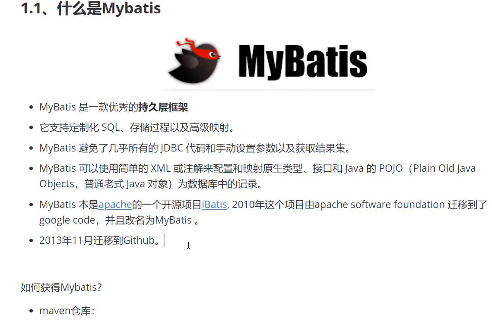 | 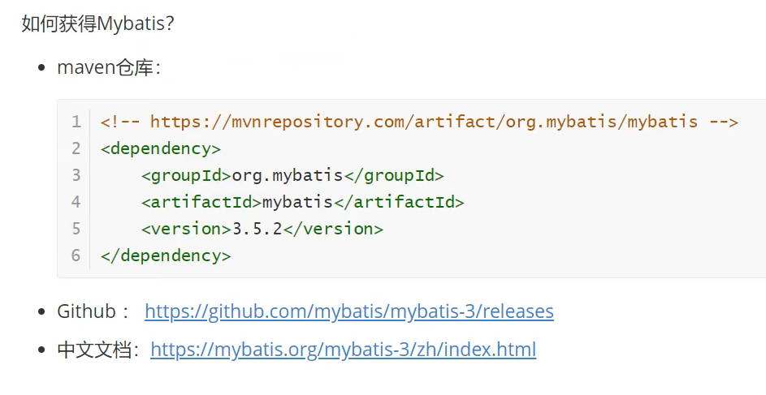 |
| ------------------------------------------------------------ | ------------------------------------------------------------ |
| 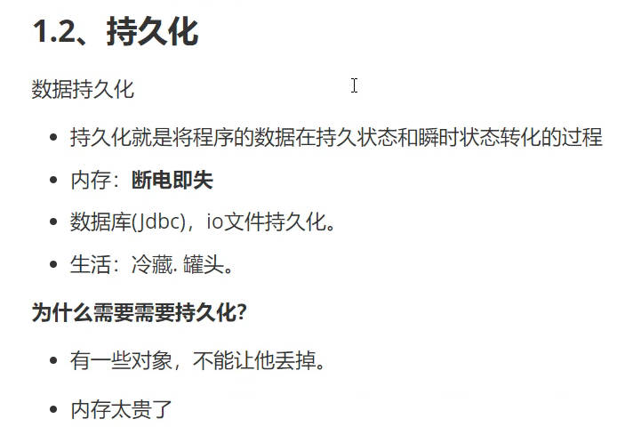 | 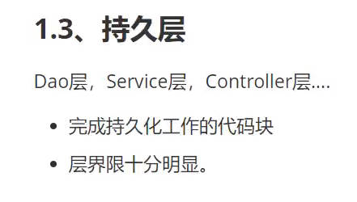 |
| 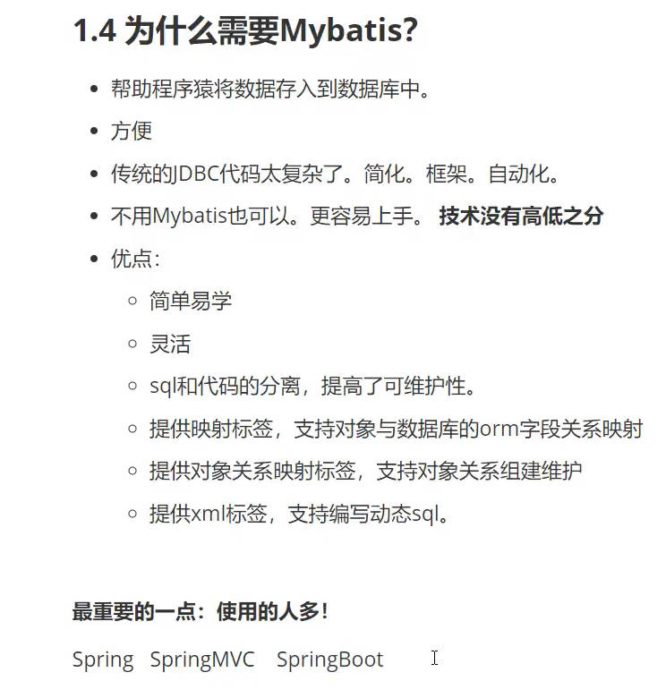 |                                                              |

## 2、为什么需要MyBatis


- Mybatis就是帮助程序猿将数据存入数据库中 , 和从数据库中取数据 .

- 传统的jdbc操作 , 有很多重复代码块 .比如 : 数据取出时的封装 , 数据库的建立连接等等... , 通过框架可以减少重复代码,提高开发效率 .

- MyBatis 是一个半自动化的**ORM框架 (Object Relationship Mapping) -->对象关系映射**

- 所有的事情，不用Mybatis依旧可以做到，只是用了它，所有实现会更加简单！**技术没有高低之分，只有使用这个技术的人有高低之别**

- MyBatis的优点

  - 简单易学：本身就很小且简单。没有任何第三方依赖，最简单安装只要两个jar文件+配置几个sql映射文件就可以了，易于学习，易于使用，通过文档和源代码，可以比较完全的掌握它的设计思路和实现。

  - 灵活：mybatis不会对应用程序或者数据库的现有设计强加任何影响。sql写在xml里，便于统一管理和优化。通过sql语句可以满足操作数据库的所有需求。
  - 解除sql与程序代码的耦合：通过提供DAO层，将业务逻辑和数据访问逻辑分离，使系统的设计更清晰，更易维护，更易单元测试。sql和代码的分离，提高了可维护性。
  - 提供xml标签，支持编写动态sql。
  - .......

- 最重要的一点，使用的人多！公司需要！

- Java操作xml的包：[dom4j](https://www.cnblogs.com/frank223/p/11836294.html) [java xml操作](https://blog.csdn.net/weixin_39983563/article/details/114416792) [Dom4j](http://www.noobyard.com/article/p-duqoualf-mm.html) 

# 3、MyBatis第一个程序

[DAO模式](https://cloud.tencent.com/developer/article/2193692)  

小结：

> 1. 核心配置文件： `resources/mybatis-config.xml`，连接数据库的信息
> 2. XML 映射文件: `UserMapper.xml` ，映射Dao，写操作数据库的sql语句
>    1. mybatis里Dao叫mapper， Dao接口实现是jdbc，现在不用写实现类，用xml映射文件实现;
>    2. 利用注解开发就不需要mapper.xml映射文件
>    3. ==每一个Mapper.xml都需要在Mybatis核心配置文件中注册!==，即在 `mybatis-config.xml` 里注册

搭建环境,创建无模板maven项目Mybatis-01,==删src目录== --> 导入Maven依赖包,==添加空的maven模块==(父子) --> 

MyBatis： ==1、核心配置文件==`resources/mybatis-config.xml` -> 写==2、工具类==(==获取SqlSession对象==)  -> 3、建pojo==实体类(对应数据库的表)== ->  4、==Dao接口(操作数据库)== 、Mapper映射文件(写sql语句) -> ==Junit测试==(1、`获取SqlSession对象` 2、执行sql 3、关闭SqlSession)

==DAO接口的实现类现在变成了Mapper.xml文件==，要在Mybatis核心配置文件中注册

> 1. 写一个工具类获取SqlSession实例
>    1. 配置文件：resources/mybatis-config.xml
>    2. 从 XML 中构建 SqlSessionFactory
>       1. MyBatis应用以一个 SqlSessionFactory 的实例为核心
>       2. ==SqlSessionFactory== 的实例可以通过 SqlSessionFactoryBuilder 获得。而 ==SqlSessionFactoryBuilder== 则可以从 ==XML 配置文件==或一个预先配置的 Configuration 实例来构建出 SqlSessionFactory 实例
>    3. 从 SqlSessionFactory 中获取 ==SqlSession==实例
>       1. 可以通过 SqlSession 实例来直接执行已映射的 SQL 语句
>       1. JDBC里用PreparedStatement执行sql
> 2. 实体类、 Dao接口、 Mapper（Dao实现类,操作sql语句; 调用SqlSession实例）
>    1. Mapper:用命名空间绑定Dao接口；  id对应方法名字；   返回类型，要用全限定名
> 3. 注册mapper: 写在mybatis配置文件xml中
>    1. 每一个Mapper.xml都需要在Mybatis核心配置文件中注册!
>    2. class、url、resource； 路径不用点用`/`
> 4. 测试

DAO(Data Access Object)： 数据访问接口，与数据库打交道。夹在`业务逻辑`与`数据库资源`中间

使用步骤

- **从 XML 中构建 SqlSessionFactory**
  - 每个基于 MyBatis 的应用都是以一个 ==SqlSessionFactory 的实例为核心==的。SqlSessionFactory 的实例可以==通过 SqlSessionFactoryBuilder 获得==。而 SqlSessionFactoryBuilder 则可以==从 XML== 配置文件==或==一个==预先配置的 Configuration 实例==来构建出 SqlSessionFactory 实例。
    - 核心配置文件： `resources/mybatis-config.xml`，连接数据库的信息
    - 读取 `mybatis-config.xml` 配置文件，创建 `SqlSessionFactory ` 实例，封装为工具类
- 从 SqlSessionFactory 中获取 `SqlSession`
  - SqlSession 提供了在数据库执行 SQL 命令所需的所有方法。可以通过 SqlSession 实例来直接==执行已映射的 SQL 语句==
- xml配置文件： environment 元素体中包含了事务管理和连接池的配置。mappers 元素包含一组映射器（mapper），映射器的 XML 映射文件包含了 SQL 代码和映射定义信息
  - ==映射器（mappers）==: 配置文件里注册映射是为了， ==告诉 MyBatis 去哪里找映射文件==
  - xml映射文件：MyBatis 的真正强大在于它的语句映射， ==定义 SQL 映射语句==
    - 替代以前的Dao操作数据库， id对应Dao的方法名，resultType对应结果集(sql语句执行后得到`结果集`)
  - mybatis里Dao叫mapper， Dao接口实现是jdbc，现在不用写实现类，用xml映射文件实现;
  - 利用注解开发就不需要mapper.xml映射文件

| 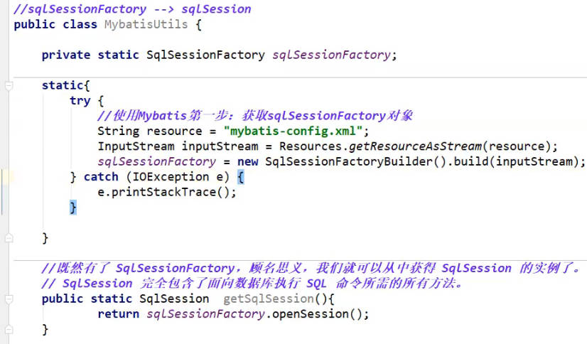 | 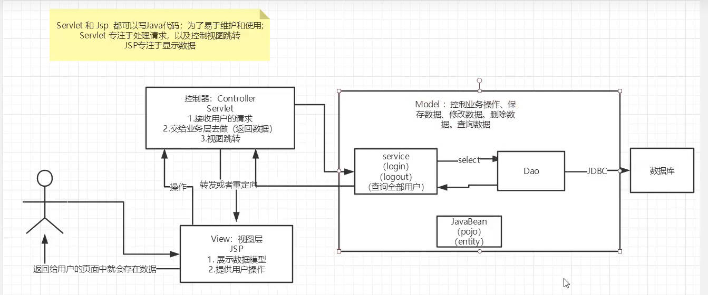 |
| ------------------------------------------------------------ | ------------------------------------------------------------ |
| 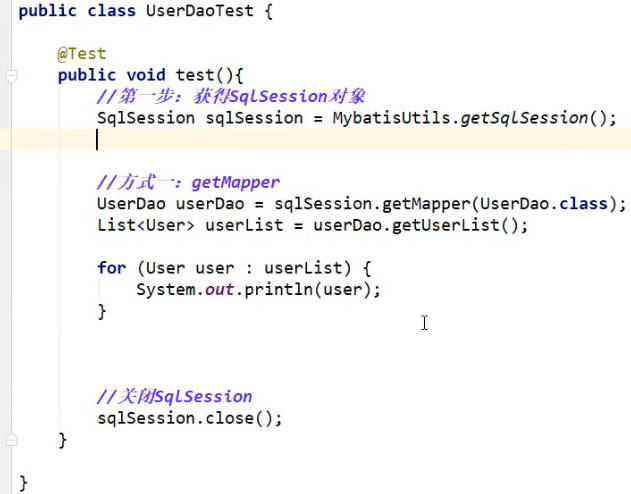 | 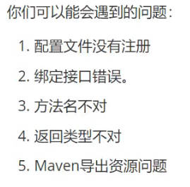 |
| 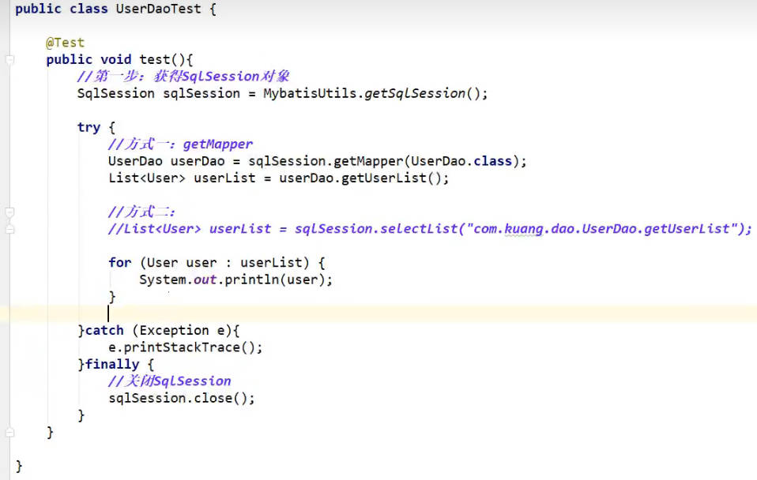 |                                                              |


## 1、搭建实验数据库

```sql
CREATE DATABASE `mybatis`;
USE `mybatis`;
DROP TABLE IF EXISTS `user`;
CREATE TABLE `user` (
`id` int(20) NOT NULL,
`name` varchar(30) DEFAULT NULL,
`pwd` varchar(30) DEFAULT NULL,
PRIMARY KEY (`id`)
) ENGINE=InnoDB DEFAULT CHARSET=utf8;

insert  into `user`(`id`,`name`,`pwd`) values (1,'王五','123456'),(2,'张三','abcdef'),(3,'李四','987654');
```

## 2、导入MyBatis相关 jar 包

mysql、mybatis的jar包

```xml
<dependencies>
        <!-- mysql驱动：connector 连接数据库 -->
        <dependency>
            <groupId>mysql</groupId>
            <artifactId>mysql-connector-java</artifactId>
            <version>5.1.47</version>
        </dependency>
        <!-- junit 单元测试 -->
        <dependency>
            <groupId>junit</groupId>
            <artifactId>junit</artifactId>
            <version>4.13.2</version>
            <scope>test</scope>
        </dependency>
        <!-- mybatis -->
        <dependency>
            <groupId>org.mybatis</groupId>
            <artifactId>mybatis</artifactId>
            <version>3.5.13</version>
        </dependency>
</dependencies>
```

## 3、==连接数据库==

编写==MyBatis核心配置文件：mybatis-config.xml==

- ==数据源,连接数据库==
- 查看帮助文档 resources下面创建==mybatis-config.xml==
- mybatis-config.xml
  - environments：配置多个环境


```xml
<?xml version="1.0" encoding="UTF-8" ?>
<!DOCTYPE configuration
        PUBLIC "-//mybatis.org//DTD Config 3.0//EN"
        "https://mybatis.org/dtd/mybatis-3-config.dtd">
<configuration>
    <settings>
        <!--标准日志工厂实现-->
        <!--<setting name="logImpl" value="STDOUT_LOGGING"/>-->
        <setting name="logImpl" value="LOG4J"/>
    </settings>
    <environments default="development">
        <environment id="development">
            <transactionManager type="JDBC"/>
            <dataSource type="POOLED">
                <property name="driver" value="com.mysql.jdbc.Driver"/>
                <property name="url"
                          value="jdbc:mysql://localhost:3306/mybatis?useSSL=true&amp;useUnicode=true&amp;characterEncoding=utf8"/>
                <property name="username" value="root"/>
                <property name="password" value="123456"/>
            </dataSource>
        </environment>
    </environments>
    <!-- 每一个Mapper.xml都需要在Mybatis核心配置文件中注册! -->
    <!-- 可通过resource、class类、url绝对地址 -->
    <mappers>
        <mapper resource="com/kuang/dao/UserMapper.xml"/>
    </mappers>
</configuration>
```

## 4、==获取 SqlSession==

==编写MyBatis工具类==   [java中Resource类](https://blog.51cto.com/u_16213303/9127046)

com.kuang.utils.MybatisUtils

- 从 SqlSessionFactory 中==获取 SqlSession==
  - SqlSession 提供了数据库执行 SQL 命令所需的所有方法
  - 类似创建`Statement、prepareStatement`
  
- 读取配置文件占用资源，把它封装为工具类

```java
package com.kuang.utils;
import org.apache.ibatis.io.Resources;
import org.apache.ibatis.session.SqlSession;
import org.apache.ibatis.session.SqlSessionFactory;
import org.apache.ibatis.session.SqlSessionFactoryBuilder;
import java.io.IOException;
import java.io.InputStream;

public class MybatisUtils {
    //提升作用域：不然静态代码块里的sqlSessionFactory，下面不能用
    private static SqlSessionFactory sqlSessionFactory;
	//静态代码块
    static {
        try {
            //1、获取SqlSessionFactory工厂,使用mybatis第一步
            String resource = "mybatis-config.xml";
            InputStream inputStream = Resources.getResourceAsStream(resource);
            sqlSessionFactory = new SqlSessionFactoryBuilder().build(inputStream);
        } catch (IOException e) {
            e.printStackTrace();
        }
    }

    //2、有了 SqlSessionFactory，获得 SqlSession 实例
    // SqlSession 提供了在数据库执行 SQL 命令所需的所有方法
    public static SqlSession getSqlSession() {
        // SqlSession sqlSession = sqlSessionFactory.openSession();
        // return sqlSession; 简化为下面
        return sqlSessionFactory.openSession();
    }
}

```

## 5、==执行sql语句== 

==执行sql，返回结果==

- a、==实体类== :数据库的表    
- b、操作实体类的实现类：一般用接口做，==Dao接口 + Dao接口实现类==;  数据访问对象(*DAO*) :Data Access Objects
  - ==mybatis里 Dao 叫 mapper==， Dao接口实现是jdbc，现在不用写实现类，用xml文件实现;  `SQL 语句映射`
  - JDBC(java database connectivity,  java数据库连接)，执行SQL语句的Java API，由类和接口组成
- DAO：数据访问对象
  - 提供对数据的持久化操作:Dao层封装了数据库的操作细节,包括插入、更新、删除和查询等
  - 夹在==业务逻辑与数据库==中间


### a、创建实体类pojo

java.com.kuang.pojo.User

```java
package com.kuang.pojo;

public class User {
    private int id;
    private String name;
    private String pwd;

    public User() {
    }

    public User(int id, String name, String pwd) {
        this.id = id;
        this.name = name;
        this.pwd = pwd;
    }

    public int getId() {
        return id;
    }

    public void setId(int id) {
        this.id = id;
    }

    public String getName() {
        return name;
    }

    public void setName(String name) {
        this.name = name;
    }

    public String getPwd() {
        return pwd;
    }

    public void setPwd(String pwd) {
        this.pwd = pwd;
    }

    @Override
    public String toString() {
        return "User{" +
                "id=" + id +
                ", name='" + name + '\'' +
                ", pwd='" + pwd + '\'' +
                '}';
    }
}
```

### b、Dao接口(Mapper)

com.kuang.dao.UserDao;   DAO层操作数据库对象

- 数据访问对象(Data Access Objects,DAO)
- myBatis里叫Mapper

```java
//mybatis之前是写个Dao接口，用jdbc写Dao的实现类； 手动配置Dao
//mybaits用mapper配置Dao
package com.kuang.dao;
import com.kuang.pojo.User;
import java.util.List;

public interface UserDao {
    List<User> getUserList();
}
```

### c、Mapper.xml配置文件

- 命名空间：==命名空间和Dao绑定,相当于实现Dao接口==
- ==xml相当于原来Dao接口的实现类==：CRUD
  - select的标签(==id==)相当于以前，dao实现类重写==方法的名字==
  - 以前重写方法里面要写执行sql的语句，mapper里只用写sql语句
  - sql执行后==返回的结果==，写在标签里：resultType返回一个(返回类型,全限定名)  resultMap返回多个(集合)
  - ==id对应方法名、resultType对应方法返回值类型、parameterType对应方法的形参类型==
  
- namespace 十分重要，不能写错！
- 可建在任何位置
- ==每一个Mapper.xml都需要在Mybatis核心配置文件中注册!==

```xml
<?xml version="1.0" encoding="UTF-8" ?>
<!DOCTYPE mapper
        PUBLIC "-//mybatis.org//DTD Mapper 3.0//EN"
        "https://mybatis.org/dtd/mybatis-3-mapper.dtd">
<!--namespace=绑定一个指定的Dao/Mapper接口,把Dao和xml配置文件命名空间绑定起来，相当于以前的实现接口-->
<!--id:接口方法,resultType:结果集com.kuang.pojo.User,返回类型是List<User>-->
<!--设置配置文件的命名空间和Dao绑定,相当于实现了Dao接口-->
<mapper namespace="com.kuang.dao.UserDao">
    <select id="getUserList" resultType="com.kuang.pojo.User">
        select * from mybatis.user
    </select>
</mapper>
```

| 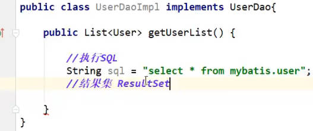 | 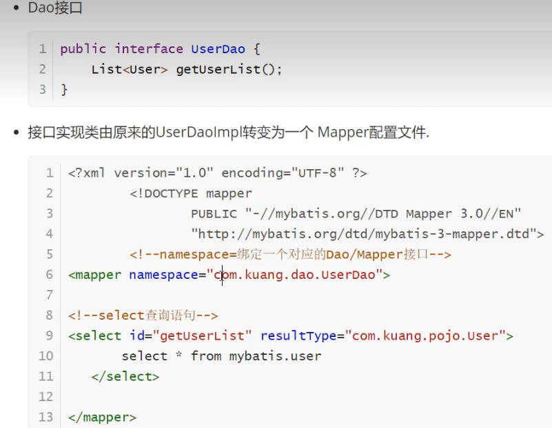 |
| ------------------------------------------------------------ | ------------------------------------------------------------ |

## 6、测试

- Junit 包测试 ： 按maven标准，应该==写在test/java目录里; 测试包和开发包对应==
  1. `获取SqlSession对象`
  2. `执行sql`
     1. 获取UserDao对象
     2. 执行它的方法,返回结果
     3. 遍历结果
  3. `关闭SqlSession`
- 资源导出失败的问题
- ==注册mapper==: mybatis配置文件xml中
  - ==DAO接口的实现类现在变成了Mapper.xml文件==，要在Mybatis核心配置文件中注册
  - ==每一个Mapper.xml都需要在Mybatis核心配置文件中注册!==


```java
import com.feng.mapper.UserMapper;
import com.feng.pojo.User;
import com.feng.utils.MyBatisUtil;
import org.apache.ibatis.session.SqlSession;
import org.junit.Test;

import java.util.List;

public class MyTest {
    @Test
    public void test() {
        //获取SqlSession对象
        SqlSession sqlSession = MybatisUtils.getSqlSession();
        //执行sql,要想办法获取UserDao对象
        //从sqlSession中获取mapper，获取哪一个mapper：UserDao.class
        //方式一：getMapper,需要在mybatis配置文件xml中注册mapper
        UserDao mapper = sqlSession.getMapper(UserDao.class);

        //拿到UserDao对象，去执行它的方法： 执行sql语句
        List<User> userList = mapper.getUserList();

        for (User user : userList) {
            System.out.println(user);
        }
        //关闭SqlSession
        sqlSession.close();
    }
}

//方式二：根据方法的返回值,返回方法类型
```

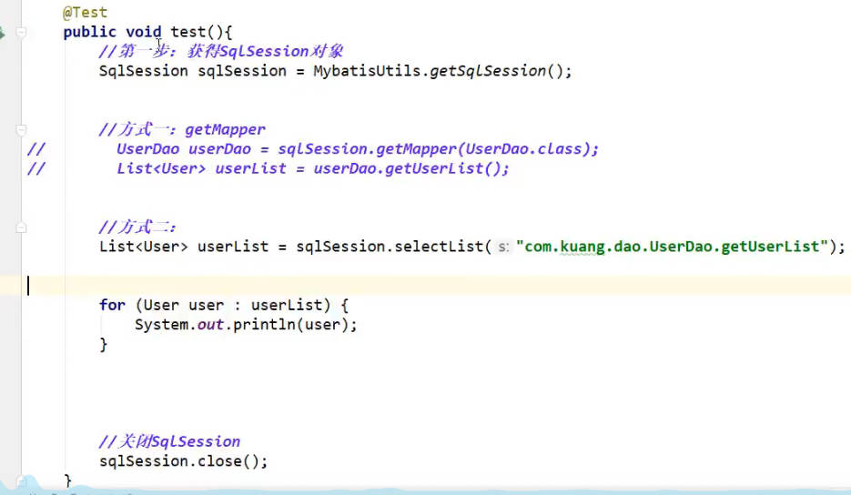

## 7、项目目录

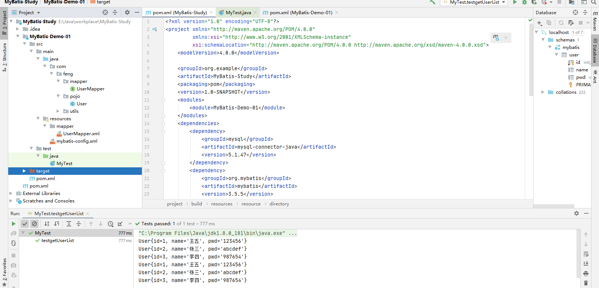


> 问题说明

## 8、可能出现的问题

1. **Maven静态资源过滤问题**

```xml
<!--在build中配置resources，来防止我们资源导出失败的问题-->
    <build>
        <resources>
            <resource>
                <directory>src/main/resources</directory>
                <includes>
                    <include>**/*.properties</include>
                    <include>**/*.xml</include>
                </includes>
                <filtering>true</filtering>
            </resource>
            <!--以上部分不写也可以默认导出,但下面的java目录先下的配置文件无法导出,必须配置-->
            <resource>
                <directory>src/main/java</directory>
                <includes>
                    <include>**/*.properties</include>
                    <include>**/*.xml</include>
                </includes>
                <filtering>true</filtering>
            </resource>
        </resources>
    </build>
```

2. **intellij idea连接mysql数据库时报错:Server returns invalid timezone. Go to ‘Advanced’ tab and set ‘serverTimezon’**


解决方法: 在`Advanced`中将`serverTimezone`设置成`Hongkong`即可


此时再重新连接就可以了


3. 数据库路径

   > jdbc:mysql://localhost:3306/mybatis?useSSL=true&amp;useUnicode=true&amp;characterEncoding=utf8

4. Idea的Maven导入包问题
   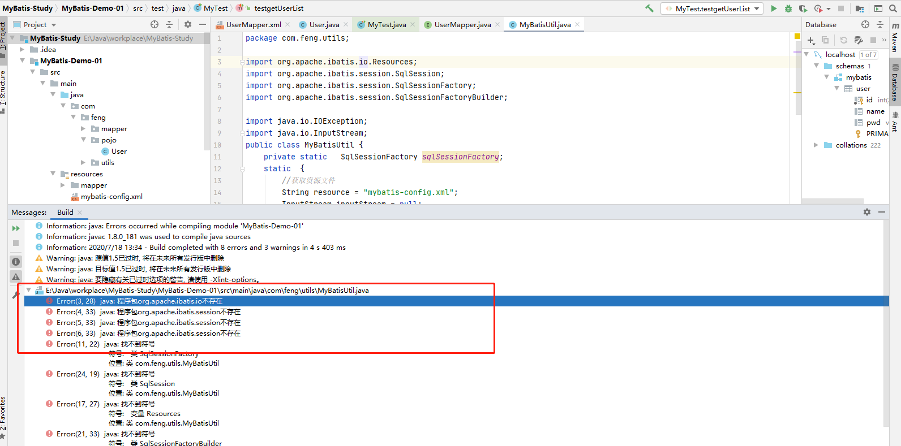

   **Idea的包导入都正常Buid的时候找不到jar包，如上图**
   **解决办法** File->settings->Buid……->Maven->Runner
   ->Delegate IDE build…… 勾选保存就好了

   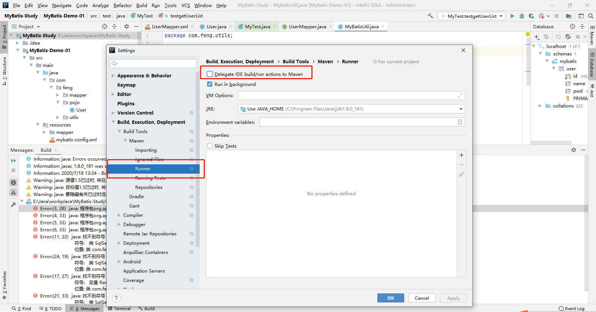

   | 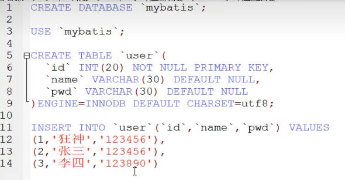 | 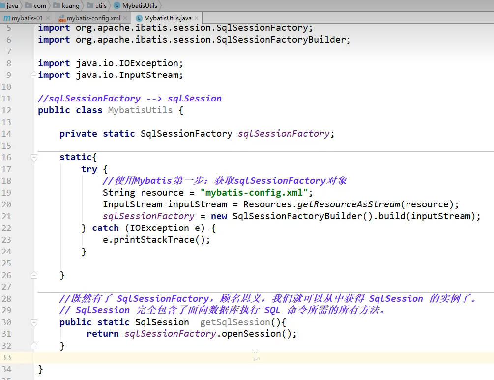 |
   | ------------------------------------------------------------ | ------------------------------------------------------------ |
   | 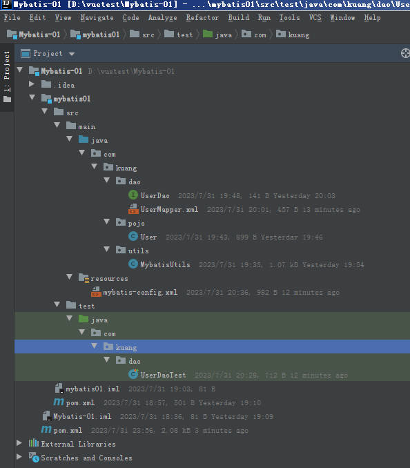 | 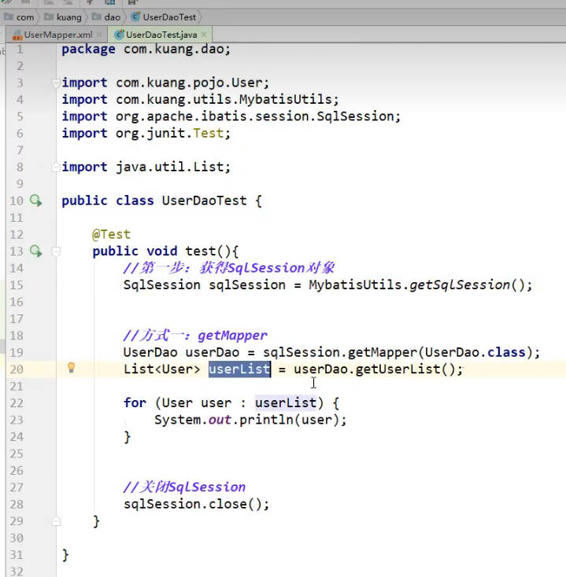 |
   | 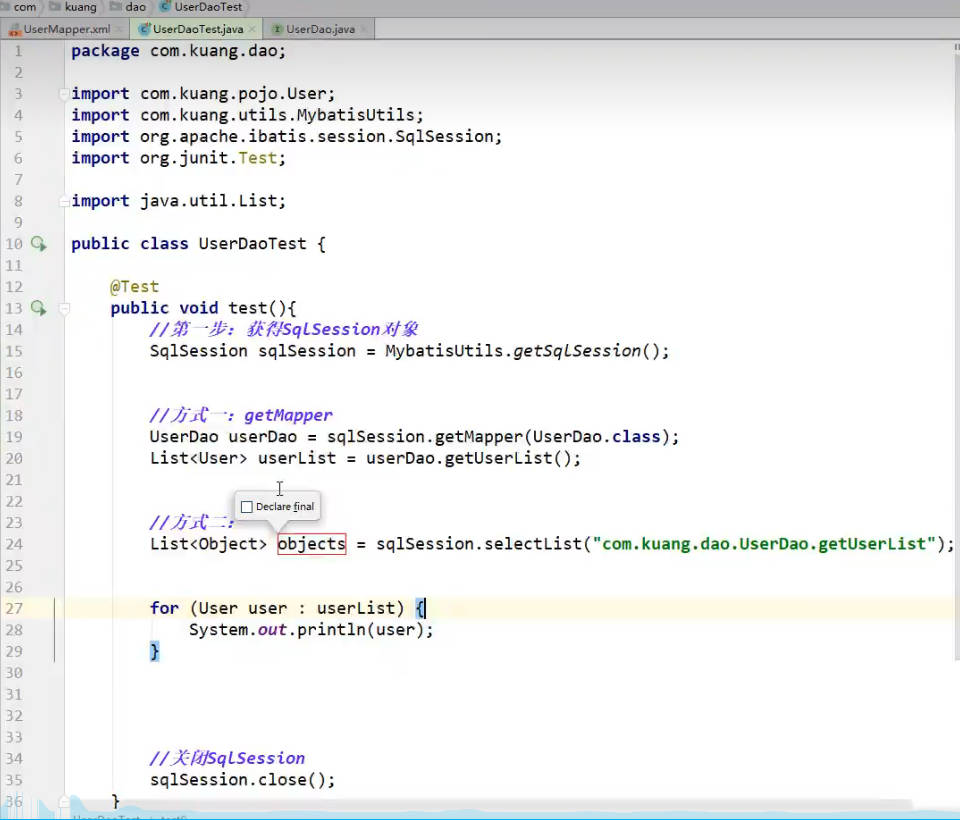 | 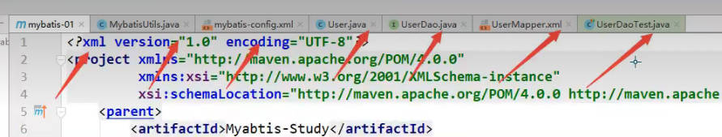 |
   
   

# 4、CURD操作

CRUD只用改==Dao接口、Mapper.xml、测试类==；其它完全不用改

- xml相当于原来Dao接口的实现类
- ==id对应方法名、resultType对应方法返回值类型、parameterType对应方法的形参类型==

| 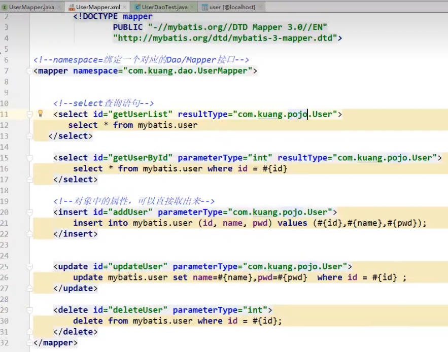 | 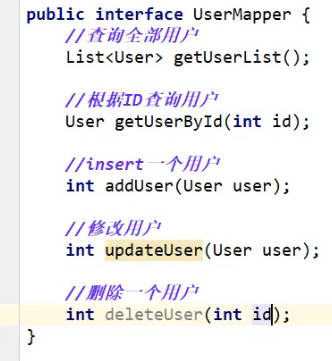 |
| ------------------------------------------------------------ | ------------------------------------------------------------ |

## 1、查询

- **根据用户 Id查询用户**

1. 在UserMapper中添加对应方法

```java
public interface UserMapper {
    List<User> getUserList();
	//根据ID查询用户
    List<User> getUserListById(int id); 
} 
```

2、在UserMapper.xml中添加Select语句

- `#{} 用来取方法的参数`

```xml
 <select id="getUserListById" resultType="com.feng.pojo.User" parameterType="int">
      select * from User where id=#{id}
  </select>
```

3、测试类中测试

```java
    @Test
    public  void  testgetUserById() {
        SqlSession sqlSession = MyBatisUtil.getSession();
        UserMapper userMapper = sqlSession.getMapper(UserMapper.class);
        
        List<User> userList = userMapper.getUserListById(1);
        for (User user : userList) {
            System.out.println(user);
        }
        sqlSession.close();
    }
```

- **根据用户名和密码获取用户**

思路一：直接在方法中传递参数(注解)

1、在接口方法的参数前加 @Param属性

2、Sql语句编写的时候，直接取@Param中设置的值即可，不需要单独设置参数类型

```xml
//通过密码和名字查询用户
User selectUserByNP(@Param("username") String username,@Param("pwd") Stringpwd);

/*
   <select id="selectUserByNP" resultType="com.feng.pojo.User">
     select * from user where name = #{username} and pwd = #{pwd}
   </select>
*/
```

思路二：使用万能的Map

1、在接口方法中，参数直接传递Map；

```
User selectUserByMP(Map<String,Object> map);
```

2、编写sql语句的时候，需要传递参数类型，参数类型为map

```
<select id="selectUserByMP" parameterType="map" resultType="com.deng.pojo.User">
select * from user where name = #{username} and pwd = #{pwd}
</select>
```

3、在使用方法的时候，Map的 key 为 sql中取的值即可，没有顺序要求！

```
Map<String, Object> map = new HashMap<String, Object>();
map.put("username","小明");
map.put("pwd","123456");
User user = mapper.selectUserByNP2(map);
```

总结：如果参数过多，我们可以考虑直接使用Map实现，如果参数比较少，直接传递参数即可

## 2、增加

1、在UserMapper接口中添加对应的方法

```java
//添加一个用户
int addUser(User user);
```

2、在UserMapper.xml中添加insert语句

```xml
<insert id="addUser" parameterType="com.feng.pojo.User">
    insert into user (id,name,pwd) values (#{id},#{name},#{pwd})
</insert>
```

3、测试

```java
@Test
public void testAddUser() {
   SqlSession session = MybatisUtils.getSession();
   UserMapper mapper = session.getMapper(UserMapper.class);
   User user = new User(5,"王五","zxcvbn");
   int i = mapper.addUser(user);
   System.out.println(i);
   session.commit(); //提交事务,重点!不写的话不会提交到数据库
   session.close();
}
```

**注意点：==增、删、改操作需要提交事务！==**

 ## 3、更新

[Using platform encoding (UTF-8 actually) to copy filtered resources](https://www.cnblogs.com/hafiz/p/6537790.html)

我们一般使用update标签进行更新操作，它的配置和select标签差不多！

**需求：修改用户的信息**

1、同理，编写接口方法

```java
//修改一个用户
int updateUser(User user);
```

2、编写对应的配置文件SQL

```xml
<update id="updateUser" parameterType="com.feng.pojo.User">
  update user set name=#{name},pwd=#{pwd} where id = #{id}
</update>
```

3、测试

```java
@Test
public void testUpdateUser() {
   SqlSession session = MybatisUtils.getSession();
   UserMapper mapper = session.getMapper(UserMapper.class);
   User user = mapper.selectUserById(1);
   user.setPwd("asdfgh");
   int i = mapper.updateUser(user);
   System.out.println(i);
   session.commit(); //提交事务,重点!不写的话不会提交到数据库
   session.close();
}
```

## 4、删除

我们一般使用delete标签进行删除操作，它的配置和select标签差不多！

**需求：根据id删除一个用户**

1、同理，编写接口方法

```jav
//根据id删除用户
int deleteUser(int id);
```

2、编写对应的配置文件SQL

```xml
<delete id="deleteUser" parameterType="int">
  delete from user where id = #{id}
</delete>
```

3、测试

```java
@Test
public void testDeleteUser() {
   SqlSession session = MybatisUtils.getSession();
   UserMapper mapper = session.getMapper(UserMapper.class);
   int i = mapper.deleteUser(5);
   System.out.println(i);
   session.commit(); //提交事务,重点!不写的话不会提交到数据库
   session.close();
}
```


**小结：**

- 所有的增删改操作都需要提交事务！
- 接口所有的普通参数，尽量都写上@Param参数，尤其是多个参数时，必须写上！
- 有时候根据业务的需求，可以考虑使用map传递参数！
- 为了规范操作，在SQL的配置文件中，我们尽量将Parameter参数和resultType都写上！


> 思考题

**模糊查询like语句该怎么写?**

第1种：在Java代码中添加sql通配符。

```
string wildcardname = “%smi%”;
list<name> names = mapper.selectlike(wildcardname);

<select id=”selectlike”>
select * from foo where bar like #{value}
</select>
```

第2种：在sql语句中拼接通配符，会引起sql注入

```
string wildcardname = “smi”;
list<name> names = mapper.selectlike(wildcardname);

<select id=”selectlike”>
    select * from foo where bar like "%"#{value}"%"
</select>
```

## 5、源码

看错误日志：从下往上读

IDEA如果没连数据库，直接写表名，不要写数据库名,去掉mybatis名字

- `insert into mybatis.user (id,name,pwd) values (#{id},#{name},#{pwd}`

==Dao接口==

```java
public interface UserDao {
    //查询全部用户
    List<User> getUserList();

    //根据ID查询用户
    List<User> getUserListById(int id);

    //insert用户
    int addUser(User user);

    //修改用户
    int updateUser(User user);

    //删除用户
    int deleteUser(int id);
}
```

==Mapper.xml==

```java
<?xml version="1.0" encoding="UTF-8" ?>
<!DOCTYPE mapper
        PUBLIC "-//mybatis.org//DTD Mapper 3.0//EN"
        "https://mybatis.org/dtd/mybatis-3-mapper.dtd">
<!--namespace=绑定一个指定的Dao/Mapper接口,把Dao和xml配置文件命名空间绑定起来，相当于以前的实现接口-->
<!--id:接口方法,resultType:结果集com.kuang.pojo.User,返回类型是List<User>-->
<mapper namespace="com.kuang.dao.UserDao">
    <select id="getUserList" resultType="com.kuang.pojo.User">
        select * from mybatis.user
    </select>
    <select id="getUserListById" resultType="com.kuang.pojo.User" parameterType="int">
        select * from User where id=#{id}
    </select>
    <!--pojo/User对象中的属性，可以直接取出来-->
    <insert id="addUser" parameterType="com.kuang.pojo.User">
        insert into mybatis.user (id,name,pwd) values (#{id},#{name},#{pwd})
    </insert>

    <update id="updateUser" parameterType="com.kuang.pojo.User">
        update mybatis.user set name=#{name},pwd=#{pwd} where id = #{id}
    </update>

    <delete id="deleteUser" parameterType="int">
        delete from mybatis.user where id = #{id}
    </delete>
</mapper>
```

==测试==

```java
public class UserDaoTest {
    static Logger logger = Logger.getLogger(UserDaoTest.class);

    @Test
    public void test() {
        //获取SqlSession对象
        SqlSession sqlSession = MybatisUtils.getSqlSession();
        //执行sql,要想办法获取UserDao对象
        //从sqlSession中获取mapper，获取哪一个mapper：UserDao.class
        //方式一：getMapper,需要在mybatis配置文件xml中注册mapper
        UserDao mapper = sqlSession.getMapper(UserDao.class);

        //拿到UserDao对象，去执行它的方法： 执行sql语句
        List<User> userList = mapper.getUserList();

        for (User user : userList) {
            System.out.println(user);
        }
        //关闭SqlSession
        sqlSession.close();
    }

    @Test   //查
    public void getUserById() {
        SqlSession sqlSession = MybatisUtils.getSqlSession();
        UserDao mapper = sqlSession.getMapper(UserDao.class);
        List<User> userListById = mapper.getUserListById(1);
        System.out.println(userListById);
    }

    @Test   //增
    public void testAddUser() {
        SqlSession sqlSession = MybatisUtils.getSqlSession();
        UserDao mapper = sqlSession.getMapper(UserDao.class);
        mapper.addUser(new User(4,"王五","zxcvbn"));
        //增删改需要提交事务
        sqlSession.commit();
        sqlSession.close();
    }

    @Test   //改
    public void testUpdateUser() {
        SqlSession sqlSession = MybatisUtils.getSqlSession();
        UserDao mapper = sqlSession.getMapper(UserDao.class);
        mapper.updateUser(new User(5,"hehe","328748"));
        sqlSession.commit();
        sqlSession.close();
    }

    @Test   //删
    public void testDeleteUser() {
        SqlSession sqlSession = MybatisUtils.getSqlSession();
        UserDao mapper = sqlSession.getMapper(UserDao.class);
        mapper.deleteUser(4);
        sqlSession.commit();
        sqlSession.close();
    }

    @Test
    public void log4j() {
        logger.info("info：进入selectUser方法");
        logger.debug("debug：进入selectUser方法");
        logger.error("error: 进入selectUser方法");
    }
}
```

## 6、==万能Map==

[mybatis狂神说笔记](https://blog.51cto.com/u_15069482/4342353)

为什么用Map：

- `insert into mybatis.user (id,name,pwd) values (#{id},#{name},#{pwd})`,如果有很多字段，全都要写很不方便

map和模糊查询扩展

- 假设，我们的实体类，或者数据库中的表，字段或者参数过多，我们应该考虑使用Map!
  - 字段或参数过多，考虑使用map
- 模糊查询：通配符

1.UserMapper接口

```java
//用万能Map插入用户,不需要知道数据库里有什么，只需要查对应字段就行
//等价于 List<User> addUser(int id);
int addUser(Map<String,Object> map);
```

2.UserMapper.xml, 参数类型改为map

```java
<!--对象中的属性可以直接取出来 传递map的key-->
<insert id="addUser2" parameterType="map">
    insert into user (id,name,password) values (#{userid},#{username},#{userpassword})
</insert>
```

3.测试

```java
HashMap<String, Object> map = new HashMap<String, Object>();

map.put("userid",4);
map.put("username","王虎");
map.put("userpassword",789);
mapper.addUser2(map);
```


| 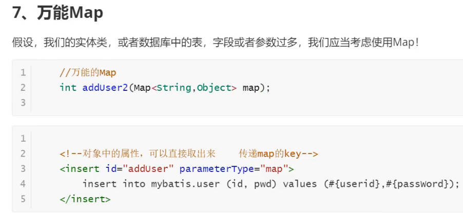 | 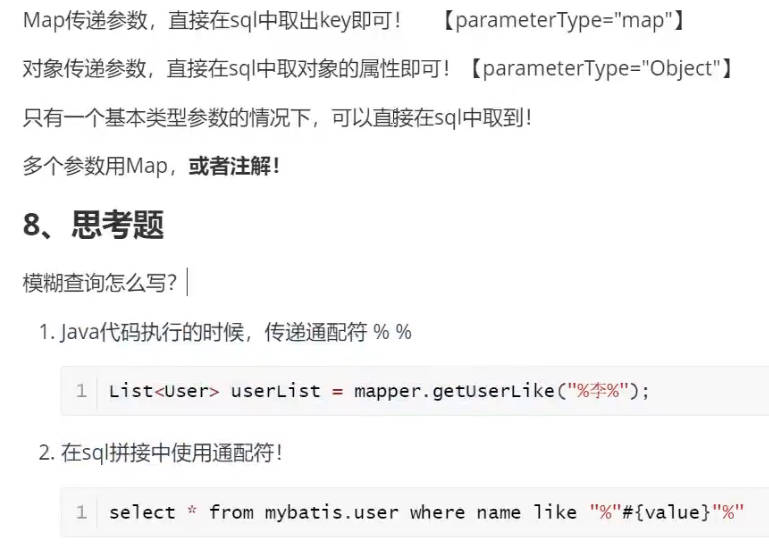 |
| ------------------------------------------------------------ | ------------------------------------------------------------ |


# 5、==核心配置文件==

小结： ==核心配置文件：mybatis-config.xml==

1. Properties属性：把连接数据库的信息，写在外部Properties文件
2. typeAliases别名: 降低冗余的全限定类名
3. settings设置
4. 映射器:4种
5. 生命周期和作用域

> 核心配置文件： mybatis-config.xml

- configuration（配置）
  - [properties（属性）](https://mybatis.org/mybatis-3/zh_CN/configuration.html#properties)
  - [settings（设置）](https://mybatis.org/mybatis-3/zh_CN/configuration.html#settings)
  - [typeAliases（类型别名）](https://mybatis.org/mybatis-3/zh_CN/configuration.html#typeAliases)
  - [typeHandlers（类型处理器）](https://mybatis.org/mybatis-3/zh_CN/configuration.html#typeHandlers)
  - [objectFactory（对象工厂）](https://mybatis.org/mybatis-3/zh_CN/configuration.html#objectFactory)
  - [plugins（插件）](https://mybatis.org/mybatis-3/zh_CN/configuration.html#plugins)
  - environments（环境配置）
    - environment（环境变量）
      - transactionManager（事务管理器）
      - dataSource（数据源）
  - [databaseIdProvider（数据库厂商标识）](https://mybatis.org/mybatis-3/zh_CN/configuration.html#databaseIdProvider)
  - [mappers（映射器）](https://mybatis.org/mybatis-3/zh_CN/configuration.html#mappers)

environments环境、 properties属性、==typeAliases类型别名==、settings设置、mappers映射器 

- mybatis-config.xml 系统核心配置文件
- MyBatis 的配置文件会深深影响 MyBatis 行为的设置和属性信息。
- 能配置的内容如下：

```
configuration（配置）
properties（属性）
settings（设置）
typeAliases（类型别名）
typeHandlers（类型处理器）
objectFactory（对象工厂）
plugins（插件）
environments（环境配置）
environment（环境变量）
transactionManager（事务管理器）
dataSource（数据源）
databaseIdProvider（数据库厂商标识）
mappers（映射器）
<!-- 注意元素节点的顺序！顺序不对会报错 -->
```

我们可以阅读 mybatis-config.xml 上面的dtd的头文件！

## 1、environments元素

==不重要==

```xml
<environments default="development">
 <environment id="development">
   <!--事务管理器-->
   <transactionManager type="JDBC">  
     <property name="..." value="..."/>   
   </transactionManager>
     <!--数据源 : 连接数据库； c3p0 dbcp druid-->
   <dataSource type="POOLED">
     <property name="driver" value="${driver}"/>
     <property name="url" value="${url}"/>
     <property name="username" value="${username}"/>
     <property name="password" value="${password}"/>
   </dataSource>
 </environment>
</environments>
```

- 配置MyBatis的多套运行环境，将SQL映射到多个不同的数据库上，必须指定其中一个为默认运行环境（通过default指定）

- 子元素节点：**environment**

- - dataSource 元素使用标准的 JDBC 数据源接口来配置 JDBC 连接对象的资源。

  - 数据源是必须配置的。

  - 有三种内建的数据源类型

    ```
    type="[UNPOOLED|POOLED|JNDI]"）
    ```

  - unpooled：这个数据源的实现只是每次被请求时打开和关闭连接。

  - **pooled**：这种数据源的实现利用“池”的概念将 JDBC 连接对象组织起来 , 这是一种使得并发 Web 应用快速响应请求的流行处理方式。

  - jndi：这个数据源的实现是为了能在如 Spring 或应用服务器这类容器中使用，容器可以集中或在外部配置数据源，然后放置一个 JNDI 上下文的引用。

  - 数据源也有很多第三方的实现，比如dbcp，c3p0，druid等等....

    

  - 详情：点击查看官方文档

  - 这两种事务管理器类型都不需要设置任何属性。

  - 具体的一套环境，通过设置id进行区别，id保证唯一！

  - 子元素节点：transactionManager - [ 事务管理器 ]

    ```
    <!-- 语法 -->
    <transactionManager type="[ JDBC | MANAGED ]"/>
    ```

  - 子元素节点：**数据源（dataSource）**

> mappers元素

## 2、==mappers映射器==

[4种](https://mybatis.org/mybatis-3/zh_CN/configuration.html#mappers): resource、url、class、name

1. ==使用类名时 class： 接口和它的Mapper文件必须同名、必须在同一个包下==
2. ==扫描包 name==：和用类名时一样，必须同名、必须在同一个包下
3. ==resourc==： xml文件可放在任意地方

告诉 MyBatis 到哪里去找SQL映射语句。 可以使用==相对于类路径的资源引用==，或==完全限定资源定位符==（包括 file:/// 形式的 URL），或==类名和包名==等

- 映射器 : 定义映射SQL语句文件
- 既然 MyBatis 的行为其他元素已经配置完了，我们现在就要定义 SQL 映射语句了。但是首先我们需要告诉 MyBatis 到哪里去找到这些语句。Java 在自动查找这方面没有提供一个很好的方法，所以最佳的方式是告诉 MyBatis 到哪里去找映射文件。你可以使用相对于类路径的资源引用， 或完全限定资源定位符（包括 `file:///` 的 URL），或类名和包名等。映射器是MyBatis中最核心的组件之一，在MyBatis 3之前，只支持xml映射器，即：所有的SQL语句都必须在xml文件中配置。而从MyBatis 3开始，还支持接口映射器，这种映射器方式允许以Java代码的方式注解定义SQL语句，非常简洁。

**引入资源方式**

```xml
<!-- 使用相对于类路径的资源引用，xml文件可放在任意地方 -->
<mappers>
 <mapper resource="org/mybatis/builder/PostMapper.xml"/>
</mappers>
<!-- 使用相对于类路径的资源引用 -->
<mappers>
 <mapper resource="org/mybatis/builder/*.xml"/>
</mappers>
<!-- 使用完全限定资源定位符（URL） -->
<mappers>
 <mapper url="file:///var/mappers/AuthorMapper.xml"/>
</mappers>
<!--
使用映射器接口实现类的完全限定类名
需要配置文件名称和接口名称一致，并且位于同一目录下
-->
<mappers>
 <mapper class="org.mybatis.builder.AuthorMapper"/>
</mappers>
<!--
将包内的映射器接口实现全部注册为映射器
但是需要配置文件名称和接口名称一致，并且位于同一目录下
-->
<mappers>
 <package name="org.mybatis.builder"/>
</mappers>
```


| 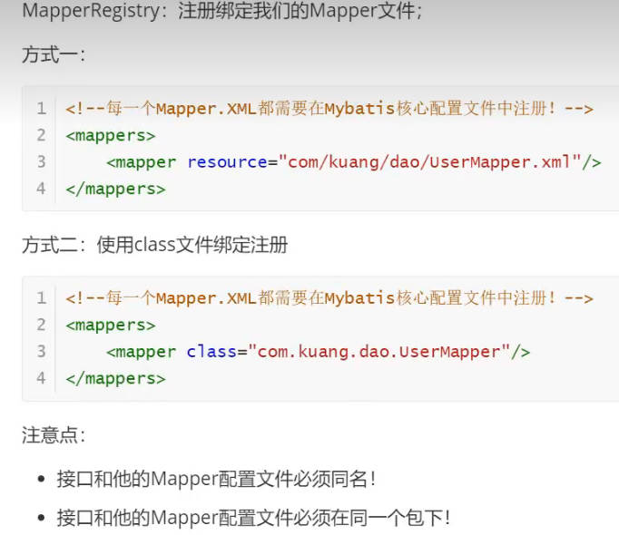 | 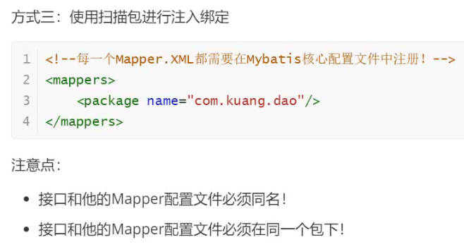 |
| ------------------------------------------------------------ | ------------------------------------------------------------ |


## 3、Mapper文件

```xml
<?xml version="1.0" encoding="UTF-8" ?>
<!DOCTYPE mapper
       PUBLIC "-//mybatis.org//DTD Mapper 3.0//EN"
       "http://mybatis.org/dtd/mybatis-3-mapper.dtd">
<mapper namespace="com.feng.mapper.UserMapper">
   
</mapper>
```

- namespace中文意思：命名空间，作用如下：

- - namespace的命名必须跟某个接口同名
  - 接口中的方法与映射文件中sql语句id应该一一对应

- 1. namespace和子元素的id联合保证唯一  , 区别不同的mapper
  2. 绑定DAO接口
  3. namespace命名规则 : 包名+类名

MyBatis 的真正强大在于它的映射语句，这是它的魔力所在。由于它的异常强大，映射器的 XML 文件就显得相对简单。如果拿它跟具有相同功能的 JDBC 代码进行对比，你会立即发现省掉了将近 95% 的代码。MyBatis 为聚焦于 SQL 而构建，以尽可能地为你减少麻烦。

## 4、==Properties==属性

属性不直接写，例如`<property name="username" value="root"/>` ，写一个属性文件引入进来

- 通过Properties来实现==引用配置文件==(.properties文件)

数据库这些属性都是可外部配置且可动态替换的，既可以在典型的 Java 属性文件中配置，亦可通过 properties 元素的子元素来传递。具体的官方文档

我们来优化我们的配置文件

第一步 ; 在资源目录下新建一个==db.properties==

```properties
driver=com.mysql.jdbc.Driver
url=jdbc:mysql://localhost:3306/mybatis?useSSL=true&useUnicode=true&characterEncoding=utf8
username=root
password=123456
```

第二步 : 将文件导入properties 配置文件

```xml
<?xml version="1.0" encoding="UTF-8" ?>
<!DOCTYPE configuration
        PUBLIC "-//mybatis.org//DTD Config 3.0//EN"
        "https://mybatis.org/dtd/mybatis-3-config.dtd">

<configuration>
    <!--引入外部配置文件,可以文件里写一些，properties元素的子元素里写一部分-->
    <properties resource="db.properties">
        <property name="username" value="root"/>
        <property name="pwd" value="123456"/>
    </properties>

    <settings>
        <!--标准日志工厂实现-->
        <!--<setting name="logImpl" value="STDOUT_LOGGING"/>-->
        <setting name="logImpl" value="LOG4J"/>
    </settings>
    <environments default="development">
        <environment id="development">
            <transactionManager type="JDBC"/>
            <dataSource type="POOLED">
                <!--这里的属性值用db.properties文件的变量替换-->
                <property name="driver" value="${driver}"/>
                <property name="url" value="${url}"/>
                <property name="username" value="${username}"/>
                <property name="password" value="${pwd}"/>
            </dataSource>
        </environment>
    </environments>
    <!-- 每一个Mapper.xml都需要在Mybatis核心配置文件中注册! -->
    <!-- 可通过resource、class类、url绝对地址 -->
    <mappers>
        <mapper resource="com/kuang/dao/UserMapper.xml"/>
    </mappers>
</configuration>
```

更多操作，可以查看官方文档！【演示带领学习】

- 配置文件优先级问题
- 新特性：使用占位符

| 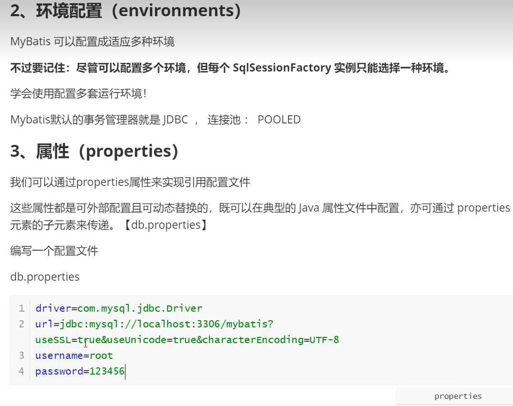 | 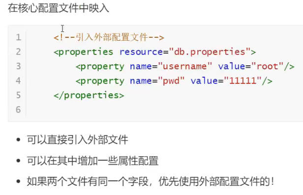 |
| ------------------------------------------------------------ | ------------------------------------------------------------ |


## 5、typeAliases==类型别名==

==类型不用全限定名==   ==类型别名== 

第一种：类型别名是为 Java 类型设置一个短的名字。它只和 XML 配置有关，存在的意义仅在于==用来减少类完全限定名的冗余==。

```xml
<!--配置别名,注意顺序-->
<typeAliases>
   <typeAlias type="com.feng.pojo.User" alias="User"/>
</typeAliases>
```

当这样配置时，`User`可以用在任何使用`com.kuang.pojo.User`的地方。

第二种：也可以==指定一个包名，MyBatis 会在包名下面搜索需要的 Java Bean==，比如:

```xml
<typeAliases>
   <package name="com.feng.pojo"/>
</typeAliases>
```

每一个在包 `com.kuang.pojo` 中的 Java Bean，**在没有注解的情况下，会使用 Bean 的首字母小写的非限定类名来作为它的别名**。

 第三种：用注解起别名

```java
@Alias("user")
public class User {
  ...
}
```

==第四种：java内建的类型别名； 去官网查看==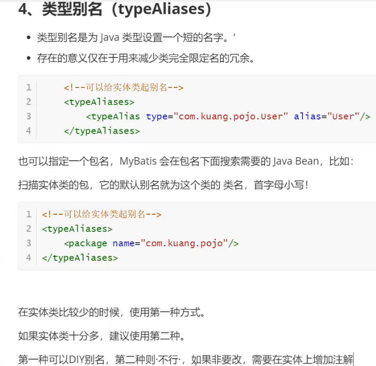

```xml
<?xml version="1.0" encoding="UTF-8" ?>
<!DOCTYPE configuration
        PUBLIC "-//mybatis.org//DTD Config 3.0//EN"
        "https://mybatis.org/dtd/mybatis-3-config.dtd">

<configuration>
    <!--1.属性：引入外部配置文件,可以文件里写一些，properties元素的子元素里写一部分-->
    <properties resource="db.properties">
        <property name="username" value="root"/>
        <property name="pwd" value="123456"/>
    </properties>

    <settings>
        <!--标准日志工厂实现-->
        <!--<setting name="logImpl" value="STDOUT_LOGGING"/>-->
        <setting name="logImpl" value="LOG4J"/>
    </settings>
    <!--2.别名:2种，typeAlias:1个实体类取一个；package:扫描一个包-->
    <typeAliases>
        <typeAlias type="com.kuang.pojo.User" alias="User"/>
    </typeAliases>

    <environments default="development">
        <environment id="development">
            <transactionManager type="JDBC"/>
            <dataSource type="POOLED">
                <!--这里的属性值用db.properties文件的变量替换-->
                <property name="driver" value="${driver}"/>
                <property name="url" value="${url}"/>
                <property name="username" value="${username}"/>
                <property name="password" value="${pwd}"/>
            </dataSource>
        </environment>
    </environments>
    <!-- 每一个Mapper.xml都需要在Mybatis核心配置文件中注册! -->
    <!-- 可通过resource、class类、url绝对地址 -->
    <mappers>
        <mapper resource="com/kuang/dao/UserMapper.xml"/>
    </mappers>
</configuration>
```


## 6、其他配置浏览

==**设置**==

- 设置（settings）相关 => 查看帮助文档

- - 懒加载
  - 日志实现
  - 缓存开启关闭

- 一个配置完整的 settings 元素的示例如下：

  ```xml
  <settings>
   <setting name="cacheEnabled" value="true"/>
   <setting name="lazyLoadingEnabled" value="true"/>
   <setting name="multipleResultSetsEnabled" value="true"/>
   <setting name="useColumnLabel" value="true"/>
   <setting name="useGeneratedKeys" value="false"/>
   <setting name="autoMappingBehavior" value="PARTIAL"/>
   <setting name="autoMappingUnknownColumnBehavior" value="WARNING"/>
   <setting name="defaultExecutorType" value="SIMPLE"/>
   <setting name="defaultStatementTimeout" value="25"/>
   <setting name="defaultFetchSize" value="100"/>
   <setting name="safeRowBoundsEnabled" value="false"/>
   <setting name="mapUnderscoreToCamelCase" value="false"/>
   <setting name="localCacheScope" value="SESSION"/>
   <setting name="jdbcTypeForNull" value="OTHER"/>
   <setting name="lazyLoadTriggerMethods" value="equals,clone,hashCode,toString"/>
  </settings>
  ```

**类型处理器**

- 无论是 MyBatis 在预处理语句（PreparedStatement）中设置一个参数时，还是从结果集中取出一个值时， 都会用类型处理器将获取的值以合适的方式转换成 Java 类型。
- 你可以重写类型处理器或创建你自己的类型处理器来处理不支持的或非标准的类型。【了解即可】

**对象工厂**

- MyBatis 每次创建结果对象的新实例时，它都会使用一个对象工厂（ObjectFactory）实例来完成。
- 默认的对象工厂需要做的仅仅是实例化目标类，要么通过默认构造方法，要么在参数映射存在的时候通过有参构造方法来实例化。
- 如果想覆盖对象工厂的默认行为，则可以通过创建自己的对象工厂来实现。【了解即可】


## 7、生命周期和作用域

**作用域（Scope）和生命周期**

理解我们目前已经讨论过的不同作用域和生命周期类是至关重要的，因为错误的使用会导致非常严重的并发问题。

我们可以先画一个流程图，分析一下Mybatis的执行过程！

| 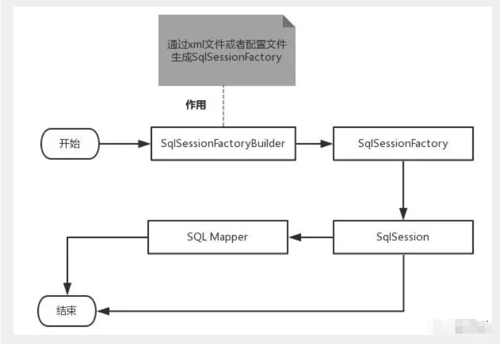 | 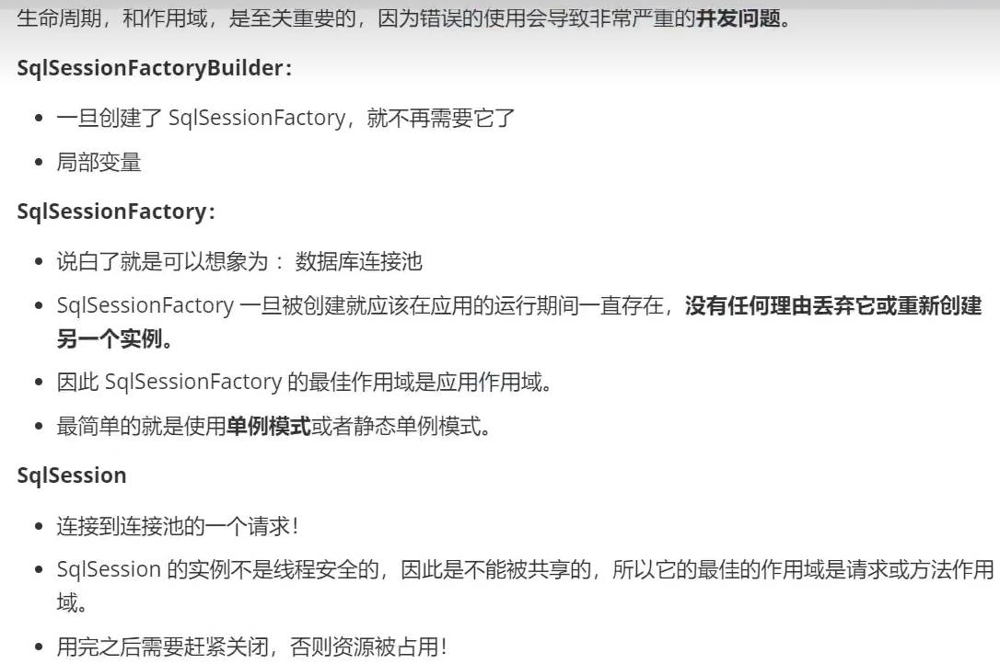 |
| ------------------------------------------------------------ | ------------------------------------------------------------ |
| 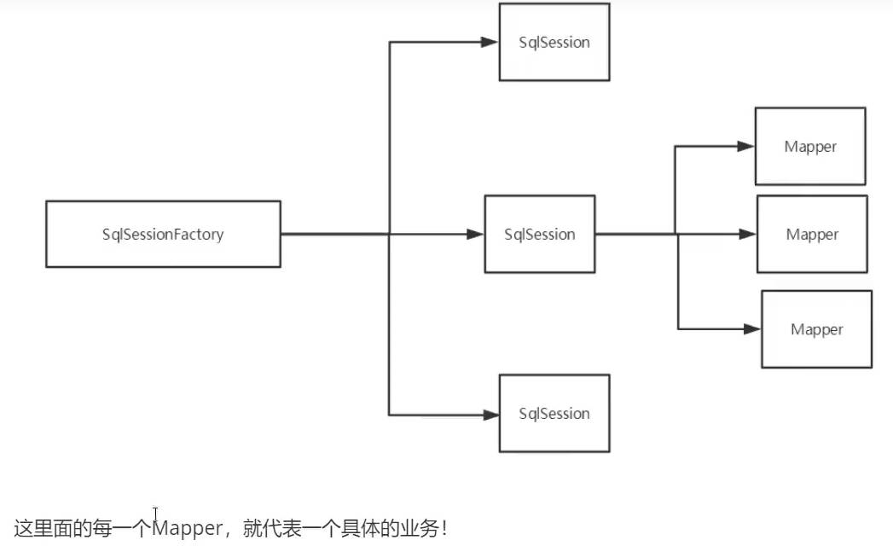 |                                                              |


**作用域理解**

- SqlSessionFactoryBuilder 的作用在于==创建 SqlSessionFactory==，创建成功后，SqlSessionFactoryBuilder 就失去了作用，所以它只能存在于创建 SqlSessionFactory 的方法中，而不要让其长期存在。因此 ==**SqlSessionFactoryBuilder 实例的最佳作用域是方法作用域**（也就是局部方法变量）==。==作用域：作为局部变量==
- ==SqlSessionFactory 可以被认为是一个数据库连接池==，它的作用是创建 SqlSession 接口对象。因为 MyBatis 的本质就是 Java 对数据库的操作，所以 SqlSessionFactory 的生命周期存在于整个 MyBatis 的应用之中，所以一旦创建了 SqlSessionFactory，就要长期保存它，直至不再使用 MyBatis 应用，所以可以认为 SqlSessionFactory 的生命周期就等同于 MyBatis 的应用周期。 ==作用域：全局==
- 由于 SqlSessionFactory 是一个对数据库的连接池，所以它占据着数据库的连接资源。如果创建多个 SqlSessionFactory，那么就存在多个数据库连接池，这样不利于对数据库资源的控制，也会导致数据库连接资源被消耗光，出现系统宕机等情况，所以尽量避免发生这样的情况。
- 因此在一般的应用中我们往往希望 SqlSessionFactory 作为一个单例，让它在应用中被共享。所以说 **SqlSessionFactory 的最佳作用域是应用作用域。**
- 如果说 SqlSessionFactory 相当于数据库连接池，那么 ==SqlSession 就相当于一个数据库连接（Connection 对象），连接到连接池的一个请求==，你可以在一个事务里面执行多条 SQL，然后通过它的 commit、rollback 等方法，提交或者回滚事务。所以它应该存活在一个业务请求中，处理完整个请求后，应该关闭这条连接，让它归还给 SqlSessionFactory，否则数据库资源就很快被耗费精光，系统就会瘫痪，所以用 try...catch...finally... 语句来保证其正确关闭。==作用域：放到方法里，用完关闭==
- **所以 SqlSession 的最佳的作用域是请求或方法作用域。**

# 6、ResultMap结果集==映射==

==解决属性名和字段名不一致的问题==： ==结果集映射为实体类User==， 列映射到字段

- 如果实体类的字段是一个对象，就很复杂，要用到多对一、一对多
- 高级的结果集映射，association，collection

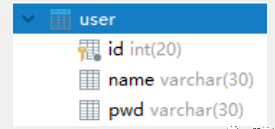

| 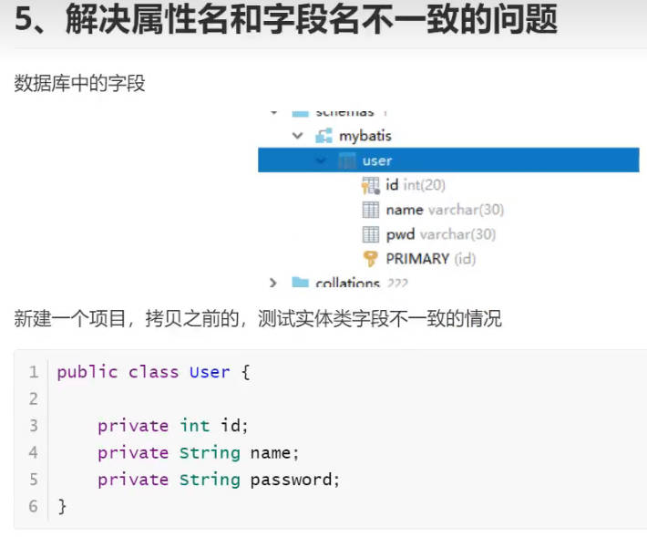 | 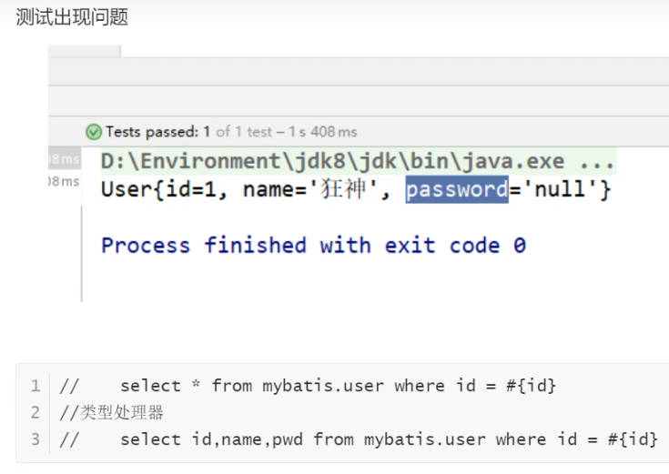 |
| ------------------------------------------------------------ | ------------------------------------------------------------ |
| 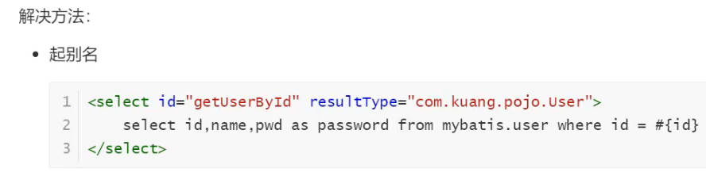 | 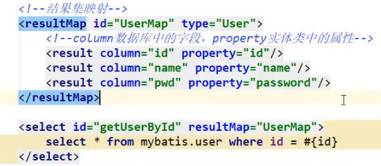 |
| 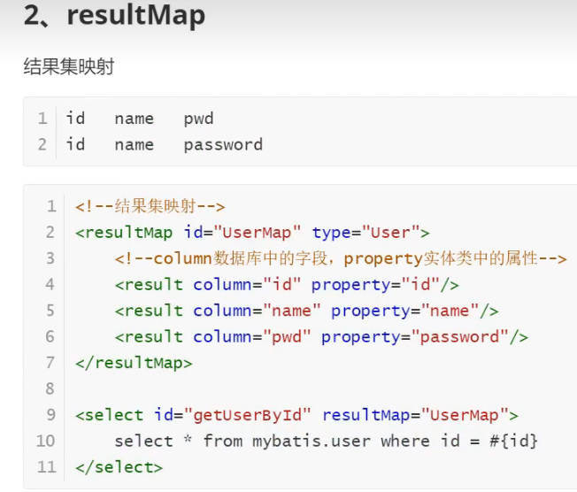 | 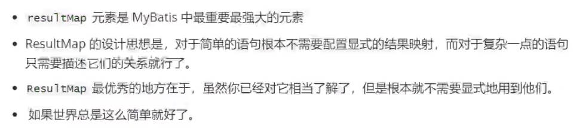 |


# 7、其它功能

## 1、==日志工厂==

[WARN Please initialize the log4j system properly_please initialize the log4j system properly](https://blog.csdn.net/just_learing/article/details/124436214)

小结：

- ==resource/log4j.properties== > setting设置日志 > 使用Log4j替换sout输出，==输出到日志==

思考：我们在测试SQL的时候，要是能够在控制台输出 SQL 的话，是不是就能够有更快的排错效率？

如果一个 数据库相关的操作出现了问题，我们可以根据输出的SQL语句快速排查问题。

对于以往的开发过程，我们会经常使用到debug模式来调节，跟踪我们的代码执行过程。但是现在使用Mybatis是基于接口，配置文件的源代码执行过程。因此，我们必须选择日志工具来作为我们开发，调节程序的工具。

==Mybatis内置的日志工厂==提供日志功能，具体的日志实现有以下几种工具：

- SLF4J
- Apache Commons Logging
- Log4j 2
- Log4j
- JDK logging

具体选择哪个日志实现工具由MyBatis的内置日志工厂确定。它会使用最先找到的（按上文列举的顺序查找）。如果一个都未找到，日志功能就会被禁用。

| 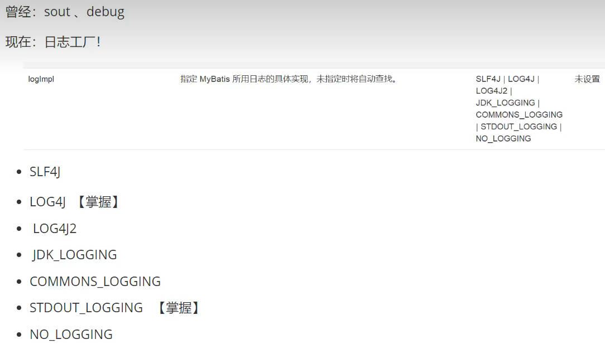 | 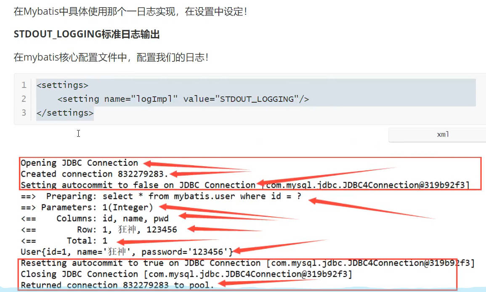 |
| ------------------------------------------------------------ | ------------------------------------------------------------ |
| 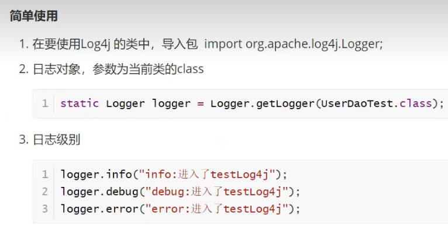 |                                                              |


### 1、**标准日志实现**  

STDOUT_LOGGING 不需要配置任何东西

指定 MyBatis 应该使用哪个日志记录实现。如果此设置不存在，则会自动发现日志记录实现。

```xml
<settings>
       <setting name="logImpl" value="STDOUT_LOGGING"/>
</settings>
```

测试，可以看到控制台有大量的输出！我们可以通过这些输出来判断程序到底哪里出了Bug

### 2、Log4j日志

**简介：**

- Log4j是Apache的一个开源项目
- 通过使用Log4j，我们可以控制日志信息输送的目的地：控制台，文本，GUI组件....
- 我们也可以控制每一条日志的输出格式；
- 通过定义每一条日志信息的级别，我们能够更加细致地控制日志的生成过程。最令人感兴趣的就是，这些可以==通过配置文件==来灵活地进行配置，而不需要修改应用的代码。

**使用步骤：**

1、导入log4j的包

```xml
<!-- https://mvnrepository.com/artifact/log4j/log4j -->
<dependency>
    <groupId>log4j</groupId>
    <artifactId>log4j</artifactId>
    <version>1.2.17</version>
</dependency>

```

2、配置文件编写 

==resource/log4j.properties==

```properties
#将等级为DEBUG的日志信息输出到console和file这两个目的地，console和file的定义在下面的代码
log4j.rootLogger=DEBUG,console,file

#控制台输出的相关设置
log4j.appender.console = org.apache.log4j.ConsoleAppender
log4j.appender.console.Target = System.out
log4j.appender.console.Threshold=DEBUG
log4j.appender.console.layout = org.apache.log4j.PatternLayout
log4j.appender.console.layout.ConversionPattern=[%c]-%m%n

#文件输出的相关设置
log4j.appender.file = org.apache.log4j.RollingFileAppender
log4j.appender.file.File=./log/log.log
log4j.appender.file.MaxFileSize=10mb
log4j.appender.file.Threshold=DEBUG
log4j.appender.file.layout=org.apache.log4j.PatternLayout
log4j.appender.file.layout.ConversionPattern=[%p][%d{yy-MM-dd}][%c]%m%n

#日志输出级别
log4j.logger.org.mybatis=DEBUG
log4j.logger.java.sql=DEBUG
log4j.logger.java.sql.Statement=DEBUG
log4j.logger.java.sql.ResultSet=DEBUG
log4j.logger.java.sql.PreparedStatement=DEBUG
```

3、setting设置日志实现

```xml
<settings>
   <setting name="logImpl" value="LOG4J"/>
</settings>
```

4、在程序中使用Log4j进行输出！

```java
//注意导包：org.apache.log4j.Logger
static Logger logger = Logger.getLogger(MyTest.class);

@Test
public void selectUser() {
   logger.info("info：进入selectUser方法");
   logger.debug("debug：进入selectUser方法");
   logger.error("error: 进入selectUser方法");
}
```

5、测试，看控制台输出！

- 使用Log4j 输出日志
- 可以看到还生成了一个日志的文件 【需要修改file的日志级别】

## 2、==分页==实现

### 1、limit实现分页

[SQL中的limit](https://www.cnblogs.com/yu011/p/13299702.html) [limit用法](http://www.mobiletrain.org/about/BBS/136108.html)

`SELECT column1, column2, ... FROM table_name LIMIT offset, count;`   offset结果集的起始位置，count返回的记录数量;   LIMIT 0, 10表示从第一条记录开始，返回10条记录

小结：

1. ==sql使用Limit分页==
2. 用myBatis分页
   1. 核心是sql，还是三步：==接口、mapper.xml、测试==

**思考：==为什么要分页==？**

在学习mybatis等持久层框架的时候，会经常对数据进行增删改查操作，使用最多的是对数据库进行查询操作，如果==查询大量数据时==，我们往往使用分页进行查询，也就是==每次处理小部分数据，数据库压力就在可控范围内==。

==sql使用Limit分页==

```java
#语法
SELECT * FROM table LIMIT stratIndex，pageSize

SELECT * FROM table LIMIT 5,10; // 检索记录行 6-15  

#为了检索从某一个偏移量到记录集的结束所有的记录行，可以指定第二个参数为 -1：  到最后一个
SELECT * FROM table LIMIT 95,-1; // 检索记录行 96-last.  

#如果只给定一个参数，它表示返回最大的记录行数目：   
SELECT * FROM table LIMIT 5; //检索前 5 个记录行  

#换句话说，LIMIT n 等价于 LIMIT 0,n。 
```

**步骤：**

1、修改Mapper文件

- ==mybatis分页核心还是在写sql==，没有面向对象，没有构建对象，==只是给sql传了个参数==,体现不出java特点，所以有人搞了个RowBounds类

```xml
<select id="getUserByPage" parameterType="map" resultType="user">
  select * from user limit #{startIndex},#{pageSize}
</select>
```

2、Mapper接口，参数为map

```java
//选择全部用户实现分页
List<User> getUserByPage(Map<String,Integer> map);
```

3、在测试类中传入参数测试

- 推断：起始位置 =  （当前页面 - 1 ） * 页面大小

```java
//分页查询 , 两个参数startIndex , pageSize
@Test
public void testSelectUser() {
   SqlSession session = MybatisUtils.getSession();
   UserMapper mapper = session.getMapper(UserMapper.class);

   int currentPage = 1;  //第几页
   int pageSize = 2;  //每页显示几个
   Map<String,Integer> map = new HashMap<String,Integer>();
   map.put("startIndex",(currentPage-1)*pageSize);
   map.put("pageSize",pageSize);

   List<User> users = mapper.getUserByPage(map);

   for (User user: users){
       System.out.println(user);
  }

   session.close();
}

//简单些
Map<String,Integer> map = new HashMap<String,Integer>();
map.put("startIndex",0);
map.put("pageSize",2);

List<User> users = mapper.getUserByLimit(map); //参数是一个Map
```


| 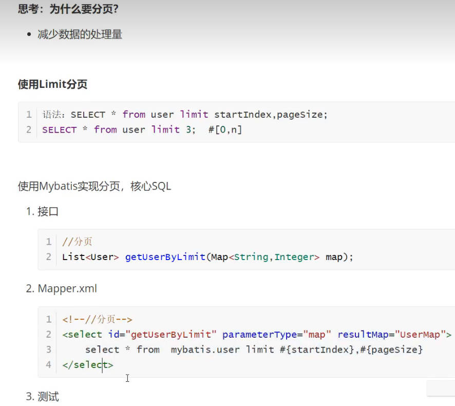 | 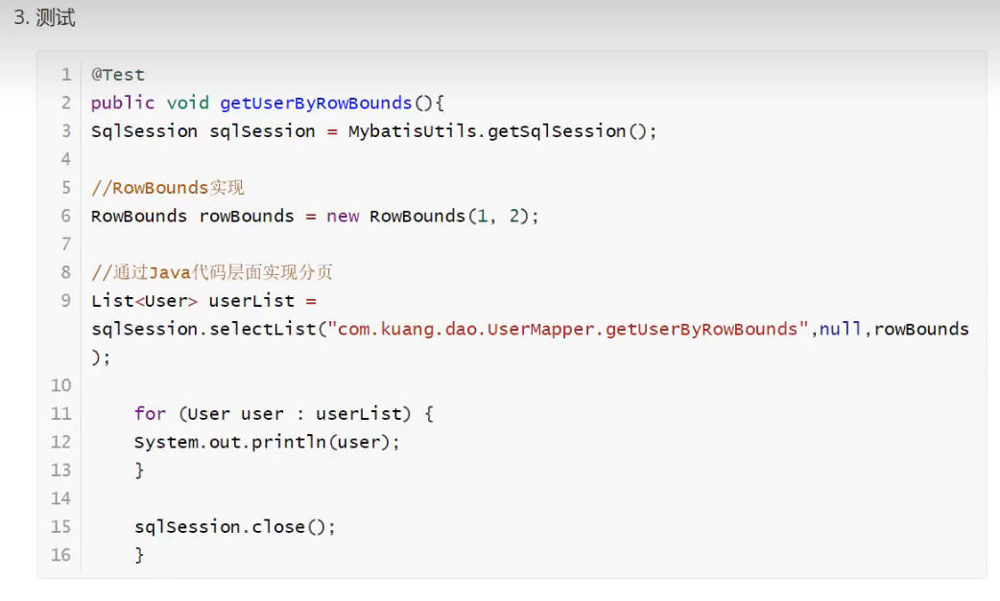 |
| ------------------------------------------------------------ | ------------------------------------------------------------ |


### 2、RowBounds分页

- ==mybatis分页核心还是在写sql==，没有用面向对象，没有构建对象，==只是给sql传了个参数==,体现不出java特点，所以有人搞了个RowBounds类

我们除了使用Limit在SQL层面实现分页，也可以使用RowBounds在Java代码层面实现分页

**步骤：**

1、mapper接口

```java
//选择全部用户RowBounds实现分页
List<User> getUserByRowBounds();
```

2、mapper文件

sql查询就查询，不干别的，==分页交给对象去做==

```xml
<select id="getUserByRowBounds" resultType="user">
select * from user
</select>
```

3、测试类

在这里，我们需要使用RowBounds类

```java
@Test
public void testUserByRowBounds() {
   SqlSession session = MybatisUtils.getSession();

   int currentPage = 2;  //第几页
   int pageSize = 2;  //每页显示几个
   RowBounds rowBounds = new RowBounds((currentPage-1)*pageSize,pageSize);

   //通过session.**方法进行传递rowBounds，[此种方式现在已经不推荐使用了]
   List<User> users =session.selectList("com.kuang.mapper.UserMapper.getUserByRowBounds", null,rowBounds);

   for (User user: users){
       System.out.println(user);
  }
   session.close();
}
```

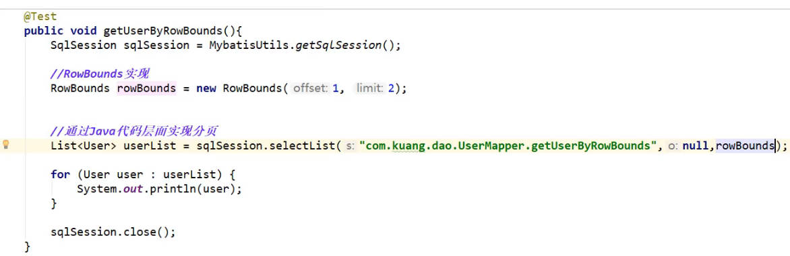

### 3、其他分页插件 


官方文档：https://pagehelper.github.io/

# 8、使用==注解==开发

[#{}和${}的区别](https://www.cnblogs.com/hskw/p/9957476.html)   [${} 和 #{} 有什么区别](https://www.cnblogs.com/vipstone/p/16614900.html) [#{} 和 ${} 的区别](https://blog.csdn.net/CYK_byte/article/details/129283220)

使用==注解==开发:  用来处理Dao映射，不用xml配置，底层主要应用反射机制实现

- ==dao接口的方法上面写注解==: 映射语句可以不用XML配置,在Dao方法上写注解
  - ==注解：增删改查，括号里写sql语句==  `@select ()、@update ()、@Insert ()、@delete () `

  - ==绑定dao接口==： 映射语句用XML配置时，绑定mapper，用注解时，要绑定dao接口
    - mybatis的xml配置文件中绑定接口: `<mapper class="com.feng.mapper.UserMapper"/>`
  

> 注释是给人看的，注解是给程序（编译器、虚拟机、框架）看的。简单说，注释是写代码时留下的说明文字，帮人理解逻辑；==注解是给代码贴的“标签”，程序运行时会读取并处理==。
>
> - ==注解==：编译后保留在 class 文件中（取决于保留策略），能被编译器、框架或运行时反射机制读取，并据此执行操作。

**注意：**利用注解开发就不需要mapper.xml映射文件了 

接口： 用来解耦，定义与实现的分离，架构师只用写接口

| 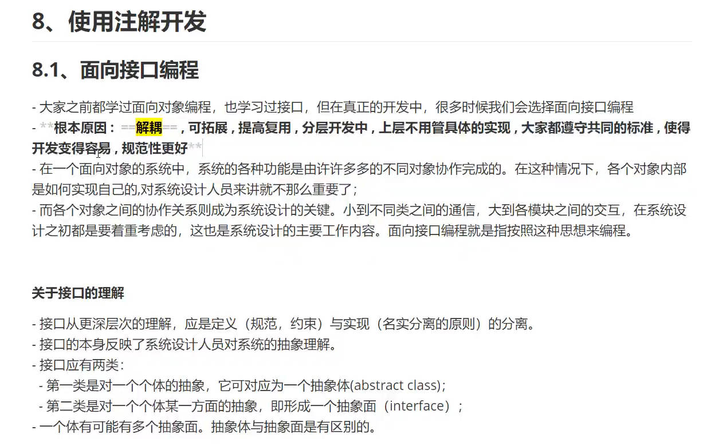 | 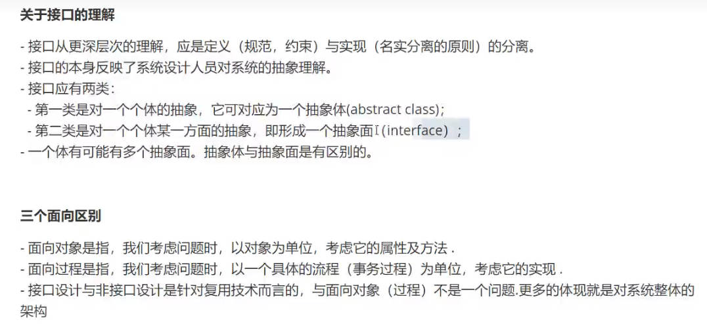 |
| ------------------------------------------------------------ | ------------------------------------------------------------ |
| 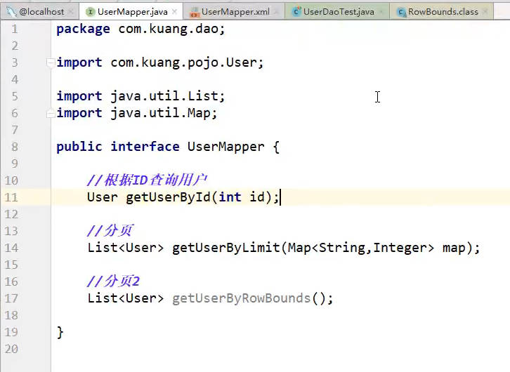 |  |
|  |  |
|  |  |
|  |                                                         |

==#{}预编译的，能防止sql注入，类似PreparedStatement==

==${},类似Statement==

**注解开发流程**

1、我们在我们的接口中添加注解

```java
//查询全部用户
@Select("select id,name,pwd password from user")
public List<User> getAllUser();
```

2、绑定接口： 在mybatis的核心配置文件中注入

```xml
<!--使用class绑定接口-->
<mappers>
   <mapper class="com.feng.mapper.UserMapper"/>
</mappers>
```

3、我们去进行测试

```java
@Test
public void testGetAllUser() {
   SqlSession session = MybatisUtils.getSession();
   //本质上利用了jvm的动态代理机制
   UserMapper mapper = session.getMapper(UserMapper.class);

   List<User> users = mapper.getAllUser();
   for (User user : users){
       System.out.println(user);
  }

   session.close();
}
```

4、利用Debug查看本质： 底层主要用反射

- 核心配置里的设置都会注入到sqlSession： 数据源等
- mapper对象是sql相关的
  - mapper执行时还是调用sqlsession
  - mapperInterface获取接口对象
- users查出来的结果


5、本质上利用了jvm的动态代理机制


## 1、Mybatis执行流程


> 注解增删改

改造MybatisUtils工具类的getSession( ) 方法，重载实现。

```java
  //获取SqlSession连接
  public static SqlSession getSession(){
      return getSession(true); //事务自动提交
  }
 
  public static SqlSession getSession(boolean flag){
      return sqlSessionFactory.openSession(flag);
  }
```

【注意】确保实体类和数据库字段对应

- 事务自动提交
- `User getUserByID(@Param("id") int id)`;  基本类型全加@Param

## 2、==查询==

[@Param注解的用法解析](https://www.cnblogs.com/xinruyi/p/11048522.html)  [@Param](https://mybatis.org/mybatis-3/zh_CN/sqlmap-xml.html#Result_Maps)

==什么是类路径（javaWeb里有讲）==：target打包后，资源文件在WEB-INF/classes下，叫classpath类路径；  [JAVA项目中CLASSPATH路径详解](https://www.cnblogs.com/hibou/p/8324276.html)

- java项目src/main下的java、resources文件夹, 都在类路径里面

1、编写接口方法注解

```java
//根据id查询用户
@Select("select * from user where id = #{id}")
User selectUserById(@Param("id") int id);
```

2、测试

```java
@Test
public void testSelectUserById() {
   SqlSession session = MybatisUtils.getSession();
   UserMapper mapper = session.getMapper(UserMapper.class);

   User user = mapper.selectUserById(1);
   System.out.println(user);

   session.close();
}
```

## 3、新增

1、编写接口方法注解

```java
//添加一个用户
@Insert("insert into user (id,name,pwd) values (#{id},#{name},#{pwd})")
int addUser(User user);
```

2、测试

```java
@Test
public void testAddUser() {
   SqlSession session = MybatisUtils.getSession();
   UserMapper mapper = session.getMapper(UserMapper.class);

   User user = new User(6, "秦疆", "123456");
   mapper.addUser(user);

   session.close();
}
```

## 4、修改

1、编写接口方法注解

```
//修改一个用户
@Update("update user set name=#{name},pwd=#{pwd} where id = #{id}")
int updateUser(User user);
```

2、测试

```
@Test
public void testUpdateUser() {
   SqlSession session = MybatisUtils.getSession();
   UserMapper mapper = session.getMapper(UserMapper.class);

   User user = new User(6, "秦疆", "zxcvbn");
   mapper.updateUser(user);

   session.close();
}
```

## 5、删除

1、编写接口方法注解

```
//根据id删除用
@Delete("delete from user where id = #{id}")
int deleteUser(@Param("id")int id);
```

2、测试

```
@Test
public void testDeleteUser() {
   SqlSession session = MybatisUtils.getSession();
   UserMapper mapper = session.getMapper(UserMapper.class);

   mapper.deleteUser(6);
   
   session.close();
}
```

【注意点：增删改一定记得对事务的处理】


> 关于@Param

@Param注解用于给方法参数起一个名字。以下是总结的使用原则：

- 在方法只接受==一个参数==的情况下，可以不使用@Param。
- 在方法接受多个参数的情况下，建议一定要使用@Param注解==给参数命名==。
- 如果参数是 JavaBean ， 则不能使用@Param。
- ==不使用@Param注解时，参数只能有一个，并且是Javabean==。

> \#与$的区别

- \#{} 的作用主要是替换预编译语句(PrepareStatement)中的占位符? 【推荐使用】

  ```
  INSERT INTO user (name) VALUES (#{name});
  INSERT INTO user (name) VALUES (?);
  ```

- ${} 的作用是直接进行字符串替换

  ```
  INSERT INTO user (name) VALUES ('${name}');
  INSERT INTO user (name) VALUES ('kuangshen');
  ```

> 使用注解和配置文件协同开发，才是MyBatis的最佳实践！

# 9、Lombok

|  |  |
| ------------------------------------------------------------ | ------------------------------------------------------------ |


```java
@Data
@AllArgsConstructor
@NoArgsConstructor
public class Person {
    private int id;
    private String name;
    private String password;
}
```


# 10、==多对一==处理

==多表查询==    [ Unable to resolve table](https://www.cnblogs.com/Code-Rain/p/16363962.html)

多对一的理解：

- 多个学生对应一个老师
- 如果对于学生这边，就是一个多对一的现象，即从学生这边关联一个老师！
- ==association== : 一个复杂类型的关联；许多结果将包装成这种类型
- `collection` – 一个复杂类型的集合

2种办法：

1. ==子查询：一个查询里再查询一次==, 一个sql语句拆分成多个sql
2. 联表查询：就写一个sql语句，处理查询的结果；

```xml-dtd
<?xml version="1.0" encoding="UTF-8" ?>
<!DOCTYPE mapper
        PUBLIC "-//mybatis.org//DTD Mapper 3.0//EN"
        "http://mybatis.org/dtd/mybatis-3-mapper.dtd">
<mapper namespace="com.kuang.dao.StudentMapper">

    <!--1.按查询进行嵌套处理; 类似子查询
   需求：获取所有学生及对应老师的信息
   思路：
       1. 获取所有学生的信息
       2. 根据获取的学生信息的老师ID->获取该老师的信息
       3. 思考问题，这样学生的结果集中应该包含老师，该如何处理呢，数据库中我们一般使用关联查询？ 类似子查询,一个结果里再嵌套一个
           1. 做一个结果集映射：StudentTeacher
           2. StudentTeacher结果集的类型为 Student
           3. 学生中老师的属性为teacher，对应数据库中为tid。
              多个 [1,...）学生关联一个老师=> 一对一，一对多
           4. 查看官网找到：association – 一个复杂类型的关联；使用它来处理关联查询
   -->
    <select id="getStudents" resultMap="StudentTeacher">
        select *
        from student
    </select>

    <resultMap id="StudentTeacher" type="Student">
        <result property="id" column="id"/>
        <result property="name" column="name"/>
        <!--这里传递过来的id，只有一个属性的时候，下面可以写任何值; association中column多参数配置：column="{key=value,key=value}"
        其实就是键值对的形式，key是传给下个sql的取值名称，value是片段一中sql查询的字段名。-->
        <!--复杂的属性，需要单独处理  对象：association   集合：collection-->
        <association property="teacher" column="tid" javaType="Teacher" select="getTeacher"/>
    </resultMap>

    <select id="getTeacher" resultMap="Teacher">
        select *
        from teacher
        where id = #{id}
    </select>

    <resultMap id="Teacher" type="Teacher">
        <result column="id" property="id"/>
        <result column="name" property="name"/>
    </resultMap>

<!--===============================================================================-->
    <!--2. 按查询结果嵌套处理; 类似联表查询 思路： 直接查询出结果，进行结果集的映射-->
    <select id="getStudents2" resultMap="StudentTeacher2">
        select s.id sid, s.name sname, t.name tname
        from student s,
             teacher t
        where s.tid = t.id
    </select>

    <resultMap id="StudentTeacher2" type="Student">
        <id property="id" column="sid"/>
        <result property="name" column="sname"/>
        <!--关联对象property 关联对象在Student实体类中的属性-->
        <association property="teacher" javaType="Teacher">
            <result property="name" column="tname"/>
        </association>
    </resultMap>

</mapper>
```

测试

```java
@Test
    public void testStudent(){
        SqlSession sqlSession = MybatisUtils.getSqlSession();
        StudentMapper mapper = sqlSession.getMapper(StudentMapper.class);

        List<Student> studentList = mapper.getStudents();
        for (Student student : studentList) {
            System.out.println(student);
        }
        sqlSession.close();
```

## 1、创建数据库

|  |  |
| ------------------------------------------------------------ | ------------------------------------------------------------ |
|  |  |
|  |  |


```sql
CREATE TABLE `teacher` (
`id` INT(10) NOT NULL,
`name` VARCHAR(30) DEFAULT NULL,
PRIMARY KEY (`id`)
) ENGINE=INNODB DEFAULT CHARSET=utf8

INSERT INTO teacher(`id`, `name`) VALUES (1, '秦老师');

CREATE TABLE `student` (
`id` INT(10) NOT NULL,
`name` VARCHAR(30) DEFAULT NULL,
`tid` INT(10) DEFAULT NULL,
PRIMARY KEY (`id`),
KEY `fktid` (`tid`),
CONSTRAINT `fktid` FOREIGN KEY (`tid`) REFERENCES `teacher` (`id`)
) ENGINE=INNODB DEFAULT CHARSET=utf8


INSERT INTO `student` (`id`, `name`, `tid`) VALUES ('1', '小明', '1');
INSERT INTO `student` (`id`, `name`, `tid`) VALUES ('2', '小红', '1');
INSERT INTO `student` (`id`, `name`, `tid`) VALUES ('3', '小张', '1');
INSERT INTO `student` (`id`, `name`, `tid`) VALUES ('4', '小李', '1');
INSERT INTO `student` (`id`, `name`, `tid`) VALUES ('5', '小王', '1');
```

## 2、搭建测试环境

1、IDEA安装Lombok插件

2、引入Maven依赖

```
<!-- https://mvnrepository.com/artifact/org.projectlombok/lombok -->
<dependency>
 <groupId>org.projectlombok</groupId>
 <artifactId>lombok</artifactId>
 <version>1.16.10</version>
</dependency>
```

3、==2个实体类对应2个表==

```java
@Data //GET,SET,ToString，有参，无参构造
public class Teacher {
   private int id;
   private String name;
}
@Data
public class Student {
   private int id;
   private String name;
   //多个学生关联一个老师，即多对一， 这里把Teacher实体类关联进来
   private Teacher teacher;
}
```

4、编写==实体类对应的两个Dao接口==

- **无论有没有需求，都应该写上，以备后来之需！**

```java
public interface StudentMapper {
}

public interface TeacherMapper {
    @Select("select * from teacher where id=#{tid}")
    Teacher getTeacher(@Param("tid") int id);
}
```

5、编写Mapper接口对应的 mapper.xml配置文件 【两个】

```xml-dtd
<?xml version="1.0" encoding="UTF-8" ?>
<!DOCTYPE mapper
       PUBLIC "-//mybatis.org//DTD Mapper 3.0//EN"
       "http://mybatis.org/dtd/mybatis-3-mapper.dtd">
<mapper namespace="com.kuang.mapper.StudentMapper">

</mapper>

<?xml version="1.0" encoding="UTF-8" ?>
<!DOCTYPE mapper
       PUBLIC "-//mybatis.org//DTD Mapper 3.0//EN"
       "http://mybatis.org/dtd/mybatis-3-mapper.dtd">
<mapper namespace="com.kuang.mapper.TeacherMapper">

</mapper>
```


## 3、==按查询嵌套处理==

- ==用sql写多对一查询==： `select s.id,s.name,t.name  from student s,teacher t where s.tid =  t.id;`
- 用方法写 :在StudentMapper.xml里写上面的sql语句，因为有另一张表，不能执行
  - 因为`resultType="Student">`只能识别Student表

只要写了`resultMap="Teacher"`,一定要写结果集映射，`<resultMap id="Teacher" type="Teacher">`； 在这上面浪费了很多时间,不然会报错`Result Maps collection does not contain value for`

|  |  |
| ------------------------------------------------------------ | ------------------------------------------------------------ |


```xml-dtd
自己排错后的代码
<mapper namespace="com.kuang.dao.StudentMapper">
    <!--
   需求：获取所有学生及对应老师的信息
   思路：
       1. 获取所有学生的信息
       2. 根据获取的学生信息的tid,寻找对应的老师
       3. 思考问题，这样学生的结果集中应该包含老师，该如何处理呢，数据库中我们一般使用关联查询？ 类似子查询，一个查询里再查询一次
           1. 做一个结果集映射：StudentTeacher
           2. StudentTeacher结果集的类型为 Student
           3. 学生中老师的属性为teacher，对应数据库中为tid。
              多个 [1,...）学生关联一个老师=> 一对一，一对多
           4. 查看官网找到：association – 一个复杂类型的关联；使用它来处理关联查询
   -->
	<!--1.查学生-->
    <select id="getStudents" resultMap="StudentTeacher">
        select * from student
    </select>
	
	<!--3.结果集映射：把2个查询连起来，-->
    <resultMap id="StudentTeacher" type="Student">
        <result property="id" column="id"/>
        <result property="name" column="name"/>
        <!--复杂的属性，需要单独处理  对象：association   集合：collection-->
		<!--javaType：属性的类型为Teacher，select增加一个嵌套查询(子查询)-->
        <association property="teacher" column="tid" javaType="Teacher" select="getTeacher"/>
    </resultMap>
	
	<!--2.根据学生查老师-->
    <select id="getTeacher" resultMap="Teacher">
        select * from teacher where id=#{id}
    </select>

    <resultMap id="Teacher" type="Teacher">
        <result column="id" property="id"/>
        <result column="name" property="name"/>
    </resultMap>
</mapper>
```

1、给StudentMapper接口增加方法

```java
//查询所有学生及对应老师的信息
public List<Student> getStudents();
```

2、编写对应的Mapper文件

3、Mybatis配置文件中，注册Mapper！

4、测试

```java
@Test
public void testGetStudents(){
   SqlSession session = MybatisUtils.getSession();
   StudentMapper mapper = session.getMapper(StudentMapper.class);

   List<Student> students = mapper.getStudents();

   for (Student student : students){
       System.out.println(
               "学生名:"+ student.getName()
                       +"\t老师:"+student.getTeacher().getName());
  }
}
```


## 4、==按结果嵌套处理==

除了上面这种方式，还有其他思路吗？

我们还可以按照结果进行嵌套处理；

1、接口方法编写

```java
public List<Student> getStudents2();
```

2、编写对应的mapper文件

```xml-dtd
<!--
按查询结果嵌套处理
思路：
   1. 直接查询出结果，进行结果集的映射
-->
<!--s.id起个别名sid-->
<select id="getStudents2" resultMap="StudentTeacher2" >
  select s.id sid, s.name sname , t.name tname
  from student s,teacher t
  where s.tid = t.id
</select>

<resultMap id="StudentTeacher2" type="Student">
   <id property="id" column="sid"/>
   <result property="name" column="sname"/>
   <!--关联对象property 关联对象在Student实体类中的属性-->
   <!--Teacher的name对应别名tname-->
   <association property="teacher" javaType="Teacher">
       <result property="name" column="tname"/>
   </association>
</resultMap>
```

3、去mybatis-config配置文件中，注册Mapper！

4、测试

```java
@Test
public void testGetStudents2(){
   SqlSession session = MybatisUtils.getSession();
   StudentMapper mapper = session.getMapper(StudentMapper.class);

   List<Student> students = mapper.getStudents2();

   for (Student student : students){
       System.out.println(
               "学生名:"+ student.getName()
                       +"\t老师:"+student.getTeacher().getName());
  }
}
```

> 小结

按照查询进行嵌套处理就像SQL中的子查询

按照结果进行嵌套处理就像SQL中的联表查询

# 11、一对多处理

一对多的理解：

- 一个老师拥有多个学生
- 如果对于老师这边，就是一个一对多的现象，即从一个老师下面拥有一群学生（集合）！

1. ==按结果==
   1. map结果集映射到Teacher类
   2. 类中的属性有List集合类型的类
      1. 这个类的属性，对应sql语句的别名
2. ==按查询==
   1. 

|  |  |
| ------------------------------------------------------------ | ------------------------------------------------------------ |
|  |                                                              |


## 1、实体类编写

```java
@Data
public class Student {
   private int id;
   private String name;
   private int tid;
}
@Data 
public class Teacher {
   private int id;
   private String name;
   //一个老师多个学生
   private List<Student> students;
}
```

..... 和之前一样，搭建测试的环境！

## 2、按结果嵌套处理

1、TeacherMapper接口编写方法

```java
//获取指定老师，及老师下的所有学生
public Teacher getTeacher(@Param("tid") int id);
```

2、编写接口对应的Mapper配置文件

```xml-dtd
<mapper namespace="com.kuang.mapper.TeacherMapper">

   <!--
   思路:
       1. 从学生表和老师表中查出学生id，学生姓名，老师姓名
       2. 对查询出来的操作做结果集映射
           1. 集合的话，使用collection！
               JavaType和ofType都是用来指定对象类型的
               JavaType是用来指定pojo中属性的类型
               ofType指定的是映射到list集合属性中pojo的类型。
   -->
   <select id="getTeacher" resultMap="TeacherStudent">
      select s.id sid, s.name sname , t.name tname, t.id tid
      from student s,teacher t
      where s.tid = t.id and t.id=#{id}
   </select>

   <resultMap id="TeacherStudent" type="Teacher">
       <result  property="name" column="tname"/>
       <collection property="students" ofType="Student">
           <result property="id" column="sid" />
           <result property="name" column="sname" />
           <result property="tid" column="tid" />
       </collection>
   </resultMap>
</mapper>
```

3、将Mapper文件注册到MyBatis-config文件中

```xml-dtd
<mappers>
   <mapper resource="mapper/TeacherMapper.xml"/>
</mappers>
```

4、测试

```java
@Test
public void testGetTeacher(){
   SqlSession session = MybatisUtils.getSession();
   TeacherMapper mapper = session.getMapper(TeacherMapper.class);
   Teacher teacher = mapper.getTeacher(1);
   System.out.println(teacher.getName());
   System.out.println(teacher.getStudents());
}
```


## 3、按查询嵌套处理

1、TeacherMapper接口编写方法

```java
public Teacher getTeacher2(int id);
```

2、编写接口对应的Mapper配置文件

```xml
<select id="getTeacher2" resultMap="TeacherStudent2">
select * from teacher where id = #{id}
</select>
<resultMap id="TeacherStudent2" type="Teacher">
   <!--column是一对多的外键 , 写的是一的主键的列名-->
   <!--集合的类型是List，它的泛型信息是Student-->
   <collection property="students" javaType="ArrayList" ofType="Student" column="id" select="getStudentByTeacherId"/>
</resultMap>

<!--把这个子查询和结果集关联起来-->
<select id="getStudentByTeacherId" resultType="Student">
  select * from student where tid = #{id}
</select>
```

3、将Mapper文件注册到MyBatis-config文件中

4、测试

```
@Test
public void testGetTeacher2(){
   SqlSession session = MybatisUtils.getSession();
   TeacherMapper mapper = session.getMapper(TeacherMapper.class);
   Teacher teacher = mapper.getTeacher2(1);
   System.out.println(teacher.getName());
   System.out.println(teacher.getStudents());
}
```

> 小结

1、关联-association

2、集合-collection

3、所以association是用于一对一和多对一，而collection是用于一对多的关系

4、JavaType和ofType都是用来指定对象类型的

- JavaType是用来指定pojo中属性的类型
- ofType指定的是映射到list集合属性中pojo的类型。

**注意说明：**

1、保证SQL的可读性，尽量通俗易懂

2、根据实际要求，尽量编写性能更高的SQL语句

3、注意属性名和字段不一致的问题

4、注意一对多和多对一 中：字段和属性对应的问题

5、尽量使用Log4j，通过日志来查看自己的错误

# 12、==动态SQL==

## 1、介绍

[动态SQL](https://www.cnblogs.com/NorthPoet/p/17461343.html)

md： [SSM知识汇总](.\SSM知识汇总)

什么是动态SQL：**==动态SQL指的是根据不同的查询条件 , 生成不同的Sql语句==**

它存在的意义是为了解决拼接 SQL 语句字符串时的痛点问题

```
官网描述：
MyBatis 的强大特性之一便是它的动态 SQL。如果你有使用 JDBC 或其它类似框架的经验，你就能体会到根据不同条件拼接 SQL 语句的痛苦。例如拼接时要确保不能忘记添加必要的空格，还要注意去掉列表最后一个列名的逗号。利用动态 SQL 这一特性可以彻底摆脱这种痛苦。
虽然在以前使用动态 SQL 并非一件易事，但正是 MyBatis 提供了可以被用在任意 SQL 映射语句中的强大的动态 SQL 语言得以改进这种情形。
动态 SQL 元素和 JSTL 或基于类似 XML 的文本处理器相似。在 MyBatis 之前的版本中，有很多元素需要花时间了解。MyBatis 3 大大精简了元素种类，现在只需学习原来一半的元素便可。MyBatis 采用功能强大的基于 OGNL 的表达式来淘汰其它大部分元素。

  -------------------------------
  - if
  - choose (when, otherwise)
  - trim (where, set)
  - foreach
  -------------------------------
```

我们之前写的 SQL 语句都比较简单，如果有比较复杂的业务，我们需要写复杂的 SQL 语句，往往需要拼接，而拼接 SQL ，稍微不注意，由于引号，空格等缺失可能都会导致错误。

那么怎么去解决这个问题呢？这就要使用 mybatis 动态SQL，通过 if, choose, when, otherwise, trim, where, set, foreach等标签，可组合成非常灵活的SQL语句，从而在提高 SQL 语句的准确性的同时，也大大提高了开发人员的效率。

|  |  |
| ------------------------------------------------------------ | ------------------------------------------------------------ |
|  |  |


## 2、搭建环境

**新建一个数据库表：blog**

字段：id，title，author，create_time，views

```sql
CREATE TABLE `blog` (
`id` varchar(50) NOT NULL COMMENT '博客id',
`title` varchar(100) NOT NULL COMMENT '博客标题',
`author` varchar(30) NOT NULL COMMENT '博客作者',
`create_time` datetime NOT NULL COMMENT '创建时间',
`views` int(30) NOT NULL COMMENT '浏览量'
) ENGINE=InnoDB DEFAULT CHARSET=utf8
```

2、IDutil工具类: 生成随机的UUID

```java
//生成随机的UUID
public class IDUtils {
    public static String genId() {
        return UUID.randomUUID().toString().replaceAll("-", "");
    }
    @Test
    public void test() {
        System.out.println(IDUtils.genId());
    }
}
```

3、实体类编写  【注意set方法作用】

```java
@Data
public class Blog {
    private String id;
    private String title;
    private String author;
    private Date createTime;
    private int views;
}
```

4、编写Mapper接口及xml文件

```java
public interface BlogMapper {
}
```

5、mybatis核心配置文件，

- 属性名和字段名不一致： 下划线和驼峰自动转换 `mapUnderscoreToCamelCas`

```xml
<settings>
   <setting name="mapUnderscoreToCamelCase" value="true"/>
   <setting name="logImpl" value="STDOUT_LOGGING"/>
</settings>
<!--注册Mapper.xml-->
<mappers>
   <mapper class="com.kuang.dao.BlogMapper"/>
</mappers>
```

6、插入初始数据

编写接口

```java
//新增一个博客
int addBlog(Blog blog);
```

mapper配置文件

```xml-dtd
<mapper namespace="com.kuang.dao.BlogMapper">

    <insert id="addBlog" parameterType="Blog">
        insert into mybatis.blog(id, title, author, create_time, views)
        values (#{id}, #{title}, #{author}, #{createTime}, #{views});
    </insert>

</mapper>
```

初始化博客方法

```java
public class MyTest {
    @Test
    public void addInitBlog() {
        SqlSession session = MybatisUtils.getSqlSession();
        BlogMapper mapper = session.getMapper(BlogMapper.class);

        Blog blog = new Blog();
        blog.setId(IDUtils.getId());
        blog.setTitle("Mybatis如此简单");
        blog.setAuthor("狂神说");
        blog.setCreateTime(new Date());
        blog.setViews(9999);

        mapper.addBlog(blog);

        blog.setId(IDUtils.getId());
        blog.setTitle("Java如此简单");
        mapper.addBlog(blog);

        blog.setId(IDUtils.getId());
        blog.setTitle("Spring如此简单");
        mapper.addBlog(blog);

        blog.setId(IDUtils.getId());
        blog.setTitle("微服务如此简单");
        mapper.addBlog(blog);

        session.commit();
        session.close();
    }
}
```

初始化数据完毕！

## 3、if语句

**需求：根据作者名字和博客名字来查询博客！如果作者名字为空，那么只根据博客名字查询，反之，则根据作者名来查询**

1、编写接口类

```java
public interface BlogMapper {
    //查询blog
    List<Blog> queryBlogIF(Map map);
}
```

2、编写SQL语句

```xml
<!--需求1：
根据作者名字和博客名字来查询博客！
如果作者名字为空，那么只根据博客名字查询，反之，则根据作者名来查询
select * from blog where title = #{title} and author = #{author}
-->
<insert id="addBlog" parameterType="Blog">
        insert into blog(id, title, author, create_time, views)
        values (#{id}, #{title}, #{author}, #{createTime}, #{views});
</insert>

<select id="queryBlogIF" parameterType="map">
    select * from blog where 1=1
    #如果title不为空，sql语句就追加上 and title=#{title}    
    <if test="title !=null">
            and title=#{title}
    </if>
    <if test="author !=null">
            and author =#{author}
    </if>
</select>
```

3、测试

```java
@Test
    public void testQueryBlogIf() {
        SqlSession sqlSession = MybatisUtils.getSqlSession();
        BlogMapper mapper = sqlSession.getMapper(BlogMapper.class);

        HashMap<String, String> map = new HashMap<String, String>();
        map.put("title", "Mybatis如此简单");
        map.put("author","狂神说");
        List<Blog> blogs = mapper.queryBlogIF(map);
        for (Blog blog : blogs) {
            System.out.println(blog);
        }
        sqlSession.close();
    }
```

这样写我们可以看到，如果 author 等于 null，那么查询语句为 select * from user where title=#{title},但是如果title为空呢？那么查询语句为 select * from user where and author=#{author}，这是错误的 SQL 语句，如何解决呢？请看下面的 where 语句！


## 4、常用标签

### 1、Where

修改上面的SQL语句；

```
<select id="queryBlogIf" parameterType="map" resultType="blog">
  select * from blog
   <where>
       <if test="title != null">
          title = #{title}
       </if>
       <if test="author != null">
          and author = #{author}
       </if>
   </where>
</select>
```

这个“where”标签会知道如果它包含的标签中有返回值的话，它就插入一个‘where’。此外，如果标签返回的内容是以AND 或OR 开头的，则它会剔除掉。


### 2、Set

同理，上面的对于查询 SQL 语句包含 where 关键字，如果在进行更新操作的时候，含有 set 关键词，我们怎么处理呢？

1、编写接口方法

```
int updateBlog(Map map);
```

2、sql配置文件

```
<!--注意set是用的逗号隔开-->
<update id="updateBlog" parameterType="map">
  update blog
     <set>
         <if test="title != null">
            title = #{title},
         </if>
         <if test="author != null">
            author = #{author}
         </if>
     </set>
  where id = #{id};
</update>
```

3、测试

```
@Test
public void testUpdateBlog(){
   SqlSession session = MybatisUtils.getSession();
   BlogMapper mapper = session.getMapper(BlogMapper.class);

   HashMap<String, String> map = new HashMap<String, String>();
   map.put("title","动态SQL");
   map.put("author","秦疆");
   map.put("id","9d6a763f5e1347cebda43e2a32687a77");

   mapper.updateBlog(map);


   session.close();
}
```


### 3、choose语句

有时候，我们不想用到所有的查询条件，只想选择其中的一个，查询条件有一个满足即可，使用 choose 标签可以解决此类问题，类似于 Java 的 switch 语句

1、编写接口方法

```
List<Blog> queryBlogChoose(Map map);
```

2、sql配置文件

```
<select id="queryBlogChoose" parameterType="map" resultType="blog">
  select * from blog
   <where>
       <choose>
           <when test="title != null">
                title = #{title}
           </when>
           <when test="author != null">
              and author = #{author}
           </when>
           <otherwise>
              and views = #{views}
           </otherwise>
       </choose>
   </where>
</select>
```

3、测试类

```
@Test
public void testQueryBlogChoose(){
   SqlSession session = MybatisUtils.getSession();
   BlogMapper mapper = session.getMapper(BlogMapper.class);

   HashMap<String, Object> map = new HashMap<String, Object>();
   map.put("title","Java如此简单");
   map.put("author","狂神说");
   map.put("views",9999);
   List<Blog> blogs = mapper.queryBlogChoose(map);

   System.out.println(blogs);

   session.close();
}
```


## 5、Foreach

### 1、SQL片段

有时候可能某个 sql 语句我们用的特别多，为了增加代码的重用性，简化代码，我们需要将这些代码抽取出来，然后使用时直接调用。

**提取SQL片段：**

```
<sql id="if-title-author">
   <if test="title != null">
      title = #{title}
   </if>
   <if test="author != null">
      and author = #{author}
   </if>
</sql>
```

**引用SQL片段：**

```
<select id="queryBlogIf" parameterType="map" resultType="blog">
  select * from blog
   <where>
       <!-- 引用 sql 片段，如果refid 指定的不在本文件中，那么需要在前面加上 namespace -->
       <include refid="if-title-author"></include>
       <!-- 在这里还可以引用其他的 sql 片段 -->
   </where>
</select>
```

注意：

①、最好基于 单表来定义 sql 片段，提高片段的可重用性

②、在 sql 片段中不要包括 where

### 2、Foreach

将数据库中前三个数据的id修改为1,2,3；

需求：我们需要查询 blog 表中 id 分别为1,2,3的博客信息

1、编写接口

```
List<Blog> queryBlogForeach(Map map);
```

2、编写SQL语句

```
<select id="queryBlogForeach" parameterType="map" resultType="blog">
  select * from blog
   <where>
       <!--
       collection:指定输入对象中的集合属性
       item:每次遍历生成的对象
       open:开始遍历时的拼接字符串
       close:结束时拼接的字符串
       separator:遍历对象之间需要拼接的字符串
       select * from blog where 1=1 and (id=1 or id=2 or id=3)
     -->
       <foreach collection="ids"  item="id" open="and (" close=")" separator="or">
          id=#{id}
       </foreach>
   </where>
</select>
```

3、测试

```
@Test
public void testQueryBlogForeach(){
   SqlSession session = MybatisUtils.getSession();
   BlogMapper mapper = session.getMapper(BlogMapper.class);

   HashMap map = new HashMap();
   List<Integer> ids = new ArrayList<Integer>();
   ids.add(1);
   ids.add(2);
   ids.add(3);
   map.put("ids",ids);

   List<Blog> blogs = mapper.queryBlogForeach(map);

   System.out.println(blogs);

   session.close();
}
```

小结：其实动态 sql 语句的编写往往就是一个拼接的问题，为了保证拼接准确，我们最好首先要写原生的 sql 语句出来，然后在通过 mybatis 动态sql 对照着改，防止出错。多在实践中使用才是熟练掌握它的技巧。


动态SQL在开发中大量的使用，一定要熟练掌握！

# 13、缓存

[mybatis缓存](https://mybatis.org/mybatis-3/zh_CN/sqlmap-xml.html#cache)  [mybatis](https://blog.csdn.net/weixin_45351103/article/details/123072462)

> 简介

1、什么是缓存 [ Cache ]？

- 查询要连接数据库，很耗资源，==查询的结果暂存到一个可以直接取到的地方（放到内存中），下次再查询就不用连数据库，直接走缓存==
  - ==读写分离==：读走缓存服务器; 解决高并发; 
  - ==主从复制==：一个数据库不够用，水平复制多台，ACID原则，会有问题,如何==保持一致性==

- 存在内存中的临时数据。
- 将用户经常查询的数据放在缓存（内存）中，用户去查询数据就不用从磁盘上(关系型数据库数据文件)查询，从缓存中查询，从而提高查询效率，解决了高并发系统的性能问题。

2、为什么使用缓存？

- 减少和数据库的交互次数，减少系统开销，提高系统效率。

3、什么样的数据能使用缓存？

- ==经常查询并且不经常改变的数据==。


> Mybatis缓存

- MyBatis包含一个非常强大的查询缓存特性，它可以非常方便地定制和配置缓存。缓存可以极大的提升查询效率。

- MyBatis系统中默认定义了两级缓存：**一级缓存**和**二级缓存**

- - 默认情况下，只有==一级缓存==开启。（==SqlSession级别的缓存（会话结束就无效），也称为本地缓存==）
  - ==二级缓存==需要手动开启和配置，他是基于==namespace级别的缓存==。
  - 为了提高扩展性，MyBatis定义了==缓存接口Cache==。我们可以通过实现Cache接口来==自定义二级缓存==

|  |  |
| ------------------------------------------------------------ | ------------------------------------------------------------ |

## 1、一级缓存

一级缓存也叫本地缓存：

- 与数据库同一次会话期间查询到的数据会放在本地缓存中。
- 以后如果需要获取相同的数据，直接从缓存中拿，没必须再去查询数据库；


> 测试

1、在mybatis中加入日志，方便测试结果

2、编写接口方法

```
//根据id查询用户
User queryUserById(@Param("id") int id);
```

3、接口对应的Mapper文件

```
<select id="queryUserById" resultType="user">
  select * from user where id = #{id}
</select>
```

4、测试

```
@Test
public void testQueryUserById(){
   SqlSession session = MybatisUtils.getSession();
   UserMapper mapper = session.getMapper(UserMapper.class);

   User user = mapper.queryUserById(1);
   System.out.println(user);
   User user2 = mapper.queryUserById(1);
   System.out.println(user2);
   System.out.println(user==user2);

   session.close();
}
```

5、结果分析


> 一级缓存失效的四种情况

一级缓存是SqlSession级别的缓存，是一直开启的，我们关闭不了它；

一级缓存失效情况：没有使用到当前的一级缓存，效果就是，还需要再向数据库中发起一次查询请求！

1、sqlSession不同

```
@Test
public void testQueryUserById(){
   SqlSession session = MybatisUtils.getSession();
   SqlSession session2 = MybatisUtils.getSession();
   UserMapper mapper = session.getMapper(UserMapper.class);
   UserMapper mapper2 = session2.getMapper(UserMapper.class);

   User user = mapper.queryUserById(1);
   System.out.println(user);
   User user2 = mapper2.queryUserById(1);
   System.out.println(user2);
   System.out.println(user==user2);

   session.close();
   session2.close();
}
```

观察结果：发现发送了两条SQL语句！

结论：**每个sqlSession中的缓存相互独立**

2、sqlSession相同，查询条件不同

```
@Test
public void testQueryUserById(){
   SqlSession session = MybatisUtils.getSession();
   UserMapper mapper = session.getMapper(UserMapper.class);
   UserMapper mapper2 = session.getMapper(UserMapper.class);

   User user = mapper.queryUserById(1);
   System.out.println(user);
   User user2 = mapper2.queryUserById(2);
   System.out.println(user2);
   System.out.println(user==user2);

   session.close();
}
```

观察结果：发现发送了两条SQL语句！很正常的理解

结论：**当前缓存中，不存在这个数据**

3、sqlSession相同，两次查询之间执行了增删改操作！

增加方法

```
//修改用户
int updateUser(Map map);
```

编写SQL

```
<update id="updateUser" parameterType="map">
  update user set name = #{name} where id = #{id}
</update>
```

测试

```
@Test
public void testQueryUserById(){
   SqlSession session = MybatisUtils.getSession();
   UserMapper mapper = session.getMapper(UserMapper.class);

   User user = mapper.queryUserById(1);
   System.out.println(user);

   HashMap map = new HashMap();
   map.put("name","kuangshen");
   map.put("id",4);
   mapper.updateUser(map);

   User user2 = mapper.queryUserById(1);
   System.out.println(user2);

   System.out.println(user==user2);

   session.close();
}
```

观察结果：查询在中间执行了增删改操作后，重新执行了

结论：**因为增删改操作可能会对当前数据产生影响**

4、sqlSession相同，手动清除一级缓存

```
@Test
public void testQueryUserById(){
   SqlSession session = MybatisUtils.getSession();
   UserMapper mapper = session.getMapper(UserMapper.class);

   User user = mapper.queryUserById(1);
   System.out.println(user);

   session.clearCache();//手动清除缓存

   User user2 = mapper.queryUserById(1);
   System.out.println(user2);

   System.out.println(user==user2);

   session.close();
}
```

一级缓存就是一个map

## 2、二级缓存

- 二级缓存也叫全局缓存，一级缓存作用域太低了，所以诞生了二级缓存

- 基于namespace级别的缓存，一个名称空间，对应一个二级缓存；  ==一级缓存转存到二级缓存==

- 工作机制

- - 一个会话查询一条数据，这个数据就会被放在当前会话的一级缓存中；
  - ==如果当前会话关闭了，这个会话对应的一级缓存就没了；但是我们想要的是，会话关闭了，一级缓存中的数据被保存到二级缓存中==；
  - ==新的会话查询信息，就可以从二级缓存中获取内容，要在同一个Mapper下，因为二级缓存是namespace级别==；
  - 不同的mapper查出的数据会放在自己对应的缓存（map）中；
  - 所有的==实体类先实现序列化==


> 使用步骤

1、开启全局缓存 【mybatis-config.xml】

```xml-dtd
<setting name="cacheEnabled" value="true"/>
```

2、去每个mapper.xml中配置使用二级缓存，这个配置非常简单；【xxxMapper.xml】

- 只用SQL 映射文件中添加一行`<cache/>`,要先开启全局缓存才能用

```xml-dtd
<cache/>

官方示例=====>查看官方文档
<cache
 eviction="FIFO"
 flushInterval="60000"
 size="512"
 readOnly="true"/>
这个更高级的配置创建了一个 FIFO 缓存，每隔 60 秒刷新，最多可以存储结果对象或列表的 512 个引用，而且返回的对象被认为是只读的，因此对它们进行修改可能会在不同线程中的调用者产生冲突。
```

3、代码测试

- 所有的==实体类先实现序列化接口==
- 测试代码

```java
@Test
public void testQueryUserById(){
   SqlSession session = MybatisUtils.getSession();
   SqlSession session2 = MybatisUtils.getSession();

   UserMapper mapper = session.getMapper(UserMapper.class);
   UserMapper mapper2 = session2.getMapper(UserMapper.class);

   User user = mapper.queryUserById(1);
   System.out.println(user);
   session.close();

   User user2 = mapper2.queryUserById(1);
   System.out.println(user2);
   System.out.println(user==user2);

   session2.close();
}
```

> 结论

- 只要开启了二级缓存，我们在同一个Mapper中的查询，可以在二级缓存中拿到数据
- 查出的数据都会被默认先放在一级缓存中
- 只有会话提交或者关闭以后，一级缓存中的数据才会转到二级缓存中

## 3、缓存原理

|  |  |
| ------------------------------------------------------------ | ------------------------------------------------------------ |

## 4、自定义缓存

==第三方缓存EhCache==


第三方缓存实现--EhCache: 查看百度百科

Ehcache是一种广泛使用的java分布式缓存，用于通用缓存；

1.要在应用程序中使用Ehcache，需要==引入依赖的jar包==

```xml
<!-- https://mvnrepository.com/artifact/org.mybatis.caches/mybatis-ehcache -->
<dependency>
   <groupId>org.mybatis.caches</groupId>
   <artifactId>mybatis-ehcache</artifactId>
   <version>1.1.0</version>
</dependency>
```

2.在==mapper.xml中使用第三方缓存==

```
<mapper namespace = “org.acme.FooMapper” > 
   <cache type = “org.mybatis.caches.ehcache.EhcacheCache” /> 
</mapper>
```

3.编写==ehcache.xml配置文件==，如果在加载时未找到/ehcache.xml资源或出现问题，则将使用默认配置。.

```xml-dtd
<?xml version="1.0" encoding="UTF-8"?>
<ehcache xmlns:xsi="http://www.w3.org/2001/XMLSchema-instance"
        xsi:noNamespaceSchemaLocation="http://ehcache.org/ehcache.xsd"
        updateCheck="false">
   <!--
      diskStore：为缓存路径，ehcache分为内存和磁盘两级，此属性定义磁盘的缓存位置。参数解释如下：
      user.home – 用户主目录
      user.dir – 用户当前工作目录
      java.io.tmpdir – 默认临时文件路径
    -->
   <diskStore path="./tmpdir/Tmp_EhCache"/>
   
   <defaultCache
           eternal="false"
           maxElementsInMemory="10000"
           overflowToDisk="false"
           diskPersistent="false"
           timeToIdleSeconds="1800"
           timeToLiveSeconds="259200"
           memoryStoreEvictionPolicy="LRU"/>

   <cache
           name="cloud_user"
           eternal="false"
           maxElementsInMemory="5000"
           overflowToDisk="false"
           diskPersistent="false"
           timeToIdleSeconds="1800"
           timeToLiveSeconds="1800"
           memoryStoreEvictionPolicy="LRU"/>
   <!--
      defaultCache：默认缓存策略，当ehcache找不到定义的缓存时，则使用这个缓存策略。只能定义一个。
    -->
   <!--
     name:缓存名称。
     maxElementsInMemory:缓存最大数目
     maxElementsOnDisk：硬盘最大缓存个数。
     eternal:对象是否永久有效，一但设置了，timeout将不起作用。
     overflowToDisk:是否保存到磁盘，当系统当机时
     timeToIdleSeconds:设置对象在失效前的允许闲置时间（单位：秒）。仅当eternal=false对象不是永久有效时使用，可选属性，默认值是0，也就是可闲置时间无穷大。
     timeToLiveSeconds:设置对象在失效前允许存活时间（单位：秒）。最大时间介于创建时间和失效时间之间。仅当eternal=false对象不是永久有效时使用，默认是0.，也就是对象存活时间无穷大。
     diskPersistent：是否缓存虚拟机重启期数据 Whether the disk store persists between restarts of the Virtual Machine. The default value is false.
     diskSpoolBufferSizeMB：这个参数设置DiskStore（磁盘缓存）的缓存区大小。默认是30MB。每个Cache都应该有自己的一个缓冲区。
     diskExpiryThreadIntervalSeconds：磁盘失效线程运行时间间隔，默认是120秒。
     memoryStoreEvictionPolicy：当达到maxElementsInMemory限制时，Ehcache将会根据指定的策略去清理内存。默认策略是LRU（最近最少使用）。你可以设置为FIFO（先进先出）或是LFU（较少使用）。
     clearOnFlush：内存数量最大时是否清除。
     memoryStoreEvictionPolicy:可选策略有：LRU（最近最少使用，默认策略）、FIFO（先进先出）、LFU（最少访问次数）。
     FIFO，first in first out，这个是大家最熟的，先进先出。
     LFU， Less Frequently Used，就是上面例子中使用的策略，直白一点就是讲一直以来最少被使用的。如上面所讲，缓存的元素有一个hit属性，hit值最小的将会被清出缓存。
     LRU，Least Recently Used，最近最少使用的，缓存的元素有一个时间戳，当缓存容量满了，而又需要腾出地方来缓存新的元素的时候，那么现有缓存元素中时间戳离当前时间最远的元素将被清出缓存。
  -->

</ehcache>
```


合理的使用缓存，可以让我们程序的性能大大提升！


# 14、mybatisplus

## 1、入门

[狂神视频](https://www.bilibili.com/video/BV17E411N7KN/?p=2&spm_id_from=pageDriver&vd_source=7346303e5e18677d7261c2c0c109ecfd) [MybatisPlus笔记](https://gitee.com/ilovemo/MybatisPlus-study?_from=gitee_search)  [MyBatis-Plus官网](https://baomidou.com/)  [狂神说_码云](https://gitee.com/kuangstudy/kuang_livenote?_from=gitee_search)  [Java/前端/Go/大数据/C学习路线](https://www.bilibili.com/read/cv14023271/?spm_id_from=333.999.0.0) 
