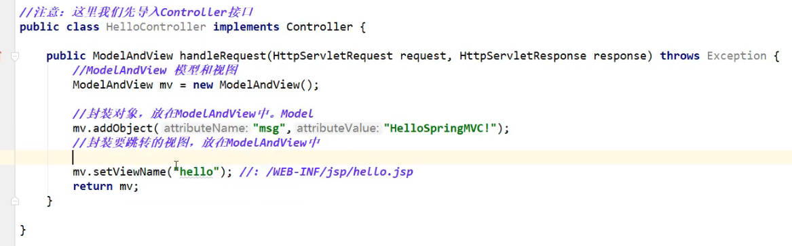

# Mybatis

## 动态 SQL

动态 SQL 是运行时根据参数动态生成并执行的 SQL 语句，让查询条件可以灵活变化，但同时也带来安全和性能风险，需要谨慎使用 。

### 动态 SQL 是什么

1. 核心定义：动态 SQL 指的是在程序运行时，根据输入参数、状态或配置动态拼接或构造 SQL 语句的技术，解决的是"查询条件不确定"这类普遍需求 。
2. 本质理解：把"条件判断"从 SQL 文本层面提前到代码逻辑层面，运行时先根据参数决定要不要拼某段条件，再生成最终 SQL 去执行 。
3. 三类主流实现方式：
   - 字符串拼接：最直接但也最危险，在服务端用代码拼接 SQL 字符串，容易引发 SQL 注入和性能问题 。
   - 数据库原生机制：如 SQL Server 的 sp_executesql、Oracle 的 EXECUTE IMMEDIATE，更接近底层，适合存储过程中处理复杂逻辑 。
   - ORM 框架封装：如 MyBatis 的 XML 动态标签、JPA 的 Specification，把"结构可变"抽象好，框架负责拼装，可读性和安全性更好 。


### MyBatis 中怎么用

1. 核心标签用法（6 个最常用）：
   - if 标签：所有动态判断的基础，test 属性写 OGNL 表达式，值为真就拼接标签内部内容 。
   - where 标签：自动处理 WHERE 关键字和多余的 AND/OR，配合 if 标签使用，避免写 1=1 这种丑代码 。
   - foreach 标签：搞定批量操作，如 IN 查询、批量插入，需指定 collection、item、separator 等属性 。
   - choose 标签：分支互斥，类似 Java 的 switch，命中第一个 when 就忽略后面的 。
   - bind 标签：在 XML 里定义变量，常见于模糊查询，把拼接逻辑从数据库方言中抽离出来 。
   - sql 与 include：SQL 片段复用，不同查询的返回列高度重合时可定义一次多处引用 。
2. 实现机制：MyBatis 通过 OGNL 表达式实现参数值计算和 SQL 拼接，解析 XML 映射文件时根据表达式结果决定是否包含相应 SQL 片段 。
3. 常见应用场景：
   - 多条件查询：用户只输入部分查询条件时，动态生成 WHERE 子句 。
   - 批量操作：根据数据集合大小动态生成 INSERT 或 UPDATE 语句 。
   - 排序和分页：根据用户选择动态生成 ORDER BY 和 LIMIT 子句 。


### 安全与性能怎么把控

1. SQL 注入防御原则：
   - 结构允许动态，值必须参数化：把 SQL 骨架和参数值分离后传给数据库，数据库先预编译 SQL 骨架，再把参数作为纯数据绑定进去 。
   - 参数永远走占位符：MyBatis 中用 `#{}` 而不是${}，${} 会直接拼接字符串，有注入风险 。
   - 动态表名/列名必须白名单校验：这类标识符没法预编译，调用方要做好限制，别直接接受用户输入
2. 性能优化要点：
   - 避免每条 SQL 都产生新文本：数据库每次都要重新解析、重新生成执行计划，高并发下性能容易出问题 。
   - 使用 bind variables：允许数据库共享单个 cursor 用于多条 SQL 语句，提升性能 。
   - 批量操作要分批：单条 INSERT 多行拼到一两百行、占位符上千个时，很多环境开始报错或性能急剧下降，常见做法是每 200 条刷一批 。
3. 什么情况下必须用/禁止用：
   - 必须用：BI 工具拖拽式报表（字段数、聚合函数全由前端配置决定）、自动化运维脚本（如按表大小自动添加索引）、动态表名场景 。
   - 禁止用：同一张表只是 WHERE 条件变（如 status='active'vs'inactive'）、固定字段的列表页仅排序字段可选、应用启动时创建固定结构的临时表 。

需要我帮你整理动态表名或列名时，白名单校验的具体实现方法吗？可以帮你安全地处理这类动态标识符。

## 其他类似动态SQL的技术

[有没有类似动态sql的技术_百度搜索](https://www.baidu.com/s?ie=UTF-8&wd=%E6%9C%89%E6%B2%A1%E6%9C%89%E7%B1%BB%E4%BC%BC%E5%8A%A8%E6%80%81sql%E7%9A%84%E6%8A%80%E6%9C%AF)  

有的，而且不止一种。动态 SQL 的核心思路，就是把 SQL 从“写死的字符串”变成“按条件组装出来的结构”，围绕这个思路，不同技术各有侧重。

### 主流同类技术

1. MyBatis Dynamic SQL：MyBatis 官方推出的动态 SQL 生成框架，用 Java API 构建 SQL 条件，类型安全，编译期就能发现字段名拼写错误，无需写 XML。
2. MyBatis-Plus 及其扩展：MyBatis 生态最主流的增强工具，封装通用 CRUD、条件构造器，用 Lambda 表达式构建查询条件，开发效率很高。
3. Spring Data JPA：Spring 生态的 ORM 框架，通过方法名自动生成查询，如 `findByUserName(String name)` 自动生成 `WHERE user_name = ?`，适合喜欢面向对象风格的团队。
4. SQLBuilder 工具：如 mooSQL 的 SQLBuilder，支持链式调用构建 SQL，自动处理参数转义，适配多种数据库方言。
5. JdbcTemplate 的 NamedParameterJdbcTemplate：Spring 提供的命名参数支持，用 `:name` 代替 `?`，可读性更好，底层仍是预编译语句，兼顾安全。

### 怎么选

- 追求类型安全、想摆脱 XML：选 MyBatis Dynamic SQL，复杂动态查询用 Java API 构建，编译期就能发现字段错误。
- 单表操作多、想提高开发效率：选 MyBatis-Plus，条件构造器非常成熟，社区活跃。
- 项目深度整合 Spring 生态、偏好面向对象：选 Spring Data JPA，方法名解析查询很优雅。
- 不想引入重框架、只想安全拼接 SQL：选 SQLBuilder 或 NamedParameterJdbcTemplate，轻量够用。

### 一个关键提醒

无论用哪种技术，防止 SQL 注入都是底线。MyBatis 的 `#{}` 是预编译占位符，安全；`${}` 是字符串拼接，有注入风险，只在动态表名、排序字段等场景使用，且必须做白名单校验。 其他 SQLBuilder 工具也要确认自动处理参数转义，别为省事直接拼接用户输入。

> 另外，如果你关注的是“AI 自动写 SQL”这个方向，现在也有 NL2SQL 和交互式 SQL Agent 等前沿技术，通过大模型直接生成或执行查询，但这类技术还在快速演进中，生产落地需要谨慎评估。

这些技术各有侧重，要不要再看看MyBatis-Plus 的 LambdaQueryWrapper 用法或者Spring Data JPA 方法名规则

## 替代mybatis的框架有哪些

[替代mybatis的框架有哪些_百度搜索](https://www.baidu.com/s?ie=UTF-8&wd=%E6%9B%BF%E4%BB%A3mybatis%E7%9A%84%E6%A1%86%E6%9E%B6%E6%9C%89%E5%93%AA%E4%BA%9B)  

[除了Mybatis还有什么好用的持久层框架](https://developer.aliyun.com/ask/402106)  

[MyBatis替代方案对比：JOOQ、Spring Data与R2DBC](https://blog.csdn.net/weixin_29611239/article/details/164960974)  

替代 MyBatis 的主流框架主要有 Spring Data JPA、jOOQ、Spring Data JDBC、dbVisitor 等，各有侧重，可根据项目特点选择。

### 常见替代方案

1. Spring Data JPA（基于 Hibernate）：接口自动生成 SQL，CRUD 代码少，支持懒加载、二级缓存，适合领域模型复杂、追求开发效率的项目。复杂查询需 JPQL 或 Criteria API，灵活性不如 MyBatis。

2. jOOQ：通过代码生成实现编译时 SQL 校验，类型安全，DSL 接近 SQL 写法，学习成本低，适合复杂联表查询、动态 SQL 多、跨数据库兼容要求高的场景。

3. Spring Data JDBC：轻量，无缓存和代理对象开销，实体直接映射表，适合简单领域模型和微服务场景。缺少懒加载、级联等 JPA 高级特性。

4. dbVisitor：轻量 ORM，链式 API 简洁，动态 SQL 用 Lambda 构建，避免 XML 与 Java 上下文切换，性能与 MyBatis 相当，适合新中小型项目和高迭代需求。

5. Ebean ORM / Jimmer：Ebean 支持 Active Record 模式，适合快速开发；Jimmer 结合 GraphQL 与 ORM，适合 API 优先设计。

### 怎么选

- 继续用 MyBatis：需深度优化 SQL、集成复杂遗留数据库、高频批量更新，MyBatis 仍合适。
- 转 JPA/Hibernate：领域模型复杂，需懒加载、缓存提升读性能，想减少手写 SQL。
- 试 jOOQ 或 Spring Data JDBC：需平衡 SQL 灵活性与类型安全选 jOOQ；微服务简单模型高效处理选 Spring Data JDBC。
- 其他语言：Node.js 可看 Objection.js 或 Prisma；Python 可看 SQLAlchemy 或 Django ORM。

> 迁移旧项目建议渐进式：新功能用新框架，旧功能逐步重写，并为旧 MyBatis 接口加适配层，降低风险。

这些框架各有侧重，要不要继续看看jOOQ和Spring Data JPA怎么选?或者dbVisitor适合哪些项目类型?

## 自动化程度更高的框架

[比Mybatis自动化程度更高的框架_百度搜索](https://www.baidu.com/s?ie=UTF-8&wd=%E6%AF%94Mybatis%E8%87%AA%E5%8A%A8%E5%8C%96%E7%A8%8B%E5%BA%A6%E6%9B%B4%E9%AB%98%E7%9A%84%E6%A1%86%E6%9E%B6)  

[为什么很多大厂不用Mybatis](https://developer.huawei.com/home/forum/hwc/thread-0263137557876533059-1-1.html)  

比 MyBatis 自动化程度更高的框架主要分为两类：一类是全自动 ORM 框架（如 JPA/Hibernate），另一类是MyBatis 的增强型框架（如 MyBatis-Plus、MyBatis-Flex）。

若追求极致的自动化（免写 SQL、自动建表、对象状态管理），首选 Spring Data JPA (Hibernate)；若希望在保留 MyBatis SQL 可控性的基础上提升 CRUD 自动化效率，首选 MyBatis-Plus 或 MyBatis-Flex。

### Spring Data JPA (基于 Hibernate)

特点：全自动 ORM，通过实体类注解自动映射数据库表，支持自动生成 SQL、自动建表（ddl-auto）、复杂关联查询。无需编写任何 SQL 即可完成标准 CRUD。
适用场景：业务逻辑以对象为中心、数据库结构稳定、对 SQL 性能调优要求不极端的项目。

Maven 依赖：
```xml
<dependency>
    <groupId>org.springframework.boot</groupId>
    <artifactId>spring-boot-starter-data-jpa</artifactId>
</dependency>
<dependency>
    <groupId>com.mysql</groupId>
    <artifactId>mysql-connector-j</artifactId>
    <scope>runtime</scope>
</dependency>
```

核心代码示例：
```java
// 1. 定义实体 (自动映射表结构)
@Entity
@Table(name = "user")
@Data
public class User {
    @Id
    @GeneratedValue(strategy = GenerationType.IDENTITY)
    private Long id;
    private String name;
    private Integer age;
}

// 2. 定义 Repository (无需实现类，自动注入 CRUD 方法)
public interface UserRepository extends JpaRepository<User, Long> {
    // 方法名即查询条件，无需写 SQL
    List<User> findByName(String name);
}

// 3. 使用
@Autowired
private UserRepository userRepository;

public void test() {
    // 自动保存/更新
    User user = new User();
    user.setName("Test");
    userRepository.save(user);
    
    // 自动查询
    List<User> users = userRepository.findByName("Test");
}
```

### MyBatis-Plus (MP)

特点：MyBatis 的增强工具，单表 CRUD 完全自动化（免写 XML/SQL），支持 Lambda 类型安全查询、分页、逻辑删除。多表复杂查询仍需手写 SQL 或使用 Wrapper。
适用场景：国内主流选择，兼顾开发效率与 SQL 灵活性，适合大多数互联网项目。

Maven 依赖：
```xml
<dependency>
    <groupId>com.baomidou</groupId>
    <artifactId>mybatis-plus-spring-boot3-starter</artifactId>
    <version>3.5.5</version> <!-- 请根据实际 Spring Boot 版本选择 -->
</dependency>
```

核心代码示例：
```java
// 1. Mapper 继承 BaseMapper
@Mapper
public interface UserMapper extends BaseMapper<User> {
}

// 2. 使用 (无需写 XML)
@Autowired
private UserMapper userMapper;

public void test() {
    // 自动插入
    User user = new User();
    user.setName("Test");
    userMapper.insert(user);

    // Lambda 查询 (类型安全，无魔法值)
    List<User> users = userMapper.selectList(
        new LambdaQueryWrapper<User>()
.eq(User::getName, "Test")
.gt(User::getAge, 18)
    );
}
```

### MyBatis-Flex

特点：新一代 MyBatis 增强框架，性能优于 MP，支持多表联合查询的 Fluent API，无 SQL 解析开销，轻量级。
适用场景：对性能敏感、需要复杂多表查询但不想写 XML 的场景。

Maven 依赖：
```xml
<dependency>
    <groupId>com.mybatis-flex</groupId>
    <artifactId>mybatis-flex-spring-boot-starter</artifactId>
    <version>1.8.0</version>
</dependency>
```

核心代码示例：
```java
// 1. Mapper 继承 BaseMapper
@Mapper
public interface AccountMapper extends BaseMapper<Account> {
}

// 2. 使用 QueryWrapper (支持多表 Join)
@Autowired
private AccountMapper accountMapper;

public void test() {
    // 单表查询
    Account account = accountMapper.selectOneByQuery(
        QueryWrapper.create()
.where(Account::getId).eq(1)
    );

    // 多表 Join 查询 (无需 XML)
    QueryWrapper query = QueryWrapper.create()
.select(ACCOUNT.ID, ACCOUNT.USER_NAME, ORDER.AMOUNT)
.from(ACCOUNT)
.leftJoin(ORDER).on(ACCOUNT.ID.eq(ORDER.ACCOUNT_ID))
.where(ACCOUNT.AGE.gt(18));
        
    List<Map<String, Object>> list = accountMapper.selectMapsByQuery(query);
}
```

### 选型建议

- 完全不想写 SQL：选 Spring Data JPA。
- 主流稳健、社区强大：选 MyBatis-Plus。
- 高性能、复杂多表查询自动化：选 MyBatis-Flex。

选型时除了看自动化程度，还可以关注==JPA和MP的性能差异大吗==?  或者==JPA的自动建表功能如何配置==?

# Spring

[自动写spring bean插件_百度搜索](https://www.baidu.com/s?ie=UTF-8&wd=%E8%87%AA%E5%8A%A8%E5%86%99spring%20bean%E6%8F%92%E4%BB%B6)  

## IoC和AOP

[ioc aop_百度搜索](https://www.baidu.com/s?ie=UTF-8&wd=ioc%20aop)  

IoC（控制反转）和AOP（面向切面编程）是Spring框架的两大核心设计思想，一个解决对象创建和依赖管理的问题，一个解决横切逻辑重复的问题。

### IoC：控制反转

传统开发中，对象由自己`new`出来，依赖关系硬编码在类里，换实现类就得改代码。IoC将对象的创建和依赖管理交给Spring容器，使用时直接拿，即依赖注入（DI）。

- 解决了什么：降低组件间耦合度，替换实现类无需改动业务代码，测试更方便。
- 怎么实现：构造器注入（推荐，避免空指针）、Setter注入、字段注入（`@Autowired`，代码简洁但不利于测试）。
- 底层原理：容器启动时读取配置，通过反射实例化Bean，再注入依赖，Bean默认单例，由容器管理整个生命周期。

> 可以这样理解：以前自己买菜做饭，现在点外卖，平台（容器）把饭送到手上，不用关心食材从哪来。

### AOP：面向切面编程

AOP将日志、事务、权限校验等横切关注点从核心业务逻辑中分离，在不修改原代码的前提下，通过动态代理在方法执行前后自动插入逻辑。

- 解决了什么：避免日志、事务等代码在多个方法里重复编写，业务代码只专注核心逻辑。
- 核心概念：切面（Aspect，封装横切逻辑）、切点（Pointcut，匹配哪些方法）、通知（Advice，前置、后置、环绕等5种）、织入（Weaving，将切面应用到目标对象）。
- 底层原理：基于动态代理。目标类有接口时用JDK动态代理，无接口时用CGLIB生成子类代理；Spring Boot 2.x之后默认统一用CGLIB。
- 典型场景：`@Transactional`声明式事务、统一日志记录、权限校验、性能监控、接口限流。

> 就像给门装自动感应灯，人过灯亮，不用每次手动开关；方法一执行，日志自动记录，不用在每个方法里手写一遍。

### IoC与AOP的关系

两者相辅相成，IoC是AOP的基础：AOP的切面本身也是Bean，由IoC容器管理；AOP则在不改变IoC管理对象的前提下，为其动态生成代理对象，增强功能。

- IoC解决纵向对象依赖问题，AOP解决横向横切逻辑问题。
- 声明式事务是两者协同的典型案例：IoC管理数据源和事务管理器，AOP在`@Transactional`方法前后自动织入事务的开启、提交和回滚。

### 面试怎么答

面试官更想听具体场景，而非背定义。

- IoC：说哪个类交给了Spring管，比如"UserService没有自己new，是Spring容器管理的"，比说"解耦"更具体。
- AOP：说哪个方法前后自动加了什么，比如"下单方法加了`@Transactional`，事务的开启和提交是AOP自动做的"。

### 两个易踩坑的点

1. AOP内部调用不生效：一个Bean内部方法调用自己的另一个方法时，不走代理，AOP不会触发。解决：将方法移到另一个Bean中，或通过代理对象调用。
2. CGLIB无法代理final方法：final方法不能被子类重写，若需AOP增强，避免将方法声明为final。

IoC和AOP的原理都涉及反射和代理，可以看看IoC容器如何实现反射实例化Bean?或者JDK代理和CGLIB代理有何区别?

## DI依赖注入

[DI依赖注入_百度搜索](https://www.baidu.com/s?ie=UTF-8&wd=DI%E4%BE%9D%E8%B5%96%E6%B3%A8%E5%85%A5)  

DI 就是依赖注入，它是实现控制反转（IoC）的一种方式，核心是==把对象需要的依赖交给外部容器来创建和注入==，而不是自己在代码里直接 new 出来。

### 它到底是啥

简单说，以前类A要使用类B，往往在A内部直接创建B；==用了DI后，A声明自己需要B，由容器在运行时把B“送进来”==。这样对象之间的耦合更低，代码更容易替换、测试和维护。

- 比如，最早==业务层调Dao层，要通过把Dao实现类组合进来==， 是写死的， 如果Dao有新的实现类，serviceimpl也要改； 客户一有新的需求，业务层代码就要改

### 常见注入方式

- 构造函数注入：在构造方法里声明依赖，最常用，推荐优先使用。
- 属性注入：对象创建后，由容器给属性赋值。
- 方法注入：通过调用某个方法把依赖传进去。

### 常见使用场景

在ASP.NET Core、Spring等框架里，DI是基础设施的一部分。`例如把日志、数据库服务等注册到容器，需要时直接注入使用`，还能配置不同生命周期，如每次新建、按请求复用或全局单例。

DI的注入方式各有特点，可以看看 构造函数注入和属性注入有何区别？ 或者 不同生命周期对容器有何影响？

## ==IoC创建对象==

[IoC创建对象_百度搜索](https://www.baidu.com/s?ie=UTF-8&wd=IoC%E5%88%9B%E5%BB%BA%E5%AF%B9%E8%B1%A1)  

IoC 创建对象的核心方式有三种：==无参构造器、有参构造器、工厂方法==，底层靠反射实例化，由容器统一管理生命周期。

### 三种创建方式

1. 无参构造器（最常用）：类提供 public 无参构造，Spring 通过反射调用，再用 setter 注入属性。配置 `<bean id="user" class="com.pojo.User">`，加载配置文件时对象即已创建，默认单例。

2. 有参构造器：用 `<constructor-arg>` 传参，可按 index（下标）、name（参数名） 或 type（类型） 匹配构造器。
   ```xml
   <bean id="user" class="com.pojo.User">
       <constructor-arg name="name" value="张三"/>
       <constructor-arg type="int" value="20"/>
   </bean>
   ```

3. 工厂方法：适合创建过程复杂的对象，分三种：
   - 静态工厂：`factory-method` 指向静态方法，如 `<bean id="airplane" class="com.factory.AirplaneStaticFactory" factory-method="getAirPlane"/>`
   - 实例工厂：先配置工厂 bean，再用 `factory-bean` + `factory-method` 调用实例方法
   - FactoryBean：实现 `FactoryBean` 接口，重写 `getObject()` 自定义创建逻辑，容器自动识别为工厂

### 底层原理

IoC 容器可看作大 Map，key 是 bean 名称，value 是实例对象。启动时扫描配置或注解，通过反射创建实例存入容器，使用时 `getBean()` 直接取，无需自己 `new`。

关键机制：
- BeanDefinition：配置信息（类路径、作用域、属性）先封装成 BeanDefinition，再据此创建实例
- 三级缓存：`singletonObjects`、`earlySingletonObjects`、`singletonFactories` 解决单例循环依赖，提前暴露未完成初始化的对象引用；原型 bean 遇循环依赖直接抛异常
- BeanPostProcessor：Spring 留给开发者的扩展点，AOP、事务、数据源代理均通过它实现，在初始化前后提供 `postProcessBefore/AfterInitialization` 钩子

### 注解方式

现在主流写法是 @Component + @ComponentScan 或 @Bean：
- `@Component` 标记类交给 Spring 管理，`@Controller`、`@Service`、`@Repository` 是其子注解，分别对应不同分层
- `@Bean` 用在方法上，适合创建复杂对象或第三方类，方法名默认 bean 名
- 注入用 `@Autowired`（默认按类型）或 `@Resource`（默认按名称）

> 注意：配置文件加载时，容器中管理的单例对象就已初始化，不是调用 `getBean()` 时才创建。

IoC创建对象的方式不止一种，要不要继续看看==工厂方法和构造器注入有何区别==?或者三级缓存如何解决循环依赖?

## DI依赖注入是什么意思

依赖注入是一种编程设计模式，指==对象需要的依赖==由==外部创建并传入==，而不是自己创建。
- 核心思想：类只负责使用依赖，不负责查找或创建依赖，依赖由外部容器管理。
- 常见注入方式：通过==构造函数、属性或方法参数==接收依赖对象。
- 主要作用：降低组件间的耦合，使代码更易维护、扩展和测试。

简单说，就是“不要自己造工具，别人把工具给你用”。

依赖注入的核心是外部管理，要不要继续看看 为什么依赖注入能降低耦合？ 或者 依赖注入和控制反转有什么区别？

## 依赖注入注入的是什么

依赖注入注入的是对象实例，具体来说是当前类所依赖的另一个对象（依赖项）。比如一个类需要调用数据库、日志或邮件服务，依赖注入会把已创建好的服务实例“从外面”传进来，而不是让类自己用 `new` 创建。

### 注入的本质

依赖注入的==核心是把“创建对象”和“使用对象”分开==。类只声明“我需要一个能发邮件的服务”，至于这个服务是真实 SMTP 实现还是测试用的模拟实现，类本身不关心——容器在运行时把对应的实例塞进来。

### 具体注入的是什么

1. ==接口类型的实现类实例==：最常见的是依赖抽象接口，容器注入实现类对象。如注入 `IEmailService`，实际拿到的是 `SmtpEmailService` 或 `MockEmailService` 的实例。
2. ==具体类实例==：简单场景可直接注入具体类，但耦合度更高，替换实现需改代码。
3. ==基本类型和集合==：除对象外，还能注入字符串、数字、List、Map、Set、Properties 等类型的数据。

### 注入方式

- 构造函数注入：依赖通过构造函数参数传入，最常用且最安全，对象创建时依赖就已就绪。
- 属性/Setter 注入：通过公共属性或 setter 方法传入，较灵活但需注意线程安全。
- 方法注入：通过普通方法传入，较少使用，会破坏封装性。

> 理解要点：依赖注入注入的不是“代码”或“配置”，而是已初始化好的对象实例。容器负责创建和维护这些实例，并在需要时“送上门”。

注入方式各有优劣，可以看看构造函数注入和setter注入哪个更常用或者方法注入为什么少用

## ==DI注入分类==

DI（依赖注入）的分类可以从注入方式和注入类型两个维度来看。按注入方式，主流分为构造方法注入、Setter注入和属性（字段）注入三类；按注入类型，则分为基本类型/String、Bean类型和集合类型三种。

### 按注入方式分类

1. 构造方法注入：通过类的构造函数传入依赖对象，Spring 容器在创建 Bean 时调用带参构造完成注入。这是 Spring 官方推荐的方式，支持 `final` 字段，依赖在对象创建时即初始化完成，也能检测循环依赖。

2. Setter 注入：通过类的 setter 方法注入依赖，容器在实例化 Bean 后调用 ==setter 完成赋值==。优点是可在对象创建后重新配置或覆盖依赖，但字段不能是 `final`，且依赖对象可能被后续修改。

3. 属性（字段）注入：直接在字段上加 `@Autowired`、`@Resource` 等==注解==完成注入，代码最简洁。缺点是依赖关系不够显式、无法检测循环依赖，且 `final` 字段无法赋值，不被 Spring 官方推荐。

### 按注入类型分类

1. 基本类型和 String：如 `int`、`boolean`、`String` 等，通过 `value` 属性直接赋值。

2. 其他 Bean 类型：注入 IoC 容器中已管理的 Bean 对象，通过 `ref` 属性或注解按类型/名称匹配。

3. 复杂类型/集合类型：包括 `List`、`Set`、`Map`、`Properties`、数组等，支持注入字符串集合、对象集合等。

### 相关注解的区别

- @Autowired：Spring 提供，默认按类型注入，多个 Bean 时需配合 `@Qualifier` 指定名称，支持 `required` 属性。
- @Resource：JDK 标准注解（JSR-250），默认按名称注入，找不到再按类型匹配，不支持 `required` 属性。
- @Primary：多个同类型 Bean 时标记默认实现，配合 `@Autowired` 使用。

> 另外还有一种较少提及的接口注入（Interface Injection），通过接口定义注入方法，由容器调用该方法注入依赖，但在 Spring 中基本不使用，更多是理论层面的分类。

DI注入方式各有特点，可以看看构造方法注入如何解决循环依赖?或者Setter注入为什么不能用final字段?

##  p和c命名空间注入

[spring p和c注入_百度搜索](https://www.baidu.com/s?ie=UTF-8&wd=spring%20p%E5%92%8Cc%E6%B3%A8%E5%85%A5)  

[Spring的P命名空间和C命名空间注入](https://blog.csdn.net/weixin_44853310/article/details/124132616)  [依赖注入之 C命名空间 和 P命名空间注入](https://www.cnblogs.com/szqengr/p/14748134.html)  [spring依赖注入中p命名空间和c命名空间区别](https://www.cnblogs.com/lonelyisland/p/14641861.html)  

Spring 的 p 命名空间和 c 命名空间==分别是 setter 注入和构造器注入的简化写法==，本质是 XML 配置的语法糖，用来少写 `<property>` 和 `<constructor-arg>` 标签。

#### p 命名空间：简化 setter 注入

- 作用：直接给属性赋值，底层调用 setter 方法。
- 前提：类必须有无参构造方法和对应属性的 setter 方法。
- 声明：`xmlns:p="http://www.springframework.org/schema/p"` 
- 用法：
```xml
<bean id="user" class="com.example.User" p:name="张三" p:age="18"/>
```
等价于：
```xml
<bean id="user" class="com.example.User">
    <property name="name" value="张三"/>
    <property name="age" value="18"/>
</bean>
```
- 引用其他 Bean：用 `-ref` 后缀，如 `p:address-ref="addressBean"`。

#### c 命名空间：简化构造器注入

- 作用：直接给构造器参数赋值，底层调用有参构造方法。
- 前提：类必须有对应的有参构造方法。
- 声明：`xmlns:c="http://www.springframework.org/schema/c"` 
- 用法：
```xml
<bean id="user" class="com.example.User" c:name="李四" c:age="20"/>
```
等价于：
```xml
<bean id="user" class="com.example.User">
    <constructor-arg name="name" value="李四"/>
    <constructor-arg name="age" value="20"/>
</bean>
```
- 按索引注入：参数名不可用时用 `c:_0`、`c:_1` 按位置指定。
- 引用其他 Bean：同样用 `-ref` 后缀，如 `c:userDao-ref="userDao"`。

### 两者对比

| 维度     | p 命名空间         | c 命名空间               |
| -------- | ------------------ | ------------------------ |
| 注入方式 | setter 注入        | 构造器注入               |
| 前提条件 | 无参构造 + setter  | 有参构造                 |
| 适用场景 | 可选依赖、属性较多 | 强制依赖、创建时就要就绪 |
| 版本要求 | Spring 2.5+        | Spring 3.1+              |

> ⚠️ 注意：c 命名空间按参数名注入时，编译需开启 `-parameters`（Java 8+），否则只能用索引方式 `c:_0`。

了解了 p 和 c 的区别，可以再看看为什么 p 注入需要无参构造?或者c 命名空间的引用写法和 p 一样吗?

## Bean的作用域

Spring Bean 的作用域是==控制 Bean 实例创建规则和生命周期的机制==，Spring 框架共支持6 种标准作用域：`singleton、prototype、request、session、application、websocket`。

### 标准作用域

1. singleton（单例）：默认作用域，整个 Spring 容器中只存在一个共享实例，容器启动时创建，关闭时销毁，适用于无状态服务如 Service、DAO、工具类。
2. prototype（原型）：每次从容器获取 Bean 时都创建新实例，容器不负责销毁，适用于有状态对象或需要独立状态的场景。


### Web 环境作用域

1. request（请求）：每个 HTTP 请求创建一个实例，请求结束即销毁，仅 Web 环境有效。
2. session（会话）：每个用户会话创建一个实例，会话超时或销毁时 Bean 销毁，适用于购物车、用户登录信息等。
3. application（应用）：整个 Web 应用共享一个实例，生命周期与 ServletContext 绑定，适用于全局配置、应用级缓存。
4. websocket（WebSocket）：每个 WebSocket 会话创建一个实例，连接关闭时销毁，适用于实时聊天、在线协作等场景。
    配置方式


可通过@Scope 注解设置作用域，如@Scope("prototype")；XML 配置中使用 scope 属性，如`<bean scope="singleton"/>`。request、session、application、websocket 作用域需配合 proxyMode 使用以避免依赖注入异常。

Bean 作用域配置方式不止一种，可以看看 如何通过 XML 配置 prototype 作用域？ 或者 proxyMode 是什么作用？

## Bean自动装配

[Bean自动装配_百度搜索](https://www.baidu.com/s?ie=utf-8&f=8&rsv_bp=1&tn=baidu&wd=Bean%E8%87%AA%E5%8A%A8%E8%A3%85%E9%85%8D&oq=Bean%25E7%259A%2584%25E4%25BD%259C%25E7%2594%25A8%25E5%259F%259F&rsv_pq=e5170309003eedc4&rsv_t=7500v7bRilRRZD0SLBYvq564QtSjLYRyopBFrJ6k6FJWMRrQxO%2BVPKqUTco&rqlang=cn&rsv_enter=1&rsv_dl=tb_click&rsv_sug3=11&rsv_n=2&rsv_btype=t&inputT=424239&rsv_sug4=424240)  

Bean自动装配是Spring容器==自动把依赖Bean注入到目标Bean中==的机制，无需手动通过`XML`或`注解`配置依赖关系。 核心是让Spring自动完成“找依赖、塞依赖”这件事，省去手动装配的繁琐。

### 自动装配的几种方式

1. no（默认）：不自动装配，需手动通过`ref`属性指定依赖。
2. byName：按属性名匹配容器中同名的Bean ID。要求set方法后的名字与Bean的id一致。
3. byType：按属性类型匹配容器中唯一同类型的Bean。容器中存在多个同类型Bean时会报错。
4. constructor：按构造方法参数类型匹配，与byType类似，优先匹配构造器参数。
5. autodetect（已过时）：优先按constructor装配，无匹配构造器则按byType装配，Spring 3.0后已弃用。

### 注解装配（最常用）

实际开发中，@Autowired是主流方式，默认按byType实现，配合@Qualifier可按名称精准匹配。

```java
@Service
public class UserService {
    // 构造器注入（Spring 4.3+可省略@Autowired）
    private final UserRepository userRepo;
    
    public UserService(UserRepository userRepo) {
        this.userRepo = userRepo;
    }
}

// 多Bean时用@Qualifier指定名字
@Autowired
@Qualifier("mysqlDataSource")
private DataSource dataSource;
```

@Resource也常用，默认按byName找，找不到再按byType。

### 底层原理

自动装配核心流程三步：

1. 组件扫描：`ClassPathBeanDefinitionScanner`解析`@ComponentScan`，扫描指定包下的类。
2. Bean定义注册：将注解类转化为`BeanDefinition`，注册到容器。
3. 依赖注入：`AutowiredAnnotationBeanPostProcessor`处理`@Autowired`，完成依赖注入。

> SpringBoot的自动装配更进一步，通过`@EnableAutoConfiguration`配合`spring.factories`，把第三方Jar包中的配置类和Bean自动加载进IoC容器，实现“约定大于配置”。

### 最佳实践建议

- 优先构造器注入：利于不可变对象和单元测试，依赖明确。
- 可选依赖用`@Autowired(required = false)`：允许依赖为null。
- 多Bean时明确指定`@Qualifier`：避免歧义。
- 避免过度依赖自动装配：隐式耦合会让依赖关系不透明，排查时需多跳几层。

自动装配的原理和方式都清楚了，要不要再看看byName和byType有什么区别?或者构造器注入为什么更利于测试?

## Spring注解注入

[Spring注解注入_百度搜索](https://www.baidu.com/s?ie=utf-8&f=8&rsv_bp=1&tn=baidu&wd=Spring%E6%B3%A8%E8%A7%A3%E6%B3%A8%E5%85%A5&oq=Bean%25E8%2587%25AA%25E5%258A%25A8%25E8%25A3%2585%25E9%2585%258D&rsv_pq=f11b17a8003f6085&rsv_t=d9cezL6A%2F4RzzWI2noazvPM4yonnfg0tRtsmJdrCY3lsyChZrFnLGsAYp%2FI&rqlang=cn&rsv_enter=1&rsv_dl=tb_enter&rsv_btype=t&inputT=3937102&rsv_sug3=36&rsv_sug1=4&rsv_sug7=100&rsv_sug4=3937103)  

Spring 注解注入主要用`@Autowired`和`@Resource`，前者按类型匹配，后者默认按名称匹配。

### 常用注入注解

1. @Autowired：Spring 提供，默认按类型自动装配，找不到 Bean 时可设置`required=false`允许为空。
2. @Resource：Java 标准注解，默认先按名称、再按类型匹配，兼容性更强。
3. @Qualifier：同类型有多个 Bean 时，配合@Autowired 指定具体 Bean 名称。


### 怎么用这些注解

1. 字段注入：直接写在属性上，代码最简洁，但不利于单元测试。
2. 构造器注入：推荐方式，能保证依赖不为空且对象不可变，Spring 4.3 起单构造器可省略@Autowired。
3. Setter 注入：适合依赖可选或后续需要重新配置的场景。


### 使用要注意啥

1. 组件声明：类上需加`@Component`、`@Service`等注解，或通过`@Configuration`注册 Bean。
2. 扫描配置：确保`@ComponentScan`扫描到注解所在包，否则注入不生效。
3. 避免循环依赖：过多使用字段注入容易导致循环引用，建议优先用构造器注入。

不同注入方式各有适用场景，可以看看 字段注入和构造器注入怎么选？ 或者 Spring 4.3之后构造器注入怎么简化？

## 注解使用

[spring注解注入](https://blog.csdn.net/inexaustible/article/details/128582049)  [Spring 注解使用](https://blog.csdn.net/weixin_51288065/article/details/166688239)  

注解注入顾名思义就是通过注解来实现注入，Spring和注入相关的常见注解有Autowired、Resource、Qualifier、Service、Controller、Repository、Component。

- Autowired是自动注入，自动从spring的上下文找到合适的bean来注入
- Resource用来指定`名称注入`
- Qualifier和Autowired配合使用，指定bean的名称
- Service，Controller，Repository分别`标记类是Service层类，Controller层类，Dao层的类`，spring扫描注解配置时，会标记这些类要生成bean
- Component是一种泛指，标记类是组件，spring扫描注解配置时，会标记这些类要生成bean

上面的Autowired和Resource是用来`修饰字段，构造函数，或者设置方法`，并做注入的。而S==ervice，Controller，Repository，Component==则是用来修饰类，`标记这些类要生成bean`。


| **注解**          | **语义**      | **特殊功能**   |
| ----------------- | ------------- | -------------- |
| `@Component`      | 通用组件      | 无             |
| `@Service`        | 业务层        | 无（语义清晰） |
| `@Repository`     | 数据访问层Dao | 异常转换       |
| `@Controller`     | Web 控制层    | 视图解析       |
| `@RestController` | REST 控制器   | 直接返回 JSON  |
| `@Configuration`  | 配置类        | CGLIB 代理     |

----

----

Spring 注解是用在 Java 类、方法或字段上的特殊标记，用来简化配置并告诉 Spring 容器如何管理 Bean、注入依赖和处理请求 。

### 怎么声明 Bean

- **[@Component](https://www.baidu.com/s?wd=@Component&usm=2&ie=utf-8&rsv_pq=dc3ed0de0041e38c&oq=Spring注解&rsv_t=3670Lk4zHevC34nOU7tZ4kla0br2axdWtUw6vyrEeWYKxykhXQgqJ5AbcE4&rsv_dl=re_dqa_generate&sa=re_dqa_generate)**‌：通用组件标记，Spring 会自动扫描并实例化
- ‌**[@Controller](https://www.baidu.com/s?wd=@Controller&usm=2&ie=utf-8&rsv_pq=dc3ed0de0041e38c&oq=Spring注解&rsv_t=f462KBJ19rsMo%2FdomeZDN9kVsHnQhXLcb8tRRGzBTUBBIDBao2tlft6PUWs&rsv_dl=re_dqa_generate&sa=re_dqa_generate)、[@Service](https://www.baidu.com/s?wd=@Service&usm=2&ie=utf-8&rsv_pq=dc3ed0de0041e38c&oq=Spring注解&rsv_t=f462KBJ19rsMo%2FdomeZDN9kVsHnQhXLcb8tRRGzBTUBBIDBao2tlft6PUWs&rsv_dl=re_dqa_generate&sa=re_dqa_generate)、[@Repository](https://www.baidu.com/s?wd=@Repository&usm=2&ie=utf-8&rsv_pq=dc3ed0de0041e38c&oq=Spring注解&rsv_t=7fc4rTQnGk2J0ZDIM55%2BUe7hOhdk5jYhezkoUzpLeBonXjcs67Ahc%2B0RpQc&rsv_dl=re_dqa_generate&sa=re_dqa_generate)**‌：分别用于 Web 控制器、业务层和数据访问层，语义更清晰
- ‌**[@Configuration](https://www.baidu.com/s?wd=@Configuration&usm=2&ie=utf-8&rsv_pq=dc3ed0de0041e38c&oq=Spring注解&rsv_t=7fc4rTQnGk2J0ZDIM55%2BUe7hOhdk5jYhezkoUzpLeBonXjcs67Ahc%2B0RpQc&rsv_dl=re_dqa_generate&sa=re_dqa_generate)**‌：声明配置类，替代 XML 配置文件
- ‌**[@Bean](https://www.baidu.com/s?wd=@Bean&usm=2&ie=utf-8&rsv_pq=dc3ed0de0041e38c&oq=Spring注解&rsv_t=9849C2tUZ8y56KWx1Bki97%2FtsMS0qZViaTCO0TyGl5OxQ6xdRCVkZLkSPeo&rsv_dl=re_dqa_generate&sa=re_dqa_generate)**‌：标注方法，把方法返回值注册为 Bean

### 怎么注入依赖

- **[@Autowired](https://www.baidu.com/s?wd=@Autowired&usm=2&ie=utf-8&rsv_pq=dc3ed0de0041e38c&oq=Spring注解&rsv_t=56a9YubmAk%2FBp2r7%2BTgewaC1bCfavJLLRAKu1tSntIw3FZomKujRO8i4a0k&rsv_dl=re_dqa_generate&sa=re_dqa_generate)**‌：按类型自动装配，最常用 。
- ‌**[@Qualifier](https://www.baidu.com/s?wd=@Qualifier&usm=2&ie=utf-8&rsv_pq=dc3ed0de0041e38c&oq=Spring注解&rsv_t=a5fen1UAG1K7xyZyg2d5oFch7%2BtiMNOQ1gFCqPrh1bwSuzQvSToL%2B77WZkU&rsv_dl=re_dqa_generate&sa=re_dqa_generate)**‌：配合@Autowired，按名称指定注入哪个 Bean
- ‌**[@Resource](https://www.baidu.com/s?wd=@Resource&usm=2&ie=utf-8&rsv_pq=dc3ed0de0041e38c&oq=Spring注解&rsv_t=463eUnOlbvmsyU9r8DA%2F8%2BSPZaMllcUoy2w2BtxV0N6Q7n4g1S4%2Bsh3GyE0&rsv_dl=re_dqa_generate&sa=re_dqa_generate)**‌：按名称或类型注入，来自 JSR-250 标准
- ‌**[@Value](https://www.baidu.com/s?wd=@Value&usm=2&ie=utf-8&rsv_pq=dc3ed0de0041e38c&oq=Spring注解&rsv_t=463eUnOlbvmsyU9r8DA%2F8%2BSPZaMllcUoy2w2BtxV0N6Q7n4g1S4%2Bsh3GyE0&rsv_dl=re_dqa_generate&sa=re_dqa_generate)**‌：注入配置值或环境变量

### 怎么处理 Web 请求

- ‌**[@RequestMapping](https://www.baidu.com/s?wd=@RequestMapping&usm=2&ie=utf-8&rsv_pq=dc3ed0de0041e38c&oq=Spring注解&rsv_t=124dtPQQWxEoD1YY5LkPs7Ff1HZVrrO%2FSJmNc0KpA6cng8hitIxw5l7f0pw&rsv_dl=re_dqa_generate&sa=re_dqa_generate)**‌：映射 HTTP 请求路径和方法
- ‌**[@GetMapping](https://www.baidu.com/s?wd=@GetMapping&usm=2&ie=utf-8&rsv_pq=dc3ed0de0041e38c&oq=Spring注解&rsv_t=b68dlgsjBaSjzqBsIhWApv9fFKrKLJqMc5jxmGMprWFvOFF2VVIbqq39%2Bjs&rsv_dl=re_dqa_generate&sa=re_dqa_generate)、[@PostMapping](https://www.baidu.com/s?wd=@PostMapping&usm=2&ie=utf-8&rsv_pq=dc3ed0de0041e38c&oq=Spring注解&rsv_t=b68dlgsjBaSjzqBsIhWApv9fFKrKLJqMc5jxmGMprWFvOFF2VVIbqq39%2Bjs&rsv_dl=re_dqa_generate&sa=re_dqa_generate)**‌：简化对应请求方法的写法
- ‌**[@RestController](https://www.baidu.com/s?wd=@RestController&usm=2&ie=utf-8&rsv_pq=dc3ed0de0041e38c&oq=Spring注解&rsv_t=b823EWXtYBmkiJzGeoiCVPC1WQ0sO%2FRpiqmpkfN%2Bgkpnwnv6A9zTu8EqZ1M&rsv_dl=re_dqa_generate&sa=re_dqa_generate)**‌：组合@Controller 和@ResponseBody，返回 JSON 数据
- ‌**[@PathVariable](https://www.baidu.com/s?wd=@PathVariable&usm=2&ie=utf-8&rsv_pq=dc3ed0de0041e38c&oq=Spring注解&rsv_t=b823EWXtYBmkiJzGeoiCVPC1WQ0sO%2FRpiqmpkfN%2Bgkpnwnv6A9zTu8EqZ1M&rsv_dl=re_dqa_generate&sa=re_dqa_generate)、[@RequestParam](https://www.baidu.com/s?wd=@RequestParam&usm=2&ie=utf-8&rsv_pq=dc3ed0de0041e38c&oq=Spring注解&rsv_t=b823EWXtYBmkiJzGeoiCVPC1WQ0sO%2FRpiqmpkfN%2Bgkpnwnv6A9zTu8EqZ1M&rsv_dl=re_dqa_generate&sa=re_dqa_generate)**‌：接收路径参数和请求参数 

Spring注解简化了配置，要不要继续看看 @Component和@ComponentScan怎么配合用？ 或者 @Autowired和@Resource有什么区别？

## 用JavaConfig实现配置

JavaConfig 是 ==Spring 基于纯 Java 代码的配置方式==，核心是用 `@Configuration` 标记配置类、用 `@Bean` 标记方法，把方法返回值注册为容器管理的 Bean，==用来替代传统 XML 配置==。

### 核心注解

1. @Configuration：标记一个类为配置类，相当于 XML 的根节点 `<beans>`，Spring 会解析该类中的 Bean 定义。
2. @Bean：加在方法上，方法返回值会被注册为 Bean，默认 Bean 名称就是方法名，也可用 `@Bean(name="xxx")` 指定。
3. @ComponentScan：开启组件扫描，自动注册指定包下带 `@Component`、`@Service`、`@Repository` 等注解的类，相当于 `<context:component-scan>`。
4. @Import：导入其他配置类，实现配置拆分和模块化。
5. @PropertySource：加载外部 `.properties` 配置文件，配合 `@Value` 注入属性值。
6. @Profile：实现多环境隔离，按 dev、test、prod 等环境加载不同 Bean。

### 快速上手

1. 定义业务类：普通 POJO，不需要任何 Spring 注解。
```java
public class UserService {
    private UserDao userDao;
    public UserService(UserDao userDao) {
        this.userDao = userDao;
    }
    public void doSomething() {
        System.out.println("UserService: " + userDao.getName());
    }
}
```

2. 编写配置类：用 `@Configuration` 和 `@Bean` 手动注册 Bean，依赖通过方法参数或直接调用其他 `@Bean` 方法注入。
```java
@Configuration
public class AppConfig {
    @Bean
    public UserDao userDao() {
        UserDao userDao = new UserDao();
        userDao.setName("JavaConfig 演示");
        return userDao;
    }
    
    @Bean
    public UserService userService(UserDao userDao) {
        return new UserService(userDao);  // 构造器注入
    }
}
```

3. 加载配置并获取 Bean：用 `AnnotationConfigApplicationContext` 替代 `ClassPathXmlApplicationContext`。
```java
public class Main {
    public static void main(String[] args) {
        ApplicationContext context = new AnnotationConfigApplicationContext(AppConfig.class);
        UserService userService = context.getBean(UserService.class);
        userService.doSomething();
        ((AnnotationConfigApplicationContext) context).close();
    }
}
```

### 与组件扫描的区别

| 特性     | 组件扫描（@Component） | JavaConfig（@Bean）              |
| -------- | ---------------------- | -------------------------------- |
| 控制方   | 类自己声明是 Bean      | 配置类外部声明 Bean              |
| 侵入性   | 需修改类源码加注解     | 目标类无需任何注解               |
| 灵活性   | 创建逻辑固定           | 方法体内可写任意复杂逻辑         |
| 典型场景 | 自己写的业务组件       | 第三方库、复杂初始化、条件化创建 |

> 实际开发中两者混合使用：自己的业务类用 `@Service` 等注解，第三方类或需精细控制的场景用 `@Bean`。

### 一个容易踩的坑

`@Bean` 不一定要写在 `@Configuration` 类里，写在 `@Component` 类里也能注册。但区别在于：`@Configuration` 类会被 Spring 用 CGLIB 代理，多次调用 `@Bean` 方法返回的是容器中的单例；而 `@Component` 类里多次调用会每次新建对象，破坏单例性。

JavaConfig 的灵活性很高，可以看看如何实现 Bean 的条件化创建?或者如何将外部 properties 文件引入配置?

# SpringMVC

## 个人总结

处理器和适配器作用： 把`url`去`匹配`spring里面，有哪个`controller`去处理它

==不用写servlet了，以后只写Controller业务层类==就可以了，处理后返回 ModelAndView，  `public class HelloController implements Controller{...}`

1. ==配置web.xml==： 注册`DispatcherServlet`

   1. web.xml 关联一个SpringMVC配置文件(springmvc-servlet.xml)
   2. `DispatcherServlet`: ==拦截请求，查找处理器==（HandlerMapping）

2. ==SpringMVC配置文件==： springmvc-servlet.xml，因为spring要有配置文件

   1. 添加 处理映射器：  根据请求 URL ==找到对应的 Controller 方法==，并封装处理器与拦截器

      1. `<bean class="org.springframework.web.servlet.handler.BeanNameUrlHandlerMapping"/>`

   2. 添加 处理器适配器：

      1. `<bean class="org.springframework.web.servlet.mvc.SimpleControllerHandlerAdapter"/>`
      2. 通过 HandlerAdapter 解析请求参数，反射==调用 Controller 方法执行业务==逻辑，`返回 ModelAndView` 或数据对象

   3. 添加 视图解析器：

      1. 若返回视图名，ViewResolver 解析为具体视图（如 JSP）并渲染数据； 若为前后端分离接口，返回值由消息转换器转为 JSON 直接响应。

      ```xml
      <!--视图解析器:DispatcherServlet给他的ModelAndView-->
      <bean class="org.springframework.web.servlet.view.InternalResourceViewResolver" id="InternalResourceViewResolver">
         <!--前缀-->
         <property name="prefix" value="/WEB-INF/jsp/"/>
         <!--后缀-->
         <property name="suffix" value=".jsp"/>
      </bean>
      ```

3. 写一个具体的==业务类==操作： 业务层，处理后返回 ModelAndView ， public class HelloController implements Controller{...}

   1. 要么实现Controller接口，要么增加注解； 需要返回一个==ModelAndView，模型存数据，视图设置要跳转到哪个地方==
   2. 通过 ModelAndView 存放东西，之前是放到session和request里面，封装要跳转到视图
   3. 写一个controller实现一个接口，还要注册到bean，很麻烦，==正式开发用注解版==
      

4. 视图渲染： 写要跳转的jsp页面，显示 ModelAndView 存放的数据

## Servlet的工作流程

Servlet的工作流程核心是：`浏览器发送请求 → Tomcat解析并找到对应Servlet → 调用service()处理 → 返回响应`。整个过程由Web容器（如Tomcat）接管，开发者只需继承HttpServlet并重写`doGet()/doPost()`

## springmvc工作流程

SpringMVC 的工作流程围绕前端控制器 `DispatcherServlet`展开，核心是“==请求分发 - 处理 - 响应==”闭环。
1. ==接收请求==：用户发送 HTTP 请求，由 DispatcherServlet 统一拦截。
2. ==查找处理器==：DispatcherServlet 调用 HandlerMapping，根据请求 URL 找到对应的 Controller 方法，并封装处理器与拦截器。
   1. `DispatcherServlet.class`里的`doService()`负责接收请求并转发 

3. ==适配执行==：通过 HandlerAdapter 解析请求参数，反射调用 Controller 方法执行业务逻辑，`返回 ModelAndView` 或数据对象。
4. ==视图渲染==：若返回视图名，ViewResolver 解析为具体视图（如 JSP）并渲染数据；若为前后端分离接口，返回值由消息转换器转为 JSON 直接响应。
5. ==拦截器后续处理==：执行拦截器的 postHandle 和 afterCompletion 方法，完成日志记录或资源清理。

整个流程中，DispatcherServlet 负责调度，HandlerMapping 负责映射，HandlerAdapter 负责执行，ViewResolver 负责视图解析。

流程中涉及多个组件，可以看看 HandlerMapping 有哪些常见实现？ 或者 HandlerAdapter 的作用是什么？

## modelandview

[modelandview_百度搜索](https://www.baidu.com/s?ie=UTF-8&wd=modelandview)  

ModelAndView是 Spring MVC 框架中用来同时封装模型数据和视图信息的核心类，控制器处理完业务后，通过它把数据传给页面，并指定要展示的视图。

### 它主要用来做什么

- 存数据：把业务逻辑处理后的结果放到模型中，比如查询到的商品列表、用户信息等，这些数据能在 JSP 等页面里被访问和展示。
- 定视图：指定最终要渲染的视图名称，Spring MVC 会通过视图解析器把名称解析成具体页面资源，比如把"index"解析为`/WEB-INF/jsp/index.jsp`。
- 二合一返回：控制器方法可以直接返回一个 ModelAndView 对象，把数据和视图打包一次交给框架处理，不用分开操作。


### 常用方法怎么写

- 创建对象：常用`new ModelAndView()`无参构造，然后分别设置视图和模型。
- 添加数据：用`addObject(String key, Object value)`向模型中存键值对，比如`mav.addObject("bookList", books)`。
- 设置视图：用`setViewName("视图名")`指定要跳转的页面名称，框架会自动拼接前后缀。
- 其他构造：也可用`ModelAndView(String viewName, Map model)`一次性传入视图名和模型数据。


### 和 Model 有什么区别

- ModelAndView需要手动创建实例，同时控制数据和视图，代码稍显完整但灵活度高。
- Model是每次请求自动注入的参数，只负责传数据，视图需通过返回字符串等方式单独指定，写法更简洁。
- 前后端分离场景下，现在后端多直接返回 JSON 数据，用`@ResponseBody`，==ModelAndView 在传统 JSP 页面渲染中更常见==。

ModelAndView 和 Model 的区别挺关键，要不要继续看看 ModelAndView 为什么需要手动创建？ 或者 Model 的数据怎么传到 JSP 页面？

# 分层结构

[ PO、VO、BO、DTO、DAO、POJO](https://zhuanlan.zhihu.com/p/1939373308756857224)  

[SSM架构开发](https://blog.51cto.com/u_16099224/9378559)  [Java后端分层架构中各层职责划分与DTO VO DO对象应用](https://developer.aliyun.com/article/1433922)  

## Web后端的分层结构

[dao pojo service controller_百度搜索](https://www.baidu.com/s?ie=UTF-8&wd=dao%20pojo%20service%20controller)  

这四层是Java Web后端最经典的分层结构，按职责把代码拆开，各管一段，从请求进来到数据落库，流程是 Controller → Service → DAO → 数据库，POJO贯穿其中当数据载体。

### 各层职责

1. POJO层：普通Java对象，对应数据库表结构，属性与字段一一对应，只有getter/setter，不写业务逻辑。别称Model、Entity、Domain。
2. DAO层：数据访问层，也叫Mapper层，只做单表增删改查，不涉及业务组合。MyBatis里就是接口加XML，用`@Mapper`标记。
3. Service层：业务逻辑层，组合多个DAO操作，做校验、计算、流程编排，事务边界用`@Transactional`控制，通常先写接口再写实现类。
4. Controller层：控制层，接收前端HTTP请求，解析参数，调Service，把结果包装成JSON返回，不写业务逻辑。

### 数据流转

一次典型请求：前端请求 → Controller接收参数 → 调Service处理业务 → Service调DAO读写数据库 → 结果逐层返回，POJO在层间传递。

### 几个关键点

- 依赖单向：Controller依赖Service，Service依赖DAO，禁止反向或跨层调用，比如Controller直接调Mapper。
- 对象不要混用：POJO别直接返回给前端，密码等敏感字段会泄露。入参用DTO，出参用VO，Service内部可用BO，各层各用各的载体。
- 事务只在Service：`@Transactional`加在Service实现类的public方法上，覆盖整个业务流程，保证多表操作要么全成功要么全回滚。

> 判断分层是否到位有个简单标准：改一个业务规则只动Service层，改一个字段映射只动DAO层，不用三层来回翻。

分层结构清楚了，可以再看看为什么分层后改规则只动Service或者Controller和Service怎么解耦

# 动态代理

## 动态代理

[javassist_百度搜索](https://www.baidu.com/s?ie=UTF-8&wd=javassist)  

Javassist 是一个 Java 字节码工程工具包，允许开发者以 Java 代码形式动态修改类结构或生成新类，无需直接处理虚拟机指令，最新版本为 3.33.0-GA（2026 年 8 月发布），项目仍在活跃维护中 。官方网站：[javassist.org](http://www.javassist.org)，GitHub 仓库：[github.com/jboss-javassist/javassist](https://github.com/jboss-javassist/javassist)。

### 核心功能与作用

1. 双层 API 设计：Javassist 提供源代码级和字节码级双层 API，使用源代码级 API 时无需了解 Java 字节码规范，可直接用 Java 语言词汇编辑类文件 。
2. 运行时类操作：支持在运行时定义新类，并在 JVM 加载时修改类文件，适用于动态代理、类加载器、AOP 框架等场景 。
3. 核心类说明：
   - ClassPool：类池容器，跟踪和控制所操作的类，工作方式与 JVM 类装载器相似。
   - CtClass：编译时类的抽象表示，可添加字段、方法、构造函数，修改父类和接口。
   - CtMethod/CtField/CtConstructor：分别用于操作方法、字段和构造器。


### 基本使用方法与代码示例

1. 动态创建类：
   - 获取默认类池：`ClassPool pool = ClassPool.getDefault()`
   - 创建新类：`CtClass ctClass = pool.makeClass("com.demo.DynamicClass")`
   - 添加字段和方法后，使用 `ctClass.toClass()` 加载修改后的类。
2. 修改现有类：
   - 获取已有类：`CtClass ctClass = pool.get("com.example.Student")`
   - 修改方法体：`ctMethod.setBody("return $1 + $2;")`，其中$1 代表第一个参数。
   - 插入代码：`method.insertBefore("System.out.println(\"日志\");")` 在方法前添加代码。
3. 注意事项：
   - 动态修改的类必须在 JVM 中未被加载过，否则会报重复类定义异常。
   - 代码块中的引用类型需写全量类名，运行时才报错，无 IDE 提示。


### 与其他工具对比及项目状态

1. 与 ASM 对比：ASM 直接操作字节码指令，执行效率高但要求掌握字节码规范；Javassist 提供更高级 API，易于使用但执行效率相对较低 。
2. 与 Cglib 对比：Javassist 被用于 Struts2 和 Hibernate 中做动态字节码修改，Cglib 基于 ASM 实现，两者都支持动态代理但 API 设计不同 。
3. 项目维护状态：由东京工业大学 Shigeru Chiba（千叶滋）于 1999 年创建，截至 2026 年 6 月 GitHub 仓库仍有代码提交，采用 MPL/LGPL/Apache 三重许可协议 。

Javassist 的 API 层次挺有意思，要不要看看 源代码级 API 和字节码级 API 的区别 或者 MPL/LGPL/Apache 三重许可协议有何区别

## JDK动态代理

[JDK动态代理_百度搜索](https://www.baidu.com/s?ie=utf-8&f=8&rsv_bp=1&tn=baidu&wd=JDK%E5%8A%A8%E6%80%81%E4%BB%A3%E7%90%86&oq=javassist&rsv_pq=b29a0ca000589d2b&rsv_t=0787z4veXFdHNTNvb3kRqjzmTrTmNB9ZuYI4oo4MDSAnuTnq9jT%2BJsfyzE0&rqlang=cn&rsv_enter=1&rsv_dl=tb_enter&rsv_sug3=22&rsv_sug1=4&rsv_sug7=100&rsv_btype=t&inputT=6548&rsv_sug4=6548)  

JDK 动态代理是 Java 自带的代理机制，只能代理实现了接口的类，它会在==运行时动态生成一个代理对象==，把方法调用转给 `InvocationHandler`，再由处理器决定何时、如何调用目标对象的方法，从而在不修改原有类的情况下增加日志、权限、事务等通用逻辑。

### 怎么实现一个 JDK 动态代理

1. 定义接口及其实现类：==目标对象必须实现某个接口，代理对象最终也会实现同一个接口==。
2. 编写 InvocationHandler：实现 `java.lang.reflect.InvocationHandler`，重写 `invoke` 方法，在里面通过反射调用目标对象方法，并可在前后添加增强逻辑。
3. 创建代理对象：调用 `Proxy.newProxyInstance(loader, interfaces, handler)`，传入类加载器、目标对象实现的接口、以及上面编写的处理器，返回的代理对象就可以像普通对象一样调用接口方法。

核心代码结构如下：
```java
public class MyHandler implements InvocationHandler {
private Object target;
public MyHandler(Object target) {
this.target = target;
}
@Override
public Object invoke(Object proxy, Method method, Object[] args) throws Throwable {
System.out.println("方法调用前");
Object result = method.invoke(target, args); // 通过反射调用目标方法
System.out.println("方法调用后");
return result;
}
}
```


创建代理对象示几乎所有实现都长这样：
```java
Object proxy = Proxy.newProxyInstance(
target.getClass().getClassLoader(),
target.getClass().getInterfaces(),
new MyHandler(target)
);
```


其中 `loader` 是加载代理类的类加载器，`interfaces` 是目标对象实现的接口数组，`handler` 是处理方法调用的处理器。

### 它是怎么动态生成代理类的

JDK 动态代理不是直接修改原有类字节码，而是在运行时动态生成一个新的代理类，这个类继承 `Proxy` 并实现目标接口，命名规则类似 `$Proxy0`。代理类中每个接口方法最终都会调用 `handler.invoke(...)`，把方法调用转发给处理器，由处理器决定是否调用目标对象。
调用流程可以简单理解为：
1. 通过 `newProxyInstance` 生成代理对象；
2. 调用代理对象的接口方法；
3. 代理类内部调用 `handler.invoke(proxy, method, args)`；
4. 处理器通过反射 `method.invoke(target, args)` 调用真实目标对象的方法；
5. 可在调用前后加入自定义逻辑，再返回结果。

### 什么时候选它，什么时候换 CGLIB

- 有接口时优先用 JDK 动态代理：这是 Java 原生支持的方案，实现简单，不需要额外依赖。
- 没有接口时考虑 CGLIB：CGLIB 通过生成目标类的子类来实现代理，因此即使目标类没有实现接口也能代理，但需要引入第三方字节码库。
- Spring 框架中：目标对象有接口时通常使用 JDK 动态代理，没有接口时会切换到 CGLIB。

JDK动态代理只能代理接口，可以看看 CGLIB代理的实现原理 或者 Spring中如何选择代理方式

## JDK 动态代理通俗理解

### 一句话理解

JDK 动态代理就是：**程序运行时，Java 帮你"现写"一个代理类**，这个类实现了你指定的接口，并把所有方法调用都转发给你写的一个"拦截器"（`InvocationHandler`）。你不用自己手写代理代码，也不用提前编译，接口有多少方法它都能自动接住。

打个比方：静态代理像你亲自找个朋友帮你跑腿，你得提前跟他说好"帮我买什么"；动态代理则像找了个万能中介，你只告诉他"凡是找我老板的事，都先问我同不同意"，具体有哪些事他自己会照单全收。

------

### 先看静态代理的痛点

假设有个 `UserService`，你想给每个方法加日志：

```java
public interface UserService {
    void save();
    void delete();
}

// 静态代理：手写一个代理类
public class UserServiceProxy implements UserService {
    private final UserService target;
    public UserServiceProxy(UserService target) { this.target = target; }

    @Override
    public void save() {
        System.out.println("日志：save 开始");
        target.save();
        System.out.println("日志：save 结束");
    }

    @Override
    public void delete() {
        System.out.println("日志：delete 开始");
        target.delete();
        System.out.println("日志：delete 结束");
    }
}
```

问题很明显：

- 接口有 10 个方法，就要写 10 遍几乎一样的样板代码。
- 接口新增一个方法，代理类必须跟着改，否则编译不过。
- 如果有 5 个接口都要加日志，就要写 5 个代理类。

**动态代理解决的就是"代理类由机器生成、逻辑集中在一处"这件事。**

------

### 动态代理的最小可用代码

只需要两个东西：一个 `InvocationHandler`（写拦截逻辑），一行 `Proxy.newProxyInstance`（生成代理对象）。

```java
import java.lang.reflect.*;

public class Demo {
    public static void main(String[] args) {
        UserService target = new UserServiceImpl();

        // 1. 写拦截逻辑
        InvocationHandler handler = (proxy, method, methodArgs) -> {
            System.out.println("日志：调用 " + method.getName() + " 开始");
            Object result = method.invoke(target, methodArgs);   // 反射调用真实对象
            System.out.println("日志：调用 " + method.getName() + " 结束");
            return result;
        };

        // 2. 生成代理对象
        UserService proxy = (UserService) Proxy.newProxyInstance(
                target.getClass().getClassLoader(),   // 类加载器
                target.getClass().getInterfaces(),    // 要实现的接口
                handler                               // 拦截器
        );

        proxy.save();
        proxy.delete();
    }
}
```

输出：

```
日志：调用 save 开始
真实逻辑：save
日志：调用 save 结束
日志：调用 delete 开始
真实逻辑：delete
日志：调用 delete 结束
```

注意 `handler` 里只有**一份**逻辑，却管住了 `save`、`delete` 以及未来接口新增的任何方法。这就是"动态"的价值。

------

### 底层到底发生了什么

`Proxy.newProxyInstance` 在运行时做了几件事：

1. **拼出一个类的源码**，名字通常长这样：`com.sun.proxy.$Proxy0`。
2. 这个类 **继承 `java.lang.reflect.Proxy`**，同时 **实现你传入的所有接口**。
3. 它为接口里的**每个方法都生成一个实现**，方法体内容高度雷同：拿到对应的 `Method` 对象，然后调用 `h.invoke(this, method, args)`，其中 `h` 就是你传进去的 `InvocationHandler`。
4. 把这个类交给类加载器加载、实例化，返回给你。

所以调用 `proxy.save()` 的真实链路是：

```
proxy.save()
   → $Proxy0 里生成的 save() 方法体
   → h.invoke(this, saveMethod, args)
   → 你的 lambda 里 method.invoke(target, args)
   → 真实的 UserServiceImpl.save()
```

关键点：**代理对象和真实对象之间没有继承关系，它们只是"实现了同一个接口"的兄弟**。代理靠的是接口这个契约，而不是靠继承目标类。

早期 JDK 是用字符串拼源码再调用 `javac` 编译，后来改成直接用 `ProxyGenerator` 生成字节码，性能更好，但对外行为一致。

------

### 三个必须记住的限制

**1. 只能代理接口，不能代理具体类**

因为生成的类已经继承了 `Proxy`（Java 单继承），没法再去继承你的业务类。所以目标对象必须有接口，否则用不了 JDK 动态代理。

```java
// 如果 UserServiceImpl 没有实现任何接口，下面这行拿不到接口，代理无意义
target.getClass().getInterfaces()  // 返回空数组
```

需要代理没有接口的类时，得用 **CGLIB**（通过生成目标类的子类来工作）或 **ByteBuddy**。

**2. `InvocationHandler` 里必须自己调用目标方法**

`method.invoke(target, args)` 这行不是框架帮你做的，是你写的。忘了写，真实逻辑就不会执行。这也意味着你可以在调用前后随意加逻辑，甚至**不调用**（比如做权限拦截直接抛异常）。

**3. 有反射开销，且每次调用都走一层转发**

相比直接调用，多了一次 `invoke` 和参数数组的装箱。对绝大多数业务代码无所谓，但在极高频的热点路径上要留意。另外 `hashCode`、`equals`、`toString` 这些 `Object` 的方法也会被拦截，写 handler 时最好特殊处理一下，否则容易出现诡异行为。

------

### 和 CGLIB 的对比

| 维度     | JDK 动态代理                   | CGLIB                              |
| -------- | ------------------------------ | ---------------------------------- |
| 代理目标 | 必须有接口                     | 可以代理没有接口的类               |
| 实现方式 | 生成实现接口的类，继承 `Proxy` | 生成目标类的子类                   |
| 依赖     | JDK 自带，零依赖               | 需要额外库（Spring 已内置）        |
| 无法代理 | 没有接口的类                   | `final` 类、`final` 方法、私有方法 |
| 创建速度 | 较快                           | 相对慢一些（字节码增强更复杂）     |

Spring AOP 的默认策略也体现了这个分工：目标有接口时优先用 JDK 动态代理，没有接口时退回到 CGLIB。Spring Boot 2.x 之后默认统一用 CGLIB，但原理层面的区别依然成立。

------

### 实际用在哪里

- **Spring AOP**：`@Transactional`、`@Cacheable`、`@Async` 等注解的能力，本质都是代理对象在方法调用前后织入逻辑。
- **RPC 框架**：Dubbo、Feign 的客户端接口，本地只是一个代理对象，`InvocationHandler` 里把方法调用序列化成网络请求发出去。这是动态代理最"惊艳"的用法——接口即契约，实现完全在远端。
- **MyBatis**：Mapper 接口你只写不实现，运行期由动态代理生成实现，把方法调用翻译成 SQL。
- **横切关注点**：日志、耗时统计、权限校验、重试、熔断、参数校验，都能收敛到一个 handler 里。

------

### 一个容易踩的坑

代理对象只在你**通过它调用方法**时才生效。如果真实对象内部自己调用自己的方法（`this.otherMethod()`），这次调用不经过代理，增强逻辑不会触发。这也是 Spring 事务"自调用失效"的经典原因，解决办法是注入自己（`@Autowired private UserService self`）或通过 `AopContext.currentProxy()` 拿代理对象再调用。

------

**总结成三句话**：JDK 动态代理 = 运行时自动生成"实现某接口的代理类" + 所有方法调用统一转发给 `InvocationHandler` + 你在 handler 里用反射决定要不要调用真实对象。它的代价是必须有接口、多一层反射开销，收益是彻底消灭了手写代理类的重复劳动。

------

想不想看看 JDK 动态代理和 CGLIB 在实际性能上差多少？我可以帮你写个对比测试。

