# Spring 教程

视频： [聊聊Spring这东西](https://www.bilibili.com/video/BV1NE411Q7Nx/?vd_source=7346303e5e18677d7261c2c0c109ecfd&spm_id_from=333.788.videopod.episodes&p=32)    [【狂神说Java】Spring5最新完整教程IDEA版](https://www.bilibili.com/video/BV1WE411d7Dv/?vd_source=7346303e5e18677d7261c2c0c109ecfd)

[Spring全家桶源码](https://www.bilibili.com/video/BV1F8411X7d1/?spm_id_from=333.1007.tianma.1-3-3.click&vd_source=7346303e5e18677d7261c2c0c109ecfd) [2023最新机器学习算法](https://www.bilibili.com/video/BV1rh4y1m7nH/?spm_id_from=333.1007.tianma.2-1-4.click&vd_source=7346303e5e18677d7261c2c0c109ecfd) [源码实现Spring后置处理器](https://www.bilibili.com/video/BV1z94y1W7G9/?p=9&vd_source=7346303e5e18677d7261c2c0c109ecfd)

Spring起源： [interface21](https://www.baidu.com/s?ie=UTF-8&wd=interface21)  [Spring Framework起源与Interface21设计思想解析](https://blog.csdn.net/weixin_32175665/article/details/163003610)  

md: [Java框架收集](..\框架收集\Java框架收集)  [SSM知识汇总](.\SSM知识汇总)

文档： [Index of /spring-framework/docs](https://docs.spring.io/spring-framework/docs/)   [Core Technologies](https://docs.spring.io/spring-framework/docs/5.2.0.RELEASE/spring-framework-reference/core.html#beans-java)  

[JPA、JTA、JMS、CRUD](https://blog.csdn.net/qq_26975307/article/details/53634758)   [分布式事务之Spring/JPA/JMS事务](https://developer.aliyun.com/article/1128046)  

[ApplicationContext_百度百科](https://baike.baidu.com/item/ApplicationContext/1129418)  [配置applicationContext.xml文件](https://developer.aliyun.com/article/1554469)  

# 1、Spring概述

控制反转（IOC，Inversion of Control）和面向切面编程（AOP，Aspect-Oriented Programming）

[Spring中的IOC与AOP：这两个编程思想的魅力](https://baijiahao.baidu.com/s?id=1833559864649348136&wfr=spider&for=pc)  [对Spring IOC与AOP的理解](https://developer.aliyun.com/article/1636328)  [Spring底层系列之：IOC、AOP](https://cloud.tencent.com/developer/article/2576030)  [对 IoC 和 AOP 的理解](https://zhuanlan.zhihu.com/p/721909049)  [Spring框架设计思想深度解析：IoC与AOP的实现原理与架构价值](https://cloud.tencent.com/developer/article/2595536)   

## 1、复习

==IOC创建对象 > 属性注入== > 

==控制反转 IoC、面向切面Aop==

- 依赖注入: 控制反转是一种设计思想，DI(依赖注入)是实现IoC的一种方法
- pring实现IoC的方式：==XML配置，注解，零配置实现IoC(自动装配)==
  - pring容器在初始化时先==读取配置文件==，根据配置文件或元数据创建与组织==对象存入容器==中，程序==使用时再从Ioc容器中取出==需要的对象

> Spring是一个轻量级的==控制反转(IoC)==和==面向切面(AOP)==的容器（框架）

mybatis、声明式事务比较难

IOC理论推导 => HelloSpring => IOC创建对象方式(==构造器注入==) => ==DI依赖注入、扩展注入c-p== => 自动装配 、注解实现自动装配(3个注解) => Spring注解开发 => 使用JavaConfig实现配置 => ==静态、动态代理 => AOP => 整合mybatis => Spring声明式事务==

> 简介

Spring : 春天 --->给软件行业带来了春天

2002年，Rod Jahnson首次推出了Spring框架雏形interface21框架。

2004年3月24日，Spring框架以==interface21==框架为基础，经过重新设计，发布了1.0正式版。

很难想象Rod Johnson的学历 , 他是悉尼大学的博士，然而他的专业不是计算机，而是音乐学。

Spring理念 : 使现有技术更加实用 . 本身就是一个大杂烩 , 整合现有的框架技术

==SSH : Struct2 + Spring + Hibernate!==
==SSM : SpringMvc + Spring + Mybatis!==

- 表现层（Struts）、业务逻辑层（Spring）,持久化层（Hibernate）
- Hibernate全自动持久化框架， Mybatis半自动

官网 : http://spring.io/      [Spring Framework Documentation](https://docs.spring.io/spring-framework/docs/5.2.0.RELEASE/spring-framework-reference/)

官方下载地址 : https://repo.spring.io/libs-release-local/org/springframework/spring/

GitHub : https://github.com/spring-projects

[Struct2系列漏洞](https://cloud.tencent.com/developer/article/2242412)  [git:上传代码](https://blog.csdn.net/m0_69087087/article/details/128838186)

----

[狂神SSM教程](https://www.kuangstudy.com/zl/ssm#1381880045424898050)  [Spring5笔记(狂神)gitee](https://gitee.com/lzh_gitee/Spring5#103动态代理)  [SpringMVC入门学习](https://www.kuangstudy.com/bbs/1528729097000706050)  [狂神说spring笔记](https://blog.51cto.com/u_15305087/3109873) [面试突击spring](https://zhuanlan.zhihu.com/p/368650653) [Spring简介](https://new-developer.aliyun.com/article/1137005) [Struct2基础介绍](https://www.cnblogs.com/beilou310/p/10436856.html)  [专栏KuangStudy](https://www.kuangstudy.com/zhuanlan) [狂神说KuangStudy](https://www.kuangstudy.com/user/4d694f8625c44aef9ff7a04424c1ca12)

[IDEA改了项目的Target bytecode version](https://blog.csdn.net/itanping/article/details/91574784?spm=1001.2101.3001.6650.5&utm_medium=distribute.pc_relevant.none-task-blog-2~default~CTRLIST~Rate-5-91574784-blog-131561114.235^v38^pc_relevant_sort_base1&depth_1-utm_source=distribute.pc_relevant.none-task-blog-2~default~CTRLIST~Rate-5-91574784-blog-131561114.235^v38^pc_relevant_sort_base1&utm_relevant_index=6)  [idea创建项目target bytecode version默认为1.5 ](https://blog.csdn.net/weixin_44299027/article/details/131561114)  [修改 jar 包中的源码](https://blog.csdn.net/Colton_Null/article/details/116280762)

[狂神说SpringBoot](https://www.cnblogs.com/hellokuangshen/p/12447995.html) [狂神-博客园](https://www.cnblogs.com/hellokuangshen/?page=5) [spring官方文档](https://docs.spring.io/spring-framework/docs/5.2.0.RELEASE/spring-framework-reference/core.html#beans-java)  [狂神说springmvc](https://blog.51cto.com/u_12617333/5997540)  [狂神说Spring](https://blog.51cto.com/u_15908581/5946813)  [超好的Spring boot实战项目 ](https://blog.csdn.net/weixin_45755816/article/details/121914983)

核心： [Spring核心原理解析](https://zhuanlan.zhihu.com/p/156209283) [spring架构图](http://blog.chinaunix.net/uid-21547257-id-98027.html) [bean实例创建时序图](http://blog.chinaunix.net/uid-21547257-id-98027.html) [Spring原理](https://baijiahao.baidu.com/s?id=1644427871624060330&wfr=spider&for=pc) [Spring各模块(jar包)之间的依赖关系](https://www.fengnayun.com/news/content/187528.html)  [Spring模块](https://www.cnblogs.com/dream-to-pku/p/7565307.html)  [Spring mvc工作流程](https://mikechen.cc/10274.html) 
[AOP原理](https://cloud.tencent.com/developer/article/1775920)  [Spring体系结构_w3cschool](https://www.w3cschool.cn/wkspring/dcu91icn.html)  

[为什么会有 FactoryBean](https://www.cnblogs.com/javastack/p/14808636.html)  [Sping简单入门](https://cloud.tencent.com/developer/article/1981312)  [spring体系架构](https://image.baidu.com/search/index?tn=baiduimage&ps=1&ct=201326592&lm=-1&cl=2&nc=1&ie=utf-8&dyTabStr=MCwxLDQsNSw2LDMsMiw3LDgsOQ%3D%3D&word=spring体系架构)

## 2、优点

1、Spring是一个开源免费的框架 , 容器  .

2、Spring是一个轻量级的框架 , 非侵入式的 .

**3、==控制反转 IoC  , 面向切面 Aop==**

4、对事务的支持 , 对框架的支持

.......

一句话概括：

**Spring是一个轻量级的控制反转(IoC)和面向切面(AOP)的容器（框架）。**

| 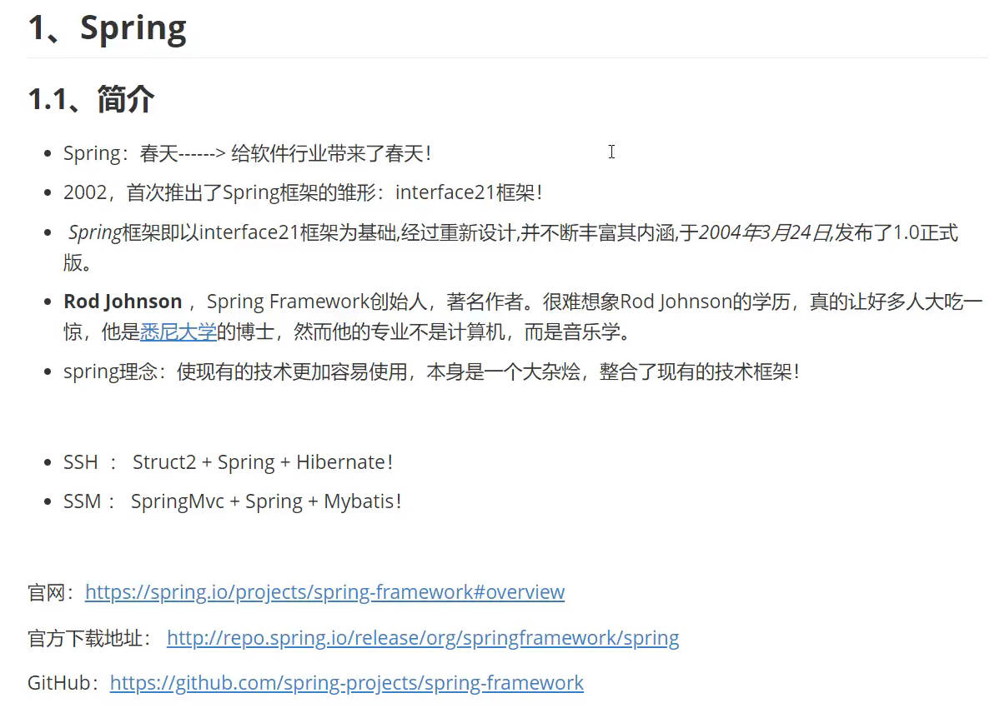 | 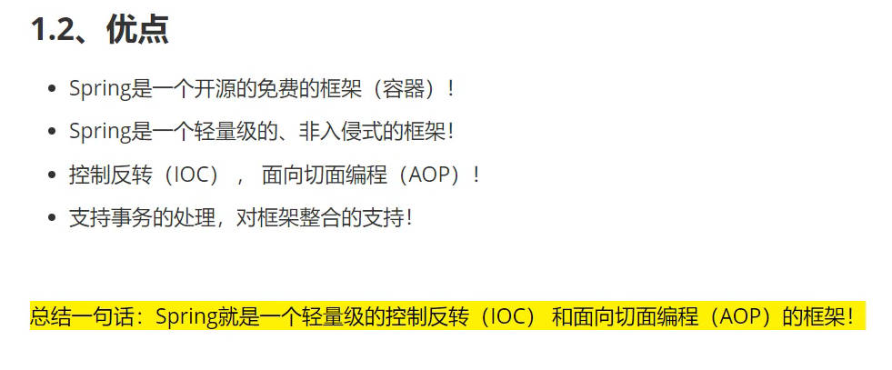 |
| ------------------------------------------------------------ | ------------------------------------------------------------ |

## 3、组成

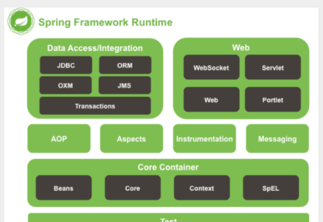

[Spring 7大模块3大思想](https://www.cnblogs.com/heavenhome/articles/6367867.html)  

Spring 框架是一个分层架构，由==7大模块==组成。Spring 模块构建在核心容器之上，核心容器定义了创建、配置和管理 bean 的方式 ; **==三大核心思想==**:  DI(依赖注入),IoC(控制反转),AOP(面向切面编程)

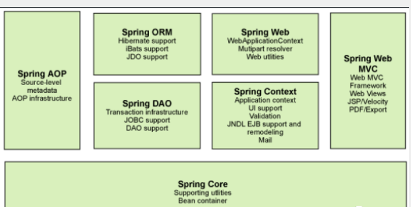

组成 Spring 框架的每个模块（或组件）都可以单独存在，或者与其他一个或多个模块联合实现。每个模块的功能如下：

- **核心容器**：核心容器提供 Spring 框架的基本功能。核心容器的主要组件是BeanFactory，它是工厂模式的实现。BeanFactory 使用*控制反转*（IOC） 模式将应用程序的配置和依赖性规范与实际的应用程序代码分开。
- **Spring 上下文**：Spring 上下文是一个配置文件，向 Spring 框架提供上下文信息。Spring 上下文包括企业服务，例如 JNDI、EJB、电子邮件、国际化、校验和调度功能。
- **Spring AOP**：通过配置管理特性，Spring AOP 模块直接将面向切面的编程功能 , 集成到了 Spring 框架中。所以，可以很容易地使 Spring 框架管理任何支持 AOP的对象。Spring AOP 模块为基于 Spring 的应用程序中的对象提供了事务管理服务。通过使用 Spring AOP，不用依赖组件，就可以将声明性事务管理集成到应用程序中。
- **Spring DAO**：JDBC DAO 抽象层提供了有意义的异常层次结构，可用该结构来管理异常处理和不同数据库供应商抛出的错误消息。异常层次结构简化了错误处理，并且极大地降低了需要编写的异常代码数量（例如打开和关闭连接）。Spring DAO 的面向 JDBC 的异常遵从通用的 DAO 异常层次结构。
- **Spring ORM**：`对象关系映射` ,Spring 框架插入了若干个 ORM 框架，从而提供了 ORM 的对象关系工具，其中包括 JDO、Hibernate 和 iBatis SQL Map。所有这些都遵从 Spring 的通用事务和 DAO 异常层次结构。
- **Spring Web 模块**：Web 上下文模块建立在应用程序上下文模块之上，为基于 Web 的应用程序提供了上下文。所以，Spring 框架支持与 Jakarta Struts 的集成。Web 模块还简化了处理多部分请求以及将请求参数绑定到域对象的工作。
- **Spring MVC 框架**：MVC 框架是一个全功能的构建 Web 应用程序的 MVC 实现。通过策略接口，MVC 框架变成为高度可配置的，MVC 容纳了大量视图技术，其中包括 JSP、Velocity、Tiles、iText 和 POI。


> 拓展

### 1、Spring Boot与Spring Cloud

- Spring Boot构建一切、Cloud协调一切、Cloud Data Flow连接一切
- Spring Boot 是 Spring 的一套快速配置脚手架，可以基于Spring Boot 快速开发单个微服务;
- Spring Cloud是基于Spring Boot实现的；
- Spring Boot专注于快速、方便集成的单个微服务个体，Spring Cloud关注全局的服务治理框架；
- Spring Boot使用了约束优于配置的理念，很多集成方案已经帮你选择好了，能不配置就不配置 , Spring Cloud很大的一部分是基于Spring Boot来实现，Spring Boot可以离开Spring Cloud独立使用开发项目，但是Spring Cloud离不开Spring Boot，属于依赖的关系。
- SpringBoot在SpringClound中起到了承上启下的作用，如果你要学习SpringCloud必须要学习SpringBoot。

|      | 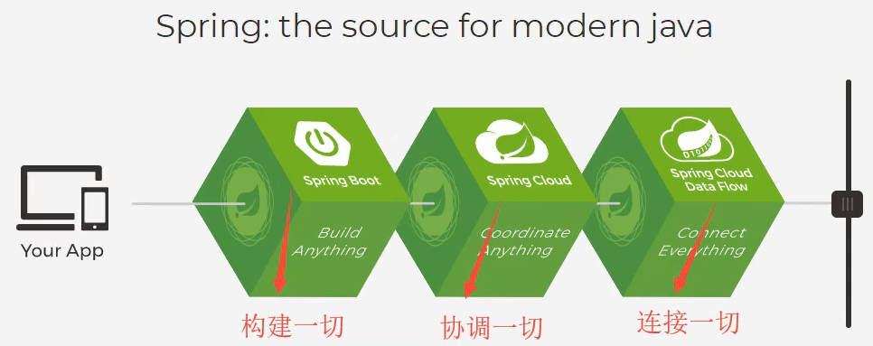 |
| ------------------------------------------------------------ | ------------------------------------------------------------ |
| 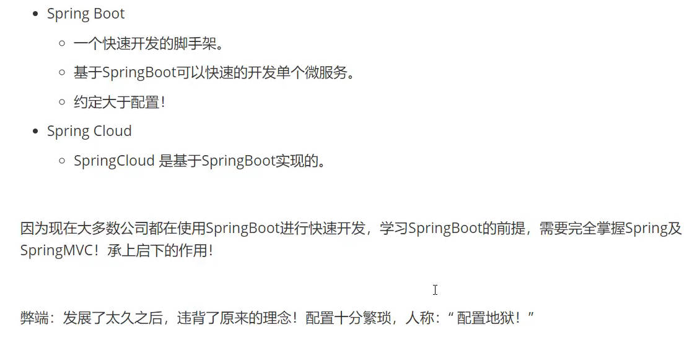 | 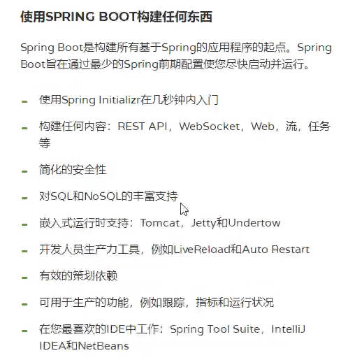 |

- ==Spring Boot==
  - ==一个快速开发的脚手架==
  - 基于SpringBoot==可以快速开发单个微服务==
  - 约定大于配置！
- Spring Cloud
  - Spring CLoud是基于SpringBoot实现的
  - ==微服务的整合,协调微服务==

## 4、==IOC理论推导==

==IOC就是提供一个set接口==

问题：==**业务层调Dao层，通过把Dao实现类组合进来**==， 是写死的， 如果Dao有新的实现类，serviceimpl也要改； 客户一有新的需求，业务层代码就要改

- UserDao接口

- UserDaoImpl实现类： `getUser()`

- UserService业务接口：也做`getUser()`这个事情

- UserServiceImpl业务实现类


解决：==用set注入DaoImpl， 架构没变控制权变了==，控制反转IoC(Inversion of Control)，是一种设计思想，`DI(依赖注入)只是IoC`的一种实现

- ==以前是直接new dao实现类，改进后把dao接口作为参数传进来==
  - 利用set动态实现值的注入

- 控制反转，对象在被创建的时候，由第三方将其所==依赖对象的引用==传递给它。也可以说，依赖被注入到对象中 
  - IOC理论提出的观点大体是这样的：借助于“第三方”实现具有依赖关系的对象之间的解耦

```java
//改进：刚开始是程序创建对象, new UserDaoImpl(); 现在是用set动态实现值的注入
public class UserServiceImpl implements UserService {
    private UserDao userDao;
    //利用set动态实现值的注入: 不同的业务作为参数传给UserDao属性
    public void setUserDao(UserDao userDao) {
        this.userDao = userDao;
    }
    
//改进后
public class MyTest {
    public static void main(String[] args) {
        //用户实际调用的是业务层，不需要接触dao层
        UserServiceImpl userService = new UserServiceImpl();
        //不同的业务作为参数传给UserDao
        userService.setUserDao(new UserDaoMysqlImpl());
        userService.getUser();
    }
}
```

| 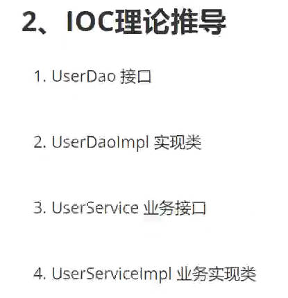 | 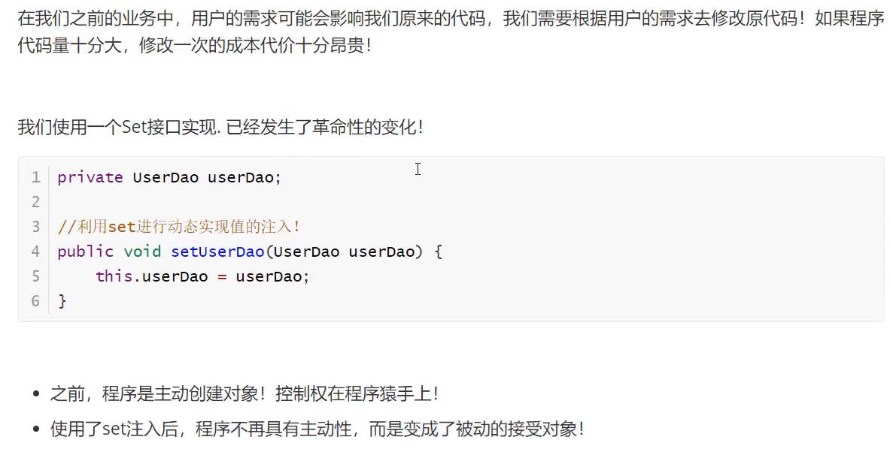 |
| ------------------------------------------------------------ | ------------------------------------------------------------ |
| 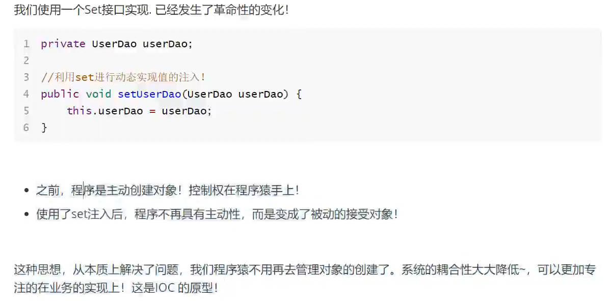 |                                                         |
| 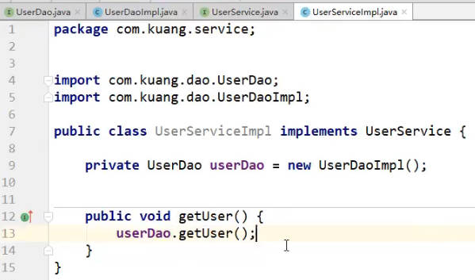 | 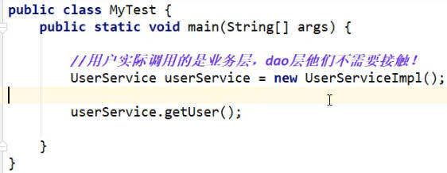 |
| 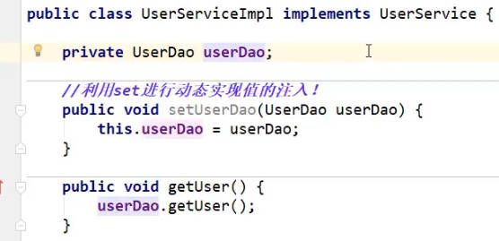 | 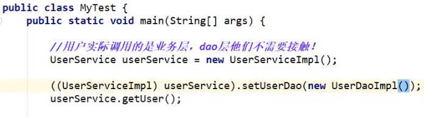 |
| 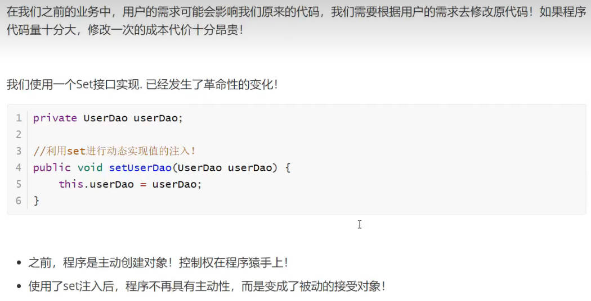 | 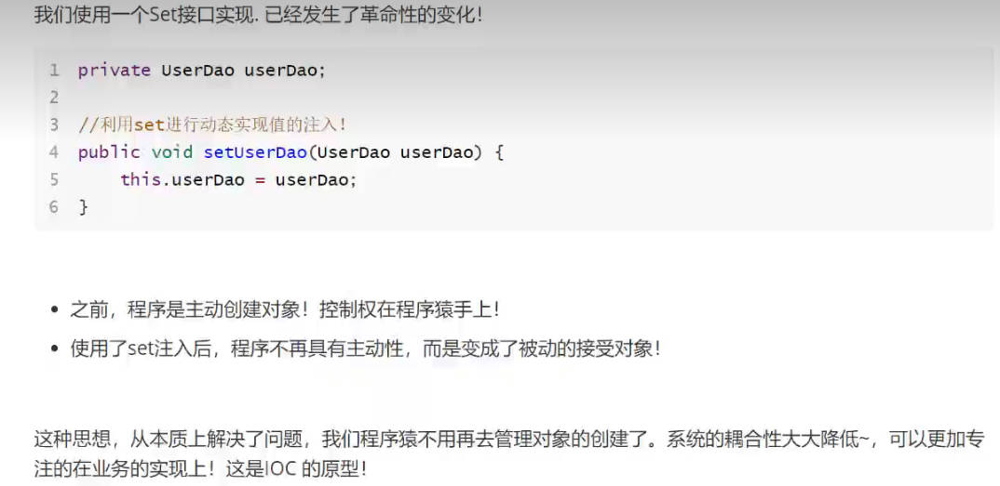 |


1. 导包

spring-study;  模块：spring-01-ioc1
文件夹: dao\UserDao.getUser()、service\UserService; 

```xml
<!-- https://mvnrepository.com/artifact/org.springframework/spring-webmvc -->
<dependency>
    <groupId>org.springframework</groupId>
    <artifactId>spring-webmvc</artifactId>
    <version>5.2.0.RELEASE</version>
</dependency>

```

2. UserServiceImpl 
   在需要用到他的地方 , ==不去实现它 , 而是留一个接口== , 利用set 

```java
package com.kuang.service;
import com.kuang.Dao.UserDao;
import com.kuang.Dao.UserDaoImpl;

public class UserServiceImpl implements UserService {
    //有新业务增加要改 new UserDaoImpl();
    private UserDao userDao = new UserDaoImpl();
    public void getUser() {
        //业务层调Dao层
        userDao.getUser();
    }
}

//改进：刚开始是程序创建对象, new UserDaoImpl(); 现在是用set动态实现值的注入
public class UserServiceImpl implements UserService {
    private UserDao userDao;
    //利用set动态实现值的注入: 不同的业务作为参数传给UserDao属性
    public void setUserDao(UserDao userDao) {
        this.userDao = userDao;
    }

    public void getUser() {
        //业务层调Dao层
        userDao.getUser();
    }
}
```

3. MyTest

```java
import com.kuang.service.UserService;
import com.kuang.service.UserServiceImpl;

public class MyTest {
    public static void main(String[] args) {
        //用户实际调用的是业务层，不需要接触dao层
        UserService userService = new UserServiceImpl();
        userService.getUser();
    }
}
//改进后
public class MyTest {
    public static void main(String[] args) {
        //用户实际调用的是业务层，不需要接触dao层
        UserServiceImpl userService = new UserServiceImpl();
        //不同的业务作为参数传给UserDao
        userService.setUserDao(new UserDaoMysqlImpl());
        userService.getUser();
    }
}
```

我们使用一个Set接口实现，已经发生了革命性的变化！ ,用户调什么业务，就创建什么对象

```java
 private UserDao userDao;

// 利用set进行动态实现值的注入
public void setUserDao(UserDao userDao) {
    this.userDao = userDao;
}
```

- 之前，程序是主动创建对象！控制权在程序员手上！
- 使用了set注入之后，程序不再有主动性，而是变成了被动的接受对象！

这种思想从本质上实现了问题，我们程序员不用再去管理对象的创建了。系统的耦合性大大降低，可以更加专注的在业务的实现上！这是IOC的原型！ 

| 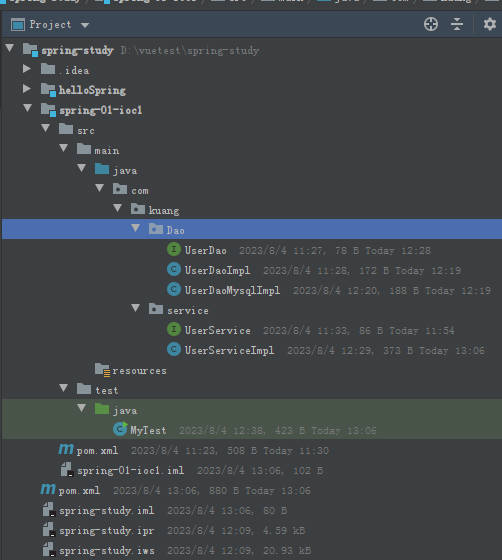 | 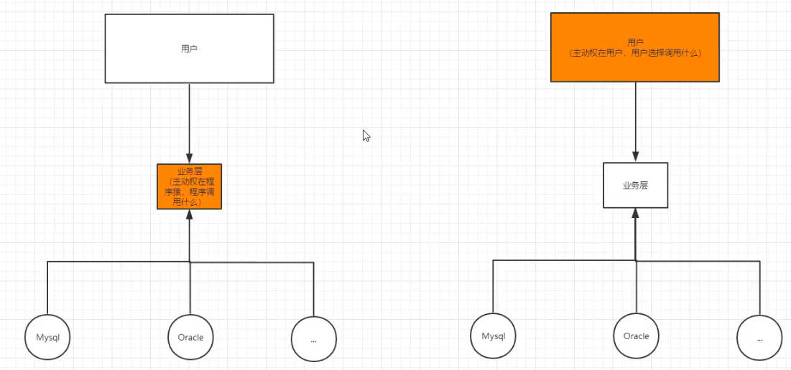 |
| ------------------------------------------------------------ | ------------------------------------------------------------ |


## 5、IOC本质

[IOC理论推导](https://blog.csdn.net/qq_23889885/article/details/106162157) [控制反转(IOC)容器详解](http://news.558idc.com/146829.html) [IoC](https://blog.csdn.net/m0_51976820/article/details/124105412) :horse:

- 之前，程序是主动创建对象！控制权在程序员手上！
- 使用了set注入之后，程序不再有主动性，而是==变成了被动的接受对象==！
  - 这种思想从本质上实现了问题，==程序员不用再去管理对象的创建==。系统的耦合性大大降低，可以更加专注的在业务的实现上！这是IOC的原型！ 

==**控制反转IoC(Inversion of Control)，是一种设计思想，DI(依赖注入)是实现IoC的一种方法**==，也有人认为DI只是IoC的另一种说法。没有IoC的程序中 , <u>*我们使用面向对象编程 , 对象的创建与对象间的依赖关系完全硬编码在程序中，对象的创建由程序自己控制，控制反转后将对象的创建转移给第三方*，</u>个人认为所谓控制反转就是：==获得依赖对象的方式反转==了。

- 耦合的对象：一层调用另一层；   解耦：一个中间件(ioc容器)连接所有, 一个接口连接所有

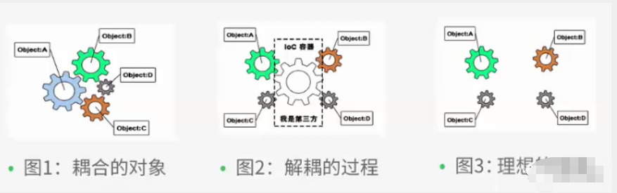

**IoC是Spring框架的核心内容**

==**spring实现IoC的方式**==：可以使用`XML`配置，也可以使用`注解`，新版本的Spring也可以零配置实现IoC(`自动装配`)。

1、Spring容器在初始化时先读取配置文件，根据配置文件或元数据创建与组织对象存入容器中，程序使用时再从Ioc容器中取出需要的对象。


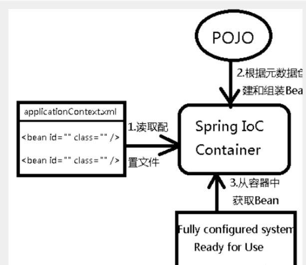

采用XML方式配置Bean的时候，Bean的定义信息是和实现分离的，而采用注解的方式可以把两者合为一体，Bean的定义信息直接以注解的形式定义在实现类中，从而达到了零配置的目的。

2、**==控制反转是一种通过描述（XML或注解）并通过第三方去生产或获取特定对象的方式。在Spring中实现控制反转的是IoC容器，其实现方法是依赖注入（Dependency Injection,DI）==。**

| 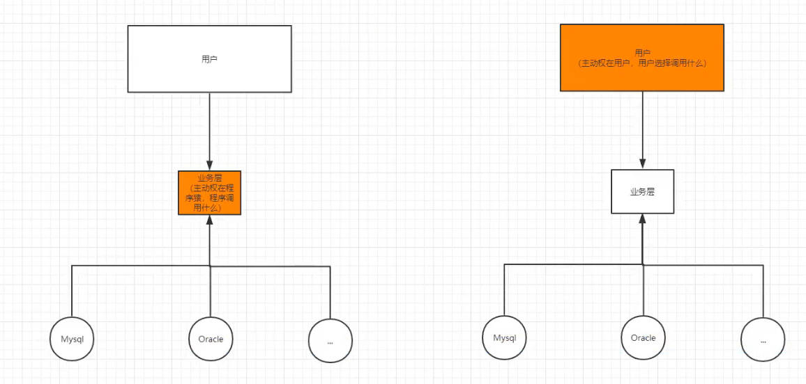 | 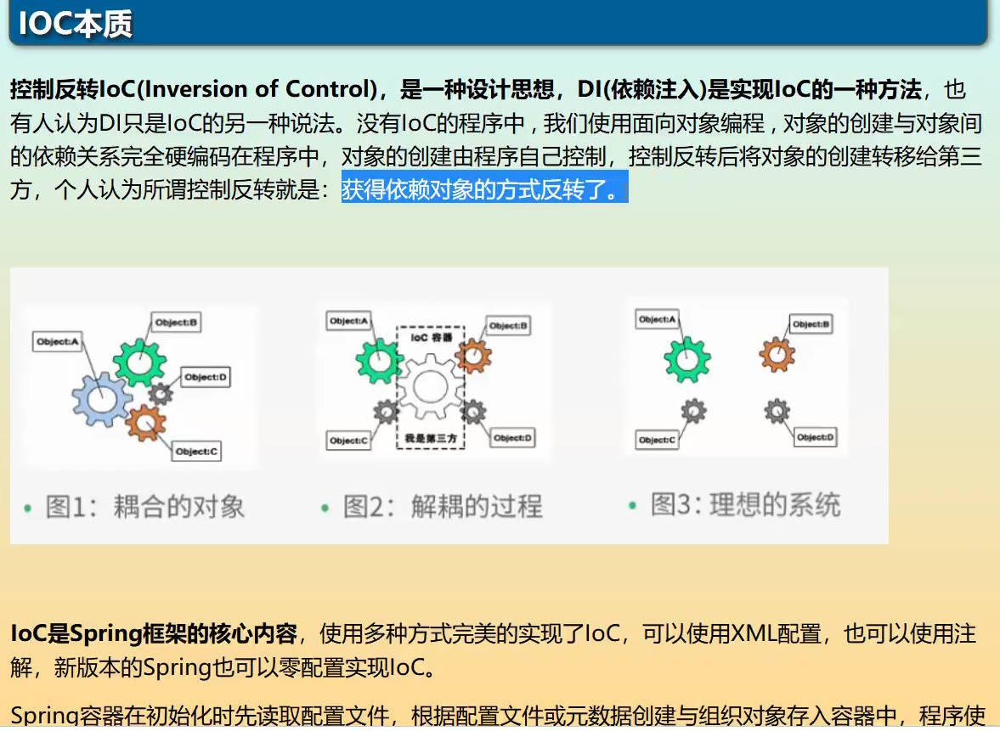 |
| ------------------------------------------------------------ | ------------------------------------------------------------ |
| 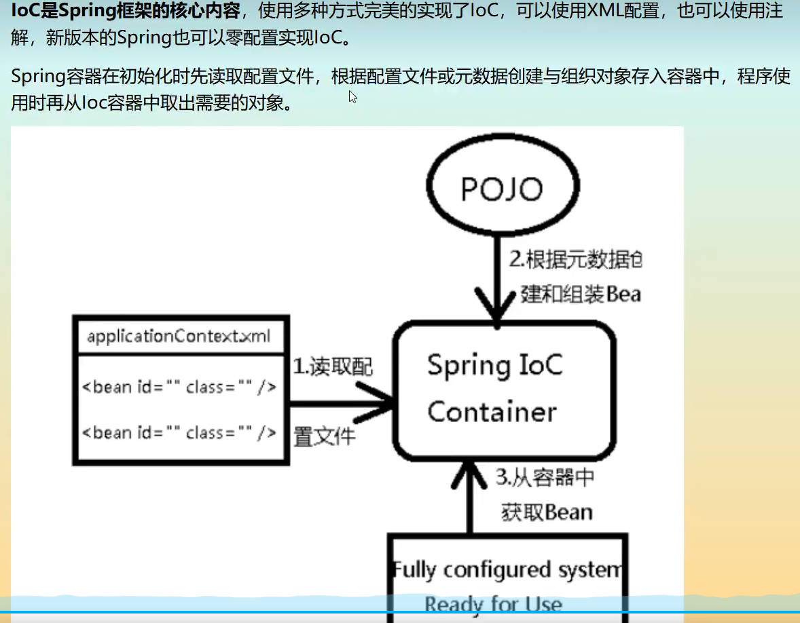 | 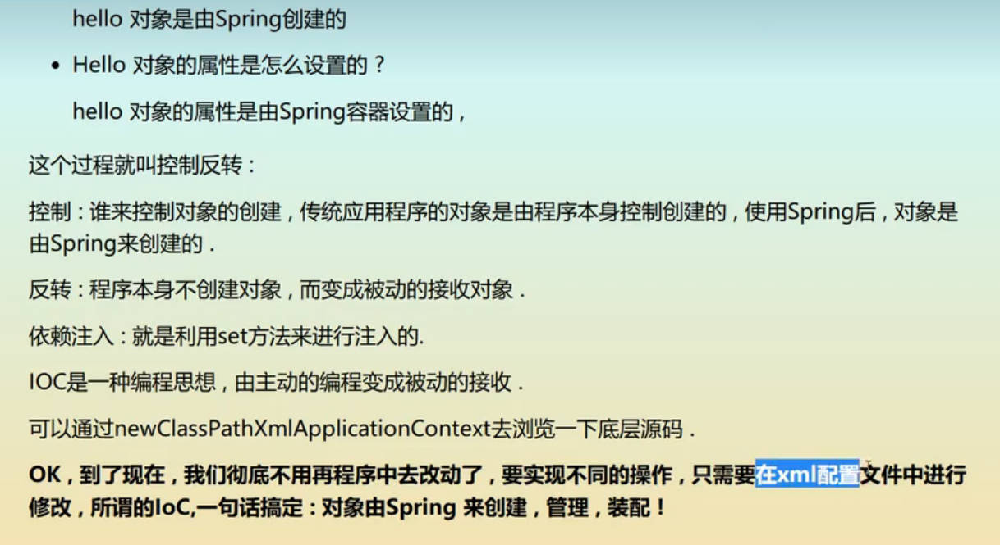 |

# 2、HelloSpring

小结：

pojo实体类 => xml配置==对象容器== => ==实例化容器==(拿到容器): 获取==spring上下文对象== => ==获取bean==(容器里的对象)：context.getBean() => ==执行bean对象方法==

- 容器里把实体类设置为bean，然后创建出一个实体类对象
- 用ApplicationContext构造器加载xml(元数据), ==实例化容器==

## 1、导入Jar包

==Spring Web MVC== 5.2.0.RELEASE ;   ==spring-jdbc== 5.2.0.RELEASE

注 : spring 需要导入commons-logging进行日志记录 . 我们利用maven , 他会自动下载对应的依赖项 .

```xml
<dependency>
   <groupId>org.springframework</groupId>
   <artifactId>spring-webmvc</artifactId>
   <version>5.1.10.RELEASE</version>
</dependency>
```

## 2、xml配置对象容器

1、编写一个pojo/Hello实体类

```java
public class Hello {
   private String name;

   public String getName() {
       return name;
  }
   public void setName(String name) {
       this.name = name;
  }

   public void show(){
       System.out.println("Hello,"+ name );
  }
}
```

2、编写我们的spring文件 , 这里我们命名为beans.xml;  ==Spring容器：对象创建和管理==

- ==id：名字； class：指向一个类==
  - id相当于new对象时的变量名：`Hello hello=new Hello()`
- value：属性set一个值；  ==ref:引用spring容器中创建好的对象==

使用ioc要配置它的元数据; 

```xml
<?xml version="1.0" encoding="UTF-8"?>
<beans xmlns="http://www.springframework.org/schema/beans"
      xmlns:xsi="http://www.w3.org/2001/XMLSchema-instance"
      xsi:schemaLocation="http://www.springframework.org/schema/beans
       http://www.springframework.org/schema/beans/spring-beans.xsd">

   <!--bean就是java对象 , 由Spring创建和管理-->
   <bean id="hello" class="com.kuang.pojo.Hello">
       <property name="name" value="Hello Spring"/>
   </bean>

</beans>
```

## 3、测试

- 实例化容器
- 获取bean
- 执行bean方法

实例化容器 => 取对象;  用的set注入，Hello类的set方法删掉就出错

==**提供了一个ApplicationContext构造器，可以让我们从外部资源中加载元数据**==  `Cpx`

```java
@Test
public void test(){
   //解析beans.xml文件 , 生成管理相应的Bean对象
    //获取spring上下文对象  Cpx
   ApplicationContext context = new ClassPathXmlApplicationContext("beans.xml");
   //getBean : 参数即为spring配置文件中bean的id .
   Hello hello = (Hello) context.getBean("hello");
   hello.show();
}
```


> 思考

- Hello 对象是谁创建的 ?  【hello 对象是由Spring创建的
- Hello 对象的属性是怎么设置的 ?  hello 对象的属性是由Spring容器设置的

这个过程就叫控制反转 :

- 控制 : 谁来控制对象的创建 , 传统应用程序的对象是由程序本身控制创建的 , 使用Spring后 , ==对象由Spring创建==
- 反转 : 程序本身不创建对象 , 而变成被动的接收对象 .

依赖注入 : 就是利用set方法来进行注入的.

 IOC是一种编程思想，由主动的编程变成被动的接收

可以通过newClassPathXmlApplicationContext去浏览一下底层源码 .

| 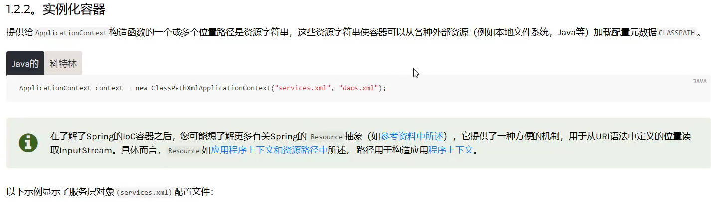 |                                                         |
| ------------------------------------------------------------ | ------------------------------------------------------------ |
| 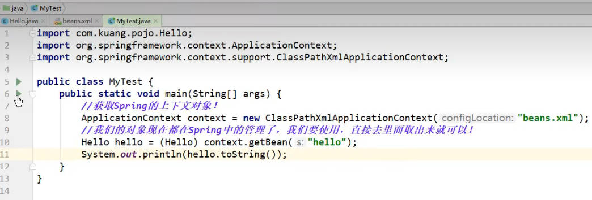 | 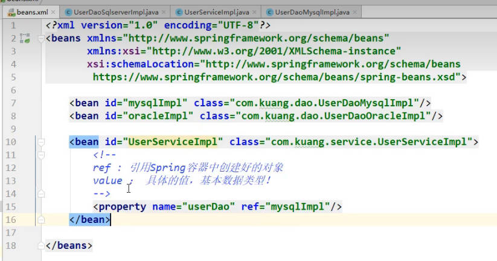 |
| 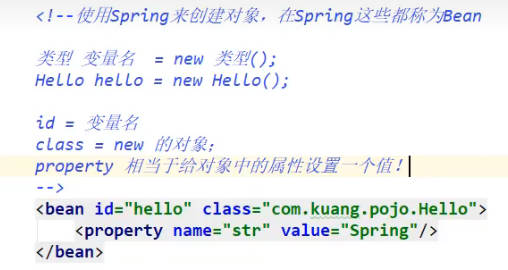 | 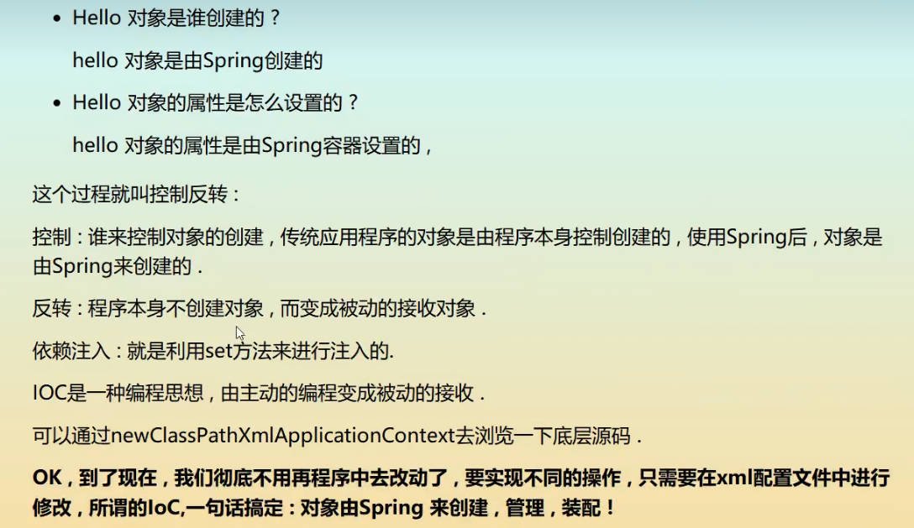 |

id相当于new对象时的变量名：`Hello hello=new Hello()`

property相当于给属性赋值

#  3、==IOC创建对象方式==(构造器注入)

==配置文件加载的时候，容器中管理的对象已经初始化了==

构造器注入参数，用来创建对象

## 1、通过无参构造创建（默认）

```java
ApplicationContext context = new ClassPathXmlApplicationContext("beans.xml");
User user = (User) context.getBean("user");     //创建对象用的是无参构造
```

1、User.java

```java
public class User {

   private String name;

   public User() {
       System.out.println("user无参构造方法");
  }

   public void setName(String name) {
       this.name = name;
  }

   public void show(){
       System.out.println("name="+ name );
  }

}
```

2、beans.xml

```xml
<?xml version="1.0" encoding="UTF-8"?>
<beans xmlns="http://www.springframework.org/schema/beans"
      xmlns:xsi="http://www.w3.org/2001/XMLSchema-instance"
      xsi:schemaLocation="http://www.springframework.org/schema/beans
       http://www.springframework.org/schema/beans/spring-beans.xsd">

   <bean id="user" class="com.kuang.pojo.User">
       <property name="name" value="kuangshen"/>
   </bean>

</beans>
```

3、测试类

```java
@Test
public void test(){
   ApplicationContext context = new ClassPathXmlApplicationContext("beans.xml");
   //在执行getBean的时候, user已经创建好了 , 通过无参构造
   User user = (User) context.getBean("user");
   //调用对象的方法 .
   user.show();
}
```

结果可以发现，在调用show方法之前，User对象已经通过无参构造初始化了！

## 2、==通过有参构造创建==

有三种方式: 通过==参数下标、参数类型、参数名字==来构建对象

1、UserT . java

```java
public class UserT {

   private String name;

   public UserT(String name) {
       this.name = name;
  }

   public void setName(String name) {
       this.name = name;
  }

   public void show(){
       System.out.println("name="+ name );
  }

}
```

2、beans.xml ==有三种方式: 参数下标、参数类型、参数名字==

```xml
<!-- 第一种根据index参数下标设置 Constructor argument index-->
<bean id="userT" class="com.kuang.pojo.UserT">
   <!-- index指构造方法 , 下标从0开始 -->
   <constructor-arg index="0" value="kuangshen2"/>
</bean>
<!-- 第二种根据参数名字设置  Constructor argument name-->
   <constructor-arg name="name" value="kuangshen2"/>
<!-- 第三种根据参数类型设置 Constructor argument type matching-->
    <!-- 引用类型要用全限定名-->
   <constructor-arg type="java.lang.String" value="kuangshen2"/>
```

3、测试

```java
@Test
public void testT(){
   ApplicationContext context = new ClassPathXmlApplicationContext("beans.xml");
   UserT user = (UserT) context.getBean("userT");
   user.show();
}
```

结论：==在配置文件加载的时候。其中管理的对象都已经初始化了==！

# 4、Spring配置

> ==别名==

alias 设置别名 , 为bean设置别名 , 可以设置多个别名

name可以设置多个别名

- ==给id起个别名==

```xml
<!--设置别名：在获取Bean的时候可以使用别名获取-->
<bean id="userT" class="com.kuang.pojo.UserT">
	<alias name="userT" alias="userNew"/>
</bean>
```

> Bean的配置

```xml
<!--bean就是java对象,由Spring创建和管理-->

<!--
   id 是bean的标识符(对象名),要唯一,如果没有配置id,name就是默认标识符
   如果配置id,又配置了name,那么name是别名
   name可以设置多个别名,可以用逗号,分号,空格隔开
   如果不配置id和name,可以根据applicationContext.getBean(.class)获取对象;

class是bean的全限定名=包名+类名
	scope 作用域，设置创建的对象是单例等
-->
<bean id="hello" name="hello2 h2,h3;h4" class="com.kuang.pojo.Hello">
   <property name="name" value="Spring"/>
</bean>
```

> import: ==导入多个配置文件==

团队的合作通过import来实现 

```xml
<import resource="{path}/beans.xml"/>
```

| 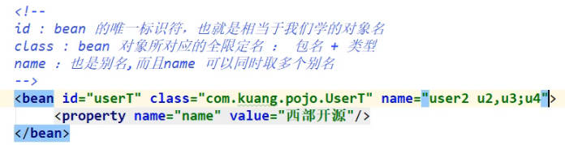 | 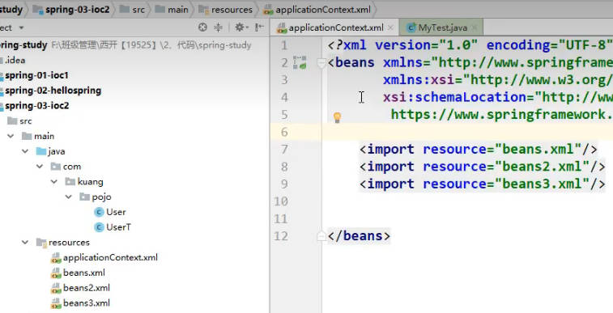 |
| ------------------------------------------------------------ | ------------------------------------------------------------ |
| 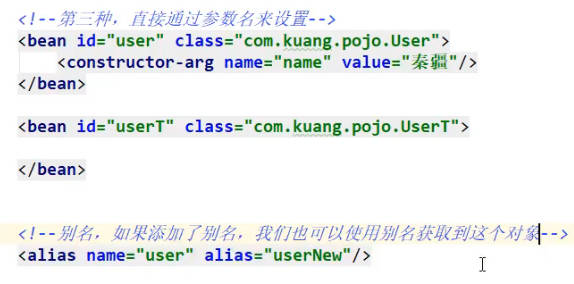 |                                                              |


# 5、DI==依赖注入==（属性）

- ==构造器注入:前面已经说过了，前面的IOC创建对象==
  - 构造器注入参数，用来创建对象

- ==set方式注入==
  - 实体类==属性注入值==

- ==扩展方式注入==

Collections: bean | ref | idref | list | set | map | props | value | null

>  概念

- 依赖注入（Dependency Injection,DI）。
- 依赖 : 指==Bean对象的创建依赖于容器== . Bean对象的依赖资源 .
- 注入 : 指==Bean对象中的所有属性， 由容器来注入== 

## 1、Set 注入 （重点）

==Bean对象中的所有属性值， 由容器来注入==

```java
@Getter
@Setter
@ToString
public class Student {
    private String name;
    private Address address;
    private String[] books;
    private List<String> hobbys;
    private Map<String, String> card;
    private Set<String> games;
    private String wife;
    private Properties info;
}
```


```xml
<?xml version="1.0" encoding="UTF-8"?>
<beans xmlns="http://www.springframework.org/schema/beans"
       xmlns:xsi="http://www.w3.org/2001/XMLSchema-instance"
       xsi:schemaLocation="http://www.springframework.org/schema/beans
        https://www.springframework.org/schema/beans/spring-beans.xsd">

    <bean id="address" class="com.kuang.pojo.Address"/>
    <bean id="student" class="com.kuang.pojo.Student">
        <!--第一种，普通值注入 value-->
        <property name="name" value="斯达康"/>

        <!--第二种： Bean注入 ref(引用对象)-->
        <property name="address" ref="address"/>

        <!--第三种： 数组注入 -->
        <property name="books">
            <array>
                <value>红楼梦</value>
                <value>西游记</value>
                <value>水浒传</value>
                <value>三国演义</value>
            </array>
        </property>

        <!--第四种：list注入-->
        <property name="hobbys">
            <list>
                <value>听歌</value>
                <value>敲代码</value>
                <value>看电影</value>
            </list>
        </property>

        <!--第五种：map注入-->
        <property name="card">
            <map>
                <entry key="身份证" value="111111111111111111"/>
                <entry key="银行卡" value="22222222222222222222"/>
            </map>
        </property>

        <!--第六种：set注入-->
        <property name="games">
            <set>
                <value>LOL</value>
                <vadlue>COC</value>
                <value>BOB</value>
            </set>
        </property>

        <!--第七种：null注入; 空值和null不一样-->
        <property name="wife">
            <null/>
        </property>

        <!--第七种：Properties注入:配置类类型-->
        <property name="info">
            <props>
                <prop key="driver">com.mysql.jdbc.Driver</prop>
                <prop key="url">localhost://3306</prop>
                <prop key="username">root</prop>
                <prop key="password">admin</prop>
            </props>
        </property>
    </bean>

</beans>
```

要求被注入的属性 , 必须有set方法 , set方法的方法名由set + 属性首字母大写 , 如果属性是boolean类型 , 没有set方法 , 是 is .

测试pojo类 :

Address.java

```java
 public class Address {
 
     private String address;
 
     public String getAddress() {
         return address;
    }
 
     public void setAddress(String address) {
         this.address = address;
    }
 }
```

Student.java

```java
 package com.kuang.pojo;
 
 import java.util.List;
 import java.util.Map;
 import java.util.Properties;
 import java.util.Set;
 
 public class Student {
 
     private String name;
     private Address address;
     private String[] books;
     private List<String> hobbys;
     private Map<String,String> card;
     private Set<String> games;
     private String wife;
     private Properties info;
 
     public void setName(String name) {
         this.name = name;
    }
 
     public void setAddress(Address address) {
         this.address = address;
    }
 
     public void setBooks(String[] books) {
         this.books = books;
    }
 
     public void setHobbys(List<String> hobbys) {
         this.hobbys = hobbys;
    }
 
     public void setCard(Map<String, String> card) {
         this.card = card;
    }
 
     public void setGames(Set<String> games) {
         this.games = games;
    }
 
     public void setWife(String wife) {
         this.wife = wife;
    }
 
     public void setInfo(Properties info) {
         this.info = info;
    }
 
     public void show(){
         System.out.println("name="+ name
                 + ",address="+ address.getAddress()
                 + ",books="
        );
         for (String book:books){
             System.out.print("<<"+book+">>\t");
        }
         System.out.println("\n爱好:"+hobbys);
 
         System.out.println("card:"+card);
 
         System.out.println("games:"+games);
 
         System.out.println("wife:"+wife);
 
         System.out.println("info:"+info);
 
    }
 }
```

### 1、**常量注入**

```xml
 <bean id="student" class="com.kuang.pojo.Student">
     <property name="name" value="小明"/>
 </bean>
```

测试：

```java
 @Test
 public void test01(){
     //new Cpx
     ApplicationContext context = newClassPathXmlApplicationContext("applicationContext.xml");
 
     Student student = (Student) context.getBean("student");
 
     System.out.println(student.getName());
 
 }
```

### 2、**Bean(类)引用注入** 

注意点：这里的值是一个引用，ref

```xml
 <bean id="addr" class="com.kuang.pojo.Address">
     <property name="address" value="重庆"/>
 </bean>
 
 <bean id="student" class="com.kuang.pojo.Student">
     <property name="name" value="小明"/>
     <property name="address" ref="addr"/>
 </bean>
```

### 3、**数组注入**

```xml
 <bean id="student" class="com.kuang.pojo.Student">
     <property name="name" value="小明"/>
     <property name="address" ref="addr"/>
     <property name="books">
         <array>
             <value>西游记</value>
             <value>红楼梦</value>
             <value>水浒传</value>
         </array>
     </property>
 </bean>
```

### 4、**List注入**

```xml
 <property name="hobbys">
     <list>
         <value>听歌</value>
         <value>看电影</value>
         <value>爬山</value>
     </list>
 </property>
```

### 5、**Map注入**

```xml
 <property name="card">
     <map>
         <entry key="中国邮政" value="456456456465456"/>
         <entry key="建设" value="1456682255511"/>
     </map>
 </property>
```

### 6、**set注入**

```xml
 <property name="games">
     <set>
         <value>LOL</value>
         <value>BOB</value>
         <value>COC</value>
     </set>
 </property>
```

### 7、**Null注入**

```xml
 <property name="wife"><null/></property>
```

### 8、**Properties注入**

```xml
 <property name="info">
     <props>
         <prop key="学号">20190604</prop>
         <prop key="性别">男</prop>
         <prop key="姓名">小明</prop>
     </props>
 </property>
```

测试

```java
public class MyTest {
    public static void main(String[] args) {
        ApplicationContext context = new ClassPathXmlApplicationContext("beans.xml");
        Student student = (Student) context.getBean("student");
        System.out.println(student.toString());
    }
}
```


##  2、扩展注入：p(property)命名注入和c(constructor)命名注入

p 命名空间和 c 命名空间==分别是 setter 注入和构造器注入的简化写法==，本质是 XML 配置的语法糖，用来少写 `<property>` 和 `<constructor-arg>` 标签

User.java ：【注意：这里没有有参构造器！】

```java
@Getter@Setter
@AllArgsConstructor
@NoArgsConstructor
public class User {
    private String name;
    private int age;
}
```

1、P命名空间注入 : 需要在头文件中加入约束文件, ==p是set注入==,注入的是类的属性

- 类必须有‌**无参构造方法**‌和对应属性的 ‌**setter 方法**

```xml
 导入约束 : xmlns:p="http://www.springframework.org/schema/p"
 
 <!--P(属性: properties)命名空间 , 属性依然要设置set方法-->
 <bean id="user" class="com.kuang.pojo.User" p:name="狂神" p:age="18"/>
```

2、c 命名空间注入 : 需要在头文件中加入约束文件, c构造器注入,注入的是==有参构造器==的参数; 例如下面的name、age

- 类必须有对应的‌**有参构造方法**

```xml
 导入约束 : xmlns:c="http://www.springframework.org/schema/c"
 <!--C(构造: Constructor)命名空间 , 属性依然要设置set方法-->
 <bean id="user" class="com.kuang.pojo.User" c:name="狂神" c:age="18"/>
```

发现问题：爆红了，刚才我们没有写有参构造！

解决：把有参构造器加上，这里也能知道，c 就是所谓的构造器注入！

测试代码：

```java
 @Test
 public void test02(){
     ApplicationContext context = newClassPathXmlApplicationContext("applicationContext.xml");
     //User user = (User) context.getBean("user");
     //第二个参数如果声明类型，下面就不用强转类型了
     User user = context.getBean("user", User.class);
     System.out.println(user);
 }
```


| 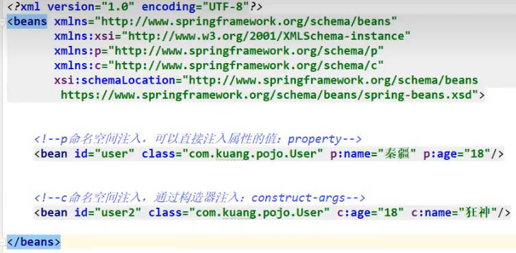 | 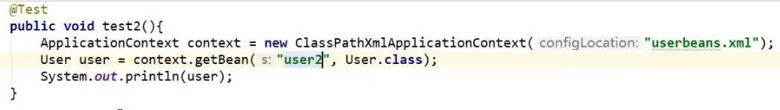 |
| ------------------------------------------------------------ | ------------------------------------------------------------ |

## 3、Bean的作用域

Bean 的作用域是‌**控制 Bean 实例创建规则和生命周期的机制**

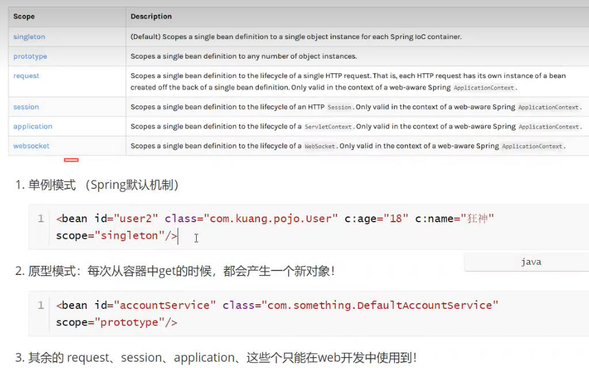

==单例：全局唯一(Bean的实例)；  原型：每一个对象都有一个自己的Bean实例==,每一个bean都创建一个单独对象; 后面的几个webmvc里面才有; 监听器、拦截器

在Spring中，那些组成应用程序的主体及由Spring IoC容器所管理的对象，被称之为bean。简单地讲，bean就是由IoC容器初始化、装配及管理的对象 .

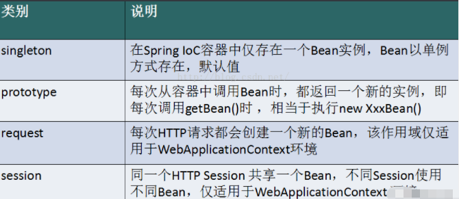

几种作用域中，request、session作用域仅在基于web的应用中使用（不必关心你所采用的是什么web应用框架），只能用在基于web的Spring ApplicationContext环境。

#### ==Singleton==

当一个bean的作用域为Singleton，那么Spring IoC容器中只会存在一个共享的bean实例，并且所有对bean的请求，只要id与该bean定义相匹配，则只会返回bean的同一实例。Singleton是单例类型，就是在创建起容器时就同时自动创建了一个bean的对象，不管你是否使用，他都存在了，每次获取到的对象都是同一个对象。注意，Singleton作用域是Spring中的缺省作用域。要在XML中将bean定义成singleton，可以这样配置：

```
 <bean id="ServiceImpl" class="cn.csdn.service.ServiceImpl" scope="singleton">
```

测试：

```java
 @Test
 public void test03(){
     ApplicationContext context = newClassPathXmlApplicationContext("applicationContext.xml");
     User user = (User) context.getBean("user");
     User user2 = (User) context.getBean("user");
     System.out.println(user==user2);
 }
```

#### ==Prototype==

- ==每一个bean创建，都是一个单独的对象==

当一个bean的作用域为Prototype，表示一个bean定义对应多个对象实例。Prototype作用域的bean会导致在每次对该bean请求（将其注入到另一个bean中，或者以程序的方式调用容器的getBean()方法）时都会创建一个新的bean实例。Prototype是原型类型，它在我们创建容器的时候并没有实例化，而是当我们获取bean的时候才会去创建一个对象，而且我们每次获取到的对象都不是同一个对象。根据经验，对有状态的bean应该使用prototype作用域，而对无状态的bean则应该使用singleton作用域。在XML中将bean定义成prototype，可以这样配置：

```xml
 <bean id="account" class="com.foo.DefaultAccount" scope="prototype"/>  
  或者
 <bean id="account" class="com.foo.DefaultAccount" singleton="false"/>
```

#### Request

当一个bean的作用域为Request，表示在一次HTTP请求中，一个bean定义对应一个实例；即每个HTTP请求都会有各自的bean实例，它们依据某个bean定义创建而成。该作用域仅在基于web的Spring ApplicationContext情形下有效。考虑下面bean定义：

```
 <bean id="loginAction" class=cn.csdn.LoginAction" scope="request"/>
```

针对每次HTTP请求，Spring容器会根据loginAction bean的定义创建一个全新的LoginAction bean实例，且该loginAction bean实例仅在当前HTTP request内有效，因此可以根据需要放心的更改所建实例的内部状态，而其他请求中根据loginAction bean定义创建的实例，将不会看到这些特定于某个请求的状态变化。当处理请求结束，request作用域的bean实例将被销毁。

#### Session

当一个bean的作用域为Session，表示在一个HTTP Session中，一个bean定义对应一个实例。该作用域仅在基于web的Spring ApplicationContext情形下有效。考虑下面bean定义：

```
 <bean id="userPreferences" class="com.foo.UserPreferences" scope="session"/>
```

针对某个HTTP Session，Spring容器会根据userPreferences bean定义创建一个全新的userPreferences bean实例，且该userPreferences bean仅在当前HTTP Session内有效。与request作用域一样，可以根据需要放心的更改所创建实例的内部状态，而别的HTTP Session中根据userPreferences创建的实例，将不会看到这些特定于某个HTTP Session的状态变化。当HTTP Session最终被废弃的时候，在该HTTP Session作用域内的bean也会被废弃掉。

# 6、自动装配

- byName：就是bean中的==ID==, 和类中属性==set方法后面的属性名一样==  ；属性名
- byType：==和对象属性类型相同的bean==  ； 属性类型
  - `<bean id="user" class="com.kuang.pojo.User" autowire="byType">`

> 自动装配说明: ==自动给bean装配属性==

- xml里自动注入属性等
- 自动装配是==spring满足bean依赖==的一种方法: ==自动装配bean依赖==
- Spring会在上下文自动寻找，并==自动给bean装配属性==！
- ~~spring会在应用上下文中为某个bean寻找其依赖的bean。~~

**Spring中==bean有三种装配机制==，分别是：**

1. `在xml中显式配置`；
2. `在java中显式配置`；不用写xml，要写一个java.config
3. ==隐式的自动装配Bean==
   1. byname：属性的set方法名字（==去掉set的名字==），和==bean的id==一致
   2. bytype：和属性的类型一致


这里我们主要讲第三种：自动化的装配bean。

Spring的自动装配需要从两个角度来实现，或者说是两个操作：

1. ==组件扫描==(component scanning)：spring会自动发现应用上下文中所创建的bean；
2. ==自动装配==(autowiring)：spring自动满足bean之间的依赖，也就是我们说的IoC/DI；

组件扫描和自动装配组合发挥巨大威力，使得显示的配置降低到最少。

**推荐不使用自动装配xml配置 , 而使用注解 .**

a、==xml中显式装配==

| 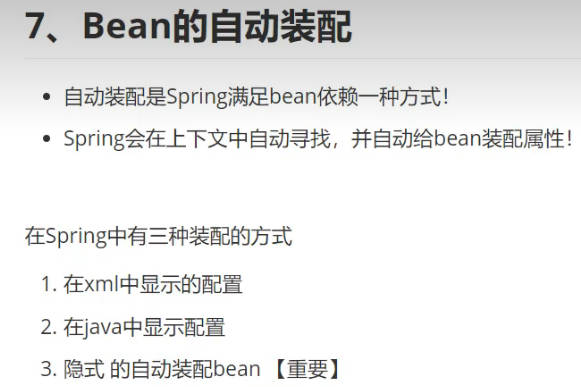 | 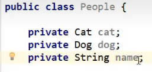 |
| ------------------------------------------------------------ | ------------------------------------------------------------ |
| 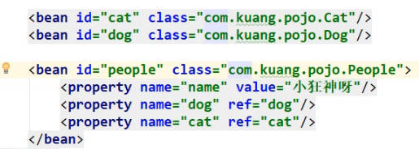 | 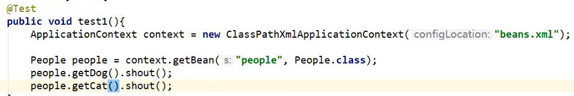 |

b、==隐式的自动装配Bean==

| 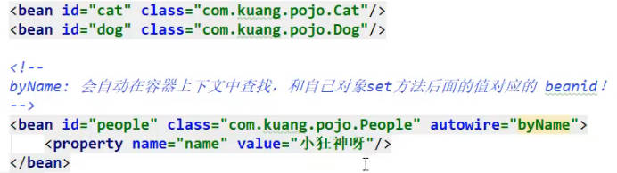 | 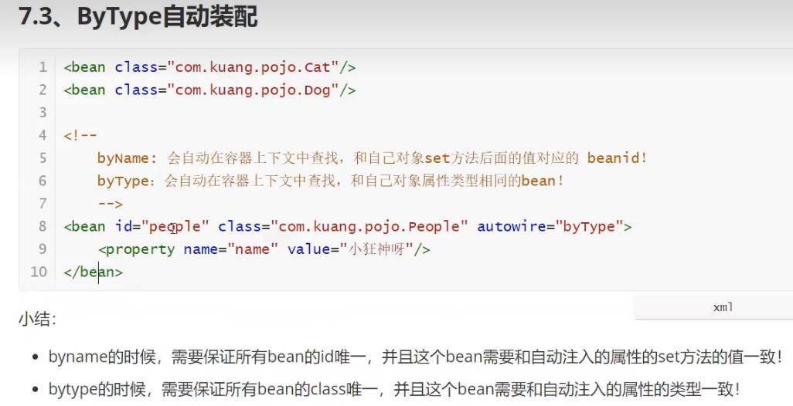 |
| ------------------------------------------------------------ | ------------------------------------------------------------ |


## 1、测试环境

1、新建一个项目

2、新建两个实体类，Cat  Dog  都有一个叫的方法

```java
public class Cat {
   public void shout() {
       System.out.println("miao~");
  }
}
public class Dog {
   public void shout() {
       System.out.println("wang~");
  }
}
```

3、新建一个用户类 User

- 属性是Cat、Dog； ==把这2个对象自动装配进来==

```java
@Getter@Setter
@ToString
public class User {
   private Cat cat;
   private Dog dog;
   private String str;
}
```

4、编写Spring配置文件: User依赖Dog、Cat类

```xml
<?xml version="1.0" encoding="UTF-8"?>
<beans xmlns="http://www.springframework.org/schema/beans"
      xmlns:xsi="http://www.w3.org/2001/XMLSchema-instance"
      xsi:schemaLocation="http://www.springframework.org/schema/beans
       http://www.springframework.org/schema/beans/spring-beans.xsd">

   <bean id="dog" class="com.kuang.pojo.Dog"/>
   <bean id="cat" class="com.kuang.pojo.Cat"/>

   <bean id="user" class="com.kuang.pojo.User">
       <property name="cat" ref="cat"/>
       <property name="dog" ref="dog"/>
       <property name="str" value="qinjiang"/>
   </bean>
</beans>
```

5、测试

```java
public class MyTest {
   @Test
   public void testMethodAutowire() {
       ApplicationContext context = new ClassPathXmlApplicationContext("beans.xml");
       User user = (User) context.getBean("user");
       user.getCat().shout();
       user.getDog().shout();
  }
}
```

结果正常输出，环境OK


## 2、byName装配

- ==byName会自动在容器上下文查找，和自己对象set方法后面的值对应的bean的ID==
  - 就是bean中的==ID==, 和类中属性==set方法后面的属性名一样==

**autowire byName (按名称自动装配)** ,==byName就是bean里的id，byType就是里面的class==， `<bean id="people" class="com.kuang.pojo.People">`

由于在手动配置xml过程中，常常发生字母缺漏和大小写等错误，而无法对其进行检查，使得开发效率降低。

采用自动装配将避免这些错误，并且使配置简单化。

测试：

1、修改bean配置，增加一个属性  autowire="byName" ,

```xml
<bean id="people" class="com.kuang.pojo.People">
        <property name="cat" ref="cat"/>	//要装配的类去掉, People依赖的2个类不用加进来
        <property name="dog" ref="dog"/>	
        <property name="name" value="qinjiang"/>
    </bean>
```

- ==byName会自动在容器上下文查找，和自己对象set方法后面的值对应的bean的ID==
  - 就是bean中的==ID==, 和类中属性==set方法后面的属性名一样==

```xml
<bean id="user" class="com.kuang.pojo.User" autowire="byName">
   <property name="str" value="qinjiang"/>
</bean>
```

2、再次测试，结果依旧成功输出！

3、我们将 cat 的bean id修改为 catXXX

4、再次测试， 执行时报空指针java.lang.NullPointerException。因为按byName规则找不对应set方法，真正的setCat就没执行，对象就没有初始化，所以调用时就会报空指针错误。

**小结：**

当一个bean节点带有 autowire byName的属性时。

1. 将查找其类中所有的set方法名，例如setCat，获得将set去掉并且首字母小写的字符串，即cat。

2. 去spring容器中寻找是否有此字符串名称id的对象。

3. 如果有，就取出注入；如果没有，就报空指针异常。


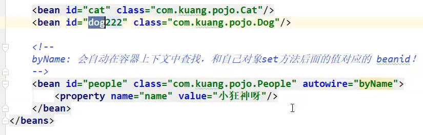

## 3、byType装配

- ==和对象属性类型相同的bean==

**autowire byType (按类型自动装配)**

使用autowire byType首先需要保证：同一类型的对象，在spring容器中唯一 `class="com.kuang.pojo.Cat"`

```
NoUniqueBeanDefinitionException
```

测试：

1、将user的bean配置修改一下 ： autowire="byType"

2、测试，正常输出

3、在注册一个cat 的bean对象！

```xml
<bean id="dog" class="com.kuang.pojo.Dog"/>
<bean id="cat" class="com.kuang.pojo.Cat"/>
<bean id="cat2" class="com.kuang.pojo.Cat"/>

<bean id="user" class="com.kuang.pojo.User" autowire="byType">
   <property name="str" value="qinjiang"/>
</bean>
```

4、测试，报错：NoUniqueBeanDefinitionException

5、删掉cat2，将cat的bean名称改掉！测试！因为是按类型装配，所以并不会报异常，也不影响最后的结果。甚至将id属性去掉，也不影响结果。

这就是按照类型自动装配！


## 4、==注解实现自动装配==

[Core Technologies](https://docs.spring.io/spring-framework/docs/5.2.0.RELEASE/spring-framework-reference/core.html#beans-required-annotation)  [annotation-config 和 component-scan区别](https://blog.csdn.net/q503385724/article/details/88569754) [annotation-config和component-scan](https://www.cnblogs.com/zby9527/p/8920633.html)  [spring注解](https://blog.csdn.net/yechuan_smile/article/details/79286482)

jdk1.5开始支持注解，spring2.5开始全面支持注解。

1. ==导入约束：context支持== `xmlns:context="http://www.springframework.org/schema/context"`
2. 配置==注解的支持==：`<context:annotation-config/>`
   1. annotation-config> 激活已经在spring容器里注册过的bean
   2. 除了具有<context:annotation-config>的功能之外，<context:component-scan>还可以在指定的package下扫描以及注册javabean

3. 直接在==属性或set上==使用`@Autowired` 

| 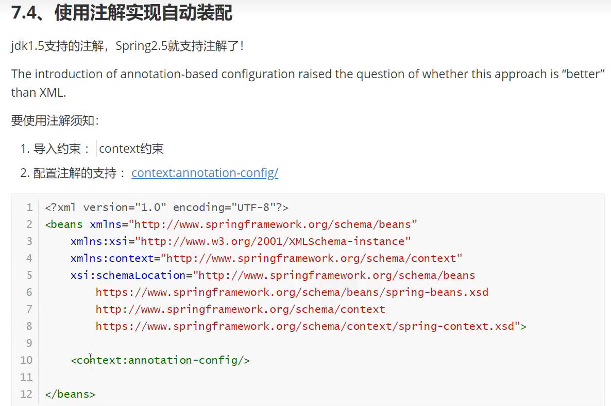 | 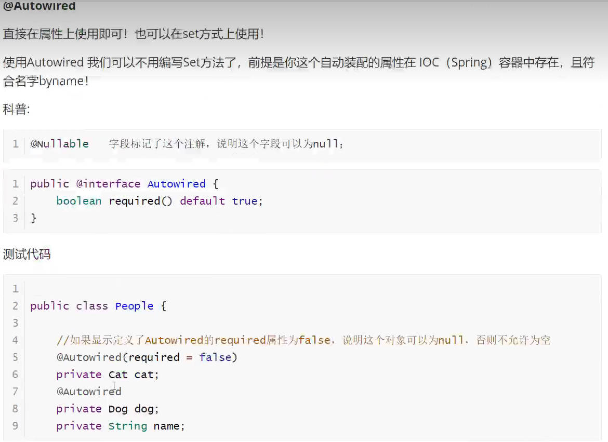 |
| ------------------------------------------------------------ | ------------------------------------------------------------ |

准备工作：利用注解的方式注入属性。

1、在spring配置文件中引入context文件头,==有顺序==

```xml
<?xml version="1.0" encoding="UTF-8"?>
<beans xmlns="http://www.springframework.org/schema/beans"
    xmlns:xsi="http://www.w3.org/2001/XMLSchema-instance"
    xmlns:context="http://www.springframework.org/schema/context"
    xsi:schemaLocation="http://www.springframework.org/schema/beans
        https://www.springframework.org/schema/beans/spring-beans.xsd
        http://www.springframework.org/schema/context
        https://www.springframework.org/schema/context/spring-context.xsd">

    <context:annotation-config/>

</beans>
```

2、开启属性注解支持！

```xml
<context:annotation-config/>
```

####  1、@==Autowired==,byType

- `@Autowired是按类型自动转配的，不支持id匹配。`
- 需要导入 spring-aop的包！
- ==直接在属性上使用，也可在set上使用==

测试：

1、可以去掉set方法，只在属性上注解，因为是用反射实现的

```java
public class User {
   @Autowired
   private Cat cat;
   @Autowired
   private Dog dog;
   private String str;

   public Cat getCat() {
       return cat;
  }
   public Dog getDog() {
       return dog;
  }
   public String getStr() {
       return str;
  }
}
```

2、此时xml配置文件内容

```xml
<context:annotation-config/>
<bean id="dog" class="com.kuang.pojo.Dog"/>
<bean id="cat" class="com.kuang.pojo.Cat"/>
<bean id="user" class="com.kuang.pojo.User"/>
```

3、测试，成功输出结果！

【小狂神科普时间】

==@Autowired(required=false)  说明对象可以为null==；true，对象必须存对象，不能为null。

```java
//如果允许对象为null，设置required = false,默认为true
@Autowired(required = false)
private Cat cat;

//@Nullable ，说明这个字段可以为null
public People(@Nullable String name) {...}
```

####  2、 ==@Qualifier== 指定bean的id

- ==要和@Autowired一起使用==
- value的值和bean的id一样，指定唯一的bean对象

qualifier：限定词、资格

- byName
- ==如果名字、类型都不匹配，可通过@Qualifier指定bean对象的名字去匹配==
- ==@Autowired是根据类型自动装配的，加上@Qualifier则可以根据byName的方式自动装配==
- @Qualifier不能单独使用。

测试实验步骤：

1、配置文件修改内容，保证类型存在对象。且名字不为类的默认名字！

```xml
<bean id="dog1" class="com.kuang.pojo.Dog"/>
<bean id="dog2" class="com.kuang.pojo.Dog"/>
<bean id="cat1" class="com.kuang.pojo.Cat"/>
<bean id="cat2" class="com.kuang.pojo.Cat"/>
```

2、没有加Qualifier测试，直接报错

3、在属性上添加Qualifier注解

```java
@Autowired
@Qualifier(value = "cat2")
private Cat cat;
@Autowired
@Qualifier(value = "dog2")
private Dog dog;
```

测试，成功输出！

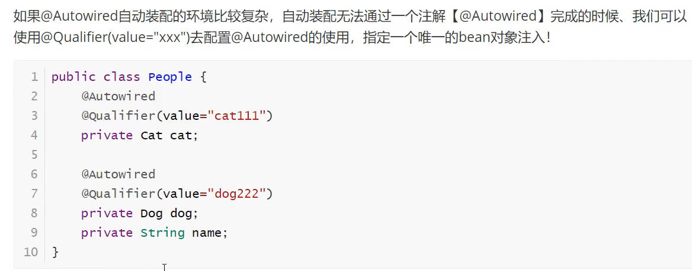

- ==@Autowire、@Qualifier这2个是一套，是spring的注解==
- @Resource是java的注解

#### 3、==@Resource==

- 集合上面2种： ==先通过bean名字匹配，找不到再找类型匹配的bean==。`是java原生的注解`，idea gutter icons没有提示
  - 如果名字和类型都不匹配，可以指定bean对象的名字去匹配 `@Resource(name = "cat2")`

- @Resource如有指定的name属性，先按该属性进行byName方式查找装配；
- 其次再进行默认的byName方式进行装配；
- 如果以上都不成功，则按byType的方式自动装配。
- 都不成功，则报异常。

实体类：

```java
public class User {
   //如果允许对象为null，设置required = false,默认为true
   //如果名字和类型都不匹配，指定bean对象的名字去匹配
   @Resource(name = "cat2")
   private Cat cat;
   @Resource
   private Dog dog;
   private String str;
}
```

beans.xml

```xml
<bean id="dog" class="com.kuang.pojo.Dog"/>
<bean id="cat1" class="com.kuang.pojo.Cat"/>
<bean id="cat2" class="com.kuang.pojo.Cat"/>

<bean id="user" class="com.kuang.pojo.User"/>
```

测试：结果OK

配置文件2：beans.xml ， 删掉cat2

```xml
<bean id="dog" class="com.kuang.pojo.Dog"/>
<bean id="cat1" class="com.kuang.pojo.Cat"/>
```

实体类上只保留注解

```java
@Resource
private Cat cat;
@Resource
private Dog dog;
```

结果：OK

结论：先进行byName查找，失败；再进行byType查找，成功。

**小结**

@Autowired与@Resource异同：

1、@Autowired与@Resource都可以用来装配bean。都可以写在字段上，或写在setter方法上。

2、@Autowired默认按类型装配（属于spring规范），默认情况下必须要求依赖对象必须存在，如果要允许null 值，可以设置它的required属性为false，如：@Autowired(required=false) ，如果我们想使用名称装配可以结合@Qualifier注解进行使用

3、@Resource（属于J2EE复返），默认按照名称进行装配，名称可以通过name属性进行指定。如果没有指定name属性，当注解写在字段上时，默认取字段名进行按照名称查找，如果注解写在setter方法上默认取属性名进行装配。当找不到与名称匹配的bean时才按照类型进行装配。但是需要注意的是，如果name属性一旦指定，就只会按照名称进行装配。

它们的作用相同都是用注解方式注入对象，但执行顺序不同。@Autowired先byType，@Resource先byName。

##### 1、 @Resource和@Autowired区别

- 都是用来自动装配的，都可以放在属性字段上
- 实现方式不同
  - @Autowired默认通过bytype的方式实现，如果有多个类型，则通过byname实现，如果两个都找不到，就报错！
  - @Resource默认通过byname的方式实现，如果找不到名字，则通过bytype实现，如果两个都找不到，就报错！
- 执行的顺序不同：
  - @Autowired默认通过bytype的方式实现
  - @Resource默认通过byname的方式实现
- 类型重复的话，如果名字不是默认的（如cat11，cat111，而没有默认的cat）
  - @Autowired配合@Qualifier(value = "cat11")使用
  - @Resource直接使用@Resource(name = "cat11")

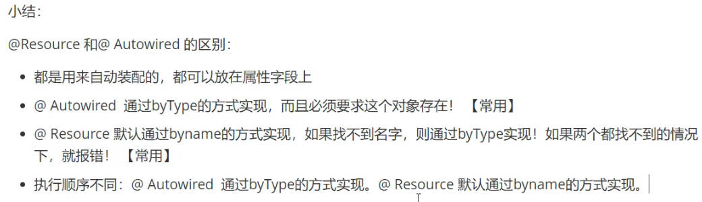

# 7、==使用注解开发==

## 1、说明

==一个类代替前面讲的xml Bean;  @Component代替注册的bean； @Value代替注入值； @Scope代替作用域==

在spring4之后，想要使用注解形式，==必须得要引入aop的包==

 ```xml
  <dependency>
            <groupId>org.springframework</groupId>
            <artifactId>spring-aop</artifactId>
            <version>5.2.7.RELEASE</version>
  </dependency> 
 ```


在配置文件当中，还得要引入一个==context约束==

```xml
<?xml version="1.0" encoding="UTF-8"?>
<beans xmlns="http://www.springframework.org/schema/beans"
      xmlns:xsi="http://www.w3.org/2001/XMLSchema-instance"
      xmlns:context="http://www.springframework.org/schema/context"
      xsi:schemaLocation="http://www.springframework.org/schema/beans
       http://www.springframework.org/schema/beans/spring-beans.xsd
       http://www.springframework.org/schema/context
       http://www.springframework.org/schema/context/spring-context.xsd">

</beans>
```


## 2、==Bean==的实现

我们之前都是使用 bean 的标签进行bean注入，但是实际开发中，我们一般都会使用注解！

### 1、配置扫描哪些包下的注解

指定要扫描的包，包下的注解才会生效

- `<context:annotation-config/>` :注解支持
- `<context:component-scan base-package="com.kuang.pojo"/>`  : 指定要扫描的包

```xml
<?xml version="1.0" encoding="UTF-8"?>
<beans xmlns="http://www.springframework.org/schema/beans"
       xmlns:xsi="http://www.w3.org/2001/XMLSchema-instance"
       xmlns:context="http://www.springframework.org/schema/context"
       xsi:schemaLocation="http://www.springframework.org/schema/beans
        https://www.springframework.org/schema/beans/spring-beans.xsd
        http://www.springframework.org/schema/context
        https://www.springframework.org/schema/context/spring-context.xsd">
	<!-- 注解驱动支持 -->
    <context:annotation-config/>
    <!-- 指定要扫描的包，这个包下的注解就会生效 -->
    <context:component-scan base-package="com.kuang.pojo"/>

</beans>
```

### 2、在指定包下编写类，增加注解

变成组件：==@Component("user")==，  赋值@Value("风雨")

```java
//等价于在xml里写一个bean,<bean id="user" class="com.kuang.pojo.User"/>
@Component("user")
// 相当于配置文件中 <bean id="user" class="当前注解的类"/>
public class User {
   public String name = "风雨";
}
```

3、测试

```java
@Test
public void test(){
   ApplicationContext applicationContext =
       new ClassPathXmlApplicationContext("beans.xml");
   User user = (User) applicationContext.getBean("user");
   System.out.println(user.name);
}
```


## 3、==属性注入==

使用注解注入属性: @Value("风雨") ，简单的值用注解方便,复杂的例如map、list还是用xml配置

1、可以不用提供set方法，直接在直接名上添加@value("值")

```java
@Component("user")
// 相当于配置文件中 <bean id="user" class="当前注解的类"/>
public class User {
   @Value("风雨")  //属性注入值
   // 相当于配置文件中 <property name="name" value="风雨"/>
   public String name;
}
```

2、如果提供了set方法，在set方法上添加@value("值");

```java
@Component("user")
public class User {

   public String name;

   @Value("风雨") 
   public void setName(String name) {
       this.name = name;
  }
}
```


## 4、==衍生注解==

@Component有几个衍生的注解，在web开发中，会按照mvc三层架构分层！

- ==@Controller：web层==
- ==@Service：service层==
- ==@Repository：dao层==

写上这些注解，就相当于将这个类交给Spring管理装配了！

四个注解功能都是一样的，都是代表将某个注册类注入到Spring中，装配Bean

## 5、自动装配注解

在Bean的自动装配已经讲过了，可以回顾！

## 6、作用域

==@scope==

- `singleton`：默认的，Spring会采用单例模式创建这个对象。关闭工厂 ，所有的对象都会销毁。
- `prototype`：多例模式。关闭工厂 ，所有的对象不会销毁。内部的垃圾回收机制会回收

```java
@Controller("user")
@Scope("prototype")
public class User {
   @Value("秦疆")
   public String name;
}
```


> 小结

**XML与注解比较**

- XML可以适用任何场景 ，结构清晰，维护方便
- 注解不是自己提供的类使用不了，开发简单方便

**xml与注解整合开发** ：推荐最佳实践

- xml管理Bean
- 注解完成属性注入
- 使用过程中， 可以不用扫描，扫描是为了类上的注解
- 使用的过程中，必须让注解生效，需要开启注解支持

```xml
<!--指定要扫描的包，这个包下面的注解就会生效-->
<context:component-scan base-package="nuc.ss"/>
<context:annotation-config/>
```

作用：

- 进行注解驱动注册，从而使注解生效

- 用于激活那些已经在spring容器里注册过的bean上面的注解，也就是显示的向Spring注册

- 如果不扫描包，就需要手动配置bean

- 如果不加注解驱动，则注入的值为null！


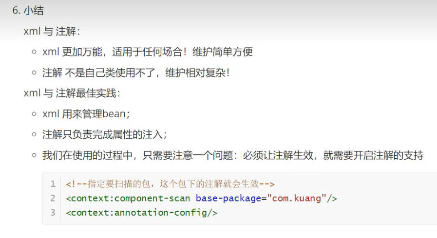

## 7、==使用JavaConfig实现配置==

JavaConfig 原来是 Spring 的一个子项目，它通过 Java 类的方式提供 Bean 的定义信息，在 Spring4 的版本， JavaConfig 已正式成为 Spring4 的核心功能 。==等价于xml里面的Bean配置==,使用java的方式配置spring

- 不用xml，用纯java类
- ==java配置类==： KuangConfig.java
  - ==@Configuration==  
  - @Bean

- MyTest: `ApplicationContext context = new AnnotationConfigApplicationContext(KuangConfig.class);`

测试：

1、编写一个实体类，Dog

```java
//说明这个类被spring接管，注册到容器中
@Component  //将这个类标注为Spring的一个组件，放到容器中！
public class Dog {
   public String name = "dog";
}
```

2、新建一个config配置包，编写一个MyConfig配置类

- @Configuration 

```java
//这个也被spring容器托管，注册到容器中，它本来就是一个@Component
@Configuration  //代表这是一个配置类
@ComponentScan("com.kuang.pojo") //扫描
public class MyConfig {

   @Bean //通过方法注册一个bean，这里的返回值就Bean的类型，方法名就是bean的id！
   public Dog dog(){
       return new Dog();
  }

}
```

3、测试

```java
@Test
public void test2(){
   ApplicationContext applicationContext =
           new AnnotationConfigApplicationContext(MyConfig.class);
   Dog dog = (Dog) applicationContext.getBean("dog");
   System.out.println(dog.name);
}
```

4、成功输出结果！

**导入其他配置如何做呢？**

1、我们再编写一个配置类！

```java
@Configuration  //代表这是一个配置类
public class MyConfig2 {
}
```

2、在之前的配置类中我们来选择导入这个配置类

```java
@Configuration
@Import(MyConfig2.class)  //导入合并其他配置类，类似于配置文件中的 inculde 标签
public class MyConfig {

   @Bean
   public Dog dog(){
       return new Dog();
  }

}
```

关于这种Java类的配置方式，我们在之后的SpringBoot 和 SpringCloud中还会大量看到，我们需要知道这些注解的作用即可！

| 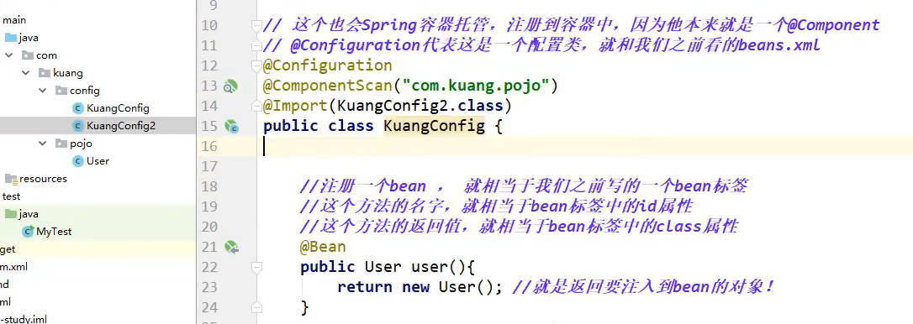 | 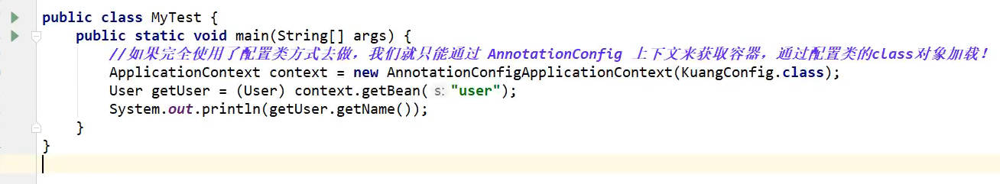 |
| ------------------------------------------------------------ | ------------------------------------------------------------ |
|  |                                                         |


# 8、静态代理/动态代理

==把真实角色作为参数注入代理，然后执行真实角色的方法==；`proxy.setUserService(userService);`

真实、代理角色都实现抽象角色 `public class UserServiceProxy implements UserService`

`需要用到他的地方 , 不去实现它 , 而是留出一个接口 , 利用set`

> 静态代理在==编译期==就确定代理类，动态代理则在运行时动态生成代理类，这是两者最核心的分界线。
>
> - 静态代理需要你为每个目标类手写一个代理类
> - 动态代理通过反射机制在内存中统一生成，代码量大幅减少
>
> 区别：
>
> - 代理类生成时机：静态代理的 `.class` 文件在编译时已存在；动态代理的字节码在程序运行中==由 JVM 动态生成，只存在于内存==，不落盘。
> - 代码量：静态代理要为每个被代理类单独写代理类，接口新增方法时目标类和代理类都要改；动态代理一个处理器即可服务多个目标类，无需逐个修改。
>
> - 灵活性：动态代理更灵活，不需要针对每个目标类都创建代理类，且能统一处理所有代理方法的增强逻辑

代理模式有2种： 基于接口，基于类

为什么要学习代理模式，因为AOP的底层机制就是动态代理！

代理模式：

- 静态代理: 例如租房，就是通过代理调用房东的方法
- 动态代理

学习aop之前 , 我们要先了解一下代理模式！

|  |  |
| ------------------------------------------------------------ | ------------------------------------------------------------ |
|      |                                                         |

## 1、静态代理

==多线程里讲的静态代理==

- Marry接口，2个实现(You、weddingCompany)
  - 真实角色注入代理角色
    - 代理角色==有参构造==里把真实角色传进来  `public Proxy(Host host) {this.host = host;}`
    - 或者用==set方法==把真实角色==注入属性== 
      - `public void setUserService(UserServiceImpl userService) {this.userService = userService;}`

  - 代理角色==实现方法里执行，真实角色的方法==  `public void rent(){host.rent();}`

- 代理角色参数里，传入真实角色;
  -  ` new WeddingCompany(new you()).HappyMarry()`

- 真实角色专注于业务，里面没其它方法
- ==真实对象和代理对象都要实现同一接口==； 代理对象代理真实角色


**静态代理角色分析**

- 抽象角色 : 一般使用接口或者抽象类来实现
  - 例如租房，真实角色和代理角色要去实现

- 真实角色 : 被代理的角色

- 代理角色 : 代理真实角色 ; 代理真实角色后 , 一般会做一些附属的操作 .

- 客户  :  使用代理角色来进行一些操作 .


|  |      |
| ------------------------------------------------------------ | ---- |

**代码实现**

Rent . java 即抽象角色

```java
//抽象角色：租房
public interface Rent {
   public void rent();
}
```

Host . java 即真实角色

```java
//真实角色: 房东，房东要出租房子
public class Host implements Rent{
   public void rent() {
       System.out.println("房屋出租");
  }
}
```

Proxy . java 即代理角色

- 把房东组合进来

```java
//代理角色：中介
public class Proxy implements Rent {
   //帮房东出租房子,先把房东拿过来
   private Host host;
   //无参构造器
   public Proxy() { }
   //代理类有参构造: 创建对象时，把房东拿过来
   public Proxy(Host host) {
       this.host = host;
  }

   //租房
   public void rent(){
       seeHouse();
       host.rent();
       fare();
  }
    
    
   //代理角色一般会有附加方法
   //看房
   public void seeHouse(){
       System.out.println("带房客看房");
  }
   //收中介费
   public void fare(){
       System.out.println("收中介费");
  }
}
```

Client . java 即客户  ==传给代理类的有参构造==

```java
//客户类，一般客户都会去找代理！
public class Client {
   public static void main(String[] args) {
       //房东要租房
       Host host = new Host();
       //中介帮助房东: 把房东传给代理,执行代理的方法
       Proxy proxy = new Proxy(host);

       //你去找中介！
       proxy.rent();
  }
}
```

分析：在这个过程中，你直接接触的就是中介，就如同现实生活中的样子，你看不到房东，但是你依旧租到了房东的房子通过代理，这就是所谓的代理模式，程序源自于生活，所以学编程的人，一般能够更加抽象的看待生活中发生的事情。

==**静态代理的好处:**==

- 可以使得我们的真实角色更加纯粹 . 不再去关注一些公共的事情 .
- 公共的业务由代理来完成 . 实现了业务的分工 ,
- 公共==业务扩展时, 方便集中管理== .

缺点 :

- 一个真实角色就会产生一个代理角色；代码量会翻倍-开发效率会变低

我们想要静态代理的好处，又不想要静态代理的缺点，所以 , 就有了动态代理 !

## 2、静态代理再理解

> #### 静态代理再理解

同学们练习完毕后，我们再来举一个例子，巩固大家的学习！

练习步骤：

1、创建一个抽象角色，比如咋们平时做的用户业务，抽象起来就是增删改查！

```java
//抽象角色：增删改查业务
public interface UserService {
   void add();
   void delete();
   void update();
   void query();
}
```

2、我们需要一个真实对象来完成这些增删改查操作

```java
//真实对象，完成增删改查操作的人
public class UserServiceImpl implements UserService {

   public void add() {
       System.out.println("增加了一个用户");
  }
   public void delete() {
       System.out.println("删除了一个用户");
  }
   public void update() {
       System.out.println("更新了一个用户");
  }
   public void query() {
       System.out.println("查询了一个用户");
  }
}
```

3、需求来了，现在我们需要增加一个日志功能，怎么实现！

- 思路1 ：在实现类上增加代码 【麻烦！】
- 思路2：使用代理来做，能够不改变原来的业务情况下，实现此功能就是最好的了！

4、设置一个代理类来处理日志！代理角色

```java
//代理角色，在这里面增加日志的实现
public class UserServiceProxy implements UserService {
   private UserServiceImpl userService;
   //spring不建议用有参构造，建议用get/set注入对象
   public void setUserService(UserServiceImpl userService) {
       this.userService = userService;
  }
    
   public void add() {
       log("add");
       userService.add();
  }
   public void delete() {
       log("delete");
       userService.delete();
  }
   public void update() {
       log("update");
       userService.update();
  }
   public void query() {
       log("query");
       userService.query();
  }
   //加一个日志方法
   public void log(String msg){
       System.out.println("执行了"+msg+"方法");
  }

}
```

5、测试访问类：

```java
public class Client {
   public static void main(String[] args) {
       //真实业务
       UserServiceImpl userService = new UserServiceImpl();
       //代理类
       UserServiceProxy proxy = new UserServiceProxy();
       //使用代理类实现日志功能！
       proxy.setUserService(userService);

       proxy.add();
  }
}
```

OK，到了现在代理模式大家应该都没有什么问题了，重点大家需要理解其中的思想；

我们在不改变原来的代码的情况下，实现了对原有功能的增强，这是AOP中最核心的思想

聊聊AOP：纵向开发，横向开发

 

## 3、==动态代理==

[HauChee's Programming Notes: What makes the CGLib Proxy Enhancer the good substitution for the Java Dynamic Proxy](http://hauchee.blogspot.com/2015/09/cglib-enhancer-good-substitution-for-java-dynamic-proxy.html)     [How does dynamic proxy works in java](https://pingrunhuang.github.io/blog/2017-10-26/)  [Java Dynamic Proxy](https://leodev.ru/blog/java/java-dynamic-proxy/)   [Java Dynamic proxy ](https://www.cnblogs.com/chaseblack/p/4722591.html)

[Java 动态代理是什么？ - 知乎](https://www.zhihu.com/question/588329174/answer/3002855971?utm_id=0)   [关于InvocationHandler接口](https://blog.csdn.net/jiafu1115/article/details/6646579)

[JAVAssist_百度百科](https://baike.baidu.com/item/JAVAssist/6039181)  

==Proxy类对象实现了代理目标的所有接口，并代替目标对象进行实际的操作==;  对目标对象的方法进行拦截

- AOP实现就是基于动态代理实现的
- `Proxy类的设计用到代理模式的设计思想，Proxy类对象实现了代理目标的所有接口，并代替目标对象进行实际的操作。但这种替代不是一种简单的替代，这样没有任何意义`
  - `代理的目的是在目标对象方法的基础上作增强，这种增强的本质通常就是对目标对象的方法进行拦截。所以，Proxy应该包括一个方法拦截器，来指示当拦截到方法调用时作何种处理。InvocationHandler就是拦截器的接口`; 在代理对象上调用方法时被调用
- ==InvocationHandler== ： `Object invoke(Object proxy, Method method, Object[] args)`
  - 第二和三参数，一个是被拦截的方法，一个是该方法的参数列表
  -  proxy Obj : 代理实例, `是一个实现了目标对象接口的对象，而不同于目标对象。也就是说，这种代理机制是面向接口，而不是面向类的`
  - 实现一个`InvocationHandler`接口，这个接口中只有一个方法`invoke()`，它会==在代理对象上调用方法时被调用==
- 使用`Proxy`类的[静态方法](https://www.zhihu.com/search?q=静态方法&search_source=Entity&hybrid_search_source=Entity&hybrid_search_extra={"sourceType"%3A"answer"%2C"sourceId"%3A2928396715})`newProxyInstance()`动态创建一个代理对象，这个==代理对象会实现定义的接口，并将方法调用分派给`InvocationHandler`对象==

> JDK 动态代理就是：**程序运行时，Java 帮你"现写"一个代理类**，这个类实现了你指定的接口，并把所有方法调用都转发给你写的一个"拦截器"（`InvocationHandler`）。你不用自己手写代理代码，也不用提前编译，接口有多少方法它都能自动接住
>
> - 只需要两个东西：一个 `InvocationHandler`（写拦截逻辑），一行 `Proxy.newProxyInstance`（生成代理对象）
> - 关键点：**代理对象和真实对象之间没有继承关系，它们只是"实现了同一个接口"的兄弟**。代理靠的是接口这个契约，而不是靠继承目标类
> - JDK 动态代理 = 运行时自动生成"实现某接口的代理类" + 所有方法调用统一转发给 `InvocationHandler` + 你在 handler 里用反射决定要不要调用真实对象。它的代价是必须有接口、多一层反射开销，收益是彻底消灭了手写代理类的重复劳动

1. 动态代理代理的是接口      
2. ==代理谁：被代理的接口==
3. ==生成代理类==
4. ==调用代理程序的方法：处理代理实例，并返回结果==

找一个代理注册来帮忙

InvocationHandler接口：每个==代理实例都有一个关联的调用处理程序==

Proxy类：==生成动态代理类和实例==的静态方法

- 动态代理的角色和静态代理的一样 .

- 动态代理的代理类是动态生成的 . 静态代理的代理类是我们提前写好的

- 动态代理分为两类 : 一类是基于接口动态代理 , 一类是基于类的动态代理

- - ==基于接口的动态代理==----JDK动态代理
  - ==基于类的动态代理==--cglib
  - 现在用的比较多的是 javasist 来生成动态代理 . 百度一下javasist
  - 我们这里使用JDK的原生代码来实现，其余的道理都是一样的！、

**JDK的动态代理需要了解两个类**

核心 : InvocationHandler   和   Proxy  ， 打开JDK帮助文档看看

|  |               |
| ------------------------------------------------------------ | ------------------------------------------------ |
|                       |  |


### 1、自己的理解

[Java 动态代理是什么？ - 知乎](https://www.zhihu.com/question/588329174/answer/3002855971?utm_id=0)   [关于InvocationHandler接口](https://blog.csdn.net/jiafu1115/article/details/6646579)

动态代理是反射机制的一种应用。Java动态代理通过程序==实时地在内存中构造代理对象==，从而可以代理实际对象并==在执行实际对象方法时拦截==并进行自定义的额外操作，自由地扩展系统的功能

动态代理包含两个核心组件:

1. 代理工厂
   1. 用反射机制在内存中==动态创建代理类，实现接口方法==并==调用被代理类的方法==，以实现对被代理类的代理访问
2. 调用处理器
   1. InvocationHandler接口的实现类，==负责代理类实现的方法调用==调用处理器的==invoke方法==，在该方法中可以==对被代理类的方法进行增强或者拦截==

示例：

1. 定义一个接口： 声明代理类和被代理类==需要实现的方法==
2. 定义一个被代理类
3. 定义一个调用处理器 ：实现代理类需要实现的方法和==增强被代理类的方法==
4. 创建代理对象并调用 ：newProxyInstance静态方法==生成代理类==，并将InvocationHandler对象传递给该方法，以供调用处理器拦截代理类方法时调用 
5. ==通过代理类调用实现类的方法==，并在调用处理器代码中对被代理类方法进行扩展


`java.lang.reflect.Proxy ,  newProxyInstance(ClassLoader loader, 类<?>[] interfaces, InvocationHandler h) `

`java.lang.reflect , Interface InvocationHandler , invoke(Object proxy, 方法 method, Object[] args)`


1. 使用Proxy类的静态方法newProxyInstance()==动态创建一个代理对象==，==将方法调用分派给LoggingInvocationHandler对象==。
2. 当==调用代理对象的request()方法==时，==实际上是调用==了LoggingInvocationHandler对象中的==invoke()方法==，然后在该方法中==调用了RealSubject对象的request()方法==。
3. 在实际应用中，可根据具体需求来实现不同的InvocationHandler接口，实现不同的增强功能

```java
public class DynamicProxyExample {
    /**
     * 首先定义了一个Subject接口和一个RealSubject类，这个类实现了Subject接口。接着，定义了一个LoggingInvocationHandler类，这个类实现了InvocationHandler接口，
     * 它会在代理对象上调用任何方法时被调用，并在方法调用前后输出日志信息。
     * 
     * 最后，使用Proxy类的静态方法newProxyInstance()动态创建一个代理对象，将方法调用分派给LoggingInvocationHandler对象。
     * 当调用代理对象的request()方法时，实际上是调用了LoggingInvocationHandler对象中的invoke()方法，
     * 然后在该方法中调用了RealSubject对象的request()方法。
     * 在实际应用中，可根据具体需求来实现不同的InvocationHandler接口，实现不同的增强功能。
     */
    public static void main(String[] args) {
        // 创建一个委托对象
        RealSubject realSubject = new RealSubject();
        // 创建一个代理对象并将方法调用分派给委托对象
        Subject proxy = (Subject) Proxy.newProxyInstance(
                Subject.class.getClassLoader(),
                new Class[]{Subject.class},
                new LoggingInvocationHandler(realSubject)
        );
        // 调用代理对象的方法, 实际上是调用了LoggingInvocationHandler对象中的invoke()方法
        proxy.request();
    }
}

interface Subject {
    void request();
}

class RealSubject implements Subject {
    @Override
    public void request() {
        System.out.println("RealSubject: Handling request.");
    }
}

//定义一个调用处理器
class LoggingInvocationHandler implements InvocationHandler {
    private Object target;

    public LoggingInvocationHandler(Object target) {
        this.target = target;
    }

    @Override
    //代理实例，被拦截的方法，该方法的参数列表
    public Object invoke(Object proxy, Method method, Object[] args)
            throws Throwable {
        System.out.println("Before method: " + method.getName());
        Object result = method.invoke(target, args);
        System.out.println("After method: " + method.getName());
        return result;
    }
}
```


### 2、狂神的笔记

|  |  |
| ------------------------------------------------------------ | ------------------------------------------------------------ |
|  |  |
|  |                                                              |

【InvocationHandler：调用处理程序】

- 是个接口，每个代理实例都有一个代理类，代理实例会自动生成一个，调用处理程序的接口

 

```java
Object invoke(Object proxy, 方法 method, Object[] args)；
//参数
//proxy - 调用该方法的代理实例
//method -所述方法对应于调用代理实例上的接口方法的实例。方法对象的声明类将是该方法声明的接口，它可以是代理类继承该方法的代理接口的超级接口。
//args -包含的方法调用传递代理实例的参数值的对象的阵列，或null如果接口方法没有参数。原始类型的参数包含在适当的原始包装器类的实例中，例如java.lang.Integer或java.lang.Boolean 。
```

【Proxy  : 代理】

 


```
//生成代理类
public Object getProxy(){
   return Proxy.newProxyInstance(this.getClass().getClassLoader(),
                                 rent.getClass().getInterfaces(),this);
}
```

**代码实现** 

抽象角色和真实角色和之前的一样！

Rent . java 即抽象角色

```java
//抽象角色：租房
public interface Rent {
   public void rent();
}
```

Host . java 即真实角色

```java
//真实角色: 房东，房东要出租房子
public class Host implements Rent{
   public void rent() {
       System.out.println("房屋出租");
  }
}
```

ProxyInvocationHandler. java 即代理角色

```java
//我们用这个类，自动生成代理类
public class ProxyInvocationHandler implements InvocationHandler {
   //1、代理谁：被代理的接口
   private Rent rent;
   //现在还没有代理类,没法new
   public void setRent(Rent rent) {
       this.rent = rent;
  }

   //2、生成代理类，重点是第二个参数，获取要代理的抽象角色！之前都是一个角色，现在可以代理一类角色
   //参数1，代理的类在哪个位置(类加载器)； 参数2，代理的接口是哪一个； 参数3，调用InvocationHandler来处理
   public Object getProxy(){
       return Proxy.newProxyInstance(this.getClass().getClassLoader(),
               rent.getClass().getInterfaces(),this);
  }

   // proxy : 代理类 method : 代理类的调用处理程序的方法对象.
   // 3、调用代理程序的方法：处理代理实例上的方法,并返回结果
   @Override
   public Object invoke(Object proxy, Method method, Object[] args) throwsThrowable {
       seeHouse();
       //核心：本质利用反射实现！
       Object result = method.invoke(rent, args);
       fare();
       return result;
  }

   //扩展功能:看房
   public void seeHouse(){
       System.out.println("带房客看房");
  }
   //收中介费
   public void fare(){
       System.out.println("收中介费");
  }

}
```

Client . java

```java
//租客
public class Client {
   public static void main(String[] args) {
       //真实角色
       Host host = new Host();
       //代理角色：现在没有,要通过处理程序生成一个代理类
       //代理实例的调用处理程序
       ProxyInvocationHandler pih = new ProxyInvocationHandler();
       //通过调用程序处理我们要调用的接口对象
       pih.setRent(host); //将真实角色放置进去！ 设置要代理的对象
       //这里的proxy是动态生成的，我们并没有写
       Rent proxy = (Rent)pih.getProxy(); //动态生成对应的代理类！
       proxy.rent();
  }

}
```

核心：**一个动态代理 , 一般代理某一类业务 , 一个动态代理可以代理多个类，代理的是接口！、**


> #### 深化理解

我们来使用动态代理实现代理我们后面写的UserService！

我们也可以编写一个通用的动态代理实现的类！所有的代理对象设置为Object即可！

```java
//工具类的写法，封装：我们用这个类，自动生成代理类
public class ProxyInvocationHandler implements InvocationHandler {
   //1、代理谁：被代理的接口
   private Object target;
   public void setTarget(Object target) {
       this.target = target;
  }

   //2、生成代理类
   public Object getProxy(){
       return Proxy.newProxyInstance(this.getClass().getClassLoader(),
               target.getClass().getInterfaces(),this);
  }

   // proxy : 代理类
   // method : 代理类的调用处理程序的方法对象
   //3、调用代理程序的方法：处理代理实例，并返回结果
   public Object invoke(Object proxy, Method method, Object[] args) throwsThrowable {
       log(method.getName());
       Object result = method.invoke(target, args);
       return result;
  }
   //扩展日志功能
    public void log(String msg) {
        System.out.println("执行了" + msg + "方法");
    }
}
```

测试！

```java
public class Test {
   public static void main(String[] args) {
       //真实对象
       UserServiceImpl userService = new UserServiceImpl();
       //代理对象的调用处理程序
       ProxyInvocationHandler pih = new ProxyInvocationHandler();
       pih.setTarget(userService); //设置要代理的对象
       UserService proxy = (UserService)pih.getProxy(); //动态生成代理类！
       proxy.delete();
  }
}
```

测试，增删改查，查看结果！


> ##### 动态代理的好处

静态代理有的它都有，静态代理没有的，它也有！

- 可以使得我们的真实角色更加纯粹 . 不再去关注一些公共的事情 .
- 公共的业务由代理来完成 . 实现了业务的分工 ,
- 公共业务发生扩展时变得更加集中和方便 .
- 一个动态代理类代理的是一个接口，一般就是对应的一类业务
- 一个动态代理类可以代理多个类，只要是实现了同一个接口即可【核心】

# 9.AOP

 

让我们只关注业务，spring把它们连接起来


## 1、什么是AOP

1. **通过 Spring API 实现**
2. **自定义类来实现Aop**
3. **使用注解实现**

AOP（Aspect Oriented Programming）意为：面向切面编程，通过预编译方式和运行期动态代理实现程序功能的统一维护的一种技术。AOP是OOP的延续，是软件开发中的一个热点，也是Spring框架中的一个重要内容，是函数式编程的一种衍生范型。利用AOP可以对业务逻辑的各个部分进行隔离，从而使得业务逻辑各部分之间的耦合度降低，提高程序的可重用性，同时提高了开发的效率。

 

## 2、Aop在Spring中的作用

提供声明式事务；允许用户自定义切面

以下名词需要了解下：

- 横切关注点：跨越应用程序多个模块的方法或功能。即是，与我们业务逻辑无关的，但是我们需要关注的部分，就是横切关注点。如日志 , 安全 , 缓存 , 事务等等 ....   ==例如加个日志功能==
- 切面（ASPECT）：横切关注点 被模块化 的特殊对象。即，它是一个类。 ==例如把日志功能生成一个类==
- 通知（Advice）：切面必须要完成的工作。即，它是==类中的一个方法==。
- 目标（Target）：被通知对象。   ==target：接口==
- 代理（Proxy）：向目标对象应用通知之后创建的对象。 ==生成的代理类==
- 切入点（PointCut）：切面通知 执行的 “地点”的定义。 ==在哪个地方执行==
- 连接点（JointPoint）：与切入点匹配的执行点。与切入点差不多，但可从切入点拿一些东西  ==在哪个地方执行==

 

SpringAOP中，通过Advice定义横切逻辑，Spring中支持5种类型的Advice:


即 Aop 在 不改变原有代码的情况下 , 去增加新的功能 .

## 3、使用Spring实现Aop

小结：

1. 导入AOP织入包
2. 编写业务接口和实现类
3. 扩展功能：写2个业务增强类
4. 配置AOP
   1. 把上面的类都注册到spring：bean
   2. aop切入实现 :`<aop:config>`  
      1. aspect:自定义切面, 切面就是一个类
      2. pointcut:切入点 
      3. advisor：执行环绕增强，方法切入，增加新功能
5. 测试

|  |  |
| ------------------------------------------------------------ | ------------------------------------------------------------ |
|  |  |

【重点】使用AOP织入，需要==导入依赖包== 

```xml
<!-- https://mvnrepository.com/artifact/org.aspectj/aspectjweaver -->
<dependency>
   <groupId>org.aspectj</groupId>
   <artifactId>aspectjweaver</artifactId>
   <version>1.9.4</version>
</dependency>
```

### ==方式一：使用Spring的API接口==【主要SpringAPI接口实现】

**通过 Spring API 实现**

#### 1、==编写业务接口和实现类==

```java
public interface UserService {

   public void add();

   public void delete();

   public void update();

   public void search();

}
public class UserServiceImpl implements UserService{

   @Override
   public void add() {
       System.out.println("增加用户");
  }
   @Override
   public void delete() {
       System.out.println("删除用户");
  }
   @Override
   public void update() {
       System.out.println("更新用户");
  }
   @Override
   public void search() {
       System.out.println("查询用户");
  }
}
```

#### ==2、扩展功能类==

- 写2个增强类

==然后不用动态代理类做，用spring来做==,aop里一堆接口，实现方法就行了，例如MethodBeforeAdvice，前置增强

然后去写我们的增强类 ,例如增加日志功能， 我们编写两个 , 一个前置增强 一个后置增强

```java
public class Log implements MethodBeforeAdvice {

   //method : 要执行的目标对象的方法
   //objects : 被调用的方法的参数
   //Object : 目标对象
   @Override
   public void before(Method method, Object[] objects, Object o) throws Throwable {
       System.out.println( o.getClass().getName() + "的" + method.getName() + "方法被执行了");
  }
}


public class AfterLog implements AfterReturningAdvice {
   //returnValue 返回值
   //method被调用的方法
   //args 被调用的方法的对象的参数
   //target 被调用的目标对象
   @Override
   public void afterReturning(Object returnValue, Method method, Object[] args,Object target) throws Throwable {
       System.out.println("执行了" + target.getClass().getName()
       +"的"+method.getName()+"方法,"
       +"返回值："+returnValue);
  }
}
```

#### ==3、配置AOP==

最后去spring的xml中注册 , 并实现aop切入实现 , 注意==导入约束(命名空间)==  [AOP](https://docs.spring.io/spring-framework/docs/5.2.0.RELEASE/spring-framework-reference/core.html#aop-introduction-defn)

配置AOP：==切入点== => 执行环绕

```xml-dtd
<beans xmlns="http://www.springframework.org/schema/beans"
    xmlns:xsi="http://www.w3.org/2001/XMLSchema-instance"
    xmlns:aop="http://www.springframework.org/schema/aop"
    xsi:schemaLocation="http://www.springframework.org/schema/beans
        https://www.springframework.org/schema/beans/spring-beans.xsd
        http://www.springframework.org/schema/aop
        https://www.springframework.org/schema/aop/spring-aop.xsd">
```

切入点： 动态代理里面,拦截被代理类方法

环绕：功能增强,就是新的方法

```xml
<?xml version="1.0" encoding="UTF-8"?>
<beans xmlns="http://www.springframework.org/schema/beans"
      xmlns:xsi="http://www.w3.org/2001/XMLSchema-instance"
      xmlns:aop="http://www.springframework.org/schema/aop"
      xsi:schemaLocation="http://www.springframework.org/schema/beans
       http://www.springframework.org/schema/beans/spring-beans.xsd
       http://www.springframework.org/schema/aop
       http://www.springframework.org/schema/aop/spring-aop.xsd">

   <!--注册bean-->
   <bean id="userService" class="com.kuang.service.UserServiceImpl"/>
   <bean id="log" class="com.kuang.log.Log"/>
   <bean id="afterLog" class="com.kuang.log.AfterLog"/>
    
   <!--方式一：使用原生Spring API接口-->
   <!--aop的配置:需要导入aop的约束-->
   <aop:config>
       <!--切入点 expression:表达式匹配要执行的方法-->
       <!--切入点,匹配要执行的方法;  expression:表达式,execution(要执行的位置, 修饰词、返回值、类名、方法名、参数)-->
       <!--要给这个类插入一些方法：com.kuang.service.UserServiceImpl; .*类里的所有方法，(..)方法有任意参数-->
       <aop:pointcut id="pointcut" expression="execution(* com.kuang.service.UserServiceImpl.*(..))"/>
       <!--执行环绕增强; advice-ref执行方法 . pointcut-ref切入点-->       
       <!--log这个类，切入到pointcut,这个方法上-->
       <aop:advisor advice-ref="log" pointcut-ref="pointcut"/>
       <aop:advisor advice-ref="afterLog" pointcut-ref="pointcut"/>
   </aop:config>
</beans>
```

#### 5、测试

```java
public class MyTest {
   @Test
   public void test(){
       ApplicationContext context = newClassPathXmlApplicationContext("beans.xml");
       //动态代理代理的是接口      
       UserService userService = (UserService) context.getBean("userService");
       userService.search();
  }
}
```

Aop的重要性 : 很重要 . 一定要理解其中的思路 , 主要是思想的理解这一块 .

Spring的Aop就是将公共的业务 (日志 , 安全等) 和领域业务结合起来 , 当执行领域业务时 , 将会把公共业务加进来 . 实现公共业务的重复利用 . 领域业务更纯粹 , 程序猿专注领域业务 , 其本质还是动态代理 . 


### 方式二：自定义类来实现Aop[主要是切面定义]

目标业务类不变依旧是userServiceImpl

#### 1、自定义切入类

```java
public class DiyPointcut {

   public void before(){
       System.out.println("---------方法执行前---------");
  }
   public void after(){
       System.out.println("---------方法执行后---------");
  }   
}
```

#### 2、切面

去spring中配置： 切面就是一个类

```xml
<!--注册bean-->
<bean id="diy" class="com.kuang.config.DiyPointcut"/>

<!--方式二：自定义类-->
<aop:config>
   <!--自定义切面，ref要引用的类--> 
   <aop:aspect ref="diy">
       <!--切入点-->
       <aop:pointcut id="diyPonitcut" expression="execution(* com.kuang.service.UserServiceImpl.*(..))"/>
       <!--通知:在这个切入点之前执行的方法：aop：before-->
       <aop:before pointcut-ref="diyPonitcut" method="before"/>
       <aop:after pointcut-ref="diyPonitcut" method="after"/>
   </aop:aspect>
</aop:config>
```

#### 3、测试

```java
public class MyTest {
   @Test
   public void test(){
       ApplicationContext context = newClassPathXmlApplicationContext("beans.xml");
       UserService userService = (UserService) context.getBean("userService");
       userService.add();
  }
}
```


### 方式三：注解实现AOP

**使用注解实现**

#### 1、写一个注解实现AOP的类 

AnnotationPointCut.java

- Around
  - 连接点：ProceedingJoinPoint；与切入点匹配的执行点，与切入点差不多，但能从切入点中拿到一些东西

```java
package com.kuang.diy;
import org.aspectj.lang.ProceedingJoinPoint;
import org.aspectj.lang.Signature;
import org.aspectj.lang.annotation.After;
import org.aspectj.lang.annotation.Around;
import org.aspectj.lang.annotation.Aspect;
import org.aspectj.lang.annotation.Before;

//方式三：注解方式实现AOP
@Aspect  //标注这个类是一个切面
public class AnnotationPointCut {
    //切入点
    @Before("execution(* com.kuang.service.UserServiceImpl.*(..))")
    public void before() {
        System.out.println("==========方法执行前============");
    }
    @After("execution(* com.kuang.service.UserServiceImpl.*(..))")
    public void after() {
        System.out.println("==========方法执行后============");
    }
    
    //在环绕增强中，我们可以给定一个参数，代表我们要获取,处理切入的点
    //连接点：ProceedingJoinPoint；与切入点匹配的执行点，与切入点差不多，但能从切入点中拿到一些东西
    @Around("execution(* com.kuang.service.UserServiceImpl.*(..))")
    public void around(ProceedingJoinPoint jp) throws Throwable {
        //执行前
        System.out.println("==========环绕前============");
        //获取签名
        Signature signature = jp.getSignature();
        System.out.println("获取签名signature:" + signature);

        //真正执行方法
        Object proceed = jp.proceed();
        System.out.println("真正执行方法:"+proceed);
        //执行后
        System.out.println("==========环绕后============");
    }
}
```

#### 2、注册bean，开启AOP的注解支持

 anno.xml  `<aop:aspectj-autoproxy/>` , 不是前面的注解支持 `<context:annotation-config/>`

```xml
<?xml version="1.0" encoding="UTF-8"?>
<beans xmlns="http://www.springframework.org/schema/beans"
       xmlns:xsi="http://www.w3.org/2001/XMLSchema-instance"
       xmlns:aop="http://www.springframework.org/schema/aop"
       xsi:schemaLocation="http://www.springframework.org/schema/beans
       http://www.springframework.org/schema/beans/spring-beans.xsd
       http://www.springframework.org/schema/aop
       http://www.springframework.org/schema/aop/spring-aop.xsd">

    <!--注册bean-->
    <bean id="userService" class="com.kuang.service.UserServiceImpl"/>
    <bean id="log" class="com.kuang.log.Log"/>
    <bean id="afterLog" class="com.kuang.log.AfterLog"/>

    <!--方式三：注册注解bean-->
    <bean id="annotationPointCut" class="com.kuang.diy.AnnotationPointCut"/>
    <!--开启aop注解支持-->
    <aop:aspectj-autoproxy/>
</beans>
```

#### 3、Test

```java
@Test
    public void anno() {
        ApplicationContext context = new ClassPathXmlApplicationContext("anno.xml");
        //动态代理代理的是接口
        UserService userService = context.getBean("userService", UserService.class);
        userService.select();
    }
```

aop:aspectj-autoproxy：说明

- poxy-target-class="false",默认AOP用JDK实现
- 改为true，用cglib去实现


```xml
通过aop命名空间的<aop:aspectj-autoproxy />声明自动为spring容器中那些配置@aspectJ切面的bean创建代理，织入切面。当然，spring 在内部依旧采用AnnotationAwareAspectJAutoProxyCreator进行自动代理的创建工作，但具体实现的细节已经被<aop:aspectj-autoproxy />隐藏起来了

<aop:aspectj-autoproxy />有一个proxy-target-class属性，默认为false，表示使用jdk动态代理织入增强，当配为<aop:aspectj-autoproxy  poxy-target-class="true"/>时，表示使用CGLib动态代理技术织入增强。不过即使proxy-target-class设置为false，如果目标类没有声明接口，则spring将自动使用CGLib动态代理。
```


# 10、整合MyBatis

[mybatis-spring](http://mybatis.org/spring/zh/transactions.html#configuration)  [mybatis-spring](https://mybatis.org/spring/sample.html)   [笔记](https://gitee.com/lzh_gitee/Spring5#13声明式事务)   

[为什么很多大厂不用Mybatis](https://developer.huawei.com/home/forum/hwc/thread-0263137557876533059-1-1.html)  

通过Spring AOP切入

## 1、步骤

- 导入相关jar包
- 编写配置文件
- 测试


|  |  |
| ------------------------------------------------------------ | ------------------------------------------------------------ |
|  |                                                              |

1、导入相关jar包

junit

```xml
<dependency>
   <groupId>junit</groupId>
   <artifactId>junit</artifactId>
   <version>4.12</version>
</dependency>
```

mybatis

```xml
<dependency>
   <groupId>org.mybatis</groupId>
   <artifactId>mybatis</artifactId>
   <version>3.5.2</version>
</dependency>
```

mysql-connector-java

```xml
<dependency>
   <groupId>mysql</groupId>
   <artifactId>mysql-connector-java</artifactId>
   <version>5.1.47</version>
</dependency>
```

spring操作数据库的包

```xml
<dependency>
   <groupId>org.springframework</groupId>
   <artifactId>spring-webmvc</artifactId>
   <version>5.1.10.RELEASE</version>
</dependency>
<dependency>
   <groupId>org.springframework</groupId>
   <artifactId>spring-jdbc</artifactId>
   <version>5.1.10.RELEASE</version>
</dependency>
```

aspectJ AOP 织入器

```xml
<!-- https://mvnrepository.com/artifact/org.aspectj/aspectjweaver -->
<dependency>
   <groupId>org.aspectj</groupId>
   <artifactId>aspectjweaver</artifactId>
   <version>1.9.4</version>
</dependency>
```

**mybatis-spring整合包 【重点】**

```xml
<dependency>
   <groupId>org.mybatis</groupId>
   <artifactId>mybatis-spring</artifactId>
   <version>2.0.2</version>
</dependency>
```

配置Maven静态资源过滤问题！

```xml
<build>
   <resources>
       <resource>
           <directory>src/main/java</directory>
           <includes>
               <include>**/*.properties</include>
               <include>**/*.xml</include>
           </includes>
           <filtering>true</filtering>
       </resource>
   </resources>
</build>
```

2、编写配置文件

3、代码实现


## 2、回忆MyBatis

**编写pojo实体类**

```java
package com.kuang.pojo;

public class User {
   private int id;  //id
   private String name;   //姓名
   private String pwd;   //密码
}
```

**实现mybatis的配置文件**

```xml
<?xml version="1.0" encoding="UTF-8" ?>
<!DOCTYPE configuration
       PUBLIC "-//mybatis.org//DTD Config 3.0//EN"
       "http://mybatis.org/dtd/mybatis-3-config.dtd">
<configuration>

   <typeAliases>
       <package name="com.kuang.pojo"/>
   </typeAliases>

   <environments default="development">
       <environment id="development">
           <transactionManager type="JDBC"/>
           <dataSource type="POOLED">
               <property name="driver" value="com.mysql.jdbc.Driver"/>
               <property name="url" value="jdbc:mysql://localhost:3306/mybatis?useSSL=true&amp;useUnicode=true&amp;characterEncoding=utf8"/>
               <property name="username" value="root"/>
               <property name="password" value="123456"/>
           </dataSource>
       </environment>
   </environments>

   <mappers>
       <!--<mapper class="com.kuang.mapper.UserMapper"/>-->
       <package name="com.kuang.mapper.UserMapper"/>
   </mappers>
</configuration>
```

**UserDao接口编写**

```java
public interface UserMapper {
   public List<User> selectUser();
}
```

**接口对应的Mapper映射文件**

```xml
<?xml version="1.0" encoding="UTF-8" ?>
<!DOCTYPE mapper
       PUBLIC "-//mybatis.org//DTD Mapper 3.0//EN"
       "http://mybatis.org/dtd/mybatis-3-mapper.dtd">
<mapper namespace="com.kuang.mapper.UserMapper">

   <select id="selectUser" resultType="User">
    select * from mybatis.user
   </select>

</mapper>
```

**测试类**

- openSession(true): ==true自动提交事务==

```java
@Test
public void selectUser() throws IOException {

   String resource = "mybatis-config.xml";
   InputStream inputStream = Resources.getResourceAsStream(resource);
   SqlSessionFactory sqlSessionFactory = new SqlSessionFactoryBuilder().build(inputStream);
   //用true自动提交事务
   SqlSession sqlSession = sqlSessionFactory.openSession(true);

   UserMapper mapper = sqlSession.getMapper(UserMapper.class);

   List<User> userList = mapper.selectUser();
   for (User user: userList){
       System.out.println(user);
  }

   sqlSession.close();
}
```

## 3、==MyBatis-Spring==

引入Spring之前需要了解mybatis-spring包中的一些重要类；

http://www.mybatis.org/spring/zh/index.html

[mybatis-spring](http://mybatis.org/spring/zh/index.html)

**什么是 MyBatis-Spring？**

MyBatis-Spring 会帮助你将 MyBatis 代码无缝地整合到 Spring 中。

**知识基础**

在开始使用 MyBatis-Spring 之前，你需要先熟悉 Spring 和 MyBatis 这两个框架和有关它们的术语。这很重要

MyBatis-Spring 需要以下版本：

| MyBatis-Spring | MyBatis | Spring 框架 | Spring Batch | Java    |
| :------------- | :------ | :---------- | :----------- | :------ |
| 2.0            | 3.5+    | 5.0+        | 4.0+         | Java 8+ |
| 1.3            | 3.4+    | 3.2.2+      | 2.1+         | Java 6+ |

如果使用 Maven 作为构建工具，仅需要在 pom.xml 中加入以下代码即可：

```xml
<dependency>
   <groupId>org.mybatis</groupId>
   <artifactId>mybatis-spring</artifactId>
   <version>2.0.2</version>
</dependency>
```

要和 Spring 一起使用 MyBatis，需要在 Spring 应用上下文中定义至少两样东西：一个 SqlSessionFactory 和至少一个数据映射器类。

在 MyBatis-Spring 中，可使用SqlSessionFactoryBean来创建 SqlSessionFactory。要配置这个工厂 bean，只需要把下面代码放在 Spring 的 XML 配置文件中：

```xml
<bean id="sqlSessionFactory" class="org.mybatis.spring.SqlSessionFactoryBean">
 <property name="dataSource" ref="dataSource" />
</bean>
```

注意：SqlSessionFactory需要一个 DataSource（数据源）。这可以是任意的 DataSource，只需要和配置其它 Spring 数据库连接一样配置它就可以了。

在基础的 MyBatis 用法中，是通过 SqlSessionFactoryBuilder 来创建 SqlSessionFactory 的。而在 MyBatis-Spring 中，则使用 SqlSessionFactoryBean 来创建。

在 MyBatis 中，你可以使用 SqlSessionFactory 来创建 SqlSession。一旦你获得一个 session 之后，你可以使用它来执行映射了的语句，提交或回滚连接，最后，当不再需要它的时候，你可以关闭 session。

SqlSessionFactory有一个唯一的必要属性：用于 JDBC 的 DataSource。这可以是任意的 DataSource 对象，它的配置方法和其它 Spring 数据库连接是一样的。

一个常用的属性是 configLocation，它用来指定 MyBatis 的 XML 配置文件路径。它在需要修改 MyBatis 的基础配置非常有用。通常，基础配置指的是 < settings> 或 < typeAliases>元素。

需要注意的是，这个配置文件并不需要是一个完整的 MyBatis 配置。确切地说，任何环境配置（<environments>），数据源（<DataSource>）和 MyBatis 的事务管理器（<transactionManager>）都会被忽略。SqlSessionFactoryBean 会创建它自有的 MyBatis 环境配置（Environment），并按要求设置自定义环境的值。

SqlSessionTemplate 是 MyBatis-Spring 的核心。作为 SqlSession 的一个实现，这意味着可以使用它无缝代替你代码中已经在使用的 SqlSession。

模板可以参与到 Spring 的事务管理中，并且由于其是线程安全的，可以供多个映射器类使用，你应该总是用 SqlSessionTemplate 来替换 MyBatis 默认的 DefaultSqlSession 实现。在同一应用程序中的不同类之间混杂使用可能会引起数据一致性的问题。

可以使用 SqlSessionFactory 作为构造方法的参数来创建 SqlSessionTemplate 对象。

```xml
<bean id="sqlSession" class="org.mybatis.spring.SqlSessionTemplate">
 <constructor-arg index="0" ref="sqlSessionFactory" />
</bean>
```

现在，这个 bean 就可以直接注入到你的 DAO bean 中了。你需要在你的 bean 中添加一个 SqlSession 属性，就像下面这样：

```java
public class UserDaoImpl implements UserDao {

 private SqlSession sqlSession;

 public void setSqlSession(SqlSession sqlSession) {
   this.sqlSession = sqlSession;
}

 public User getUser(String userId) {
   return sqlSession.getMapper...;
}
}
```

按下面这样，注入 SqlSessionTemplate：

```xml
<bean id="userDao" class="org.mybatis.spring.sample.dao.UserDaoImpl">
 <property name="sqlSession" ref="sqlSession" />
</bean>
```

### 1、整合实现一

|  |  |
| ------------------------------------------------------------ | ------------------------------------------------------------ |
|  |  |


#### 1、==Spring配置文件==

以前的mybatis测试

- MyBatis-Spring需要一个==数据源和sqlSessionFactory==

```java
@Test
public void selectUser() throws IOException {

   String resource = "mybatis-config.xml";
   InputStream inputStream = Resources.getResourceAsStream(resource);
   SqlSessionFactory sqlSessionFactory = new SqlSessionFactoryBuilder().build(inputStream);
   //用true自动提交事务
   SqlSession sqlSession = sqlSessionFactory.openSession(true);

   UserMapper mapper = sqlSession.getMapper(UserMapper.class);

   List<User> userList = mapper.selectUser();
   for (User user: userList){
       System.out.println(user);
  }

   sqlSession.close();
}
```

spring-dao.xml 

```xml
<?xml version="1.0" encoding="UTF-8"?>
<beans xmlns="http://www.springframework.org/schema/beans"
       xmlns:xsi="http://www.w3.org/2001/XMLSchema-instance"
       xmlns:aop="http://www.springframework.org/schema/aop"
       xsi:schemaLocation="http://www.springframework.org/schema/beans
       http://www.springframework.org/schema/beans/spring-beans.xsd
       http://www.springframework.org/schema/aop
       http://www.springframework.org/schema/aop/spring-aop.xsd">
```

##### 1.1、配置==数据源==替换mybaits的数据源

- MyBatis-Spring需要一个==数据源和sqlSessionFactory==
  - dataSource类用spring提供的jdbc类

```xml
<!--配置数据源：数据源有非常多，可以使用第三方的，也可使使用Spring的-->
<!--DataSource: 使用Spring的数据源替换MyBatis的配置-->
<!--配置数据源：数据源有非常多，可以使用第三方的，也可使使用Spring的,下面就用spring的-->
<bean id="dataSource" class="org.springframework.jdbc.datasource.DriverManagerDataSource">
   <property name="driverClassName" value="com.mysql.jdbc.Driver"/>
   <property name="url" value="jdbc:mysql://localhost:3306/mybatis?useSSL=true&amp;useUnicode=true&amp;characterEncoding=utf8"/>
   <property name="username" value="root"/>
   <property name="password" value="123456"/>
</bean>
```

##### 1.2、配置==SqlSessionFactory==，关联MyBatis

- ==配置SqlSessionFactory,里面导入数据源==
- 可以绑定mybatis配置文件

```xml
<!--配置SqlSessionFactory-->
<bean id="sqlSessionFactory" class="org.mybatis.spring.SqlSessionFactoryBean">
    <property name="dataSource" ref="dataSource"/>
    
    <!--附加的：绑定mybatis配置文件： 关联Mybatis，将spring配置和mybatis配置文件连接起来-->
    <property name="configLocation" value="classpath:mybatis-config.xml"/>
    <!-- 匹配所有的mapper，相当于在mybait配置里注册mapper-->
    <property name="mapperLocations" value="classpath:com/kuang/mapper/*.xml"/>
</bean>
```

##### 1.3、创建==sqlSession==

- ==通过sqlSessionTemplate代替sqlSession==，关联sqlSessionFactory；
  - SqlSessionTemplate这个类没有set方法，==只能通过构造方法注入==

```xml
<!-- 此时 sqlSession还没创建，spring提供了SqlSessionTemplate对象来做（模板引擎来做） -->
<!--SqlSessionTemplate: 创建sqlSession，没有set方法，只能用构造器注入sqlSessionFactory，有3种方式 -->
<!-- SqlSessionTemplate类要注入的话要有set方法，但看源代码里没有set方法，只能用构造器注入，需要传入参数:public SqlSessionTemplate(SqlSessionFactory sqlSessionFactory, ExecutorType executorType)   -->

<bean id="sqlSession" class="org.mybatis.spring.SqlSessionTemplate">
   <constructor-arg index="0" ref="sqlSessionFactory"/>
</bean>
```

##### 1.4、==Mapper类==

增加Dao接口的实现类；私有化sqlSessionTemplate

- mybatis是用Mapper，现在一般写一个实现类， UserMapperImpl.java

==以前调sql语句都是在test测试类里写，整合mybatis后，放在类里面去做，调类的方法就行了，下一步把这个实现类注册到spring==

```java
public class UserMapperImpl implements UserMapper {
    //原来用sqlSession来执行sql，现在用sqlSessionTemplate
    private SqlSessionTemplate sqlSession;

    //spring万物可注入，加一个set方法注入sqlSessin
    public void setSqlSession(SqlSessionTemplate sqlSession) {
        this.sqlSession = sqlSession;
    }

    public List<User> selectUser() {
        UserMapper mapper = sqlSession.getMapper(UserMapper.class);
        return mapper.selectUser();
    }
}
```


|  |  |
| ------------------------------------------------------------ | ------------------------------------------------------------ |

##### 1.5、mapper类注册为bean

==以后在spring调这个bean，调它的方法就执行sql语句==

```xml
<!-- applicationContext.xml专注于注册bean; spring-dao.xml专注于操作数据库,以后不用改 -->
<import resource="spring-dao.xml"/>
<!-- <import resource="spring-mvc.xml"/>-->

<!-- 有了sqlSesson，就可执行sql语句: 以前在mybatis调sql语句都是在test测试类里写，现在放在实现类里面去做，调类的方法就行了，下一步把这个类注册到spring   -->
<bean id="userMapper" class="com.kuang.mapper.UserMapperImpl">
  <property name="sqlSession" ref="sqlSession"/>
</bean>
```

##### 1.6、测试

```java
 public class mybatisTest {
    @Test
    public void selectUser() throws IOException {
        ApplicationContext context = new ClassPathXmlApplicationContext("applicationcontext.xml");
        
        UserMapper mapper = context.getBean("userMapper",UserMapper.class);
        List<User> user = mapper.selectUser();
        System.out.println(user);

        for (User user1 : mapper.selectUser()) {
            System.out.println(user1);
        }
    }
}
```

结果成功输出！现在我们的Mybatis配置文件的状态！发现都可以被Spring整合！

|  |      |
| ------------------------------------------------------------ | ---- |

==mybatis的配置文件里只用写别名和设置就行了==

```xml
<?xml version="1.0" encoding="UTF-8" ?>
<!DOCTYPE configuration
        PUBLIC "-//mybatis.org//DTD Config 3.0//EN"
        "http://mybatis.org/dtd/mybatis-3-config.dtd">
<configuration>
    <!-- 别名 -->
    <typeAliases>
        <package name="com.kuang.pojo"/>
    </typeAliases>

    <!-- 设置  -->

</configuration>
```


==applicationContext.xml专注于注册bean; spring-dao.xml专注于操作数据库,以后不用改==

### 2、整合实现二

不用 `SqlSessionTemplate` ， 继承这个类 `SqlSessionDaoSupport` 就提供了 `SqlSession`

- ==SqlSessionDaoSupport== 是一个抽象的支持类，用来为你提供 `SqlSession`。调用 `getSqlSession()` 方法你会得到一个 `SqlSessionTemplate`，之后可以用于执行 SQL 方法
  - 方法1第4步，Mapper类里不用再注入`SqlSessionTemplate`, 直接继承`SqlSessionDaoSupport`就可以了
  - 配置文件里`<bean id="sqlSession" class="org.mybatis.spring.SqlSessionTemplate">`也可省略


dao继承Support类 , 直接利用 getSqlSession() 获得 , 然后直接注入SqlSessionFactory . 比起方式1 , 不需要管理SqlSessionTemplate , 而且对事务的支持更加友好 . 可跟踪源码查看


测试：

1、将我们上面写的UserDaoImpl修改一下

```java
public class ExtendDaoSupport extends SqlSessionDaoSupport implements UserMapper {

    @Override
    public List<User> selectUser() {
        //SqlSession sqlSession = getSqlSession();
        //sqlSession.getMapper(UserMapper.class);
        //return selectUser();
        
        //getSqlSession()会得到一个 SqlSessionTemplate，之后用于执行 SQL 方法
        return getSqlSession().getMapper(UserMapper.class).selectUser();
    }
}
```

2、修改bean的配置

```xml
<bean id="extendDaoSupport" class="com.kuang.mapper.ExtendDaoSupport">
    <!-- 没有属性，dao.xml中可删掉sqlSession的bean，但它的父类需要注入sqlSessionFactory -->
    <property name="sqlSessionFactory" ref="sqlSessionFactory"/>
</bean>
```

3、测试

```java
@Test
public void extDaoSupport() {
   ApplicationContext context = new  ClassPathXmlApplicationContext("applicationcontext.xml");
   UserMapper mapper = context.getBean("extendDaoSupport", UserMapper.class);
   List<User> user = mapper.selectUser();
   System.out.println(user);

   for (User user1 : mapper.selectUser()) {
            System.out.println(user1);
        }
    }
```

**总结 : 整合到spring以后可以完全不要mybatis的配置文件，除了这些方式可以实现整合之外，我们还可以使用注解来实现，这个等我们后面学习SpringBoot的时候还会测试整合！**

# 11、声明式事务

## 1、回顾事务

[mybatis-spring事务](http://mybatis.org/spring/zh/transactions.html)

- 把一组业务当成一个业务来做；要么都成功，要么都失败！
- 事务在项目开发中，十分重要，涉及到数据的一致性问题，不能马虎
- 确保完整性和一致性

**事务的ACID原则**

- 原子性（atomicity）
  - 事务是原子性操作，由一系列动作组成，事务的原子性确保动作要么全部完成，要么完全不起作用
- 一致性（consistency）
  - 一旦所有事务动作完成，事务就要被提交。数据和资源处于一种满足业务规则的一致性状态中
- 隔离性（isolation）
  - 多个业务可能操作同一个资源，防止数据损坏
- 持久性（durability）
  - 事务一旦提交，无论系统发生什么问题，结果都不会再被影响，被持久化的写到存储器中！

1. ==声明式事务==：用AOP切入
2. ==编程式事务==：需要在代码中，进行事务的管理。会改变原有代码，没必要学

==MyBatis-Spring 借助了 Spring 中的 `DataSourceTransactionManager` 来实现事务管理, 要开启 Spring 的事务处理功能，在 Spring 的配置文件中创建一个 `DataSourceTransactionManager` 对象==

导依赖=>pojo/User实体类=>mybatis-config.xml=>整合mybatis：spring-dao.xml=>UserMapper.xml

> #### 测试

将上面的代码拷贝到一个新项目中

在之前的案例中，我们给userDao接口新增两个方法，删除和增加用户；

```java
//添加一个用户
int addUser(User user);

//根据id删除用户
int deleteUser(int id);
```

mapper文件，我们故意把 deletes 写错，测试！

```xml
<insert id="addUser" parameterType="com.kuang.pojo.User">
insert into user (id,name,pwd) values (#{id},#{name},#{pwd})
</insert>

<delete id="deleteUser" parameterType="int">
deletes from user where id = #{id}
</delete>
```

编写接口的实现类，在实现类中，我们去操作一波

```java
public class UserDaoImpl extends SqlSessionDaoSupport implements UserMapper {

   //增加一些操作
   public List<User> selectUser() {
       User user = new User(4,"小明","123456");
       UserMapper mapper = getSqlSession().getMapper(UserMapper.class);
       mapper.addUser(user);
       mapper.deleteUser(4);
       return mapper.selectUser();
  }

   //新增
   public int addUser(User user) {
       UserMapper mapper = getSqlSession().getMapper(UserMapper.class);
       return mapper.addUser(user);
  }
   //删除
   public int deleteUser(int id) {
       UserMapper mapper = getSqlSession().getMapper(UserMapper.class);
       return mapper.deleteUser(id);
  }

}
```

测试

```java
@Test
public void test2(){
   ApplicationContext context = new ClassPathXmlApplicationContext("beans.xml");
   UserMapper mapper = (UserMapper) context.getBean("userDao");
   List<User> user = mapper.selectUser();
   System.out.println(user);
}
```

报错：sql异常，delete写错了

结果 ：插入成功！

没有进行事务的管理；我们想让他们都成功才成功，有一个失败，就都失败，我们就应该需要**事务！**

以前我们都需要自己手动管理事务，十分麻烦！

但是Spring给我们提供了事务管理，我们只需要配置即可；


## 2、==Spring中的事务管理==

[mybatis-spring文档](http://mybatis.org/spring/zh/transactions.html)  [Spring中propagation的7种事务配置](https://www.cnblogs.com/kelelipeng/p/17577062.html)

小结：

1. Spring 的配置文件中创建一个 `DataSourceTransactionManager` 对象
2. 用AOP实现事务的织入
   1. 导入事务的约束（命名空间） : tx
   2. 配置事务的类(通知) 
      1. `<aop:advisor advice-ref="afterLog" pointcut-ref="pointcut"/>`
      2. `<tx:advice id="txAdvice" transaction-manager="transactionManager">`
         1. 给哪些方法配置事务
         2. 配置事务的传播特性: 7种
   3. 配置事务切入


```xml
<!-- 配置声明式事务 -->
<!--  拿到事务  -->
<bean id="transactionManager" class="org.springframework.jdbc.datasource.DataSourceTransactionManager">
    <property name="dataSource" ref="dataSource" />
</bean>
<!--用AOP实现事务的织入: 交由容器管理事务,官方文档里没有,kuang用的方法，aop织入  -->
<!--配置事务通知：-->
<tx:advice id="txAdvice" transaction-manager="transactionManager">
    <!--给哪些方法配置事务-->
    <!--配置事务的传播特性 new propagation= -->
    <tx:attributes>
        <tx:method name="add" propagation="REQUIRED"/>
        <tx:method name="delete" propagation="REQUIRED"/>
        <tx:method name="update" propagation="REQUIRED"/>
        <tx:method name="query" read-only="true"/>
        <tx:method name="*" propagation="REQUIRED"/>
    </tx:attributes>
</tx:advice>
<!--配置事务切入-->
<aop:config>
    <aop:pointcut id="txPointCut"  expression="execution(* com.kuang.mapper.*.*(..))" />
    <aop:advisor advice-ref="txAdvice" pointcut-ref="txPointCut"/>
</aop:config>
```

Spring在不同的事务管理API之上定义了一个抽象层，使得开发人员不必了解底层的事务管理API就可以使用Spring的事务管理机制。Spring支持编程式事务管理和声明式的事务管理。

**==编程式事务==管理**

- 将事务管理代码嵌到业务方法中来控制事务的提交和回滚
- 缺点：必须在每个事务操作业务逻辑中包含额外的事务管理代码

**==声明式事务==管理**

- 一般情况下比编程式事务好用。
- `将事务管理代码从业务方法中分离出来，以声明的方式来实现事务管理。`
- 将事务管理作为横切关注点，通过aop方法模块化。Spring中通过Spring AOP框架支持声明式事务管理。

**使用Spring管理事务，注意头文件的==约束导入== : tx**

```
xmlns:tx="http://www.springframework.org/schema/tx"

http://www.springframework.org/schema/tx
http://www.springframework.org/schema/tx/spring-tx.xsd">
```

**事务管理器**

- 无论使用Spring的哪种事务管理策略（编程式或者声明式）事务管理器都是必须的。
- 就是 Spring的核心事务管理抽象，管理封装了一组独立于技术的方法。

### 1、开启 Spring 的事务管理功能

- Spring配置文件中创建一个 `DataSourceTransactionManager` 对象， 需要传一个构造器参数 或 set注入

```xml
<bean id="transactionManager"class="org.springframework.jdbc.datasource.DataSourceTransactionManager">
       <property name="dataSource" ref="dataSource" />
</bean>
```

### 2、交由容器管理事务

- ==用AOP实现事务的织入==: 交由容器管理事务,而不使用 Spring 的事务管理
  - 执行CRUD时，往里面丢事务
    - 首先要写事务的类，就是aop里讲的befor、after； spring帮我们做了
    - 导入事务的约束（命名空间），事务tx开头

**配置好事务管理器后我们需要去配置事务的通知**

```
<!--配置事务通知-->
<tx:advice id="txAdvice" transaction-manager="transactionManager">
   <tx:attributes>
       <!--配置哪些方法使用什么样的事务,配置事务的传播特性-->
       <tx:method name="add" propagation="REQUIRED"/>
       <tx:method name="delete" propagation="REQUIRED"/>
       <tx:method name="update" propagation="REQUIRED"/>
       <tx:method name="search*" propagation="REQUIRED"/>
       <tx:method name="get" read-only="true"/>
       <tx:method name="*" propagation="REQUIRED"/>
   </tx:attributes>
</tx:advice>
```

**spring事务传播特性：**

事务传播行为就是多个事务方法相互调用时，事务如何在这些方法间传播。spring支持7种事务传播行为：

- propagation_requierd：如果当前没有事务，就新建一个事务，如果已存在一个事务中，加入到这个事务中，这是最常见的选择。
- propagation_supports：支持当前事务，如果没有当前事务，就以非事务方法执行。
- propagation_mandatory：使用当前事务，如果没有当前事务，就抛出异常。
- propagation_required_new：新建事务，如果当前存在事务，把当前事务挂起。
- propagation_not_supported：以非事务方式执行操作，如果当前存在事务，就把当前事务挂起。
- propagation_never：以非事务方式执行操作，如果当前事务存在则抛出异常。
- propagation_nested：如果当前存在事务，则在嵌套事务内执行。如果当前没有事务，则执行与propagation_required类似的操作

Spring 默认的事务传播行为是 PROPAGATION_REQUIRED，它适合于绝大多数的情况。

假设 ServiveX#methodX() 都工作在事务环境下（即都被 Spring 事务增强了），假设程序中存在如下的调用链：Service1#method1()->Service2#method2()->Service3#method3()，那么这 3 个服务类的 3 个方法通过 Spring 的事务传播机制都工作在同一个事务中。

就好比，我们刚才的几个方法存在调用，所以会被放在一组事务当中！

**配置AOP**

导入aop的头文件！

```
<!--配置aop织入事务-->
<aop:config>
   <aop:pointcut id="txPointcut" expression="execution(* com.kuang.dao.*.*(..))"/>
   <aop:advisor advice-ref="txAdvice" pointcut-ref="txPointcut"/>
</aop:config>
```

**进行测试**

删掉刚才插入的数据，再次测试！

```
@Test
public void test2(){
   ApplicationContext context = new ClassPathXmlApplicationContext("beans.xml");
   UserMapper mapper = (UserMapper) context.getBean("userDao");
   List<User> user = mapper.selectUser();
   System.out.println(user);
}
```

> 思考问题？

为什么需要配置事务？

- 如果不配置，就需要我们手动提交控制事务；
- 事务在项目开发过程非常重要，涉及到数据的一致性的问题，不容马虎！

|  |  |
| ------------------------------------------------------------ | ------------------------------------------------------------ |

