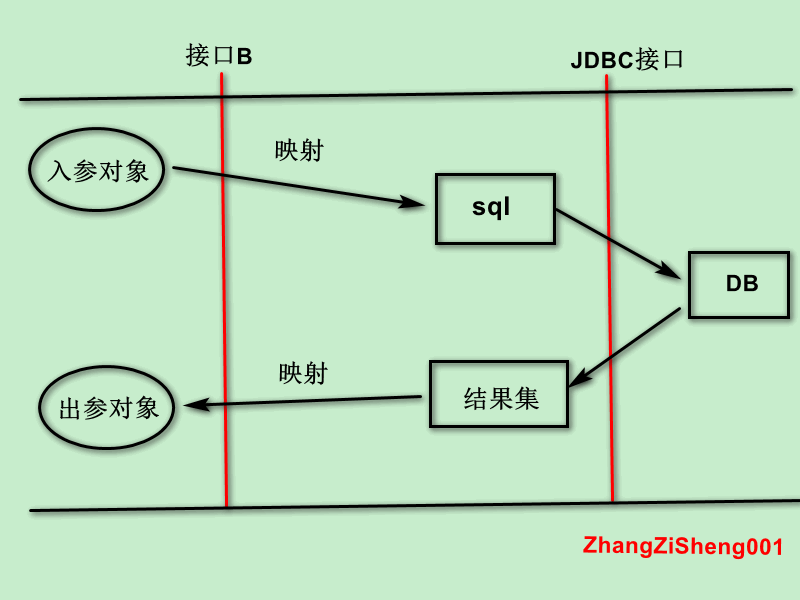
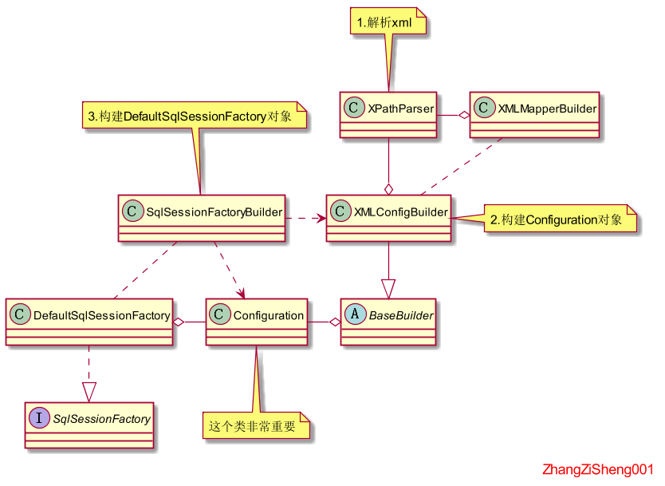
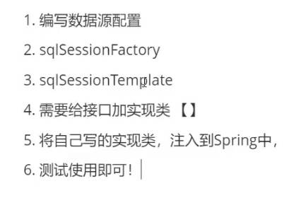
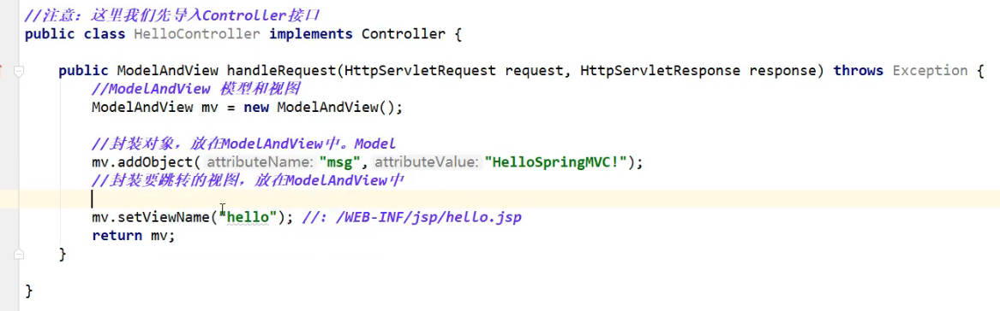

# MyBatis

## 个人总结

[好：MyBatis核心类](https://www.cnblogs.com/whl5/p/8675281.html)    [Mybatis源码详解系列](https://www.cnblogs.com/ZhangZiSheng001/p/12704076.html)  

[Mybatis源码详解系列(一)](https://www.cnblogs.com/ZhangZiSheng001/p/12603885.html)  [Mybatis详解](https://www.cnblogs.com/ZhangZiSheng001/category/1685176.html)   [(二)Mybatis如何加载配置及初始化](https://www.cnblogs.com/ZhangZiSheng001/p/12704076.html)  [(三)从Mapper接口开始看Mybatis的执行逻辑](https://www.cnblogs.com/ZhangZiSheng001/p/12761376.html)  

> 1. 加载配置、初始化`SqlSessionFactory`；
> 2. 获取`SqlSession`和`Mapper`；
>    1. **mappers**（映射器）: `通过接口方法关联对应的SQL语句`，完成增删改查，SQL写在==注解==或==XML文件==里，与Java代码解耦
> 3. 执行`Mapper`方法

1.  `SqlSessionFactoryBuilder`
   1. 是一个==类==
   2. 读取全局配置文件，得到==数据源信息==，创建连接工厂`SqlSessionFactory`
      1. `mybatis-config.xml`：  用于配置和定制化`MyBatis`的运行时行为
      2. 比如可以用于==配置数据库连接==、属性、类型别名、类型处理器、插件、环境配置、映射器（mapper.xml）等信息
   3. `SqlSessionFactoryBuilder` 从 ==XML 配置文件==或一个==预先定制的 Configuration 的实例==构建出 `SqlSessionFactory` 的实例
2.  `SqlSessionFactory`： 连接工厂；创建SqlSession实例的工厂
   1. 是一个==接口==
   2. 每个基于 `MyBatis` 的应用都是以一个 `SqlSessionFactory` 的实例为中心的。
      1. `SqlSessionFactory` 的实例可以通过 `SqlSessionFactoryBuilder` 获得。
3.  `SqlSession`： 
   1. 是一个==接口==
   2. 会话对象类，SqlSession 完全包含了面向数据库执行 SQL 命令所需的所有方法。可以通过 SqlSession 实例来直接执行已映射的 SQL 语句
4.  Mapper
    1.  映射类， 作为==接口的代理类==
    2.  将传入的接口类型与映射的XML文件关联起来，接口的实现是基于XML配置文件中的SQL实现，生成代理类对象


> 配置configuration xml文件

mybatis-config.xml:  configuration（配置）

- properties（全局参数）
- **settings**（全局行为配置）
- typeAliases（类型别名）
- typeHandlers（类型处理器）
- objectFactory（对象工厂）
- **plugins**（插件）
- environments（环境配置）
  - environment（环境变量）
    - transactionManager（事务管理器）
    - dataSource（数据源）
- databaseIdProvider（数据库厂商标识）
- **mappers**（映射器）:  告诉 mybatis 你的 Mapper 接口和 Mapper.xml 文件放在哪里
  - `通过接口方法关联对应的SQL语句`，完成增删改查，`SQL写在注解或XML文件里`，与Java代码解耦

> 初始化的过程

1. **构建 xml 的“节点树”**。`XPathParser`使用的是 JDK 自带的 JAXP API来解析并构建`Document`对象，并且支持 XPath 功能。
2. **初始化`Configuration`对象的成员属性。**`XMLConfigBuilder`利用“节点树”来构建==Configuration对象==（也会去解析注解的配置），==Configuration对象包含了 configuration 文件和 mapper 文件的所有配置信息==。这部分内容比较难，尤其是初始化 mapper 相关的配置。
3. **创建`SqlSessionFactory`**。`SqlSessionFactoryBuilder`利用构建好的`Configuration`对象来创建`SqlSessionFactory`

|  |  |
| ------------------------------------ | ---------------------------------------------- |
|                                 |                                           |
|                                 |                                           |
|                                 |                                           |


## mybatis执行流程

[Mybatis使用笔记](https://www.cnblogs.com/xu-xiang/p/5879814.html)  [ Mybatis工作流程](https://zhuanlan.zhihu.com/p/439834916)  

MyBatis 执行流程可分为==初始化、会话创建、SQL 执行、结果映射与资源关闭==四个阶段，核心是通过配置驱动和组件协同完成数据库操作。

### 初始化与会话创建

1. 加载配置：读取`mybatis-config.xml`和映射文件，解析为`Configuration`对象，将 SQL 节点封装为`MappedStatement`。
2. 构建工厂：通过`SqlSessionFactoryBuilder`创建全局单例的`SqlSessionFactory`。
3. 开启会话：调用`openSession()`获取线程私有的`SqlSession`，内部持有`Executor`执行器。


### SQL 执行与结果处理

1. 代理调用：调用 Mapper 接口方法时，`MapperProxy`通过 JDK 动态代理拦截请求，根据方法名定位`MappedStatement`。
2. 参数绑定：`ParameterHandler`将 Java 参数转换为 JDBC 参数，绑定到`PreparedStatement`的占位符。
3. 执行 SQL：`StatementHandler`调用 JDBC 驱动执行查询，获取`ResultSet`结果集。
4. 结果映射：`ResultSetHandler`根据配置将结果集映射为 Java 对象，支持自动或手动映射。
    资源关闭

执行完成后需手动关闭`SqlSession`释放数据库连接，若集成 Spring 则由容器管理。

MyBatis 执行流程涉及多个组件，可以继续了解 Executor 的作用是什么？ 或者 ParameterHandler 如何处理参数？

## mybatis-config.xml作用

[MyBatis配置文件mybatis-config配置详解](https://cloud.tencent.com/developer/article/2511430)  

`mybatis-config.xml` 是 MyBatis 的全局核心配置文件，用于定义框架的运行时行为、数据库连接环境以及映射器注册。它决定了 SqlSessionFactory 的构建方式。

主要作用包括：
1. 全局设置：配置缓存、懒加载、日志实现等影响所有 SQL 执行的行为。
2. 环境管理：定义数据源（DataSource）和事务管理器，支持多环境（开发/生产）切换。
3. 类型处理：注册类型别名（TypeAliases）简化类名引用，自定义类型处理器（TypeHandlers）处理特殊数据类型转换。
4. 插件扩展：注册拦截器插件，用于分页、性能监控等切面逻辑。
5. 映射器注册：告知 MyBatis 去哪里加载 SQL 映射文件（Mapper XML）或 Mapper 接口。

注意：XML 中标签顺序必须严格遵循 `properties` -> `settings` -> `typeAliases` -> `typeHandlers` -> `objectFactory` -> `objectWrapperFactory` -> `reflectorFactory` -> `plugins` -> `environments` -> `databaseIdProvider` -> `mappers`，否则启动报错。

```xml
<?xml version="1.0" encoding="UTF-8" ?>
<!DOCTYPE configuration PUBLIC "-//mybatis.org//DTD Config 3.0//EN" "http://mybatis.org/dtd/mybatis-3-config.dtd">
<configuration>
    <!-- 1. 引入外部属性文件，避免硬编码 -->
    <properties resource="db.properties"/>

    <!-- 2. 全局设置 -->
    <settings>
        <!-- 开启驼峰命名自动映射: user_id -> userId -->
        <setting name="mapUnderscoreToCamelCase" value="true"/>
        <!-- 指定日志实现，开发期推荐 STDOUT_LOGGING 或 SLF4J -->
        <setting name="logImpl" value="SLF4J"/>
        <!-- 开启二级缓存 -->
        <setting name="cacheEnabled" value="true"/>
    </settings>

    <!-- 3. 类型别名，简化 resultType/parameterType 写法 -->
    <typeAliases>
        <!-- 扫描包，默认别名为类名首字母小写 -->
        <package name="com.example.entity"/>
    </typeAliases>

    <!-- 4. 环境配置 -->
    <environments default="development">
        <environment id="development">
            <!-- JDBC 事务管理 -->
            <transactionManager type="JDBC"/>
            <!-- POOLED 数据源 -->
            <dataSource type="POOLED">
                <property name="driver" value="${jdbc.driver}"/>
                <property name="url" value="${jdbc.url}"/>
                <property name="username" value="${jdbc.username}"/>
                <property name="password" value="${jdbc.password}"/>
            </dataSource>
        </environment>
    </environments>

    <!-- 5. 映射器注册 -->
    <mappers>
        <!-- 方式一：扫描包下所有 Mapper 接口（推荐，需接口与XML同名同包） -->
        <package name="com.example.mapper"/>
        
        <!-- 方式二：指定具体 XML 资源路径 -->
        <!-- <mapper resource="com/example/mapper/UserMapper.xml"/> -->
        
        <!-- 方式三：指定 Mapper 接口类 -->
        <!-- <mapper class="com.example.mapper.OrderMapper"/> -->
    </mappers>
</configuration>
```

配置顺序和标签都清楚了，实际写的时候还有两处容易卡住，可以看看properties和environments怎么写或者缓存和事务怎么配置

## SqlSessionFactory 实例

[每个基于mybatis的应用都是以一个sqlsessionfactory的实例_百度搜索](https://www.baidu.com/s?ie=UTF-8&wd=%E6%AF%8F%E4%B8%AA%E5%9F%BA%E4%BA%8Emybatis%E7%9A%84%E5%BA%94%E7%94%A8%E9%83%BD%E6%98%AF%E4%BB%A5%E4%B8%80%E4%B8%AAsqlsessionfactory%E7%9A%84%E5%AE%9E%E4%BE%8B)  

问题： 每个基于 MyBatis 的应用都是以一个 SqlSessionFactory 的实例为中心的

每个基于 MyBatis 的应用都是以一个 SqlSessionFactory 的实例为中心的。

SqlSessionFactory 是线程安全的，一旦创建应在应用运行期间一直存在（通常作为单例管理），用于创建 SqlSession 实例。它可以通过 SqlSessionFactoryBuilder 从 XML 配置文件、Configuration 实例或注解配置中构建。

XML 配置方式构建示例：

```java
String resource = "mybatis-config.xml";
InputStream inputStream = Resources.getResourceAsStream(resource);
SqlSessionFactory sqlSessionFactory = new SqlSessionFactoryBuilder().build(inputStream);
```

Java 配置方式构建示例：

```java
DataSource dataSource = getDataSource(); // 获取数据源
TransactionFactory transactionFactory = new JdbcTransactionFactory();
Environment environment = new Environment("development", transactionFactory, dataSource);
Configuration configuration = new Configuration(environment);
configuration.addMapper(UserMapper.class); // 注册 Mapper 接口
SqlSessionFactory sqlSessionFactory = new SqlSessionFactoryBuilder().build(configuration);
```

Spring Boot/Spring 集成示例（推荐）：

```java
@Configuration
@MapperScan("com.example.mapper")
public class MyBatisConfig {

    @Bean
    public SqlSessionFactory sqlSessionFactory(DataSource dataSource) throws Exception {
        SqlSessionFactoryBean sessionFactory = new SqlSessionFactoryBean();
        sessionFactory.setDataSource(dataSource);
        // 设置 Mapper XML 文件位置
        sessionFactory.setMapperLocations(new PathMatchingResourcePatternResolver()
.getResources("classpath:mapper/*.xml"));
        return sessionFactory.getObject();
    }
}
```

SqlSessionFactory 的作用和用法都清楚了，要不要接着看看SqlSessionFactory和SqlSession区别或者SqlSessionFactory怎么关闭

## Mapper接口

Mapper接口是MyBatis中用来==定义数据库操作==的核心接口，它==把SQL语句和Java方法绑定在一起，开发者只需声明方法，不需要写实现类就能直接操作数据库==。

### 核心作用

1. 定义SQL与数据操作：`通过接口方法关联对应的SQL语句`，完成增删改查，`SQL写在注解或XML文件里`，与Java代码解耦。
2. 类型安全的调用入口：方法名、参数类型在编译期就能校验，避免字符串拼接SQL带来的风险。
3. 自动结果映射：查询结果按`resultType`或`resultMap`规则自动封装成Java对象，无需手动处理`ResultSet`。
4. 支持动态SQL：可根据条件动态拼接SQL，比如`<if>`、`<where>`标签，提高灵活性。

### 工作原理

1. 定义接口：声明方法，如`User selectById(Long id)`。
2. 绑定SQL：SQL写在XML文件或注解（`@Select`等）上，通过接口全限定名+方法名作为唯一标识。
3. 动态代理：MyBatis启动时用JDK动态代理为接口生成代理对象，无需手写实现类。
4. 执行与返回：调用方法时，代理对象拦截调用，定位对应`MappedStatement`，交给`Executor`执行JDBC操作，最后把结果映射成Java对象返回。

> 简单说，Mapper接口就是“声明式”的数据库操作入口，你只管定义方法，MyBatis帮你搞定SQL执行和结果封装。

### 常见用法

- XML方式：接口方法对应XML文件中的`<select>`、`<insert>`等标签，适合SQL复杂的场景。
- 注解方式：直接用`@Select`、`@Insert`等写在方法上，适合简单SQL，无需XML文件。
- 通用Mapper：继承通用Mapper接口后，基础增删改查方法自动生成，不用自己写SQL。

在Spring Boot三层架构中，Mapper层负责数据访问，Service层调用它处理业务逻辑，Controller层对外提供接口，职责清晰。

接口和XML/注解的用法都讲到了，可以接着看看XML和注解写法有什么区别或者通用Mapper怎么继承使用

# 理解

## 映射类作为接口的代理类,工作流程是什么

[映射类作为接口的代理类,工作流程是什么_百度搜索](https://www.baidu.com/s?ie=UTF-8&wd=%E6%98%A0%E5%B0%84%E7%B1%BB%E4%BD%9C%E4%B8%BA%E6%8E%A5%E5%8F%A3%E7%9A%84%E4%BB%A3%E7%90%86%E7%B1%BB%EF%BC%8C%E5%B7%A5%E4%BD%9C%E6%B5%81%E7%A8%8B%E6%98%AF%E4%BB%80%E4%B9%88)  

[好： 从Mapper接口开始看Mybatis的执行逻辑](https://www.cnblogs.com/ZhangZiSheng001/p/12761376.html)  

MyBatis 的 Mapper 接口通过 JDK 动态代理==生成代理对象，将接口方法调用拦截并路由到对应的 SQL 执行==，整个过程无需手写实现类。 核心流程分为启动期注册绑定和运行期代理执行两阶段。

### 启动阶段：注册与绑定

1. 解析配置：MyBatis 启动时读取 `mybatis-config.xml` 和映射文件，解析 `<mapper>` 节点，将 Mapper 接口全限定名与 XML 的 `namespace` 绑定。
2. 注册接口：`MapperRegistry` 注册中心存储所有 Mapper 接口与对应 `MapperProxyFactory` 的映射关系，每个接口对应一个代理工厂实例。
3. 构建映射语句：解析 XML 中 `<select>`、`<insert>` 等标签，将 SQL 信息封装为 `MappedStatement` 对象，以 `接口全限定名 + 方法名` 为 key 存入 `Configuration`，供运行时定位。

### 运行阶段：代理执行

1. 获取代理对象：调用 `sqlSession.getMapper(UserMapper.class)` 时，`MapperProxyFactory` 创建 `MapperProxy`（实现了 `InvocationHandler`），通过 `Proxy.newProxyInstance` 生成接口代理对象。
2. 拦截方法调用：调用接口方法（如 `userMapper.selectById(1)`）时，`MapperProxy.invoke()` 拦截，创建 `MapperMethod` 对象封装方法信息。
3. 定位 SQL：`MapperMethod` 根据 `接口全限定名 + 方法名` 从 `Configuration` 找到对应 `MappedStatement`，获取 SQL 类型（SELECT/INSERT/UPDATE/DELETE）。
4. 参数处理：`ParamNameResolver` 将 Java 方法参数解析并绑定为 SQL 占位符参数，多参数时建议用 `@Param` 指定名称。
5. 执行 SQL：`MapperMethod.execute()` 按 SQL 类型调用 `SqlSession` 对应方法（如 `selectOne`、`insert`），由 `Executor` 执行，经 `StatementHandler` 和 `ParameterHandler` 完成 JDBC 的 `PreparedStatement` 参数绑定与执行。
6. 结果映射：`ResultSetHandler` 将 JDBC 返回的 `ResultSet` 按 `resultType` 自动映射或 `resultMap` 显式映射规则，通过反射创建 Java 对象并赋值返回。

### 关键限制

- 方法重载被禁止：MyBatis 以方法名作为 SQL 的 id，同名方法会冲突，启动报错。
- 多参数必须用 `@Param`：否则 MyBatis 只能用 `arg0`、`param1` 作为默认键名，易导致参数绑定失败。
- 接口全限定名与 XML namespace 必须严格一致，方法名与 SQL id 也必须一致。

整个流程里有两处容易卡住，可以看看MapperMethod怎么根据方法名定位SQL或者ParamNameResolver怎么处理多参数

# Spring

[spring 源码详解](https://www.cnblogs.com/ZhangZiSheng001/tag/spring/)   [(二)bean组件的源码分析](https://www.cnblogs.com/ZhangZiSheng001/p/13196228.html)  [(四)spring-aop是如何设计的 ](https://www.cnblogs.com/ZhangZiSheng001/p/13745168.html)  

## 个人总结

[源码解析ioc](https://www.cnblogs.com/qunan/p/6868179.html)  [Spring IoC 源码解析：容器的基本层次结构 ](https://my.oschina.net/wangzhenchao/blog/915089)  

[Spring IoC容器工作原理与启动流程解析](https://developer.aliyun.com/article/1584031)    [深入解析Spring IoC容器：从启动流程到BeanPostProcessor扩展点](https://cloud.tencent.com/developer/article/2560564)  

自动装配: 

- 注解实现自动装配： 直接在==属性或set上==使用`@Autowired` 
  - `@Qualifier` : 指定bean的id
  - `@Resource` : 先通过bean名字匹配，找不到再找类型匹配的bean

1 ==注解的使用==

- 属性注入： `@Value("风雨") `
- `@Component`衍生的注解： 
  - ==@Controller：web层==
  - ==@Service：service层==
  - ==@Repository：dao层==
- 作用域：`@scope`

---

2 ==使用JavaConfig实现配置==： **配置类**    [使用JavaConfig实现配置_百度搜索](https://www.baidu.com/s?ie=UTF-8&wd=%E4%BD%BF%E7%94%A8JavaConfig%E5%AE%9E%E7%8E%B0%E9%85%8D%E7%BD%AE)  

- 使用 `@Configuration` 标记配置类，`@Bean` 标记方法以注册 Bean，通过 `AnnotationConfigApplicationContext` 启动容器
- **组件扫描**‌：若需自动扫描 `@Component` 等注解，在配置类上添加 `@ComponentScan("com.example.package")`。
- ‌**导入其他配置**‌：使用 `@Import(OtherConfig.class)` 合并多个配置类

---

3 ==注解实现AOP==

- 用`@Aspect`标记切面，配合`@Before`、`@After`、`@Around`等通知注解，再通过`@EnableAspectJAutoProxy`开启自动代理
  - `@Before("execution(* com.kuang.service.UserServiceImpl.*(..))")`
  - Before括号里写切入点

## Spring工作流程

Spring 的工作流程主要分两条线：一是 ==IoC 容器的启动流程==，二是 ==SpringMVC 的请求处理流程==。

- 面试里问“Spring 工作流程”，通常想听的是 IoC 容器启动时怎么扫描、创建 Bean，以及请求进来后怎么被分发和处理。

### IoC 容器启动流程

核心入口是 `AbstractApplicationContext#refresh()`，整个启动过程由这 12 个步骤串联起来。

1. 准备阶段（prepareRefresh）：设置启动状态、初始化属性配置、校验必要属性。
2. 获取 BeanFactory（obtainFreshBeanFactory）：创建或刷新 `DefaultListableBeanFactory`，这是 IoC 容器最核心的实现类。
3. 配置 BeanFactory（prepareBeanFactory）：设置类加载器、SpEL 表达式解析器，注册 `ApplicationContextAwareProcessor` 等后置处理器，并注册 `BeanFactory`、`ApplicationContext` 等可注入的依赖。
4. 子类扩展（postProcessBeanFactory）：模板方法，Web 环境在这里注册 `request`、`session` 作用域，并扫描配置类生成 `BeanDefinition`。
5. 调用 BeanFactoryPostProcessor（invokeBeanFactoryPostProcessors）：这一步非常关键。`ConfigurationClassPostProcessor` 会解析配置类、扫描 `@Component`、处理 `@Bean` 等方法，把所有 Bean 的定义信息注册到容器中。
6. 注册 BeanPostProcessor（registerBeanPostProcessors）：把处理 `@Autowired`、`@Resource`、`@PostConstruct` 等注解的后置处理器注册进容器，为后续 Bean 的创建做准备。
7. 其他步骤：包括初始化消息源、事件广播器，以及最重要的——完成非懒加载单例 Bean 的实例化（`finishBeanFactoryInitialization`）。
8. 完成刷新（finishRefresh）：发布 `ContextRefreshedEvent` 事件，启动 Web 服务器（如内嵌 Tomcat）。

> 简化理解：启动时先扫描所有配置，生成 `BeanDefinition`（Bean 的定义元数据）注册到容器；然后遍历这些定义，通过反射实例化非懒加载的单例 Bean，并在实例化过程中完成依赖注入（DI）。

### SpringMVC 请求处理流程

一次 HTTP 请求从进入到返回，经历的核心链路如下：

1. 请求到达前端控制器：`DispatcherServlet` 接住所有请求，它是整个流程的入口。
2. 处理器映射：`DispatcherServlet` 调用 `HandlerMapping`，根据请求 URL 和请求方法找到对应的 `HandlerExecutionChain`，这里面包含处理器方法（`@Controller` 里的方法）和匹配的拦截器。
3. 处理器适配：`DispatcherServlet` 通过 `HandlerAdapter` 找到能支持当前处理器的适配器，统一处理不同形态的 Handler。
4. 执行拦截器 preHandle：按注册顺序正序执行，若某个 `preHandle` 返回 `false`，流程直接中断。
5. 调用 Controller 方法：适配器通过参数解析器（`HandlerMethodArgumentResolver`）把请求参数、请求体转换成方法入参，然后反射调用真实的业务方法。
6. 处理返回值：返回值处理器（`HandlerMethodReturnValueHandler`）决定怎么处理结果——有 `@ResponseBody` 就序列化成 JSON 写回响应，返回字符串就当成逻辑视图名。
7. 执行拦截器 postHandle：在视图渲染之前执行，按逆序执行。
8. 视图解析与渲染：`ViewResolver` 把逻辑视图名解析成真正的 `View` 对象，然后渲染输出。
9. 执行拦截器 afterCompletion：请求结束（无论正常还是异常）都会执行，相当于 `finally` 块，常用于记录日志、清理资源。

> 容易踩坑的点：`DispatcherServlet` 创建的是子容器，扫描 Controller 等 Web 层组件；而 `ContextLoaderListener` 创建根容器，放 Service、DAO 等业务组件。子容器能看到父容器的 Bean，反过来不行，所以 Controller 里注入 Service 报错，多半是扫描范围配置出了问题。

流程分两线，顺着往下还能看看BeanFactoryPostProcessor和BeanPostProcessor区别或者BeanDefinition和BeanFactory关系

## IoC 容器启动流程

IoC 容器的启动，本质是把「配置/注解」翻译成「对象图」并放进容器管理的过程。整个链路可以切成三段：启动前的准备、`refresh()` 十二步核心刷新、刷新完成后的收尾。其中 `AbstractApplicationContext.refresh()` 是绝对主干，面试和排障问的几乎都是它。

### 一、refresh 之前：容器还没开始刷新

以 Spring Boot 的 `SpringApplication.run()` 为例，进入 `refresh()` 前已经做了不少事：

- 推断应用类型：根据类路径判断是 SERVLET、REACTIVE 还是 NONE，决定后续用哪种 `ApplicationContext` 实现。
- 准备 Environment：加载 `application.yml/properties`、命令行参数、环境变量，解析激活的 Profile。此时配置只是「存起来」，占位符 `${}` 还没解析。
- 创建 ApplicationContext 实例：反射实例化对应的上下文对象（如 `AnnotationConfigServletWebServerApplicationContext`）。
- 准备上下文：执行 `ApplicationContextInitializer`、把主配置类解析成 `BeanDefinition` 注册进去、注册 `ApplicationRunner`/`CommandLineRunner`。

注意一个关键区别：注解驱动的 BeanDefinition 是在这一步和后续的 `BeanFactoryPostProcessor` 阶段就注册好的，而传统 XML 的 BeanDefinition 是在 `refresh()` 内部的 `obtainFreshBeanFactory()` 里解析的。

### 二、核心：refresh() 的十二个步骤

方法上有 `synchronized` 锁，保证容器刷新串行；`finally` 里会清理启动步骤计时，异常时销毁已创建的 Bean 并关闭 BeanFactory。

1. `prepareRefresh()`
记录启动时间、把容器标记为 active，初始化 `PropertySources`，让子类有机会补充自己的属性源。

2. `obtainFreshBeanFactory()`
创建或刷新 `BeanFactory`（通常是 `DefaultListableBeanFactory`），并加载 BeanDefinition。XML 场景在这里完成文档解析与注册；如果检测到配置已刷新，会销毁旧的单例。

3. `prepareBeanFactory()`
给 BeanFactory 装配基础设施：设置 ClassLoader、SpEL 表达式解析器、忽略指定依赖接口（`BeanNameAware`、`BeanFactoryAware` 等不参与自动装配）、注册默认环境 Bean（`environment`、`systemProperties`、`systemEnvironment`）。

4. `postProcessBeanFactory()`
空方法，纯扩展点。Web 场景的子类会在这里注册 `request`、`session` 等 scope。

5. `invokeBeanFactoryPostProcessors()` —— 第一个重头戏
执行所有 `BeanFactoryPostProcessor`。这一步之后，BeanDefinition 才算真正齐全：

- `ConfigurationClassPostProcessor` 解析 `@Configuration`、`@ComponentScan`、`@Import`、`@Bean`、`@PropertySource`，把配置类里声明的 Bean 注册进容器；
- `PropertySourcesPlaceholderConfigurer` 解析 `${}` 占位符；
- 执行顺序按 `PriorityOrdered` → `Ordered` → 无序 分批进行，并且会循环扫描，直到没有新增的 BeanDefinition 为止（因为处理器可能又注册了新 Bean）。

6. `registerBeanPostProcessors()`
把 `BeanPostProcessor` 按优先级排序后注册到列表里，但不执行。它们要等到后面 Bean 实例化时才逐个回调——AOP 代理就是在 `postProcessAfterInitialization` 里生成的。

7. `initMessageSource()`
初始化国际化消息源，没配置就设一个空的。

8. `initApplicationEventMulticaster()`
初始化事件广播器，负责后续的 `ApplicationEvent` 发布。

9. `onRefresh()`
子类钩子。Spring Boot 的 Web 场景在这里创建内嵌 Web 服务器（Tomcat/Jetty/Undertow），注意此时只是创建，还没真正启动监听端口。

10. `registerListeners()`
注册 `ApplicationListener`，并把之前缓存的早期事件补发出去。

11. `finishBeanFactoryInitialization()` —— 第二个重头戏
调用 `preInstantiateSingletons()`，实例化所有非懒加载的单例 Bean。这一步会完整走完单个 Bean 的生命周期：实例化 → 属性注入（循环依赖在此暴露）→ 各种 Aware 回调 → `@PostConstruct` → `afterPropertiesSet` → `init-method` → 后置处理（AOP 代理生成）→ 放入单例池。

12. `finishRefresh()`
发布 `ContextRefreshedEvent`；启动 `SmartLifecycle` 组件——Spring Boot 的 `WebServerStartStopLifecycle` 正是在这里真正启动 Web 服务器并开始接收请求；最后注册 JMX MBean。

### 三、一句话串起来

> 准备 Environment → 创建上下文 → `refresh()`：先建 BeanFactory 并加载 BeanDefinition（第 2 步）→ 跑 BeanFactoryPostProcessor 补全 BeanDefinition（第 5 步）→ 注册 BeanPostProcessor（第 6 步）→ 实例化全部单例并注入依赖（第 11 步）→ 发布事件、启动 Web 服务（第 12 步）。

理解的关键在于两个阶段分明：前半段只操作「元数据」（BeanDefinition），不创建业务对象；第 11 步才真正 new 出对象。所以很多「配置没生效」的问题，根因都在第 5 步的处理器执行时机或顺序上。

### 四、几个容易踩的点

- `BeanFactoryPostProcessor` 里不要依赖业务 Bean：它执行时业务 Bean 还没实例化，过早触发实例化会导致依赖注入失败或 BeanPostProcessor 失效。
- `@PostConstruct` 与 `init-method` 的顺序：`@PostConstruct` 先于 `afterPropertiesSet`，`init-method` 最后；三者都在初始化阶段，都在 AOP 代理生成之前。
- 懒加载 Bean 不在第 11 步创建：`@Lazy` 的 Bean 推迟到首次被使用时才实例化，这也是排查「启动正常、运行时才报错」的常见原因。
- 原生 Spring MVC 的父子容器：父容器（`ContextLoaderListener` 加载 Service/Dao）先刷新，子容器（`DispatcherServlet` 加载 Controller/拦截器）后刷新，子容器可以引用父容器 Bean，反之不行。

如果你想再往下钻，我可以单独展开某一段，比如 `ConfigurationClassPostProcessor` 解析 `@Configuration` 的完整过程、`preInstantiateSingletons` 到 `doCreateBean` 的调用栈，或者循环依赖三级缓存在启动流程中的具体介入点。

## IoC 容器启动流程

Spring IoC 容器启动流程主要围绕 `AbstractApplicationContext.refresh()` 方法展开，核心步骤包括==资源定位、BeanDefinition 解析注册、BeanFactory 后置处理、Bean 实例化与依赖注入==。

```plantuml
@startuml
title Spring IoC Container Startup Process

participant "Client" as Client
participant "ApplicationContext" as Context
participant "BeanFactory" as BF
participant "BeanDefinitionReader" as Reader
participant "BeanPostProcessor" as BPP

 Initialization Phase 
Client -> Context : new ClassPathXmlApplicationContext / AnnotationConfigApplicationContext
activate Context
Context -> Context : prepareRefresh()
note right: Set startup date, active flag, init property sources

Context -> Context : obtainFreshBeanFactory()
activate BF
Context -> BF : refreshBeanFactory()
BF -> BF : createBeanFactory()
BF -> Reader : loadBeanDefinitions()
activate Reader
Reader -> Reader : parse XML/Annotations
Reader --> BF : register BeanDefinitions
deactivate Reader
deactivate BF
Context <-- BF : return ConfigurableListableBeanFactory
deactivate Context

 Configuration Phase 
Context -> Context : prepareBeanFactory(beanFactory)
note right: Set class loader, expression resolver, add default BPPs

Context -> Context : postProcessBeanFactory(beanFactory)
note right: Subclass extension point (e.g., Servlet context)

Context -> Context : invokeBeanFactoryPostProcessors()
note right: Execute BeanFactoryPostProcessor (e.g., PropertyPlaceholderConfigurer)

Context -> Context : registerBeanPostProcessors()
note right: Detect and register BeanPostProcessor beans

 Bean Creation Phase 
Context -> Context : finishBeanFactoryInitialization()
activate Context
Context -> BF : preInstantiateSingletons()
activate BF
loop for each non-lazy singleton bean
    BF -> BF : getBean(beanName)
    BF -> BF : doCreateBean()
    BF -> BF : createBeanInstance()
    BF -> BPP : postProcessBeforeInitialization()
    BF -> BF : populateBean()
    note right: Dependency Injection (DI)
    BF -> BPP : postProcessAfterInitialization()
    note right: AOP Proxy creation if needed
end loop
deactivate BF
deactivate Context

 Finalization Phase 
Context -> Context : finishRefresh()
note right: Publish ContextRefreshedEvent, start Lifecycle beans
Context --> Client : Container Ready
@enduml
```

关键步骤说明：
1.  prepareRefresh(): 设置容器状态，初始化属性源。
2.  obtainFreshBeanFactory(): 创建或刷新内部 BeanFactory，加载并解析配置文件（XML/注解）为 `BeanDefinition`，注册到 `BeanDefinitionRegistry`。
3.  prepareBeanFactory(): 配置 BeanFactory 的标准特征，如类加载器、表达式解析器，注册默认的 `BeanPostProcessor`。
4.  invokeBeanFactoryPostProcessors(): 执行 `BeanFactoryPostProcessor`，允许在 Bean 实例化前修改 BeanDefinition（如处理 `${}` 占位符）。
5.  registerBeanPostProcessors(): 注册所有实现的 `BeanPostProcessor`，用于干预 Bean 的初始化过程。
6.  finishBeanFactoryInitialization(): 实例化所有非懒加载的单例 Bean。此阶段完成依赖注入（DI），并调用 `BeanPostProcessor` 的前置/后置处理方法（AOP 代理通常在此阶段创建）。
7.  finishRefresh(): 发布上下文刷新事件，启动生命周期 Bean。

流程图和说明都挺全了，可以看看BeanFactoryPostProcessor和BeanPostProcessor区别或者BeanPostProcessor常用实现有哪些

## ==Spring使用注解==

[Spring常用注解大全](https://cloud.tencent.com/developer/article/1485206)   

Spring 注解的核心是让容器自动完成 Bean 注册、依赖注入和配置加载，代替繁琐的 XML 配置。按功能分，常用注解主要围绕以下几块。

### 声明与注册 Bean

1. @Component：通用组件注解，标记类交由 Spring 管理，是其他分层注解的基类。
2. @Service：业务逻辑层专用，语义清晰。
3. @Repository：数据访问层专用，附带数据库异常自动转换功能。
4. @Controller：Web 控制层，配合请求映射使用。
5. @RestController：等于 `@Controller` + `@ResponseBody`，接口方法==直接返回 JSON==。
6. @Configuration：==标记配置类，替代 XML 配置文件==。
7. @Bean：用在配置类方法上，将方法返回值注册为容器中的 Bean，适合第三方类或复杂初始化逻辑。

### 依赖注入

1. @Autowired：默认按类型自动注入，可用在字段、构造方法、Setter 上。构造器注入是官方推荐方式，便于单元测试和避免循环依赖。
2. @Resource：JSR-250 规范，默认按名称注入。
3. @Qualifier：同类型有多个 Bean 时，配合 `@Autowired` 按名称指定具体实现。
4. @Primary：同类型多个 Bean 时，标记其中一个为默认首选。
5. @Value：注入配置文件中的值、系统属性或表达式结果。

### Web 开发

1. @RequestMapping：映射 HTTP 请求路径和方法到处理器，可标注在类或方法上。
2. @GetMapping / @PostMapping / @PutMapping / @DeleteMapping：对应各 HTTP 方法的快捷方式。
3. @PathVariable：获取 URL 路径中的占位符变量，如 `/users/{id}`。
   1. url传参用，让controller里==方法参数==的值绑定到==url==模板==变量==上

4. @RequestParam：获取查询参数或表单参数，支持设置默认值和是否必填。
5. @RequestBody：将请求体中的 JSON/XML 反序列化为 Java 对象。
6. @ControllerAdvice：全局异常处理，配合 `@ExceptionHandler` 统一捕获控制器抛出的异常。

### ⚙️ 配置与条件

1. @SpringBootApplication：Spring Boot 启动类的核心组合注解，整合了 `@Configuration`、`@EnableAutoConfiguration` 和 `@ComponentScan`。
2. @ComponentScan：指定组件扫描路径，可配置包含和排除规则。
3. @PropertySource：加载自定义 properties 配置文件。
4. @Profile：按环境（dev、test、prod）决定 Bean 是否生效。
5. @ConditionalOnProperty / @ConditionalOnClass / @ConditionalOnBean：Spring Boot 条件装配，满足条件才创建 Bean，是自动配置的基石。

### 进阶功能

1. @Transactional：声明式事务管理，可配置回滚规则、传播行为和隔离级别。
2. @Aspect：声明切面，配合 `@Before`、`@After`、`@Around` 实现 AOP 编程。
3. @Scheduled：定时任务，支持 cron 表达式和固定频率，需配合 `@EnableScheduling` 使用。
4. @Async：异步执行方法，需配合 `@EnableAsync` 开启。
5. @Cacheable / @CachePut / @CacheEvict：声明式缓存，需配合 `@EnableCaching` 开启。

> 注解本身不会“自动生效”，底层靠 `BeanPostProcessor` 和 `BeanFactoryPostProcessor` 在容器启动时扫描并执行对应逻辑，如 `AutowiredAnnotationBeanPostProcessor` 负责处理 `@Autowired`，`ConfigurationClassPostProcessor` 负责解析配置类。

实际开发中，从这几类里各挑几个高频注解组合使用，就能覆盖绝大多数场景。需要深入某个具体注解的底层原理或实战写法，可以再细聊。

注解的底层原理和写法都挺有讲究，可以看看BeanPostProcessor怎么触发注解生效或者@Autowired和@Resource怎么选

## Spring配置文件

Spring 的“配置文件”其实不是一个文件，而是**四代形态并存**：==XML、properties/YAML、Java Config、注解 + 自动配置==。它们解决的是同一件事——告诉 IoC 容器「有哪些 Bean、怎么装配、参数是多少」。下面按形态和加载机制两条线说清楚。

### 一、四种配置形态

**1. XML 配置（传统方式）**

最经典的是 `applicationContext.xml`，核心命名空间：

- `beans`：`<bean>` 定义 Bean，`id`/`class`/`scope`/`init-method`/`destroy-method`/`factory-method`
- `context`：`<context:component-scan>` 开启注解扫描、`<context:property-placeholder>` 加载属性文件
- `mvc`：`<mvc:annotation-driven>`、`<mvc:resources>`、`<mvc:interceptors>`
- `aop` / `tx`：`<aop:config>`、`<tx:annotation-driven>`
- `import`：拆分大文件时引入其他 XML

依赖注入写法有 `constructor-arg`、`property`、`ref`、`value`，以及 `autowire="byType|byName"`。

**2. properties / YAML（参数配置）**

这类文件不定义 Bean，只放**键值参数**，比如数据源 URL、端口、日志级别、业务开关。

- `application.properties`：`server.port=8080`，扁平结构，简单直接
- `application.yml`：层级缩进，适合复杂嵌套配置，注意缩进不能用 Tab
- 两者同时存在时，**properties 优先级高于 yml**

**3. Java Config（推荐的代码化配置）**

用 `@Configuration` 类替代 XML，`@Bean` 方法替代 `<bean>`：

```java
@Configuration
@ComponentScan("com.example")
@PropertySource("classpath:app.properties")
public class AppConfig {
    @Bean
    public DataSource dataSource(DataSourceProperties props) {
        return new HikariDataSource(props);
    }
}
```

优势是类型安全、IDE 可跳转、重构友好；`@Import` 可以组合多个配置类，等价于 XML 的 `<import>`。

**4. 注解 + 自动配置（Spring Boot 主流）**

`@SpringBootApplication` 是 `@SpringBootConfiguration` + `@EnableAutoConfiguration` + `@ComponentScan` 的组合。Bean 的定义权交给 starter 里的自动配置类，你只在配置文件里改参数，几乎不写装配代码。

### 二、配置文件是怎么被读进来的

这条链路接上你前面问的启动流程：

1. **加载**：`Environment` 在容器准备阶段就把 `application.yml`、命令行参数、环境变量、`@PropertySource` 指定的文件收进 `PropertySources`（一个有序列表，越靠前优先级越高）。

2. **解析占位符**：`PropertySourcesPlaceholderConfigurer`（一个 `BeanFactoryPostProcessor`）在 `refresh()` 第 5 步把 BeanDefinition 里的 `${...}` 替换成真实值。所以配置值的最终确定发生在 Bean 实例化之前。

3. 注入到 Bean

   ，常见四种方式：

   - `@Value("${jdbc.url}")`：单个值，支持 SpEL 和默认值 `@Value("${x:default}")`
   - `@ConfigurationProperties(prefix = "app.mail")`：批量绑定到 POJO，适合成组配置
   - `Environment env`：直接注入，动态读取
   - `@ConfigurationProperties` + `@EnableConfigurationProperties`：让第三方库的配置类也生效

### 三、Spring Boot 的加载优先级与 Profile

**文件位置优先级**（从高到低，大致）：

1. 命令行参数 `--server.port=9090`
2. `jar` 包同级目录的 `config/` 下的配置
3. `jar` 包同级目录的配置文件
4. classpath 下 `config/` 包
5. classpath 根目录的 `application.yml`

**Profile 机制**：`application-dev.yml`、`application-prod.yml` 按环境分文件，用 `spring.profiles.active` 指定激活；Profile 专属文件覆盖默认文件。YAML 里还能用 `---` 分隔多文档块，配合 `spring.config.activate.on-profile` 写在同一个文件里。

**导入其他文件**：`spring.config.import`（Boot 2.4+）可以显式引入额外配置，替代旧版 `spring.profiles.include` 的部分用法。

### 四、原生 Spring 与 Spring Boot 的对照

| 关注点    | 原生 Spring / Spring MVC                | Spring Boot                |
| --------- | --------------------------------------- | -------------------------- |
| Bean 定义 | XML `<bean>` 或 `@Configuration`        | 自动配置 + `@Bean`         |
| 参数文件  | 需手动 `<context:property-placeholder>` | 自动加载 `application.yml` |
| 入口配置  | `web.xml` + `applicationContext.xml`    | 一个启动类 + yml           |
| 环境切换  | 手动指定加载哪个 XML/properties         | Profile 机制               |
| 约定      | 显式配置为主                            | 约定优于配置，可覆盖       |

### 五、几个高频坑

- **`@Value` 拿不到值**：多半是配置文件没被加载（`@PropertySource` 路径写错、yml 缩进用了 Tab），或者该 Bean 不是 Spring 管理的（自己 `new` 出来的对象注入不进去）。
- **`@ConfigurationProperties` 不生效**：忘了加 `@EnableConfigurationProperties`，或者类没有 getter/setter（Lombok 的 `@Data` 可用），或 prefix 与文件层级不匹配。
- **配置改了不生效**：确认改的是不是 classpath 里那份，Maven 的 `resources` 过滤可能没把 yml 打进 jar。
- **XML 与注解混用重复定义**：同一个 Bean 被 XML 和 `@ComponentScan` 各注册一次，后加载的覆盖前者，排查时容易困惑。

------

你这个问法比较宽，我按“全景概览”给了结构。如果你想聚焦某一块，比如 **XML 配置的完整标签用法**、**`@ConfigurationProperties` 的进阶（校验、嵌套、松散绑定）**、**多环境 Profile 的最佳实践**，或者 **Spring Security / MyBatis 等组件在配置文件里的具体写法**，说一声我针对性展开。

## 注解实现AOP

[注解实现AOP_百度搜索](https://www.baidu.com/s?ie=utf-8&f=8&rsv_bp=1&tn=baidu&wd=%E6%B3%A8%E8%A7%A3%E5%AE%9E%E7%8E%B0AOP&oq=%25E4%25BD%25BF%25E7%2594%25A8Java%2526lt%253Bonfig%25E5%25AE%259E%25E7%258E%25B0%25E9%2585%258D%25E7%25BD%25AE&rsv_pq=de4d4f9b0005a2a0&rsv_t=99a5w%2FXMb4EahbgCJB%2BsrNwnjoGTZkAvL2C0bsjmNYewmTDghg8QV%2B6%2FGQY&rqlang=cn&rsv_enter=1&rsv_dl=tb_enter&rsv_sug3=9&rsv_n=2&rsv_btype=t&inputT=3212&rsv_sug4=3213)  

注解实现AOP的核心就是在切面类上用`@Aspect`标记，配合`@Before`、`@After`、`@Around`等通知注解，再通过`@EnableAspectJAutoProxy`开启自动代理。Spring会在运行时通过动态代理（JDK代理或CGLIB）把通知逻辑织入目标方法，业务代码零侵入。

### 快速上手

1. 引入依赖：Spring Boot项目加`spring-boot-starter-aop`即可；普通Spring项目需加`spring-context`和`aspectjweaver`。

2. 定义切面类：用`@Aspect`和`@Component`标注类，让Spring管理并识别为切面。

3. 编写通知方法：在方法上加通知注解，并用切点表达式指定要拦截的目标方法。

```java
@Aspect
@Component
public class MyAspect {
    @Before("execution(* com.example.service.*.*(..))")
    public void before(JoinPoint joinPoint) {
        System.out.println("前置通知：" + joinPoint.getSignature().getName());
    }

    @AfterReturning(pointcut = "execution(* com.example.service.*.*(..))", returning = "result")
    public void afterReturning(Object result) {
        System.out.println("返回通知，结果：" + result);
    }

    @Around("execution(* com.example.service.*.*(..))")
    public Object around(ProceedingJoinPoint pjp) throws Throwable {
        System.out.println("环绕前...");
        Object result = pjp.proceed();
        System.out.println("环绕后...");
        return result;
    }
}
```

4. 开启自动代理：配置类加`@EnableAspectJAutoProxy`，否则切面不生效。

### 自定义注解方式

更灵活的做法是自定义注解，通过`@annotation`切点精确拦截标记的方法。

```java
@Target(ElementType.METHOD)
@Retention(RetentionPolicy.RUNTIME)
public @interface LogExecution {
    String value() default "";
}
```

```java
@Aspect
@Component
public class LogAspect {
    @Around("@annotation(logExecution)")
    public Object around(ProceedingJoinPoint pjp, LogExecution logExecution) throws Throwable {
        System.out.println("开始执行：" + logExecution.value());
        Object result = pjp.proceed();
        System.out.println("执行完成");
        return result;
    }
}
```

业务方法加上`@LogExecution("处理订单")`即可被拦截。

### 常见踩坑点

- 切面类必须被Spring管理：`@Aspect`和`@Component`缺一不可，否则静默失效。
- 注解保留策略必须是RUNTIME：写成CLASS或SOURCE，运行时读不到，切点永远匹配不上。
- 同类内部调用不生效：`this.method()`走的是原始对象而非代理对象，切面不执行。
- 代理机制限制：目标类没实现接口时用CGLIB生成子类代理，`final`方法无法被代理。

### 五种通知类型

| 通知     | 注解              | 执行时机                     |
| -------- | ----------------- | ---------------------------- |
| 前置通知 | `@Before`         | 目标方法执行前               |
| 后置通知 | `@After`          | 目标方法执行后，无论是否异常 |
| 返回通知 | `@AfterReturning` | 正常返回后，可拿到返回值     |
| 异常通知 | `@AfterThrowing`  | 抛出异常时，可拿到异常信息   |
| 环绕通知 | `@Around`         | 完全控制方法执行，最灵活     |

环绕通知用`ProceedingJoinPoint.proceed()`决定是否继续执行目标方法，适合做日志、事务、权限校验、性能监控等横切逻辑。

五种通知类型都列齐了，要不要把它们用起来五种通知类型用法对照表或者通知类型执行时机对照表

# MyBatis-Spring

[SpringMVC原理，工作流程及实例](https://cloud.tencent.com/developer/article/2028708)   [springMVC工作的流程](https://cloud.tencent.com/developer/article/1152514)  

## 个人总结

==MyBatis-Spring== 会帮助你将 ==MyBatis== 代码无缝地==整合到 Spring== 中

整合实现一： 

- SqlSessionFactoryBean ：  创建 `SqlSessionFactory`
- `SqlSessionTemplate` ： 本质是线程安全的 ==SqlSession== 代理对象
  - 原来用sqlSession来执行sql，现在用sqlSessionTemplate
- Mapper:  ==以前调sql语句都是在test测试类里写，整合mybatis后，放在类里面去做，调类的方法就行了，下一步把这个实现类注册到spring==

整合实现二： 

- 不用 `SqlSessionTemplate` ， 继承这个类 `SqlSessionDaoSupport` 就提供了 `SqlSession`



## MyBatis-Spring

[mybatis-spring_百度搜索](https://www.baidu.com/s?ie=utf-8&f=8&rsv_bp=1&tn=baidu&wd=mybatis-spring&oq=MyBatis-Spring%25E6%2595%25B4%25E5%2590%2588spring&rsv_pq=e7bd6524000b7af0&rsv_t=ba0fihiuscqs1InJOhJ9VjFVNgjKWGnTRayEIDRSEG8Lg6vEBNMzNUtWauc&rqlang=cn&rsv_enter=1&rsv_dl=tb_pre&rsv_sug3=5&bs=MyBatis-Spring%E6%95%B4%E5%90%88spring)  

mybatis-spring是把 MyBatis 持久层框架和 Spring 框架整合在一起的桥梁，核心作用是让 Spring 管理 MyBatis 的配置、事务和 Mapper 对象，开发者不用手动创建 `SqlSession` 或管理资源，就能在 Spring 容器里直接注入 Mapper 接口使用。

### 主要是做什么的

1. ==自动创建和管理 Mapper 代理对象==：MyBatis 的 Mapper 本质是接口，不能直接实例化，mybatis-spring 会扫描接口包，为每个 Mapper 生成代理对象并注册成 Spring Bean，因此你可以直接在 Service 中通过 `@Autowired` 注入 Mapper。
2. ==统一管理 SqlSessionFactory 和 SqlSession==：框架提供 `SqlSessionFactoryBean` 和 `SqlSessionTemplate`，前者在 Spring 启动时创建 `SqlSessionFactory`，后者保证线程安全地操作数据库，避免手动关闭会话导致资源泄漏。
   1. SqlSessionFactoryBean 创建 `SqlSessionFactory`
   2. `SqlSessionTemplate` ： 本质是线程安全的 ==SqlSession== 代理对象，负责管理 SqlSession 的生命周期并自动参与 Spring 事务

3. ==把 MyBatis 事务纳入 Spring 事务管理==：配置好后，MyBatis 的数据库操作可以和 Spring 的 `@Transactional` 事务一起使用，事务开启、提交或回滚由 Spring 统一控制。


### 和 MyBatis、Spring 有什么关系

1. MyBatis 负责数据库操作：定义 Mapper 接口和 SQL 映射，执行增删改查。
2. Spring 负责对象和事务管理：管理 Bean 生命周期、依赖注入、事务边界。
3. mybatis-spring 负责两者连接：==让 MyBatis 的 Mapper 成为 Spring Bean，让 SqlSessionFactory 被 Spring 管理==，从而在 Spring 项目中像使用普通 Service 一样使用 Mapper。


### 常见配置怎么写

1. 引入依赖：在 Maven 或 Gradle 中加入 `mybatis-spring` 和对应 Spring 版本兼容的 MyBatis 依赖。
2. 配置 SqlSessionFactoryBean：指定数据源、Mapper XML 文件位置、实体包别名等。
3. 开启 Mapper 扫描：使用 `@MapperScan` 指定 Mapper 接口所在包，框架会自动扫描并注册为 Spring Bean。
4. 在 Service 中注入 Mapper：直接用 `@Autowired` 注入 Mapper 接口即可调用方法，无需手动创建会话或提交事务。


如果你愿意，我还可以继续给你补充一份Spring Boot 整合 MyBatis 的最小可用配置示例，包括依赖、配置类和调用写法。

mybatis-spring 除了整合，还有一些细节，比如 SqlSessionTemplate 为什么线程安全？ 或者 Mapper 接口方法名和 XML 不一致会报错吗？

## SqlSessionTemplate

[SqlSessionTemplate_百度搜索](https://www.baidu.com/s?ie=UTF-8&wd=SqlSessionTemplate)  

SqlSessionTemplate 是 MyBatis 与 Spring 整合后提供的核心类，本质是线程安全的 ==SqlSession 代理对象==，负责管理 SqlSession 的生命周期并自动参与 Spring 事务。 它实现了 ==SqlSession== 接口，内部通过 JDK 动态代理拦截所有数据库操作，结合 `TransactionSynchronizationManager` 将 SqlSession 绑定到当前事务上下文，实现事务复用、自动提交/回滚/释放，是生产环境操作数据库的首选方式。

### 核心机制

1. 事务感知：每次执行 `selectList`、`insert` 等方法时，内部调用 `SqlSessionUtils.getSqlSession(factory, true)`，先检查当前事务中是否已有绑定的 SqlSession，有则复用，无则新建并注册到事务同步器。这保证了在 `@Transactional` 方法内，所有操作共享同一个 SqlSession 和数据库连接，不会出现“读不到自己刚写的数据”的问题。

2. 线程安全：本身不持有 `Connection`、`Statement` 等状态，线程安全靠“无状态设计 + 事务上下文委托”实现，而非加锁。因此可安全注入到任意单例 Service 中，多个线程并发调用时，各自从事务同步管理器获取属于自己的 SqlSession。

3. 生命周期托管：由 Spring 容器统一管理创建和销毁，无需手动调用 `openSession()`、`close()`、`commit()` 或 `rollback()`。事务提交时自动 flush，回滚时自动 clear，方法结束自动释放连接。

### 关键使用边界

- 不要手动 `new SqlSessionTemplate(sqlSessionFactory)`：手动创建的对象脱离 Spring 容器管理，事务结束时无法自动清理，并发下易出现 `Cannot change the ExecutorType when there is an existing transaction` 异常，还会导致连接池耗尽。
- 不要直接注入 `SqlSessionFactory` 后手动 `openSession()`：这种方式拿到的 SqlSession 完全游离于 Spring 事务之外，`@Transactional` 对它是无效的，且容易造成连接泄漏。
- `SqlSessionUtils.getSqlSession()` 不等于 `SqlSessionTemplate`：前者返回原始 SqlSession，不感知事务边界，即使在事务方法里调用也可能新开 session；后者是事务感知的代理对象。

### 常见用法

```java
@Service
public class UserService {
    @Autowired
    private SqlSessionTemplate sqlSessionTemplate;

    public User getUserById(Integer id) {
        return sqlSessionTemplate.selectOne(
            "com.example.mapper.UserMapper.selectUserById", id);
    }
}
```

批量插入场景：可基于已有的 `SqlSessionTemplate` 创建 `ExecutorType.BATCH` 模式的副本，大幅提升批量写入性能，但需注意 BATCH 模式不支持 SELECT 操作，且事务边界需手动控制。

多数据源场景：可为每个数据源创建独立的 `SqlSessionFactory` 和对应的 `SqlSessionTemplate` Bean，在 Service 层通过 `@Resource(name = "xxxTemplate")` 精确注入，避免隐式路由歧义。

### 与 Mapper 接口的关系

Mapper 接口是更高层的封装，日常 CRUD 用 Mapper 更简洁。但当需要动态拼接 SQL ID、执行存储过程、处理 `ResultHandler` 流式回调、或显式控制多数据源会话时，`SqlSessionTemplate` 的灵活性远超 Mapper 接口，是这些硬需求场景下的正确选择。

> 一句话总结：`SqlSessionTemplate` 是 Spring 环境下 MyBatis 事务安全的“标准答案”，不是可选项，而是生产环境的必选项。 只要项目里还在手动管理 SqlSession，就存在事务失效、连接泄漏和线程安全风险。

线程安全靠事务上下文委托实现，可以接着看看事务同步器怎么绑定 SqlSession或者无状态设计具体指什么

# SpringMVC

## 个人总结

写一个controller实现一个接口，还要注册到bean，很麻烦，==正式开发用注解版==

> ==注解版：==
>
> - spring-mvc.xml:  写自动扫描包、静态资源过滤
>   - 不用配置`处理器`映射和处理器`适配器`，直接写一个 `<mvc:annotation-driven />` 搞定
>    - 视图解析器一样
> - 创建Controller
>   - `@Controller`
>   - `@RequestMapping`：映射 HTTP 请求路径和方法到处理器， 解决url怎么请求到Controller方法
>     - `@GetMapping / @PostMapping / @PutMapping / @DeleteMapping`：对应各 HTTP 方法的快捷方式
>   - 多个映射请求，写多个方法就行了
>   - `@RestController`：等于 `@Controller` + `@ResponseBody`，接口方法==直接返回 JSON==

处理器和适配器作用： 把`url`去`匹配`spring里面，有哪个`controller`去处理它

==不用写servlet了，以后只写Controller业务层类==就可以了，处理后返回 ModelAndView，  `public class HelloController implements Controller{...}`

1. ==配置web.xml==： 注册`DispatcherServlet`

   1. web.xml 关联一个SpringMVC配置文件(springmvc-servlet.xml)
   2. `DispatcherServlet`: ==拦截请求，查找处理器==（HandlerMapping）

2. ==SpringMVC配置文件==： springmvc-servlet.xml，因为spring要有配置文件

   1. 添加 处理映射器：  根据请求 URL ==找到对应的 Controller 方法==，并封装处理器与拦截器

      1. `<bean class="org.springframework.web.servlet.handler.BeanNameUrlHandlerMapping"/>`

   2. 添加 处理器适配器：

      1. `<bean class="org.springframework.web.servlet.mvc.SimpleControllerHandlerAdapter"/>`
      2. 通过 HandlerAdapter 解析请求参数，反射==调用 Controller 方法执行业务==逻辑，`返回 ModelAndView` 或数据对象

   3. 添加 视图解析器：

      1. 若返回视图名，ViewResolver 解析为具体视图（如 JSP）并渲染数据； 若为前后端分离接口，返回值由消息转换器转为 JSON 直接响应。

      ```xml
      <!--视图解析器:DispatcherServlet给他的ModelAndView-->
      <bean class="org.springframework.web.servlet.view.InternalResourceViewResolver" id="InternalResourceViewResolver">
         <!--前缀-->
         <property name="prefix" value="/WEB-INF/jsp/"/>
         <!--后缀-->
         <property name="suffix" value=".jsp"/>
      </bean>
      ```

3. 写一个具体的==业务类==操作： 业务层，处理后返回 ModelAndView ， `public class HelloController implements Controller{...}`

   1. 要么实现Controller接口，要么增加注解； 需要返回一个==ModelAndView，模型存数据，视图设置要跳转到哪个地方==
   2. 通过 ModelAndView 存放东西，之前是放到session和request里面，封装要跳转到视图
   3. 写一个controller实现一个接口，还要注册到bean，很麻烦，==正式开发用注解版==
      

4. 视图渲染： 写要跳转的jsp页面，显示 ModelAndView 存放的数据

# 整合

## SpringMVC整合mybatis流程

SpringMVC 整合 MyBatis 的核心思路是：==Spring 作为父容器管理 Service、DAO 和数据源，SpringMVC 作为子容器管理 Controller，MyBatis 负责数据持久化==，通过 mybatis-spring 桥接包让 Mapper 接口自动注入到 Spring 容器中。 下面按 XML 配置方式梳理完整流程，这也是最经典的整合方案。

### 整体架构

SSM 是标准 MVC 分层架构，各层职责明确：

1. Controller 层：SpringMVC 负责，接收请求、调用 Service、返回视图或 JSON。
2. Service 层：Spring 管理，处理业务逻辑，声明事务。
3. DAO/Mapper 层：MyBatis 负责，接口定义 SQL 操作，Mapper XML 实现。
4. Spring 容器关系：==父容器管理 Service、DAO、数据源；子容器管理 Controller==，子容器可访问父容器 Bean，反之不行。

### 引入依赖

pom.xml 核心依赖包括：Spring 核心（spring-context、spring-jdbc、spring-webmvc）、MyBatis 及整合包（mybatis、mybatis-spring）、数据库驱动（mysql-connector-java）、连接池（Druid 或 DBCP）。

### 配置 web.xml

web.xml 是整合入口，需配置三件事：

1. Spring 父容器监听器：`ContextLoaderListener` 加载 `spring.xml`。
2. SpringMVC 前端控制器：`DispatcherServlet` 加载 `spring-mvc.xml`，映射 `/`。
3. 编码过滤器：`CharacterEncodingFilter` 设置 UTF-8。

### 配置 Spring 父容器（spring.xml）

这是整合的关键，主要配置：

1. 数据源：Druid 或 DBCP 连接池，读取 `db.properties`。
2. SqlSessionFactory：`org.mybatis.spring.SqlSessionFactoryBean`，注入数据源、Mapper XML 路径、别名包。
3. Mapper 扫描器：`MapperScannerConfigurer`，指定 `basePackage` 扫描 Mapper 接口，自动生成代理对象注册到 Spring 容器。
4. Service 扫描：`<context:component-scan>` 扫描 Service 包。
5. 事务管理：`DataSourceTransactionManager` 加 `<tx:annotation-driven>` 开启注解事务。

### 配置 SpringMVC 子容器（spring-mvc.xml）

spring-mvc.xml 只管 Web 层：

1. Controller 扫描：只扫描 `controller` 包。
2. 注解驱动：`<mvc:annotation-driven>` 启用请求映射和 JSON 转换。
3. 视图解析器：`InternalResourceViewResolver` 配置 JSP 前缀后缀。
4. 静态资源处理：`<mvc:default-servlet-handler>` 或 `<mvc:resources>`。

### 配置 MyBatis 全局文件（mybatis-config.xml）

与 Spring 整合后，`environments` 配置废除，数据源交给 Spring 管理。此文件主要保留：

1. 类型别名：`<typeAliases>` 批量扫描 POJO 包。
2. 设置项：日志实现、驼峰命名自动转换等。
3. Mapper 映射：由 Spring 的 `MapperScannerConfigurer` 负责，此处不配。

### 编写代码

按分层结构编写：

1. 实体类：POJO，属性对应数据库字段。
2. Mapper 接口：定义 CRUD 方法，无需实现类，MyBatis 动态代理生成。
3. Mapper XML：namespace 指向接口全限定名，SQL 语句 id 对应方法名。
4. Service 接口和实现：实现类用 `@Service` 和 `@Transactional` 标注，注入 Mapper。
5. Controller：用 `@Controller` 和 `@RequestMapping` 标注，注入 Service。

### 常见坑点

1. Mapper 扫描顺序：`MapperScannerConfigurer` 可能先于 `SqlSessionFactoryBean` 初始化，用 `sqlSessionFactoryBeanName` 属性（而非 `ref`）指定，避免加载 db.properties 失效。
2. 配置文件加载时机：实现 `EnvironmentAware` 接口可确保属性源在 Bean 实例化前加载。
3. Mapper XML 位置：XML 和接口需同名且在同一目录，或在 spring.xml 中明确指定 `mapperLocations`。

> 事务控制一般放在 Service 层，用 `@Transactional` 声明式管理，保证业务操作的原子性。

配置顺序和扫描顺序容易搞混，可以看看父容器和子容器配置顺序或者Mapper接口和XML怎么对上名

## 整合Spring

## 整合SpringMVC

# 注解

## @ResponseBody

[@ResponseBody_百度搜索](https://www.baidu.com/s?ie=utf-8&f=8&rsv_bp=1&tn=baidu&wd=%40ResponseBody&oq=%2540ResponseB&rsv_pq=e58f88210020b7a9&rsv_t=f268YBC7AUYQjsJ%2Bs2FTZLHa5kENybh9x%2F8LDfpvkKtRTrTXo62F7rggkUA&rqlang=cn&rsv_enter=1&rsv_dl=tb_enter&rsv_sug3=5&rsv_btype=t&inputT=2339&rsv_sug4=2340)  

Spring MVC 里的一个注解，核心作用是把方法的返回值直接写入 HTTP 响应体，而不是当成视图名去解析跳转页面。‌ 也就是说，加了它，接口==返回==的就是==数据==本身（通常是 JSON），不是 HTML 页面