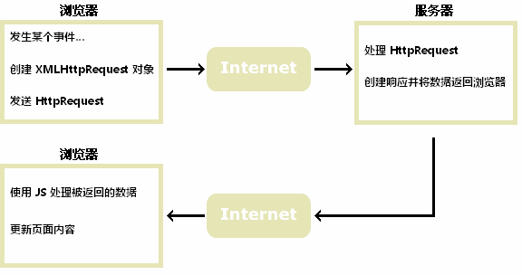

## 一、AJAX

### 工作原理

`发生事件，创建xmlHttpRequest对象并发送；  处理HttpRequest并返回数据；   js处理返回的数据，更新页面。`

### 创建 XMLHttpRequest 对象

`xmlhttp = new XMLHttpRequest();`

### 向服务器发送请求

将请求发送到服务器，使用 XMLHttpRequest 对象的 open() 和 send() 方法：

```js
xmlhttp.open("GET","ajax_info.txt",true);
xmlhttp.send();
```

请求被发送到服务器时，需要执行一些基于响应的任务。每当 readyState 改变时，就会触发 onreadystatechange 事件。readyState 属性存有 XMLHttpRequest 的状态信息。当 readyState 等于 4 且状态为 200 时，表示响应已就绪

```js
xmlhttp.onreadystatechange=function()
{
    if (xmlhttp.readyState==4 && xmlhttp.status==200)
    {
        document.getElementById("myDiv").innerHTML=xmlhttp.responseText;
    }
}
```

### 获得来自服务器的响应

使用 XMLHttpRequest 对象的 responseText 或 responseXML 属性

`document.getElementById("myDiv").innerHTML=xmlhttp.responseText;`



## 二、JQuery

### load() 方法

从服务器加载数据，并把返回的数据放入被选元素中。

`$(selector).load(URL,data,callback);`

把文件 "demo_test.txt" 的内容加载到指定的 <div> 元素中

`$("#div1").load("demo_test.txt");`

```js
/*
callback 参数规定当 load() 方法完成后所要允许的回调函数。回调函数可以设置不同的参数：
responseTxt		- 包含调用成功时的结果内容
statusTXT		- 包含调用的状态
xhr				- 包含 XMLHttpRequest 对象
*/

//load() 方法完成后显示一个提示框。如果 load() 方法已成功，则显示"外部内容加载成功！"，而如果失败，则显示错误消息
$("button").click(function(){
  $("#div1").load("demo_test.txt",function(responseTxt,statusTxt,xhr){
    if(statusTxt=="success")
      alert("外部内容加载成功!");
    if(statusTxt=="error")
      alert("Error: "+xhr.status+": "+xhr.statusText);
  });
});
```

### get() 和 post() 

jQuery get() 和 post() 方法从服务器请求数据

```js
$("button").click(function(){
  $.get("demo_test.php",function(data,status){
    alert("数据: " + data + "\n状态: " + status);
  });
});
```

```js
$("button").click(function(){
    $.post("/try/ajax/demo_test_post.php",
    {
        name:"菜鸟教程",
        url:"http://www.runoob.com"
    },
    function(data,status){
        alert("数据: \n" + data + "\n状态: " + status);
    });
});
```
