---

---

# 1、BootStrap入门

[千锋教育](https://www.bilibili.com/video/BV1da4y1i7yk?p=13&spm_id_from=pageDriver&vd_source=7346303e5e18677d7261c2c0c109ecfd)   [Bootstrap中文网](https://www.bootcss.com/)  [学习笔记](https://notes.xiyankt.com/#/start/) [Bootstrap](https://www.cnblogs.com/tfboy/p/10370649.html) [bootstrap ](https://zhuanlan.zhihu.com/p/133943252) [【HBuilderX】自定义快捷键 ](https://www.jianshu.com/p/13c9d0d7bcf0) [快速移动光标，高效的键盘映射方案](https://zhuanlan.zhihu.com/p/88486735)  

[Bootstrap v3 中文文档](https://v3.bootcss.com/css/#overview-type-links)  [Bootstrap中文文档](https://v4.bootcss.com/docs/utilities/flex/) [Bootstrap](https://www.runoob.com/bootstrap/bootstrap-popover-plugin.html) [间距](https://www.bootstrap.cn/doc/read/175.html)

## 1、使用步骤

1. 下载bootstrap　：http://www.bootcss.com/
3. 导入bootstrap.css
4. 导入jQuery.js
5. 导入bootstrap.js
6. 将所有的内容放到布局容器中

| 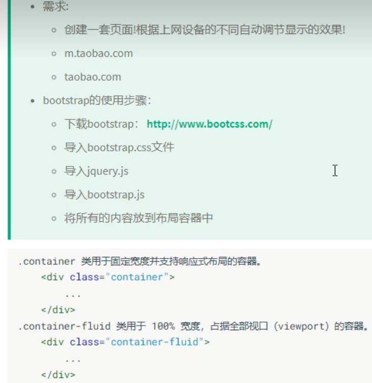 |  |
| -------------------------------------------------------- | ----- |

bootstrap组成：

1. 全局css样式
2. 组件
3. js插件

# 2、全局css样式

[Grid二维布局](https://www.bilibili.com/video/BV1pC411z7nh/?spm_id_from=333.788.recommend_more_video.4&vd_source=7346303e5e18677d7261c2c0c109ecfd) 

[Bootstrap5Flex](https://www.bilibili.com/video/BV1Ez4y1q7oA?p=34&vd_source=7346303e5e18677d7261c2c0c109ecfd)  [Flex](https://www.bilibili.com/video/BV1fD4y1h7UG/?spm_id_from=333.337.search-card.all.click&vd_source=7346303e5e18677d7261c2c0c109ecfd) [2分钟掌握flexbox布局](https://www.bilibili.com/video/BV1P7411m7Nu/?spm_id_from=333.788&vd_source=7346303e5e18677d7261c2c0c109ecfd) [flex弹性布局](https://www.bilibili.com/video/BV1Rv4y177rj/?spm_id_from=333.788.recommend_more_video.0&vd_source=7346303e5e18677d7261c2c0c109ecfd) [Bootstrap5Flex（弹性）布局](https://www.runoob.com/bootstrap5/bootstrap5-flex.html)   [Flex布局](https://www.bilibili.com/video/BV1bM411i74W?p=37&vd_source=7346303e5e18677d7261c2c0c109ecfd) 

[布局视频教程](https://www.bilibili.com/video/BV1Ez4y1q7oA?p=9&vd_source=7346303e5e18677d7261c2c0c109ecfd) [布局教程](https://www.bilibili.com/video/BV1fD4y1h7UG?p=20&vd_source=7346303e5e18677d7261c2c0c109ecfd) [间距](https://www.bootstrap.cn/doc/read/174.html)

## 1、栅格系统

- bootstrap将每一行分为12份
- .container类：用于固定宽度并支持响应式布局
- .container-fluid类：用于100%宽度，占满全部视口（viewport）的容器

> *大屏幕：* *每行显示6个*　 *超大电脑：	 col-lg-2*
> *屏幕小点：每行显示4个，<992<1200     col-md-3*
>
> *分辨率再小时，每行显示2个时，768~992　 col-sm-6*
> *分辨率<768时，每行显示一个，可以使用　 col-xs-12*

1. 不等宽列：`col-md-3   col-md-6`
2. 嵌套列
3. 偏移列：两个列之间有间距; `offset-*-*`
4. 列排序: `order-1`,数字意思是把它排第几
   1. 排序规则 :数字设为1到5有效，设置为其它没用
   2. ==order-first，order-last==，总是排第一和最后
   3. first last排序优先数字和默认排序，默认排序优先数字排序
      1. 没排序的在前面，之后按数字排序

| 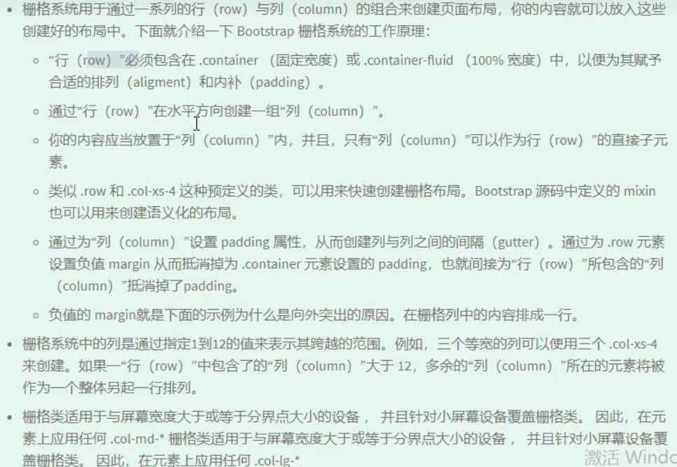 | 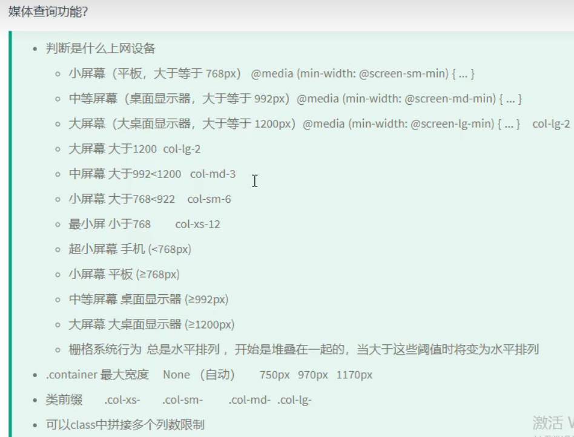 |
| -------------------------------------------------------- | -------------------------------------------------------- |
| 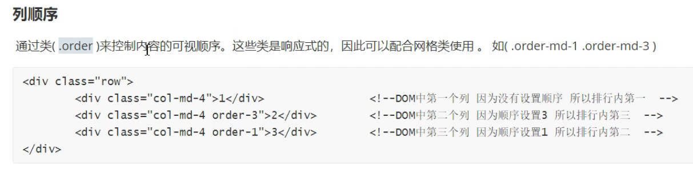 | 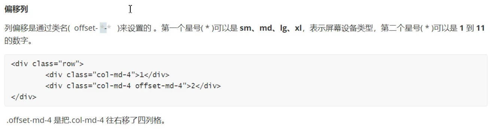 |
| 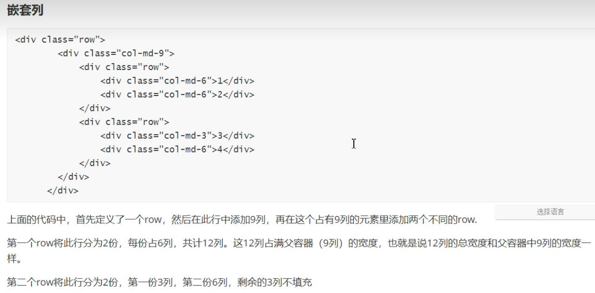 |                                                     |

导入样式、jquery、bootstrap

- 可写多个class属性，id属性只能写一个

```html
<html>
	<head>
		<meta charset="utf-8">
		<title></title>  
		<link type="text/css" rel="stylesheet" href="css/bootstrap.min.css"/>
		<link type="text/css" rel="stylesheet" href="css/bootstrap-theme.min.css"/>
		<style type="text/css">
			.b{border: solid 1px #f00;}
            .row>div{
				border: 1px solid red;
				height: 50px;
				text-align: center;
				line-height: 50px;
		</style>
	</head>
	<body>
		<script type="text/javascript" src="js/jquery-3.4.1.min.js"></script>
		<script type="text/javascript" src="js/bootstrap.min.js"></script>
		
		<div class="container">
			<div class="row">
				<div class="col-md-1 b col-md-push-11">1</div>
				<div class="col-md-3 b">2</div>
				<div class="col-md-3 b col-md-pull-1">4</div>
			</div>
		</div>
	</body>
</html>
```


## 2、Flex布局

[间距](https://www.bootstrap.cn/doc/read/175.html)   [Flex ](https://v4.bootcss.com/docs/utilities/flex/) [骰子布局](https://www.bilibili.com/video/BV1Ez4y1q7oA?p=44&spm_id_from=pageDriver&vd_source=7346303e5e18677d7261c2c0c109ecfd)

1. 创建弹性盒子容器
   1. `.d-flex`
   2. `.d-inline-flex` :行内flexbox容器
2. 写在容器里
   1. ==轴向：水平垂直==`，flex-row 、flex-column`
      1. 换行：交叉轴； `flex-wrap`
   2. ==对齐==
      1. `justify-content-×`
      2. `align-items-×`：垂直对齐，控制单行子元素
      3. `align-content-×`:垂直对齐，控制多行子元素，需要换行flex-wrap
         1. `<div class="d-flex flex-wrap align-content-around" 	style="width:10px">`
      4. around：子元素两端的间隔相等; between:两端对齐,子元素之间的间隔相等；baseline：基线对齐
3. 写在子元素里
   1. 弹性：
      1. 顺序： `.order`
      2. 等宽：`flex-fill`
      3. 伸缩：Grow and shrink ; `flex-grow-1`，父元素有多余的空间
      4. 子元素对齐：`align-self-×`

| 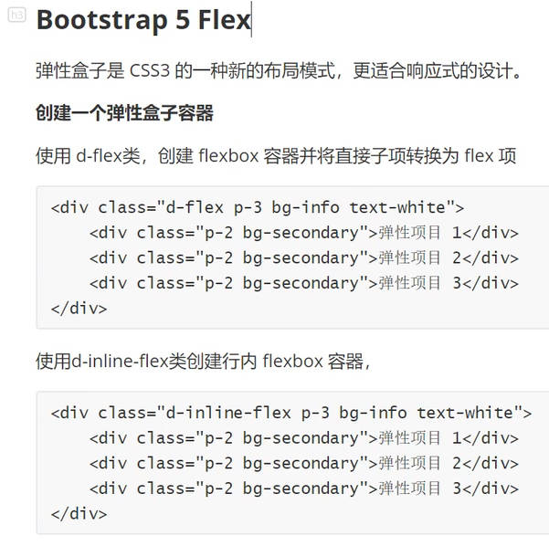 | 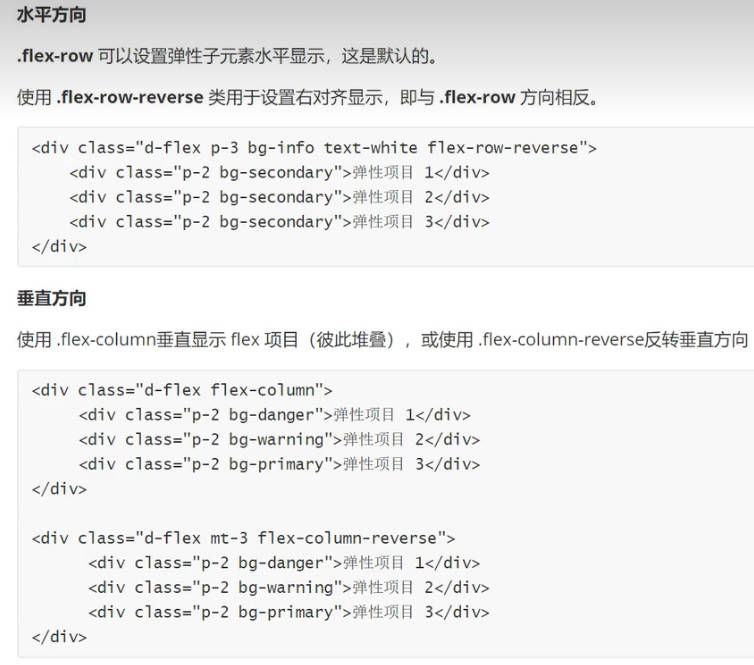 |
| ------------------------------------------------------------ | -------------------------------------------------------- |
| 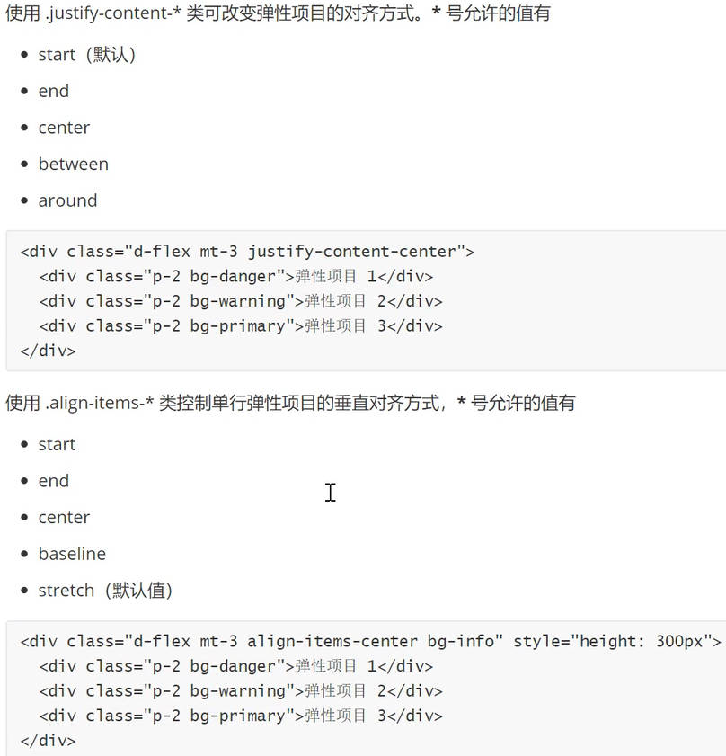 | 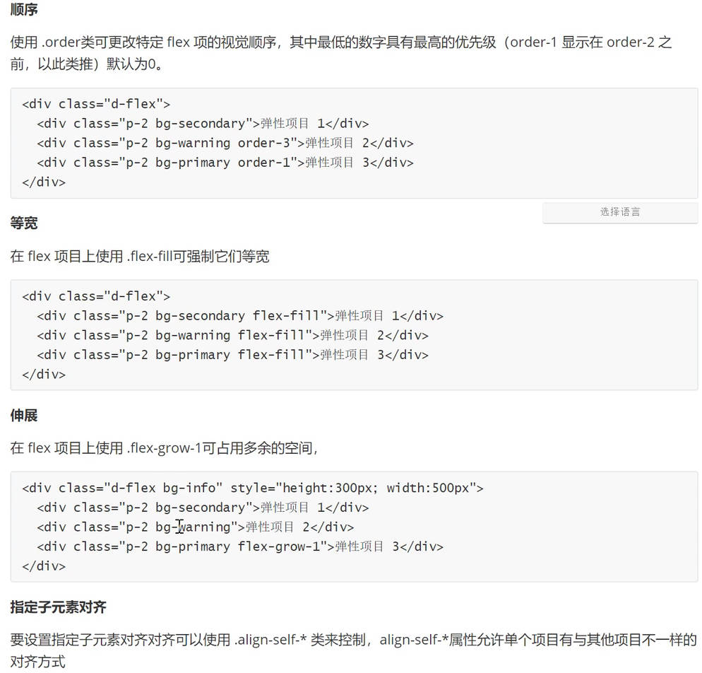 |
| 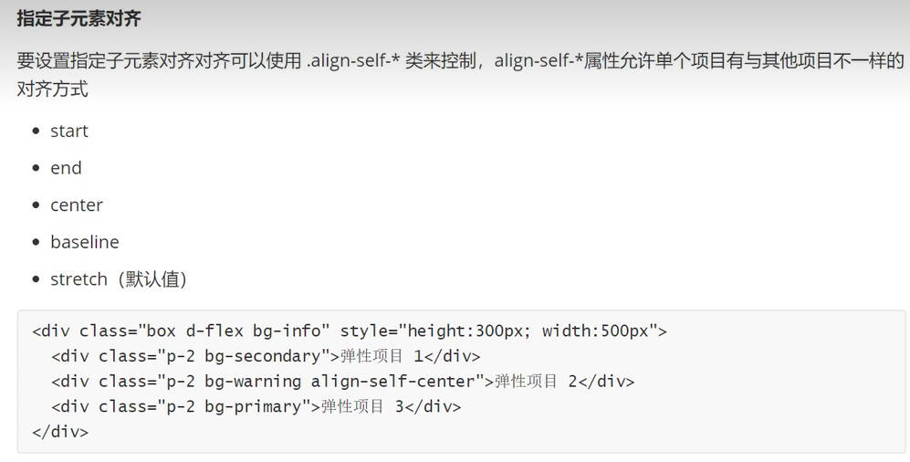 | 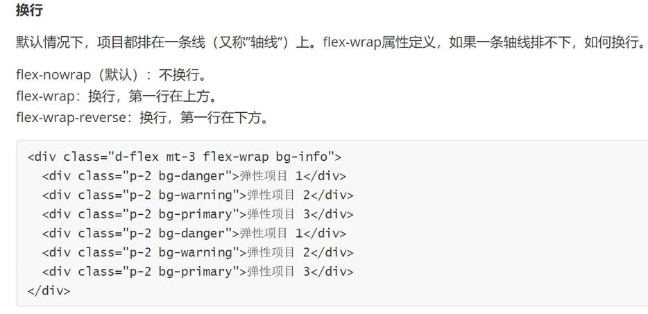 |
| 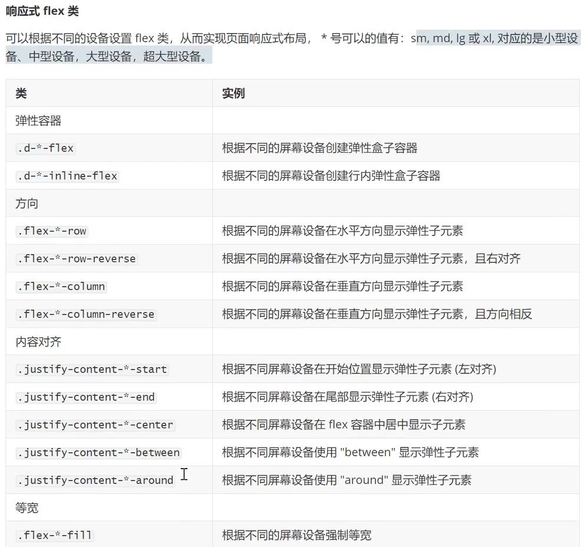 |                                                     |

```html
<!DOCTYPE html>
<html>
	<head>
		<meta charset="utf-8">
		<meta name="viewport" content="width=device-width, initial-scale=1">
		<link href="https://cdn.jsdelivr.net/npm/bootstrap@5.3.0-alpha1/dist/css/bootstrap.min.css" rel="stylesheet"
			integrity="sha384-GLhlTQ8iRABdZLl6O3oVMWSktQOp6b7In1Zl3/Jr59b6EGGoI1aFkw7cmDA6j6gD" crossorigin="anonymous">
		<style>
			.box {
				width: 100px;
				height: 100px;
				border-radius: 20px;
			}

			.box span {
				width: 20px;
				height: 20px;
			}
		</style>
	</head>
	<body>
		<script src="https://cdn.jsdelivr.net/npm/bootstrap@5.3.0-alpha1/dist/js/bootstrap.bundle.min.js"
			integrity="sha384-/mhDoLbDldZc3qpsJHpLogda//BVZbgYuw6kof4u2FrCedxOtgRZDTHgHUhOCVim" crossorigin="anonymous">
		</script>

		<!-- 先画外框，再画内部的圆 -->
		<div class="container mt-3">
			<div class="d-flex">
				<div class="box border border-dark border-3 d-flex justify-content-center align-items-center  mx-3">
					<span class="bg-dark rounded-circle"></span>
				</div>
				<div
					class="box border border-dark border-3 d-flex mx-3 flex-column  justify-content-around align-items-center  ">
					<span class="bg-dark rounded-circle"></span>
					<span class="bg-dark rounded-circle"></span>
				</div>
			</div>
		</div>
	</body>
</html>
```


## 3、表格

状态类为==行或单元格==设置颜色

## 4、表单

- `div加form-group ; 文本元素<input>`、`<textarea>` 和 `<select>加class="form-control"`
- 内联表单：`为 <form>元素添加 .form-inline`
- 水平表单： `form-horizontal`
- 内联单选、多选框：`checkbox-inline  radio-inline`
- 校验状态

## 5、按钮

- `class="btn btn-default"`
- *按钮组* ：把一组btn放入btn-group， btn-group内部嵌套btn
- 设置角色: 如果` <a> 作为按钮使用` -- 并用于==在当前页面触发某些功能== -- 而不是用于链接其他页面或链接当前页面中的其他部分，那么，务必为其设置 role="button" 属性 

| 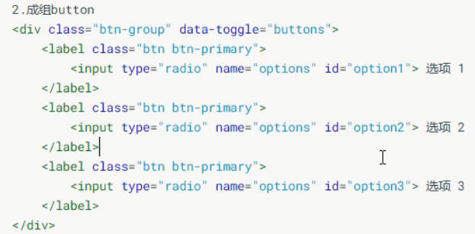 | 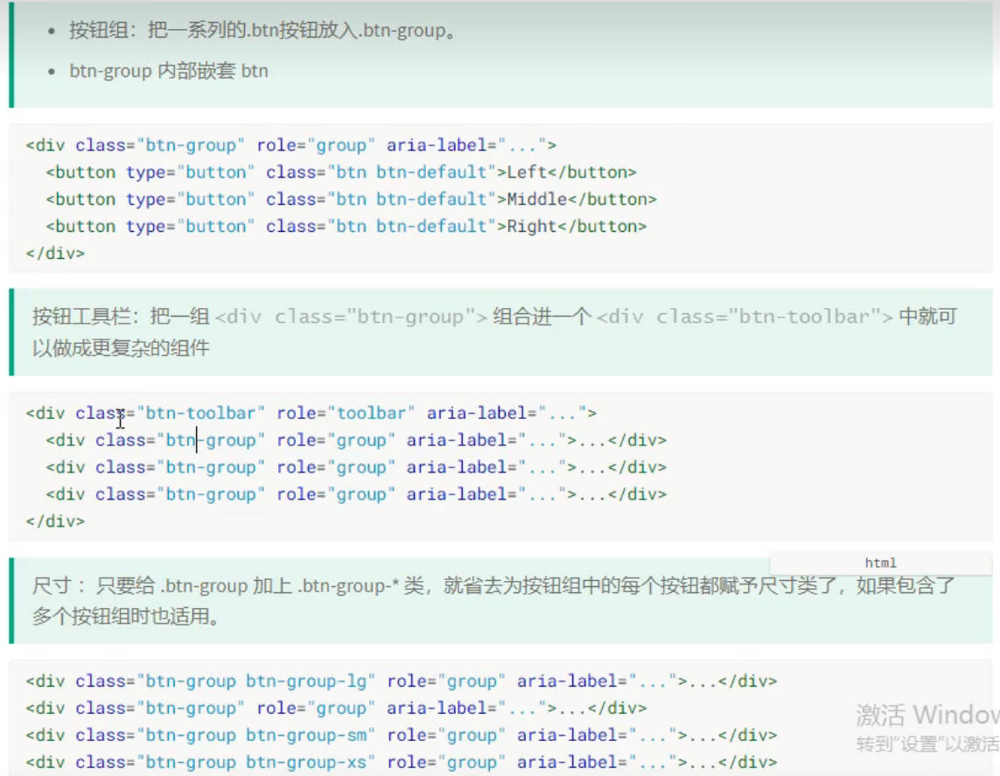 |
| -------------------------------------------------------- | -------------------------------------------------------- |

```html
<div class="btn-group" data-toggle="buttons">
    <label class="btn btn-primary">
		<input type="radio" name="options" id="option1">选项1</label>
    </label>
	<label class="btn btn-primary">
		<input type="radio" name="options" id="option2">选项2</label>
	</label>
	<label class="btn btn-primary">
		<input type="radio" name="options" id="option3">选项3</label>
	</label>
</div>
```

# 3、组件

## 1、导航栏

[组件_导航](https://v3.bootcss.com/components/#nav)

- 标签式导航栏
- 胶囊导航


| 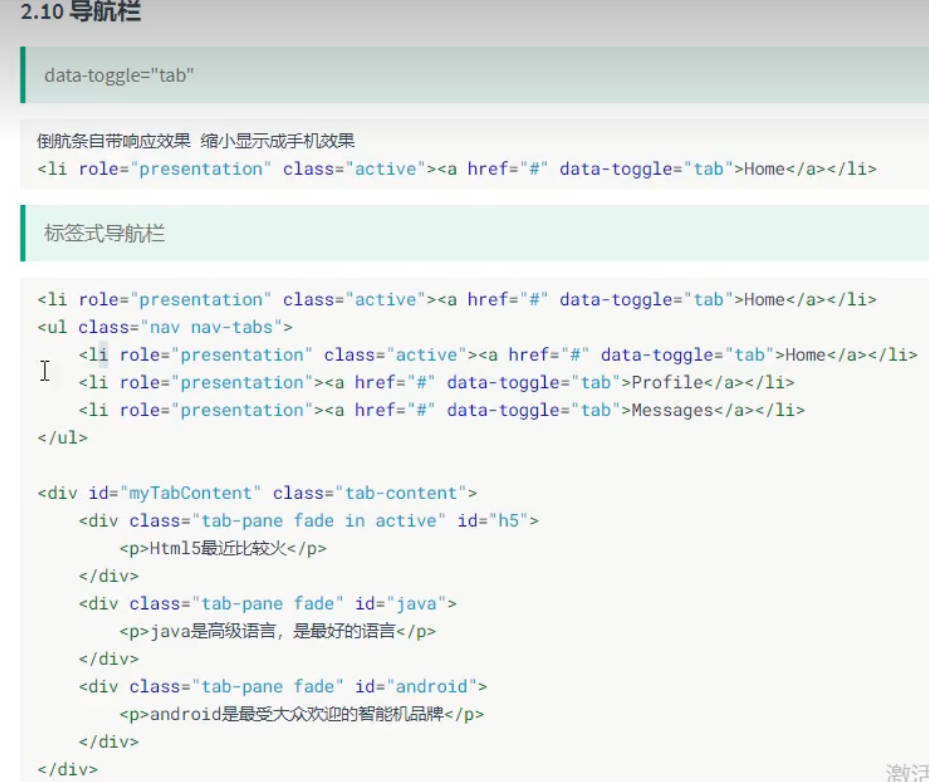 |  |
| -------------------------------------------------------- | ----- |

# 4、js插件

## 1、模态框

[模态弹框和非模态弹框](https://pixso.cn/designskills/motaikuangsheji/) [插件_模态框](https://v3.bootcss.com/javascript/#modals)

- 模态框（Modal Dialog）指代中断用户操作，用户必须完成对话框内任务（或主动关闭对话框后）才能够继续主窗口操作的弹框
  - 模态和非模态，都统称为弹窗
  - 模态对话框一旦被调用就不允许用户使用父窗口
  - 非模态框允许用户访问父窗口，不会影响所属的主流程
  - 非模态弹窗一般被设计成用来==告诉用户信息==内容，而==模态弹窗除了告诉用户信息内容外还需要用户进行功能操作==


## 2、validate插件

[jquery-validation](https://github.com/jquery-validation/jquery-validation)   [jQuery Validation Plugin](https://jqueryvalidation.org/)  [jQuery CDN](https://releases.jquery.com/)  [CDN](https://www.jsdelivr.com/)

[jQuery.Validate表单验证插件](https://www.cnblogs.com/ccorz/p/5919472.html)  [表单error](http://element-plus.org/zh-CN/component/form.html#formitem-exposes)

jquery插件，验证方法库

### 1.使用步骤

1. 导入jquery, 导入validate.js
2. 页面加载成功后，对表单进行验证： $("选择器").validate()
3. 在validate中编写校验规则

```js
$("选择器").validate(
	rules:{}, 	//规则
	messages:{}	//提示信息
)
```
```html
<html>
	<head>
		<style type="text/css">
			.error{color:#f00;font-size:12px} //表单错误提示信息样式
		</style>
	</head>
	<body>
		<script type="text/javascript" src="https://cdn.jsdelivr.net/npm/jquery@3.6.4/dist/jquery.min.js"></script>
		<script type="text/javascript" src="https://cdn.jsdelivr.net/npm/jquery-validation@1.20.0/dist/jquery.validate.min.js"></script>
		<script type="text/javascript" src="https://cdn.jsdelivr.net/npm/jquery-validation@1.20.0/dist/localization/messages_zh.min.js"></script>
        
		<script type="text/javascript"> //表单验证
			$(function(){
				$("#frm").validate({
					rules:{usrname:{required:true,maxlength:10}},
					messages:{usrname:"必填且长度不超过10个字符"}
				});
			});
		</script>
		<form id="frm" action="test.html">
			username:<input type="text" name="usrname"><br>
			userpass:<input type="password" name="usrpass" required="required"><br>
			<input type="submit" value="登录">
		</form>
	</body>
</html>
```


```js
//CDN
<script src="https://code.jquery.com/jquery-migrate-3.4.1.min.js" integrity="sha256-UnTxHm+zKuDPLfufgEMnKGXDl6fEIjtM+n1Q6lL73ok=" crossorigin="anonymous"></script>
https://cdn.jsdelivr.net/npm/jquery@3.6.4/dist/jquery.min.js

https://cdnjs.cloudflare.com/ajax/libs/jquery-validate/1.19.5/jquery.validate.min.js
https://cdn.jsdelivr.net/npm/jquery-validation@1.19.5/dist/jquery.validate.min.js

<script type="text/javascript" src="https://cdn.jsdelivr.net/npm/jquery@3.6.4/dist/jquery.min.js"></script>
		<script type="text/javascript" src="https://cdn.jsdelivr.net/npm/jquery-validation@1.20.0/dist/jquery.validate.min.js"></script>
		<script type="text/javascript" src="https://cdn.jsdelivr.net/npm/jquery-validation@1.20.0/dist/localization/messages_zh.min.js"></script>
```

| 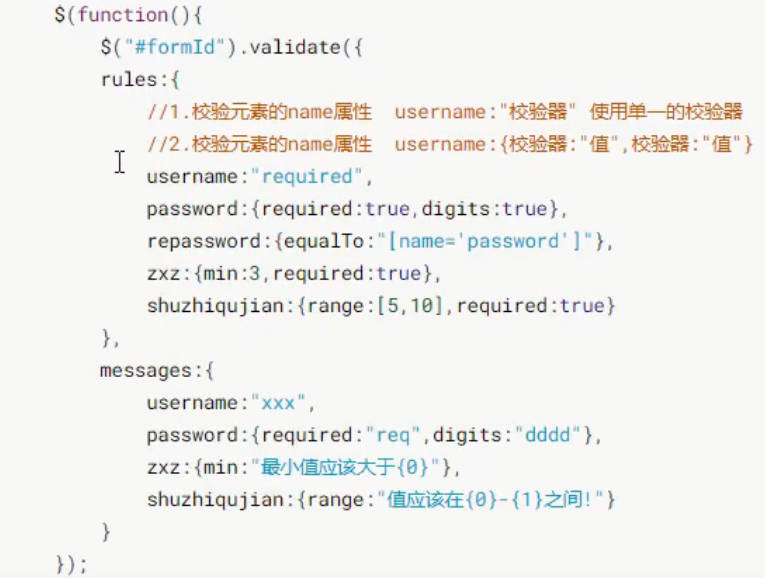 |  |
| -------------------------------------------------------- | ----- |


# 5、实战


# 6、前端UI框架

[前端UI框架](https://pixso.cn/designskills/popular-front-end-ui-framework/) [Ant Design](https://4x-ant-design.antgroup.com/index-cn) [前端UI框架](https://baijiahao.baidu.com/s?id=1762415925367599590&wfr=spider&for=pc) [前端UI框架](http://situedu.com/news/uid/2479.html) [前端UI框架](https://blog.csdn.net/ZXH0122/article/details/126658628)
