[TOC]

总结：

- **双向绑定**：   用 ==v-model== 指令在表单 `<input>`、 `<textarea>` 、 `<select>` 元素上创建双向数据绑定
- **vue组件**： 就是自定义标签(div、p标签) 
  - 组件是可复用的Vue实例，是一组可以重复使用的模板 
- axios通信： 通过钩子函数实现ajax通信， ==data()==接收响应的数据
- slot插槽： vue实现了一套==内容分发==的API， `<slot>`元素承载分发内容
- 自定义事件分发：  Vue 里==子组件向父组件传递数据==的核心方式

vue脚手架

- vue-cli
- vue-router
- 路由钩子

md： [大前端知识汇总](.\大前端知识汇总)

视频： [大前端](https://www.bilibili.com/video/BV1BU4y147pS/?vd_source=7346303e5e18677d7261c2c0c109ecfd)  [狂神说Java_Vue最新快速上手教程通俗易懂](https://www.bilibili.com/video/BV18E411a7mC/?vd_source=7346303e5e18677d7261c2c0c109ecfd)  [狂神说Java_Git最新教程](https://www.bilibili.com/video/BV1FE411P7B3/?vd_source=7346303e5e18677d7261c2c0c109ecfd)  

# 一、前后分离演变史

[Vue笔记](https://www.cnblogs.com/xiaolaodi1999/p/13497894.html)

[前后端分离](https://blog.csdn.net/qq_53008257/article/details/124425641)  [Vue：简介、前后端分离了解、MVVM模式-狂神](https://www.cnblogs.com/lijinyu08/p/14576883.html)      [前后端分离架构图](https://www.cnblogs.com/clwydjgs/p/10796763.html) [RESTful API 最佳实践 - 阮一峰](http://www.ruanyifeng.com/blog/2018/10/restful-api-best-practices.html)

[前端工程化——超详细教程](https://zhuanlan.zhihu.com/p/276458191) [前端工程化简书](https://www.jianshu.com/p/9ccfe98f988b)  [前端工程化](https://blog.csdn.net/weixin_42232156/article/details/120949343) [restful风格API编写和接口调用](https://baijiahao.baidu.com/s?id=1728072425446748243&wfr=spider&for=pc) [webkit框架](https://baike.baidu.com/item/webkit/1467841?fr=aladdin) [浏览器内核WebKit](https://zhuanlan.zhihu.com/p/554130625)  


[vue通用后台管理](https://www.bilibili.com/video/BV1QU4y1E7qo?p=48&spm_id_from=pageDriver)  [Vue+ElementUI](https://www.bilibili.com/video/BV1Fu411f7qi?p=175&spm_id_from=pageDriver)  [Vue+ElementUI前端项目](https://www.bilibili.com/video/BV1kr4y1r7he?p=69&spm_id_from=pageDriver)  [vuex](https://search.bilibili.com/all?vt=56700553&keyword=vuex&from_source=webtop_search&spm_id_from=333.1007) 

[Vue3精品学习网站](https://vue3js.cn/)

后端能用MVC数据分离，==前端也能数据分离，用MVVM==

- 前端视图层V: JSP
- 前端数据层M： DATA
- 前端Controller： 叫VM，数据双向绑定

虚拟DOM

> 1. 前后端分离
>    1. 前端处理页面跳转，渲染数据；    后端处理业务逻辑，数据持久等操作；  前后端服务器通信的实现方式是ajax
>    2. 前端项目使用vue或react进行编写，运行在nginx服务器上。后端项目使用springboot，运行在tomcat服务器上
>    3. 前端服务器向后端服务器接口发送ajax请求，获取数据，使用vue框架，将数据渲染在页面上。
>    4. 后端编写api接口，接受前端请求，将查询出来的数据封装起来返回给前端服务器。
> 2. 业务逻辑
>    1. 不同的项目有不同的功能，不同的功能需要不同的实现，实现这些核心功能的代码就叫业务逻辑

> 1. 前端内容
>    1. 视图、事件、逻辑、通信         //前端四要素 
>       1. 视图有框架来做：BootStrap、LayUI等；视图层框架：只关注视图层(给用户看，刷新后台给的数据)，soc关注度分离
>       2. 事件也有框架来做：jQuery封装了大量事件；Vue、React等
>       3. 通信：js原生(xhr); jquery封装ajax，vue的axios
>    2. 难得是前端化工程
>       1. ssm+vue+BootStrap
> 2. 前端知识体系
>    1. 前端三要素：
>       1. HTML（结构层）
>       2. CSS（表现层）
>       3. JavaScript（行为层）：是一种弱类型脚本语言，其源码不需经过编译，而是由浏览器解释运行，用于控制网页的行为；ES3--ES9，ES6用let，不用var；用打包工具打包成不同版本； webpack前端打包；Maven对java项目打包
>          1. Native原生JS开发：ECMAScript标准(ES6)
>          2. TypeScript
>          3. JS框架
>             1. Angular：将MVC引入前端并增加模块化开发
>             2. React：提出虚拟DOM，在内存中模拟DOM操作，提升渲染效率。
>             3. Vue：综合模块化和虚拟DOM优点
> 3. MVC
>    1. 视图view；M模型层放数据； 前端控制层叫vm(数据双向绑定)
> 4. 前后端分离史
>    1. 后端为主的MVC时代：前端写好html，让后端去套数据
>    2. ==基于AJAX带来的SPA时代==：单页面应用，后端提供ajax接口
>       1. CDN作为静态资源存储
>    3. ==前端为主的MVC时代==：大前端时代，1人拿1.8人工资干3人活；
>       1. 前端可以本地开发。后端则可以专注于业务逻辑的处理， 输出RESTful等接口
>       2. 前端代码很重，但合理的分层，让前端代码能各司其职
>       3. MVC(同步通信为主) ：Model、View、Controller
>       4. MVP(异步通信为主) ：Model、View、Presenter
>       5. **MVVM(异步通信为主)：Model、View、View Model**
>       6. 为了降低开发复杂度，框架按类型分层，例：MVC分M、V、C层
>    4. Node JS带来的全栈时代
>       1. 连RESTful等接口都不需要，后端给node.js提供一个服务就行了，node.js给前端传东西
>       2. 与JSP模式相比， 全栈模式看起来是一种回归， 也的确是一种向原始开发模式的回归， 不过是一种螺旋上升式的回归

| 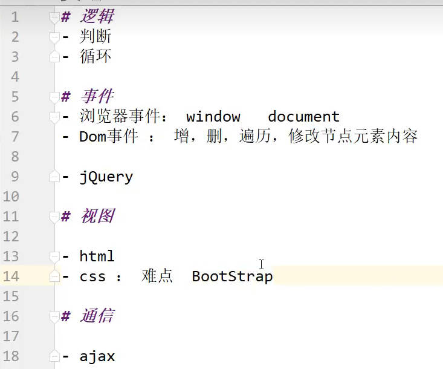           | 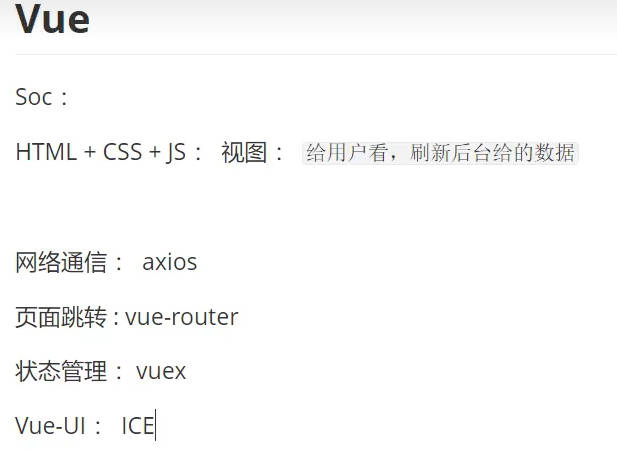 |
| ------------------------------------------------------------ | -------------------------------------------------- |
| 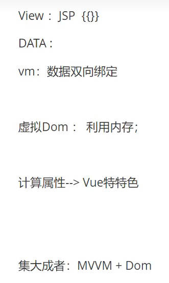           | 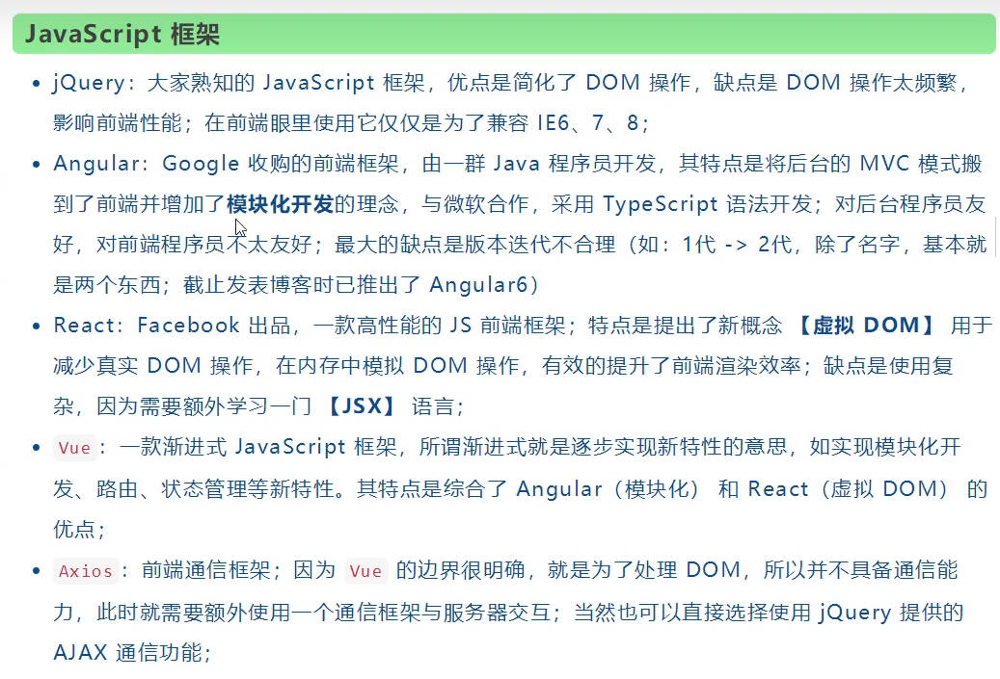 |
| 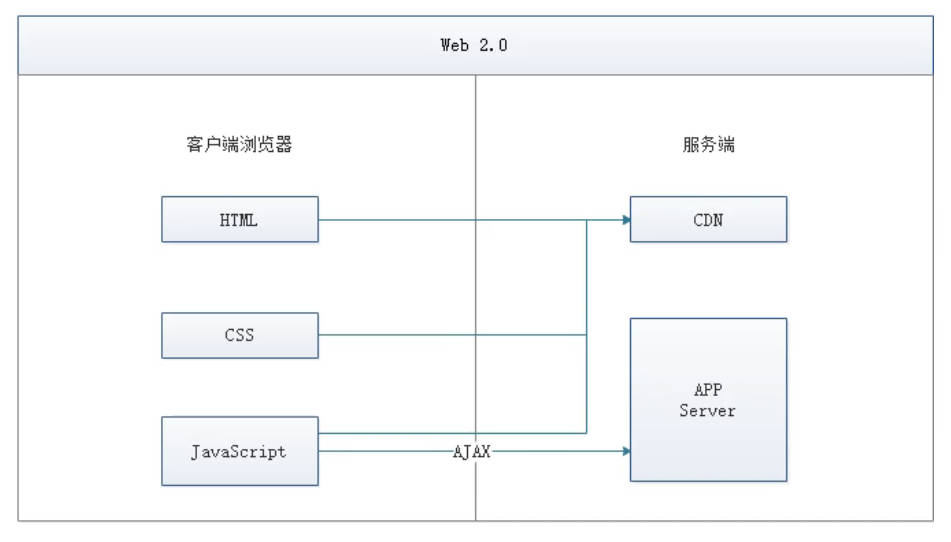 | 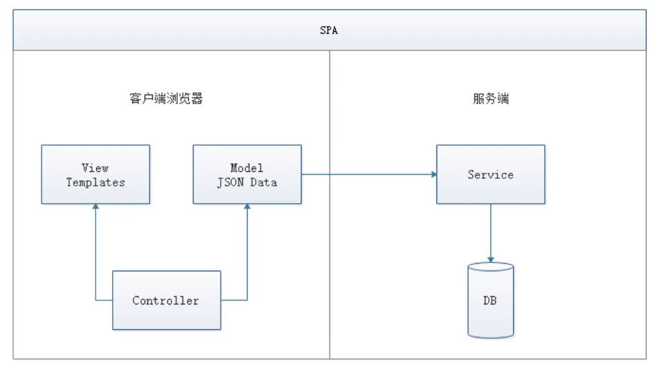 |
| 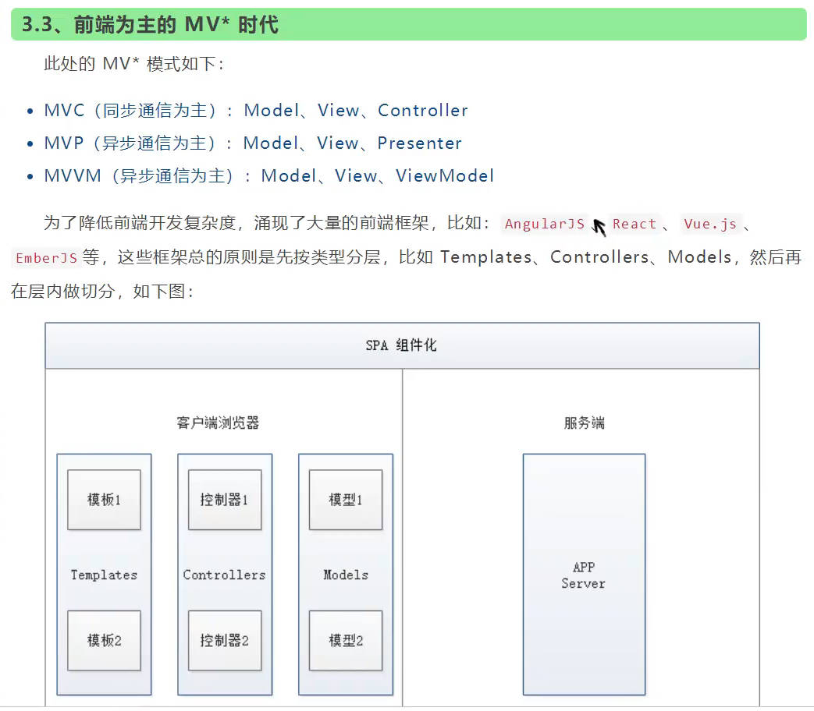           | 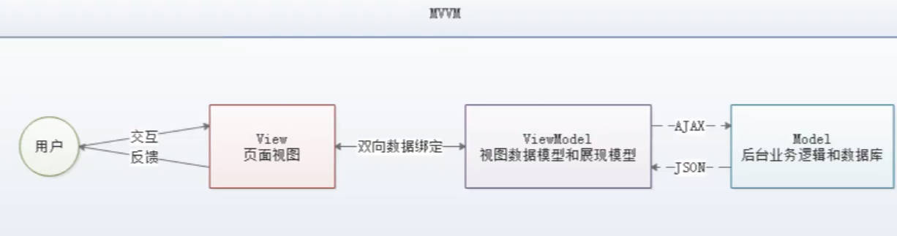 |
| 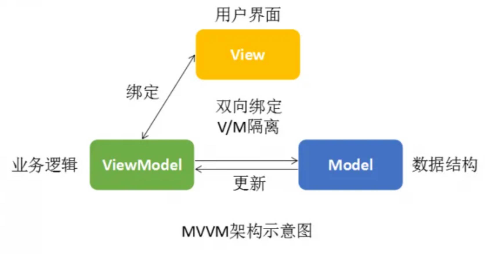           |                                                    |

MVVM分层： ==vm把view和model双向绑定==，model数据变化，view跟着变化

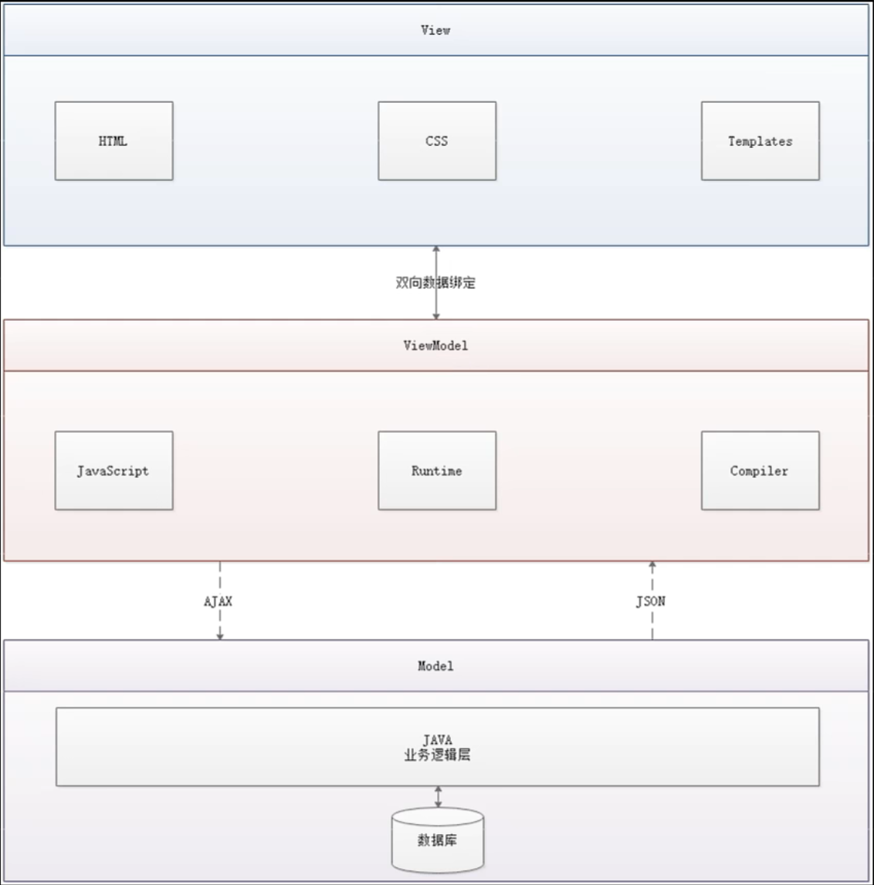

# 二、VUE

[Vue课堂笔记](https://gitee.com/lzh_gitee/Vue/tree/master/Vue课堂笔记) [Vue](https://www.cnblogs.com/xiaolaodi1999/p/13497894.html)

[【狂神说Java】Vue最新快速上手教程通俗易懂](https://www.bilibili.com/video/BV18E411a7mC?p=19)  [第一个vue程序 ](https://www.cnblogs.com/edgarstudy/p/15121202.html)   [Vue和React深度比较](https://baijiahao.baidu.com/s?id=1675146151317165518&wfr=spider&for=pc)  [Web前端入门教程](https://class.imooc.com/sale/fe2021)   [nvm的简介](https://blog.csdn.net/QWERTYQ16/article/details/124497532)  [Vue源码解析之数据响应式原理](https://www.bilibili.com/video/BV1G54y1s7xV/?spm_id_from=333.337.search-card.all.click&vd_source=7346303e5e18677d7261c2c0c109ecfd)  [ vue3新特性---reactive函数](https://blog.csdn.net/weixin_44691220/article/details/120302873)   [ Vue —— 创建响应式对象](https://blog.csdn.net/weixin_52148548/article/details/125055677)   [win7安装高版本node](https://www.cnblogs.com/alannxu/p/16954405.html)    

[ Vue：MVVM模式和第一个Vue程序 ](https://blog.csdn.net/zhao854116434/article/details/126652930)  [Vue-loader](https://www.jb51.net/article/258279.htm)  [ Vue.js官网](https://cn.vuejs.org/guide/introduction.html)   [ Vue2文档](https://v2.cn.vuejs.org/v2/guide/)  [如何阅读源码 —— 以 Vetur 为例](https://zhuanlan.zhihu.com/p/395405684)  [Vue基础](https://www.kuangstudy.com/bbs/1474045873721139202)

[vue的7个属性8个方法7个指令787原则 ](https://www.cnblogs.com/yayuya/p/16571051.html)  [VUE7大属性  ](https://www.cnblogs.com/huhaotian/p/15782027.html) 

[es6 双箭头函数](https://blog.csdn.net/sinat_34524528/article/details/90545189)  [ es6 双箭头函数](https://segmentfault.com/q/1010000016320367)  [Vue过滤器&&侦听器|监听器 ](https://www.jianshu.com/p/3a64f43a6d1f)

项目：[16 个顶尖 Vue 开源项目](https://zhuanlan.zhihu.com/p/519899912)

`vue框架主要做的是，用一种特定的dom书写方法，把标签转成js对象（虚拟DOM），再把虚拟DOM插入到HTML中，渲染成页面。`

- 版本:  [CHANGELOG](https://github.com/vuejs/core/blob/main/CHANGELOG.md)
  - 3.0.x (2019-12-20 - 2021-04-01)
  - 3.4.19 (2024-02-13)

> 1. ==vue:事件驱动==
>    1. View层展现的不是`Model`层的数据， 而是`ViewModel`的数据， 由`ViewModel`负责与`Model`层交互， 这就**完全解耦了View层和Model层， 这个解耦是至关重要的， 它是前后端分离方案实施的重要一环**
> 1. 前缀 $ ：vue提供的属性与方法
> 1. win7 最高只支持 node 13.14.0 版本
> 1. **单文件组件** (*.vue文件), 将一个组件的逻辑 (JavaScript)，模板 (HTML) 和样式 (CSS) 封装在同一个文件里
>    1. Vue 的组件可以按两种不同的风格书写：**选项式 API** 和**组合式 API**
> 1. createApp 对象实际上是一个组件，每个应用都需要一个“根组件”，其他组件将作为其子组件
> 1. ==属性绑定==： 双大括号不能在 HTML attributes 中使用。想要响应式地绑定一个 attribute，应该使用 v-bind
> 1. ==类与样式绑定== ：数据绑定的一个常见需求场景是操纵元素的 CSS class 列表和内联样式,  Vue 专门为 `class` 和 `style` 的 `v-bind` 用法提供了特殊的功能增强。除了字符串外，表达式的值也可以是对象或数组。
> 1. ==事件处理==： v-on 指令来监听 DOM 事件，从而执行 JavaScript 代码
> 1. ==表单==： v-model 指令在表单 `<input>`、`<textarea>` 及 `<select>` 等元素上创建双向数据绑定

> 第一个vue程序： IDEA直接open打开一个目录
>
> 1. 需要vue插件: IDEA设置里引入vue插件
> 2. 导包：引入CDN
> 3. 创建vue对象：vue是一个对象：var vm = new Vue({ })
>    1. 首先绑定元素：<div id="app">  ；var vm = new Vue({el:"#app" })
>    2. 取vue对象数据：<div id="app">     {{message}} </div>
>    3. Model层：vue对象里的数据； <div>view层，模板；  VM层：vm.message="hello" ；数据层改变，view层跟着改变（双向绑定）    //本质是操作DOM
>       1. view层变成了模板

| 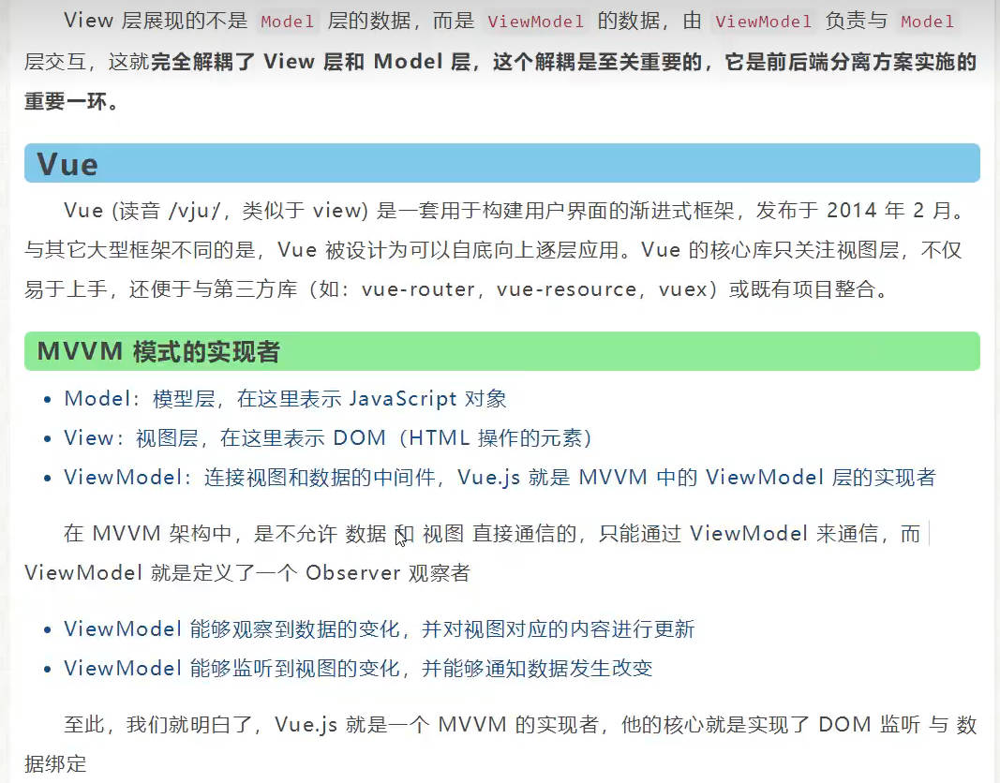 | 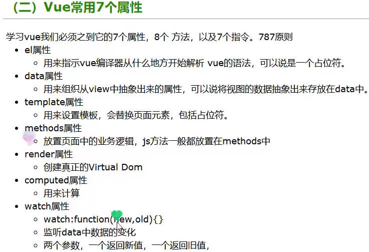 |
| -------------------------------------------------- | -------------------------------------------------- |


> **View**
>
>  View 是视图层，也就是用户界面。前端主要由`HTML`和`CSS`来构建，为了更方便地展现`ViewModel`或者`Model`层的数据，已经产生了各种各样的前后端模板语言，比如FreeMarker、Thymeleaf等等，各大MVVM框架如Vue.js，Angular.js，EJS等也都有自己用来构建用户界面的内置模板语言。
>
> **Model**
>
>  Model 是指数据模型，泛指后端进行的各种业务逻辑处理和数据操控，主要围绕数据库系统展开。这里的难点主要在于需要和前端约定统一的`接口规则`。
>
> **ViewModel**
>
>  ViewModel 是由前端开发人员组织生成和维护的视图数据层。在这一层前端开发者对从后端获取的 Model 数据进行转换处理，做二次封装。以生成符合 View 层使用预期的视图数据模型。
>
>  需要注意的是 **<span style="color:red">ViewModel 所封装出来的数据模型包括视图的状态和行为两部分，而 Model 层的数据模型是只包含状态的</span>**
>
> - 比如页面的这一块展示什么，那一块展示什么，这些都属于视图状态（展示）
> - 页面加载进来时发生什么，点击这一块发生什么，这一块滚动时发生什么，这些都属于视图行为（交互）
>
>  视图状态和行为都封装在了View Model里。这样的封装使得View Model可以完整地去描述View层。由于实现了双向绑定，View Model地内容会实时展现在View层，这是激动人心的，因为前端开发者再也不必低效又麻烦地通过操作DOM去更新视图。
>
>  MVVM框架已经把最脏最累地一块做好了，我们 **<span style="color:red">开发者只需要处理和维护View Model，更新数据视图就会自动得到相应更新，真正实现事件驱动编程。</span>**
>
>  *View层展现的不是Model层的数据，而是ViewModel的数据*，由ViewModel负责与Model层交互，获取和更新数据，这就完全解耦了View层和Model层，这个解耦是至关重要的，它是前后端分离方案实施的重要一环。

## 1. SoC关注度分离

## 2. 概述

| 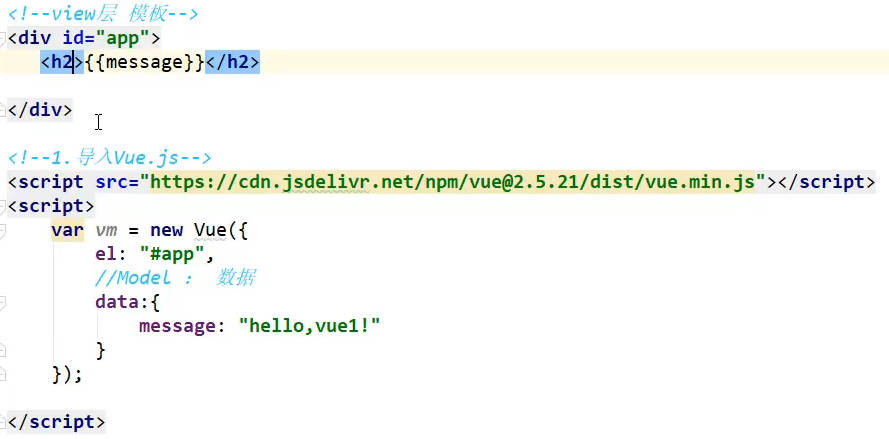 | 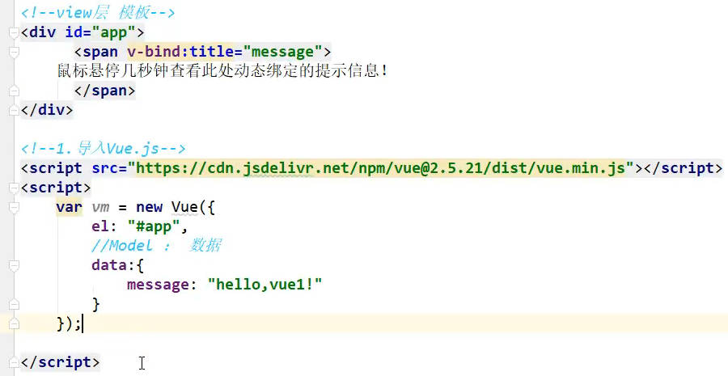 |
| -------------------------------------------------- | -------------------------------------------------- |
| 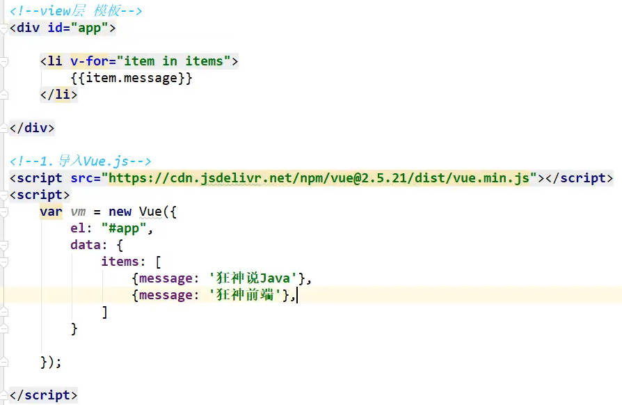 | 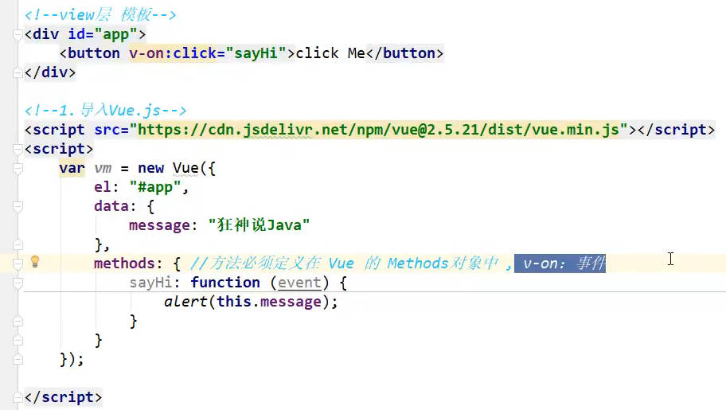 |
| 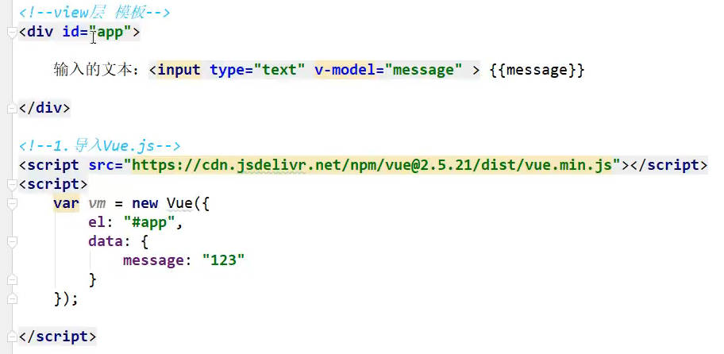 | 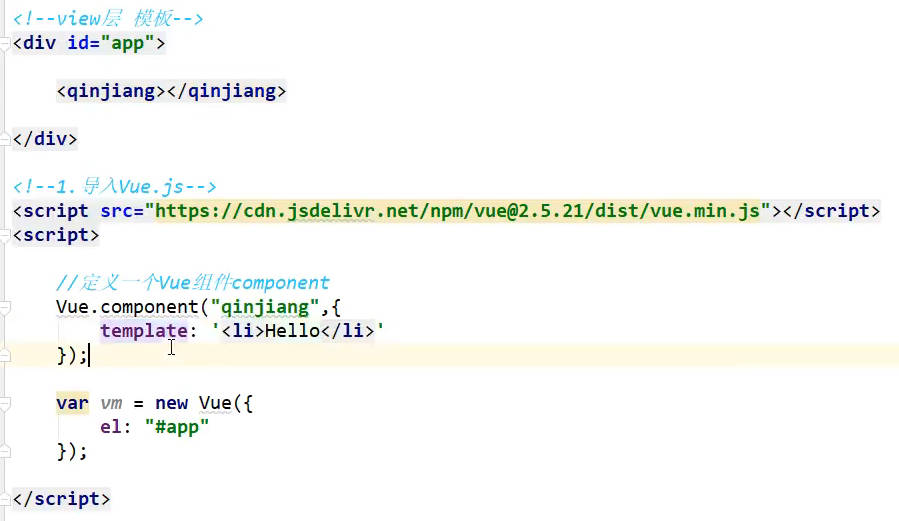 |
| 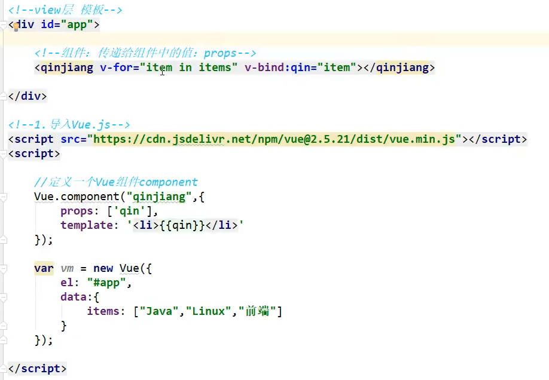 | 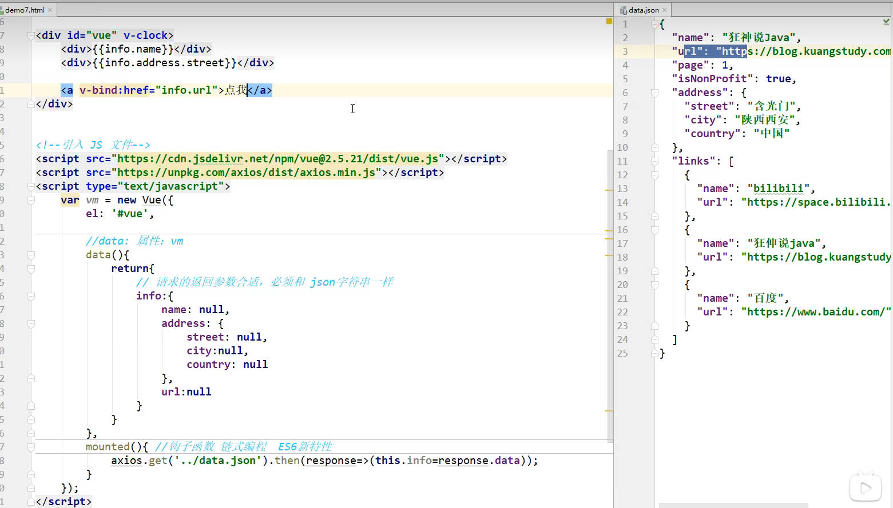 |

7个属性，8个 方法，以及7个指令，787原则

vue七大属性：el(v-bind)、data(if  for)、methods(v-on)；

```
Model：模型层， 在这里表示JavaScript对象
View：视图层， 在这里表示DOM(HTML操作的元素)
ViewModel：连接视图和数据的中间件， Vue.js就是MVVM中的View Model层的实现者
```

```
在MVVM架构中， 是不允许数据和视图直接通信的， 只能通过ViewModel来通信， 而View Model就是定义了一个Observer观察者
ViewModel能够观察到数据的变化， 并对视图对应的内容进行更新
ViewModel能够监听到视图的变化， 并能够通知数据发生改变
至此， 我们就明白了， Vue.js就是一个MV VM的实现者， 他的核心就是实现了DOM监听与数据绑定
```

> 1. el：	用来指示vue编译器从什么地方开始解析 vue的语法，可以说是一个占位符。        		v-bind  绑定元素
>
> 2. data：         用来组织从view中抽象出来的属性，可以说将视图的数据抽象出来存放在data中。      if   for
>
> 3. template：  用来设置模板，会替换页面元素，包括占位符。
>
> 4. methods：  放置页面中的业务逻辑，js方法一般都放置在methods中;                                                   v-on  监听dom事件
>
> 5. render：      创建真正的Virtual Dom
>
> 6. computed：用来计算
>
> 7. watch：       watch:function(new,old){}； 监听data中数据的变化； 两个参数，一个返回新值，一个返回旧值

## 3. ==绑定==元素属性、事件绑定、双向绑定、计算属性

- ==v-bind==:元素属性加上绑定标识，该属性的值从Model中获取数据; 不用v-bind就用{{}}
  - v-bind给组件绑定参数
  - 用于动态绑定 HTML 属性、组件 props，它把数据与 DOM 属性关联起来，数据变化时视图自动更新
- v-if
- v-for

```html
<div id="app">
    {{message}}   <--可以用<span v-bind:title="message">代替, span标签的title属性显示message--> 
</div>
```

```html
<div id="app">
       <span v-bind:title="message">   //span的title属性
  </span>
</div>
```

```html
<div id="app">
    <h1 v-if="ok">Yes</h1>      	   //v-if
    <h1 v-else>No</h1>
</div>  
```

```html
<div id="app">
    <li v-for="(item,index) in items">     //遍历传2个参数，index是自带属性
        {{item.message}} - {{ index }}
    </li>
</div>
```

###### a. 事件绑定

==v-on监听DOM事件==，并在事件触发时执行对应的JavaScript；     onclick肯定绑定不到vue对象里的方法

```html
<div id="app">
    <button v-on:click="sayHi">click Me</button>
</div>

<!--1.导入Vue.js-->
<script src="https://cdn.jsdelivr.net/npm/vue@2.5.21/dist/vue.min.js"></script>
<script>
    var vm = new Vue({
        el: "#app",
        data: {
            message: 'edgar学Java'
        },
        methods: { 						// 方法必须定义在 Vue 的 methods 对象中，v-on：事件
            sayHi: function (event) {   //event监听事件
                alert(this.message)

            }
        }
    });
</script>
```

###### b. 双向绑定

视图变，数据跟着变，例： input输入框；       `<input type="text" v-model="message"> {{message}}` 

 用 ==v-model== 指令在表单 `<input>`、 `<textarea>` 、 `<select>` 元素上创建双向数据绑定； 本质上不过是语法糖，监听用户的输入事件，更新数据；

- 当数据发生变化的时候，视图也发生变化，当视图变，数据也会跟着同步变化
- ==只有UI控件会双向绑定==，例如表单等

```html
<div id="app">
    输入的文本：<input type="text" v-model="message"> {{message}}   //文本框输入什么，后面显示什么
</div>

<!--1.导入Vue.js-->
<script src="https://cdn.jsdelivr.net/npm/vue@2.5.21/dist/vue.min.js"></script>
<script>
    var vm = new Vue({
        el: "#app",
        data: {
            message: 'edgar学Java'
        }
    });
```
###### c. 计算属性

==将计算结果缓存起来作为属性（将行为转化成了静态的属性），可以想象为缓存==！  计算属性为了将不经常变化的计算结果进行缓存，以节约系统开销；

```html
<div id="app">
    <p>currentTime1=>{{currentTime1()}}</p>
    <p>currentTime2=>{{currentTime2}}</p>
</div>

<!--1.导入Vue.js-->
<script src="https://cdn.jsdelivr.net/npm/vue@2.5.21/dist/vue.min.js"></script>
<script>
    var vm = new Vue({
        el: "#app",
        data: {
            message : "hello,edgar!"
        },
        methods: {					//函数
            currentTime1: function () {
                return Date.now(); // 返回一个时间戳
            }
        },
        computed:{ // 计算属性:里面也是写方法； methods，computed不能重名，重名之后，只会调用methods的方法
            currentTime2: function () {
                this.message;
                return Date.now(); // 返回一个时间戳
            }
        }
    });
```
## 4. ==组件==

vue组件就是自定义标签；组件是可复用的Vue实例，是一组可以重复使用的模板   ；  vue.component定义组件，      props传参，        methods：this.$emit远程调用vue对象里的方法；

*实例对象*就是把抽象的东西具体化的一个实例 [类和对象4：类、类对象、实例对象](https://blog.csdn.net/davidksatan/article/details/125495556)  [组件](https://www.cnblogs.com/edgarstudy/p/15130823.html)

```html
<div id="app">
    <edgar v-for="item in items" v-bind:ding="item"></edgar>
</div>
<!--1.导入Vue.js-->
<script src="https://cdn.jsdelivr.net/npm/vue@2.5.21/dist/vue.min.js"></script>
<script>
    // 定义一个Vue组件component
    Vue.component("edgar", {  //edgar组件名字; 组件是可复用的Vue实例，是一组可以重复使用的模板
        props: ['ding'],  //v-bind的数据不能直接放到template里，需要props先接收
        template: '<li>{{ding}}</li>'
    })

    var vm = new Vue({
        el: "#app",
        data: {
            items: ['java', 'mysql', '前端']
        }
    });
```

| 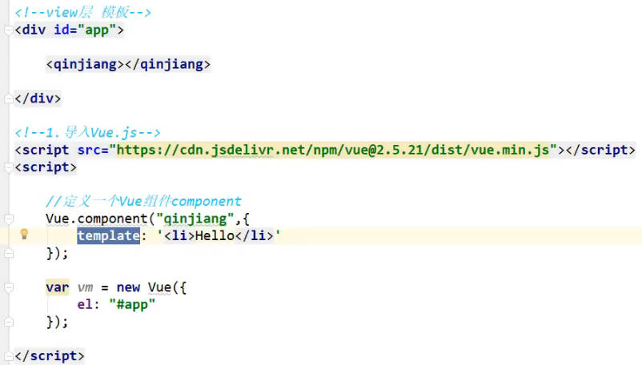 | 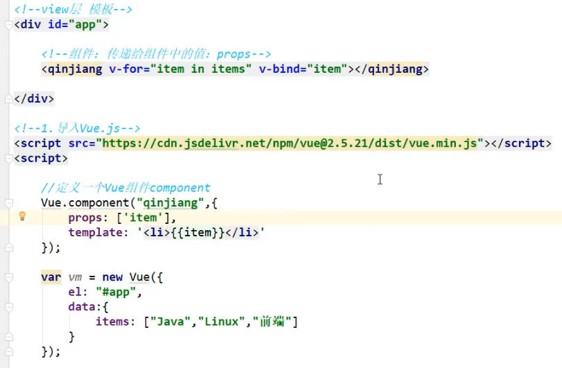 |
| -------------------------------------------------- | -------------------------------------------------- |


## 5. 通信==axios==

[Vue05-Axios异步通信](https://www.cnblogs.com/edgarstudy/p/15139431.html)  [axios中文文档 (axios-js.com)](http://axios-js.com/zh-cn/docs/)  [Axios 文档](https://www.axios-http.cn/)

`Axios 是一个基于 promise 的 HTTP 库，可以用在浏览器和 node.js 中`

> 1. 测试数据放在mock目录，mock要放在static下

通过钩子函数实现ajax通信， ==data()==接收响应的数据

| 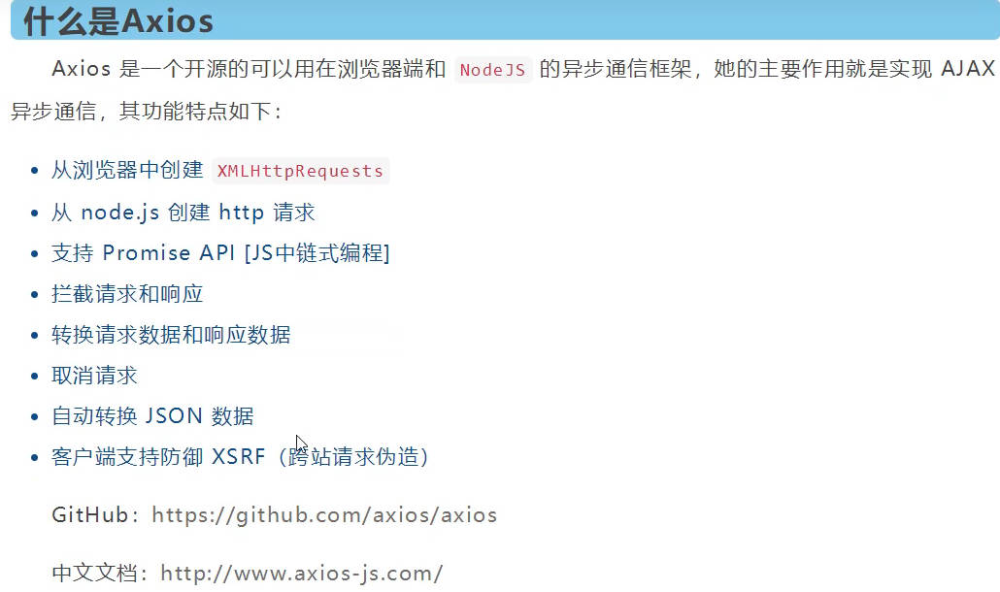 | 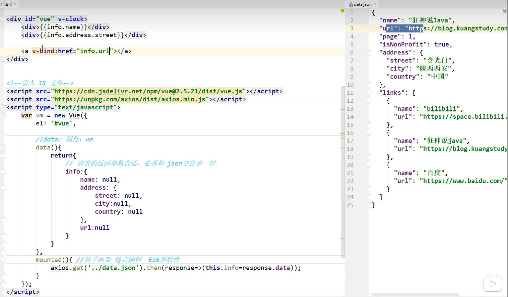 |
| -------------------------------------------------- | -------------------------------------------------- |


###### a. 钩子函数

Vue 实例有完整的生命周期，从开始创建、初始化数据、编译模板、挂载 DOM 、渲染-->更新-->渲染、卸载等一系列过程; Vue实例从创建到销毁的过程;

在 Vue生命周期中，提供了一系列的事件，让我们在事件触发时注册 JS 方法，用注册的 JS 方法控制大局，在这些事件响应方法中的 this 直接指向的是 Vue 的实例。

vm就是挂了个mounted钩子函数

```html
<div id="vue" v-cloak>
    <div>{{info.name}}</div>
    <div>{{info.address.street}}</div>
    <div>{{info.links}}</div>
    <a v-bind:href="info.url">点我</a>
</div>

<!--引入js文件-->
<script src="https://cdn.jsdelivr.net/npm/vue@2.5.21/dist/vue.min.js"></script>
<script src="https://unpkg.com/axios/dist/axios.min.js"></script>
<script>
    var vm = new Vue({ //钩子函数，data函数
        el: "#vue",
        data() {	//data(){return{...}} 接收axios数据固定格式
            return {
              info: {	//请求的返回参数名，必须和 json 字符串一样
                    name: null,
                    address: {
                        street: null,
                        city: null,
                        country: null
                    },
                    url: null,
                    links: [
                        {
                            name: null,
                            url: null
                        }
                    ]
                }
            }
        },
        mounted() { // 钩子函数 链式编程 ES6新特性；  axios通信用钩子函数；vue里的data()方法接收axios传回的数据
            axios.get('../data.json').then(response => (this.info = response.data))
        }
    });
```

## 6. 插槽==slot(内容分发)==、自定义事件

[Vue06-计算属性、内容分发、自定义事件](https://www.cnblogs.com/edgarstudy/p/15150256.html)  

vue实现了一套内容分发的API， `<slot>`元素承载分发内容

组件里事件删除vue实例里的数据（组件调用vue实例里的方法），个人理解：就是方法的传递。

###### 6.1 slot

 [Vue插槽作用解释的很明白](https://zhuanlan.zhihu.com/p/639709107)   [组件如何接收模板内容](https://cn.vuejs.org/guide/components/slots.html)  [插槽](https://www.cnblogs.com/Solitary-Rhyme/p/16910208.html) 

- 插槽（slot）是 vue 为组件的封装者提供的能力。允许开发者在封装组件时，把不确定的、希望由==用户指定的部分定义为插槽==，可以==把插槽认为是组件封装期间，为用户预留的内容的占位符==。
  - slot作用：在组件内写入用户自定义的内容    [Vue插槽作用解释的很明白](https://zhuanlan.zhihu.com/p/639709107)  [Slots (vuejs.org)](https://cn.vuejs.org/guide/components/slots.html#slot-content-and-outlet)
    - 插槽就是Vue实现的一套==内容分发==的API，`将<slot></slot>元素作为分发内容的出口`
  - `<child-component>你好</child-component>` ,`你好`不会输出到页面,只会输出组件内的内容
- 插槽常用于父组件向子组件指定位置插入html结构，也是一种组件间通信方式，适用于父组件→子组件

> 1. slot插槽（内容分发)
>    1. 页面渲染时，有些地方变，有些地方不变，留个口，方便其他东西进来。
> 2. 在 `Vue.js` 中使用 `<slot>` 元素作为承载分发内容的出口，作者称其为插槽，可以应用在组合组件的场景中

1. ==具名插槽==：就是给这个插槽起个名字  `<slot name="girl"></slot>`

```html
<!DOCTYPE html>
<html lang="en">
<head>
    <meta charset="UTF-8">
    <title>Title</title>
</head>
<body>
<!--view层 模板-->
<div id="app">
    <todo>
        <todo-title slot="todo-title" :title1="title3"></todo-title>
        <todo-items slot="todo-items" v-for="item1 in todoitems" :item2="item1"></todo-items>
    </todo>
</div>

<!--1.导入Vue.js-->
<script src="https://cdn.jsdelivr.net/npm/vue@2.5.21/dist/vue.min.js"></script>
<script>
    // slot：定义插槽,用来插数据
    Vue.component("todo", {
        template:
            '<div>\   //换行
                <slot name="todo-title"></slot>\
                <ul>\
                    <slot name="todo-items"></slot>\
                </ul>\
            </div>'

    })
	
    //定义2个要插入的数据
    Vue.component("todo-title", {
        props: ['title1'], //props接收数据
        template: '<div>{{title1}}</div>'
    })

    Vue.component("todo-items", {
        props: ['item2'],
        template: '<li>{{item2}}</li>'
    })

    var vm = new Vue({
        el: "#app",
        data: {
            title3: "edgar学习系列课程",
            todoitems: ['edgar学Java', 'edgar学Linux', 'edgar学前端']
        }
    });
</script>
</body>
</html>

```

###### 6.2 ==组件触发==自定义事件

[组件实例](https://cn.vuejs.org/api/component-instance.html#emit)  [emits](https://cn.vuejs.org/api/options-state.html#emits)

- 组件内部绑定事件要用`this.$emit("事件名",参数)` 
  - 在当前组件触发一个自定义事件
  - emits: 声明由组件触发的自定义事件

> 1. 父组件是使用 props 传递数据给子组件，但如果子组件要把数据传递回去，就需要使用自定义事件！  我们可以使用 v-on 绑定自定义事件, 每个 Vue 实例都实现了事件接口(Events interface)，

==Vue 自定义事件分发==： 简单说就是子组件通过 `$emit` 触发一个自己定义的事件，把数据“抛”出去，让父组件监听并处理

- 这是 Vue 里子组件向父组件传递数据的核心方式

- 自定义事件==本质上是发布订阅模式==。子组件是发布者，通过 `$emit` 发布事件；父组件是订阅者，通过 `$on` 监听。Vue 实例内部维护了事件中心，`$emit` 触发时查找并执行对应回调函数

```js
<!DOCTYPE html>
<html lang="en">
<head>
    <meta charset="UTF-8">
    <title>Title</title>
</head>
<body>
<!--view层 模板-->
<div id="app">
    <todo>
        <todo-title slot="todo-title" :title="title"></todo-title>
        <!--增加了v-on:remove="removeItems(index)"自定义事件，该组件会调用Vue实例中定义的removeItems方法-->
        <todo-items slot="todo-items" v-for="(item,index) in todoitems"
                    :item="item" :index="index" v-on:remove="removeItems(index)"></todo-items>
    	//remove是自定义事件名，this.$emit('自定义事件名', 参数)  ：事件分发
		//自定义事件调vue的方法 => 然后用自定义事件分发(就是方法的传递)，传递到组件里 =>组件调自定义事件，间接调用vue方法
		</todo>
</div>

<!--1.导入Vue.js-->
<script src="https://cdn.jsdelivr.net/npm/vue@2.5.21/dist/vue.min.js"></script>
<script>
    // slot：插槽
    Vue.component("todo", {
        template:
            '<div>\
                <slot name="todo-title"></slot>\
                <ul>\
                    <slot name="todo-items"></slot>\
                </ul>\
            </div>'

    })

    Vue.component("todo-title", {
        props: ['title'],
        template: '<div>{{title}}</div>'
    })

    // 这里的index，就是数组的下标，使用for循环遍历的时候，可以循环出来！
    Vue.component("todo-items", {
        props: ['item', 'index'],
        // 只能绑定当前组件的方法
        template: '<li>{{index}}----{{item}}<button @click="remove">删除</button></li>',
        methods: {
            remove: function () {
                // this.$emit自定义事件分发
                this.$emit('remove', this.index)
            }
        }
    })

    var vm = new Vue({
        el: "#app",
        data: {
            title: "edgar学习系列课程",
            todoitems: ['edgar学Java', 'edgar学Linux', 'edgar学前端']
        },
        methods: {
            removeItems: function (index) {
                console.log("删除了" + this.todoitems[index] + "OK")
                this.todoitems.splice(index, 1);// 一次删除一个元素
            }
        }
    });
</script>
</body>
</html>

```

| 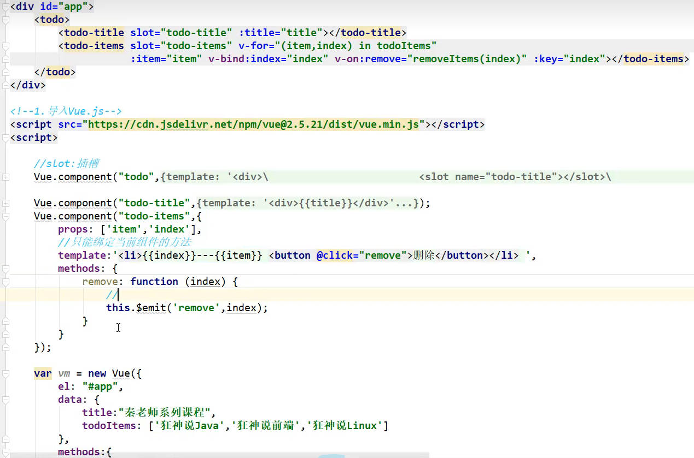 | 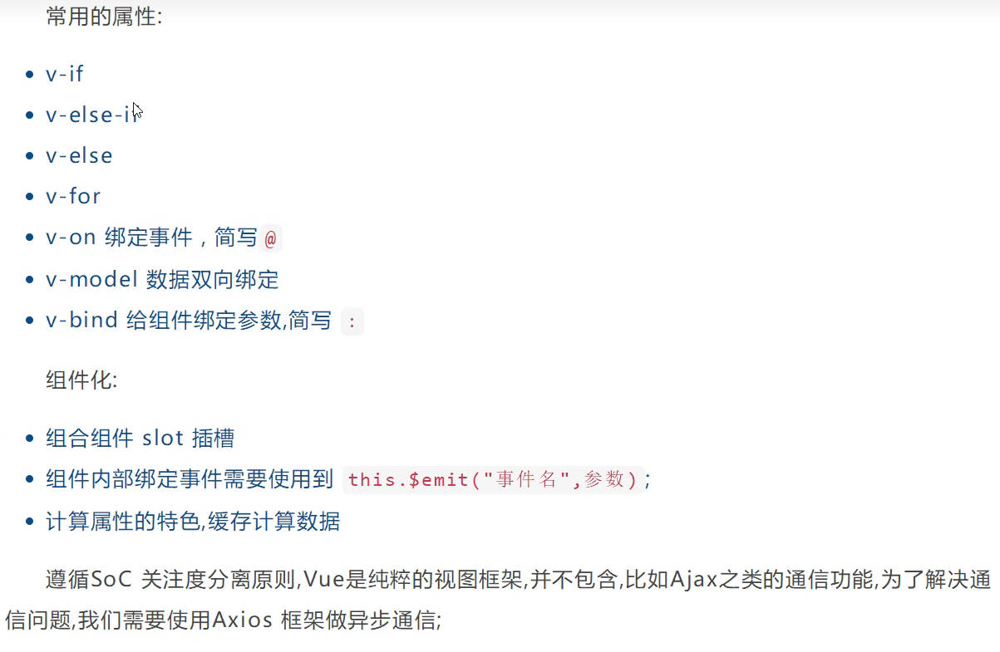 |
| -------------------------------------------------- | -------------------------------------------------- |


## 7. ==路由==

[Vue09-vue-router](https://www.cnblogs.com/edgarstudy/p/15164639.html)  [入门 | Vue Router](https://router.vuejs.org/zh/guide/)   [Vue Router3](https://v3.router.vuejs.org/zh/guide/#html)

[Vue-router使用](https://blog.csdn.net/xiaowude_boke/article/details/131782106) 

<span style="color:red">配路由文件 router/index.js  =>   配置文件导入main.js入口文件   =>   在组件app.vue中使用路由</span>

index不一定是主页，是主配置文件；

- 安装： `npm install vue-router@3 --save-dev //安装`   npm list vue-router查看版本
- `import VueRouter from 'vue-router'`
- `Vue.use(VueRouter)`

```js
import Vue from 'vue'
import VueRouter from 'vue-router'

Vue.use(VueRouter);  //全局导入，任何组件都可用vuerouter提供的组件。

//使用路由
<router-link to="/main">首页</router-link>
```

`export default new VueRouter` 导出一个router对象，main.js是入口文件，所以vue-router要导入进来。


| 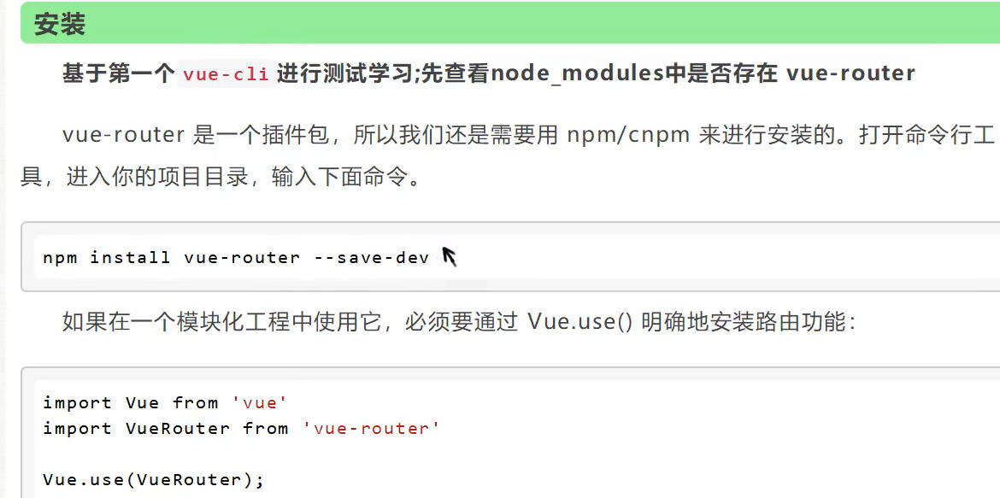 |  |
| -------------------------------------------------- | ----- |

1. ==路由在路由配置文件里配== ：router/index.js
2. ==在Vue对象里使用路由== ：main.js
3. 然后在App.vue里使用路由，相当于页面设置超链接： a标签
   1. `<router-link to="main">首页</router-link>`
   2. `<router-view></router-view> `

router/index.js: ==路由配置文件==

```js
import Vue from 'vue'
import VueRouter from 'vue-router'
import Content from "../components/Content"
import Main from "../components/Main";

Vue.use(VueRouter)

//配置导出路由（main.js里面有全局唯一vue对象(new vue)，所以这里导出Router对象）
//export default new Router();
export default new VueRouter({
  //routes数组里存对象，
  routes: [
    {
      //路由跳转的路径
      path: '/content',
      name: 'content',
      //跳转的组件
      component: Content
    },
    {
      path: '/main',
      name: 'main',
      component: Main
    }
  ]
});
```

main.js

```js
import Vue from 'vue'
import App from './App'
//路由配置好，导入路由：自动扫描目录里面的路由配置,然后在Vue对象里使用路由
import router from './router'

new Vue({
  el: '#app',
  router,  //vue对象里使用router，因为vue对象全局唯一，所以路由只能导入这里使用
  components: { App },
  template: '<App/>'
})

```

App.vue 

```vue
<template>
  <div id="app">
    <!-- router-lind相当于a标签，to相当于herf; 还必须加上展示-->  
    <router-link to="main">首页</router-link>
    <router-link to="content">内容页</router-link>
    <router-view></router-view>  
  </div>
</template>
```


## 8.Element-UI(vue2)

[Element2官网](https://element.eleme.cn/#/zh-CN/component/installation)  [Layui 前端 UI 组件库](https://layuion.com/) [Layui ](https://www.ilayuis.com/)  [Element Plus-vue3](https://element-plus.gitee.io/zh-CN/guide/quickstart.html) [Element3](https://element-plus.org/zh-CN/#/zh-CN)

[Vue10-实战快速上手](https://www.cnblogs.com/edgarstudy/p/15182478.html)  [ElementUI课堂笔记](https://gitee.com/lzh_gitee/Vue/blob/master/Vue课堂笔记/10实战快速上手.md)

[node node-sass sass-loader 版本对应](https://www.jianshu.com/p/e90b83b31f4b)   [vue2安装 node-sass sass-loader版本](https://blog.csdn.net/ferwagrea/article/details/129201862)   [各个版本的对应node版本](https://blog.csdn.net/qq_41177135/article/details/130885444) 

[组件 | Element](https://element.eleme.cn/#/zh-CN/component/form)  

- `sass-loader 7.3.1，node-sass 4.14.1  node14`

| 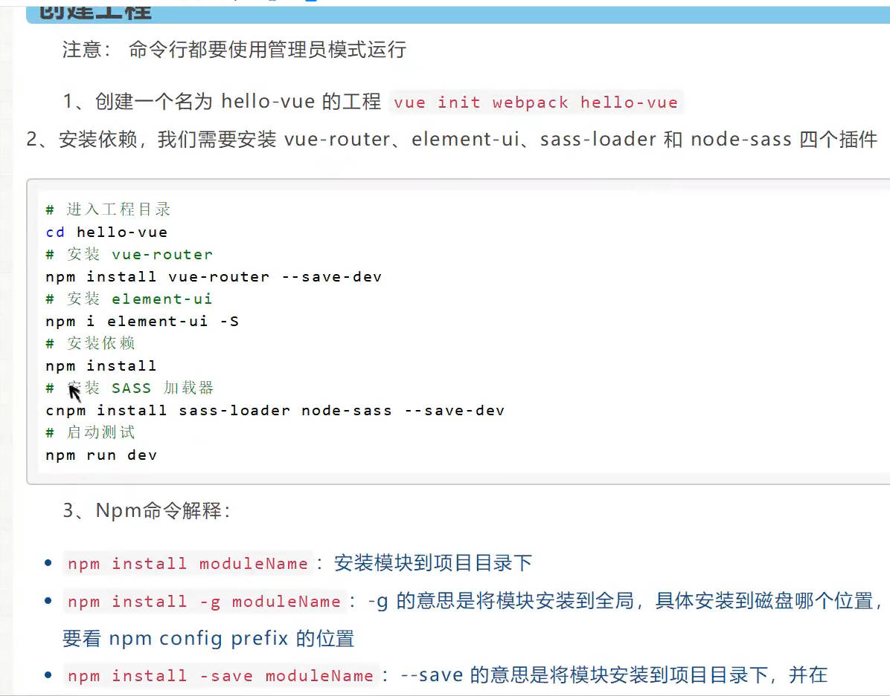 |  |
| -------------------------------------------------- | ----- |

1. 创建项目
   1. 创建一个名为hello-vue的工程`vue init webpack hello-vue`

   2. 安装依赖，我们需要安装 `vue-router`、`element-ui`、`sass-loader`和`node-sass`四个插件  `node -v`

2. 创建组件
   1. Main.vue ， Login.vue

3. 路由
   1. 配置路由
   2. Vue对象里使用路由 main.js
   3. ==App.vue里展示路由页面==


```bash
#进入工程目录
cd hello-vue
#安装vue-routern  
npm install vue-router@3.6.5 --save-dev
#安装element-ui
npm i element-ui -S
#安装依赖
npm install
# 安装SASS加载器
cnpm install sass-loader@7.3.1 node-sass@4.14.1 --save-dev
#启功测试
npm run dev

```

views目录==放视图组件==， components目录==放功能性组件==

- views目录： 首页、登录页、用户管理页、用户列表页、

`嵌套路由又称为子路由，在实际应用中，通常由多层嵌套的组件组合而成。同样的，URL中各段动态路径也按某种结构对应嵌套的各层组件`

```js
//子路由
import Vue from "vue";
import VueRouter from "vue-router";
import Main from "../views/Main";
import Login from "../views/Login";
import UserList from "../views/user/List"
import UserProfile from "../views/user/Profile"

Vue.use(VueRouter);

export default new VueRouter({
  routes: [
    {
      path: '/main',
      component: Main,
      children: [
        { // 嵌套路由 children数组
          path: '/user/profile',
          component: UserProfile
        }, {
          path: '/user/list',
          component: UserList
        }
      ]
    },
    {
      path: '/login',
      component: Login
    }
  ]
})

```
main.js

```js
import Vue from 'vue'
import App from './App'
import router from "./router"

import ElementUI from 'element-ui'
//导入的css，所以需要sass编译
import 'element-ui/lib/theme-chalk/index.css'

Vue.use(router)
Vue.use(ElementUI)

/* eslint-disable no-new */
new Vue({
  el: '#app',
  router,
  render: h => h(App)
})
```

### 1、嵌套路由

1. 新建views/user/Profile.vue、List.vue
2. 写Main.vue页面，将1里的2个组件作为子组件放进来
3. 将1里的组件写进路由index.js，作为Main的子路由
4. 在Main.vue里用`router-link`展示1里的组件

### 2、参数传递重定向

[VUE路由组件传参_百度搜索](https://www.baidu.com/s?ie=utf-8&f=8&rsv_bp=1&tn=baidu&wd=VUE%E8%B7%AF%E7%94%B1%E7%BB%84%E4%BB%B6%E4%BC%A0%E5%8F%82&oq=VU%2526gt%253B%25E7%25BB%2584%25E5%2590%2588%25E5%25BC%258FAPI%25E6%2598%25AF%25E4%25BB%2580%25E4%25B9%2588%25E6%2584%258F%25E6%2580%259D&rsv_pq=cfd832200008b6b9&rsv_t=db4c4WYGCIPDV2olnFmXyWM7EI%2Bxek1IbEVC0%2FmFfLT85N9%2B07whfJGu54k&rqlang=cn&rsv_enter=1&rsv_dl=tb_enter&rsv_sug3=28&rsv_btype=t&inputT=6527&rsv_sug4=14352)  [路由组件传参 | Vue Router](https://v3.router.vuejs.org/zh/guide/essentials/passing-props.html)  [Vue 路由组件传参的 8 种方式](https://www.cnblogs.com/msjhw/p/15697161.html)  

- 个人信息要根据==不同用户显示不同内容==，所以除了url跳转，还要==接收前端传递的参数==
  - `<router-link :to="{name:'UserProfile',params:{id:1,name:'狂神'}}">个人信息</router-link>`; 前端传递一个对象：Main.vue
  - 路由配置里接收：`{path: '/user/profile/:id/:name',name:'UserProfile',component: UserProfile},`
  - 在个人信息里展示： Profile.vue,  `<div>{{$router.params.id}}</div>`

- 另外可以通过props解耦
  - 增加 `props: true`
  - 展示处这样写：props:['id']


| 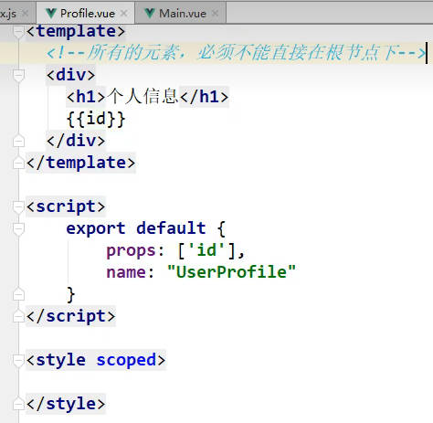 | 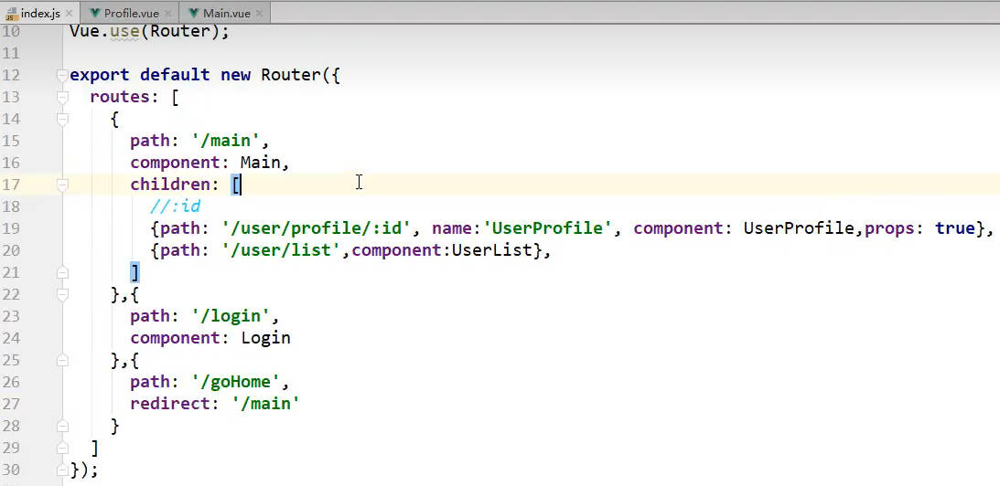 |
| ------------------------------------------------------------ | -------------------------------------------------------- |


> 1. 参数传递
>    1. 我们有一个User组件， ID不同的用户，都要使用这个组件来渲染。此时就需要传递参数
> 2. 重定向
>    1. `redirect: '/main`

```js
前端传、中间接收(路由接收)、用户展示(目标组件展示)

//传递参数 Main.vue； 传参需要绑定对象 :to
<!--name:传组件名 params:传递参数 需要对象:v-bind-->
<router-link :to="{name:'UserProfile',params:{id:1,name:'edgar'}}">个人信息</router-link>

//修改路由配置  index.js； 在 path 属性中增加 :id，:name 这样的占位符
{
  path: '/main',
  component: Main,
  children: [
    { // 嵌套路由
      path: '/user/profile/:id/:name',
      name: 'UserProfile',
      component: UserProfile
    }, {
      path: '/user/list',
      component: UserList
    }
  ]
}


//接收参数,在目标组件中
<template>
  <!--所有的元素，必须不能直接在根节点下-->
  <div>
    <h1>个人信息</h1>
    {{ $route.params.id }}
    {{ $route.params.name }}
  </div>
</template>

<script>
export default {
  name: "UserProfile"
}
</script>
<style scoped>
</style>

```

`通过props解耦`

```js
//修改路由配置，主要增加了 props: true 属性
{
  path: '/main',
  component: Main,
  children: [
    { // 嵌套路由
      path: '/user/profile/:id/:name',
      name: 'UserProfile',
      component: UserProfile,
      props: true
    }, {
      path: '/user/list',
      component: UserList
    }
  ]
}

//接收参数为目标组件增加 props 属性
<template>
  <!--所有的元素，必须不能直接在根节点下-->
  <div>
    <h1>个人信息</h1>
    {{id}}
    {{name}}
  </div>
</template>

<script>
export default {
  props:['id','name'],  //组件接收参数
  name: "UserProfile"
}
</script>

<style scoped>

</style>

//重定向；路由配置中
{
	path: '/goHome',
	redirect:'/main'
}
```

### 3 路由钩子与异步请求axios

[Vue10-实战快速上手](https://www.cnblogs.com/edgarstudy/p/15182478.html)  [ 404和路由钩子](https://www.freesion.com/article/98271343503/)

登录后显示当前登录用户

- history：路径不带 # 符号； hash：路径带 # 符号
- 路由钩子
- axios

## 9、组合式API

[Vue3 script setup 语法糖详解](https://blog.csdn.net/weixin_66471060/article/details/127256998)  [TypeScript 与组合式 API ](https://cn.vuejs.org/guide/typescript/composition-api.html)  [Vue3 组合式 API ](https://www.runoob.com/vue3/vue3-composition-api.html)    [ Vue 3.x改进](https://zhuanlan.zhihu.com/p/460881348)  [若依](http://www.ruoyi.vip/)  [Vue3 组合式API](https://liujiangblog.com/course/Vue3/303)   [响应式的 `repositories` 变量](http://www.manongjc.com/detail/61-bsywngggllsvojw.html)

###### 1、setup组件选项

> 1. 组合式API
>    1. vue3特色，解决共享代码、复用问题
> 2. 理解组合式API
>    1. created、methods等都是选项，Vue构建时要传入选项option，vue调用option时，会执行一些操作，vue的生命周期
>    2. 先拿到option(props)，然后调用setup，并且props传入setup，同时还传一个context，
>    3. `setup` 选项是一个接收 `props` 和 `context` 的函数，我们将在[之后](https://v3.cn.vuejs.org/guide/composition-api-setup.html#参数)进行讨论。此外，我们将 `setup` 返回的所有内容都暴露给组件的其余部分 ([计算属性](https://so.csdn.net/so/search?q=计算属性&spm=1001.2101.3001.7020)、方法、生命周期钩子等等) 以及组件的模板
>    4. setup是函数，返回值传给其余部分

```js
//以前的，无setup
let a = {
	created(){
        
    },
    mounted(){
        
    },
    methods:{
        
    }
}

function Vue(option){
    //还有很多自己的业务逻辑
    option.created();
    //真正的创建逻辑
    option.mounted()
}
```

```js
//有setup
let a = {
    setup(){
        return{a:1,b:2} 
    },
	created(){
        
    },
    mounted(){
        
    },
    methods:{
        
    }
}

function Vue(option){
    //还有很多自己的业务逻辑
    //vue函数执行时，先执行setup，创建时，setup有一个返回值obj
    let obj = option.setup();
    //暴露给组件其余部分,obj作为参数传入，其他部分就能用setup的返回结果
    option.created(obj);
    //真正的创建逻辑
    option.mounted(obj)
}
```

###### 2、 带 ref 的响应式变量

> 1. 将setup里的一些变量变成响应式(数据双向绑定)， 所以引入vue的一个ref方法，可以把变量变成响应式，ref方法可以从vue组件里解构出来。

- `ref` 接收参数并将其包裹在一个带有 `value` property 的对象中返回，然后可以使用该 property 访问或更改响应式变量的值

  ```js
  import { ref } from 'vue'
  
  const counter = ref(0)		//把变量变成响应式
  
  console.log(counter) 		// { value: 0 }
  console.log(counter.value) 	// 0
  
  counter.value++
  console.log(counter.value) 	// 1
  ```

```js
// src/components/UserRepositories.vue `setup` function
import { fetchUserRepositories } from '@/api/repositories'
import { ref } from 'vue'

// in our component
setup (props) {
  const repositories = ref([])			//仓库定义成响应式的
  const getUserRepositories = async () => {
    repositories.value = await fetchUserRepositories(props.user)
  }    			//定义一个方法，这个方法是async的，async里面使用await，awiait后面是一个返回promise的函数，函数的结果返回给value
  //根据user查询仓库，组合式api把相同主题的方法、变量等组合到了一起

  return {
    repositories,
    getUserRepositories
  }
}
```

###### 3、 setup内注册生命周期钩子

- 上例组合式api里的watch、mounted也要加载仓库，这2块也是相同主题，也能放在setup里； 

- 要解构watch、mounted方法

  `import { ref, onMounted } from 'vue'`

###### 4、 watch响应式更改

- 解构出一个watch

`import { ref, watch } from 'vue'`

###### 5、 独立的computed属性

- 从vue解构出computed

`import { ref, computed } from 'vue'`

###### 6、 响应性API（不是组合式函数）

[组合式函数](http://www.manongjc.com/detail/61-bsywngggllsvojw.html)   [响应性API](https://zhuanlan.zhihu.com/p/460881348)

- 组合式api首先要组合，然后用组合式函数提取(return)，然后在组件中用setup使用`const { repositories, getUserRepositories } = useUserRepositories(user)`

- `<script setup>`不用return，在script里定义的变量，都会暴露出去

- props也不是响应式，==把toRefs解构出来的数据变成响应式引用==，用`const {user} = toRefs(props) ` [==用toRefs创建对props中'user' property的响应式引用==],要先解构toRefs方法`import {toRefs} from 'vue'`

  ```js
  // src/composables/useUserRepositories.js
  
  //首先需要一个api，从后台加载数据，将来fetchUserRepositories里面就是一个axios，发get请求，拿到仓库列表
  import { fetchUserRepositories } from '@/api/repositories'
  //把vue里的ref, onMounted, watch解构出来
  import { ref, onMounted, watch } from 'vue'
  
  //然后export一个函数，这个函数其实就是setup，把仓库相关的提取出来。
  export default function useUserRepositories(user) {
    const repositories = ref([])
    const getUserRepositories = async () => {
      repositories.value = await fetchUserRepositories(user.value)
    }
  
    onMounted(getUserRepositories)
    watch(user, getUserRepositories)
  
    return {
      repositories,
      getUserRepositories
    }
  }
  ```

  然后是搜索功能，又独立的提取出来  [组合式api](http://www.manongjc.com/detail/61-bsywngggllsvojw.html)

  ```js
  // src/composables/useRepositoryNameSearch.js
  
  import { ref, computed } from 'vue'
  
  export default function useRepositoryNameSearch(repositories) {
    const searchQuery = ref('')
    const repositoriesMatchingSearchQuery = computed(() => {
      return repositories.value.filter(repository => {
        return repository.name.includes(searchQuery.value)
      })
    })
  
    return {
      searchQuery,
      repositoriesMatchingSearchQuery
    }
  }  
  ```

[ES6基础知识点_const {}](https://blog.csdn.net/weixin_41227874/article/details/120823360)  [vue中常用的es6的语法](https://blog.csdn.net/m0_64542161/article/details/124818018?spm=1001.2101.3001.6650.1&utm_medium=distribute.pc_relevant.none-task-blog-2~default~CTRLIST~Rate-1-124818018-blog-120823360.pc_relevant_default&depth_1-utm_source=distribute.pc_relevant.none-task-blog-2~default~CTRLIST~Rate-1-124818018-blog-120823360.pc_relevant_default&utm_relevant_index=2) [es6学习笔记之let const和解构](https://blog.csdn.net/houyibing930920/article/details/85251954)   [ES6 CONST 常量 数组解构 对象解构_const 解构](https://blog.csdn.net/qq_35112578/article/details/126373411)  [解构、展开](https://blog.csdn.net/lunahaijiao/article/details/99800596)  

[ES6学习笔记（let,const,变量的解构赋值）](https://www.cnblogs.com/NatChen/p/9930873.html) [ ES6入门（二）解构赋值](https://blog.csdn.net/qq_51005544/article/details/121048061)  [ES6之变量的解构赋值](https://blog.csdn.net/lovewhoilove/article/details/119830423)  [es6变量解构与函数解构 ](https://www.cnblogs.com/txf-123/p/11492789.html)

` 解构: es6允许按照一定的模式，从数组和对象中提取值，对变量进行赋值，被称为解构（Destructuring）`

  ```js
  //函数只能返回一个值，如果要返回多个值，将它们放在数组或对象里返回。有了解构赋值，取出这些值就非常方便
  // 返回一个数组
  
  function example() {
    return [1, 2, 3];
  }
  let [a, b, c] = example();
  
  // 返回一个对象
  
  function example() {
    return {
      foo: 1,
      bar: 2
    };
  }
  let { foo, bar } = example();
  
  //从useRepositoryNameSearch方法中解构searchQuery,repositoriesMatchingSearchQuery
  const {
        searchQuery,
        repositoriesMatchingSearchQuery
      } = useRepositoryNameSearch(repositories)
  ```

######   组合式API抽离

- 所有组合式api放一个目录，里面放不同的js文件（定义多个组合式api，例如时间选择器的组合式api），可导出对象、方法(将来调用方法，解构出相应内容)等；

# 三、==VUE-CLI==脚手架开发

[使用Vite构建Vue项目，整合vuex、vue-router、axios、scss_](https://blog.csdn.net/weixin_44066182/article/details/117078349)   [Vue 3全新的Web开发构建工具——Vite介绍](https://baijiahao.baidu.com/s?id=1684779666333900  793&wfr=spider&for=pc)  [模块化的演变](https://zhuanlan.zhihu.com/p/345240568)  [模块化的演变](https://www.pianshen.com/article/24932083364/)  [前端模块化的演变过程](https://www.cnblogs.com/zhaojian-08/p/14368990.html)   [Webpack 入门教程](https://www.runoob.com/w3cnote/webpack-tutorial.html) [带你快速了解WebPack](https://baijiahao.baidu.com/s?id=1704537283144284061&wfr=spider&for=pc)  

[nvm学习](https://www.cnblogs.com/kunmomo/p/14976085.html)   [ nvm常用命令](https://blog.csdn.net/weixin_43471909/article/details/124714279) [npm init初始化项目](https://www.cnblogs.com/wangxirui/p/13399315.html)

[pnpm是什么](https://www.cnblogs.com/magicg/p/16776288.html) [Bun1.0正式发布](https://zhuanlan.zhihu.com/p/657868875) [尤雨溪推荐神器ni能替代 npm/yarn/pnpm ](https://blog.csdn.net/u012384510/article/details/121092421) [ni软件管理器](https://blog.csdn.net/weixin_39738755/article/details/110867103) [NI包管理器(NIPM)](https://zhuanlan.zhihu.com/p/268822505?utm_id=0) 

+ nvm 是 Mac 下的 node 管理工具； 可以实现多个node版本共存，并随意切换，相当于python里面的pyenv


| 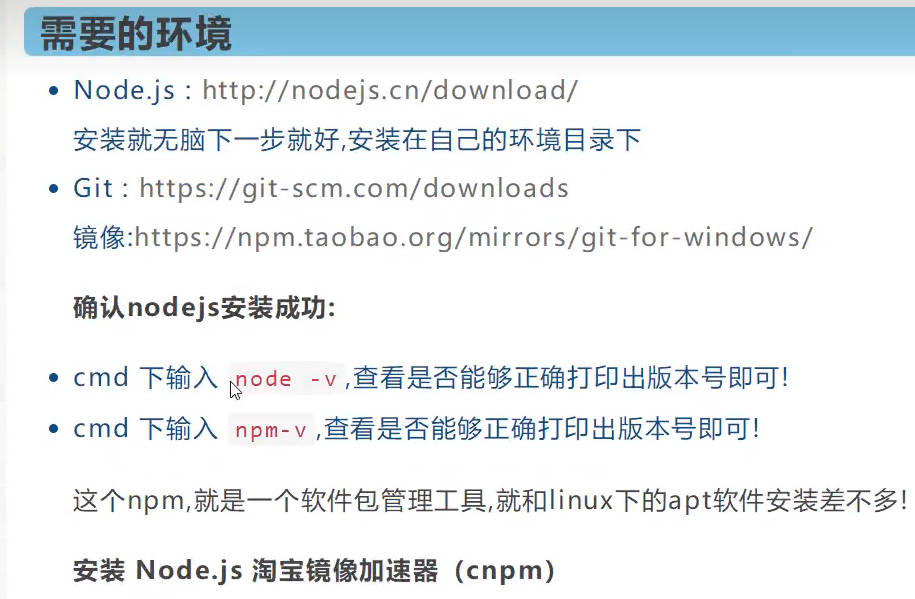 |  |
| -------------------------------------------------- | ----- |


##### 1. 前端工程标准化

[前端工程化之规范化标准](https://zhuanlan.zhihu.com/p/374402796)   [前端工程化理解和规范](https://www.jianshu.com/p/2c5e9a59c412)  [前端工程师的自检清单](https://baijiahao.baidu.com/s?id=1700195384045751835&wfr=spider&for=pc)  [前端工程化之规范化标准](https://blog.csdn.net/gongye2019/article/details/115879104)  [手把手带你入门前端工程化](https://blog.51cto.com/u_15291238/3729060)  

[Vue CLI](https://cli.vuejs.org/zh/guide/)  [ Vite中文网](https://vitejs.cn/) [什么是 Vite ](https://www.jianshu.com/p/9b81c266fd68) [Vite详解](https://www.cnblogs.com/ypSharing/p/viteHandler.html)  [初识 Vite](https://www.cnblogs.com/zhazhanitian/p/14422086.html)  [ Vue CLI](https://cli.vuejs.org/zh/guide/)  [vue-cli](https://www.cnblogs.com/ming1025/p/9887247.html)   [深入研究Vue CLI3 ](https://www.gxlsystem.com/qianduan-1745.html)   [Vite 与 Vue Cli 对比 ](https://blog.csdn.net/weixin_48201324/article/details/124891172)

> 1. Vue的开发都是要基于NodeJS，实际开发采用 vue-cli脚手架开发，vue-router 路由，vuex做状态管理；Vue UI界面一般使用 ElementUI（饿了么出品），或者ICE（阿里巴巴出品！）来快速搭建前端项目
>    1. 状态管理：就是服务端的会话，session、cookie等，vue可用local storage，但刷新就没了。所以用vuex

###### 1.1 vue-cli

Vite 是 vue 的作者尤雨溪在开发 vue3.0 的时候开发的一个 **基于原生 ES-Module 的前端构建工具**。

<span style="color:red">vue-cli是官方提供的一个脚手架，用于快速生成一个vue的项目模板</span>

[第一个vue-cli项目_笔记](https://www.cnblogs.com/edgarstudy/p/15154692.html)

> vue-cli需要的环境：
>
> 1. ==Node.js==
>    1. **Node.js ==淘宝镜像加速器==（cnpm）**     npm install cnpm -g
>    2. 全局安装的位置：`C:\Users\86152\AppData\Roaming\npm\node_modules`
> 2. ==安装 vue -cli==           
>    1. cnpm install vue-cli -g
>    2. vue list
> 3. ==创建一个Vue项目==
>    1. 进入到对应的目录,  vue init webpack myvue
>    2. 初始化
>       1. cd myvue ；   npm install 安装项目依赖环境
>    3. 运行当前项目        npm run dev启动项目，（相当于tomcat启动）          IDEA打开项目 open
>       1. 参数--watch 用于监听变化，可以实现热更新(热部署)        ==webpack --watch==
>    4. ==脚手架目录结构==：build 构建；config 配置； static静态资源； node_modules模块化组件

```
vue list   					查看可以基于哪些模板创建vue应用
vue init webpack  myvue		创建基于webpack模板的vue应用
cd myvue; npm install	安装运行时依赖环境；   npm run dev  启动当前项目，然后就可以访问
```

> 1. build/webpack.base.conf.js ： entry，入口
> 2. config/index.js: 静态目录、端口号等
> 3. index.html：应用主入口
> 4. package.json：打包的版本

##### 2.webpack

[模块化-CommonJs、AMD、CMD ](https://cloud.tencent.com/developer/article/1942235)  [==模块化的演变==](https://www.cnblogs.com/edgarstudy/p/15159479.html) [webpack详解](https://blog.csdn.net/qq_43743402/article/details/123652090)  [Vue08-webpack使用](https://www.cnblogs.com/edgarstudy/p/15159479.html)   [webpack详解](https://www.cnblogs.com/mrlin/articles/16448837.html)  [前端常用构建工具 ](https://blog.csdn.net/qq_30436011/article/details/125082348) [前端9大构建工具](https://wangxiaoting.blog.csdn.net/article/details/110425213?spm=1001.2101.3001.6661.1&utm_medium=distribute.pc_relevant_t0.none-task-blog-2~default~CTRLIST~Rate-1-110425213-blog-125082348.pc_relevant_multi_platform_whitelistv3&depth_1-utm_source=distribute.pc_relevant_t0.none-task-blog-2~default~CTRLIST~Rate-1-110425213-blog-125082348.pc_relevant_multi_platform_whitelistv3&utm_relevant_index=1)    [如何在一个工程下管理多个npm包](https://www.bilibili.com/read/cv4948266)  [npm包大全](https://www.cnblogs.com/ygunoil/p/14889600.html)  [npm包大全](http://www.manongjc.com/detail/24-atztrqsxulfuhny.html)  [30个有用的npm包](https://brands.cnblogs.com/tencentcloud/p/12715)   [npm 包和模块](https://www.npmrc.cn/quick-start/pkg-module.html)  [npm包最多可以有多少依赖](https://www.zhihu.com/question/273919763) [npm支持的依赖包管理](https://blog.csdn.net/weixin_42467428/article/details/113018369)    [webpack+browserify+gulp+grunt等的区别](https://www.jianshu.com/p/3be647dffbf1)

[Babel](https://www.babeljs.cn/)   [ webpack中文文档](https://www.webpackjs.com/)

[devDependencies依赖包中前缀^符号和~](https://blog.csdn.net/duansamve/article/details/122657428)   [devDependencies中依赖的版本号常用的符号](https://blog.csdn.net/Heartbroken_man/article/details/123236879)   [语义化版本管理 ](https://www.jianshu.com/p/6679fe192c47) [语义化版本规范](https://blog.csdn.net/wohu1104/article/details/123051709)

[序列化理解](https://zhuanlan.zhihu.com/p/40462507)  [大数据的类型](https://verytoolz.com/blog/1df6f24248/) [数据序列化语言 YAML ](https://www.51cto.com/article/683208.html)

> 1. 序列化	
>    1. **序列化：**把对象转化为可传输的字节序列过程称为序列化。
>    2. **反序列化：**把字节序列还原为对象的过程称为反序列化。
> 2. 序列化目的是为了对象可以**跨平台存储，和进行网络传输**
> 3. 模块化理解
>    1. 将复杂的程序依据一定的规则(规范)拆分成多个模块(文件)
>    2.  模块的内部数据与实现是私有的, 只是向外部暴露一些接口(方法)与外部其它模块通信
>
> 

`npm支持的依赖包管理：dependencies、devDependencies、peerDependencies、optionalDependencies、bundledDependencies / bundleDependencies`

模块化的演进:  Script标签=>CommonJS=>AMD=>CMD=>ES6模块

> 1. ==Script标签==		<script src = "module1.js"></script>
>    1. 如果把每一个js文件看作是一个模块，那么它们的接口通常是暴露在全局作用域下，也就是定义在window对象中，不同模块的调用都是一个作用域。
> 2. ==CommonJS== 
>    1. NodeJS遵循CommonJS规范, 模块通过==require==方法来*==同步==加载*,  通过==exports或module.exports==来导出需要暴露的接口
> 3. ==AMD==(Asynchronous Module Definition) ==异步==
>    1. 其核心接口是：define(id?,  dependencies?,   factory);它要在声明模块的时候指定所有的依赖dependencies，并且还要当做形参传到factory中，对于依赖的模块提前执行，依赖前置
>    2. 对于依赖的模块，AMD 推崇`提前执行(依赖前置)`，RequireJS 从 2.0 开始，也改成可以延迟执行
>    3. 定义了写入模块接口和加载模块接口的 JavaScript 规范
>    4. 可以并行加载多个模块,  不符合通用的模块化思维方式，是一种妥协的实现
> 4.   ==Commons Module Definition==
>    1. 规范和AMD很相似，尽保持简单，并与CommonsJS和NodeJS的Modules规范保持了很大的兼容性。  
> 5. ES6模块
>    1. 增加了JavaScript语言层面的模块体系定义。ES 6模块的设计思想，是尽量静态化，使编译时就能确定模块的依赖关系，以及输入和输出的变量。CommonJS和AMD模块，都只能在运行时确定这些东西         
>    2. 实现：Babel :高版本js编译成低版本js。
>    3. export default，模块指定默认输出


| 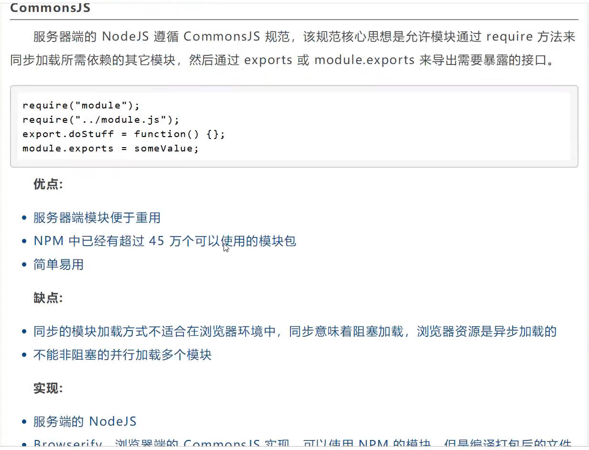 | 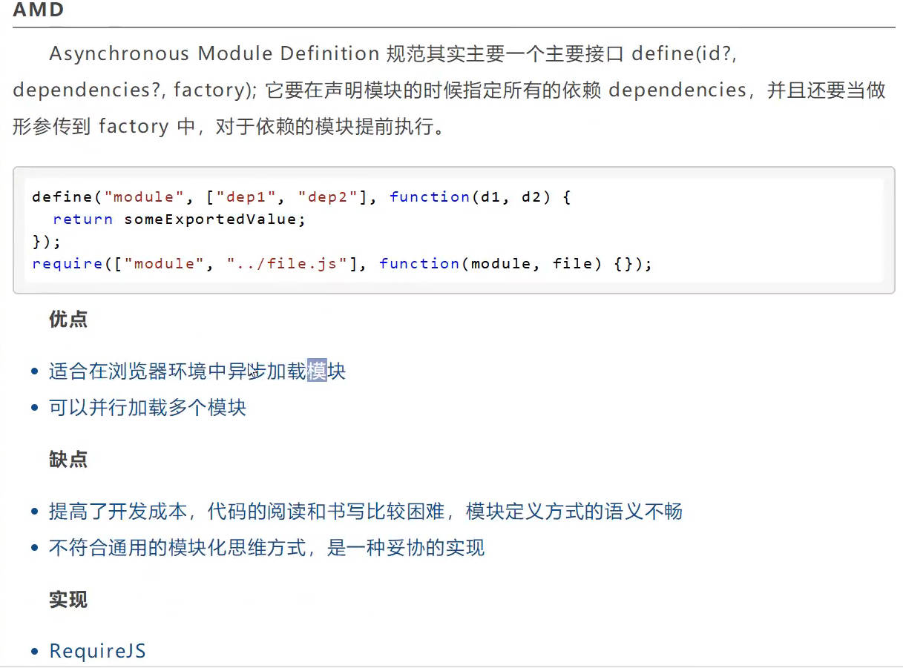 |
| -------------------------------------------------- | -------------------------------------------------- |
| 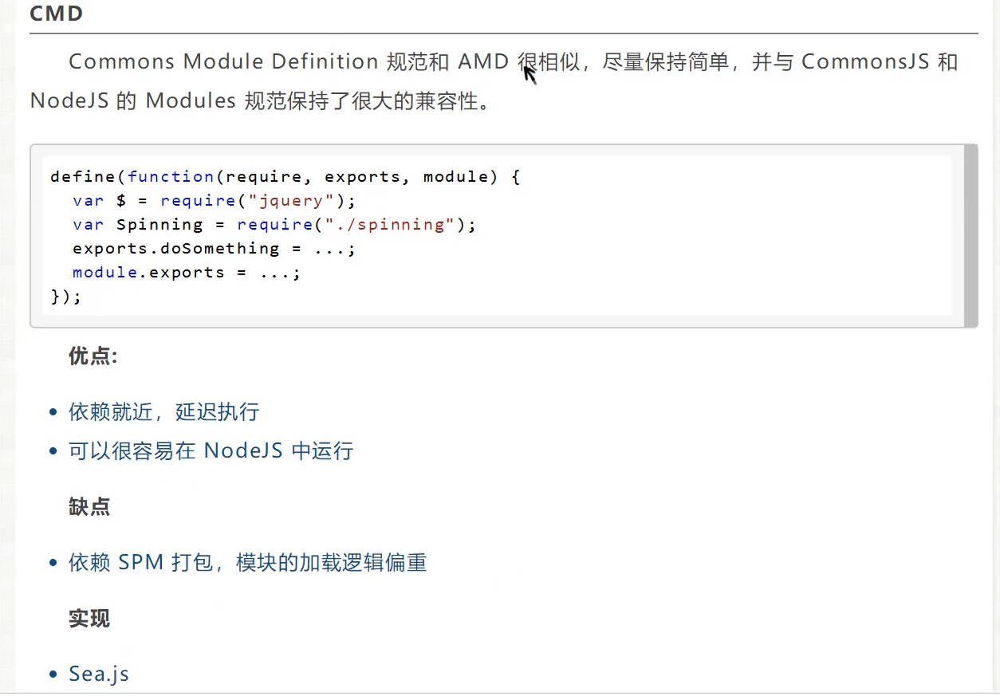 | 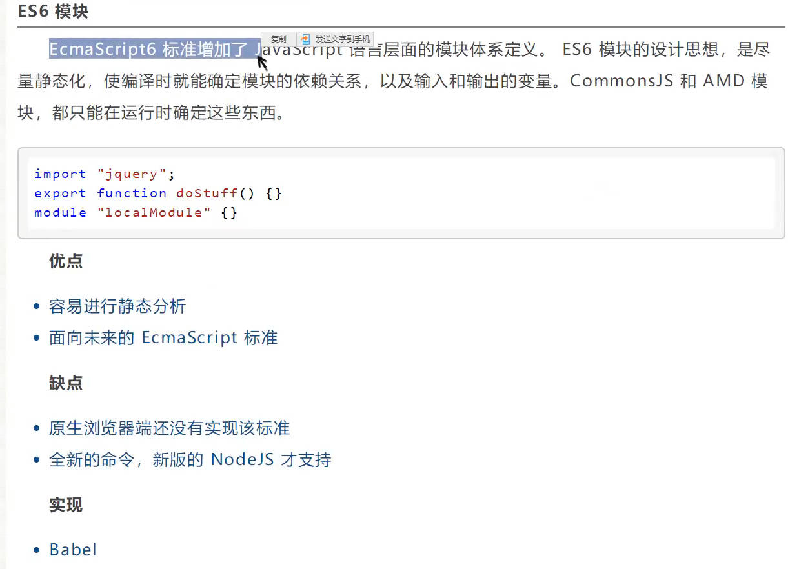 |


```js
//Script标签
<script src = "module1.js"></script>
//CommonJS
require("module");
require("../module.js");
export.doStuff = function(){};
module.exports = someValue;

//AMD
define("module",["dep1","dep2"],function(d1,d2){
   return someExportedValue;
});
require(["module","../file.js"],function(module,file){});


// CMD
define(function(require,exports,module){
	var $=require("jquery");
	var Spinning = require("./spinning");
	exports.doSomething = ...;
	module.exports=...;
});

//ES6模块
import "jquery"
export function doStuff(){}
module "localModule"{}

```

WebPack是一款**模块加载器兼打包工具**， 它能把各种资源， 如JS、JSX、ES 6、SASS、LESS、图片等都作为模块来处理和使用。

` 本质上，webpack是一个现代JavaScript应用程序的静态模块打包器（module bundler）。当webpack处理应用程序时，它会递归地构建一个依赖关系图（dependency graph），其中包含应用程序需要的每个模块，然后将所有模块打包成一个或多个bundle。`

把ES6的代码打包编译成ES5规范。

```java
参数--watch 用于监听变化，可以实现热更新(热部署)        webpack --watch
Webpack安装：
npm install webpack -g	
npm install webpack-cli -g
测试安装成功： webpack -v ;  webpack-cli -v
```
###### 2.1 使用webpack

- ==安装webpack==

1、创建项目（创建一个名为webpack-study的空文件夹，用idea打开）
2、创建一个==modules目录==，用于放置JS模块等资源文件
3、在==modules下创建模块文件==，如 hello.js ， 用于编写JS模块相关代码,==exports导出==

```java
~的意思是匹配最近的小版本，比如~1.0.2将会匹配所有的1.0.x版本，但不匹配1.1.0；
^的意思是匹配最近的一个大版本，比如1.0.2 将会匹配所有 1.x.x，但不包括2.x.x。
```


```js
// 暴露一个方法: sayHi  ;hello.js
exports.sayHi = function () {
    document.write("<div>Edgar学ES6</div>");
};
```
4、在modules下创建一个名为main.js的入口文件，用于打包时设置entry属性; ==require 导入==

```js
// require 导入一个模块(hello.js)，就可以调用这个模块中的方法了
var hello = require("./hello"); 
hello.sayHi();
```
5、==打包==：在==项目目录下创建webpack.config.js配置文件==，使用`webpack`命令打包,==生成bundle.js==

```js
module.exports = {
    entry: './modules/main.js',
    output: {
        filename: "./js/bundle.js"
    }
}
```
6、在==项目目录下创建HTML页面，如index.html==，导入`webpack`打包后的JS文件：bundle.js

| 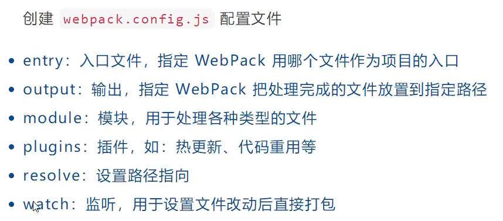 | 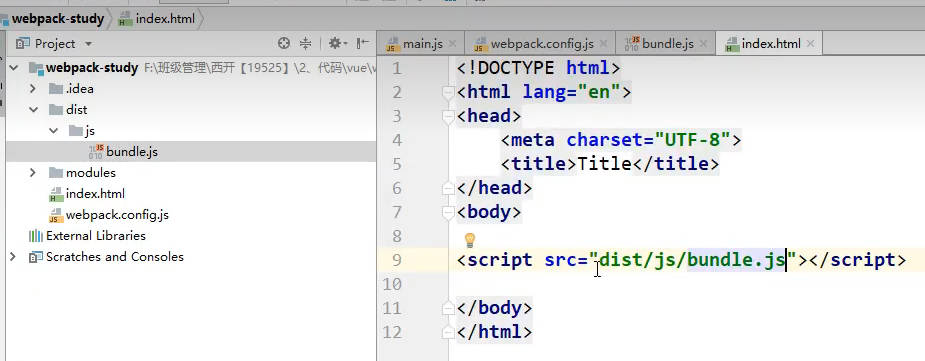 |
| -------------------------------------------------- | -------------------------------------------------- |


###### 3. nodejs项目

[vue-element-admin](https://panjiachen.github.io/vue-element-admin-site/zh/)    [Ant Design ](https://ant.design/index-cn)  [Node.js构建的开源项目](https://zhuanlan.zhihu.com/p/381840340)

# 四、vuex

视频： [**IT楠老师**](https://www.bilibili.com/video/BV1zq4y1c78s?p=49&vd_source=7346303e5e18677d7261c2c0c109ecfd)   [黑马程序员_vue全家桶](https://www.bilibili.com/video/BV1h7411N7bg/?p=14&vd_source=7346303e5e18677d7261c2c0c109ecfd)      [黑马_VUE全家桶 ](https://www.bilibili.com/video/BV1BK4y1h762/?spm_id_from=333.337.search-card.all.click&vd_source=7346303e5e18677d7261c2c0c109ecfd) 

[Vuex 官网](https://vuex.vuejs.org/zh/guide/modules.html#保留-state)   [vuex的五个属性](https://www.cnblogs.com/lyxzxp/p/11778579.html)  [Vuex5个核心属性](https://baijiahao.baidu.com/s?id=1742300435801656515&wfr=spider&for=pc) [ vue ui](https://blog.csdn.net/Angela_Connie/article/details/120067525) 

[vue新一代状态管理插件Pinia](https://baijiahao.baidu.com/s?id=1733404395245364527&wfr=spider&for=pc)   [Pinia](https://www.51cto.com/article/699570.html)   [Home | Pinia ](https://pinia.vuejs.org/zh/index.html)   

[什么是状态管理](https://cn.vuejs.org/guide/scaling-up/state-management.html#what-is-state-management)  [async和await](https://www.jianshu.com/p/b4fd76c61dc9)  [深入理解await与async](https://www.cnblogs.com/jsgoshu/p/11444404.html)  [如何讲清楚async和await](https://zhuanlan.zhihu.com/p/112081953)   [async/await ](https://www.jianshu.com/p/fb1da22f335d)

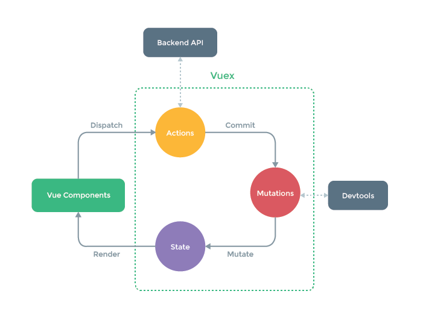

- 安装

- 导入

- 创建store实例：调用方法，给方法传递一些参数； 将store实例作为插件； 这是全局安装

  > 1. store
  >    1. 访问数据
  >       1. state：之前的data；   commit触发一个mutations。  ==//计算属性、辅助函数用来解构方法==
  >          1. Vuex 通过 Vue 的插件系统将 store 实例从根组件中“注入”到所有的子组件里。子组件能通过 this.$store 访问
  >          2. 辅助函数mapState：访问state，不会这样用{{$store.state.count}}，一般放在计算属性(是个对象)；当一个组件获取多个状态时，要写多个方法，麻烦，用mapstate
  >          3. 对象展开运算符：合并多个对象 ...  ；类似java可变参数;  ...为展开运算符，操作数组时可以用来把数组展开成字符串, 
  >       2. ==Getter==：有时需要从state中派生一些状态；获取的数据并不是数据本身，而是派生的数据； 如果有多个组件需要用到此属性（==派生的数据复用==）；用Getter；它和计算属性很像，==里面也是方法==； Getter 会暴露为 `store.getters` 对象；                            ==//计算属性、辅助函数==
  >    2. 操作数据
  >       1. mutations：操作数据； 保存对共享数据的修改逻辑; @代表source； 绝对路径import router from '@/router'
  >          1. 可以向 `store.commit` 传入额外的参数，即 mutation 的**载荷（payload）**，载荷(就是参数)应该是一个对象
  >          2. 提交 mutation 的另一种方式是直接使用包含 `type` 属性的对象
  >          3. 常量替代 Mutation 事件类型：就是定义一个js，里面保存所有Mutation名字;  使用字符串可能出错，用统一的变量去管理就没问题。
  >       2. Action：异步； 
  >          1. Action 函数接受一个与 store 实例具有相同方法和属性的 context 对象，用 context.commit 一个 mutation方法； 从context里面解构出一个commit方法。{commit}
  >          2. 触发Actions：`this.$store.dispatch('increment')`
  >          3. 分层：actions提交mutation，mutation修改state数据
  >          4. **调用异步 API** 和**分发多重 mutation**： 一个actions里进行多个mutations，并且异步调用
  > 2. async和await
  >    1. await后面接一个会return new promise的函数并执行它
  >    2. await只能放在async函数里
  >    3. 定义一个方法，这个方法是async的，async里面使用await，awiait后面是一个返回promise的函数，函数的结果返回给value
  
  ```js
  //访问state：
  <span>{{count}}</span>
  computed:{
  	count(){
  		return this.$store.state.count;
  	}
  }
  //2：当一个组件获取多个状态时，要写多个方法，麻烦，用mapstate
  computed: mapState(['count','name'])  //同名时解构出来多个状态
  
  //3：合并多个对象属性 ...
  let A = {a:1,b:2}
  let B = {c:3,...A}
  B
  {c: 3, a: 1, b: 2}
  ```
  
  ```js
  //以后doneTodos可以在组件中复用
  getters: {
      doneTodosCount (state) {
        return state.todos.filter(todo => todo.done === true).length
      }
    }
  //使用getters，最好定义成计算属性
  computed: {
    doneTodosCount () {
      return this.$store.getters.doneTodosCount
    }
  }
  //如果getters里方法多了，写起来不方便，用辅助函数
  computed: {
    ...mapGetters([
        'doneTodosCount',
        'anotherGetter'
      ])
    doneTodosCount () {
      return this.$store.getters.doneTodosCount
    }
  }
  ```
  
  ```
  mutations:{
  	[increment](state,payload){
  		state.count += payload.n;
  	}
  }
  ```
  
  

```vue
<script setup>
import { ref } from 'vue'

// 状态
const count = ref(0)

// 动作
function increment() {
  count.value++
}
</script>

<!-- 视图 -->
<template>{{ count }}</template>
```

- 理论上来说，每一个 Vue 组件实例都已经在“管理”它自己的响应式状态了, 
- 它是一个独立的单元，由以下几个部分组成：
  - **状态**：驱动整个应用的数据源；
  - **视图**：对**状态**的一种声明式映射；
  - **交互**：状态根据用户在**视图**中的输入而作出相应变更的可能方式。
- 然而，当我们有**多个组件共享一个共同的状态**时，就没有这么简单了：
  1. 多个视图可能都依赖于同一份状态。
  2. 来自不同视图的交互也可能需要更改同一份状态。
- 一个更简单直接的解决方案是抽取出组件间的共享状态，放在一个全局单例中来管理。这样我们的组件树就变成了一个大的“视图”，而任何位置上的组件都可以访问其中的状态或触发动作。

# 五、vite

[Volar - vue终极开发神器](https://zhuanlan.zhihu.com/p/375096539) [如何阅读源码](https://zhuanlan.zhihu.com/p/395405684) [Vue3源码解析之toRefs方法](https://www.modb.pro/db/97762)  [响应性API-refs](https://zhuanlan.zhihu.com/p/460881348) [API 参考 | Vue.js ](https://cn.vuejs.org/api/)  [谈谈接口封装 ](https://tool.4xseo.com/article/206705.html) 

[ES6的计算属性名语法_es6 中括号](https://blog.csdn.net/qq_43751465/article/details/113801573) [es6学习](https://blog.csdn.net/xuan971130/article/details/124149879)  [vite与ts的结合](https://www.bilibili.com/video/BV1GN4y1M7P5/?p=28&vd_source=7346303e5e18677d7261c2c0c109ecfd)

[VitePress](https://vitepress.dev/zh/)  [ VuePress](https://vuepress.vuejs.org/zh/)  [新的框架级别推荐 | Vue 3 迁移指南](https://v3-migration.vuejs.org/zh/recommendations.html)  

```
解构: reactive方法通过new Proxy创建对象的响应性对象; toRefs是将响应性对象转换为普通对象，并且结果对象上的每个属性都是指向被转换对象中的相应属性的ref对象

封装接口，抽象起来，就是由一个函数名，若干个参数，若干个返回值组成的。封装的好坏，就在这几个上面。  封装，就是将属性和方法捆绑到一起，封装到一个对象中去.   
封装是面向对象编程的一大原则，就是把程序的一些细节隐藏起来。封装好的函数接口可以直接拿来调用，不用进行重复性开发。而且后期维护的时候也可以进行单独接口的维护。来说就是为了更好的复用和维护。
```

# 六、框架

[2021 十大 JS 框架](https://www.sohu.com/a/524925919_121124376)  [nextjs](https://www.cnblogs.com/zccst/p/16880125.html)

- layui弹窗

# 七、大前端

##### 1、 可以用不同的方式使用 Vue

- 无需构建步骤，渐进式增强静态的 HTML
- 在任何页面中作为 Web Components 嵌入
- 单页应用 (SPA)
- 全栈 / 服务端渲染 (SSR)
- Jamstack / 静态站点生成 (SSG)
- 开发桌面端、移动端、WebGL，甚至是命令行终端中的界面

###### 1、WebGL

[WebGL- Web API 接口参考](https://developer.mozilla.org/zh-CN/docs/Web/API/WebGL_API/Tutorial/Adding_2D_content_to_a_WebGL_context)

- WebGL 是一种 3D 绘图标准，这种绘图技术标准允许把 JavaScript 和 OpenGL ES 2.0 结合在一起，通过增加 OpenGL ES 2.0 的一个 JavaScript 绑定，WebGL 可以为 HTML5 Canvas 提供硬件 3D 加速渲染，这样 Web 开发人员就可以借助系统显卡来在浏览器里更流畅地展示 3D 场景和模型了，还能创建复杂的导航和数据视觉化。显然，WebGL 技术标准免去了开发网页专用渲染插件的麻烦，可被用于创建具有复杂 3D 结构的网站页面，甚至可以用来设计 3D 网页游戏等等。

##### 2、 前端页面渲染的几种方式

[前端页面渲染的几种方式](https://blog.csdn.net/weixin_42538281/article/details/122854986)  [Next.js渲染方法：CSR、SSR、SSG和ISR-51](https://www.51cto.com/article/743761.html)  

- 渲染是将React代码转换成HTML的过程。用户选择的渲染方法取决于所处理的数据以及用户对性能的关注程度


###### 1、静态站点生成 SSG

[什么是静态站点生成器](https://zhuanlan.zhihu.com/p/560204167)

- 浏览器端向前端服务请求html资源，前端服务将已经打包好的，具有全部dom的html返回给浏览器端，进行解析、构建dom树等操作
- 用于静态页面的渲染方式，构建时生成完整的html页面，无需服务端请求处理，服务器响应快，非常快就可以看到展示的页面

###### 2、客户端渲染 CSR

+ 首先对html页面进行解析并构建dom树，等js文件返回后、动态的改变 DOM 树的结构，完成页面渲染

###### 3、服务端渲染 SSR

[服务端渲染(SSR)](https://www.jianshu.com/p/10b6074d772c) [Vue服务器端渲染](https://zhuanlan.zhihu.com/p/79868019)   [服务端渲染 (SSR) ](https://docsify.js.org/#/zh-cn/ssr?id=服务端渲染（ssr）)

###### 4、离线浏览PWA

[ 让你的 WebApp 离线可用-Service Worker](https://blog.csdn.net/shenxianhui1995/article/details/128627117)  [Web离线应用解决方案——ServiceWorker](https://www.cnblogs.com/dojo-lzz/p/8047336.html)    [Web Worker和Service worker](https://blog.csdn.net/eggmayo77/article/details/127489773)

##### 3、网站架构JAMstack

 [网站架构JAMstack](https://zhuanlan.zhihu.com/p/591197235)  [Jamstack介绍](https://www.jianshu.com/p/61b84de90a97)   [Web网站架构演变历程](https://zhuanlan.zhihu.com/p/69249136)  [BAT等大型互联网公司的网站架构演化历程](https://zhuanlan.zhihu.com/p/35599395)  [下一代 Web 建站技术栈](https://baijiahao.baidu.com/s?id=1708953450744695433&wfr=spider&for=pc)

- JAMstack 是一种新的现代架构方法，用于构建更快、更安全的网站，指的是JavaScript、API和Markup

- JavaScript是Web应用程序使用的编程语言。==API（应用程序编程接口）是指从另一个程序或应用程序请求数据的方法==。Markup是向浏览器提供格式说明的代码（HTML 和 CSS）。“堆栈”是这三者的组合，共同提供一个解决方案：**JAMstack网站**

- 其核心是解耦和预渲染原则。系统和服务是分开的，因此每个组件都更容易独立使用。内容以静态页面和文件资产的形式提前生成的。

- **传统网站的问题**

  传统网站实际上是一个必须始终在Web服务器上运行的程序。以这种方式运行网站会不必要地减慢速度，提供太多的表面区域攻击，并且扩展的成本高昂。

  与传统的CMS（如WordPress）不同，JAMstack站点不依赖于单个主机服务器来处理大量数据库和用户请求。JAMstack站点在多个方面表现更好，通过创建预呈现的静态HTML内容并通过CDN分发。

# 八、开发工具

##### 1、 chrome

 [console.log技巧](https://juejin.cn/post/6844904101893898247) 

- log技巧：打印全名变量、格式化、样式输出、打印`对象、数组、DOM树、对象转json`  

# 九、ES6

##### 1、解构解耦等

[ES6解构](https://www.jianshu.com/p/12a41a2e660b/)  [es6的解构函数](https://www.cnblogs.com/tangjiao/p/9019671.html)  [ES6基础知识点_const {}](https://blog.csdn.net/weixin_41227874/article/details/120823360)  [vue中常用的es6的语法](https://blog.csdn.net/m0_64542161/article/details/124818018?spm=1001.2101.3001.6650.1&utm_medium=distribute.pc_relevant.none-task-blog-2~default~CTRLIST~Rate-1-124818018-blog-120823360.pc_relevant_default&depth_1-utm_source=distribute.pc_relevant.none-task-blog-2~default~CTRLIST~Rate-1-124818018-blog-120823360.pc_relevant_default&utm_relevant_index=2) [es6学习笔记之let const和解构](https://blog.csdn.net/houyibing930920/article/details/85251954)   [ES6 CONST 常量 数组解构 对象解构_const 解构](https://blog.csdn.net/qq_35112578/article/details/126373411)  [解构、展开](https://blog.csdn.net/lunahaijiao/article/details/99800596)  

[ES6学习笔记（let,const,变量的解构赋值）](https://www.cnblogs.com/NatChen/p/9930873.html) [ ES6入门（二）解构赋值](https://blog.csdn.net/qq_51005544/article/details/121048061)  [ES6之变量的解构赋值](https://blog.csdn.net/lovewhoilove/article/details/119830423)  [es6变量解构与函数解构 ](https://www.cnblogs.com/txf-123/p/11492789.html)   [参数解构](https://blog.csdn.net/qq_48648782/article/details/118555950?spm=1001.2101.3001.6650.1&utm_medium=distribute.pc_relevant.none-task-blog-2~default~CTRLIST~Rate-1-118555950-blog-126373411.235^v26^pc_relevant_default&depth_1-utm_source=distribute.pc_relevant.none-task-blog-2~default~CTRLIST~Rate-1-118555950-blog-126373411.235^v26^pc_relevant_default&utm_relevant_index=2)   [参数解构](https://bbs.huaweicloud.com/blogs/347457)

- 问题：旧js中，要想使用对象中的成员，或数组中的元素，都必须带着"对象名."或"数组名[]"前缀。但是，实际开发中，对象或数组的嵌套结构可能很深。前缀就可能写很长: “对象名.子对象名.子对象名…”，非常麻烦。
+ 何时使用：如果遇到复杂的对象或数组时，都可以通过解构的方式，来减少数组或对象的嵌套结构, 便于使用

---

1. 解构：结构分解，ES6 允许按照一定模式，从数组和对象中提取值，对变量进行赋值，这被称为解构（Destructuring） [es6-promise_p18](https://www.bilibili.com/video/BV1zq4y1c78s?p=20&spm_id_from=pageDriver&vd_source=7346303e5e18677d7261c2c0c109ecfd)
   + 数组解构，数组本身并没有发生任何的改变，==解构是对新的变量（可能是对象同名属性）赋值==
   + 常见的有对象解构、 数组解构、混合解构。将数据结构分解为更小的部分的过程，==简化提取信息==
   + 从数组和对象中提取值，对变量进行赋值;  简化数组或对象里面元素的赋值语句
2. ES6模块化
   - 默认导出，导入时可随意命名，非默认导出要解构
3. ES6 promise  [es6-promise_p20](https://www.bilibili.com/video/BV1zq4y1c78s?p=20&spm_id_from=pageDriver&vd_source=7346303e5e18677d7261c2c0c109ecfd)  [IT楠老师](www.ydlclass.com)
   + 解决异步调用中，回调地狱问题(回调中继续调用回调函数)； 例，隔1秒调用a函数，再隔1秒调用b函数
   + 例：想分三次输出字符串，第一次间隔 1 秒，第二次间隔 4 秒，第三次间隔 3 秒； 1个回调依赖上一个回调
   + 将异步请求包装成一个promise对象，若异步任务执行成功就主动调用resolve，将resolve的值传递给下一个异步任务；   
   + 异步任务执行成功，会执行then中的回调

###### 1、对象
- 使用let、var、const对对象进行解构时，被解构对象的值不能不存在

- 圆括号和解构赋值的关系 ：  不用var、let、const赋值时，要将解构语句使用（）进行包裹； 只要有可能导致解构歧义，就不得不使用圆括号
  `（{type，name} = node);     //{}在js中作为代码块，单独使用加等号会报错会报错`

- 嵌套对象解构

  ```js
  //冒号前的标识符都代表在对象中的检索位置，其右侧为被赋值的变量名  
  let { loc: { start: newStart }} = node
  
  //冒号后是花括号，则要赋予的最终值嵌套在对象内部更深的层级中
  let { loc: { start }} = node;
  ```

  

###### 2、数组

###### 3、混合解构

###### 4、参数解构

一般用在==封装函数参数==的情况

```js
// options 上的属性表示附加参数
function setCookie(name, value, options) {
       options = options || {};
       let secure = options.secure,
       path = options.path,
       domain = options.domain,
       expires = options.expires;
       // 设置 cookie 的代码
}
//可以改写为：对options进行解构并赋予默认值
function setCookie(name, value, { secure, path, domain, expires } = {}) {
// ...
}
```

4.1  变量交换

```js
let x = 1;
let y = 2;
[x,y] = [y,x]
```

4.2 函数返回多个值

```js
function example(){return [1,2,3]}
let [a,b,c] = example();
function example(){return {foo:1,bar:2}}
let {foo,bar} = example();
```

4.3 函数参数的定义

```js
//解构赋值可以将参数和变量名对应起来，可以无次序
function f({x,y,z}){...}
f({z:2,y:8:x:9})
```

4.4 提取JSON数据，有关json的提取就是对象的解构赋值而已

4.5 函数参数的默认值

```js
//指定参数的默认值，就避免了在函数体内再写 || 语句。
jQuery.ajax  = function(url,{
    async = true,
    beforeSend = function(){},
    cache = true,
    complete = function(){},
    crossDomain = false,
    global = true,
} = {}) {  }
//这种写法有个缺点，当传入参数值为null时会引发程序异常。因为null和undefined是无法被解构的。
```

4.6 输入模块的指定方法

`import { mapState, mapGetters, mapMutations, mapActions } from 'vuex'`

##### 2、ES6模块化

[es6模块化](https://www.bilibili.com/video/BV1zq4y1c78s/?p=19&vd_source=7346303e5e18677d7261c2c0c109ecfd)

```js
//a.js,要引用b.js;  不是默认的要解构
import user,{a,c} from './b.js'

console.log(user);
console.log(c);
```

```js
//b.js
let user = {
	username:'张三',
	login(){
		console.log('hello,world')
	}
}

//只有1个默认，引入时可随意命名；
export default user;
//导出变量
export let a = '123';
export let b = '456';
export let c = '789';
```

##### 3、模板字符串${ }

[模板字符串](https://blog.csdn.net/rowlet/article/details/117413833)  [this指向](https://blog.csdn.net/qq_28020829/article/details/109145044?spm=1001.2101.3001.6650.3&utm_medium=distribute.pc_relevant.none-task-blog-2~default~BlogCommendFromBaidu~Rate-3-109145044-blog-45967825.235^v29^pc_relevant_default_base3&depth_1-utm_source=distribute.pc_relevant.none-task-blog-2~default~BlogCommendFromBaidu~Rate-3-109145044-blog-45967825.235^v29^pc_relevant_default_base3&utm_relevant_index=6) [ jquery中this](https://blog.csdn.net/u012889638/article/details/45967825) [JS里this的上下文对象及用法](http://www.webkaka.com/tutorial/js/2022/0507124/)

# 十、项目实战

[Vue3 + vite + Ts + pinia](https://www.bilibili.com/video/BV1dS4y1y7vd/?p=3&vd_source=7346303e5e18677d7261c2c0c109ecfd)    [GOF23设计模式](https://www.bilibili.com/video/BV1F54y1R7L1/?p=2&vd_source=7346303e5e18677d7261c2c0c109ecfd)	[GOF 设计模式](https://www.bilibili.com/video/BV1gW41197hU/?spm_id_from=333.337.search-card.all.click&vd_source=7346303e5e18677d7261c2c0c109ecfd)   [Python最火爬虫框架Scrapy入门与实践-大壮老师](https://www.imooc.com/video/17523)  [React项目](https://www.bilibili.com/video/BV1uq4y1q7NM/?p=3&spm_id_from=pageDriver&vd_source=7346303e5e18677d7261c2c0c109ecfd)

[vue-elementUI后台管理](https://gitee.com/nmgwap/vueproject?_from=gitee_search#技术栈) [vue全家桶和elementui)](https://gitee.com/nut77/vue2-elementui-admin?_from=gitee_search) 
