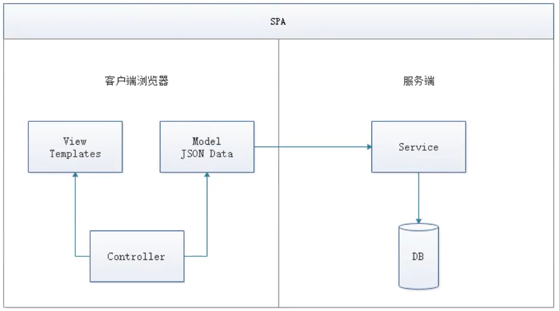
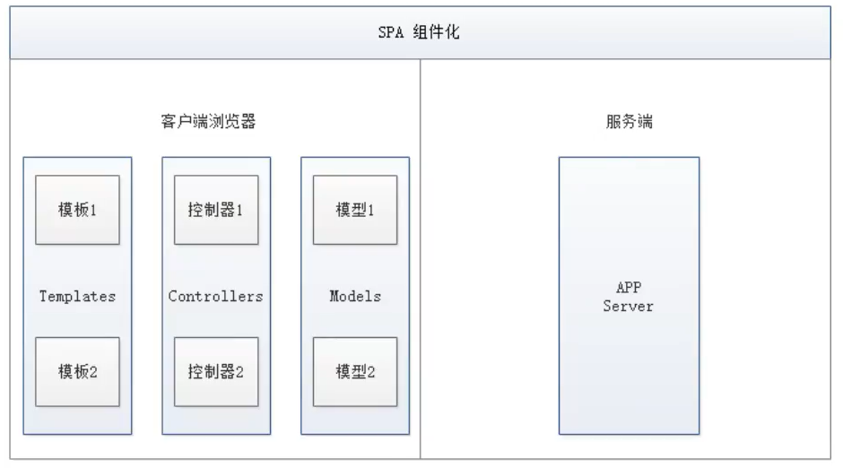

### 1、概述

### 2、前端核心分析

#### 2.1前端三要素

HTML（结构）、CSS（表现）、JavaScript（行为）   [Clash for Windows](https://docs.cfw.lbyczf.com/)

##### 2.1.1 HTML（结构）

太简单，略

##### 2.1.2 CSS（表现）

 css是标记语言，并不是编程语言，因此不可以自定义变量，不可以引用等，换句话说就是不具备任何语法支持。

CSS 预处理器，提供 CSS 缺失的样式层复用机制、减少冗余代码，提高样式代码的可维护性。大大提高了前端在样式上的开发效率。

##### 2.1.3 行为层（JavaScript）

JavaScript 一门弱类型脚本语言，其源代码在发往客户端运行之前不需经过编译，而是将文本格式的字符代码发送给浏览器由浏览器解释运行。

###### 2.1.3.1   **Native 原生 JS 开发**

原生 JS 开发，也就是按照 **【ECMAScript】** 标准的开发方式，简称是 ES，特点是所有浏览器都支持。

###### 2.1.3.2   **TypeScript 微软的标准**

TypeScript 是一种由微软开发的编程语言。 JavaScript 的一个超集，而且本质上向这个语言添加了可选的静态类型和基于类的面向对象编程。由安德斯·海尔斯伯格（C#、Delphi、TypeScript 之父；.NET 创立者）主导。

该语言的特点就是除了具备 ES 的特性之外还纳入了许多不在标准范围内的新特性，所以会导致很多浏览器不能直接支持 TypeScript 语法，需要编译后（编译成 JS）才能被浏览器正确执行。

###### 2.1.3.3  JS框架

[Bootstrap可视化布局系统 ](https://www.bootcss.com/p/layoutit/) [各种框架 ](https://www.bootcss.com/) 

> - jQuery：大家熟知的 JavaScript 框架，优点是简化了 DOM 操作，缺点是 DOM 操作太频繁，影响前端性能；在前端眼里使用它仅仅是为了兼容 IE6、7、8；
> - Angular：Google 收购的前端框架，由一群 Java 程序员开发，其特点是将后台的 MVC 模式搬到了前端并增加了模块化开发的理念，与微软合作，采用 TypeScript 语法开发；对后台程序员友好，对前端程序员不太友好；最大的缺点是版本迭代不合理（如：1代 -> 2代，除了名字，基本就是两个东西；截止发表博客时已推出了 Angular6）
> - react：Facebook 出品，一款高性能的 JS 前端框架；特点是提出了新概念 【虚拟 DOM】 用于减少真实 DOM 操作，在内存中模拟 DOM 操作，有效的提升了前端渲染效率；缺点是使用复杂，因为需要额外学习一门 【JSX】 语言；
> - Vue：一款渐进式 JavaScript 框架，所谓渐进式就是逐步实现新特性的意思，如实现模块化开发、路由、状态管理等新特性。其特点是综合了 Angular（模块化） 和 React（虚拟 DOM） 的优点；
>   Axios：前端通信框架；因为 Vue 的边界很明确，就是为了处理 DOM，所以并不具备通信能力，此时就需要额外使用一个通信框架与服务器交互；当然也可以直接选择使用 jQuery 提供的 AJAX 通信功能；

```
1、 Angular：将后端的 MVC 模式搬到了前端并增加了模块化开发的理念；【前端数据分离：view视图{{}};Model模型层放数据data；前端的控制层叫vm:数据双向绑定。 MVVM】

2、 React：提出了新概念 【虚拟 DOM】 用于减少真实 DOM 操作，在内存中模拟 DOM 操作，有效的提升了前端渲染效率； 

3、vue：综合了 Angular（模块化） 和 React（虚拟 DOM） 的优点；【MVVM+虚拟DOM】Vue的特色计算属性，就是利用虚拟dom； 
```
###### 2.1.3.4  UI框架

UI：[常用前端UI框架](https://blog.csdn.net/qq_57035859/article/details/122271701)  [开源小程序UI框架](https://zhuanlan.zhihu.com/p/502122900) [Amaze UI ](http://amazeui.clouddeep.cn/1.x/)   [ vue-elementui-admin框架介绍](https://blog.csdn.net/weixin_44001965/article/details/110225388)  [ vue-element-admin-doc](https://panjiachen.github.io/vue-element-admin-site/zh/guide/#功能)

###### 2.1.3.5  JS构建工具
```
JavaScript 构建工具
Babel：JS 编译工具，主要用于浏览器不支持的 ES 新特性，比如用于编译 TypeScript
WebPack：模块打包器，主要作用是打包、压缩、合并及按序加载
```
#### 2.2、三端统一开发

一套代码三端统一（PC、Android：.apk 、iOS: .ipa ）并能够调用到设备底层硬件（如：传感器、GPS、摄像头等）

#### 2.3、后端技术

后端框架和项目管理工具，NodeJS 框架及项目管理工具如下：

- Express：NodeJS 框架
- Koa：Express 简化版
- NPM：项目综合管理工具，类似于 Maven，（Node Package Manager，是一个NodeJS包管理和分发工具）
- YARN：NPM 的替代方案，类似于 Maven 和 Gradle 的关系

#### 2.4、 主流前端框架

### 3、总结

##### a、逻辑

- 判断

- 循环

##### b、事件

- 浏览器事件：window事件，document事件
- Dom事件：增删改，遍历，修改节点元素内容
- 事件框架：jQuery，Vue，React等

##### c、视图

- 视图由html、css来做
- 基于html、css的衍生视图框架：BootStrap，Layui等

##### d、通信

- xhr（原生的js事件）
- jquery封装了变成ajax请求
- vue的通信框架axios
- 都是ajax

### 4、VUE

##### 4.1、概述

教程：[狂神Vue最新快速上手](https://www.bilibili.com/video/BV18E411a7mC?p=15&vd_source=7346303e5e18677d7261c2c0c109ecfd)  [狂神Vue笔记](https://www.cnblogs.com/xiaolaodi1999/p/13497894.html)     [vue读官网 vuex(https://www.bilibili.com/video/BV1zq4y1c78s?p=49&spm_id_from=pageDriver&vd_source=7346303e5e18677d7261c2c0c109ecfd)   [ Vuex官方文档](https://vuex.vuejs.org/zh/guide/getters.html)   [元动力vue教程](https://www.ydlclass.com/ui/learningPath)

<span id="jump2">[MVVM](#jump1)</span>    webpack打包：ES5不支持ES6的let等，降级转化打包   [awesome-vue](https://github.com/vuejs/awesome-vue)  [vue & vue Cli 版本及对应关系](http://vsalw.com/9757.html)

[运行时（runtime）是什么意思](https://www.zhihu.com/question/20607178)  [安装  Vue.js](https://v3.cn.vuejs.org/guide/installation.html#命令行工具-cli)  [@vue/cli@4.1.1 ](https://www.csdn.net/tags/NtzacgwsMTY1MDUtYmxvZwO0O0OO0O0O.html)   [nrm下载源管理](https://blog.csdn.net/PPY614609/article/details/124150881)    

Vue官方资料： [router.vuejs.org](https://router.vuejs.org/zh/introduction.html)  [cn.vuejs.org](https://cn.vuejs.org/)  [vue2.x文档](https://cn.vuejs.org/v2/guide/state-management.html)  [Vue3文档](https://v3.cn.vuejs.org/guide/introduction.html#vue-js-是什么) 


> win7：nodejs13.14  、vue2.7.3 、vue-cli2.9.6
>
> npm install vue@next    最新稳定版
>
> npm install -g @vue/cli    然后在 Vue 项目中运行:  vue upgrade --next
>
> npm i -g @vue/cli@x.x.x  安装指定版本         卸载 @vue/cli：npm uninstall -g @vue/cli
>
> 升级 @vue/cli：  npm update -g @vue/cli         升级项目依赖：vue upgrade --next    
>
> vue版本：npm list vue -g    


```
1）Soc:关注点分离原则
Html+css+js:视图，给用户看，刷新后台数据

2）网络通信：axios
3）页面跳转：vue-router
4）状态管理：vuex
5）vueUI
Ant-Design：阿里巴巴出品，基于 React 的 UI 框架
ElementUI、iview、ice：饿了么出品，基于 Vue 的 UI 框架
Bootstrap：Twitter 推出的一个用于前端开发的开源工具包
AmazeUI：又叫“妹子 UI”，一款 HTML5 跨屏前端框架
```

##### 4.2、 第一个vue程序

[1：狂神Vue笔记](https://www.cnblogs.com/xiaolaodi1999/p/13497894.html)  [Vue课堂笔记](https://gitee.com/lzh_gitee/Vue/blob/master/Vue课堂笔记/02第一个vue程序.md)  [vue 知识点复习](https://zhuanlan.zhihu.com/p/549905143?utm_id=0) 

[jQuery API 中文文档](https://www.jquery123.com/)  [Vue常用7个属性](https://www.cnblogs.com/bgwhite/p/9297221.html)   [v-model](https://blog.csdn.net/third_/article/details/119812621)   [v-model](http://www.manongjc.com/detail/22-smhzcgakgtxlmdy.html)  [vue总结](https://www.bilibili.com/video/BV18E411a7mC?p=12&t=1459.1) 

vue ui:[vue-element-admin文档-开发后台](https://panjiachen.gitee.io/vue-element-admin-site/zh/) [Vue Element Admin](https://panjiachen.github.io/vue-element-admin/#/dashboard)  [Vue UI 组件库](https://blog.csdn.net/mengdong_524/article/details/123212059)  [VUE UI框架](https://blog.csdn.net/m0_53850749/article/details/119938128)


> Vue的开发都是要基于NodeJS, 实际开发采用 vue-cli脚手架开发,vue-router 路由,vuex做状态管理（会话、cookie、数据库是有状态的）; Vue UI,界面我们一般使用 ElementUI或者ICE来快速搭建前端项目。

> 1、IDEA打开文件夹，plugins->vue才能开发vue；导入vue包(用vue-cdn)

```
runtime：即时运行，即时编译(viewmodel)；还有个说法：运行时环境
```

```js
1、 <span v-bind:title="message">  或 {{}}绑定     //v-bind: 绑定HTML 属性
2、 <h1 v-if="type==='A'">A</h1>
    <h1 v-else-if="type==='B'">B</h1>
3、 <li v-for="x in items">  姓名：{{x.name}}    </li>
4、 v-on监听dom事件  <button v-on:click="sayHi()">Click Me</button>
5、表单双向绑定:<input type="text" v-model="message">{{message}}
    
6、先注册vue组件：Vue.component('componentname',{ 
    	props:['myitem'],			//接收数据；vue实例中的数据传递到组件。
        template: '<li>Hello VUE Component</li>'   //定义组件，然后组件里添加内容，即模板（html标签）
    });    //再实例化 Vue:var vm = new Vue({...});
    
7、路由钩子：从后端获取ajax数据
    网络通信：
    mounted(){   //钩子函数,get请求url
    	axios.get('../data.json').then(response => (console.log(response.data)));
    }
       
    methods: {
      getData: function () {
        this.axios({
          method: 'get',
          url: 'http://localhost:8080/static/mock/data.json'
        }).then(function (repos) {
          console.log(repos);
        }).catch(function (error) {
          console.log(error);
        });
      }
    }
    
    
8、计算属性：computed：计算出来的结果，缓存在内存中。主要特性就是为了将不经常变化的计算结果进行缓存，以节省系统开销
    
9、插槽slot【内容分发】
10、自定义事件：数据项在 Vue 的实例中，但删除操作要在组件中完成，那么组件如何删除 Vue 实例中的数据呢？此时就涉及到参数传递(props)与事件分发。   组件：this.$emit("remove",index)远程调用vue实例中的方法
```

[vue组件](https://blog.csdn.net/qq_45554909/article/details/111477068)  [Axios异步通信](https://blog.csdn.net/qq_43472877/article/details/108812212)  [跨域](https://blog.csdn.net/lisa2017_/article/details/115276882)  [前端工程目录](http://www.manongjc.com/detail/51-zhnidmkhpwvgyyq.html)   [1：Vue实例生命周期详解](https://blog.csdn.net/CC_Together/article/details/105594222) [2：vue 生命周期 ](https://www.cnblogs.com/wxf960320/p/9768339.html)  [Vue 实例的生命周期 ](https://www.jianshu.com/p/ff9f8beb543d) [Vue组件、网络通信、Vue的生命周期、计算属性](https://www.pudn.com/news/62582b6f60196e4b84c511f8.html) [狂神Vue生命周期](https://www.pudn.com/news/62582b6f60196e4b84c511f8.html)

组件是可复用的 Vue 实例，说白了就是一组可以重复使用的模板,

Axios 是一个开源的可以用在浏览器端和 `NodeJS` 的异步通信[框架](https://so.csdn.net/so/search?q=框架&spm=1001.2101.3001.7020)，它的主要作用就是实现 AJAX 异步通信.

> /src：存放源码目录
>
> /src/assets：存放项目公用的图片、js、样式、模板、数据的资源
>
> /src/components：存放封装好的前端组件，比如图片上传组件、树组件、列表组件等等
>
> /src/routes：存放vue-router的路由配置
>
> /src/views：存放应用的视图，比如用户管理页面（叫页面不确切，因为我们是单页面应用，整个系统只有一个页面。所以叫html片段更贴切）
>
> /dist：存放构建后的文件

vue-cli目录结构：

> - build（构建） 和 config：WebPack 配置文件
>   - webpack.dev.conf.js 打包配置
> - node_modules：用于存放 npm install 安装的依赖文件
> - src： 项目源码目录
>   - main.js：   项目的入口文件
> - static：静态资源文件
>
> 
>
> - .babelrc：Babel 配置文件，主要作用是将 ES6 转换为 ES5
> - .editorconfig：编辑器配置
> - eslintignore：需要忽略的语法检查配置文件
> - .gitignore：git 忽略的配置文件
> - .postcssrc.js：css 相关配置文件，其中内部的 module.exports 是 NodeJS 模块化语法
> - index.html：首页，仅作为模板页，实际开发时不使用
> - package.json：项目的配置文件（打包时版本高改这里）
>   - name：项目名称
>   - version：项目版本
>   - description：项目描述
>   - author：项目作者
>   - scripts：封装常用命令
>   - dependencies：生产环境依赖
>   - devDependencies：开发环境依赖


> 生命周期： 开始创建、初始化数据、编译模板、挂载DOM、—>渲染、更新—>渲染、卸载

##### 4.3 、vue-cli

[cli4.1.1 项目初始化](https://www.freesion.com/article/1817215039/)  [vue cli 4.1.1完整项目搭建](https://blog.csdn.net/qq_41495998/article/details/103646872)   [安装sass与node版本对应](https://blog.csdn.net/Yoga99/article/details/122678778)   [this$refs ](https://www.e-learn.cn/topic/3626620)  [this.$refs用法 ](https://juejin.cn/post/6866308130335588360)  [处理边界情况 ](https://cn.vuejs.org/v2/guide/components-edge-cases.html#访问子组件实例或子元素)

[ Element](https://element.eleme.cn/#/zh-CN/component/installation)  [弹窗用Layui ](https://layuion.com/)  [docsify ](https://docsify.js.org/#/)    

 [快速创建 Vue 项目 ](https://www.shuzhiduo.com/A/q4zVKnK2JK/) [ npm run build](https://www.jb51.net/article/147750.htm)

> node -v、npm -v、
>
> 创建工程：nodejs -> vue-cli ->vue init webpack myvue（创建工程） ->cd myvue ->vue-router ->element-ui ->npm install（安装所有依赖）->安装sass
>
> 
>
> 
>
> 安装node.js(win7-13.14) => npm install cnpm -g（淘宝加速）=>vue-cli -g (vue list 早期版本查看vue模板)
>
> 1、创建一个基于 webpack 模板的 vue 应用程序：vue init webpack myvue,   cd myvue
>
> 2、npm i vue-router@3.1.3 --save-dev;     npm i element-ui -S
>
> 3、项目初始化：npm install（安装项目环境依赖包）；
>
> 4、安装sass加载器：npm i sass-loader@8.0.2  7.3.1   node-sass@4.13.1 --save-dev            **sass@1.26.5**
>
> npm run dev（运行项目）
>
> 5、idea打开项目：新建目录，router、views(存视图组件)、components存功能组件

`嵌套路由又称子路由，组件多层嵌套。(路由配置里加 children:[ {} ])`

```js
1、传递参数
点击个人信息，每个人显示不同的内容，所以<router-link>要传递不同的参数：
//to 改为了 :to，是为了将这一属性当成对象使用，传参：需要对象：v-bind绑定一个对象
<router-link :to="{name: 'UserProfile', params: {id: 1}}">个人信息</router-link>

//修改路由配置, 在 path 属性中增加 :id 占位符，接收前端传过来的参数id:1
{path: '/user/profile/:id/:name', name:'UserProfile', component: UserProfile}

//接收参数, 在目标组件中
{{ $route.params.id }}

//通过props解耦，props接收参数
{path: '/user/profile/:id/:name', name:'UserProfile', component: UserProfile,props:true}
 export default {   //子组件里
      props: ['id'],
      name: "UserProfile"
    }

2、重定向
	{
      path: '/goHome',
      redirect: '/main'
    }
```

404和路由钩子：[狂神-Vue最新快速上手教程通俗易懂](https://www.bilibili.com/video/BV18E411a7mC?p=19&vd_source=7346303e5e18677d7261c2c0c109ecfd)   [狂神vue笔记](https://www.cnblogs.com/xiaolaodi1999/p/13497894.html)

```js
1、去掉#
路由模式有两种：hash：路径带 # 符号；  history：路径不带 # 符号
mode: 'history',
2、404  //新建一404组件，路由配置里：匹配不到的路径走*,即到404页面
{
   path: '*',
   component: NotFound
}
3、路由钩子函数：创建vue对象时执行钩子函数
beforeRouteEnter：在进入路由前执行
beforeRouteLeave：在离开路由前执行
//拦截器，过滤器(进入路由前过滤一遍)，chain链：to从哪来，from到哪去，next往下一个走
`beforeRouteEnter: (to, from, next) => {}`   
```


##### 4.4、webpack-前端模块化总结

[前端开发模块化规范-模块导入导出](https://www.cnblogs.com/bgwhite/p/9298794.html)  [ES6语法](https://blog.csdn.net/qq_40322724/article/details/113919534)  [前端模块化总结](http://www.unclealan.cn/index.php/front/23.html)

 [webpack](https://www.cnblogs.com/edgarstudy/p/15159479.html)  [webpack -  JavaScript 应用程序的静态模块打包器](https://www.pianshen.com/article/1607703858/)  [WebPack](https://blog.csdn.net/qq_37430247/article/details/115319085)

>  webpack -> webpack-cli -> 创建webpack.config.js配置文件 -> webpack命令打包
>
> 网站已经从网页模式进化到了WebApp模式
>
> WebPack是一款模块加载器兼打包工具， 它能把各种资源， 如JS、JSX、ES 6、SASS、LESS、图片等都作为模块来处理和使用
>
> npm install webpack -g（打包工具）； webpack-cli -g （客户端）  webpack -v  vue-V
>
> npm uninstall vue -g     

> 前端模块化总结：
>
> - `<script>标签：<script src="module1.js"></script>  把每一个文件看做是一个模块，他们的接口通常是暴露在全局作用域下，也就是定义在 window 对象中，不同模块的接口调用都是一个作用域中.`
>  - CommonJS：服务器端的 Node.js 遵循 CommonJS规范。 exports 或 module.exports 暴露接口, require加载模块；接口里的变量在自己作用域有效。缺点：模块同步加载
>  - AMD：声明模块的依赖，对于依赖的模块提前执行。是一种妥协的实现
>  - CMD：
>  - ES6模块：模块化思想，尽量静态化编译，在编译时就能确定模块的依赖关系（写代码编译时就会报错），以及输入和输出的变量。CommonJS 和 AMD 模块，只能在运行时确定这些东西。`import "jquery";   export function doStuff() {}    module "localModule" {}`

`webpack.config.js`配置文件

- entry：入口文件， 指定Web Pack用哪个文件作为项目的入口
- output：输出， 指定WebPack把处理完成的文件放置到指定路径 (打包后放哪)
- module：模块， 用于处理各种类型的文件 （静态资源过滤规则）
- plugins：插件， 如：热更新、代码重用等
- resolve：设置模块如何被解析
- watch：监听， 用于设置文件改动后直接打包

> 1、hello.js模块导出    main.js主入口，模块导入
>
> 2、创建webpack.config.js配置文件    output: { filename: "./js/bundle.js"}
>
> 3、`webpack`命令打包
>
> 4、运行项目：项目目录下创建index.html，导入webpack打包后的JS文件，`<script src="dist/js/bundle.js"></script>`,运行html。`前端的模块化开发：【html导入一个打包完的bundle.js,然后运行】vue类似：组件一拼，前端一引。`

```js
module.exports = {
    entry: "./modules/main.js",
    output: {
        filename: "./js/bundle.js"
    }
};
```


##### 4.5、 vue-router 页面跳转

IDEA：[IDEA中各种图标](https://www.cnblogs.com/zhihaospace/p/12076684.html)  [IDEA 各个图标含义](https://blog.csdn.net/u010180815/article/details/105975352?utm_medium=distribute.pc_aggpage_search_result.none-task-blog-2~aggregatepage~first_rank_ecpm_v1~rank_v31_ecpm-1-105975352-null-null.pc_agg_new_rank&utm_term=idea中p标志和m标志&spm=1000.2123.3001.4430)  [intellij IDEA里各图标对应的文件类型](https://blog.csdn.net/u011065164/article/details/52210755?spm=1001.2101.3001.6650.1&utm_medium=distribute.pc_relevant.none-task-blog-2~default~CTRLIST~default-1-52210755-blog-105975352.pc_relevant_multi_platform_whitelistv2&depth_1-utm_source=distribute.pc_relevant.none-task-blog-2~default~CTRLIST~default-1-52210755-blog-105975352.pc_relevant_multi_platform_whitelistv2&utm_relevant_index=2)  [Icon reference](https://www.jetbrains.com/help/idea/symbols.html)  [IDEA的各种快捷键](https://blog.51cto.com/u_15368284/5117372)

[Vue.use() 原理及使用](https://blog.csdn.net/ZYS10000/article/details/107246076/)   

> 1、安装 npm install vue-router   --save-dev(在当前项目目录安装，保存在开发配置中) 。`npm i vue-router@3.1.3 --save-dev`版本高出问题
>
> 2、写自己的组件：内容页：new->vue component; //template：页面编辑部分，script：vue对象的部分，一般要export导出；
> src目录下建router目录管理路由。 main.js全局唯一一个vue对象(new vue).
>
> //router目录里配置路由，main.js里vue对象使用配置的路由。 app.vue组件里改页面。<router-link>相当于a标签，跳转路由。<router-view>展示跳转的页面。

router/index.js

```js
import Vue from 'vue'
import VueRouter from 'vue-router'
import Content from "../components/Content"
import Main from "../components/Main";

Vue.use(VueRouter)

//配置导出路由（main.js里面有全局唯一vue对象(new vue)，所以这里导出Router对象）
//export default new Router();
export default new VueRouter({
  //routes数组里存对象，
  routes: [
    {
      //路由跳转的路径
      path: '/content',
      name: 'content',
      //跳转的组件
      component: Content
    },
    {
      path: '/main',
      name: 'main',
      component: Main
    }
  ]
});
```

main.js

```js
import Vue from 'vue'
import App from './App'
//路由配置好，使用路由：自动扫描目录里面的路由配置
import router from './router'

new Vue({
  el: '#app',
  router,  //vue对象里添加router
  components: { App },
  template: '<App/>'
})

```


##### 4.6 、vuex 状态管理

[Flux 实现](https://www.baidu.com/s?ie=UTF-8&wd=Flux 实现)  [vuex](https://cn.vuejs.org/v2/guide/state-management.html)  

##### 4.7、狂神没说的

[过滤器](https://www.runoob.com/vue2/vue-template-syntax.html)  [自定义指令](https://www.runoob.com/vue2/vue-custom-directive.html)  [route-link属性](https://www.runoob.com/vue2/vue-routing.html)   [axios](https://www.runoob.com/vue2/vuejs-ajax-axios.html)  [Vite创建vue项目 ](https://www.runoob.com/vue3/vue3-install.html) [create创建项目](https://www.runoob.com/vue3/vue3-create-project.html)  [UI创建项目 ](https://baijiahao.baidu.com/s?id=1736486285983532889&wfr=spider&for=pc) [Vue3 组合式 API ](https://www.runoob.com/vue3/vue3-composition-api.html) [dist文件夹](https://www.shuzhiduo.com/A/A7zg6BeWd4/)  [vue不同构建版本](https://cn.vuejs.org/v2/guide/installation.html#对不同构建版本的解释)  [npm中国镜像 ](https://npmmirror.com/) [vue源码](https://cdn.jsdelivr.net/npm/vue@2.6.14/dist/)  

> 1. 打包 Vue 项目： npm run build ；生成dist文件夹，distribution发行版
> 2. 修饰符：半角句号 **.** 用于指出一个指令应该以特殊方式绑定， `<form v-on:submit.prevent="onSubmit"></form>`,告诉 **v-on** 对于触发的事件调用 **event.preventDefault()**
> 3. 过滤器, 用作文本格式化：管道符 ` {{ message | capitalize }}`
> 4. v-show ：根据条件展示元素  `<h1 v-show="ok">Hello!</h1>`
> 5. 监听属性 watch：通过 watch 响应数据变化 ：`vm.$watch('counter', function(nval, oval) {}`
> 6. 全局组件：`Vue.component(tagName, options)`；局部组件：在实例中注册局部组件，只能在这个实例中使用  components:
> 7. `动态组件`：在不同组件之间动态切换   `异步组件`：将应用分割成小一些的代码块，并且只在需要的时候才从服务器加载一个模块。
> 8. 父组件使用 props 传递数据给子组件，子组件要把数据传递回去，要使用自定义事件：  `$on(eventName)` 监听事件； `$emit(eventName)` 触发事件。 父组件可以在使用子组件的地方直接用 v-on 来监听子组件触发的事件
> 9. 自定义指令
> 10. 动画：Vue 提供了内置的过渡封装组件 （插入、更新或者移除 DOM 时）
> 11. 混入：定义了一部分可复用的方法或者计算属性
> 12. vite创建项目：`npm init @vitejs/app <my>`cd  my => npm install  => npm run  dev
> 13. vue create创建项目： `vue create [options] <app-name>`; **vue ui**图形化创建项目
> 14. Vue3 组合式 API：组件中提高代码逻辑的可复用性： `setup`

### 5、前后端分离史

[b站视频](https://www.bilibili.com/video/BV18E411a7mC?p=3&t=551.0)[前后端分离](https://blog.csdn.net/weixin_43412762/article/details/124516205)  [前后端分离史](https://blog.nowcoder.net/n/975772ddb6c54778a0f9b770e1d9a8ac)  [Vue之如何理解前端体系与前后端分离](https://www.yisu.com/zixun/616572.html)  [Vue：前端体系、前后端分离](https://www.cnblogs.com/cbpm-wuhq/p/12325734.html)

SSM回顾：三个框架 => mybatis、spring、springmvc

#### 5.1  为什么需要前后分离

#### 5.2   后端为主的 MVC 时代（套模板、后端生成接口）

`为了降低开发的复杂度，以后端为出发点，比如：Struts、SpringMVC 等框架的使用，就是后端的 MVC 时代;`

**优点**
MVC 是一个非常好的协作模式，能够有效降低代码的耦合度，从架构上能够让开发者明白代码应该写在哪里。为了让 View 更纯粹，还可以使用 Thymeleaf、Freemarker 等模板引擎，使模板里无法写入 Java 代码，让前后端分工更加清晰。
**缺点**
前端开发重度依赖开发环境，开发效率低，<span style="color:red">**这种架构下，前后端协作有两种模式：套模板、后端生成接口**</span>

> - 1、前端写 DEMO，写好后，让后端去套模板。好处是 DEMO 可以本地开发，很高效。不足是还需要后端套模板，有可能套错，套完后还需要前端确定，来回沟通调整的成本比较大；（html模板写好，然后给后端套数据）
> - 2、前端负责浏览器端的所有开发和服务器端的 View 层模板开发。好处是 UI 相关的代码都是前端去写就好，后端不用太关注，不足就是前端开发重度绑定后端环境，环境成为影响前端开发效率的重要因素。（后端生成接口，需要什么数据就给前端传什么，前端根据接口开发）

注：在这期间（2005 年以前），包括早期的 JSP、PHP 可以称之为 Web 1.0 时代。在这里想说一句，如果你是一名 Java 初学者，请你不要再把一些陈旧的技术当回事了，比如 JSP，因为时代在变、技术在变、什么都在变（引用扎克伯格的一句话：唯一不变的是变化本身）；

#### 5.3  基于 AJAX 带来的 SPA 时代（ajax接口）

2005年ajax出现后**(web2.0)**，网页就可以做单页面应用，因为网页不用刷新，不用跳转；

**优点：** 前后端的分工非常清晰，<span style="color:red">前后端的关键协作点是 AJAX 接口（后端app server给前端提供ajax接口）；</span>   这与 JSP 时代区别不大。复杂度从服务端的 JSP 里移到了浏览器的 JavaScript（因为ajax在js里写），浏览器端变得很复杂。类似 Spring MVC，<span style="color:red">这个时代出现了浏览器端的分层架构（因为前端做到事情多了）。</span>

**缺点:**

> - **前后端接口的约定：** 如果后端的接口一塌糊涂，如果后端的业务模型不够稳定，那么前端开发会很痛苦；不少团队也有类似尝试，通过接口规则、接口平台等方式来做。**有了和后端一起沉淀的 接口规则，还可以用来模拟数据，使得前后端可以在约定接口后实现高效并行开发**。
> - **前端开发的复杂度控制：** SPA 应用大多以功能交互型为主，JavaScript 代码过十万行很正常。大量 JS 代码的组织，与 View 层的绑定等，都不是容易的事情。

ajax接口获取json格式数据



#### 5.4  前端为主的 MV* 时代（大前端时代）

<span id="jump1">[大前端时代，前端为主。](#jump2)</span> `1拿1.8工资干3个人活`

[Restful接口](https://blog.csdn.net/heroicpoem/article/details/119180530)  [RESTful 架构详解](https://www.runoob.com/w3cnote/restful-architecture.html)  [RESTful](https://baike.baidu.com/item/RESTful/4406165?fr=aladdin)     [2：★三种主流的Web服务交互 ](https://wenku.baidu.com/view/8a636fe8a2c7aa00b52acfc789eb172ded639915.html)    [看的顺序1：Web Service](https://baike.baidu.com/item/Web Service/1215039?fromtitle=Web服务&fromid=2837593)  [2：三种主流的WebService实现方案](https://www.cnblogs.com/ceshi2016/p/5985086.html)

[MVVM](https://baike.baidu.com/item/MVVM/96310?fr=aladdin)  [1：什么是MVVM](https://blog.csdn.net/jiahao1186/article/details/121915711)   [2：MVVM模型和MVC模型](https://baijiahao.baidu.com/s?id=1705333225423245283&wfr=spider&for=pc)  [MVVM](https://zhuanlan.zhihu.com/p/439724486)

- MVC（同步通信为主）：Model、View、Controller
- MVP（异步通信为主）：Model、View、Presenter
- MVVM（异步通信为主）：Model、View、ViewModel

> M：模型    V：视图     C：控制器
>
> 前端MVC：view层：JSP{{}}
>
> M模型层（DATA层）：专门放数据
>
> 前端的控制层叫VM：viewmodel（数据双向绑定）；  //【前端数据分离：view视图{{}};Model模型层放数据data；前端的控制层叫vm:数据双向绑定。 MVVM】

> vm是 mvvm 模式的核心，它是连接 view 和 model 的桥梁。有2个方向：
>
> 1、Model => view，即数据转化成看到的页面。实现的方式是：<span style="color:red">数据绑定</span>
>
> 2、view => model，即页面转化成后端的数据。实现的方式是：<span style="color:red">DOM事件监听</span>
>
> 两个方向都实现的，称之为数据的双向绑定。
>
> 项目复杂度越来越高之后，MVC中的Controller会变得越来越臃肿，难以维护，将其中的数据和逻辑处理抽离出的MVVM更佳

`MVVM采用双向数据绑定，view中数据变化将自动反映到viewmodel上，反之，model中数据变化也将会自动展示在页面上。把Model和View关联起来的就是ViewModel。vm是一个中间件，分隔了v与m，v与m进行数据调度时，都需要经过vm做中间处理`   [MVVM模型和MVC模型](https://baijiahao.baidu.com/s?id=1705333225423245283&wfr=spider&for=pc)

`Vue.js 是一个提供了 MVVM 风格的双向数据绑定的 Javascript 库，专注于View 层。核心是 MVVM 中的 VM，也就是 ViewModel。ViewModel负责连接 View 和 Model，保证视图和数据的一致性`

RESTFUL是一种网络应用程序的设计风格和开发方式，基于[HTTP](https://baike.baidu.com/item/HTTP/243074)，可以使用[XML](https://baike.baidu.com/item/XML/86251)或[JSON](https://baike.baidu.com/item/JSON/2462549)格式定义。RESTFUL适用于移动互联网厂商作为业务接口的场景，实现第三方[OTT](https://baike.baidu.com/item/OTT/9960940)调用移动网络资源的功能，动作类型为新增、变更、删除所调用资源。




前后端分离，中间没线了；前端能脱离后端独立运行，纯前端也能做项目，但前端项目最终要跟后端融合，融合要用java。

**优点**

- <span style="color:red">前后端职责很清晰：前端工作在浏览器端，后端工作在服务端。</span>清晰的分工，可以让开发并行，测试数据的模拟不难，前端可以本地开发。后端则可以专注于业务逻辑的处理，输出RESTful等接口。
- <span style="color:red">前端开发的复杂度可控：前端代码很重，但合理的**分层**，让前端代码能各司其职。</span>这一块蛮有意思的，简单如模板特性的选择，就有很多很多讲究。并非越强大越好，限制什么，留下哪些自由，代码应该如何组织，所- 有这一切设计，得花一本书的厚度去说明。
- 部署相对独立：可以快速改进产品体验

**缺点**
代码不能复用。比如后端依旧需要对数据做各种校验，校验逻辑无法复用浏览器端的代码。如果可以复用，那么后端的数据校验可以相对简单化。
全异步，对SEO不利。往往还需要服务端做同步渲染的降级方案。
性能并非最佳，特别是移动互联网环境下。
SPA不能满足所有需求，依旧存在大多页面应用。URL Design需要后端配合，前端无法完全掌控。

#### 5.5  NodeJS 带来的全栈时代

#### 5.6  总结

综上所述，模式也好，技术也罢，没有好坏优劣之分，只有适合不适合；前后分离的开发思想主要是基于 `SoC`（关注度分离原则），上面种种模式，都是让前后端的职责更清晰，分工更合理高效。

### 6、 技巧

操作DOM

[DOM 断点（属性、节点、内容变化监听） - H5W3](https://www.h5w3.com/234109.html)      [ CodeSandbox在线代码编辑器](https://codesandbox.io/s/festive-beaver-62isft?file=/index.html)  [Chrome工具-查看dom元素绑定的事件](https://www.likecs.com/show-203885720.html)  [CSS网格布局（grid）](https://www.cnblogs.com/MrSlow/p/14985803.html) [ 网格布局](https://blog.csdn.net/giu056/article/details/122135657) [网格布局的基本概念](https://developer.mozilla.org/zh-CN/docs/Web/CSS/CSS_Grid_Layout/Basic_Concepts_of_Grid_Layout)  [Web APIs | MDN (mozilla.org) ](https://developer.mozilla.org/en-US/docs/Web/API/Document/body) [ JavaScript语言之webAPIs](https://blog.csdn.net/weixin_50939386/article/details/123975107)

开源项目：[opensourceagenda](https://www.opensourceagenda.com/tags/v2ray-subscriber)

```js
改样式：document.getElementById(id).style.property=新样式
document.getElementById("p2").style.fontFamily="Arial";

触发事件:<button type="button"
onclick="document.getElementById('id1').style.color='red'">
点我!</button>
```

```js
元素添加事件：element.addEventListener(event, function, useCapture);
document.getElementById("myBtn").addEventListener("click", displayDate);

//使用 addEventListener() 方法时, JavaScript 从 HTML 标记中分离开来，可读性更强， 在没有控制HTML标记时也可以添加事件监听。

removeEventListener() 移除事件的监听

getEventListeners是chrome提供给我们的一个工具函数，可以通过这个函数来查看当前页面dom 绑定了哪些事件，这个api只能再控制台调用，不能直接在代码中调用
getEventListeners(document.querySelector(".container"))
```

```
添加移除元素(节点)

```

```html
<div id="div1">
<p id="p1">这是一个段落。</p>
<p id="p2">这是另外一个段落。</p>
</div>
 
<script>
var para = document.createElement("p");      			  <!--创建 <p> 元素-->         
var node = document.createTextNode("这是一个新的段落。");	<!--创建文本节点-->
para.appendChild(node);									<!--文本节点添加到 <p> 元素中-->
 
var element = document.getElementById("div1");			<!--查找元素-->
element.appendChild(para);							<!--p元素添加到div1-->
</script>

<script>
var parent = document.getElementById("div1");
var child = document.getElementById("p1");
parent.removeChild(child);
</script>
var child = document.getElementById("p1");
child.parentNode.removeChild(child);     <!--已知要查找的子元素，然后查找其父元素，再删除这个子元素-->

document.getElementById("chatcomments").setAttribute('style','font-size:36px; color:red !important;');  <!--使用setattribute更改字体颜色-->

appendChild() 	添加新元素到尾部，
insertBefore() 	新元素添加到开始位置 
removeChild()	移除一个元素，需要知道该元素的父元素
replaceChild()	替换 HTML 元素
```

### 7、 Web Service

[Restful接口](https://blog.csdn.net/heroicpoem/article/details/119180530)  [RESTful 架构详解](https://www.runoob.com/w3cnote/restful-architecture.html)  [RESTful](https://baike.baidu.com/item/RESTful/4406165?fr=aladdin)     [2：★三种主流的Web服务交互 ](https://wenku.baidu.com/view/8a636fe8a2c7aa00b52acfc789eb172ded639915.html)    [看的顺序1：Web Service](https://baike.baidu.com/item/Web Service/1215039?fromtitle=Web服务&fromid=2837593)  [2：三种主流的WebService实现方案](https://www.cnblogs.com/ceshi2016/p/5985086.html)  [REST学习总结](https://blog.csdn.net/Wanger_tt/article/details/51821334)  [3： Restful接口详解](https://blog.csdn.net/qq_39601612/article/details/104888560)  [4：RESTful](https://baike.baidu.com/item/RESTful/4406165?fr=aladdin)    [5：RESTful 架构详解](https://www.runoob.com/w3cnote/restful-architecture.html)

[物联网大数据通信协议](https://www.163.com/dy/article/D867OTTV0518RT2L.html)

RESTFUL是一种网络应用程序的设计风格和开发方式，基于[HTTP](https://baike.baidu.com/item/HTTP/243074)，可以使用[XML](https://baike.baidu.com/item/XML/86251)或[JSON](https://baike.baidu.com/item/JSON/2462549)格式定义。RESTFUL适用于移动互联网厂商作为业务接口的场景，实现第三方[OTT](https://baike.baidu.com/item/OTT/9960940)调用移动网络资源的功能，动作类型为新增、变更、删除所调用资源。

```html
Internet的迅猛发展使其成为全球信息传递与共享的巨大的资源库。越来越多的网络环境下的Web应用系统被建立起来，利用HTML、CGI等Web技术可以轻松地在Internet环境下实现电子商务、电子政务等多种应用。然而这些应用可能分布在不同的地理位置，使用不同的数据组织形式和操作系统平台，加上应用不同所造成的数据不一致性，使得如何将这些高度分布的数据集中起来并得以充分利用成为急需解决的问题。

人们提出一种新的利用网络进行应用集成的解决方案——Web Service。Web Service是一种新的Web应用程序分支，其可以执行从简单的请求到复杂商务处理的任何功能。一旦部署以后，其他Web Service应用程序可以发现并调用它部署的服务。因此，Web Service是构造分布式、模块化应用程序和面向服务应用集成的最新技术和发展趋势。
```

> <span style="color:red">JAVA将万物抽象成了对象，REST设计风格则将万物抽象成了资源</span>   [三种主流的WebService实现方案（REST/SOAP/XML-RPC）](https://www.cnblogs.com/ceshi2016/p/5985086.html)【调用web service】
>
> 1、SOAP：简单对象访问协议（Simple Object Access Protocol）,<span style="color:red">SOAP使用XML消息调用远程方法，</span>这样web services可以通过HTTP协议的post和get方法与远程机器交互。SOAP提供了标准的RPC方法来调用Web service
> SOAP 使用过程例子：一个 SOAP 消息发送到一个具有 Web Service 功能的 Web 站点，例如，一个含有房价信息的数据库，消息的参数中标明这是一个查询消息，此站点将返回一个 XML查询结果。
>
> 2、REST：表征状态转移（Representational State Transfer）; 使用标准的 HTTP 方法 (GET/PUT/POST/DELETE)<span style="color:red"> 将所有 Web 系统的服务抽象为资源，</span>REST从资源的角度来观察整个网络，分布在各处的资源由URI确定，而客户端的应用通过URI来获取资源的表征。
> Http协议所抽象的get,post,put,delete就好比[数据库](http://lib.csdn.net/base/mysql)中最基本的增删改查，而互联网上的各种资源就好比数据库中的记录（可能这么比喻不是很好）
>
> 3、 XML-RPC：一个远程过程调用（remote procedure call，RPC)的分布式计算协议，<span style="color:red">通过XML将调用函数封装，并使用HTTP协议作为传送机制。这个标准慢慢演变成为今日的SOAP协定。</span>
>
> 比较：
> 效率和易用性上：REST更胜一筹
> 安全性上：SOAP安全性高于REST，因为REST更关注的是效率和性能问题

> [Web Service_百度百科 ](https://baike.baidu.com/item/Web Service/1215039?fromtitle=Web服务&fromid=2837593)
>
> 当前的[应用程序开发](https://baike.baidu.com/item/应用程序开发)：人们开始偏爱基于[浏览器](https://baike.baidu.com/item/浏览器)的客户端应用程序。这当然不是因为客户端能够提供更好的用户界面，而是因为它能够避免花在[桌面应用程序](https://baike.baidu.com/item/桌面应用程序)发布上的高成本。发布[桌面应用程序](https://baike.baidu.com/item/桌面应用程序)成本很高，一半是因为应用程序安装和配置的问题，另一半是因为客户端和服务器之间通信的问题。
>
> 关于[客户端](https://baike.baidu.com/item/客户端)与服务器的通信问题，一个完美的解决方法是使用HTTP协议来通信。
>
> 许多商用程序还面临另一个问题，那就是与其他程序的[互操作性](https://baike.baidu.com/item/互操作性),很多商用程序使用C++、Java、Visual Basic和其他各种各样的语言编写,  数据交换通常都是由特殊的方法，如[文件传输](https://baike.baidu.com/item/文件传输)和分析，[消息队列](https://baike.baidu.com/item/消息队列)，还有仅适用于某些情况的的API，如IBM的"高级程序到程序交流(APPC)"等来完成的。   只有通过Web Service，[客户端](https://baike.baidu.com/item/客户端)和服务器才能够自由的用HTTP进行通信，不论两个程序的平台和[编程语言](https://baike.baidu.com/item/编程语言)是什么。
>
> Web service平台的三个技术：
>
> 1、**XML和XSD：** XML[数据表示](https://baike.baidu.com/item/数据表示)， XSD定义[数据类型](https://baike.baidu.com/item/数据类型)
>
> 2、**SOAP：**<span style="color:red">调用Web service：</span>SOAP提供了标准的RPC方法调用Web service
>
> 3、**WSDL：**Web service<span style="color:red">调用文档，</span>Web service描述语言([WSDL](https://baike.baidu.com/item/WSDL))：基于[XML](https://baike.baidu.com/item/XML)（[标准通用标记语言](https://baike.baidu.com/item/标准通用标记语言)下的一个子集）的语言，用于描述Web service及其函数、[参数](https://baike.baidu.com/item/参数)和返回值。
>
> 4、**UDDI：**为加速Web Service的推广、加强Web Service的互操作能力而推出的一个计划

> 
