视频： [【狂神说Java】SpringBoot最新教程IDEA版](https://www.bilibili.com/video/BV1PE411i7CV/?vd_source=7346303e5e18677d7261c2c0c109ecfd)  

md： [微服务知识汇总](.\微服务知识汇总)

文档： [ Spring 中文文档](https://spring-doc.muziseo.cn/spring-boot/reference/using/using-the-springbootapplication-annotation.html)  [Spring 中文文档](https://www.spring-doc.cn/)  

# 1.入门

## 1、基础

### 1、回顾Spring

[Examples · Bootstrap](https://v4.bootcss.com/docs/examples/) [IDEA代码警告(warning)整理以及解决办法](https://blog.csdn.net/csdn_mrsongyang/article/details/119803040)

[初探SpringBoot ](https://www.cnblogs.com/CHENFANgY/p/13599097.html)  [springboot是什么](https://www.zhihu.com/question/602119085) [springboot](https://blog.51cto.com/u_16099301/10750798)   

> SpringBoot，是一个**javaweb的开发框架**，和SpringMVC类似

小结：

1. 知识点
   1. 之前项目网站打war包，在tomcat中运行；在springboot微服务中，打jar包，内嵌tomcat
   2. ==springcloud所有服务都是以restful风格调用； Dubbo用RPC调用==
   3. springboot之后的新服务架构：服务网格
      1. springboot==本质和spring一样，省去了配置==
      2. springboot最核心的是==自动装配==，所以省去配置
   4. SpringBoot是一个javaweb的开发框架，和SpringMVC类似，简化开发，约定大于配置，  you can "just run"，能迅速的开发web应用，几行代码开发一个http接口
2. 安全框架：Shiro、SpringSecurity；==类似拦截器，登录验证，更加简化==，用aop横切进去
3. 分布式开发：Dubbo+zookeeper、
4. 接口文档：swagger、
5. ==多线程任务调度==：异步任务、邮件调度
6. ==服务注册与发现==：Eureka，与zookeeper一样，是springcloud不同的实现方案
7. 负载均衡：nginx、ribbon、feign
8. 服务容灾机制：HyStrix
9. 路由网关：Zuul
10. 远程配置：springCloud config：git
11. SpringCloud： 服务越来越多，用SpringCloud
    1. 所有服务调用都是Restful风格，Dubbo是RPC风格调用


| 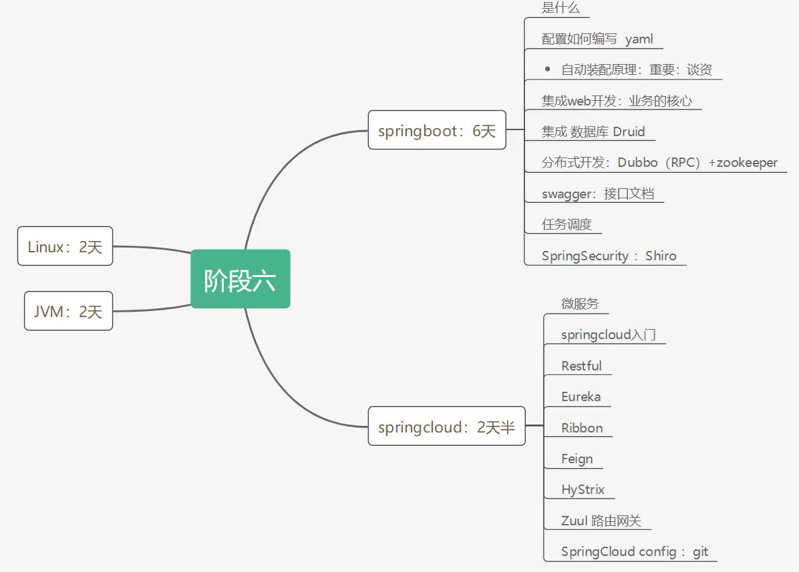 | 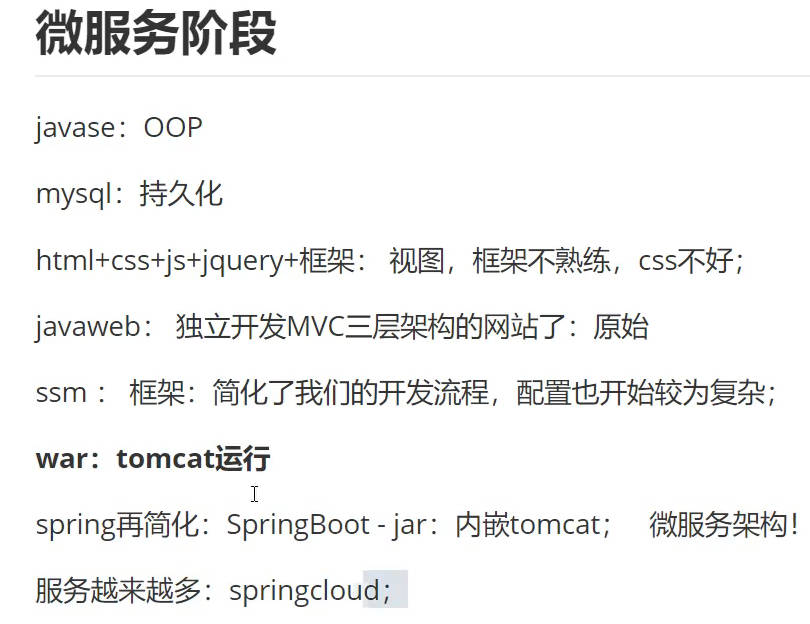 |
| --------------------------------------------------------- | --------------------------------------------------------- |
| 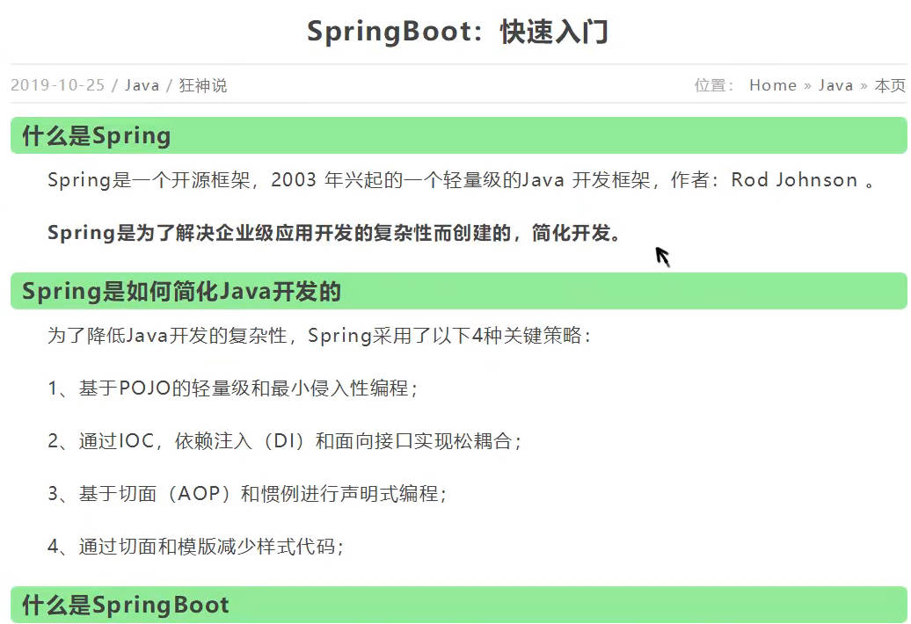 | 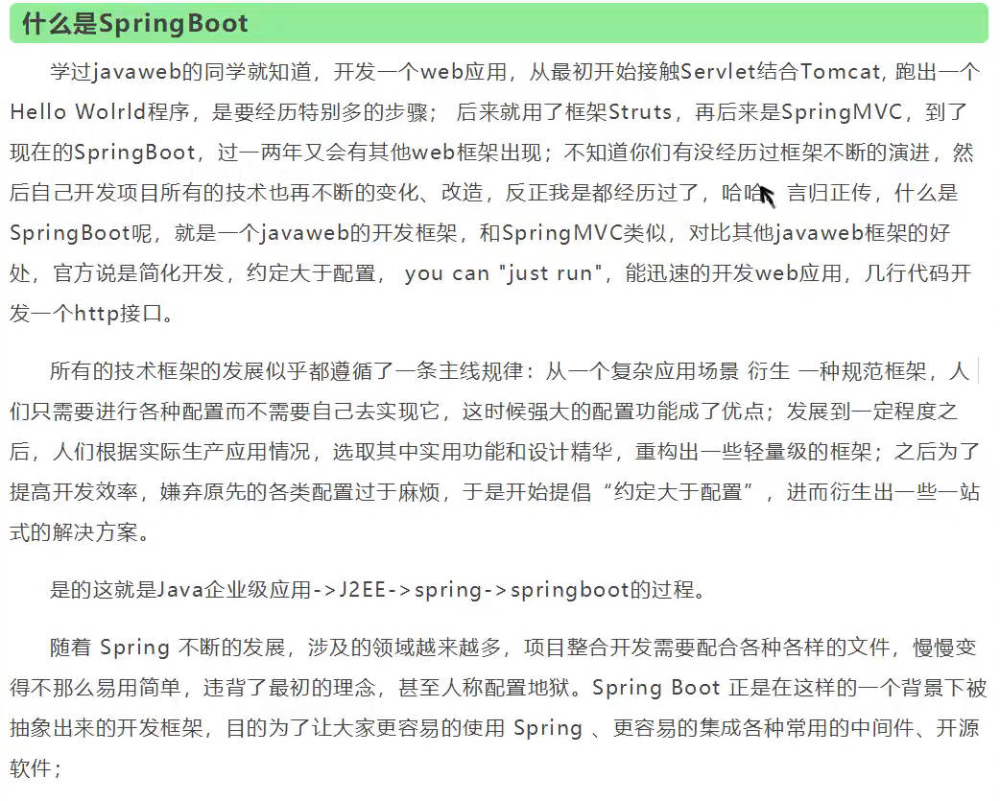 |
| 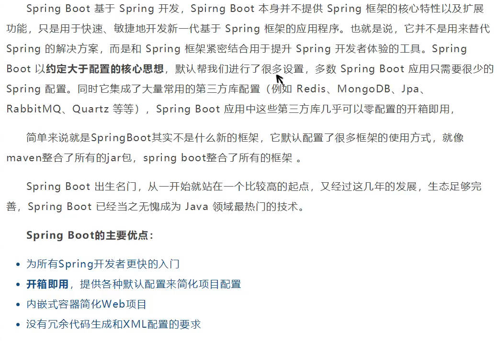 |                                                      |


Spring是一个开源框架，2003 年兴起的一个轻量级的==Java 开发框架==，作者：Rod Johnson  。

**Spring是为了解决企业级应用开发的复杂性而创建的，简化开发。**

**Spring是如何简化Java开发的**

为了降低Java开发的复杂性，Spring采用了以下4种关键策略：

1、基于POJO的轻量级和最小侵入性编程，所有东西都是bean；

2、通过IOC，依赖注入（DI）和面向接口实现松耦合；

3、基于切面（AOP）和惯例进行声明式编程；

4、通过切面和模版减少样式代码，RedisTemplate，xxxTemplate；

-Dmaven.multiModuleProjectDirectory=$MAVEN_HOME -Dmaven.wagon.http.ssl.insec

- 不用war包，打jar包，内嵌tomcat，微服务架构，服务越来越多： 用springcloud管理

### 2、什么是SpringBoot

[狂神SSM教程](https://www.kuangstudy.com/zl/ssm#1381880045424898050)  [SpringBoot课堂笔记](https://gitee.com/lzh_gitee/SpringBoot/tree/master/SpringBoot课堂笔记) [Spring5笔记(狂神)gitee](https://gitee.com/lzh_gitee/Spring5#103动态代理)  [SpringMVC入门学习](https://www.kuangstudy.com/bbs/1528729097000706050)  [狂神说spring笔记](https://blog.51cto.com/u_15305087/3109873) [面试突击spring](https://zhuanlan.zhihu.com/p/368650653) [Spring简介](https://new-developer.aliyun.com/article/1137005) [Struct2基础介绍](https://www.cnblogs.com/beilou310/p/10436856.html)  [专栏KuangStudy](https://www.kuangstudy.com/zhuanlan) [狂神说KuangStudy](https://www.kuangstudy.com/user/4d694f8625c44aef9ff7a04424c1ca12)

[微服务框架有哪些](https://www.5axxw.com/questions/simple/8gc3yv) [4款主流微服务框架](https://mikechen.cc/22684.html) [SpringBoot与SpringCloud区别](https://baijiahao.baidu.com/s?id=1752271004768735959&wfr=spider&for=pc) [SpringBoot与SpringCloud](https://baijiahao.baidu.com/s?id=1720622681816849211&wfr=spider&for=pc)

[jdk1.8支持的springboot版本](https://www.baidu.com/s?ie=utf-8&f=3&rsv_bp=1&tn=baidu&wd=jdk1.8支持的springboot版本&rn=20&oq=jdk1.8&rsv_pq=eac6602a009bdbb9&rsv_t=db15eEbVjEiCIL08SHBu71do9KaszFheMtALLRrMGc%2BxfSOeIYUUmmNmA%2Fc&rqlang=cn&rsv_enter=1&rsv_dl=ts_3&rsv_sug3=7&rsv_sug1=5&rsv_sug7=100&rsv_sug2=0&rsv_btype=t&prefixsug=jdk1.8%E6%94%AF%E6%8C%81%E7%9A%84&rsp=3&inputT=5663&rsv_sug4=5664)  [SpringBoot版本与JDK版本的对应关系](https://blog.csdn.net/qq_40528266/article/details/129120506) [Failure to transfer org.springframework.boot](https://blog.51cto.com/u_9058648/3555336) [解决IDEA创建maven工程springboot工程无法下载pom依赖问题](https://blog.51cto.com/u_16173997/6578973)  [IDEA中解决Springboot相关jar包下载问题](https://www.cnblogs.com/jiangyyyf/p/15085413.html)  [IDEA的maven项目生成的文件详解](https://blog.csdn.net/weixin_52380943/article/details/122977801)

项目：[Github标星35K+超火的Spring Boot项目](https://www.pianshen.com/article/80861724053/) [Springboot 开源项目](https://www.ngui.cc/el/3445357.html?action=onClick) [Spring Boot开源项目](http://www.taodudu.cc/news/show-1774509.html?action=onClick) [SpringBoot核心文档](https://zhuanlan.zhihu.com/p/568516450)

学过javaweb的同学就知道，开发一个web应用，从最初开始接触Servlet结合Tomcat, 跑出一个Hello Wolrld程序，是要经历特别多的步骤；后来就用了框架Struts，再后来是SpringMVC，到了现在的SpringBoot，过一两年又会有其他web框架出现；你们有经历过框架不断的演进，然后自己开发项目所有的技术也在不断的变化、改造吗？建议都可以去经历一遍；

言归正传，什么是==SpringBoot呢，就是一个**javaweb的开发框架**，和SpringMVC类似，对比其他javaweb框架的好处，官方说是简化开发，约定大于配置，  you can "just run"，能迅速的开发web应用，几行代码开发一个http接口==。

所有的技术框架的发展似乎都遵循了一条主线规律：从一个复杂应用场景 衍生 一种规范框架，人们只需要进行各种配置而不需要自己去实现它，这时候强大的配置功能成了优点；发展到一定程度之后，人们根据实际生产应用情况，选取其中实用功能和设计精华，重构出一些轻量级的框架；之后为了提高开发效率，嫌弃原先的各类配置过于麻烦，于是开始提倡“约定大于配置”，进而衍生出一些一站式的解决方案。

是的这就是Java企业级应用->J2EE->spring->springboot的过程。

随着 Spring 不断的发展，涉及的领域越来越多，项目整合开发需要配合各种各样的文件，慢慢变得不那么易用简单，违背了最初的理念，甚至人称配置地狱。Spring Boot 正是在这样的一个背景下被抽象出来的开发框架，目的为了让大家更容易的使用 Spring 、更容易的集成各种常用的中间件、开源软件；

Spring Boot 基于 Spring 开发，Spirng Boot 本身并不提供 Spring 框架的核心特性以及扩展功能，只是用于快速、敏捷地开发新一代基于 Spring 框架的应用程序。也就是说，它并不是用来替代 Spring 的解决方案，而是和 Spring 框架紧密结合用于提升 Spring 开发者体验的工具。Spring Boot 以**约定大于配置的核心思想**，默认帮我们进行了很多设置，多数 Spring Boot 应用只需要很少的 Spring 配置。同时它集成了大量常用的第三方库配置（例如 Redis、MongoDB、Jpa、RabbitMQ、Quartz 等等），Spring Boot 应用中这些第三方库几乎可以零配置的开箱即用。

简单来说就是SpringBoot其实不是什么新的框架，它默认配置了很多框架的使用方式，就像maven整合了所有的jar包，spring boot整合了所有的框架 。

Spring Boot 出生名门，从一开始就站在一个比较高的起点，又经过这几年的发展，生态足够完善，Spring Boot 已经当之无愧成为 Java 领域最热门的技术。

**Spring Boot的主要优点：**

- 为所有Spring开发者更快的入门
- **开箱即用**，提供各种默认配置来简化项目配置
- 内嵌式容器简化Web项目
- 没有冗余代码生成和XML配置的要求

真的很爽，我们快速去体验开发个接口的感觉吧！

### 3、==第一个springboot程序==

[Spring Boot](https://spring.io/projects/spring-boot)  [阿里巴巴微服务生态 ](https://start.aliyun.com/ecosystem.html)  [IDEA2023版本创建Spring项目只能勾选17和21却无法使用Java8的完美解决方案](https://www.jb51.net/program/308256k4b.htm)

[docs/spring-boot](https://docs.spring.io/spring-boot/)

[Groovy？Kotlin？](https://www.cnblogs.com/heweiren-cheng/p/16886320.html)  [gradle与maven区别](https://www.zhihu.com/question/557159038/answer/2920631780?utm_id=0)  [Gradle和Maven](https://blog.csdn.net/weixin_45626288/article/details/131973787)

[安装2023最新版Java SE 21.0.1](https://blog.csdn.net/jackson_lingua/article/details/134994241) [Java 21](https://baijiahao.baidu.com/s?id=1776857648223481047&wfr=spider&for=pc) [jdkman：多版本JDK的命令行管理工具](https://zhuanlan.zhihu.com/p/671307783)   [jdkman](https://www.cnblogs.com/featherw/p/16937643.html) [Java 8 ~ Java 21 所有新特性 ](https://zhuanlan.zhihu.com/p/673938152) [JDK Releases ](https://www.java.com/releases/fullmatrix/)

- Gradle是构建工具，没有依赖包管理功能，适合巨石应用
- Maven是依赖包管理工具，通过依赖插件有一定构建能力，适合不需要复杂构建手段的项目
- ==spring boot devtools勾上，热部署==
- 配置里`改Tomcat端口号`
  - `application.properties`：  SpringBoot核心配置文件里改

- ==改banner==： resources 目录下新建一个banner.txt

> ==HelloworldApplication==： 程序主入口，相当于main()
>
> application.properties： SpringBoot核心配置文件

我们将学习如何快速的创建一个Spring Boot应用，并且实现一个简单的Http请求处理。通过这个例子对Spring Boot有一个初步的了解，并体验其结构简单、开发快速的特性。

我的环境准备：

- java version "1.8.0_181"
- Maven-3.6.1
- SpringBoot 2.x 最新版

开发工具：

- IDEA


| 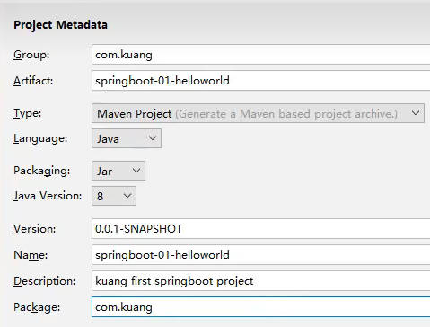 |  |
| --------------------------------------------------------- | ----- |


#### 1、创建基础项目说明

Spring官方提供了非常方便的工具让我们快速构建应用 [Quickstart Your Project](https://spring.io/projects/spring-boot#overview)

Spring Initializr：https://start.spring.io/   [Cloud Native App Initializer (aliyun.com)](https://start.aliyun.com/)

**项目创建方式一：**使用Spring Initializr 的 Web页面创建项目

1、打开  https://start.spring.io/

2、填写项目信息

3、点击”Generate Project“按钮生成项目；下载此项目

4、解压项目包，并用IDEA以Maven项目导入，一路下一步即可，直到项目导入完毕。==要导入网上的项目，不能用打开==

5、如果是第一次使用，可能速度会比较慢，包比较多、需要耐心等待一切就绪。

==spring web依赖==: web.xml,tomcat,dispatcherServlet,等所有的都配好了

**项目创建方式二：**使用 IDEA 直接创建项目, 

1、创建一个新项目

2、选择spring initalizr ， 可以看到默认就是去官网的快速构建工具那里实现

3、填写项目信息

4、选择初始化的组件（初学勾选 Web 即可）

5、填写项目路径

6、等待项目构建成功

7、删除 ==.mvn、.gitignore、HELP.MD、mvnw.cmd、mvnw==, 只剩下main.java.com.kuang.helloworld.==HelloworldApplication==(程序主入口);  resources.application.==properties==核心配置文件

8、打jar包，运行：java -jar .\aaa.jar; 相当于现在写的java程序不用管视图层，真正的前后端分离； vue纯前端框架，只需要数据就好； 数据通过后端的jar包提供接口; 微服务就是拆成一个一个模块，jar包

**项目结构分析：**

通过上面步骤完成了基础项目的创建。就会自动生成以下文件。

1、程序的主启动类

2、一个 application.properties 配置文件

3、一个 测试类

4、一个 pom.xml


#### 2、pom.xml 分析

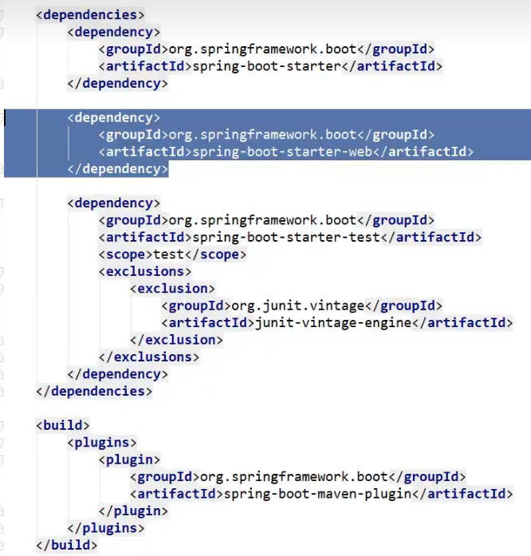

打开pom.xml，看看Spring Boot项目的依赖：

- 所有springboot依赖都是==spring-boot-starter开头==

```xml
<!-- 父依赖 -->
<parent>
    <groupId>org.springframework.boot</groupId>
    <artifactId>spring-boot-starter-parent</artifactId>
    <version>2.2.5.RELEASE</version>
    <relativePath/>
</parent>

<dependencies>
    <!-- web场景启动器 -->
    <dependency>
        <groupId>org.springframework.boot</groupId>
        <artifactId>spring-boot-starter-web</artifactId>
    </dependency>
    <!-- springboot单元测试 -->
    <dependency>
        <groupId>org.springframework.boot</groupId>
        <artifactId>spring-boot-starter-test</artifactId>
        <scope>test</scope>
        <!-- 剔除依赖 -->
        <exclusions>
            <exclusion>
                <groupId>org.junit.vintage</groupId>
                <artifactId>junit-vintage-engine</artifactId>
            </exclusion>
        </exclusions>
    </dependency>
</dependencies>

<build>
    <plugins>
        <!-- 打jar包插件 -->
        <plugin>
            <groupId>org.springframework.boot</groupId>
            <artifactId>spring-boot-maven-plugin</artifactId>
        </plugin>
    </plugins>
</build>
```


#### 3、编写一个http接口

1、在主程序的同级目录下，新建一个controller包，一定要在同级目录下，否则识别不到

2、在包中新建一个HelloController类

```java
@RestController
public class HelloController {

    @RequestMapping("/hello")
    public String hello() {
        return "Hello World";
    } 
}
```

3、编写完毕后，从主程序启动项目，浏览器发起请求，看页面返回；控制台输出了 Tomcat 访问的端口号！

简单几步，就完成了一个web接口的开发，SpringBoot就是这么简单。所以我们常用它来建立我们的微服务项目！

#### 4、将项目打成jar包

点击 maven的 package


如果遇到以上错误，可以配置打包时 跳过项目运行测试用例

```xml
<!--
    在工作中,很多情况下我们打包是不想执行测试用例的
    可能是测试用例不完事,或是测试用例会影响数据库数据
    跳过测试用例执
    -->
<plugin>
    <groupId>org.apache.maven.plugins</groupId>
    <artifactId>maven-surefire-plugin</artifactId>
    <configuration>
        <!--跳过项目运行测试用例-->
        <skipTests>true</skipTests>
    </configuration>
</plugin>
```

如果打包成功，则会在target目录下生成一个 jar 包


打成了jar包后，就可以在任何地方运行了！OK

彩蛋 

如何更改启动时显示的字符拼成的字母，SpringBoot呢？也就是 banner 图案；

只需一步：到项目下的 ==resources 目录下新建一个banner.txt== 即可。

图案可以到：https://www.bootschool.net/ascii 这个网站生成，然后拷贝到文件中即可！


**SpringBoot这么简单的东西背后一定有故事，我们之后去进行一波源码分析！ **

### 4、==什么是微服务==

[微服务简介](https://blog.csdn.net/qq_44377709/article/details/104892649)  [一文读懂微服务架构设计](https://cloud.tencent.com/developer/article/2046545)  [微服务架构概述](https://www.jianshu.com/p/5b1a83a26f5b) [Dubbo文档](https://cn.dubbo.apache.org/zh-cn/overview/home/)  [Spring Boot](https://spring.io/projects/spring-boot)  [Martin Fowler微服务论文翻译](https://www.kuangstudy.com/bbs/1364150595472072706)  [微服务（Microservices）](https://www.kuangstudy.com/bbs/1374644434515275777)

[架构演化](https://www.jianshu.com/p/c70d76451548) [Dubbo的概念](https://blog.csdn.net/qq_38599840/article/details/105982705)  [SpringCloud架构的各个组件的原理分析](https://blog.51cto.com/u_15368284/5116553) [spring boot和SSM开发中有什么区别](http://www2.zhihu.com/question/284488830) 

弹性计算： [Elastic computing_百度搜索](https://www.baidu.com/s?ie=UTF-8&wd=elastic%20computing)  [什么是弹性计算（Elastic computing）？](https://baijiahao.baidu.com/s?id=1792694867288651617&wfr=spider&for=pc)  [弹性计算_百度百科](https://baike.baidu.com/item/%E5%BC%B9%E6%80%A7%E8%AE%A1%E7%AE%97/64476282)  [Elastic Computing](https://www.sciencedirect.com/topics/computer-science/elastic-computing)  

小结：

- ==一个微服务就是一个业务，把业务拆分成模块==：springmvc一配，controller一写，controller就负责提供接口；很多的接口，分布在不同电脑上，就是一个网状的结构。
  - 微服务相当于一个一个的业务，MVC的业务拆分成模块

- ==架构演化==
  - 单一应用架构
  - 垂直应用架构
  - 分布式服务架构
  - 流动计算架构

> 1. 微服务（MicroServices）是一种架构风格，一个大型复杂软件应用由多个微服务和前端展示层组成	
>    1. 应用必须构建成一系列小服务的组合；可以通过http的方式进行互通，后面有更多：RPC等
>    2. 把MVC的业务层拆分成模块
>    3. 系统中的各个微服务可被独立部署，各个微服务之间是松耦合的。每个微服务仅关注于完成一件任务并很好地完成该任务。在所有情况下，每个任务代表着一个小的业务能力。 
>    4. 以往我们开发应用程序都是单体应用（可以理解为一个部署包包含了项目的所有功能），虽然开发和部署比较方便，但后期随着业务的不断增加为了能够达到响应业务需求，单体应用的开发迭代和性能瓶颈等问题愈发明显，微服务就是解决此问题的有效手段
> 2. 一体化架构
> 3. 微服务架构
>    1. 微服务部署 前后端联调 编排依赖

用户下单：请求controller，可能1s就解决了

背后要做的： 仓库冻结：资金冻结； 验证：购买成功，仓库数量减少，仓库解冻，资金解冻  可能要10s;  要用到消息队列：让它们异步的去做这些事情


| 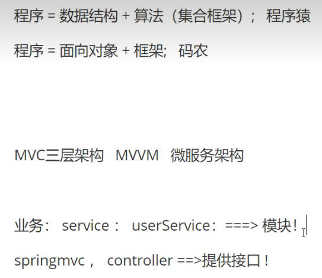 | 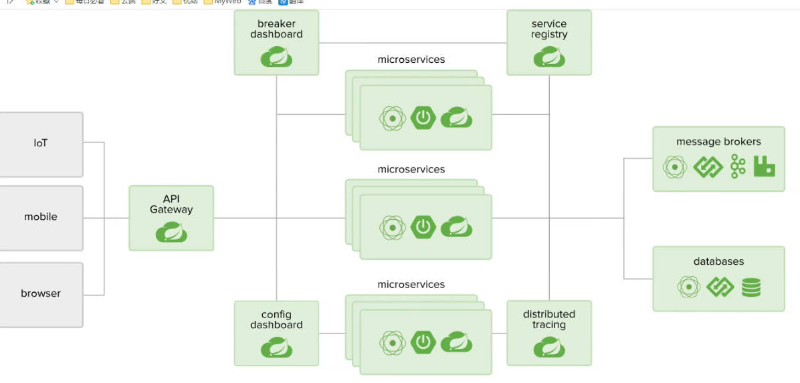 |
| --------------------------------------------------------- | --------------------------------------------------------- |


## 2、SpringBoot运行原理初探

[spring boot 自动配置原理](https://www.cnblogs.com/qianyi525/p/13894503.html) [了解SpringBoot自动配置原理](https://www.cnblogs.com/wyzstudy/p/16185370.html)  [SpringBoot自动配置的实现原理是什么](https://www.php.cn/faq/540264.html)  [springboot的自动配置原理](https://zhuanlan.zhihu.com/p/307938433)  [了解SpringBoot自动配置原理](https://www.cnblogs.com/wyzstudy/p/16185370.html)   [微服务](https://blog.csdn.net/qq_44377709/article/details/104892649)  

我们之前写的HelloSpringBoot，到底是怎么运行的呢，Maven项目，我们一般从pom.xml文件探究起；

### 1、==SpringBoot自动装配原理==

小结：

1. pom.xml文件
   1. 父依赖
   2. 启动器
2. 主程序： SpringbootApplication.java
   1. 注解：
      1. `@SpringBootConfiguration` :springboot配置
      2. `@EnableAutoConfiguration` ：自动导入配置

#### 1、POM.xml

##### 1、依赖管理

spring-boot-dependencies

其中它主要是依赖一个父项目，主要是管理项目的资源过滤及插件！

```xml
<parent>
    <groupId>org.springframework.boot</groupId>
    <artifactId>spring-boot-starter-parent</artifactId>
    <version>2.2.5.RELEASE</version>
    <relativePath/> <!-- lookup parent from repository -->
</parent>
```

点进去，发现还有一个父依赖

```xml
<parent>
    <groupId>org.springframework.boot</groupId>
    <artifactId>spring-boot-dependencies</artifactId>
    <version>2.2.5.RELEASE</version>
    <relativePath>../../spring-boot-dependencies</relativePath>
</parent>
```

这里才是真正管理SpringBoot应用里面所有依赖版本的地方，SpringBoot的版本控制中心；

**以后我们导入依赖默认是不需要写版本；但是如果导入的包没有在依赖中管理着就需要手动配置版本了；**

| 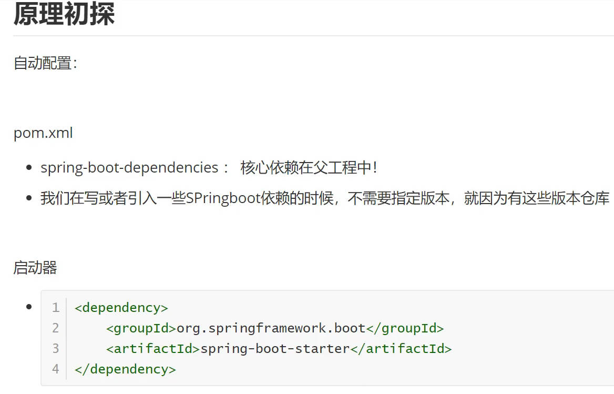 | 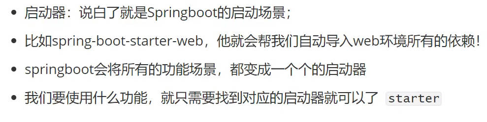 |
| --------------------------------------------------------- | --------------------------------------------------------- |
| 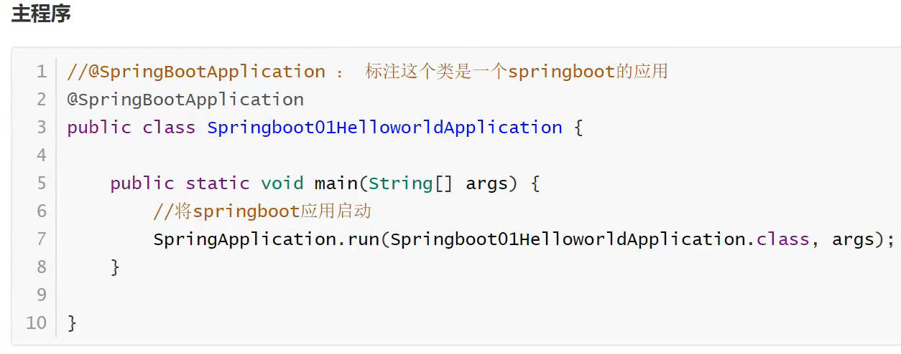 | 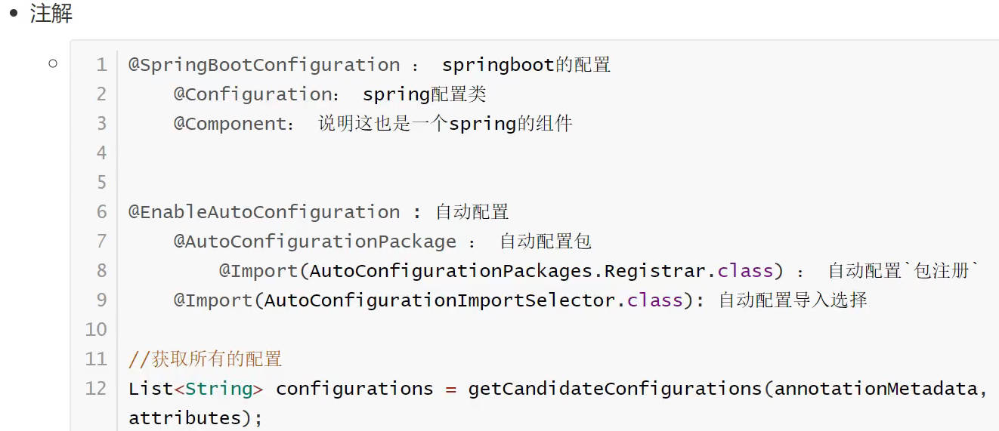 |
| 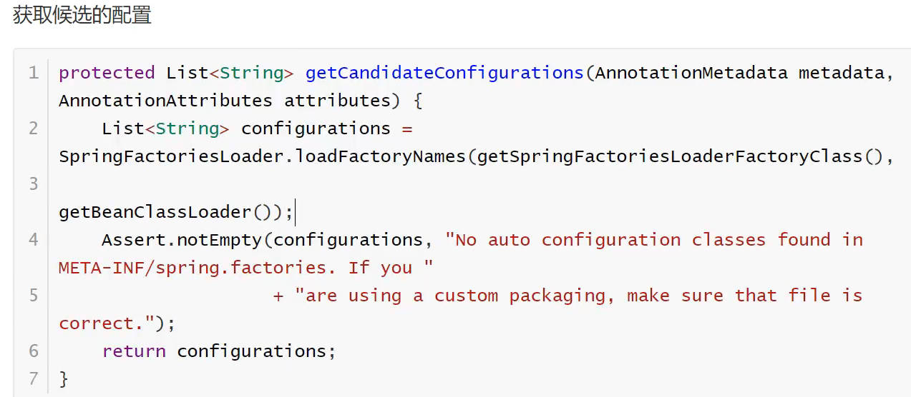 | 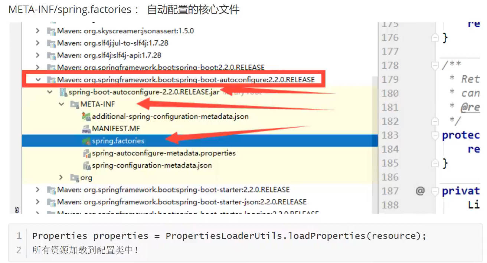 |
| 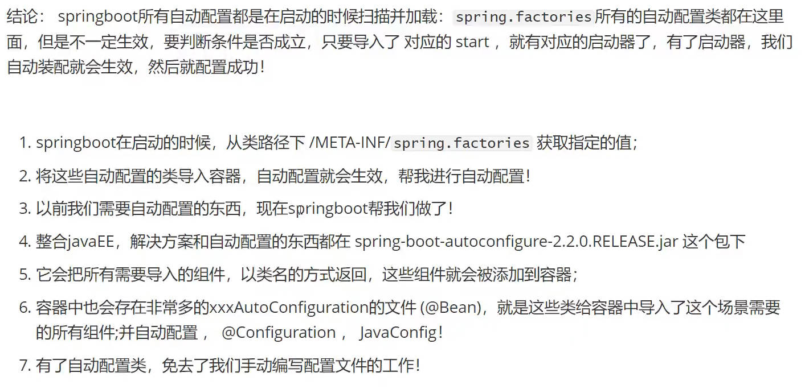 |                                                      |

##### **2、启动器 **

[spring-boot](https://spring.io/projects/spring-boot)   [Starters](https://docs.spring.io/spring-boot/3.5/reference/using/build-systems.html#using.build-systems.starters)  

**spring-boot-starter**

```xml
<dependency>
    <groupId>org.springframework.boot</groupId>
    <artifactId>spring-boot-starter-web</artifactId>
</dependency>
```

**springboot-boot-starter-xxx**：就是spring-boot的场景启动器

**spring-boot-starter-web**：帮我们导入了web模块正常运行所依赖的组件；

SpringBoot将所有的功能场景都抽取出来，做成一个个的starter （启动器），只需要在项目中引入这些starter即可，所有相关的依赖都会导入进来 ， 我们要用什么功能就导入什么样的场景启动器即可 ；我们未来也可以自己自定义 starter；

#### 2、自动配置：主启动类

[SpringBoot自动配置的实现原理](https://www.php.cn/faq/540264.html)  [自动配置@EnableAutoConfiguration](https://blog.csdn.net/joy_tom/article/details/118548581)

- @EnableAutoConfiguration
  - 里面有两个关键注解@AutoConfigurationPackage和@Import
    - @Import(AutoConfiguration==ImportSelector==.class)，导入AutoConfigurationImportSelector类。这个类中有一个非常重要的方法selectImports（）,涵盖了组件自动装配的所有处理逻辑，包括获得候选配置类、配置类去重、排除不需要的配置类、过滤等，最终返回符合条件的自动配置类的全限定名数组
- SpringFactoriesLoader
  - spring-core包里定义了Spring==FactoriesLoader==类，这个类实现了检索META-INF/==spring.factories==文件，并获取指定接口的配置的功能

==导入元数据==

```java
static class Registrar implements ImportBeanDefinitionRegistrar, DeterminableImports {
//PackageImport(metadata)导入元数据:  AutoConfigurationPackages.Registrar.class
		@Override
		public void registerBeanDefinitions(AnnotationMetadata metadata, BeanDefinitionRegistry registry) {
			register(registry, new PackageImport(metadata).getPackageName());
		}

		@Override
		public Set<Object> determineImports(AnnotationMetadata metadata) {
			return Collections.singleton(new PackageImport(metadata));
		}

	}
```

==获取配置==

```java
//获取配置： AutoConfigurationImportSelector.java
List<String> configurations = getCandidateConfigurations(annotationMetadata, attributes);
```

##### 1、@SpringBootApplication

```java
//@SpringBootApplication 标注这个类是一个springboot应用
//说明这是一个Spring Boot应用
@SpringBootApplication
public class SpringbootApplication {
   public static void main(String[] args) {
     //以为是启动了一个方法，没想到启动了一个服务
      SpringApplication.run(SpringbootApplication.class, args);
   }
}
```

但是**一个简单的启动类并不简单！**我们来分析一下这些注解都干了什么

>**@SpringBootApplication**

作用：标注在某个类上说明这个类是SpringBoot的主配置类 ， SpringBoot就应该运行这个类的main方法来启动SpringBoot应用；

进入这个注解：可以看到上面还有很多其他注解！

```java
@SpringBootConfiguration
@EnableAutoConfiguration
@ComponentScan(
    excludeFilters = {@Filter(
    type = FilterType.CUSTOM,
    classes = {TypeExcludeFilter.class}
), @Filter(
    type = FilterType.CUSTOM,
    classes = {AutoConfigurationExcludeFilter.class}
)}
)
public @interface SpringBootApplication {
    // ......
}
```

> **@ComponentScan**

这个注解在Spring中很重要 ,它对应XML配置中的元素。

作用：自动扫描并加载符合条件的组件或者bean ， 将这个bean定义加载到IOC容器中

> **@SpringBootConfiguration**

###### 1、@SpringBootConfiguration

作用：SpringBoot的配置类 ，标注在某个类上 ， 表示这是一个SpringBoot的配置类；

我们继续进去这个注解查看

```java
// 点进去得到下面的 @Component
@Configuration
public @interface SpringBootConfiguration {}

@Component
public @interface Configuration {}
```

这里的 @Configuration，说明这是一个配置类 ，配置类就是对应Spring的xml 配置文件；

里面的 @Component 这就说明，启动类本身也是Spring中的一个组件而已，负责启动应用！

我们回到 SpringBootApplication 注解中继续看。

> **@EnableAutoConfiguration**

###### 2、@EnableAutoConfiguration

**@EnableAutoConfiguration ：开启自动配置功能**

以前我们需要自己配置的东西，而现在SpringBoot可以自动帮我们配置 ；@EnableAutoConfiguration告诉SpringBoot开启自动配置功能，这样自动配置才能生效；

点进注解接续查看：

**@AutoConfigurationPackage ：自动配置包**

```java
@Import({Registrar.class})
public @interface AutoConfigurationPackage {
}
```

**@import** ：Spring底层注解@import ， 给容器中导入一个组件

Registrar.class 作用：将主启动类的所在包及包下面所有子包里面的所有组件扫描到Spring容器 ；

这个分析完了，退到上一步，继续看

**@Import({AutoConfigurationImportSelector.class}) ：给容器导入组件 ；**

AutoConfigurationImportSelector ：自动配置导入选择器，那么它会导入哪些组件的选择器呢？我们点击去这个类看源码：

1、这个类中有一个这样的方法

```java
// 获得候选的配置
protected List<String> getCandidateConfigurations(AnnotationMetadata metadata, AnnotationAttributes attributes) {
    //这里的getSpringFactoriesLoaderFactoryClass（）方法
    //返回的就是我们最开始看的启动自动导入配置文件的注解类；EnableAutoConfiguration
    List<String> configurations = SpringFactoriesLoader.loadFactoryNames(this.getSpringFactoriesLoaderFactoryClass(), this.getBeanClassLoader());
    Assert.notEmpty(configurations, "No auto configuration classes found in META-INF/spring.factories. If you are using a custom packaging, make sure that file is correct.");
    return configurations;
}
```

2、这个方法又调用了  SpringFactoriesLoader 类的静态方法！我们进入SpringFactoriesLoader类loadFactoryNames() 方法

```java
public static List<String> loadFactoryNames(Class<?> factoryClass, @Nullable ClassLoader classLoader) {
    String factoryClassName = factoryClass.getName();
    //这里它又调用了 loadSpringFactories 方法
    return (List)loadSpringFactories(classLoader).getOrDefault(factoryClassName, Collections.emptyList());
}
```

3、我们继续点击查看 loadSpringFactories 方法

```java
private static Map<String, List<String>> loadSpringFactories(@Nullable ClassLoader classLoader) {
    //获得classLoader ， 我们返回可以看到这里得到的就是EnableAutoConfiguration标注的类本身
    MultiValueMap<String, String> result = (MultiValueMap)cache.get(classLoader);
    if (result != null) {
        return result;
    } else {
        try {
            //去获取一个资源 "META-INF/spring.factories"
            Enumeration<URL> urls = classLoader != null ? classLoader.getResources("META-INF/spring.factories") : ClassLoader.getSystemResources("META-INF/spring.factories");
            LinkedMultiValueMap result = new LinkedMultiValueMap();

            //将读取到的资源遍历，封装成为一个Properties
            while(urls.hasMoreElements()) {
                URL url = (URL)urls.nextElement();
                UrlResource resource = new UrlResource(url);
                Properties properties = PropertiesLoaderUtils.loadProperties(resource);
                Iterator var6 = properties.entrySet().iterator();

                while(var6.hasNext()) {
                    Entry<?, ?> entry = (Entry)var6.next();
                    String factoryClassName = ((String)entry.getKey()).trim();
                    String[] var9 = StringUtils.commaDelimitedListToStringArray((String)entry.getValue());
                    int var10 = var9.length;

                    for(int var11 = 0; var11 < var10; ++var11) {
                        String factoryName = var9[var11];
                        result.add(factoryClassName, factoryName.trim());
                    }
                }
            }

            cache.put(classLoader, result);
            return result;
        } catch (IOException var13) {
            throw new IllegalArgumentException("Unable to load factories from location [META-INF/spring.factories]", var13);
        }
    }
}
```

4、发现一个多次出现的文件：spring.factories，全局搜索它

> **spring.factories**

我们根据源头打开spring.factories ， 看到了很多自动配置的文件；这就是自动配置根源所在！


**WebMvcAutoConfiguration**

我们在上面的自动配置类随便找一个打开看看，比如 ：WebMvcAutoConfiguration


可以看到这些一个个的都是JavaConfig配置类，而且都注入了一些Bean，可以找一些自己认识的类，看着熟悉一下！

所以，自动配置真正实现是从classpath中搜寻所有的META-INF/spring.factories配置文件 ，并将其中对应的 org.springframework.boot.autoconfigure. 包下的配置项，通过反射实例化为对应标注了 @Configuration的JavaConfig形式的IOC容器配置类 ， 然后将这些都汇总成为一个实例并加载到IOC容器中。

**结论：**

1. SpringBoot在启动的时候从类路径下的`META-INF/spring.factories`中获取`EnableAutoConfiguration`指定的值
2. 将这些值作为自动配置类导入容器 ， 自动配置类就生效 ， 帮我们进行自动配置工作；
3. 整个J2EE的整体解决方案和自动配置都在`springboot-autoconfigure`的jar包中；
4. 它会给容器中导入非常多的自动配置类 （xxxAutoConfiguration）, 就是给容器中导入这个场景需要的所有组件 ， 并配置好这些组件 ；
5. 有了自动配置类 ， 免去了我们手动编写配置注入功能组件等的工作；

**现在大家应该大概的了解了下，SpringBoot的运行原理，后面我们还会深化一次！**

#### 3. ==主启动类怎么运行==

SpringApplication不简单的方法

我最初以为就是运行了一个main方法，没想到却开启了一个服务；

```java
@SpringBootApplication
public class SpringbootApplication {
    public static void main(String[] args) {
        SpringApplication.run(SpringbootApplication.class, args);
    }
}
```

**SpringApplication.run分析**

分析该方法主要分两部分，一部分是SpringApplication的实例化，二是run方法的执行；

> **SpringApplication实例化**

**这个类主要做了以下四件事情：**

1、推断应用的类型是普通的项目还是Web项目

2、查找并加载所有可用初始化器 ， 设置到initializers属性中

3、找出所有的应用程序监听器，设置到listeners属性中

4、推断并设置main方法的定义类，找到运行的主类

查看构造器：

```java
public SpringApplication(ResourceLoader resourceLoader, Class... primarySources) {
    // ......
    this.webApplicationType = WebApplicationType.deduceFromClasspath();
    this.setInitializers(this.getSpringFactoriesInstances();
    this.setListeners(this.getSpringFactoriesInstances(ApplicationListener.class));
    this.mainApplicationClass = this.deduceMainApplicationClass();
}
```

>  **run方法流程分析**

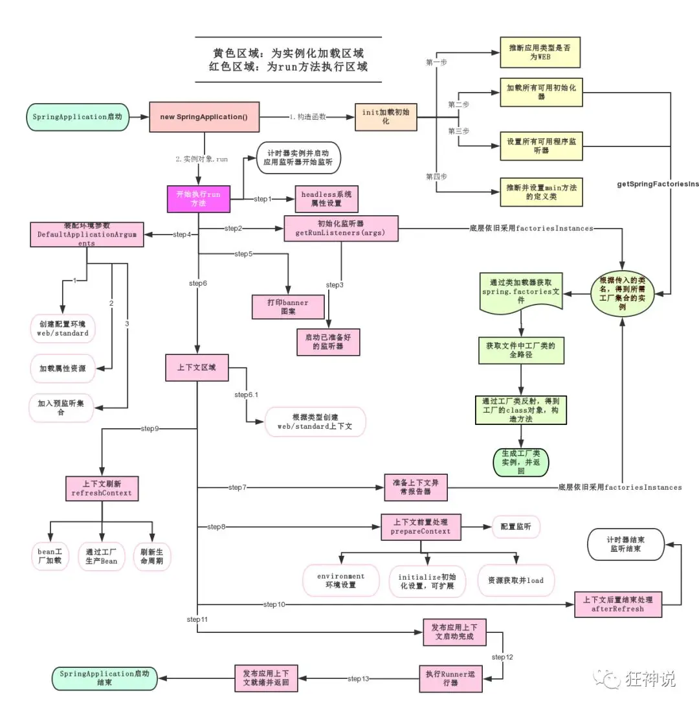

跟着源码和这幅图就可以一探究竟了！

## 3、==yml配置注入==

### 1、springboot全局配置文件

[2.1.6.RELEASE/reference](https://docs.spring.io/spring-boot/docs/2.1.6.RELEASE/reference/)  [inside your application.properties file](https://docs.spring.io/spring-boot/docs/2.1.6.RELEASE/reference/htmlsingle/#common-application-properties)  [2.1.6.RELEASE](https://blog.csdn.net/weixin_43876125/article/details/104238221)  [spring-boot-devtools热部署](https://blog.csdn.net/qq_42217906/article/details/122541220)
[YAML教程](https://www.runoob.com/w3cnote/yaml-intro.html)

- ==不用application.properties，官方推荐application.yml==

| 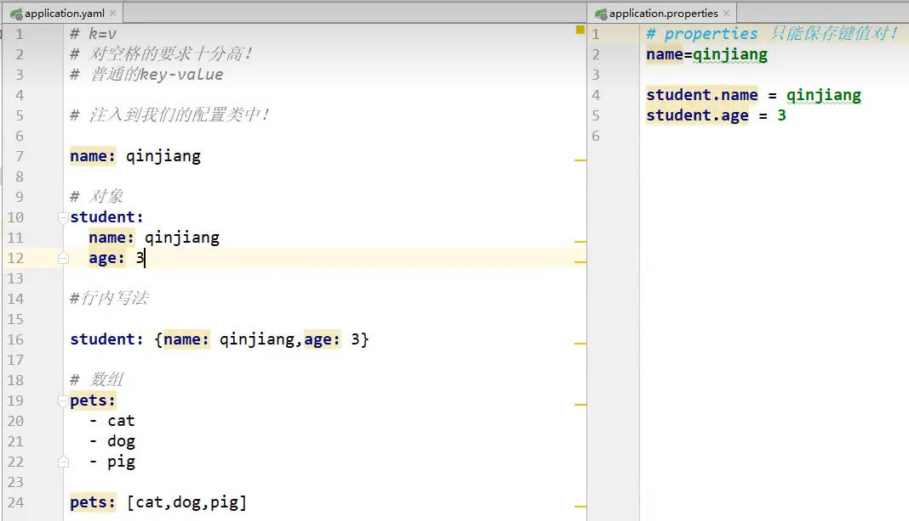 | 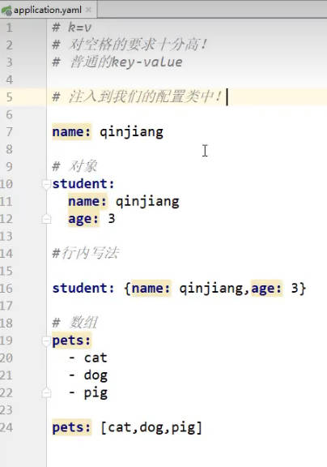 |
| --------------------------------------------------------- | --------------------------------------------------------- |

SpringBoot使用一个全局的配置文件 ， 配置文件名称是固定的; 

==spring boot devtools勾上，热部署==

- application.properties
  - 语法结构 ：key=value

- application.yml
  - 语法结构 ：key：空格 value


**配置文件的作用 ：**修改SpringBoot自动配置的默认值，因为SpringBoot在底层都给我们自动配置好了；

比如我们可以在配置文件中修改Tomcat 默认启动的端口号！测试一下！

```yaml
server：
  prot: 8080
```

### 2、yaml概述

```yaml
#普通kv键值对：name=qinjiang    name:空格qinjiang
name: qinjiang
#对象:student.name=qinjiang
student:
  name: qinjiang
  age: 3
#对象行内写法：
stu: {name: qinjiang,age: 3}

#数组
pets:
  - cat
  - dog

#stu:[{id:1,name:wx,score:99},{id:2,name:xx,score:100}]
stu:
  - id: 1
    name: wx
    score: 99
  - id: 2
    name: xx
    score: 100
```

YAML是 "YAML Ain't a Markup Language" （YAML不是一种标记语言）的递归缩写。在开发的这种语言时，YAML 的意思其实是："Yet Another Markup Language"（仍是一种标记语言）

**这种语言以数据作为中心，而不是以标记语言为重点！**

以前的配置文件，大多数都是使用xml来配置；比如一个简单的端口配置，我们来对比下yaml和xml

传统xml配置：

```xml
<server>
    <port>8081<port>
</server>
```

yaml配置：

```yaml
server：
  prot: 8080
```


### 3、yaml基础语法

说明：语法要求严格！

1、空格不能省略

2、以缩进来控制层级关系，只要是左边对齐的一列数据都是同一个层级的。

3、属性和值的大小写都是十分敏感的。


**字面量：普通的值  [ 数字，布尔值，字符串  ]**

字面量直接写在后面就可以 ， 字符串默认不用加上双引号或者单引号；

```yaml
k: v
```

注意：

- “ ” 双引号，不会转义字符串里面的特殊字符 ， 特殊字符会作为本身想表示的意思；

  比如 ：name: "kuang \n shen"  输出 ：kuang  换行  shen

- '' 单引号，会转义特殊字符 ， 特殊字符最终会变成和普通字符一样输出

  比如 ：name: ‘kuang \n shen’  输出 ：kuang  \n  shen

  


**对象、Map（键值对）**

```yaml
#对象、Map格式
k: 
    v1:
    v2:
```

在下一行来写对象的属性和值得关系，注意缩进；比如：

```yaml
student:
    name: qinjiang
    age: 3
```

行内写法

```yaml
student: {name: qinjiang,age: 3}
```


**数组（ List、set ）**

用 - 值表示数组中的一个元素,比如：

```yaml
pets:
 - cat
 - dog
 - pig
```

行内写法

```yaml
pets: [cat,dog,pig]
```

**修改SpringBoot的默认端口号**

配置文件中添加，端口号的参数，就可以切换端口；

```yaml
server:
  port: 8082
```

注入配置文件

yaml文件更强大的地方在于，他可以给我们的实体类直接注入匹配值！

### 4、==yaml注入配置文件==

[SPEL（Spring表达式语言）_百度百科](https://baike.baidu.com/item/SPEL/63868768)  [Spring中强大的spel表达式](https://cloud.tencent.com/developer/article/1676200)  

- ==yaml可以给实体类属性赋值==: 不用 @value
  - 把一个配置文件和一个类绑定
  - `@ConfigurationProperties(prefix = "person")`：批量绑定到 POJO，适合成组配置
  - 也可以用==properties文件==给属性赋值： `@PropertySource(value="classpath:kuang.properties")`

| 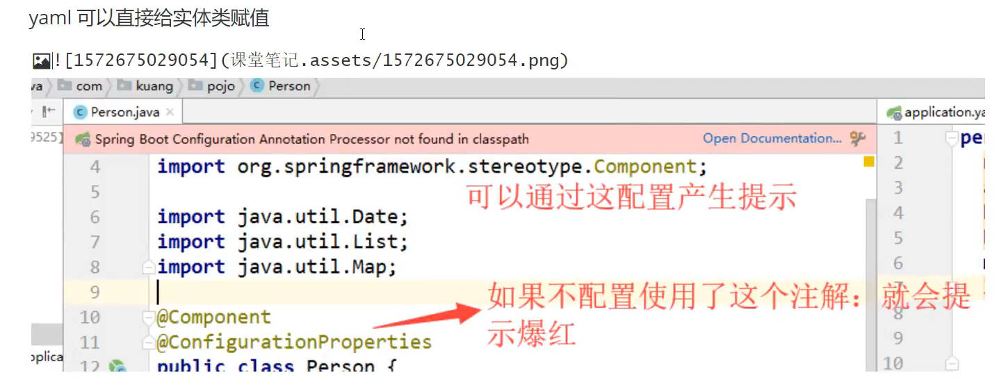    | 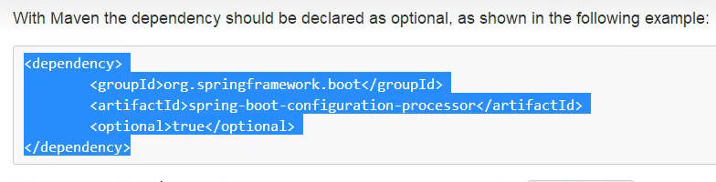 |
| ------------------------------------------------------------ | --------------------------------------------------------- |
| 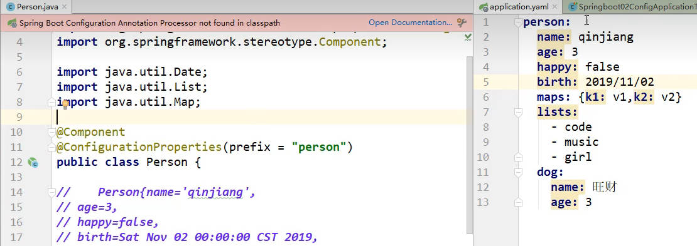    | 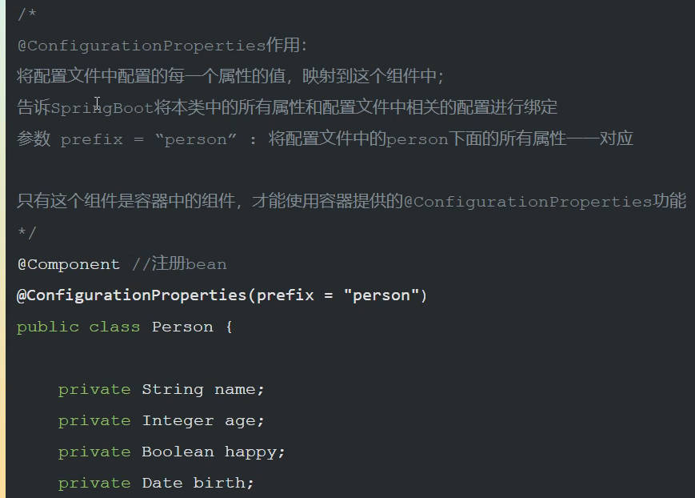 |
| 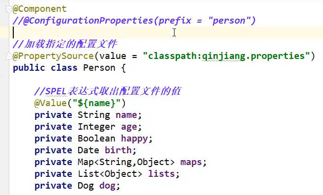 |  |

1、在springboot项目中的resources目录下新建一个文件 application.yml

2、编写一个实体类 Dog；

```java
@Component  //注册bean到容器中
public class Dog {
    private String name;
    private Integer age; 
    //有参无参构造、get、set方法、toString()方法  
}

```

3、思考，我们原来是如何给bean注入属性值的！@Value，给狗狗类测试一下：

```java
@Data
@Component //注册bean
public class Dog {
    @Value("阿黄")
    private String name;
    @Value("18")
    private Integer age;
}
```

4、在SpringBoot的测试类下注入狗狗输出一下；

```java
@SpringBootTest
class DemoApplicationTests { 
    @Autowired //将狗狗自动注入进来
    Dog dog; 
    @Test
    public void contextLoads() {
        System.out.println(dog); //打印看下狗狗对象
    } 
}
```

结果成功输出，@Value注入成功，这是我们原来的办法对吧。


5、我们在编写一个复杂一点的实体类：Person 类

```java
@Component //注册bean到容器中
public class Person {
    private String name;
    private Integer age;
    private Boolean happy;
    private Date birth;
    private Map<String,Object> maps;
    private List<Object> lists;
    private Dog dog;
    
    //有参无参构造、get、set方法、toString()方法  
}
```

6、我们来使用yaml配置的方式进行注入，大家写的时候注意区别和优势，我们编写一个yaml配置！

```yaml
person:
  name: qinjiang
  age: 3
  happy: false
  birth: 2000/01/01
  maps: {k1: v1,k2: v2}
  lists:
   - code
   - girl
   - music
  dog:
    name: 旺财
    age: 1
```

7、我们刚才已经把person这个对象的所有值都写好了，我们现在来注入到我们的类中！

```java
/*
@ConfigurationProperties作用：
将配置文件中配置的每一个属性的值，映射到这个组件中；
告诉SpringBoot将本类中的所有属性和配置文件中相关的配置进行绑定
参数 prefix = “person” : 将配置文件中的person下面的所有属性一一对应
*/
@Component //注册bean
@ConfigurationProperties(prefix = "person")
public class Person {
    private String name;
    private Integer age;
    private Boolean happy;
    private Date birth;
    private Map<String,Object> maps;
    private List<Object> lists;
    private Dog dog;
}
```

8、IDEA 提示，springboot配置注解处理器没有找到，让我们看文档，我们可以查看文档，找到一个依赖！


```xml
<!-- 导入配置文件处理器，配置文件进行绑定就会有提示，需要重启 -->
<dependency>
  <groupId>org.springframework.boot</groupId>
  <artifactId>spring-boot-configuration-processor</artifactId>
  <optional>true</optional>
</dependency> 
```

9、确认以上配置都OK之后，我们去测试类中测试一下：

```java
@SpringBootTest
class DemoApplicationTests {

    @Autowired
    Person person; //将person自动注入进来

    @Test
    public void contextLoads() {
        System.out.println(person); //打印person信息
    }

}
```

结果：所有值全部注入成功！


**yaml配置注入到实体类完全OK！**

课堂测试：

1、将配置文件的key 值 和 属性的值设置为不一样，则结果输出为null，注入失败

2、在配置一个person2，然后将 @ConfigurationProperties(prefix = "person2") 指向我们的person2；


### 5、加载指定的配置文件

**@PropertySource ：**加载指定的配置文件；

**@configurationProperties**：默认从全局配置文件中获取值；

1、我们去在resources目录下新建一个**person.properties**文件

```properties
name=fengyu
```

2、然后在我们的代码中指定加载person.properties文件

```java
@PropertySource(value = "classpath:person.properties")
@Component //注册bean
public class Person {

    @Value("${name}")
    private String name;

    ......  
}
```

3、再次输出测试一下：指定配置文件绑定成功！


### 6、配置文件占位符

配置文件还可以编写占位符生成随机数

```yaml
person:
    name: qinjiang${random.uuid} # 随机uuid
    age: ${random.int}  # 随机int
    happy: false
    birth: 2000/01/01
    maps: {k1: v1,k2: v2}
    lists:
      - code
      - girl
      - music
    dog:
      name: ${person.hello:other}_旺财
      age: 1person:    name: qinjiang${random.uuid} # 随机uuid    
```


### 7、回顾properties配置

我们上面采用的yaml方法都是最简单的方式，开发中最常用的；也是springboot所推荐的！那我们来唠唠其他的实现方式，道理都是相同的；写还是那样写；配置文件除了yml还有我们之前常用的properties ， 我们没有讲，我们来唠唠！

【注意】==properties配置文件在写中文的时候，会有乱码 ， 我们需要去IDEA中设置编码格式为UTF-8==；

==settings-->FileEncodings 中配置==；


**测试步骤：**

1、新建一个实体类User

```java
@Component //注册bean
public class User {
    private String name;
    private int age;
    private String sex;
}
```

2、编辑配置文件 user.properties

```properties
user.name=kuangshen
user.age=18
user.sex=男
```

3、我们在User类上使用@Value来进行注入！

```java
@Component //注册bean
@PropertySource(value = "classpath:user.properties")
public class User {
    //直接使用@value
    @Value("${user.name}") //从配置文件中取值
    private String name;
    @Value("#{9*2}")  // #{SPEL} Spring表达式
    private int age;
    @Value("男")  // 字面量
    private String sex;
}
```

4、Springboot测试

```java
@SpringBootTest
class DemoApplicationTests {

    @Autowired
    User user;

    @Test
    public void contextLoads() {
        System.out.println(user);
    }

}
```

结果正常输出：


### 8、对比小结

@Value这个使用起来并不友好！我们需要为每个属性单独注解赋值，比较麻烦；我们来看个功能对比图

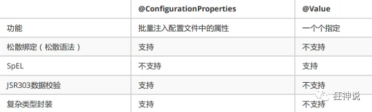

1、@ConfigurationProperties只需要写一次即可 ， @Value则需要每个字段都添加

2、松散绑定：这个什么意思呢? 比如我的yml中写的last-name，这个和lastName是一样的， - 后面跟着的字母默认是大写的。这就是松散绑定。可以测试一下

3、JSR303数据校验 ， 这个就是我们可以在字段是增加一层过滤器验证 ， 可以保证数据的合法性

4、复杂类型封装，yml中可以封装对象 ， 使用value就不支持

**结论：**

配置yml和配置properties都可以获取到值 ， 强烈推荐 yml；

如果我们在某个业务中，只需要获取配置文件中的某个值，可以使用一下 @value；

如果说，我们专门编写了一个JavaBean来和配置文件进行一一映射，就直接@configurationProperties，不要犹豫！

## 4、JSR303数据校验及多环境切换

小结：

- 增加数据校验 `@Validated`  @Email()

| 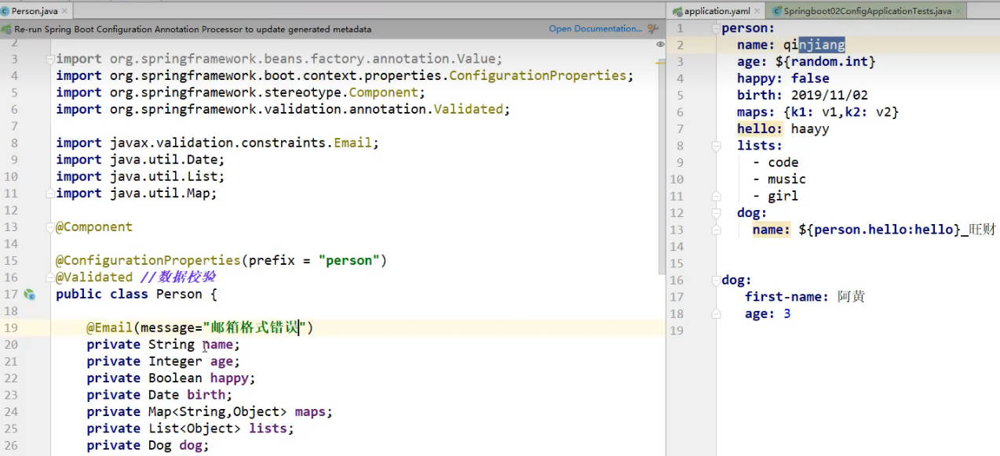 |      |
| ------------------------------------------------------------ | ---- |


### 1、简单使用

Springboot中可以用@validated来校验数据，如果数据异常则会统一抛出异常，方便异常中心统一处理。我们这里来写个注解让我们的name只能支持Email格式；

```java
@Component //注册bean
@ConfigurationProperties(prefix = "person")
@Validated  //数据校验
public class Person {

    @Email(message="邮箱格式错误") //name必须是邮箱格式
    private String name;
}
```

运行结果 ：default message [不是一个合法的电子邮件地址];

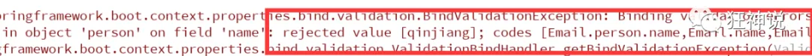

**使用数据校验，可以保证数据的正确性；** 

### 2、常见参数

```java
@NotNull(message="名字不能为空")
private String userName;
@Max(value=120,message="年龄最大不能查过120")
private int age;
@Email(message="邮箱格式错误")
private String email;

空检查
@Null       验证对象是否为null
@NotNull    验证对象是否不为null, 无法查检长度为0的字符串
@NotBlank   检查约束字符串是不是Null还有被Trim的长度是否大于0,只对字符串,且会去掉前后空格.
@NotEmpty   检查约束元素是否为NULL或者是EMPTY.
    
Booelan检查
@AssertTrue     验证 Boolean 对象是否为 true  
@AssertFalse    验证 Boolean 对象是否为 false  
    
长度检查
@Size(min=, max=) 验证对象（Array,Collection,Map,String）长度是否在给定的范围之内  
@Length(min=, max=) string is between min and max included.

日期检查
@Past       验证 Date 和 Calendar 对象是否在当前时间之前  
@Future     验证 Date 和 Calendar 对象是否在当前时间之后  
@Pattern    验证 String 对象是否符合正则表达式的规则

.......等等
除此以外，我们还可以自定义一些数据校验规则
```

### 3、多环境切换

[docs/2.1.6.RELEASE/reference](https://docs.spring.io/spring-boot/docs/2.1.6.RELEASE/reference/)

- Application Property Files:配置文件能写在哪里
  - file:项目路径
  - 类路径：java、resources目录下
- 配置文件优先级
  - ./config > ./ > resources/config > classpath:/
- 多环境切换： 测试、生产等环境切换
  - `spring.profiles.active=dev`
  - yaml实现多文档模块

profile是Spring对不同环境提供不同配置功能的支持，可以通过激活不同的环境版本，实现快速切换环境；

| 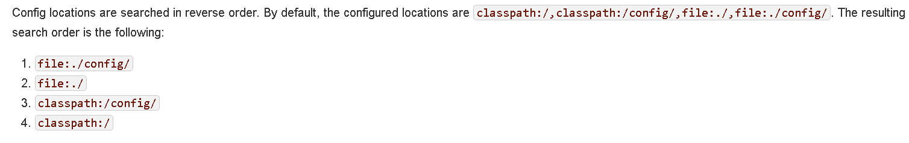 | 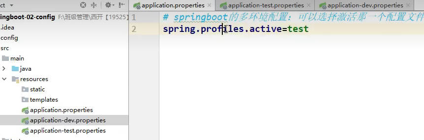 |
| --------------------------------------------------------- | --------------------------------------------------------- |
| 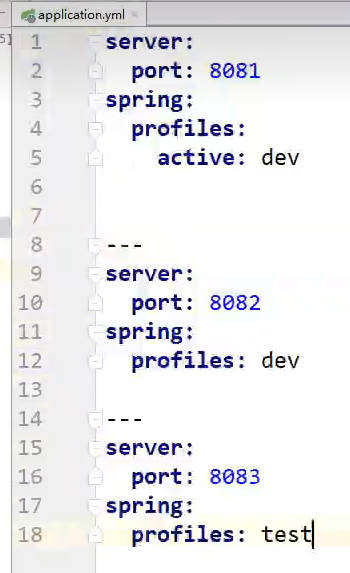 | 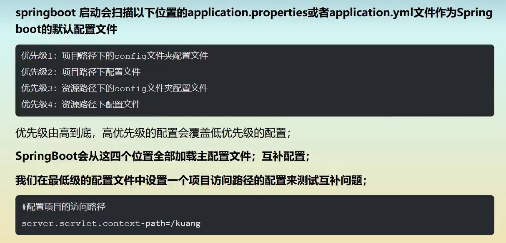 |


### 4、多配置文件

我们在主配置文件编写的时候，文件名可以是 application-{profile}.properties/yml , 用来指定多个环境版本；

**例如：**

application-test.properties 代表测试环境配置

application-dev.properties 代表开发环境配置

但是Springboot并不会直接启动这些配置文件，它**默认使用application.properties主配置文件**；

我们需要通过一个配置来选择需要激活的环境：

```properties
#比如在配置文件中指定使用dev环境，我们可以通过设置不同的端口号进行测试；#我们启动SpringBoot，就可以看到已经切换到dev下的配置了；spring.profiles.active=dev
```


### 5、yaml的多文档块

和properties配置文件中一样，但是使用yml去实现不需要创建多个配置文件，更加方便了 !

```yaml
server:
  port: 8081
#选择要激活那个环境块
spring:
  profiles:
    active: prod

---
server:
  port: 8083
spring:
  profiles: dev #配置环境的名称


---

server:
  port: 8084
spring:
  profiles: prod  #配置环境的名称
```

**注意：如果yml和properties同时都配置了端口，并且没有激活其他环境 ， 默认会使用properties配置文件的！**


### 6、配置文件加载位置

**外部加载配置文件的方式十分多，我们选择最常用的即可，在开发的资源文件中进行配置！**

官方外部配置文件说明参考文档


springboot 启动会扫描以下位置的application.properties或者application.yml文件作为Spring boot的默认配置文件：

```xml
优先级1：项目路径下的config文件夹配置文件
优先级2：项目路径下配置文件
优先级3：资源路径下的config文件夹配置文件
优先级4：资源路径下配置文件
```

优先级由高到底，高优先级的配置会覆盖低优先级的配置；

**SpringBoot会从这四个位置全部加载主配置文件；互补配置；**

我们在最低级的配置文件中设置一个项目访问路径的配置来测试互补问题；

```xml
#配置项目的访问路径
server.servlet.context-path=/kuang
```


### 7、拓展，运维小技巧

指定位置加载配置文件

我们还可以通过spring.config.location来改变默认的配置文件位置

项目打包好以后，我们可以使用命令行参数的形式，启动项目的时候来指定配置文件的新位置；这种情况，一般是后期运维做的多，相同配置，外部指定的配置文件优先级最高

```
java -jar spring-boot-config.jar --spring.config.location=F:/application.prope
```

## 5、SpringBoot自动配置原理

配置文件到底能写什么？怎么写？

SpringBoot官方文档中有大量的配置，我们无法全部记住

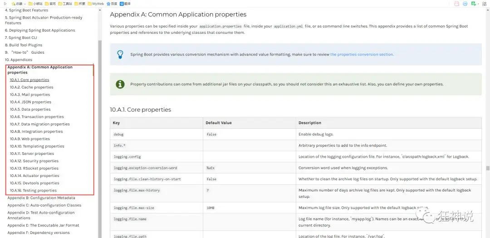


### 1、分析自动配置原理

我们以**HttpEncodingAutoConfiguration（Http编码自动配置）**为例解释自动配置原理；

```java
//表示这是一个配置类，和以前编写的配置文件一样，也可以给容器中添加组件；
@Configuration 

//启动指定类的ConfigurationProperties功能；
  //进入这个HttpProperties查看，将配置文件中对应的值和HttpProperties绑定起来；
  //并把HttpProperties加入到ioc容器中
@EnableConfigurationProperties({HttpProperties.class}) 

//Spring底层@Conditional注解
  //根据不同的条件判断，如果满足指定的条件，整个配置类里面的配置就会生效；
  //这里的意思就是判断当前应用是否是web应用，如果是，当前配置类生效
@ConditionalOnWebApplication(
    type = Type.SERVLET
)

//判断当前项目有没有这个类CharacterEncodingFilter；SpringMVC中进行乱码解决的过滤器；
@ConditionalOnClass({CharacterEncodingFilter.class})

//判断配置文件中是否存在某个配置：spring.http.encoding.enabled；
  //如果不存在，判断也是成立的
  //即使我们配置文件中不配置pring.http.encoding.enabled=true，也是默认生效的；
@ConditionalOnProperty(
    prefix = "spring.http.encoding",
    value = {"enabled"},
    matchIfMissing = true
)

public class HttpEncodingAutoConfiguration {
    //他已经和SpringBoot的配置文件映射了
    private final Encoding properties;
    //只有一个有参构造器的情况下，参数的值就会从容器中拿
    public HttpEncodingAutoConfiguration(HttpProperties properties) {
        this.properties = properties.getEncoding();
    }
    
    //给容器中添加一个组件，这个组件的某些值需要从properties中获取
    @Bean
    @ConditionalOnMissingBean //判断容器没有这个组件？
    public CharacterEncodingFilter characterEncodingFilter() {
        CharacterEncodingFilter filter = new OrderedCharacterEncodingFilter();
        filter.setEncoding(this.properties.getCharset().name());
        filter.setForceRequestEncoding(this.properties.shouldForce(org.springframework.boot.autoconfigure.http.HttpProperties.Encoding.Type.REQUEST));
        filter.setForceResponseEncoding(this.properties.shouldForce(org.springframework.boot.autoconfigure.http.HttpProperties.Encoding.Type.RESPONSE));
        return filter;
    }
    //。。。。。。。
}
```

**一句话总结 ：根据当前不同的条件判断，决定这个配置类是否生效！**

- 一但这个配置类生效；这个配置类就会给容器中添加各种组件；
- 这些组件的属性是从对应的properties类中获取的，这些类里面的每一个属性又是和配置文件绑定的；
- 所有在配置文件中能配置的属性都是在xxxxProperties类中封装着；
- 配置文件能配置什么就可以参照某个功能对应的这个属性类

```java
//从配置文件中获取指定的值和bean的属性进行绑定
@ConfigurationProperties(prefix = "spring.http") 
public class HttpProperties {
    // .....
}
```

我们去配置文件里面试试前缀，看提示！

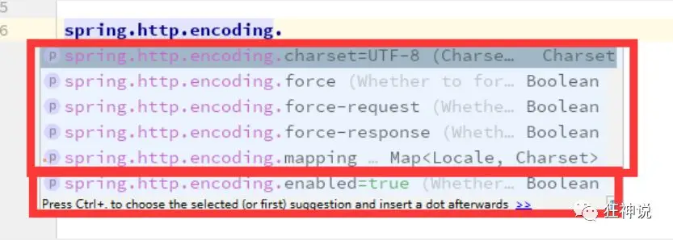

**这就是自动装配的原理！**


### 2、精髓

1、SpringBoot启动会加载大量的自动配置类

2、我们看我们需要的功能有没有在SpringBoot默认写好的自动配置类当中；

3、我们再来看这个自动配置类中到底配置了哪些组件；（只要我们要用的组件存在在其中，我们就不需要再手动配置了）

4、给容器中自动配置类添加组件的时候，会从properties类中获取某些属性。我们只需要在配置文件中指定这些属性的值即可；

**xxxxAutoConfigurartion：自动配置类；**给容器中添加组件

**xxxxProperties:封装配置文件中相关属性；**

| 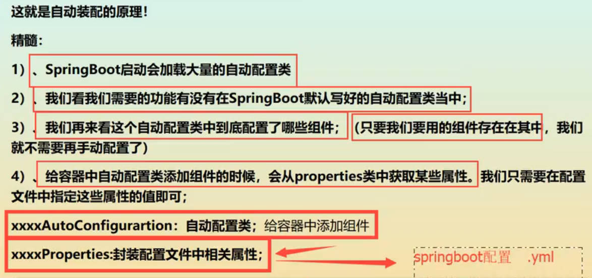 |  |
| --------------------------------------------------------- | ----- |
|                                                      |  |

### 3、了解：@Conditional

了解完自动装配的原理后，我们来关注一个细节问题，**自动配置类必须在一定的条件下才能生效；**

**@Conditional派生注解（Spring注解版原生的@Conditional作用）**

作用：必须是@Conditional指定的条件成立，才给容器中添加组件，配置配里面的所有内容才生效；

| 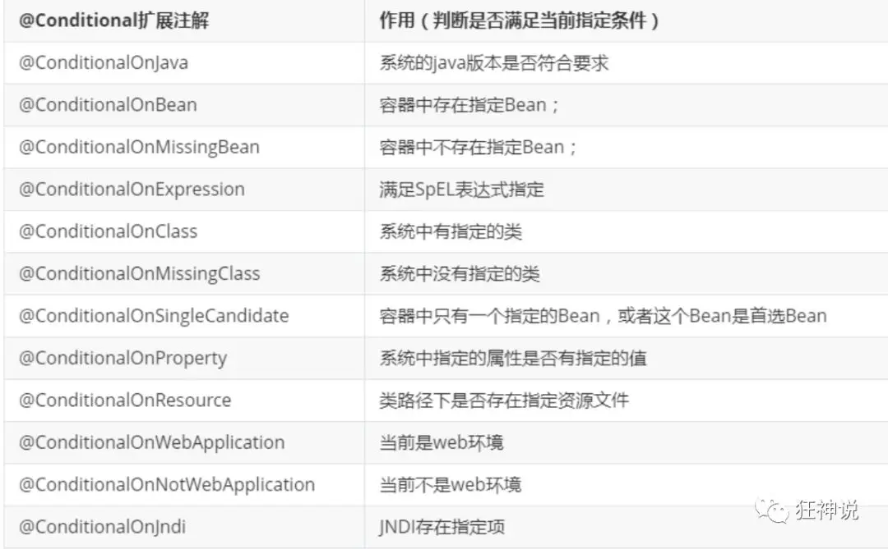 | 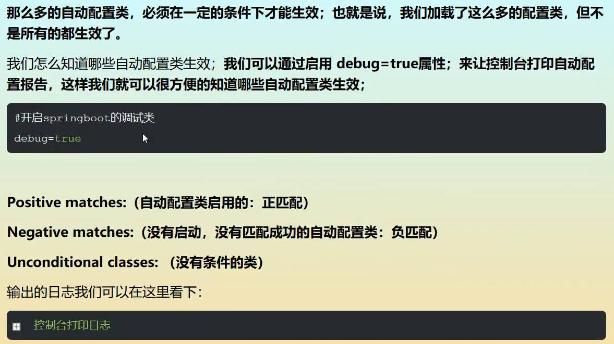 |
| --------------------------------- | --------------------------------------------------------- |
|                                   |                                                           |

**那么多的自动配置类，必须在一定的条件下才能生效；也就是说，我们加载了这么多的配置类，但不是所有的都生效了。**

我们怎么知道哪些自动配置类生效？

**我们可以通过启用 debug=true属性；来让控制台打印自动配置报告，这样我们就可以很方便的知道哪些自动配置类生效；**

```properties
#开启springboot的调试类
debug=true
```

**Positive matches:（自动配置类启用的：正匹配）**

**Negative matches:（没有启动，没有匹配成功的自动配置类：负匹配）**

**Unconditional classes: （没有条件的类）**

【演示：查看输出的日志】

掌握吸收理解原理，即可以不变应万变！

## 6、==自定义starter==

我们分析完毕了源码以及自动装配的过程，我们可以尝试自定义一个启动器来玩玩！

### 1、说明

启动器模块是一个 空 jar 文件，仅提供辅助性依赖管理，这些依赖可能用于自动装配或者其他类库；

**命名归约：**

官方命名：

- 前缀：spring-boot-starter-xxx
- 比如：spring-boot-starter-web....

自定义命名：

- xxx-spring-boot-starter
- 比如：mybatis-spring-boot-starter

### 2、编写启动器

1、在IDEA中新建一个空项目 spring-boot-starter-diy

2、新建一个普通Maven模块：kuang-spring-boot-starter

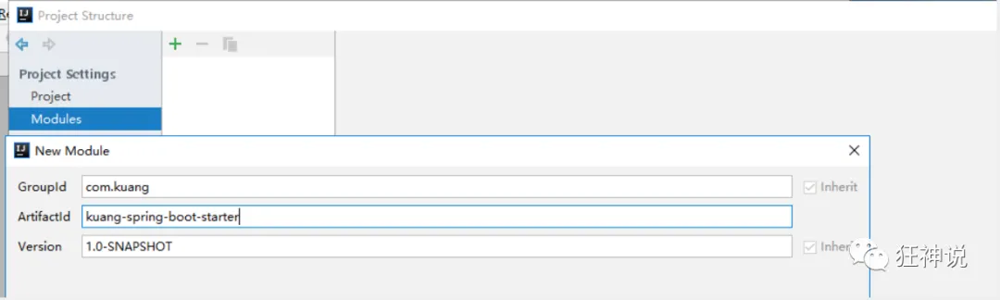

3、新建一个Springboot模块：kuang-spring-boot-starter-autoconfigure


4、点击apply即可，基本结构


5、在我们的 starter 中 导入  autoconfigure 的依赖！

```xml
<!-- 启动器 -->
<dependencies>
    <!--  引入自动配置模块 -->
    <dependency>
        <groupId>com.kuang</groupId>
        <artifactId>kuang-spring-boot-starter-autoconfigure</artifactId>
        <version>0.0.1-SNAPSHOT</version>
    </dependency>
</dependencies>
```

6、将 autoconfigure 项目下多余的文件都删掉，Pom中只留下一个 starter，这是所有的启动器基本配置！


7、我们编写一个自己的服务

```java
public class HelloService {

    HelloProperties helloProperties;

    public HelloProperties getHelloProperties() {
        return helloProperties;
    }

    public void setHelloProperties(HelloProperties helloProperties) {
        this.helloProperties = helloProperties;
    }

    public String sayHello(String name){
        return helloProperties.getPrefix() + name + helloProperties.getSuffix();
    }

}
```

8、编写HelloProperties 配置类

```java
// 前缀 kuang.hello
@ConfigurationProperties(prefix = "kuang.hello")
public class HelloProperties {

    private String prefix;
    private String suffix;

    public String getPrefix() {
        return prefix;
    }

    public void setPrefix(String prefix) {
        this.prefix = prefix;
    }

    public String getSuffix() {
        return suffix;
    }

    public void setSuffix(String suffix) {
        this.suffix = suffix;
    }
}
```

9、编写我们的自动配置类并注入bean，测试！

```java
@Configuration
@ConditionalOnWebApplication //web应用生效
@EnableConfigurationProperties(HelloProperties.class)
public class HelloServiceAutoConfiguration {

    @Autowired
    HelloProperties helloProperties;

    @Bean
    public HelloService helloService(){
        HelloService service = new HelloService();
        service.setHelloProperties(helloProperties);
        return service;
    }

}
```

10、在resources编写一个自己的 META-INF\spring.factories

```properties
# Auto Configure
org.springframework.boot.autoconfigure.EnableAutoConfiguration=\
com.kuang.HelloServiceAutoConfiguration
```

11、编写完成后，可以安装到maven仓库中！


### 3、新建项目测试我们自己写的启动器

1、新建一个SpringBoot 项目

2、导入我们自己写的启动器

```xml
<dependency>
    <groupId>com.kuang</groupId>
    <artifactId>kuang-spring-boot-starter</artifactId>
    <version>1.0-SNAPSHOT</version>
</dependency>
```

3、编写一个 HelloController  进行测试我们自己的写的接口！

```java
package com.kuang.controller;

@RestController
public class HelloController {

    @Autowired
    HelloService helloService;

    @RequestMapping("/hello")
    public String hello(){
        return helloService.sayHello("zxc");
    }

}
```

4、编写配置文件 application.properties

```properties
kuang.hello.prefix="ppp"
kuang.hello.suffix="sss"
```

5、启动项目进行测试，结果成功 !


