# SpringBoot

# 4、集成

## 1、集成Swagger

[学习路之伪造数据rap2](https://blog.csdn.net/hopetomorrow/article/details/114359404) [利用EasyMock伪造小程序后台数据](https://blog.csdn.net/qq_35395045/article/details/87972482) [使用Mock伪造数据](https://zhuanlan.zhihu.com/p/65417934)

| 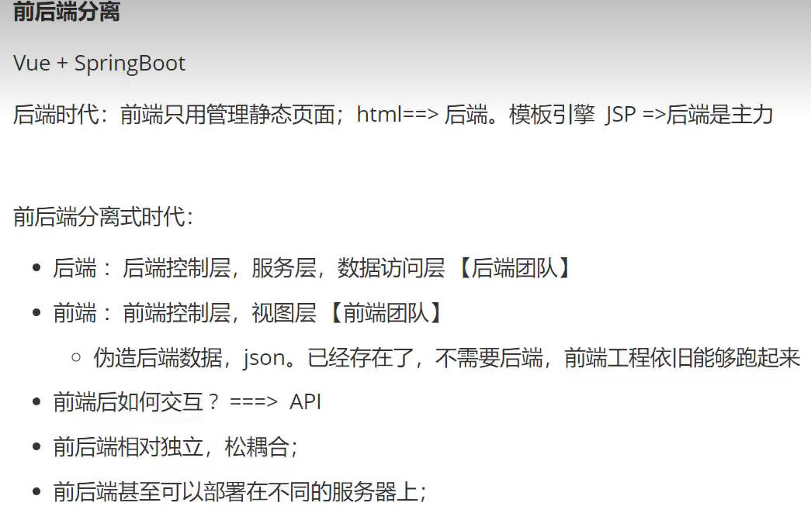 | 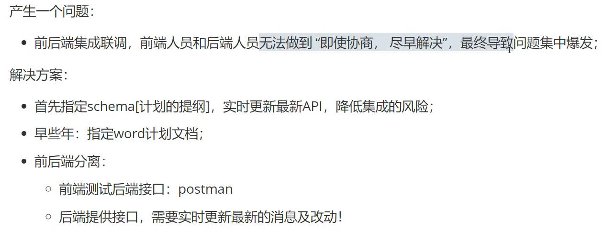 |
| --------------------------------------------------------- | --------------------------------------------------------- |
| 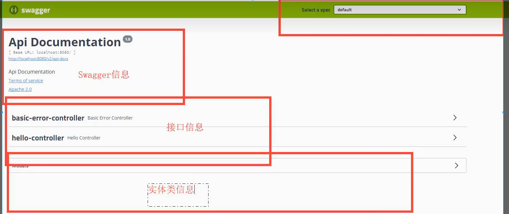 |                                                      |


### 1、Swagger简介

**前后端分离**

- 前端 -> 前端控制层、视图层
- 后端 -> 后端控制层、服务层、数据访问层
- 前后端通过API进行交互
- 前后端相对独立且松耦合

**产生的问题**

- 前后端集成，前端或者后端无法做到“及时协商，尽早解决”，最终导致问题集中爆发

**解决方案**

- 首先定义schema [ 计划的提纲 ]，并实时跟踪最新的API，降低集成风险

**Swagger**

- 号称世界上最流行的API框架
- Restful Api 文档在线自动生成器 => **API 文档 与API 定义同步更新**
- 直接运行，在线测试API
- 支持多种语言 （如：Java，PHP等）
- 官网：https://swagger.io/


### 2、SpringBoot集成Swagger

**SpringBoot集成Swagger** => **springfox**，两个jar包

- **Springfox-swagger2**
- swagger-springmvc

**使用Swagger**

要求：jdk 1.8 + 否则swagger2无法运行

步骤：

1、新建一个SpringBoot-web项目

2、添加Maven依赖

```xml
<!-- https://mvnrepository.com/artifact/io.springfox/springfox-swagger2 -->
<dependency>
   <groupId>io.springfox</groupId>
   <artifactId>springfox-swagger2</artifactId>
   <version>2.9.2</version>
</dependency>
<!-- https://mvnrepository.com/artifact/io.springfox/springfox-swagger-ui -->
<dependency>
   <groupId>io.springfox</groupId>
   <artifactId>springfox-swagger-ui</artifactId>
   <version>2.9.2</version>
</dependency>
```

3、编写HelloController，测试确保运行成功！

4、要使用Swagger，我们需要编写一个配置类-SwaggerConfig来配置 Swagger

```java
@Configuration //配置类
@EnableSwagger2// 开启Swagger2的自动配置
public class SwaggerConfig {  
}
```

5、访问测试 ：http://localhost:8080/swagger-ui.html ，可以看到swagger的界面；


### 3、配置Swagger

1、Swagger实例Bean是Docket，所以通过配置Docket实例来配置Swaggger。

```java
@Bean //配置docket以配置Swagger具体参数
public Docket docket() {
   return new Docket(DocumentationType.SWAGGER_2);
}
```

2、可以通过apiInfo()属性配置文档信息

```java
//配置文档信息
private ApiInfo apiInfo() {
   Contact contact = new Contact("联系人名字", "http://xxx.xxx.com/联系人访问链接","联系人邮箱");
   return new ApiInfo(
           "Swagger学习", // 标题
           "学习演示如何配置Swagger", // 描述
           "v1.0", // 版本
           "http://terms.service.url/组织链接", // 组织链接
           contact, // 联系人信息
           "Apach 2.0 许可", // 许可
           "许可链接", // 许可连接
           new ArrayList<>()// 扩展
  );
}
```

3、Docket 实例关联上 apiInfo()

```java
@Bean
public Docket docket() {
   return new Docket(DocumentationType.SWAGGER_2).apiInfo(apiInfo());
}
```

4、重启项目，访问测试 http://localhost:8080/swagger-ui.html  看下效果；

### 4、配置==扫描接口及开关==

#### 1、配置==扫描接口==

1、构建Docket时通过select()方法配置怎么扫描接口。

```java
@Bean
public Docket docket() {
   return new Docket(DocumentationType.SWAGGER_2)
      .apiInfo(apiInfo())
      .select()// 通过.select()方法，去配置扫描接口,RequestHandlerSelectors配置如何扫描接口
      .apis(RequestHandlerSelectors.basePackage("com.kuang.swagger.controller"))
      .build();
}
```

2、重启项目测试，由于我们配置根据包的路径扫描接口，所以我们只能看到一个类

3、除了通过包路径配置扫描接口外，还可以通过配置其他方式扫描接口，这里注释一下所有的配置方式：

```java
any() // 扫描所有，项目中的所有接口都会被扫描到
none() // 不扫描接口
// 通过方法上的注解扫描，如withMethodAnnotation(GetMapping.class)只扫描get请求
withMethodAnnotation(final Class<? extends Annotation> annotation)
// 通过类上的注解扫描，如.withClassAnnotation(Controller.class)只扫描有controller注解的类中的接口
withClassAnnotation(final Class<? extends Annotation> annotation)
basePackage(final String basePackage) // 根据包路径扫描接口
```

4、除此之外，我们还可以配置接口扫描过滤：

```java
@Bean
public Docket docket() {
   return new Docket(DocumentationType.SWAGGER_2)
      .apiInfo(apiInfo())
      .select()// 通过.select()方法，去配置扫描接口,RequestHandlerSelectors配置如何扫描接口
      .apis(RequestHandlerSelectors.basePackage("com.kuang.swagger.controller"))
       // 配置如何通过path过滤,即这里只扫描请求以/kuang开头的接口
      .paths(PathSelectors.ant("/kuang/**"))
      .build();
}
```

5、这里的可选值还有

```java
any() // 任何请求都扫描
none() // 任何请求都不扫描
regex(final String pathRegex) // 通过正则表达式控制
ant(final String antPattern) // 通过ant()控制
```


#### 2、开启Swagger==开关==

1、通过enable()方法配置是否启用swagger，如果是false，swagger将不能在浏览器中访问了

```
@Bean
public Docket docket() {
   return new Docket(DocumentationType.SWAGGER_2)
      .apiInfo(apiInfo())
      .enable(false) //配置是否启用Swagger，如果是false，在浏览器将无法访问
      .select()// 通过.select()方法，去配置扫描接口,RequestHandlerSelectors配置如何扫描接口
      .apis(RequestHandlerSelectors.basePackage("com.kuang.swagger.controller"))
       // 配置如何通过path过滤,即这里只扫描请求以/kuang开头的接口
      .paths(PathSelectors.ant("/kuang/**"))
      .build();
}
```

2、如何动态配置当项目处于test、dev环境时显示swagger，处于prod时不显示？

```
@Bean
public Docket docket(Environment environment) {
   // 设置要显示swagger的环境
   Profiles of = Profiles.of("dev", "test");
   // 判断当前是否处于该环境
   // 通过 enable() 接收此参数判断是否要显示
   boolean b = environment.acceptsProfiles(of);
   
   return new Docket(DocumentationType.SWAGGER_2)
      .apiInfo(apiInfo())
      .enable(b) //配置是否启用Swagger，如果是false，在浏览器将无法访问
      .select()// 通过.select()方法，去配置扫描接口,RequestHandlerSelectors配置如何扫描接口
      .apis(RequestHandlerSelectors.basePackage("com.kuang.swagger.controller"))
       // 配置如何通过path过滤,即这里只扫描请求以/kuang开头的接口
      .paths(PathSelectors.ant("/kuang/**"))
      .build();
}
```

3、可以在项目中增加一个dev的配置文件查看效果！


### 6、配置API==分组==


1、如果没有配置分组，默认是default。通过groupName()方法即可配置分组：

```java
@Bean
public Docket docket(Environment environment) {
   return new Docket(DocumentationType.SWAGGER_2).apiInfo(apiInfo())
      .groupName("hello") // 配置分组
       // 省略配置....
}
```

2、重启项目查看分组

3、如何配置多个分组？配置==多个分组只需要配置多个docket即可==：

```java
@Bean
public Docket docket1(){
   return new Docket(DocumentationType.SWAGGER_2).groupName("group1");
}
@Bean
public Docket docket2(){
   return new Docket(DocumentationType.SWAGGER_2).groupName("group2");
}
@Bean
public Docket docket3(){
   return new Docket(DocumentationType.SWAGGER_2).groupName("group3");
}
```

4、重启项目查看即可

### 7、==实体类配置==

1、新建一个实体类

```
@ApiModel("用户实体")
public class User {
   @ApiModelProperty("用户名")
   public String username;
   @ApiModelProperty("密码")
   public String password;
}
```

2、只要这个实体在**请求接口**的返回值上（即使是泛型），都能映射到实体项中：

```
@RequestMapping("/getUser")
public User getUser(){
   return new User();
}
```

3、重启查看测试


注：并不是因为@ApiModel这个注解让实体显示在这里了，而是只要出现在接口方法的返回值上的实体都会显示在这里，而@ApiModel和@ApiModelProperty这两个注解只是为实体添加注释的。

@ApiModel为类添加注释

@ApiModelProperty为类属性添加注释

### 8、常用注解

Swagger的所有注解定义在io.swagger.annotations包下

下面列一些经常用到的，未列举出来的可以另行查阅说明：

| Swagger注解                                                  | 简单说明                                             | 实例                                                         |
| ------------------------------------------------------------ | ---------------------------------------------------- | ------------------------------------------------------------ |
| @Api(tags = "xxx模块说明"value–也是说明，可以使用tags替代)   | 作用在模块类上                                       | @Api(value="用户controller",tags={"用户操作接口"})           |
| @ApiOperation("xxx接口说明") value用于方法描述 <br/>notes用于提示内容 <br/>tags可以重新分组（视情况而用） | 作用在接口方法上                                     | @ApiOperation(value="获取用户信息",tags={"获取用户信息copy"},notes="注意问题点") |
| @ApiModel("xxxPOJO说明")                                     | 作用在模型类上：如VO、BO                             |                                                              |
| @ApiModelProperty(value = "xxx属性说明",hidden = true)       | 作用在类方法和属性上，hidden设置为true可以隐藏该属性 |                                                              |
| @ApiParam("xxx参数说明")    name–参数名 <br/>value–参数说明 <br/>required–是否必填 | 作用在参数、方法和字段上，类似@ApiModelProperty      | @ApiParam(name="id",value="用户id",required=true)            |

我们也可以给请求的接口配置一些注释

```java
@ApiOperation(value="获取用户信息",tags={"获取用户信息copy"},notes="注意问题点")
@PostMapping("/getUser")
@ResponseBody
public User getUser(@RequestBody  @ApiParam(name="用户对象",value="传入json格式",required=true)  User user){
        return user;
    }
```


```
@ApiOperation("狂神的接口")
@PostMapping("/kuang")
@ResponseBody
public String kuang(@ApiParam("这个名字会被返回")String username){
   return username;
}
```

这样的话，可以给一些比较难理解的属性或者接口，增加一些配置信息，让人更容易阅读！

相较于传统的Postman或Curl方式测试接口，使用swagger简直就是傻瓜式操作，不需要额外说明文档(写得好本身就是文档)而且更不容易出错，只需要录入数据然后点击Execute，如果再配合自动化框架，可以说基本就不需要人为操作了。

Swagger是个优秀的工具，现在国内已经有很多的中小型互联网公司都在使用它，相较于传统的要先出Word接口文档再测试的方式，显然这样也更符合现在的快速迭代开发行情。当然了，提醒下大家在正式环境要记得关闭Swagger，一来出于安全考虑二来也可以节省运行时内存。


### 9、拓展：其他皮肤

我们可以导入不同的包实现不同的皮肤定义：

1、默认的  **访问 http://localhost:8080/swagger-ui.html**

```
<dependency> 
   <groupId>io.springfox</groupId>
   <artifactId>springfox-swagger-ui</artifactId>
   <version>2.9.2</version>
</dependency>
```


2、bootstrap-ui  **访问 http://localhost:8080/doc.html**

```
<!-- 引入swagger-bootstrap-ui包 /doc.html-->
<dependency>
   <groupId>com.github.xiaoymin</groupId>
   <artifactId>swagger-bootstrap-ui</artifactId>
   <version>1.9.1</version>
</dependency>
```


3、Layui-ui  **访问 http://localhost:8080/docs.html**

```
<!-- 引入swagger-ui-layer包 /docs.html-->
<dependency>
   <groupId>com.github.caspar-chen</groupId>
   <artifactId>swagger-ui-layer</artifactId>
   <version>1.1.3</version>
</dependency>
```


4、mg-ui  **访问 http://localhost:8080/document.html**

```
<!-- 引入swagger-ui-layer包 /document.html-->
<dependency>
   <groupId>com.zyplayer</groupId>
   <artifactId>swagger-mg-ui</artifactId>
   <version>1.0.6</version>
</dependency>
```


## 2、集成SpringSecurity

[2023年Web开发的5个最佳Java框架](https://baijiahao.baidu.com/s?id=1763381342526254067&wfr=spider&for=pc)

java安全框架：

[SpringSecurity](http://i0921.cn/blog/5dc52b0aba304f6314a9229f/65c80e406b52af7adc795071) [java安全框架](https://blog.csdn.net/di101cipaqi/article/details/135680363)

小结：

1. 测试环境搭建
1. pom导依赖包
3. 配置文件：config/SecurityConfig
   1. `public class SecurityConfig extends WebSecurityConfigurerAdapter`
   2. 注销：`thymeleaf和springsecurity整合包`


| 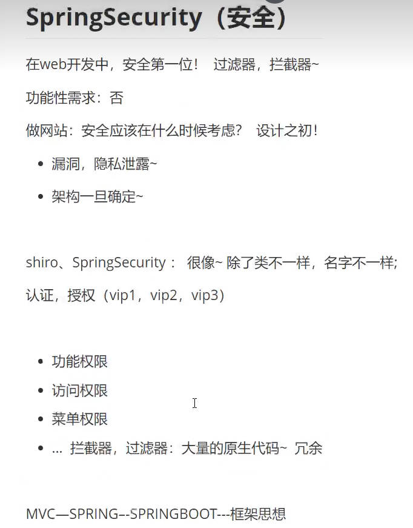    | 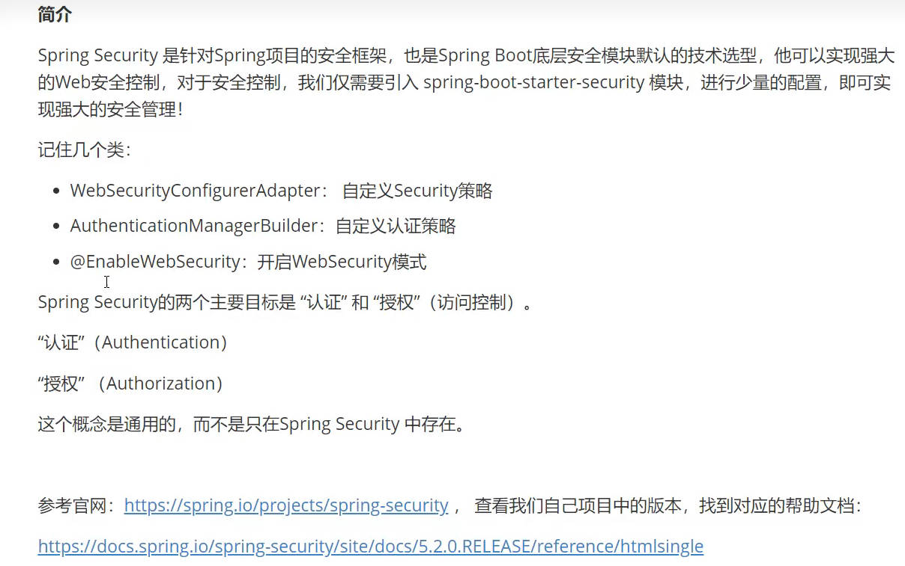 |
| ------------------------------------------------------------ | --------------------------------------------------------- |
| 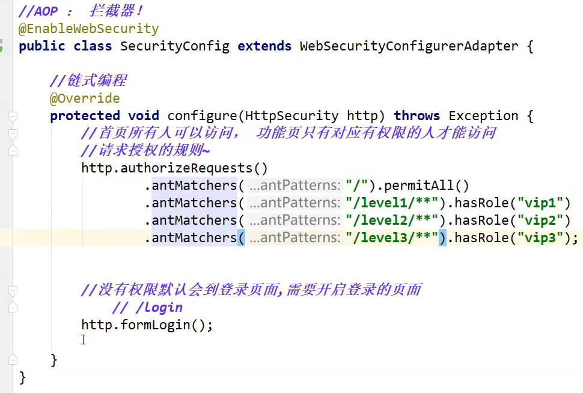 | 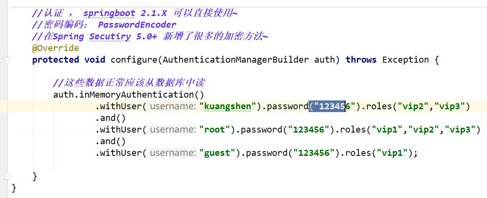 |
|                                                         |                                                      |


### 1、安全简介

在 Web 开发中，安全一直是非常重要的一个方面。安全虽然属于应用的非功能性需求，但是应该在应用开发的初期就考虑进来。如果在应用开发的后期才考虑安全的问题，就可能陷入一个两难的境地：一方面，应用存在严重的安全漏洞，无法满足用户的要求，并可能造成用户的隐私数据被攻击者窃取；另一方面，应用的基本架构已经确定，要修复安全漏洞，可能需要对系统的架构做出比较重大的调整，因而需要更多的开发时间，影响应用的发布进程。因此，从应用开发的第一天就应该把安全相关的因素考虑进来，并在整个应用的开发过程中。

市面上存在比较有名的：Shiro，Spring Security ！

这里需要阐述一下的是，每一个框架的出现都是为了解决某一问题而产生了，那么Spring Security框架的出现是为了解决什么问题呢？

首先我们看下它的官网介绍：Spring Security官网地址

Spring Security is a powerful and highly customizable authentication and access-control framework. It is the de-facto standard for securing Spring-based applications.

Spring Security is a framework that focuses on providing both authentication and authorization to Java applications. Like all Spring projects, the real power of Spring Security is found in how easily it can be extended to meet custom requirements

Spring Security是一个功能强大且高度可定制的身份验证和访问控制框架。它实际上是保护基于spring的应用程序的标准。

Spring Security是一个框架，侧重于为Java应用程序提供身份验证和授权。与所有Spring项目一样，Spring安全性的真正强大之处在于它可以轻松地扩展以满足定制需求

从官网的介绍中可以知道这是一个权限框架。想我们之前做项目是没有使用框架是怎么控制权限的？对于权限 一般会细分为功能权限，访问权限，和菜单权限。代码会写的非常的繁琐，冗余。

怎么解决之前写权限代码繁琐，冗余的问题，一些主流框架就应运而生而Spring Scecurity就是其中的一种。

Spring 是一个非常流行和成功的 Java 应用开发框架。Spring Security 基于 Spring 框架，提供了一套 Web 应用安全性的完整解决方案。一般来说，Web 应用的安全性包括用户认证（Authentication）和用户授权（Authorization）两个部分。用户认证指的是验证某个用户是否为系统中的合法主体，也就是说用户能否访问该系统。用户认证一般要求用户提供用户名和密码。系统通过校验用户名和密码来完成认证过程。用户授权指的是验证某个用户是否有权限执行某个操作。在一个系统中，不同用户所具有的权限是不同的。比如对一个文件来说，有的用户只能进行读取，而有的用户可以进行修改。一般来说，系统会为不同的用户分配不同的角色，而每个角色则对应一系列的权限。

对于上面提到的两种应用情景，Spring Security 框架都有很好的支持。在用户认证方面，Spring Security 框架支持主流的认证方式，包括 HTTP 基本认证、HTTP 表单验证、HTTP 摘要认证、OpenID 和 LDAP 等。在用户授权方面，Spring Security 提供了基于角色的访问控制和访问控制列表（Access Control List，ACL），可以对应用中的领域对象进行细粒度的控制。


### 2、实战测试

**实验环境搭建**

1、新建一个初始的springboot项目web模块，thymeleaf模块

2、导入静态资源

```
welcome.html
|views
|level1
1.html
2.html
3.html
|level2
1.html
2.html
3.html
|level3
1.html
2.html
3.html
Login.html
```

3、controller跳转！

```java
package com.kuang.controller;

import org.springframework.stereotype.Controller;
import org.springframework.web.bind.annotation.PathVariable;
import org.springframework.web.bind.annotation.RequestMapping;

@Controller
public class RouterController {

   @RequestMapping({"/","/index"})
   public String index(){
       return "index";
  }

   @RequestMapping("/toLogin")
   public String toLogin(){
       return "views/login";
  }

   @RequestMapping("/level1/{id}")
   public String level1(@PathVariable("id") int id){
       return "views/level1/"+id;
  }

   @RequestMapping("/level2/{id}")
   public String level2(@PathVariable("id") int id){
       return "views/level2/"+id;
  }

   @RequestMapping("/level3/{id}")
   public String level3(@PathVariable("id") int id){
       return "views/level3/"+id;
  }

}
```

4、测试实验环境是否OK！


### 3、认识SpringSecurity

Spring Security 是针对Spring项目的安全框架，也是Spring Boot底层安全模块默认的技术选型，他可以实现强大的Web安全控制，对于安全控制，我们仅需要引入spring-boot-starter-security 模块，进行少量的配置，即可实现强大的安全管理！

记住几个类：

- WebSecurityConfigurerAdapter：自定义Security策略
- AuthenticationManagerBuilder：自定义认证策略
- @EnableWebSecurity：开启WebSecurity模式

Spring Security的两个主要目标是 “认证” 和 “授权”（访问控制）。

**“认证”（Authentication）**

身份验证是关于验证您的凭据，如用户名/用户ID和密码，以验证您的身份。

身份验证通常通过用户名和密码完成，有时与身份验证因素结合使用。

 **“授权” （Authorization）**

授权发生在系统成功验证您的身份后，最终会授予您访问资源（如信息，文件，数据库，资金，位置，几乎任何内容）的完全权限。

这个概念是通用的，而不是只在Spring Security 中存在。


### 4、认证和授权

目前，我们的测试环境，是谁都可以访问的，我们使用 Spring Security 增加上认证和授权的功能

1、引入 Spring Security 模块

```
<dependency>
   <groupId>org.springframework.boot</groupId>
   <artifactId>spring-boot-starter-security</artifactId>
</dependency>
```

2、编写 Spring Security 配置类

参考官网：https://spring.io/projects/spring-security 

查看我们自己项目中的版本，找到对应的帮助文档：

https://docs.spring.io/spring-security/site/docs/5.3.0.RELEASE/reference/html5  #servlet-applications 8.16.4


3、编写基础配置类

```java
package com.kuang.config;

import org.springframework.security.config.annotation.web.builders.HttpSecurity;
importorg.springframework.security.config.annotation.web.configuration.EnableWebSecurity;
importorg.springframework.security.config.annotation.web.configuration.WebSecurityConfigurerAdapter;

@EnableWebSecurity // 开启WebSecurity模式
public class SecurityConfig extends WebSecurityConfigurerAdapter {

   @Override
   protected void configure(HttpSecurity http) throws Exception {
       
  }
}
```

4、定制请求的授权规则

```java
@Override
protected void configure(HttpSecurity http) throws Exception {
   // 定制请求的授权规则
   // 首页所有人可以访问
   http.authorizeRequests().antMatchers("/").permitAll()
  .antMatchers("/level1/**").hasRole("vip1")
  .antMatchers("/level2/**").hasRole("vip2")
  .antMatchers("/level3/**").hasRole("vip3");
}
```

5、测试一下：发现除了首页都进不去了！因为我们目前没有登录的角色，因为请求需要登录的角色拥有对应的权限才可以！

6、在configure()方法中加入以下配置，开启自动配置的登录功能！

```
// 开启自动配置的登录功能
// /login 请求来到登录页
// /login?error 重定向到这里表示登录失败
http.formLogin();
```

7、测试一下：发现，没有权限的时候，会跳转到登录的页面！


8、查看刚才登录页的注释信息；

我们可以定义认证规则，重写configure(AuthenticationManagerBuilder auth)方法

```java
//定义认证规则
@Override
protected void configure(AuthenticationManagerBuilder auth) throws Exception {
   
   //在内存中定义，也可以在jdbc中去拿....
   auth.inMemoryAuthentication()
          .withUser("kuangshen").password("123456").roles("vip2","vip3")
          .and()
          .withUser("root").password("123456").roles("vip1","vip2","vip3")
          .and()
          .withUser("guest").password("123456").roles("vip1","vip2");
}
```

9、测试，我们可以使用这些账号登录进行测试！发现会报错！

There is no PasswordEncoder mapped for the id “null”


10、原因，我们要将前端传过来的密码进行某种方式加密，否则就无法登录，修改代码

```java
//定义认证规则
@Override
protected void configure(AuthenticationManagerBuilder auth) throws Exception {
   //在内存中定义，也可以在jdbc中去拿....
   //Spring security 5.0中新增了多种加密方式，也改变了密码的格式。
   //要想我们的项目还能够正常登陆，需要修改一下configure中的代码。我们要将前端传过来的密码进行某种方式加密
   //spring security 官方推荐的是使用bcrypt加密方式。
   
   auth.inMemoryAuthentication().passwordEncoder(new BCryptPasswordEncoder())
          .withUser("kuangshen").password(new BCryptPasswordEncoder().encode("123456")).roles("vip2","vip3")
          .and()
          .withUser("root").password(new BCryptPasswordEncoder().encode("123456")).roles("vip1","vip2","vip3")
          .and()
          .withUser("guest").password(new BCryptPasswordEncoder().encode("123456")).roles("vip1","vip2");
}
```

11、测试，发现，登录成功，并且每个角色只能访问自己认证下的规则！搞定

### 5、权限控制和注销

1、开启自动配置的注销的功能

```
//定制请求的授权规则
@Override
protected void configure(HttpSecurity http) throws Exception {
   //....
   //开启自动配置的注销的功能
      // /logout 注销请求
   http.logout();
}
```

2、我们在前端，增加一个注销的按钮，index.html 导航栏中

```
<a class="item" th:href="@{/logout}">
   <i class="address card icon"></i> 注销
</a>
```

3、我们可以去测试一下，登录成功后点击注销，发现注销完毕会跳转到登录页面！

4、但是，我们想让他注销成功后，依旧可以跳转到首页，该怎么处理呢？

```
// .logoutSuccessUrl("/"); 注销成功来到首页
http.logout().logoutSuccessUrl("/");
```

5、测试，注销完毕后，发现跳转到首页OK

6、我们现在又来一个需求：用户没有登录的时候，导航栏上只显示登录按钮，用户登录之后，导航栏可以显示登录的用户信息及注销按钮！还有就是，比如kuangshen这个用户，它只有 vip2，vip3功能，那么登录则只显示这两个功能，而vip1的功能菜单不显示！这个就是真实的网站情况了！该如何做呢？

我们需要结合thymeleaf中的一些功能

sec：authorize="isAuthenticated()":是否认证登录！来显示不同的页面

Maven依赖：

- ==thymeleaf和springsecurity整合包==

```
<!-- https://mvnrepository.com/artifact/org.thymeleaf.extras/thymeleaf-extras-springsecurity4 -->
<dependency>
   <groupId>org.thymeleaf.extras</groupId>
   <artifactId>thymeleaf-extras-springsecurity5</artifactId>
   <version>3.0.4.RELEASE</version>
</dependency>
```

7、修改我们的 前端页面

1. 导入命名空间

2. ```
   xmlns:sec="http://www.thymeleaf.org/thymeleaf-extras-springsecurity5"
   ```

3. 修改导航栏，增加认证判断

4. ```
   <!--登录注销-->
   <div class="right menu">
   
      <!--如果未登录-->
      <div sec:authorize="!isAuthenticated()">
          <a class="item" th:href="@{/login}">
              <i class="address card icon"></i> 登录
          </a>
      </div>
   
      <!--如果已登录-->
      <div sec:authorize="isAuthenticated()">
          <a class="item">
              <i class="address card icon"></i>
             用户名：<span sec:authentication="principal.username"></span>
             角色：<span sec:authentication="principal.authorities"></span>
          </a>
      </div>
   
      <div sec:authorize="isAuthenticated()">
          <a class="item" th:href="@{/logout}">
              <i class="address card icon"></i> 注销
          </a>
      </div>
   </div>
   ```

8、重启测试，我们可以登录试试看，登录成功后确实，显示了我们想要的页面；

9、如果注销404了，就是因为它默认防止csrf跨站请求伪造，因为会产生安全问题，我们可以将请求改为post表单提交，或者在spring security中关闭csrf功能；我们试试：在 配置中增加 `http.csrf().disable();`

```
http.csrf().disable();//关闭csrf功能:跨站请求伪造,默认只能通过post方式提交logout请求
http.logout().logoutSuccessUrl("/");
```

10、我们继续将下面的角色功能块认证完成！

```
<!-- sec:authorize="hasRole('vip1')" -->
<div class="column" sec:authorize="hasRole('vip1')">
   <div class="ui raised segment">
       <div class="ui">
           <div class="content">
               <h5 class="content">Level 1</h5>
               <hr>
               <div><a th:href="@{/level1/1}"><i class="bullhorn icon"></i> Level-1-1</a></div>
               <div><a th:href="@{/level1/2}"><i class="bullhorn icon"></i> Level-1-2</a></div>
               <div><a th:href="@{/level1/3}"><i class="bullhorn icon"></i> Level-1-3</a></div>
           </div>
       </div>
   </div>
</div>

<div class="column" sec:authorize="hasRole('vip2')">
   <div class="ui raised segment">
       <div class="ui">
           <div class="content">
               <h5 class="content">Level 2</h5>
               <hr>
               <div><a th:href="@{/level2/1}"><i class="bullhorn icon"></i> Level-2-1</a></div>
               <div><a th:href="@{/level2/2}"><i class="bullhorn icon"></i> Level-2-2</a></div>
               <div><a th:href="@{/level2/3}"><i class="bullhorn icon"></i> Level-2-3</a></div>
           </div>
       </div>
   </div>
</div>

<div class="column" sec:authorize="hasRole('vip3')">
   <div class="ui raised segment">
       <div class="ui">
           <div class="content">
               <h5 class="content">Level 3</h5>
               <hr>
               <div><a th:href="@{/level3/1}"><i class="bullhorn icon"></i> Level-3-1</a></div>
               <div><a th:href="@{/level3/2}"><i class="bullhorn icon"></i> Level-3-2</a></div>
               <div><a th:href="@{/level3/3}"><i class="bullhorn icon"></i> Level-3-3</a></div>
           </div>
       </div>
   </div>
</div>
```

11、测试一下！

12、权限控制和注销搞定！

### 6、记住我

现在的情况，我们只要登录之后，关闭浏览器，再登录，就会让我们重新登录，但是很多网站的情况，就是有一个记住密码的功能，这个该如何实现呢？很简单

1、开启记住我功能

```
//定制请求的授权规则
@Override
protected void configure(HttpSecurity http) throws Exception {
//。。。。。。。。。。。
   //记住我
   http.rememberMe();
}
```

2、我们再次启动项目测试一下，发现登录页多了一个记住我功能，我们登录之后关闭 浏览器，然后重新打开浏览器访问，发现用户依旧存在！

思考：如何实现的呢？其实非常简单

我们可以查看浏览器的cookie


3、我们点击注销的时候，可以发现，spring security 帮我们自动删除了这个 cookie

4、结论：登录成功后，将cookie发送给浏览器保存，以后登录带上这个cookie，只要通过检查就可以免登录了。如果点击注销，则会删除这个cookie，具体的原理我们在JavaWeb阶段都讲过了，这里就不在多说了！


### 7、==定制登录页==

现在这个登录页面都是spring security 默认的，怎么样可以使用我们自己写的Login界面呢？

1、在刚才的登录页配置后面指定 loginpage

```
http.formLogin().loginPage("/toLogin");
```

2、然后前端也需要指向我们自己定义的 login请求

```
<a class="item" th:href="@{/toLogin}">
   <i class="address card icon"></i> 登录
</a>
```

3、我们登录，需要将这些信息发送到哪里，我们也需要配置，login.html 配置提交请求及方式，方式必须为post:

在 loginPage()源码中的注释上有写明：


```
<form th:action="@{/login}" method="post">
   <div class="field">
       <label>Username</label>
       <div class="ui left icon input">
           <input type="text" placeholder="Username" name="username">
           <i class="user icon"></i>
       </div>
   </div>
   <div class="field">
       <label>Password</label>
       <div class="ui left icon input">
           <input type="password" name="password">
           <i class="lock icon"></i>
       </div>
   </div>
   <input type="submit" class="ui blue submit button"/>
</form>
```

4、这个请求提交上来，我们还需要验证处理，怎么做呢？我们可以查看formLogin()方法的源码！我们配置接收登录的用户名和密码的参数！

```
http.formLogin()
  .usernameParameter("username")
  .passwordParameter("password")
  .loginPage("/toLogin")
  .loginProcessingUrl("/login"); // 登陆表单提交请求
```

5、在登录页增加记住我的多选框

```
<input type="checkbox" name="remember"> 记住我
```

6、后端验证处理！

```
//定制记住我的参数！
http.rememberMe().rememberMeParameter("remember");
```

7、测试，OK

### 8、完整配置代码

```
package com.kuang.config;

importorg.springframework.security.config.annotation.authentication.builders.AuthenticationManagerBuilder;
import org.springframework.security.config.annotation.web.builders.HttpSecurity;
importorg.springframework.security.config.annotation.web.configuration.EnableWebSecurity;
importorg.springframework.security.config.annotation.web.configuration.WebSecurityConfigurerAdapter;
import org.springframework.security.crypto.bcrypt.BCryptPasswordEncoder;

@EnableWebSecurity
public class SecurityConfig extends WebSecurityConfigurerAdapter {

   //定制请求的授权规则
   @Override
   protected void configure(HttpSecurity http) throws Exception {

       http.authorizeRequests().antMatchers("/").permitAll()
      .antMatchers("/level1/**").hasRole("vip1")
      .antMatchers("/level2/**").hasRole("vip2")
      .antMatchers("/level3/**").hasRole("vip3");


       //开启自动配置的登录功能：如果没有权限，就会跳转到登录页面！
           // /login 请求来到登录页
           // /login?error 重定向到这里表示登录失败
       http.formLogin()
          .usernameParameter("username")
          .passwordParameter("password")
          .loginPage("/toLogin")
          .loginProcessingUrl("/login"); // 登陆表单提交请求

       //开启自动配置的注销的功能
           // /logout 注销请求
           // .logoutSuccessUrl("/"); 注销成功来到首页

       http.csrf().disable();//关闭csrf功能:跨站请求伪造,默认只能通过post方式提交logout请求
       http.logout().logoutSuccessUrl("/");

       //记住我
       http.rememberMe().rememberMeParameter("remember");
  }

   //定义认证规则
   @Override
   protected void configure(AuthenticationManagerBuilder auth) throws Exception {
       //在内存中定义，也可以在jdbc中去拿....
       //Spring security 5.0中新增了多种加密方式，也改变了密码的格式。
       //要想我们的项目还能够正常登陆，需要修改一下configure中的代码。我们要将前端传过来的密码进行某种方式加密
       //spring security 官方推荐的是使用bcrypt加密方式。

       auth.inMemoryAuthentication().passwordEncoder(newBCryptPasswordEncoder())
              .withUser("kuangshen").password(newBCryptPasswordEncoder().encode("123456")).roles("vip2","vip3")
              .and()
              .withUser("root").password(newBCryptPasswordEncoder().encode("123456")).roles("vip1","vip2","vip3")
              .and()
              .withUser("guest").password(newBCryptPasswordEncoder().encode("123456")).roles("vip1","vip2");
  }
}
```

## 3、==Shiro==

参考教程 https://www.w3cschool.cn/shiro/

官网 http://shiro.apache.org/

小结：

1. shiro有自己的session
2. 

### 1、Shiro简介

Apache Shiro 是 Java 的一个安全框架。目前，使用 Apache Shiro 的人越来越多，因为它相当简单，对比 Spring Security，可能没有 Spring Security 做的功能强大，但是在实际工作时可能并不需要那么复杂的东西，所以使用小而简单的 Shiro 就足够了。对于它俩到底哪个好，这个不必纠结，能更简单的解决项目问题就好了。

本教程只介绍基本的 Shiro 使用，不会过多分析源码等，重在使用。

Shiro 可以非常容易的开发出足够好的应用，其不仅可以用在 JavaSE 环境，也可以用在 JavaEE 环境。Shiro 可以帮助我们完成：认证、授权、加密、会话管理、与 Web 集成、缓存等。这不就是我们想要的嘛，而且 Shiro 的 API 也是非常简单；其基本功能点如下图所示：


**Authentication**：身份认证 / 登录，验证用户是不是拥有相应的身份；

**Authorization**：授权，即权限验证，验证某个已认证的用户是否拥有某个权限；即判断用户是否能做事情，常见的如：验证某个用户是否拥有某个角色。或者细粒度的验证某个用户对某个资源是否具有某个权限；

**Session** **Management**：会话管理，即用户登录后就是一次会话，在没有退出之前，它的所有信息都在会话中；会话可以是普通 JavaSE 环境的，也可以是如 Web 环境的；

**Cryptography**：加密，保护数据的安全性，如密码加密存储到数据库，而不是明文存储；

**Web Support**：Web 支持，可以非常容易的集成到 Web 环境；

**Caching**：缓存，比如用户登录后，其用户信息、拥有的角色 / 权限不必每次去查，这样可以提高效率；

**Concurrency**：shiro 支持多线程应用的并发验证，即如在一个线程中开启另一个线程，能把权限自动传播过去；

**Testing**：提供测试支持；

**Run As**：==允许一个用户假装为另一个用户==（如果他们允许）的身份进行访问；

**Remember Me**：记住我，这个是非常常见的功能，即一次登录后，下次再来的话不用登录了。

**记住一点，Shiro 不会去维护用户、维护权限；这些需要我们自己去设计 / 提供；然后通过相应的接口注入给 Shiro 即可。**

接下来我们分别从外部和内部来看看 Shiro 的架构，对于一个好的框架，从外部来看应该具有非常简单易于使用的 API，且 API 契约明确；从内部来看的话，其应该有一个可扩展的架构，即非常容易插入用户自定义实现，因为任何框架都不能满足所有需求。

首先，我们从外部来看 Shiro 吧，即从应用程序角度的来观察如何使用 Shiro 完成工作。如下图：


可以看到：应用代码直接交互的对象是 Subject，也就是说 Shiro 的对外 API 核心就是 Subject；其每个 API 的含义：

**Subject**：主体，代表了当前 “用户”，这个用户不一定是一个具体的人，与当前应用交互的任何东西都是 Subject，如网络爬虫，机器人等；即一个抽象概念；所有 Subject 都绑定到 SecurityManager，与 Subject 的所有交互都会委托给 SecurityManager；可以把 Subject 认为是一个门面；SecurityManager 才是实际的执行者；

**SecurityManager**：安全管理器；即所有与安全有关的操作都会与 SecurityManager 交互；且它管理着所有 Subject；可以看出它是 Shiro 的核心，它负责与后边介绍的其他组件进行交互，如果学习过 SpringMVC，你可以把它看成 DispatcherServlet 前端控制器；

**Realm**：域，Shiro 从从 Realm 获取安全数据（如用户、角色、权限），就是说 SecurityManager 要验证用户身份，那么它需要从 Realm 获取相应的用户进行比较以确定用户身份是否合法；也需要从 Realm 得到用户相应的角色 / 权限进行验证用户是否能进行操作；可以把 Realm 看成 DataSource，即安全数据源。

也就是说对于我们而言，最简单的一个 Shiro 应用：

1. 应用代码通过 Subject 来进行认证和授权，而 Subject 又委托给 SecurityManager；
2. 我们需要给 Shiro 的 SecurityManager 注入 Realm，从而让 SecurityManager 能得到合法的用户及其权限进行判断。

**从以上也可以看出，Shiro 不提供维护用户 / 权限，而是通过 Realm 让开发人员自己注入。**

接下来我们来从 Shiro 内部来看下 Shiro 的架构，如下图所示：


**Subject**：主体，可以看到主体可以是任何可以与应用交互的 “用户”；

**SecurityManager**：相当于 SpringMVC 中的 DispatcherServlet 或者 Struts2 中的 FilterDispatcher；是 Shiro 的心脏；所有具体的交互都通过 SecurityManager 进行控制；它管理着所有 Subject、且负责进行认证和授权、及会话、缓存的管理。

**Authenticator**：认证器，负责主体认证的，这是一个扩展点，如果用户觉得 Shiro 默认的不好，可以自定义实现；其需要认证策略（Authentication Strategy），即什么情况下算用户认证通过了；

**Authrizer**：授权器，或者访问控制器，用来决定主体是否有权限进行相应的操作；即控制着用户能访问应用中的哪些功能；

**Realm**：可以有 1 个或多个 Realm，可以认为是安全实体数据源，即用于获取安全实体的；可以是 JDBC 实现，也可以是 LDAP 实现，或者内存实现等等；由用户提供；注意：Shiro 不知道你的用户 / 权限存储在哪及以何种格式存储；所以我们一般在应用中都需要实现自己的 Realm；

**SessionManager**：如果写过 Servlet 就应该知道 Session 的概念，Session 呢需要有人去管理它的生命周期，这个组件就是 SessionManager；而 Shiro 并不仅仅可以用在 Web 环境，也可以用在如普通的 JavaSE 环境、EJB 等环境；所以呢，Shiro 就抽象了一个自己的 Session 来管理主体与应用之间交互的数据；这样的话，比如我们在 Web 环境用，刚开始是一台 Web 服务器；接着又上了台 EJB 服务器；这时想把两台服务器的会话数据放到一个地方，这个时候就可以实现自己的分布式会话（如把数据放到 Memcached 服务器）；

**SessionDAO**：DAO 大家都用过，数据访问对象，用于会话的 CRUD，比如我们想把 Session 保存到数据库，那么可以实现自己的 SessionDAO，通过如 JDBC 写到数据库；比如想把 Session 放到 Memcached 中，可以实现自己的 Memcached SessionDAO；另外 SessionDAO 中可以使用 Cache 进行缓存，以提高性能；

**CacheManager**：缓存控制器，来管理如用户、角色、权限等的缓存的；因为这些数据基本上很少去改变，放到缓存中后可以提高访问的性能

**Cryptography**：密码模块，Shiro 提高了一些常见的加密组件用于如密码加密 / 解密的。

到此 Shiro 架构及其组件就认识完了，接下来挨着学习 Shiro 的组件吧。

### 2、Hello Shiro

1、环境准备 添加 junit、common-logging 及 shiro-core 依赖即可

```xml
<dependencies>
    <dependency>
        <groupId>junit</groupId>
        <artifactId>junit</artifactId>
        <version>4.9</version>
    </dependency>
    <dependency>
        <groupId>commons-logging</groupId>
        <artifactId>commons-logging</artifactId>
        <version>1.1.3</version>
    </dependency>
    <dependency>
        <groupId>org.apache.shiro</groupId>
        <artifactId>shiro-core</artifactId>
        <version>1.2.2</version>
    </dependency></dependencies>
```

2、首先准备一些用户身份 / 凭据（shiro.ini） 此处使用 ini 配置文件，通过 [users] 指定了两个主体：zhang/123、wang/123

```ini
[users]
zhang=123
wang=123
```

3、测试用例

```java
@Test
public void testHelloworld() {
    Logger log = LoggerFactory.getLogger(Springboot09HelloshiroApplicationTests.class);
        //1、获取SecurityManager工厂，此处使用Ini配置文件初始化SecurityManager
        Factory<org.apache.shiro.mgt.SecurityManager> factory = new IniSecurityManagerFactory("classpath:shiro.ini");
        //2、得到SecurityManager实例 并绑定给SecurityUtils
        org.apache.shiro.mgt.SecurityManager securityManager = factory.getInstance();
        SecurityUtils.setSecurityManager(securityManager);
        //3、得到Subject及创建用户名/密码身份验证Token（即用户身份/凭证）
        Subject currentUser = SecurityUtils.getSubject();

        Session session = currentUser.getSession();
        session.setAttribute("someKey", "aValue");
        String value = (String) session.getAttribute("someKey");
        if (value.equals("aValue")) {
            log.info("Retrieved the correct value! [" + value + "]");
        }
        // let's login the current user so we can check against roles and permissions:
        if (!currentUser.isAuthenticated()) {
            UsernamePasswordToken token = new UsernamePasswordToken("zhang", "123");
            token.setRememberMe(true);
            try {
                //4、登录，即身份验证
                currentUser.login(token);
            } catch (AuthenticationException e) {
                //5、身份验证失败
            }
        }

        //say who they are:
        //print their identifying principal (in this case, a username):
        log.info("User [" + currentUser.getPrincipal() + "] logged in successfully.");

        //test a role:
        if (currentUser.hasRole("schwartz")) {
            log.info("May the Schwartz be with you!");
        } else {
            log.info("Hello, mere mortal.");
        }

        //test a typed permission (not instance-level)
        if (currentUser.isPermitted("lightsaber:wield")) {
            log.info("You may use a lightsaber ring.  Use it wisely.");
        } else {
            log.info("Sorry, lightsaber rings are for schwartz masters only.");
        }

        //a (very powerful) Instance Level permission:
        if (currentUser.isPermitted("winnebago:drive:eagle5")) {
            log.info("You are permitted to 'drive' the winnebago with license plate (id) 'eagle5'.  " +
                    "Here are the keys - have fun!");
        } else {
            log.info("Sorry, you aren't allowed to drive the 'eagle5' winnebago!");
        }
        Assert.assertEquals(true, currentUser.isAuthenticated()); //断言用户已经登录
        //6、退出
        currentUser.logout();
}
```


- 首先通过 new IniSecurityManagerFactory 并指定一个 ini 配置文件来创建一个 SecurityManager 工厂；
- 接着获取 SecurityManager 并绑定到 SecurityUtils，这是一个全局设置，设置一次即可；
- 通过 SecurityUtils 得到 Subject，其会自动绑定到当前线程；如果在 web 环境在请求结束时需要解除绑定；然后获取身份验证的 Token，如用户名 / 密码；
- 调用 subject.login 方法进行登录，其会自动委托给 SecurityManager.login 方法进行登录；
- 如果身份验证失败请捕获 AuthenticationException 或其子类，常见的如： DisabledAccountException（禁用的帐号）、LockedAccountException（锁定的帐号）、UnknownAccountException（错误的帐号）、ExcessiveAttemptsException（登录失败次数过多）、IncorrectCredentialsException （错误的凭证）、ExpiredCredentialsException（过期的凭证）等，具体请查看其继承关系；对于页面的错误消息展示，最好使用如 “用户名 / 密码错误” 而不是 “用户名错误”/“密码错误”，防止一些恶意用户非法扫描帐号库；
- 最后可以调用 subject.logout 退出，其会自动委托给 SecurityManager.logout 方法退出。

**从如上代码可总结出身份验证的步骤**：

1. 收集用户身份 / 凭证，即如用户名 / 密码；
2. 调用 Subject.login 进行登录，如果失败将得到相应的 AuthenticationException 异常，根据异常提示用户错误信息；否则登录成功；
3. 最后调用 Subject.logout 进行退出操作。

如上测试的几个问题：

1. 用户名 / 密码硬编码在 ini 配置文件，以后需要改成如数据库存储，且密码需要加密存储；
2. 用户身份 Token 可能不仅仅是用户名 / 密码，也可能还有其他的，如登录时允许用户名 / 邮箱 / 手机号同时登录。


### 3、==springboot集成shiro==

**配置测试环境**

1、导入依赖

```java
 <dependency>
            <groupId>org.apache.shiro</groupId>
            <artifactId>shiro-spring</artifactId>
            <version>1.6.0</version>
 </dependency>
```

2、创建Thymeleaf页面

```html
<!DOCTYPE html>
<html lang="en"  xmlns:th="http://www.thymeleaf.org">
<head>
    <meta charset="UTF-8">
    <title>Title</title>
</head>
<body>
<div th:text="${msg}"></div>
</body>
</html>
```

3、建立controller

```java
@Controller
public class MyController {

    @GetMapping({"/","/index"})
    public  String index(Model model)
    {
        model.addAttribute("msg","hello shiro");
        return "index";
    }
}
```

4、测试

5、配置文件

自定义Realm 处理登录 权限

```java
public class UserRealm extends AuthorizingRealm {
    //授权
    @Override
    protected AuthorizationInfo doGetAuthorizationInfo(PrincipalCollection principalCollection) {
        System.out.println("执行了授权=>AuthorizationInfo");
        return null;
    }
    //认证
    @Override
    protected AuthenticationInfo doGetAuthenticationInfo(AuthenticationToken authenticationToken) throws AuthenticationException {
        System.out.println("执行了认证=>AuthenticationInfo");
        return null;
    }
}
```

```java

@Configuration
public class ShiroConfig {

    /*1、创建ShiroFilterFactoryBean*/
    @Bean
    public ShiroFilterFactoryBean    getShiroFilterFactoryBean(@Qualifier("securityManager")DefaultSecurityManager defaultSecurityManager) {
        ShiroFilterFactoryBean bean = new ShiroFilterFactoryBean();
        bean.setSecurityManager(defaultSecurityManager);
        return bean;
    }

    /**
     * 2/创建DefaultWebSecurityManager
     *
     * 里面主要定义了登录，创建subject，登出等操作
     */
    @Bean(name="securityManager")
    public DefaultWebSecurityManager getDefaultWebSecurityManager(@Qualifier("userRealm") UserRealm userRealm) {
        DefaultWebSecurityManager securityManager = new DefaultWebSecurityManager();
        securityManager.setRealm(userRealm);
        return securityManager;
    }

    /* 3、自定义UserRealm*/
    @Bean(name="userRealm")
    public UserRealm userRealm() {
        return new UserRealm();
    }
}

```

6、配置权限过滤和添加跳转页面

```java
// 身份认证失败，则跳转到登录页面的配置
        bean.setLoginUrl("/login");
        // Shiro连接约束配置，即过滤链的定义
        LinkedHashMap<String, String> filterChainDefinitionMap = new LinkedHashMap<>();
        /*anon：无需认证就可访问
        *authc：认证才可以访问
        *user：必须拥有记住我，才可以访问
        *perms：拥有对某个资源的权限才可以访问
        *role：拥有某个资源权限才可以访问
        * */
        // 对静态资源设置匿名访问
        filterChainDefinitionMap.put("/user/*", "authc");
        bean.setFilterChainDefinitionMap(filterChainDefinitionMap);
```

```ht
<!DOCTYPE html>
<html lang="en"  xmlns:th="http://www.thymeleaf.org">
<head>
    <meta charset="UTF-8">
    <title>Title</title>
</head>
<body>
<h1>登录</h1>

<div>
    <form action="/login" method="post">
        用户名：<input type="text" name="username"/>
        密码：<input type="text" name="password"/>
     <button> 登录</button>
    </form>

</body>
</html>
```

7、登录认证

controller

```
  @GetMapping("/tologin")
    public String login()
    {
        return "login";
    }

    @PostMapping("/login")
    public String loginpost(String username,String password,Model model)
    {
        //获取当前用户
        Subject subject = SecurityUtils.getSubject();
        //封装用户的登录权限
        UsernamePasswordToken usernamePasswordToken = new UsernamePasswordToken(username,password);

        try {
            subject.login(usernamePasswordToken);
            return "redirect:/index";
        }
        catch (UnknownAccountException e)
        {
           model.addAttribute("msg","用户名不存在");
           return  "login";
        }
        catch (IncorrectCredentialsException e)
        {
            model.addAttribute("msg","密码错误");
            return  "login";
        }
    }
```

UserRealm

```
public class UserRealm extends AuthorizingRealm {
    //授权
    @Override
    protected AuthorizationInfo doGetAuthorizationInfo(PrincipalCollection principalCollection) {
        System.out.println("执行了授权=>AuthorizationInfo");
        return null;
    }
    //认证
    @Override
    protected AuthenticationInfo doGetAuthenticationInfo(AuthenticationToken authenticationToken) throws AuthenticationException {
        System.out.println("执行了认证=>AuthenticationInfo");
        String username="root";
        String password="123456";
        UsernamePasswordToken usertoken = (UsernamePasswordToken) authenticationToken;
        if(!usertoken.getUsername().equals(username))
        {
            return null;
        }

        return new SimpleAuthenticationInfo("",password,"");
    }
}
```

### 4、集成Mybatis

1、测试环境准备

导入依赖

```xml
        <dependency>
            <groupId>mysql</groupId>
            <artifactId>mysql-connector-java</artifactId>
        </dependency>
        <dependency>
            <groupId>org.projectlombok</groupId>
            <artifactId>lombok</artifactId>
        </dependency>
        <dependency>
            <groupId>com.alibaba</groupId>
            <artifactId>druid</artifactId>
            <version>1.1.21</version>
        </dependency>
        <dependency>
            <groupId>org.springframework.boot</groupId>
            <artifactId>spring-boot-starter-jdbc</artifactId>
        </dependency>
        <dependency>
            <groupId>org.mybatis.spring.boot</groupId>
            <artifactId>mybatis-spring-boot-starter</artifactId>
            <version>2.1.3</version>
        </dependency>
        <dependency>
            <groupId>log4j</groupId>
            <artifactId>log4j</artifactId>
            <version>1.2.17</version>
        </dependency>
```

编写代码

目录结构


application.yaml

```yaml
spring:
  datasource:
    driver-class-name: com.mysql.jdbc.Driver
    username: root
    password: 123456
    url: jdbc:mysql://localhost:3306/mybatis?serverTimezone=UTC&useUnicode=true&characterEncoding=utf-8
    type: com.alibaba.druid.pool.DruidDataSource

    #Spring Boot 默认是不注入这些属性值的，需要自己绑定
    #druid 数据源专有配置
    initialSize: 5
    minIdle: 5
    maxActive: 20
    maxWait: 60000
    timeBetweenEvictionRunsMillis: 60000
    minEvictableIdleTimeMillis: 300000
    validationQuery: SELECT 1 FROM DUAL
    testWhileIdle: true
    testOnBorrow: false
    testOnReturn: false
    poolPreparedStatements: true

    #配置监控统计拦截的filters，stat:监控统计、log4j：日志记录、wall：防御sql注入
    #如果允许时报错  java.lang.ClassNotFoundException: org.apache.log4j.Priority
    #则导入 log4j 依赖即可，Maven 地址：https://mvnrepository.com/artifact/log4j/log4j
    filters: stat,wall,log4j
    maxPoolPreparedStatementPerConnectionSize: 20
    useGlobalDataSourceStat: true
    connectionProperties: druid.stat.mergeSql=true;druid.stat.slowSqlMillis=500
```

application.properties

```properties
#整合mybatis
mybatis.type-aliases-package=com.feng.pojo
mybatis.mapper-locations=classpath:mapper/*.xml


```

pojo

```java
@Data
@AllArgsConstructor
@NoArgsConstructor
public class User {
    public int id;
    public  String name;
    public String pwd;
}

```

mapper

```java
@Mapper
@Repository
public interface UserMapper {

   public User queryUser(String name);

}

```

mapper.xml

```xml
<?xml version="1.0" encoding="UTF-8" ?>
<!DOCTYPE mapper
        PUBLIC "-//mybatis.org//DTD Mapper 3.0//EN"
        "http://mybatis.org/dtd/mybatis-3-mapper.dtd">

<mapper namespace="com.feng.mapper.UserMapper">
    <select id="queryUser" resultType="User" parameterType="String">
       select * from user where name = #{name};
    </select>

</mapper>
```

service

```java
public interface UserService {

    public User queryUser(String name);
}

```

serviceImp

```java
@Service
public class UserServiceImp implements UserService {
    @Autowired
    UserMapper userMapper;

    @Override
    public User queryUser(String name) {
        return userMapper.queryUser(name);
    }
}

```

编写测试

```java
    @Autowired
    UserServiceImp userServiceImp;
    @Test
    void contextLoads() {

        System.out.println(userServiceImp.queryUser("王五"));
    }

```

2、整合认证

```
    //认证
    @Override
    protected AuthenticationInfo doGetAuthenticationInfo(AuthenticationToken authenticationToken) throws AuthenticationException {
        System.out.println("执行了认证=>AuthenticationInfo");

        UsernamePasswordToken usertoken = (UsernamePasswordToken) authenticationToken;
        User user = userService.queryUser(usertoken.getUsername());
        if(user==null)
        {
            return null;
        }

        return new SimpleAuthenticationInfo(user,user.getPwd(),"");
    }
```


### 5、授权实现

```java
  @Bean
    public ShiroFilterFactoryBean    getShiroFilterFactoryBean(@Qualifier("securityManager")DefaultSecurityManager defaultSecurityManager) {
        ShiroFilterFactoryBean bean = new ShiroFilterFactoryBean();
        // Shiro的核心安全接口,这个属性是必须的
        bean.setSecurityManager(defaultSecurityManager);

        // 权限认证失败，则跳转到指定页面
        bean.setUnauthorizedUrl("/unauthorized");
        // 身份认证失败，则跳转到登录页面的配置
        bean.setLoginUrl("/tologin");
        // Shiro连接约束配置，即过滤链的定义
        LinkedHashMap<String, String> filterChainDefinitionMap = new LinkedHashMap<>();
        /*anon：无需认证就可访问
        *authc：认证才可以访问
        *user：必须拥有记住我，才可以访问
        *perms：拥有对某个资源的权限才可以访问
        *role：拥有某个资源权限才可以访问
        * */
        filterChainDefinitionMap.put("/user/add", "perms[user:add]");
        filterChainDefinitionMap.put("/user/update", "perms[user:update]");
        // 对静态资源设置匿名访问
        filterChainDefinitionMap.put("/user/*", "authc");

        bean.setFilterChainDefinitionMap(filterChainDefinitionMap);

        return bean;
    }
```

```java
  //授权
    @Override
    protected AuthorizationInfo doGetAuthorizationInfo(PrincipalCollection principalCollection) {
        System.out.println("执行了授权=>AuthorizationInfo");

        //添加授权
        SimpleAuthorizationInfo info = new SimpleAuthorizationInfo();
      /*  info.addStringPermission("user:add");*/
        //获取当前登录用户
        Subject subject = SecurityUtils.getSubject();
        User currentUser =(User)subject.getPrincipal();
        info.addStringPermission(currentUser.getPerms());
        return info;
    }
```

### 6、整合Thymeleaf

1、导入依赖

```xml
   <dependency>
            <groupId>com.github.theborakompanioni</groupId>
            <artifactId>thymeleaf-extras-shiro</artifactId>
            <version>2.0.0</version>
        </dependency>
```

2、修改代码

index.html

```html
<!DOCTYPE html>
<html lang="en"  xmlns:th="http://www.thymeleaf.org"
      xmlns:shiro="http://www.thymeleaf.org/thymeleaf-extras-shiro">
<head>
    <meta charset="UTF-8">
    <title>Title</title>
</head>
<body>
<h1>主页</h1>
<div th:if="${user!=null}">当前用户：
    <p th:text="${user.name}" />
   </div>
<!--<div th:text="${session.loginuser.username}">当前用户：</div>-->
<div th:if="${session.loginuser==null}"><a th:href="@{/tologin}">登录</a> </div>
<div th:if="${session.loginuser!=null}"><a th:href="@{/logout}">登出</a> </div>
<div th:text="${msg}"></div>

<div shiro:hasPermission="user:add">
    <a th:href="@{/user/add}">添加</a>
</div>
<div shiro:hasPermission="user:update">
    <a th:href="@{/user/update}">修改</a>
</div>
</body>
</html>
```


```java

 @GetMapping({"/","/index"})
    public  String index(Model model)
    {
        Object obj = SecurityUtils.getSubject().getPrincipal();
        User user =new User();
        if (obj!=null)
        {
            user=(User)obj;
        }
        model.addAttribute("msg","hello shiro");
        model.addAttribute("user",user);
        return "index";
    }

public class UserRealm extends AuthorizingRealm {
    @Autowired
    UserService userService;
    //授权
    @Override
    protected AuthorizationInfo doGetAuthorizationInfo(PrincipalCollection principalCollection) {
        System.out.println("执行了授权=>AuthorizationInfo");

        //添加授权
        SimpleAuthorizationInfo info = new SimpleAuthorizationInfo();
      /*  info.addStringPermission("user:add");*/
        //获取当前登录用户
        Subject subject = SecurityUtils.getSubject();
        User currentUser =(User)subject.getPrincipal();
        info.addStringPermission(currentUser.getPerms());
        return info;
    }
    //认证
    @Override
    protected AuthenticationInfo doGetAuthenticationInfo(AuthenticationToken authenticationToken) throws AuthenticationException {
        System.out.println("执行了认证=>AuthenticationInfo");

        UsernamePasswordToken usertoken = (UsernamePasswordToken) authenticationToken;
        User user = userService.queryUser(usertoken.getUsername());
        if(user==null)
        {
            return null;
        }
        //写入Session
        Subject currentUser = SecurityUtils.getSubject();
        Session session = currentUser.getSession();
        session.setAttribute("loginuser", currentUser);
        return new SimpleAuthenticationInfo(user,user.getPwd(),"");
    }
}
```

## 4、集成Redis

## 5、分布式

[Dubbo和Zookeeper集成笔记](https://gitee.com/lzh_gitee/SpringBoot/blob/master/SpringBoot课堂笔记/SpringBoot17：Dubbo和Zookeeper集成.md)

[高性能Java RPC框架Dubbo](https://www.cnblogs.com/anni-qianqian/p/16145181.html) [Java微服务分布式架构](https://www.cnblogs.com/anni-qianqian/p/15766355.html) [分布式协调框架ZooKeeper](https://www.cnblogs.com/anni-qianqian/p/15906857.html)

云市场：

[阿里云市场](https://market.aliyun.com/products/53400005?k=&spm=5176.730005.filter.53400005&page=1&scene=market) 

桌面云：

[阿里无影云](https://www.aliyun.com/product/wuying/download?spm=5176.730005.0.0.6c7a77c6DwKvS2)  [桌面云架构讲解（VDI、IDV、VOI/TCI、RDS）](https://blog.csdn.net/m0_49864110/article/details/134375545)  

应用技术架构：

- [单体架构 & 垂直架构 & SOA 架构](https://cloud.tencent.com/developer/article/1957268)  [RPC框架有哪些](http://www.mobiletrain.org/about/BBS/115318.html) [SOA五种基本架构模式](https://zhuanlan.zhihu.com/p/651754019) [什么是SOA](https://cloud.tencent.com/developer/article/1361060)  [面向服务的软件架构SOA](https://blog.csdn.net/johnpub/article/details/127812255)  [SOA接口测试 ](https://zhuanlan.zhihu.com/p/527025085) 
- 面向服务的架构（SOA）： 有两种，==以企业服务总线（ESB）为代表的 SOA== 和==以 RPC 为代表的 SOA==
  - RPC
    - [Dubbo(远程过程调用)+ZooKeeper(分布式协调服务)](https://blog.csdn.net/m0_66689823/article/details/127710458)  [Dubbo上云](https://bp.aliyun.com/detail/132?spm=5176.730005.0.0.6c7a77c6DwKvS2) 


| 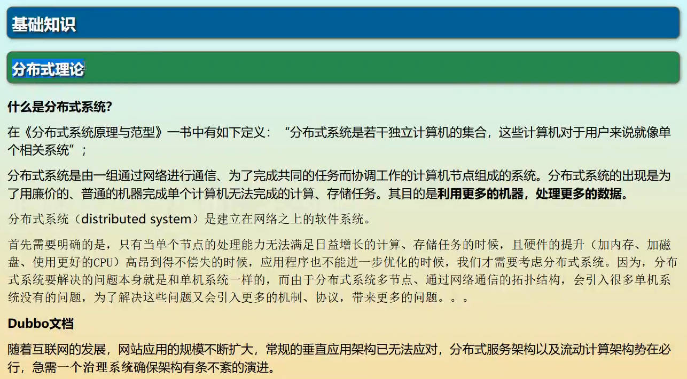 | 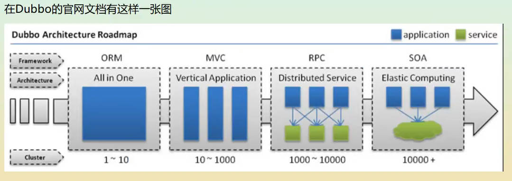    |
| --------------------------------------------------------- | ------------------------------------------------------------ |
| 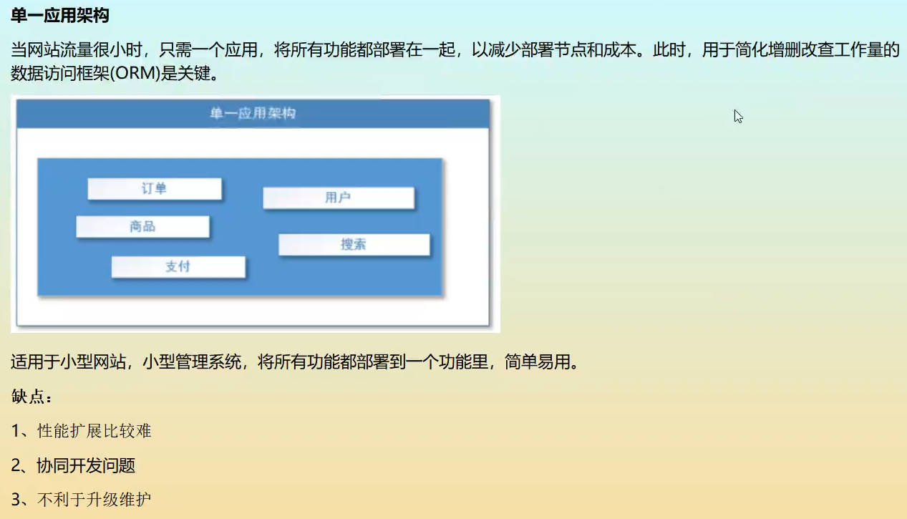 | 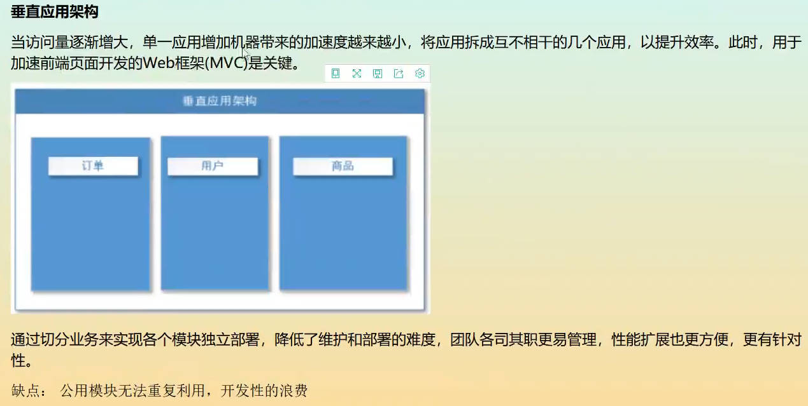    |
| 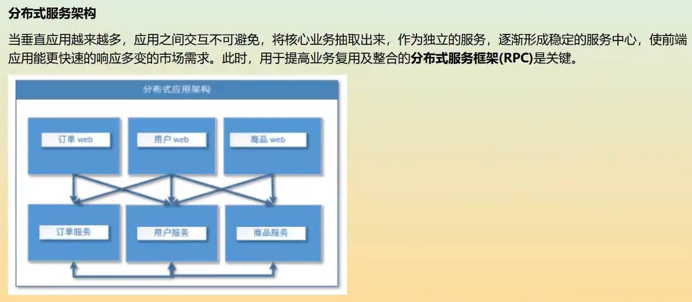 | 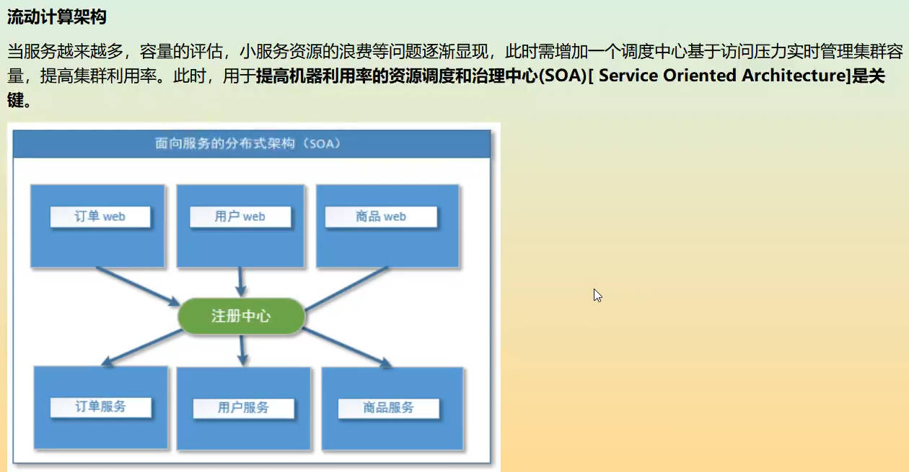 |

RPC两个核心模块： 通讯、序列化

| 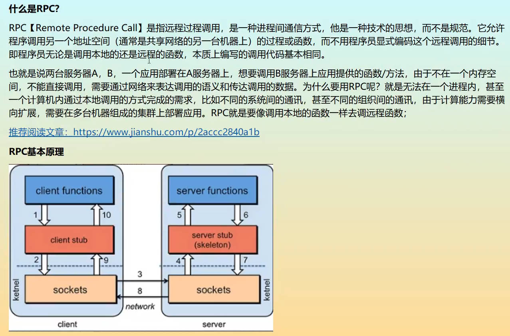 | 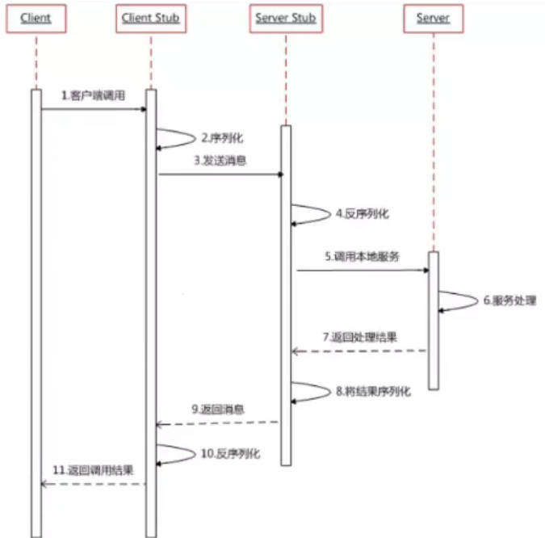 |
| --------------------------------------------------------- | --------------------------------------------------------- |

Dubbo

| 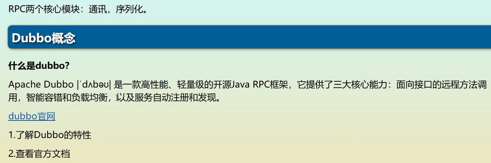 | 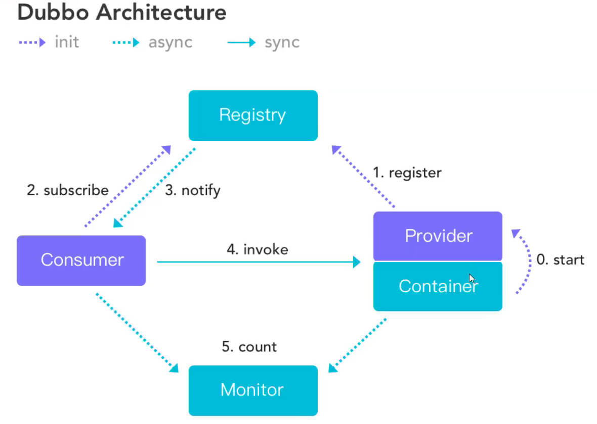 |
| --------------------------------------------------------- | --------------------------------------------------------- |
| 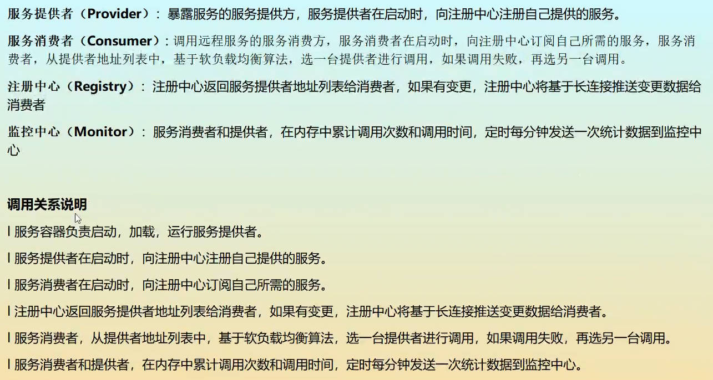 |                                                      |

## 6、聊聊现在和未来

[SpringCloud Tencent 全套解决方案](https://blog.csdn.net/2401_89872708/article/details/145099762)  [spring cloud_百度百科](https://baike.baidu.com/item/spring%20cloud/20269825)   

[SpringCloud 详解：微服务架构的主流解决方案](https://download.csdn.net/blog/column/11818193/150579042)  [SpringCloud 详解：微服务架构的主流解决方案](https://guobao.blog.csdn.net/article/details/150579042)   

[Spring Cloud 到底解决了什么？单体、集群、分布式、微服务一次讲透](https://blog.csdn.net/2301_78967866/article/details/170196623)  

1. 客户端通过API网关去访问
2. 服务之间用http通信
3. 如何治理： 服务注册与发现

| 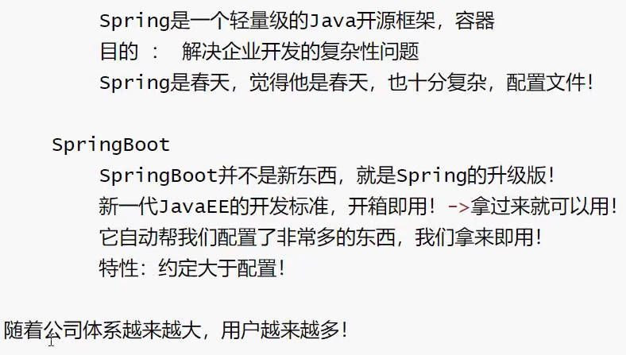 | 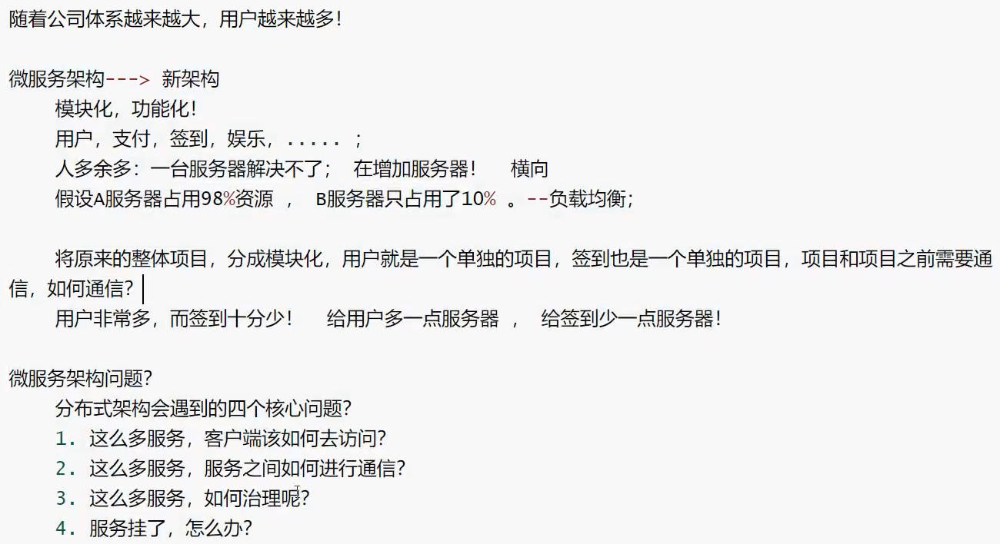 |
| --------------------------------------------------------- | --------------------------------------------------------- |
| 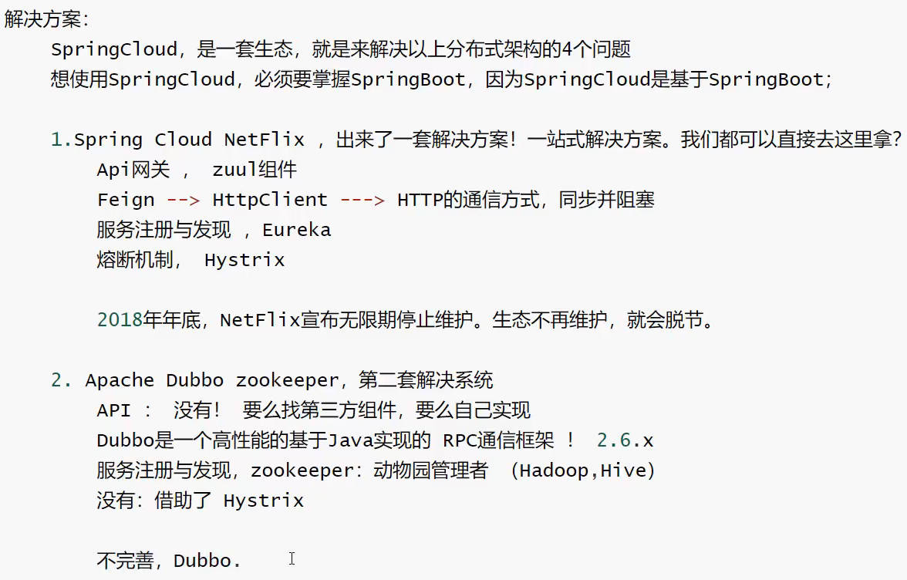 | 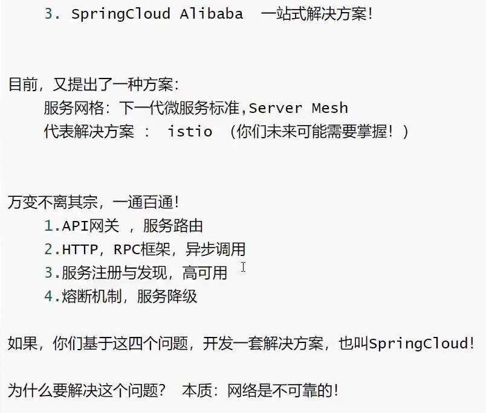 |

