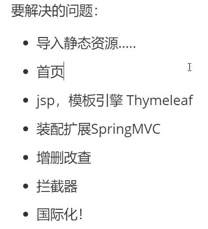

# 微服务

## 微服务

弹性计算： [Elastic computing_百度搜索](https://www.baidu.com/s?ie=UTF-8&wd=elastic%20computing)  [什么是弹性计算（Elastic computing）？](https://baijiahao.baidu.com/s?id=1792694867288651617&wfr=spider&for=pc)  [弹性计算_百度百科](https://baike.baidu.com/item/%E5%BC%B9%E6%80%A7%E8%AE%A1%E7%AE%97/64476282)  [Elastic Computing](https://www.sciencedirect.com/topics/computer-science/elastic-computing)  

微服务相当于一个一个的业务，MVC的业务拆分成模块

# 模板引擎

[Thymeleaf一篇就够了](https://cloud.tencent.com/developer/article/2308879)  [FreeMarker_百度搜索](https://www.baidu.com/s?wd=FreeMarker&usm=3&ie=utf-8&oq=jsp%E6%8A%80%E6%9C%AF%E5%B7%B2%E7%BB%8F%E6%B2%A1%E7%94%A8%E4%BA%86%E5%90%97&rsv_dl=re_dqa_generate&sa=re_dqa_generate)  [ FreeMarker 模板引擎](https://cloud.tencent.com/developer/article/2368177)  

## 模板引擎是什么

[模板引擎是什么_百度搜索](https://www.baidu.com/s?ie=UTF-8&wd=%E6%A8%A1%E6%9D%BF%E5%BC%95%E6%93%8E%E6%98%AF%E4%BB%80%E4%B9%88)  

模板引擎是Web开发中用于把页面结构和业务数据分离、动态生成HTML文档的工具。核心价值是让界面和逻辑解耦——前端改页面、后端改数据互不影响，代码更好维护。

### 工作原理

模板引擎靠“模板 + 数据 = 输出”工作。模板是写好的静态结构，里面留了占位标记（如`{$name}`或`${user.name}`），引擎把数据填入这些位置，最终输出完整HTML页面。

### 常见类型

1. 置换型：通过字符串替换实现基础功能，逻辑简单但能力有限。
2. 解释型：运行时解析模板语法，灵活但性能相对较低。
3. 编译型：把模板预编译成代码（如PHP脚本），执行效率更高，代表有Smarty。

### 主流实现

- Java生态：Thymeleaf和FreeMarker最常用。Thymeleaf是Spring Boot官方推荐的JSP替代方案，支持“自然模板”——模板本身就能在浏览器里当静态原型预览；FreeMarker更通用，能生成HTML、邮件、配置文件等。
- PHP生态：Smarty是老牌选择，支持编译缓存、模板继承；Twig语法简洁、安全，编译成优化后的PHP代码。

### 为什么重要

早期Web开发常把PHP或Java代码和HTML混在一起，页面一复杂就难维护。模板引擎把视图层独立出来，前端设计师改模板不用碰程序逻辑，后端开发改数据不影响页面，多人协作效率明显提升。

模板引擎类型和原理搞清楚了，可以再看看Thymeleaf和FreeMarker怎么选或者编译型和解释型性能差多少

## 模板引擎功能是不是类似JSP

[模板引擎功能是不是类似JSP_百度搜索](https://www.baidu.com/s?ie=UTF-8&wd=%E6%A8%A1%E6%9D%BF%E5%BC%95%E6%93%8E%E5%8A%9F%E8%83%BD%E6%98%AF%E4%B8%8D%E6%98%AF%E7%B1%BB%E4%BC%BCJSP)  

模板引擎和JSP在功能上确实有相似之处，但又不完全一样。两者核心作用都是把动态数据填充到模板里生成最终页面，实现页面展示和业务逻辑分离。但 JSP 本质是“能写 Java 代码的网页”，而现代模板引擎（如 Thymeleaf）更强调“纯 HTML 模板 + 标签语法”，强制分离视图与业务逻辑。

### 核心区别

1. 代码嵌入方式：JSP 允许直接在页面里写 Java 代码（`<% %>`），灵活但易破坏 MVC 结构；模板引擎（如 Thymeleaf、FreeMarker）不允许写 Java 代码，只能通过表达式和标签取数据，强制更干净的分离。
2. 模板形态：JSP 本质是 Java 类，编译成 Servlet 运行，依赖 Servlet 容器；Thymeleaf 模板是纯 HTML 文件，浏览器可直接打开静态预览，不启动后端也能看到页面结构。
3. Spring Boot 支持：Spring Boot 官方推荐 Thymeleaf 作为默认模板引擎，默认不支持 JSP（尤其 jar 打包方式），这是选择模板引擎时很实际的区别。

### 主流模板引擎对比

| 引擎       | 特点                                        | 现状                                 |
| ---------- | ------------------------------------------- | ------------------------------------ |
| JSP        | 功能强大、可写 Java 代码、官方标准          | 遗留系统使用较多，新项目逐渐减少     |
| Thymeleaf  | 自然模板、动静结合、与 Spring Boot 完美整合 | Spring Boot 官方推荐，当前主流       |
| FreeMarker | 性能好、语法强大、不依赖 Servlet 容器       | 适合生成非 HTML 内容（如 XML、邮件） |
| Velocity   | 语法简单、接近 Java                         | 社区活跃度低，逐渐被取代             |

> 关键区别：JSP 是“网页里嵌代码”，Thymeleaf 是“HTML 里加标签”。前者灵活但易乱，后者约束更强、更利于前后端协作。

你之前关注 Spring 生态，若在 Spring Boot 项目里选模板引擎，Thymeleaf 基本是默认答案，与 Spring MVC 集成几乎零配置，表单绑定、国际化都直接支持。

模板引擎和JSP确实有区别，要不要继续看看Thymeleaf的语法有哪些特点或者为什么Spring Boot默认用Thymeleaf

## 前后端分离架构还用模板引擎吗

[java输出数据,vue生成页面,还要模板引擎干什么_百度搜索](https://www.baidu.com/s?ie=UTF-8&wd=java%E8%BE%93%E5%87%BA%E6%95%B0%E6%8D%AE%EF%BC%8Cvue%E7%94%9F%E6%88%90%E9%A1%B5%E9%9D%A2%EF%BC%8C%E8%BF%98%E8%A6%81%E6%A8%A1%E6%9D%BF%E5%BC%95%E6%93%8E%E5%B9%B2%E4%BB%80%E4%B9%88)  

问题： java输出数据,vue生成页面,还要模板引擎干什么？

模板引擎在前后端分离架构里依然有用，但它服务的场景变了。Java输出JSON数据、Vue负责页面渲染，这是典型的前后端分离模式，此时模板引擎不再负责生成业务页面，而是转向其他不可替代的用途。

### 服务端渲染（SSR）场景

门户网站、新闻站点、官网等页面需要SEO，搜索引擎爬虫对JS动态渲染的内容抓取能力有限。此时用Thymeleaf或FreeMarker在服务端直接把数据拼成HTML输出，爬虫拿到的是完整页面。

首屏加载速度也是考量。服务端直接返回HTML，用户看到内容更快，不用等JS下载执行完再渲染。

### 非浏览器输出场景

模板引擎不只生成HTML，还能生成邮件正文、Word文档、数据报表、配置文件等。比如发送注册验证邮件，用FreeMarker模板填充用户名和链接，比在Java代码里字符串拼接优雅得多。

==代码生成器==也依赖模板引擎。像==若依框架==这类开源后台管理系统，自动生成Java文件、XML配置，核心就是模板引擎把模板和数据结合输出代码文件。

### 前后端分离下的其他用途

前端工程化构建流程中，模板引擎参与编译阶段。Webpack或Rollup里的模板插件，把模板文件编译成静态HTML或运行时动态渲染的JS代码。

Vue本身也内置模板编译能力，`v-for`、`v-if`这些指令本质上就是模板引擎的语法糖，负责把模板字符串编译成渲染函数。

### 什么时候不需要模板引擎

纯后台管理系统、内部工具、数据看板这类不需要SEO、不需要服务端渲染的项目，用Spring Boot + Vue的接口分离模式就够了，模板引擎确实用不上。

> 简单判断：需要SEO、需要生成文件、需要静态化页面时，模板引擎依然刚需；纯接口+前端渲染的业务系统，可以完全不用。

模板引擎在前后端分离后用法变了，要不要了解一下Thymeleaf和FreeMarker的区别或者前后端分离项目需要模板引擎吗

## 服务端渲染需要模板引擎吗

[服务端渲染需要模板引擎吗_百度搜索](https://www.baidu.com/s?ie=UTF-8&wd=%E6%9C%8D%E5%8A%A1%E7%AB%AF%E6%B8%B2%E6%9F%93%E9%9C%80%E8%A6%81%E6%A8%A1%E6%9D%BF%E5%BC%95%E6%93%8E%E5%90%97)  

服务端渲染不一定需要模板引擎，但绝大多数场景下都会用。模板引擎是传统 SSR 最主流的实现方式，但==现代前端框架（如 React、Vue）的 SSR 方案是通过框架自身的组件渲染机制生成 HTML==，并不依赖传统模板引擎。

### 两种实现路径

1. 传统模板引擎方案：服务端==直接用模板引擎把数据和模板拼接成 HTML==，再返回给浏览器。常见的有 `Thymeleaf、Freemarker、JSP（Java 生态）、EJS、Pug、Handlebars（Node.js 生态）`等。
2. 现代框架 SSR 方案：用 Next.js（React）、Nuxt.js（Vue）这类框架，服务端把组件渲染成 HTML 字符串返回，浏览器接收后通过“水合（Hydration）”激活交互。

### 怎么选

- 传统后端项目（如 Spring Boot、Express 做内容型网站或后台管理系统）：用模板引擎更直接，开发效率高，SEO 友好。
- 现代前端项目（SPA 改造或对首屏速度、SEO 要求高）：用 Next.js/Nuxt.js 这类框架级 SSR 方案，不需要额外引入模板引擎。
- 简单场景：如果只是返回少量动态 HTML，服务端直接用字符串拼接也能实现 SSR，只是维护性差，不推荐用于复杂页面。

> 模板引擎的核心价值是把“数据 + 模板”的拼接工作自动化，避免手写字符串拼接，让代码更易维护。但“服务端渲染”和“模板引擎”是两个概念，前者是目标，后者是手段之一。

两种实现路径各有侧重，可以看看传统模板引擎和框架级SSR的优缺点对比或者Next.js和Nuxt.js在SSR上的区别

# SpringBoot

## 个人总结

pom.xml

- `spring-boot-starter-parent`：父工程里面，``spring-boot-dependencies`` 各种依赖jar包在父工程里

启动器： SpringBoot 启动场景

- 比如`spring-boot-starter-web`：帮我们导入web环境所有的依赖

==@SpringBootApplication==

- 组合注解，由`@SpringBootConfiguration、@EnableAutoConfiguration 和@ComponentScan` 三个注解构成，用于快速启动 Spring Boot 应用并开启==自动配置==与==组件扫描==功能
- 根据引入的依赖和已有配置，自动帮容器==注册需要的 Bean==，实现“约定大于配置”

## SpringBoot

[SpringBoot,是一个javaweb的开发框架,和SpringMVC类似_百度搜索](https://www.baidu.com/s?ie=UTF-8&wd=SpringBoot%EF%BC%8C%E6%98%AF%E4%B8%80%E4%B8%AAjavaweb%E7%9A%84%E5%BC%80%E5%8F%91%E6%A1%86%E6%9E%B6%EF%BC%8C%E5%92%8CSpringMVC%E7%B1%BB%E4%BC%BC)  

问题： SpringBoot,是一个javaweb的开发框架,和SpringMVC类似

Spring Boot 并非与 Spring MVC 类似，而是==基于 Spring 框架（包含 Spring MVC）的快速开发脚手架==。

- Spring MVC 是处理 Web 请求的 MVC 框架
- 而 Spring Boot 通过“约定优于配置”、自动装配和内嵌服务器简化了 Spring 应用的搭建和部署。
  - 在 Spring Boot 中引入 `spring-boot-starter-web` 即自动集成了 Spring MVC。

以下是一个标准的 Spring Boot Web 项目最小化实现：

1. Maven 依赖 (pom.xml)
```xml
<parent>
    <groupId>org.springframework.boot</groupId>
    <artifactId>spring-boot-starter-parent</artifactId>
    <version>3.2.0</version> <!-- 请使用最新稳定版 -->
</parent>

<dependencies>
    <!-- 集成 Spring MVC 和内嵌 Tomcat -->
    <dependency>
        <groupId>org.springframework.boot</groupId>
        <artifactId>spring-boot-starter-web</artifactId>
    </dependency>
</dependencies>
```

2. 启动类
```java
import org.springframework.boot.SpringApplication;
import org.springframework.boot.autoconfigure.SpringBootApplication;

@SpringBootApplication // 开启组件扫描和自动配置
public class Application {
    public static void main(String[] args) {
        SpringApplication.run(Application.class, args);
    }
}
```

3. 控制器 (Controller)
```java
import org.springframework.web.bind.annotation.GetMapping;
import org.springframework.web.bind.annotation.RestController;

@RestController // 等同于 @Controller + @ResponseBody
public class HelloController {

    @GetMapping("/hello")
    public String hello() {
        return "Hello, Spring Boot!";
    }
}
```

4. 配置文件 (application.yml)
```yaml
server:
  port: 8080    #可选，默认即为8080
```

直接运行 `Application` 类的 `main` 方法即可启动内嵌 Tomcat 并访问 `http://localhost:8080/hello`。

Spring Boot 简化了开发，要不要继续看看它和Spring MVC具体有哪些区别或者内嵌服务器有哪些选择

## SpringBoot==自动装配原理==

### 一句话概括

Spring Boot 自动装配的本质是：**启动时通过 `@EnableAutoConfiguration` 导入一个选择器，从 jar 包的约定文件里把所有候选自动配置类全量读出来，再经过条件注解（`@Conditional`）层层过滤，只把当前环境真正需要的配置类注册进 IoC 容器**，从而实现“约定优于配置、引入 starter 即开箱即用”。

------

### 一、注解链条：从 `@SpringBootApplication` 开始

```java
@SpringBootApplication
public class DemoApplication {
    public static void main(String[] args) {
        SpringApplication.run(DemoApplication.class, args);
    }
}
```

`@SpringBootApplication` 是一个组合注解，核心由三个部分组成：

| 注解                       | 作用                                        |
| -------------------------- | ------------------------------------------- |
| `@SpringBootConfiguration` | 本质是 `@Configuration`，标记这是一个配置类 |
| `@ComponentScan`           | 扫描启动类所在包及子包下的组件              |
| `@EnableAutoConfiguration` | **自动装配的入口**，开启自动配置            |

`@EnableAutoConfiguration` 的关键在这里：

```java
@Import(AutoConfigurationImportSelector.class)
public @interface EnableAutoConfiguration {
    String ENABLED_DEFAULTS = "spring.boot.enableautoconfiguration";
    Class<?>[] exclude() default {};      // 排除指定自动配置类
    String[] excludeName() default {};    // 按类名排除
}
```

所以整个自动装配的“发动机”就是 `AutoConfigurationImportSelector`。

------

### 二、加载流程（核心原理）

#### 第 1 步：`@Import` 触发 `AutoConfigurationImportSelector`

`AutoConfigurationImportSelector` 实现了 `DeferredImportSelector`（延迟导入选择器）。它和普通的 `ImportSelector` 区别在于：**它会在 `@ComponentScan` 扫描完成之后才执行**，这样才能保证用户自己写的 Bean 先注册，自动配置后注册，从而实现“用户配置优先、自动配置兜底”。

#### 第 2 步：全量加载候选自动配置类

`getAutoConfigurationEntry()` 中调用 `getCandidateConfigurations()`，通过 `SpringFactoriesLoader.loadFactoryNames()` 读取类路径下所有 jar 的约定文件：

- Spring Boot 2.7 之前： `META-INF/spring.factories`

  ```properties
  org.springframework.boot.autoconfigure.EnableAutoConfiguration=\
  org.springframework.boot.autoconfigure.web.servlet.WebMvcAutoConfiguration,\
  org.springframework.boot.autoconfigure.jdbc.DataSourceAutoConfiguration,\
  ...
  ```

- **Spring Boot 2.7+ / 3.x**：改为 `META-INF/spring/org.springframework.boot.autoconfigure.AutoConfiguration.imports`，一行一个类名（性能更好，避免解析 properties 的开销）。

这一步会把**所有** starter 里声明的自动配置类名收集成一个 List，此时还没有做任何判断。

#### 第 3 步：去重、排除

- 处理 `exclude` / `excludeName` 属性；
- 读取配置文件 `spring.autoconfigure.exclude`；
- 通过 `AutoConfigurationImportFilter`（如 `OnClassCondition` 的批量过滤）做**第一轮快速过滤**——这是性能优化点，避免对每个类都反射解析注解。

#### 第 4 步：条件过滤（`@Conditional` 家族）

每个自动配置类上都挂着条件注解，典型如：

```java
@AutoConfiguration
@ConditionalOnClass(DataSource.class)          // 类路径下必须有该类
@ConditionalOnMissingBean(DataSource.class)    // 容器里没有用户自定义的才生效
@EnableConfigurationProperties(DataSourceProperties.class)
public class DataSourceAutoConfiguration { ... }
```

只有条件全部成立，这个配置类才会被真正解析并注册 Bean。

#### 第 5 步：排序后注册

按 `@AutoConfigureOrder`、`@AutoConfigureAfter`、`@AutoConfigureBefore` 排序，然后由 `ConfigurationClassParser` 解析，把其中的 `@Bean` 方法注册进容器。

#### 第 6 步：配置属性绑定

自动配置类通常配合 `@EnableConfigurationProperties(XxxProperties.class)`，把 `application.yml` 中 `spring.datasource.*` 这类配置绑定到 POJO 上，供 `@Bean` 方法读取。

------

### 三、条件注解 `@Conditional` 是关键

`@Conditional(XxxCondition.class)` 是 Spring 4 提供的通用条件装配机制，`Condition` 接口的核心方法：

```java
public interface Condition {
    boolean matches(ConditionContext context, AnnotatedTypeMetadata metadata);
}
```

Spring Boot 在其之上封装了一整套注解：

| 注解                                                 | 含义                    |
| ---------------------------------------------------- | ----------------------- |
| `@ConditionalOnClass` / `@ConditionalOnMissingClass` | 类路径中是否存在某个类  |
| `@ConditionalOnBean` / `@ConditionalOnMissingBean`   | 容器中是否已有某个 Bean |
| `@ConditionalOnProperty`                             | 配置项是否满足指定值    |
| `@ConditionalOnWebApplication`                       | 是否是 Web 应用         |
| `@ConditionalOnJava`                                 | JDK 版本是否满足        |
| `@ConditionalOnExpression`                           | SpEL 表达式为 true      |

**`@ConditionalOnMissingBean` 是实现“可覆盖”的核心**：用户自己定义了同类型 Bean，自动配置就不再生效，这就是“约定优于配置 + 用户优先”的落地方式。

> 注意：`@ConditionalOnMissingBean` 依赖 Bean 的注册顺序，所以它只能用在自动配置类中（配合 `@AutoConfigureAfter` 保证顺序），写在普通 `@Configuration` 里行为不可靠。

------

### 四、一个简化版流程示意

```
SpringApplication.run()
        ↓
@SpringBootApplication → @EnableAutoConfiguration
        ↓
@Import(AutoConfigurationImportSelector.class)
        ↓
读取 META-INF/spring/...AutoConfiguration.imports（全量类名）
        ↓
排除（exclude / spring.autoconfigure.exclude）
        ↓
AutoConfigurationImportFilter 快速过滤（如 OnClassCondition）
        ↓
排序（Order / After / Before）
        ↓
逐个解析 @Conditional 条件
        ↓
条件成立的配置类 → 注册 @Bean 到 IoC 容器
        ↓
@ConfigurationProperties 绑定 application.yml 配置
```

------

### 五、自定义 Starter 的实践要点

一个完整的 starter 通常拆成两个模块：

**1）`xxx-spring-boot-autoconfigure` 模块**

```java
@AutoConfiguration
@ConditionalOnClass(MyClient.class)
@EnableConfigurationProperties(MyClientProperties.class)
public class MyClientAutoConfiguration {

    @Bean
    @ConditionalOnMissingBean(MyClient.class)
    public MyClient myClient(MyClientProperties props) {
        return new MyClient(props.getEndpoint(), props.getTimeout());
    }
}
@ConfigurationProperties(prefix = "my.client")
public class MyClientProperties {
    private String endpoint;
    private int timeout = 3000;
    // getter / setter
}
```

`resources/META-INF/spring/org.springframework.boot.autoconfigure.AutoConfiguration.imports`：

```
com.example.MyClientAutoConfiguration
```

**2）`xxx-spring-boot-starter` 模块**

只做依赖聚合（pom 里依赖 autoconfigure 模块和第三方 SDK），不含代码。

用户只需引入 starter，再在 yml 中写：

```yaml
my:
  client:
    endpoint: http://api.example.com
    timeout: 5000
```

即可直接 `@Autowired MyClient`。

------

### 六、常见坑与注意点

1. **自动配置不生效**：优先检查 `imports` 文件路径和类名是否写错、`@ConditionalOnClass` 的类是否真的在 classpath、是否被 `spring.autoconfigure.exclude` 排除。
2. **Bean 被覆盖或冲突**：多为 `@ConditionalOnMissingBean` 顺序问题，补上 `@AutoConfigureAfter(DataSourceAutoConfiguration.class)` 之类的声明。
3. **`@ConfigurationProperties` 不生效**：确认有 getter/setter（或构造器绑定），且类被 `@EnableConfigurationProperties` 或 `@Component` 注册；IDE 建议引入 `spring-boot-configuration-processor` 以生成元数据、获得配置提示。
4. **启动变慢**：自动配置类过多时，可用 `spring.autoconfigure.exclude` 关掉不需要的（如不用数据库就排除 `DataSourceAutoConfiguration`）。
5. **调试手段**：启动参数加 `--debug` 或 `logging.level.org.springframework.boot.autoconfigure=DEBUG`，控制台会打印 `Positive matches`（生效的）和 `Negative matches`（未生效及原因），排查非常直观。
6. **版本差异**：Spring Boot 2.7 起 `spring.factories` 中的自动配置声明迁移到 `AutoConfiguration.imports`，3.0 后彻底不再读取旧文件，写 starter 时要按目标版本选择。

------

如果你想更进一步，我可以帮你手写一个完整的自定义 starter Demo（含 autoconfigure + starter 两个模块的完整代码和目录结构），或者结合某个具体 starter（比如 MyBatis、Redis）逐行拆解它的自动配置源码。

## SpringBoot自动装配原理

[SpringBoot自动装配原理_百度搜索](https://www.baidu.com/s?ie=UTF-8&wd=SpringBoot%E8%87%AA%E5%8A%A8%E8%A3%85%E9%85%8D%E5%8E%9F%E7%90%86)  

Spring Boot 自动装配原理是通过@EnableAutoConfiguration 注解，利用 AutoConfigurationImportSelector 读取配置文件并加载符合条件的配置类到 IOC 容器。

### 核心机制与入口注解

1. 应用启动时，@SpringBootApplication 注解自动包含@EnableAutoConfiguration。
2. @EnableAutoConfiguration 通过@Import 导入 AutoConfigurationImportSelector 类。
3. 该选择器负责扫描 classpath 并动态加载配置类到 Spring 容器。


### 配置文件与加载流程

1. Spring Boot 2.x 版本使用 META-INF/spring.factories 文件存储配置类列表。
2. 2.7 版本起新增 META-INF/spring/org.springframework.boot.autoconfigure.AutoConfiguration.imports 文件。
3. 3.x 版本主要采用新机制，旧方式保留兼容性。
4. SpringFactoriesLoader 根据 key 加载对应类到 IOC 容器。


### 条件过滤与版本差异

1. 配置类使用@ConditionalOnClass 等条件注解进行过滤。
2. 仅当 classpath 存在指定类时，对应配置才会生效。
3. 可通过 exclude 属性或 spring.autoconfigure.exclude 配置排除特定自动配置。
4. 启动时添加--debug 参数可输出自动配置条件报告便于排查。

自动装配的条件判断机制挺有意思，要不要了解一下 ConditionalOnClass具体怎么触发的？ 或者 exclude属性和debug参数有何区别？

## ==@SpringBootApplication==

> 点开进入里面： `@Import(AutoConfigurationPackages.Registrar.class)`，导入选择器

@SpringBootApplication 是 Spring Boot 应用的核心启动注解，它是一个==组合注解==，由`@SpringBootConfiguration、@EnableAutoConfiguration 和@ComponentScan` 三个注解构成，用于==快速启动 Spring Boot 应用==并==开启自动配置与组件扫描==功能 。

### 注解组成与核心作用

@SpringBootApplication 作为 Spring Boot 项目的入口标识，通常标注在主应用程序类上，该类包含 main 方法作为程序启动点 。这个组合注解简化了配置，单个注解即可启用 Spring Boot 的三大核心特性：
1. 配置类标识：将当前类标记为 Spring 配置类，允许在上下文中注册 bean 或导入其他配置类。
2. 自动配置启用：根据项目依赖自动配置所需的 bean，如添加 web 依赖后自动配置 Tomcat 和 Spring MVC。
3. 组件扫描激活：自动扫描指定包下的组件类并注册为 Spring Bean。

### 三个子注解详解

- @SpringBootConfiguration：本质是`@Configuration` 的变体，标记当前类为配置类入口，允许通过@Bean 方法定义组件。
- @EnableAutoConfiguration：==自动配置机制的入口==，根据类路径依赖（如 spring-boot-starter-web）自动配置应用组件，通过读取 `META-INF/spring.factories` 或 `AutoConfiguration.imports` 文件加载预定义的自动配置类。
- @ComponentScan：==自动扫描==当前类所在包及其子包中标记有@Component、@Service、@Controller 等注解的类，并注册为 Spring Bean。

### 使用注意事项

1. 启动类位置：@ComponentScan 默认只扫描启动类所在包及其子包，若将启动类放在深层子包（如 com.example.demo.app），则 com.example.demo.service 下的类无法被扫描到，解决办法是将启动类放在最外层包或手动指定 scanBasePackages。
2. 自定义扫描范围：可通过@SpringBootApplication(scanBasePackages = "com.example.demo") 手动配置扫描的包路径。
3. 排除自动配置：可通过 exclude 或 excludeName 属性排除不需要的自动配置类。

这个注解是组合注解，可以继续了解 它和 @Configuration 有什么区别？ 或者 如何排除特定的自动配置类？

## spring-boot-starter-parent

[spring-boot-starter-parent_百度搜索](https://www.baidu.com/s?ie=UTF-8&wd=spring-boot-starter-parent)  

`spring-boot-starter-parent` 是 Spring Boot 官方提供的Maven 父项目，在 `pom.xml` 中用 `<parent>` 继承它，项目就能==获得统一的依赖版本管理和默认构建配置，从而减少版本冲突和手动配置==。

- 统一依赖版本：它内部继承 spring-boot-dependencies，锁定了 Spring、数据库、日志等常用组件的兼容版本，子项目引入依赖时通常可以不写 version，降低版本冲突风险。
- 默认构建配置：提供 Java 版本、UTF-8 编码、资源过滤、打包插件等开箱即用配置，简化 pom.xml 维护；需要时可通过属性覆盖，如指定 `<java.version>`。
- 按需引入依赖：parent 只管理版本，不会自动把所有 jar 导入项目；实际需要什么依赖，再在子项目中单独声明即可。
- 与 `spring-boot-dependencies` 的区别：后者是 BOM（只管理依赖版本），前者是父 POM，在==版本管理基础上还提供构建和插件配置==，通常直接继承 parent 更方便。
- 版本选择：具体版本需按 Spring Boot 官方路线图选择，升级时建议整体调整 parent 版本，以保持依赖兼容性。

了解了 parent 的作用，要不要继续看看 子项目如何覆盖 parent 的配置？ 或者 不同 Spring Boot 版本之间有什么区别？

# @SpringBootApplication

## @EnableAutoConfiguration

@EnableAutoConfiguration 是 Spring Boot 自动配置的“总开关”，项目启动时它会根据你引入的依赖和已有配置，自动帮容器注册需要的 Bean，实现“约定大于配置”。日常开发中通常不需要单独加它，因为 `@SpringBootApplication` 已经包含了它。

### 它是怎么起作用的

1. 开启自动配置能力：这个注解告诉 Spring Boot，启动时去类路径中查找可用的自动配置类，并按条件加载到容器里。
2. 按条件决定加载哪些配置：不是所有自动配置类都会生效，只有满足特定条件才会加载。常见判断条件包括：
   - 类路径里存在某个类，才加载对应配置（例如引入了 Redis 依赖，才会配置 RedisTemplate）。
   - 容器里还没有某个 Bean，才会创建默认 Bean（如果你自己定义了同名 Bean，自动配置会退避）。
   - 配置文件中的属性满足要求，才会加载对应配置。
3. 自动配置在用户自定义 Bean 之后应用：这样你自定义的 Bean 可以覆盖自动配置的默认行为。


### 底层怎么找到并加载配置类

1. 扫描自动配置清单：`@EnableAutoConfiguration` 会借助 `AutoConfigurationImportSelector`，读取类路径下 `META-INF/spring.factories` 文件中的自动配置类全类名。
2. 筛选并去重：拿到候选配置类后，会根据条件注解过滤掉当前场景不需要的类，并去除重复项。
3. 注册到容器：最终符合条件的自动配置类会被导入并注册为 Bean，完成自动装配。


### 开发中怎么使用和排除

1. 通常直接用 `@SpringBootApplication` 即可：这个组合注解内部已经包含 `@EnableAutoConfiguration`，不用单独添加。
2. 想关闭某些自动配置时，可以用以下方式排除：
   - 在 `@SpringBootApplication` 上指定 `exclude`，传入要排除的自动配置类。
   - 在配置文件中设置 `spring.autoconfigure.exclude`，指定要排除的自动配置类全类名。
3. 覆盖自动配置：直接定义同类型的 Bean，自动配置会因为 `@ConditionalOnMissingBean` 而不再创建默认 Bean。

自动配置的条件判断很关键，可以看看 ConditionalOnMissingBean 是怎么工作的？ 或者 ConditionalOnClass 依赖什么条件？

## @EnableAutoConfiguration 自动配置工作流程

`@EnableAutoConfiguration` 的工作流程可以概括为一条链：**注解触发 → 延迟导入选择器 → SPI 读取候选清单 → 去重与排除 → 条件过滤 → 排序 → 按配置类解析注册 Bean**，而“用户定义优先”是靠延迟导入 + `@ConditionalOnMissingBean` 两点共同保证的。下面按执行顺序拆开讲。

### 一、入口：注解是怎么被激活的

`@SpringBootApplication` 是复合注解，包含 `@SpringBootConfiguration`（等价 `@Configuration`）、`@ComponentScan`、`@EnableAutoConfiguration`。其中自动配置的关键是：

```java
@AutoConfigurationPackage
@Import(AutoConfigurationImportSelector.class)   // 关键
public @interface EnableAutoConfiguration { ... }
```

`@Import` 把 `AutoConfigurationImportSelector` 交给 Spring 的 `ConfigurationClassParser` 处理，这是整个流程的起点。

### 二、关键时机：DeferredImportSelector 的“延迟”特权

`AutoConfigurationImportSelector` 实现的不是普通 `ImportSelector`，而是 `DeferredImportSelector`。普通导入是“立刻导入”，而延迟导入会等到**所有业务配置类（用户 `@Configuration`、`@ComponentScan` 扫到的类）解析完之后**才执行 `selectImports()`。

这个顺序是“用户优先”的**结构性基础**：用户 Bean 的定义先注册进容器，自动配置后到，才有“让位”的可能。

执行时机上，它发生在 Spring 容器初始化的 BeanFactoryPostProcessor 阶段（`ConfigurationClassPostProcessor` → `ConfigurationClassParser#processImports`），也就是 Bean 实例化之前的 BeanDefinition 解析期。

### 三、候选清单加载：SPI 读取（有版本差异）

`selectImports()` 内部通过 `getAutoConfigurationEntry()` 完成加载，候选类名来自 classpath 下各 jar 的声明文件，聚合所有 jar 的清单后全局去重：

| 版本       | 清单文件                                                     | 格式                |
| ---------- | ------------------------------------------------------------ | ------------------- |
| 2.7 及以前 | `META-INF/spring.factories`（`EnableAutoConfiguration` 键）  | key=value，逗号分隔 |
| 2.7+/3.x   | `META-INF/spring/org.springframework.boot.autoconfigure.AutoConfiguration.imports` | 每行一个全限定类名  |

新版拆分文件主要是为了减少无效 IO、适配 JPMS 与 GraalVM 原生镜像，加载逻辑本身没变。

一个典型 Web 应用聚合到的候选有上百个，但“加载清单”不等于“全部装配”，绝大多数会在后续条件过滤中被跳过。

### 四、去重、排除与条件过滤（三层漏斗）

`getAutoConfigurationEntry()` 的处理顺序大致是：

1. **去重** `removeDuplicates()`；
2. **排除** 注解上的 `exclude` / `excludeName`，以及配置文件中的 `spring.autoconfigure.exclude`；
3. **条件过滤** `filter()`，依据 `AutoConfigurationMetadata`（由 `AutoConfigurationMetadataLoader` 预加载的元数据）快速判断，不满足条件的直接剔除。

条件注解在**Bean 定义注册阶段**评估，不满足则整个配置类（含其中 `@Bean`）被跳过。常见的过滤漏斗是：

```
上百个候选
  ↓ @ConditionalOnClass（classpath 有依赖才进门）
几十个
  ↓ @ConditionalOnProperty / @ConditionalOnWebApplication 等
更少
  ↓ @ConditionalOnMissingBean（用户没定义才装）
最终生效的自动配置
```

`@ConditionalOnClass` 判断的是 classpath 是否存在该类，而不是容器里有没有对应 Bean，这是常见误解点。

### 五、排序：三级优先级

过滤后的自动配置类并非乱序加载，而是按 `@AutoConfigureOrder`（数值越小越先）→ `@AutoConfigureBefore` / `@AutoConfigureAfter`（控制相对顺序，解决配置依赖冲突）→ 类名字母自然排序 三级规则排序。Spring Boot 2.7+ 提供专属的 `@AutoConfiguration` 注解（内含 `@Configuration` 与排序相关元注解）替代普通 `@Configuration`。

### 六、注册 Bean 与“用户优先”落地

幸存的自动配置类被当作普通 `@Configuration` 导入容器，由 `ConfigurationClassParser` 继续解析其内部 `@Bean` 方法。此时：

- `@EnableConfigurationProperties(XxxProperties.class)` 把 `application.yml` 中如 `spring.datasource.*` 的配置绑定到属性对象，供默认 Bean 使用；
- `@Bean` 上的 `@ConditionalOnMissingBean` 在注册前检查容器是否已有同类型 Bean，有则让位——这是“用户覆盖默认”的第二重保障。

所以结论是：**业务配置类先加载 → 自动配置类后加载 → `@ConditionalOnMissingBean` 天然让用户 Bean 覆盖框架 Bean**。

### 七、一句话时序串讲

`SpringApplication.run()` → 解析 `@SpringBootApplication` → 激活 `@EnableAutoConfiguration` → `@Import` 载入 `AutoConfigurationImportSelector` → 等待业务配置解析完毕（延迟导入）→ 读取 `AutoConfiguration.imports` / `spring.factories` 获取全量候选 → 去重、排除 → 条件注解筛选 → 三级排序 → 作为配置类解析 `@Bean` → 绑定 `@ConfigurationProperties` → 实例化并注册进 IOC 容器。

### 八、排查与自定义要点

- **调试**：启动参数加 `--debug`（或 `logging.level.org.springframework.boot.autoconfigure=DEBUG`）打印 `ConditionEvaluationReport`，可以看到哪些自动配置 matched、哪些 skipped 及原因；`--trace` 更详细。
- **自定义 Starter**：写自动配置类 + 属性类，再在 `resources/META-INF/spring/org.springframework.boot.autoconfigure.AutoConfiguration.imports` 中登记全类名（2.7 前用 `spring.factories`）；文件路径写错是最常见的“不生效”原因。
- **注意**：Starter 本身通常只是依赖坐标聚合，真正的自动配置逻辑在 `spring-boot-autoconfigure` 或配套 autoconfigure 包中。

如果你正在准备面试，建议按“入口注解 → 延迟导入 → SPI 清单（含版本差异）→ 条件过滤 → 排序 → 用户优先”这六段来背，逻辑链完整且不容易被追问打穿。需要我针对某一段（比如 `Condition` 的评估细节或 `AutoConfigurationMetadata` 的预编译机制）再深入展开吗？

## @EnableAutoConfiguration ==自动配置工作流程==

[@EnableAutoConfiguration 自动配置工作流程_百度搜索](https://www.baidu.com/s?ie=UTF-8&wd=@EnableAutoConfiguration%20%E8%87%AA%E5%8A%A8%E9%85%8D%E7%BD%AE%E5%B7%A5%E4%BD%9C%E6%B5%81%E7%A8%8B)  

@EnableAutoConfiguration 的工作流程本质是延迟导入（Deferred Import） + SPI 服务发现 + 条件过滤。

### 触发入口

`@SpringBootApplication` 包含 `@EnableAutoConfiguration`，后者通过 `@Import(AutoConfigurationImportSelector.class)` 引入核心处理器。

### 执行时机：延迟加载

`AutoConfigurationImportSelector` 实现了 `DeferredImportSelector` 接口。

*   普通 `@Import`：解析配置类时立即执行。
*   `DeferredImportSelector`：在所有用户自定义的 `@Configuration`、`@Bean` 处理完毕后，最后执行。
*   目的：确保 `@ConditionalOnMissingBean` 等条件注解能正确判断用户是否已自定义 Bean，实现“用户配置优先”。

### 核心处理链路 (getAutoConfigurationEntry)

在 `selectImports` 方法中调用 `getAutoConfigurationEntry`，执行以下五步：

Step 1: 加载候选配置类 (`getCandidateConfigurations`)
利用 SPI 机制扫描 Classpath 下的配置文件，获取所有潜在的自动配置类全限定名。
*   Spring Boot 2.7+ / 3.x：优先读取 `META-INF/spring/org.springframework.boot.autoconfigure.AutoConfiguration.imports`。
*   兼容旧版：若新文件不存在，回退读取 `META-INF/spring.factories` 中 `org.springframework.boot.autoconfigure.EnableAutoConfiguration` 键对应的值。

Step 2: 去重 (`removeDuplicates`)
移除重复的配置类名称。

Step 3: 处理排除项 (`getExclusions`)
收集需要排除的配置类，来源包括：
*   `@EnableAutoConfiguration(exclude=...)` 或 `excludeName=...`
*   配置文件属性 `spring.autoconfigure.exclude`

Step 4: 移除排除项 (`configurations.removeAll(exclusions)`)
从候选列表中剔除被明确排除的类。

Step 5: 条件过滤 (`getConfigurationClassFilter().filter()`)
这是性能优化的关键。使用 `AutoConfigurationImportFilter`（基于 ASM 字节码读取）进行预过滤：
*   检查 `@ConditionalOnClass`：判断类路径下是否存在指定类，无需加载类即可判断，避免 `NoClassDefFoundError`。
*   检查 `@ConditionalOnMissingClass`。
*   *注意*：此阶段仅做粗筛，细粒度的 `@ConditionalOnBean`、`@ConditionalOnProperty` 等在后续 Bean 注册阶段由 `ConditionEvaluator` 评估。

### 排序与注册

过滤后的配置类列表经过 `AutoConfigurationSorter` 进行拓扑排序（依据 `@AutoConfigureBefore`、`@AutoConfigureAfter`、`@AutoConfigureOrder`），最终返回给 Spring 容器。容器将这些类作为普通的 `@Configuration` 类进行解析和 Bean 注册。

### 关键代码逻辑示意

```java
// AutoConfigurationImportSelector.java 核心逻辑简化
protected AutoConfigurationEntry getAutoConfigurationEntry(AnnotationMetadata annotationMetadata) {
    if (!isEnabled(annotationMetadata)) {
        return EMPTY_ENTRY;
    }
    
    // 1. 获取注解属性 (exclude/excludeName)
    AnnotationAttributes attributes = getAttributes(annotationMetadata);
        // 2. 加载所有候选自动配置类 (SPI:.imports 或 spring.factories)
    List<String> configurations = getCandidateConfigurations(annotationMetadata, attributes);
    
    // 3. 去重
    configurations = removeDuplicates(configurations);
    
    // 4. 获取排除列表并校验
    Set<String> exclusions = getExclusions(annotationMetadata, attributes);
    checkExcludedClasses(configurations, exclusions);
    
    // 5. 从候选列表中移除排除项
    configurations.removeAll(exclusions);
    
    // 6. 条件过滤 (基于 @ConditionalOnClass 等元数据预筛选)
    configurations = getConfigurationClassFilter().filter(configurations);
        // 7. 触发事件通知
    fireAutoConfigurationImportEvents(configurations, exclusions);
    
    return new AutoConfigurationEntry(configurations, exclusions);
}
```

### 常见坑点

1.  版本差异：Spring Boot 3.x 彻底移除了 `spring.factories` 对自动配置的加载支持，自定义 Starter 必须使用 `META-INF/spring/org.springframework.boot.autoconfigure.AutoConfiguration.imports`。
2.  排除失效：`exclude` 属性仅在自动配置类被加载前生效。如果配置类已通过其他途径（如组件扫描）被注册为 Bean，排除无效。
3.  顺序依赖：若自定义配置依赖自动配置的 Bean，需确保自定义配置类在自动配置之后加载（通常默认即如此，因为自动配置是延迟导入），或使用 `@AutoConfigureAfter` 明确指定。

流程讲完，真正容易卡住的是==条件判断==，可以看看==ConditionalOnClass和ConditionalOnBean区别==或者==条件注解怎么一步步生效==

# SpringBoot开发

## springboot开发web应用流程

### 整体路线

用 Spring Boot 开发一个 Web 应用，标准路径大致是：**建工程 → 引依赖 → 写配置 → 分层编码（Controller/Service/DAO/Entity）→ 补横切能力（统一返回、异常、校验、拦截、跨域、日志）→ 接口测试 → 打包部署 → 上线后监控运维**。下面按这个顺序走一遍，每步给出可直接用的代码骨架。

------

### 一、创建项目

#### 1. 环境准备

- **JDK**：Spring Boot 3.x 需要 JDK 17+；Spring Boot 2.7 可用 JDK 8/11。
- **Maven 3.6+** 或 Gradle。
- IDE：IntelliJ IDEA（社区版即可，旗舰版对 Spring 支持更好）。

#### 2. 生成工程骨架

推荐用官方初始化器 **[https://start.spring.io](https://start.spring.io/)**，或 IDEA 内置的 Spring Initializr：

- 类型：Maven / Jar
- 语言：Java
- Spring Boot 版本：选稳定版（如 3.2.x / 3.3.x）
- 依赖勾选：`Spring Web`、`Spring Data JPA` 或 `MyBatis Framework`、`MySQL Driver`、`Validation`、`Lombok`、`Actuator`、`Spring Boot DevTools`

生成的目录结构：

```
demo/
├── pom.xml
└── src/main/
    ├── java/com/example/demo/
    │   ├── DemoApplication.java     // 启动类
    │   ├── controller/
    │   ├── service/  service/impl/
    │   ├── mapper/  repository/
    │   ├── entity/  dto/  vo/
    │   ├── config/  common/  utils/
    └── resources/
        ├── application.yml
        ├── mapper/*.xml
        └── static/ templates/
```

启动类：

```java
@SpringBootApplication
public class DemoApplication {
    public static void main(String[] args) {
        SpringApplication.run(DemoApplication.class, args);
    }
}
```

------

### 二、引入依赖（pom.xml 核心部分）

```xml
<dependencies>
    <!-- Web：内置 Tomcat + Spring MVC + Jackson -->
    <dependency>
        <groupId>org.springframework.boot</groupId>
        <artifactId>spring-boot-starter-web</artifactId>
    </dependency>

    <!-- 参数校验 -->
    <dependency>
        <groupId>org.springframework.boot</groupId>
        <artifactId>spring-boot-starter-validation</artifactId>
    </dependency>

    <!-- 持久层：MyBatis-Plus（或换成 spring-boot-starter-data-jpa） -->
    <dependency>
        <groupId>com.baomidou</groupId>
        <artifactId>mybatis-plus-boot-starter</artifactId>
        <version>3.5.7</version>
    </dependency>
    <dependency>
        <groupId>com.mysql</groupId>
        <artifactId>mysql-connector-j</artifactId>
        <scope>runtime</scope>
    </dependency>

    <!-- 工具类 -->
    <dependency>
        <groupId>org.projectlombok</groupId>
        <artifactId>lombok</artifactId>
        <optional>true</optional>
    </dependency>

    <!-- 健康检查与监控 -->
    <dependency>
        <groupId>org.springframework.boot</groupId>
        <artifactId>spring-boot-starter-actuator</artifactId>
    </dependency>

    <!-- 开发期热部署 -->
    <dependency>
        <groupId>org.springframework.boot</groupId>
        <artifactId>spring-boot-devtools</artifactId>
        <scope>runtime</scope>
        <optional>true</optional>
    </dependency>

    <!-- 测试 -->
    <dependency>
        <groupId>org.springframework.boot</groupId>
        <artifactId>spring-boot-starter-test</artifactId>
        <scope>test</scope>
    </dependency>
</dependencies>
```

打包插件（生成可执行 fat jar）：

```xml
<build>
    <plugins>
        <plugin>
            <groupId>org.springframework.boot</groupId>
            <artifactId>spring-boot-maven-plugin</artifactId>
        </plugin>
    </plugins>
</build>
```

------

### 三、配置文件

`src/main/resources/application.yml`：

```yaml
server:
  port: 8080
  servlet:
    context-path: /api
    encoding:
      charset: UTF-8
      force: true

spring:
  application:
    name: demo
  profiles:
    active: dev          # 激活开发环境配置
  datasource:
    driver-class-name: com.mysql.cj.jdbc.Driver
    url: jdbc:mysql://127.0.0.1:3306/demo?useUnicode=true&characterEncoding=utf8&serverTimezone=Asia/Shanghai
    username: root
    password: 123456
    hikari:
      maximum-pool-size: 20
      minimum-idle: 5
  jackson:
    date-format: yyyy-MM-dd HH:mm:ss
    time-zone: GMT+8
    default-property-inclusion: non_null

mybatis-plus:
  mapper-locations: classpath:mapper/*.xml
  type-aliases-package: com.example.demo.entity
  configuration:
    map-underscore-to-camel-case: true
    log-impl: org.apache.ibatis.logging.stdout.StdOutImpl

logging:
  level:
    root: info
    com.example.demo: debug
  file:
    name: logs/app.log

management:
  endpoints:
    web:
      exposure:
        include: health,info,metrics
```

**多环境拆分**：`application-dev.yml`、`application-test.yml`、`application-prod.yml`，用 `spring.profiles.active` 或启动参数 `--spring.profiles.active=prod` 切换。生产环境的密码、密钥建议用环境变量或配置中心注入，不要明文提交到仓库。

------

### 四、分层编码

#### 1. 实体与 DTO/VO

```java
@Data
@TableName("t_user")
public class User {
    @TableId(type = IdType.AUTO)
    private Long id;
    private String username;
    private String email;
    private Integer age;
    private LocalDateTime createTime;
}
```

- **Entity**：对应数据库表，不直接暴露给前端。
- **DTO**：接收前端入参，带校验注解。
- **VO**：返回给前端的视图对象，做脱敏（如不返回密码）。

```java
@Data
public class UserCreateDTO {
    @NotBlank(message = "用户名不能为空")
    @Size(max = 32, message = "用户名最长32位")
    private String username;

    @NotBlank(message = "邮箱不能为空")
    @Email(message = "邮箱格式不正确")
    private String email;

    @Min(value = 1, message = "年龄需大于0")
    @Max(value = 150, message = "年龄不合理")
    private Integer age;
}
```

#### 2. Controller 层

```java
@RestController
@RequestMapping("/users")
public class UserController {

    private final UserService userService;

    public UserController(UserService userService) {
        this.userService = userService;
    }

    @PostMapping
    public Result<UserVO> create(@Valid @RequestBody UserCreateDTO dto) {
        return Result.success(userService.create(dto));
    }

    @GetMapping("/{id}")
    public Result<UserVO> get(@PathVariable Long id) {
        return Result.success(userService.getById(id));
    }

    @GetMapping
    public Result<PageResult<UserVO>> page(@Valid UserQueryDTO query) {
        return Result.success(userService.page(query));
    }

    @PutMapping("/{id}")
    public Result<Void> update(@PathVariable Long id,
                               @Valid @RequestBody UserUpdateDTO dto) {
        userService.update(id, dto);
        return Result.success();
    }

    @DeleteMapping("/{id}")
    public Result<Void> delete(@PathVariable Long id) {
        userService.delete(id);
        return Result.success();
    }
}
```

要点：

- `@RestController` = `@Controller` + `@ResponseBody`，返回 JSON。
- 用**构造器注入**（推荐），避免字段注入带来的循环依赖和不可测试问题。
- `@Valid` 触发校验，配合全局异常处理返回友好提示。
- Controller 只做参数接收、校验、调用 Service、封装返回，**不写业务逻辑**。

#### 3. Service 层

```java
public interface UserService {
    UserVO create(UserCreateDTO dto);
    UserVO getById(Long id);
    PageResult<UserVO> page(UserQueryDTO query);
    void update(Long id, UserUpdateDTO dto);
    void delete(Long id);
}

@Service
public class UserServiceImpl implements UserService {

    private final UserMapper userMapper;

    public UserServiceImpl(UserMapper userMapper) {
        this.userMapper = userMapper;
    }

    @Override
    @Transactional(rollbackFor = Exception.class)
    public UserVO create(UserCreateDTO dto) {
        if (userMapper.existsUsername(dto.getUsername())) {
            throw new BizException("用户名已存在");
        }
        User user = new User();
        BeanUtils.copyProperties(dto, user);
        user.setCreateTime(LocalDateTime.now());
        userMapper.insert(user);
        return UserVO.from(user);
    }
    // ...
}
```

要点：

- 业务逻辑、事务边界都放在 Service。
- `@Transactional` 注意：只在 public 方法上生效；同类内部方法自调用不会走代理；`rollbackFor` 要显式指定。

#### 4. 数据访问层

MyBatis-Plus 方式：

```java
@Mapper
public interface UserMapper extends BaseMapper<User> {
    boolean existsUsername(@Param("username") String username);
    IPage<UserVO> selectUserPage(IPage<UserVO> page, @Param("q") UserQueryDTO query);
}
```

复杂 SQL 写在 `resources/mapper/UserMapper.xml`，简单 CRUD 直接用 `BaseMapper`。

若用 Spring Data JPA，则继承 `JpaRepository<User, Long>`，靠方法名派生查询。

------

### 五、补齐横切能力（工程化必备）

#### 1. 统一返回结构

```java
@Data
public class Result<T> {
    private int code;
    private String message;
    private T data;
    private long timestamp = System.currentTimeMillis();

    public static <T> Result<T> success(T data) {
        Result<T> r = new Result<>();
        r.setCode(0); r.setMessage("ok"); r.setData(data);
        return r;
    }

    public static <T> Result<T> fail(int code, String message) {
        Result<T> r = new Result<>();
        r.setCode(code); r.setMessage(message);
        return r;
    }
}
```

#### 2. 全局异常处理

```java
@RestControllerAdvice
public class GlobalExceptionHandler {

    @ExceptionHandler(BizException.class)
    public Result<Void> handleBiz(BizException e) {
        return Result.fail(e.getCode(), e.getMessage());
    }

    @ExceptionHandler(MethodArgumentNotValidException.class)
    public Result<Void> handleValid(MethodArgumentNotValidException e) {
        String msg = e.getBindingResult().getFieldErrors().stream()
                .map(f -> f.getField() + ":" + f.getDefaultMessage())
                .collect(Collectors.joining("; "));
        return Result.fail(400, msg);
    }

    @ExceptionHandler(Exception.class)
    public Result<Void> handleOther(Exception e) {
        log.error("系统异常", e);
        return Result.fail(500, "系统繁忙，请稍后重试");
    }
}
```

#### 3. 跨域配置

```java
@Configuration
public class CorsConfig implements WebMvcConfigurer {
    @Override
    public void addCorsMappings(CorsRegistry registry) {
        registry.addMapping("/**")
                .allowedOriginPatterns("*")
                .allowedMethods("GET", "POST", "PUT", "DELETE", "OPTIONS")
                .allowedHeaders("*")
                .allowCredentials(true)
                .maxAge(3600);
    }
}
```

生产环境不要把 `allowedOrigins` 设为 `*` 同时开启 `allowCredentials`，应明确白名单。

#### 4. 拦截器 / 过滤器

- **Filter**：解决跨域、日志、字符编码等“容器级”问题。
- **Interceptor**：做登录态校验、权限校验、接口耗时统计，能拿到 `HandlerMethod`。

```java
@Component
public class AuthInterceptor implements HandlerInterceptor {
    @Override
    public boolean preHandle(HttpServletRequest req, HttpServletResponse res, Object handler) {
        String token = req.getHeader("Authorization");
        if (token == null || !token.startsWith("Bearer ")) {
            res.setStatus(401);
            return false;
        }
        // 校验 token，解析用户信息放入 ThreadLocal
        return true;
    }
}
```

注册时记得排除登录、静态资源等路径。

#### 5. 接口文档

Spring Boot 3.x 用 **springdoc-openapi**（Swagger UI）：

```xml
<dependency>
    <groupId>org.springdoc</groupId>
    <artifactId>springdoc-openapi-starter-webmvc-ui</artifactId>
    <version>2.6.0</version>
</dependency>
```

访问 `/swagger-ui.html` 即可在线调试。国内项目也常用 Knife4j。

#### 6. 其他按需引入

- **安全认证**：Spring Security + JWT，或 Sa-Token。
- **缓存**：`spring-boot-starter-data-redis` + Spring Cache。
- **异步/定时**：`@EnableAsync`、`@Scheduled`。
- **消息队列**：RabbitMQ / Kafka starter。
- **文件上传**：`MultipartFile` + 本地/OSS 存储，注意限制大小与类型。

------

### 六、测试

#### 单元测试（Service 层）

```java
@SpringBootTest
class UserServiceTest {
    @Autowired UserService userService;

    @Test
    void create_success() {
        UserCreateDTO dto = new UserCreateDTO();
        dto.setUsername("tom");
        dto.setEmail("tom@example.com");
        dto.setAge(20);
        assertNotNull(userService.create(dto).getId());
    }
}
```

#### 接口测试（MockMvc）

```java
@WebMvcTest(UserController.class)
class UserControllerTest {
    @Autowired MockMvc mockMvc;
    @MockBean UserService userService;

    @Test
    void get_user() throws Exception {
        mockMvc.perform(get("/users/1"))
               .andExpect(status().isOk())
               .andExpect(jsonPath("$.code").value(0));
    }
}
```

也可以用 IDEA 的 HTTP Client（`.http` 文件）或 Postman 做手工联调。

------

### 七、打包与部署

#### 1. 打成可执行 jar

```bash
mvn clean package -DskipTests
java -jar target/demo-0.0.1-SNAPSHOT.jar --spring.profiles.active=prod
```

#### 2. 部署方式选择

| 方式                      | 适用场景                                               |
| ------------------------- | ------------------------------------------------------ |
| 可执行 jar（内置 Tomcat） | 最常用，`java -jar` 直接跑，配合 systemd 守护          |
| war 包                    | 需要部署到外部 Tomcat / 传统运维环境                   |
| Docker 镜像               | 容器化、K8s 编排，用 `eclipse-temurin:17-jre` 基础镜像 |
| 云服务                    | 阿里云 EDAS、腾讯云 TKE、Serverless 等                 |

Dockerfile 示例：

```dockerfile
FROM eclipse-temurin:17-jre
WORKDIR /app
COPY target/demo-0.0.1-SNAPSHOT.jar app.jar
EXPOSE 8080
ENTRYPOINT ["java","-jar","/app/app.jar","--spring.profiles.active=prod"]
```

#### 3. 上线前检查清单

- 关闭 `devtools`、`mybatis-plus` 的 SQL 打印、Swagger 生产环境访问。
- 日志改为滚动文件 + 合理级别，接入 ELK / Loki。
- 数据库连接池、超时、重试参数调优；开启慢 SQL 监控。
- 敏感配置外置，密钥不进代码库。
- 接口限流、幂等、防重复提交（尤其支付、下单类）。
- 健康检查 `/actuator/health` 配好，供负载均衡探活。

------

### 八、一个最小可运行示例（串联全流程）

```java
// entity
@Data @TableName("t_user")
public class User {
    @TableId(type = IdType.AUTO) private Long id;
    private String username;
    private String email;
}

// mapper
@Mapper public interface UserMapper extends BaseMapper<User> {}

// service
@Service
public class UserService {
    private final UserMapper mapper;
    public UserService(UserMapper mapper) { this.mapper = mapper; }

    public List<User> list() { return mapper.selectList(null); }

    @Transactional(rollbackFor = Exception.class)
    public User add(User user) {
        if (user.getUsername() == null || user.getUsername().isBlank()) {
            throw new BizException("用户名不能为空");
        }
        mapper.insert(user);
        return user;
    }
}

// controller
@RestController @RequestMapping("/users")
public class UserController {
    private final UserService service;
    public UserController(UserService service) { this.service = service; }

    @GetMapping public List<User> list() { return service.list(); }

    @PostMapping public User add(@RequestBody User user) { return service.add(user); }
}
```

建表后启动，`curl http://localhost:8080/users` 就能看到结果。

------

### 常见坑提醒

1. **404**：Controller 不在启动类包扫描范围内，或 `context-path` 拼错了。
2. **中文乱码**：统一 UTF-8（`server.servlet.encoding`、数据库连接串、IDE 文件编码）。
3. **参数接收不到**：GET 用对象接收需去掉 `@RequestBody`；POST JSON 才用 `@RequestBody`；表单用 `@ModelAttribute` 或直接对象。
4. **事务不生效**：方法非 public、自调用、异常被吞掉、`rollbackFor` 未指定导致受检异常不回滚。
5. **循环依赖报错**：Spring Boot 2.6+ 默认禁止循环引用，用构造器注入 + 合理分层解决，别急着开 `allow-circular-references`。
6. **静态资源访问不到**：放在 `resources/static` 下，或自定义 `WebMvcConfigurer` 添加资源映射。

------

需要的话，我可以针对你的具体场景再细化，比如：给我你的技术栈（MyBatis-Plus 还是 JPA、是否要登录鉴权、单体还是微服务），我直接输出一份可运行的完整项目代码结构；或者单独深入某一块，例如统一返回 + 全局异常 + 日志链路追踪的完整落地方案。

# 数据脱敏

[什么是数据脱敏？](https://zhuanlan.zhihu.com/p/2101604023191200615)  [数据脱敏的3种常见方案](https://javazhiyin.blog.csdn.net/article/details/135835142)  

# 开源项目

[SpringBoot项目实战：企业项目管理系统](https://www.bilibili.com/video/BV1b4411q7DX/?vd_source=7346303e5e18677d7261c2c0c109ecfd)  

## springboot开源项目

[springboot开源项目_百度搜索](https://www.baidu.com/s?ie=UTF-8&wd=springboot%E5%BC%80%E6%BA%90%E9%A1%B9%E7%9B%AE)  

[Lithe-IDEA：专为Spring Boot打造的轻量开源IDE](https://www.csdn.net/detail/webblog_78231135/125939)  

[35款优秀的 SpringBoot/SpringCloud 开源项目](https://cloud.tencent.com/developer/article/2391291)   [ Spring Boot + Vue 开源项目](https://cloud.tencent.com/developer/article/2781364)  

下面推荐几款热门、高 Star 的 Spring Boot 开源项目，涵盖后台脚手架、微服务架构和业务系统，你可以直接按需求去 GitHub 或 Gitee 下载源码学习或二次开发。

### 想快速搭后台系统选哪些

1. RuoYi（若依）：基于 Spring Boot、MyBatis、Shiro 的权限管理系统，提供单体和微服务版本，文档丰富，适合做企业后台、CMS、CRM 等。
2. JeecgBoot：低代码开发平台，内置代码生成器，前后端分离，适合快速搭建信息管理系统、OA、ERP 等。
3. Pig：基于 Spring Cloud、OAuth2 的权限管理系统，支持 Docker、Kubernetes 部署，适合需要微服务权限控制的项目。


### 想学微服务架构看哪些

1. SpringCloud 学习脚手架（zhoutaoo/SpringCloud）：整合 Nacos、Feign、Sentinel、Gateway 等组件，适合用来学习微服务治理和搭建原型。
2. COLA（Alibaba/COLA）：阿里巴巴开源的应用架构框架，提供规范的架构模板，适合想规范后端项目结构的团队。
3. lamp-cloud：微服务中后台快速开发平台，支持 SaaS 切换、灰度发布、分布式事务，适合企业级中台开发。


### 想看完整业务案例有哪些

1. mall（macrozheng/mall）：电商系统项目，包含前台商城和后台管理，覆盖商品、订单、会员、支付等模块，适合学习完整业务流程。
2. Cloud-Platform：国内较早的 Spring Cloud 微服务开发平台，包含授权、认证、网关、权限管理等模块，适合参考企业级架构。


你可以直接在 GitHub 搜索项目名，或访问对应仓库页面查看源码和文档。大部分项目适合本地学习和内部系统开发，若用于商业产品，建议先确认开源协议和授权要求。

这些项目各有侧重，要不要看看 RuoYi和JeecgBoot的核心区别 或者 Pig项目支持哪些数据库？

# ==自动配置个人总结==

> 参考： @EnableAutoConfiguration ==自动配置工作流程==， @EnableAutoConfiguration 自动配置工作流程

重点步骤：

`SpringApplication.run()` → 解析 `@SpringBootApplication` → 激活 `@EnableAutoConfiguration` → `@Import` 载入 `AutoConfigurationImportSelector` → 等待业务配置解析完毕（延迟导入）→ 读取 `AutoConfiguration.imports` / `spring.factories` 获取全量候选 → 去重、排除 → 条件注解筛选 → 三级排序 → 作为配置类解析 `@Bean` → 绑定 `@ConfigurationProperties` → 实例化并注册进 IOC 容器。

- @Import(AutoConfigurationImportSelector.class)   // 关键
  - `@Import` 把 `AutoConfigurationImportSelector` 交给 Spring 的 `ConfigurationClassParser` 处理，这是整个流程的起点
  - `AutoConfigurationImportSelector` 实现延迟导入(`DeferredImportSelector`)。延迟导入会等到所有业务配置类（用户 `@Configuration`、`@ComponentScan` 扫到的类）解析完之后才执行 `selectImports()`。
- 候选清单加载：SPI 读取
  - `selectImports()` 方法中调用 `getAutoConfigurationEntry()`，完成加载
    - selectImports() 方法在  `AutoConfigurationImportSelector.java`里
- ==条件过滤== `filter()`，依据 `AutoConfigurationMetadata`（由 AutoConfigurationMetadataLoader 预加载的元数据）快速判断，不满足条件的直接剔除

# 主启动类怎么运行

SpringApplication.run分析

- 方法主要分两部分，一部分是SpringApplication的实例化，二是run方法的执行

# ==自定义starter==

[SpringBoot 自定义starter组件](https://cloud.tencent.com/developer/article/2689573)  [自定义Starter](https://cloud.tencent.com/developer/article/2388189)  [自定义 Starter](https://blizzawang.blog.csdn.net/article/details/160034954)  

[详解SpringBoot自动配置自定义starter与启动流程](https://developer.aliyun.com/article/1607948) [SpringBoot自定义starter](https://www.cnblogs.com/zys2019/p/14960813.html)   

哪些自动配置类生效？

可以通过启用 `debug=true` 属性；来让控制台打印自动配置报告，这样我们就可以很方便的知道哪些自动配置类生效

- 通过yaml配置组件，导入启动器

## SpringBoot自定义starter

[springboot自定义starter_百度搜索](https://www.baidu.com/s?ie=UTF-8&wd=springboot%E8%87%AA%E5%AE%9A%E4%B9%89starter)  

自定义 Spring Boot Starter 通常采用双模块结构：`xxx-spring-boot-autoconfigure`（核心逻辑）和 `xxx-spring-boot-starter`（依赖聚合）。以下以 Spring Boot 3.x 为例，展示最简实现流程。

### 1 自动配置模块 (xxx-spring-boot-autoconfigure)

pom.xml
```xml
<dependencies>
    <dependency>
        <groupId>org.springframework.boot</groupId>
        <artifactId>spring-boot-starter</artifactId>
    </dependency>
    <!-- 用于生成配置元数据，提供IDE提示 -->
    <dependency>
        <groupId>org.springframework.boot</groupId>
        <artifactId>spring-boot-configuration-processor</artifactId>
        <optional>true</optional>
    </dependency>
</dependencies>
```

属性配置类
```java
package com.example.autoconfigure;

import org.springframework.boot.context.properties.ConfigurationProperties;

@ConfigurationProperties(prefix = "example.service")
public class ExampleProperties {
    private String message = "Hello Default"; // 默认值

    public String getMessage() {
        return message;
    }

    public void setMessage(String message) {
        this.message = message;
    }
}
```

业务服务类
```java
package com.example.autoconfigure;

public class ExampleService {
    private final String message;

    public ExampleService(String message) {
        this.message = message;
    }

    public String sayHello() {
        return message;
    }
}
```

自动配置类
Spring Boot 3.x 推荐使用 `@AutoConfiguration` 替代 `@Configuration`，并通过 `META-INF/spring/org.springframework.boot.autoconfigure.AutoConfiguration.imports` 注册。

```java
package com.example.autoconfigure;

import org.springframework.boot.autoconfigure.AutoConfiguration;
import org.springframework.boot.autoconfigure.condition.ConditionalOnMissingBean;
import org.springframework.boot.context.properties.EnableConfigurationProperties;
import org.springframework.context.annotation.Bean;

@AutoConfiguration
@EnableConfigurationProperties(ExampleProperties.class)
public class ExampleAutoConfiguration {

    @Bean
    @ConditionalOnMissingBean // 允许用户自定义Bean覆盖默认实现
    public ExampleService exampleService(ExampleProperties properties) {
        return new ExampleService(properties.getMessage());
    }
}
```

注册文件
在 `src/main/resources/META-INF/spring/` 目录下创建 `org.springframework.boot.autoconfigure.AutoConfiguration.imports` 文件，内容如下：
```properties
com.example.autoconfigure.ExampleAutoConfiguration
```

### 2 启动器模块 (xxx-spring-boot-starter)

该模块仅作为依赖入口，无代码实现。

pom.xml
```xml
<dependencies>
    <dependency>
        <groupId>com.example</groupId>
        <artifactId>xxx-spring-boot-autoconfigure</artifactId>
        <version>${project.version}</version>
    </dependency>
</dependencies>
```

### 3 使用方式

在其他项目中引入 starter 依赖：
```xml
<dependency>
    <groupId>com.example</groupId>
    <artifactId>xxx-spring-boot-starter</artifactId>
    <version>1.0.0</version>
</dependency>
```

在 `application.yml` 中配置（可选）：
```yaml
example:
  service:
    message: "Hello Custom"
```

注入使用：
```java
@RestController
public class DemoController {
    @Autowired
    private ExampleService exampleService;

    @GetMapping("/test")
    public String test() {
        return exampleService.sayHello();
    }
}
```

双模块结构讲清楚了，动手前还有两处容易卡住，可以看看starter和autoconfigure怎么分清楚或者配置属性怎么写成可选

# ==Spring Boot框架分析==

[从代码反推设计：实战用IDEA的PlantUML插件分析Spring Boot项目结构-CSDN博客](https://blog.csdn.net/weixin_27743991/article/details/159572113)  

## springboot框架用uml分析

[springboot框架用uml分析_百度搜索](https://www.baidu.com/s?ie=utf-8&f=8&rsv_bp=1&tn=baidu&wd=springboot%E6%A1%86%E6%9E%B6%E7%94%A8uml%E5%88%86%E6%9E%90&oq=springboot%2520web%25E5%25BC%2580%25E5%258F%2591%25E9%259D%2599%25E6%2580%2581%25E8%25B5%2584%25E6%25BA%2590%25E5%25AF%25BC%25E5%2585%25A5&rsv_pq=be5b0d8c0001628f&rsv_t=4f6288e64Rm3blMk%2FF4B8wahC8HTutSG98QL3cAWdx2Miwh3OpEGNXX0Wd0&rqlang=cn&rsv_enter=1&rsv_dl=tb_enter&rsv_btype=t&inputT=445102&rsv_sug2=0&rsv_sug3=50&rsv_sug1=29&rsv_sug7=100&rsv_sug4=445102)   [Spring‑Statemachine 状态机](https://www.cnblogs.com/hewei-blogs/articles/22739496)  

[Spring Boot超详细讲解请求处理流程机制](https://www.jb51.net/article/255206.htm)  

[admin801122/springboot2-spring5-studying: Springboot2源码学习项目，涉及SpringBoot2 自动装配实现机制，Spring AOP动态代理以及IOC各种扩展接口的实现方式](https://github.com/admin801122/springboot2-spring5-studying)  

用 UML 分析 Spring Boot 框架，核心是抓住“类图 + 时序图”这两张图，再配合用例图和活动图，就能把框架的静态结构和动态行为讲清楚。

### 静态结构：类图

类图是分析 Spring Boot 的起点，主要看类的属性、方法以及它们之间的关系。

1. 核心注解与类关系：`@SpringBootApplication` 是一个组合注解，它背后关联 `@Configuration`、`@EnableAutoConfiguration` 和 `@ComponentScan`。用类图可以清晰展示这种“注解组合”的关系，以及 `SpringApplication` 类如何启动应用、创建 `ApplicationContext`。
2. 分层架构的依赖关系：在典型的 Spring Boot 项目中，Controller 层依赖 Service 层，Service 层依赖 Repository/Mapper 层。类图能直观地画出这些依赖（虚线箭头）和关联（实线箭头），比如 `UserController` 关联 `UserService`，`UserService` 关联 `UserRepository`。
3. JPA 实体关系：实体类之间的关联、聚合、组合关系在类图中一目了然。例如，`Order` 和 `OrderItem` 是典型的组合关系（生命周期绑定），`Book` 和 `Author` 是双向关联，这些都能通过 JPA 注解（`@OneToMany`、`@ManyToOne`）在类图中体现。

### 动态行为：时序图

类图看“有什么”，时序图看“怎么跑”。时序图是分析 Spring Boot 请求处理流程的最佳工具。

1. 一次 HTTP 请求的完整调用链：时序图可以清晰画出请求从浏览器出发，经过 `DispatcherServlet`、`HandlerMapping` 找到对应的 `Controller`，再调用 `Service` 层方法，最后通过 `Repository` 访问数据库的完整过程。每一步的调用顺序和返回消息都能标注清楚。
2. AOP 代理的拦截过程：Spring Boot 中 `@Transactional` 或 `@Async` 这类注解是通过 AOP 代理实现的。时序图可以画出“调用方 → 代理对象 → 目标对象”的交互，帮助理解为什么直接调用同类内部方法事务会失效。
3. 自动配置的加载流程：可以用时序图分析 `SpringApplication.run()` 的执行过程，包括加载 `ApplicationContext`、执行 `BeanFactoryPostProcessor`、注册 `BeanPostProcessor` 等关键步骤。

### 需求与流程：用例图 + 活动图

1. 用例图：用于从用户角度分析系统功能边界。比如在一个“房产销售系统”中，管理员、用户、销售经理各有不同的操作权限，用例图能清晰画出这些角色与功能（如“房源管理”“交易订单管理”）的关系。
2. 活动图：适合分析复杂的业务流程，比如“订单创建”流程中涉及库存扣减、支付、异常回滚等分支逻辑。活动图能表达并发分支和条件判断，比普通流程图更强大。

### 实操建议：从代码反推 UML

接手一个陌生项目时，不建议手动画图，直接用工具从代码生成。

1. IDEA 内置功能：右键点击类或包，选择 `Diagrams -> Show Diagram`，IDEA 会自动生成类图，并显示类之间的依赖、关联、继承等关系。
2. PlantUML 插件：这是更推荐的方式。通过 PlantUML 可以编写文本形式的 `.puml` 文件，然后生成类图、时序图等。它支持版本控制，改代码后同步更新图表只需调整文本，还能集成到 CI/CD 流程中自动生成架构图。
3. 分析重点：生成图后，重点检查有没有“上帝类”（关联过多）、过深的继承层次、循环依赖等问题，这些往往是代码坏味道的信号。

类图和时序图的画法都讲清了，要不要把这两张图的画法再理一理类图和时序图怎么画才清晰或者PlantUML写类图的语法怎么记

# springboot web开发



## 静态资源导入

[静态资源](https://www.cnblogs.com/lidabo/p/17949812)  [SpringBoot基础（静态资源导入）](https://blog.csdn.net/await_9/article/details/147672147)  

[静态资源配置与读取](https://developer.aliyun.com/article/925916)  [Spring Boot Web开发](https://cloud.tencent.com/developer/article/2484611)  

## 首页

WebMvcAutoConfiguration.java下分析源码

## 模板引擎

[thymeleaf](https://gitcode.com/gh_mirrors/th/thymeleaf)   [Thymeleaf](https://www.thymeleaf.org/)  

[Thymeleaf-Spring](https://blog.csdn.net/gitblog_00084/article/details/139111230)  

Thymeleaf 代替 JSP

## SpringMVC接管

## 开始写代码

[登录器和拦截器_百度搜索](https://www.baidu.com/s?ie=UTF-8&wd=%E7%99%BB%E5%BD%95%E5%99%A8%E5%92%8C%E6%8B%A6%E6%88%AA%E5%99%A8)  [登录、拦截器与过滤器详解](https://blog.csdn.net/2403_88360489/article/details/148669257)  [处理登录用拦截器还是过滤器 ](https://www.cnblogs.com/chenglaoshi/p/11631083.html)  [登录认证](https://blog.csdn.net/qq_42821835/article/details/161117252)  

前面3步准备工作做完，就开始开发项目： 登录、注销、拦截器、CRUD

- 国际化： i18n
- 登录器和拦截器

# ==分布式系统==

SpringCloud生态

- Spring Cloud NetFlix
- Apache ： Dubbo + Zookeeper + SpringBoot
- Spring cloud Alibaba

API网关： [服务网关zuul](https://cloud.tencent.com/developer/article/2476558)  

## 分布式系统如何通信

分布式系统通信的核心方式主要有三种：同步的远程调用（RPC/REST）、异步的消息队列，以及基于网络IO的底层数据传输。它们解决不同场景下的协作问题，实际系统通常会组合使用。

### 通信方式怎么选

1. 远程过程调用（RPC）：==像调用本地函数一样调用远端服务==，调用方需等待结果返回，适合需要即时响应的场景，如查询订单详情、用户登录校验。 主流框架有`gRPC、Dubbo、Thrift`，内部微服务间常用。
2. HTTP/RESTful API：基于HTTP协议，跨语言、跨平台兼容性最好，适合对外暴露接口或异构系统集成，如提供给第三方调用。
3. 消息队列（MQ）‌：生产者发消息到队列后立即返回，消费者异步处理，实现‌解耦和削峰‌。适合“下单后发积分、发通知、更新报表”这类不需要即时返回、允许延迟的旁路动作。 常见选型有Kafka（高吞吐）、RabbitMQ（灵活路由）、Redis（轻量级）
4. 发布/订阅（Pub/Sub）：事件驱动的异步模式，一个事件被多个感兴趣的订阅者消费，适合一对多扇出，如订单创建后通知积分、风控、数仓等多个服务。

### 底层通信原理

所有分布式通信最终都基于网络IO（BIO/NIO/AIO）和传输协议（TCP/UDP）将数据流从一台机器传到另一台机器。 关键环节：

- 进程寻址：网络环境中用五元组（协议、本地地址、本地端口、远程地址、远程端口）唯一标识一个通信进程。
- 序列化与编码：内存中的对象必须先转换成字节流（如Protobuf、JSON、XML）才能在网络上传输，接收端再反序列化还原。
- 同步与异步：同步通信中发送方阻塞等待响应；异步通信中发送方发出消息后继续做别的事，接收方稍后处理。

### 可靠性与工程实践

分布式环境网络不可靠，通信设计必须考虑：

- 超时与重试：设置合理的超时预算，失败后按策略重试，但操作必须幂等，避免重复执行产生副作用。
- 服务发现与负载均衡：调用方需知道服务实例的地址，通常通过注册中心（如ZooKeeper、etcd）动态发现，并做负载均衡。
- 熔断与降级：下游服务故障时，快速失败并切换备用逻辑，防止级联故障拖垮整个系统。
- 流量削峰：秒杀等场景下，用消息队列缓冲突发流量，以时间换稳定。

三种通信方式各有适用场景，可以看看同步调用和异步消息队列怎么选或者消息队列和发布订阅怎么区分

## Dubbo和Zookeeper

[Dubbo和Zookeeper作用_百度搜索](https://www.baidu.com/s?ie=UTF-8&wd=Dubbo%E5%92%8CZookeeper%E4%BD%9C%E7%94%A8)  

[Java SDK 手册 | Apache Dubbo](https://cn.dubbo.apache.org/zh-cn/overview/mannual/java-sdk/)  

Dubbo 是高性能 RPC 框架，负责服务间的==远程调用==和服务治理；ZooKeeper 是分布式协调服务，在 Dubbo 中通常扮演==注册中心，负责服务的注册与发现==。 两者配合解决微服务里“服务怎么找到彼此、怎么调用”的核心问题。

### Dubbo 的核心作用

Dubbo 是阿里巴巴开源、后捐给 Apache 的 RPC 框架，主打高性能远程通信和服务治理。

- 远程调用（RPC）：让服务消费者像调用本地方法一样调用远程服务，底层封装了网络通信、序列化、超时重试等细节。
- 服务治理：内置负载均衡（随机、轮询、最少活跃调用等）、集群容错（失败重试、快速失败等）、流量管控和链路追踪。
- 服务注册与发现：服务提供者启动时自动注册，消费者动态感知地址变化，无需硬编码。

### ZooKeeper 的核心作用

ZooKeeper 是 Apache 的分布式协调服务，基于 ZAB 协议保证数据一致性，在 Dubbo 体系里主要充当注册中心。

- 服务注册表：提供者启动时将自己的 IP、端口等信息写入临时节点，宕机后节点自动删除，避免调用失效地址。
- 动态通知：消费者监听服务路径，提供者上下线时通过 Watcher 机制实时推送变更，刷新本地缓存。
- 通用协调能力：除服务发现外，还能实现分布式锁、配置管理、集群管理等功能，是 Hadoop、Kafka 等组件的基础。

### 两者如何配合

1. 服务注册：提供者启动，将地址信息写入 ZooKeeper 的 `/dubbo/接口名/providers` 临时节点。
2. 服务订阅：消费者启动，从 ZooKeeper 拉取提供者地址列表并缓存本地，同时注册监听。
3. 动态感知：提供者上下线时，ZooKeeper 推送变更通知，消费者刷新地址列表。
4. 远程调用：消费者从本地缓存选一个提供者，直接发起 RPC 调用，不经过 ZooKeeper。

> ZooKeeper 只负责服务发现，不参与实际 RPC 调用。ZooKeeper 挂了，已建立的调用不受影响，只是感知不到新的服务上下线。

两者配合的流程清楚了，实际用起来还有两点值得看看服务注册后怎么保证不超时或者ZooKeeper挂了怎么处理

## Feign

[Feign](https://www.baidu.com/s?ie=utf-8&f=8&rsv_bp=1&tn=baidu&wd=Feign%E5%BE%AE%E6%9C%8D%E5%8A%A1&oq=Feign&rsv_pq=8d5c5bf300116abb&rsv_t=4082UQzWn%2BtTkIcdlK2Lj2l%2FcV8Xknsrk8AEnIYF%2BoY%2FcSVWZgyMM6vSzdA&rqlang=cn&rsv_enter=1&rsv_dl=tb_click&rsv_sug3=4&rsv_n=2&rsv_btype=t&inputT=2498&rsv_sug4=2499)  

[Feign简化微服务通信](https://cloud.tencent.com/developer/article/2417153)  [服务调用Feign](https://blog.csdn.net/princemilo/article/details/144188374)  

Feign 是微服务中常用的`声明式 HTTP 客户端`，核心作用是==把远程服务调用写成类似本地方法调用==，开发者只需定义接口和注解，不必手动拼接 URL、构造请求和解析响应 。在 Spring Cloud 生态里，它通常和服务发现、负载均衡一起使用，能通过服务名自动找到目标服务实例并分发请求 。

> 不用rpc，基于http的通信方式

### 它能做什么

- 声明式调用：用接口 + 注解定义远程调用，像调用本地方法一样使用远程服务 。
- 自动服务发现与负载均衡：通过服务名从注册中心获取可用实例，并按策略分发请求 。
- 可扩展配置：支持自定义编码器、解码器、日志、超时、重试和拦截器，满足不同场景需求 。
- 容错能力：可结合熔断机制，在远程服务不可用时快速失败，避免故障扩散 。


### 基本怎么用

- 引入依赖：在 Spring Boot 项目中添加 `spring-cloud-starter-openfeign` 依赖 。
- 开启功能：在启动类上添加 `@EnableFeignClients` 注解 。
- 定义接口：用 `@FeignClient(name = "服务名")` 标记接口，用 `@GetMapping` 等注解声明请求路径和方法 。
- 注入调用：在业务类中通过 `@Autowired` 注入 Feign 客户端，直接调用接口方法即可完成远程请求 


### 底层怎么工作

- 动态代理：运行时根据接口定义生成代理对象，拦截方法调用 。
- 构建请求：从注解中解析服务名、路径、参数、请求方法等信息，生成 HTTP 请求 。
- 发送与解析：通过底层 HTTP 客户端发送请求，收到响应后将结果反序列化为 Java 对象返回 。
- 性能优化建议：可将默认 `URLConnection` 替换为支持连接池的 Apache HTTP Client 或 OkHttp，合理设置超时、日志级别和重试策略，生产环境建议关闭详细日志以提升性能 。

Feign 的声明式调用很简洁，要不要继续看看 如何配置 Feign 的编码器？ 或者 Feign 支持哪些 HTTP 方法？

## SpringCloud解决方案有哪些

[springcloud解决方案有哪些_百度搜索](https://www.baidu.com/s?ie=utf-8&f=8&rsv_bp=1&tn=baidu&wd=springcloud%E8%A7%A3%E5%86%B3%E6%96%B9%E6%A1%88%E6%9C%89%E5%93%AA%E4%BA%9B&oq=springcloud%25E8%25A7%25A3%25E5%2586%25B3%25E6%2596%25B9%25E6%25A1%2588&rsv_pq=e3827468001229df&rsv_t=b24bI%2FCzXtlI2q24cssf4Hn80rOPAqIDvIFzMGWPwFxt9poij%2F%2BpLmjD3Sw&rqlang=cn&rsv_enter=1&rsv_dl=tb_enter&rsv_sug3=9&rsv_sug1=6&rsv_sug7=100&rsv_btype=t&inputT=1707&rsv_sug4=1707)  

[SpringCloud Tencent 全套解决方案](https://blog.csdn.net/2401_89872708/article/details/145099762)  [spring cloud_百度百科](https://baike.baidu.com/item/spring%20cloud/20269825)   

[SpringCloud 详解：微服务架构的主流解决方案](https://download.csdn.net/blog/column/11818193/150579042)  [SpringCloud 详解：微服务架构的主流解决方案](https://guobao.blog.csdn.net/article/details/150579042)   

[Spring Cloud 到底解决了什么？单体、集群、分布式、微服务一次讲透](https://blog.csdn.net/2301_78967866/article/details/170196623)  

[微服务架构的现状与未来：服务网格与云原生趋势解析](https://cloud.tencent.com/developer/article/2370638)  

Spring Cloud 的解决方案主要围绕微服务架构中的服务发现、配置管理、网关、容错、链路追踪等核心问题，提供了一整套组件化的技术栈。目前主流的方案分为两大阵营：Spring Cloud 原生生态（Netflix/官方组件）和 Spring Cloud Alibaba 生态，两者都能覆盖微服务治理的完整需求。

### 两大主流方案对比

1. Spring Cloud 原生方案：基于 Netflix OSS 及官方组件构建，包括 Eureka、Ribbon、Hystrix 等，适合传统微服务场景。
2. Spring Cloud Alibaba 方案：阿里巴巴开源的微服务一站式解决方案，基于 Spring Cloud 标准构建，整合了 Nacos、Sentinel、Seata 等组件，性能更好，且解决了 Netflix 组件停止维护的问题。

> 需要注意：Netflix 的 Eureka 2.x 后宣布闭源，Hystrix 也已停止维护，因此很多新项目更倾向于选择 Spring Cloud Alibaba 方案。

### 核心组件对照

| 解决的问题     | Spring Cloud 原生方案             | Spring Cloud Alibaba 方案 |
| -------------- | --------------------------------- | ------------------------- |
| 服务注册与发现 | Eureka、Consul、Zookeeper         | Nacos Discovery           |
| 配置管理       | Spring Cloud Config               | Nacos Config              |
| 负载均衡       | Ribbon、Spring Cloud LoadBalancer | 集成 LoadBalancer / Dubbo |
| 熔断降级       | Hystrix、Resilience4j             | Sentinel                  |
| 服务调用       | OpenFeign、RestTemplate           | Dubbo、OpenFeign          |
| 网关           | Spring Cloud Gateway              | Spring Cloud Gateway      |
| 分布式事务     | 无内置方案                        | Seata                     |
| 消息通信       | Spring Cloud Stream               | RocketMQ                  |
| 链路追踪       | Sleuth + Zipkin                   | 支持 SkyWalking 等集成    |

### 方案选型建议

1. 新项目首选：Spring Cloud Alibaba 是当前国内生产环境的主流选择，组件经过大规模生产验证，且持续维护更新，2025 年已发布适配 Spring Boot 4.0 的版本。
2. 云原生场景：Spring Cloud 2025 版（Leytonstone）强化了对 Kubernetes 原生服务发现、OpenTelemetry 可观测性标准的支持，适合容器化部署。
3. 轻量级场景：如果团队规模小、服务数量不多，可以只引入注册中心 + 网关 + 熔断这几个核心组件，不需要一次性把所有组件都加上。

### 学习资源

如果想系统学习 Spring Cloud Alibaba，可以看黑马程序员的《天机学堂》实战项目教程，基于 Spring Cloud Alibaba 技术栈的企业级微服务项目，能帮你把组件串联起来理解。

两大方案的组件对照表已经列清楚了，要不要直接整成两种方案组件对照表或者两种方案选型对照清单

## 微服务是不是过时

[服务网格出现后,微服务是不是过时了_百度搜索](https://www.baidu.com/s?ie=utf-8&f=8&rsv_bp=1&tn=baidu&wd=%E6%9C%8D%E5%8A%A1%E7%BD%91%E6%A0%BC%E5%87%BA%E7%8E%B0%E5%90%8E%EF%BC%8C%E5%BE%AE%E6%9C%8D%E5%8A%A1%E6%98%AF%E4%B8%8D%E6%98%AF%E8%BF%87%E6%97%B6%E4%BA%86&oq=springcloud%25E8%25A7%25A3%25E5%2586%25B3%25E6%2596%25B9%25E6%25A1%2588%25E6%259C%2589%25E5%2593%25AA%25E4%25BA%259B&rsv_pq=d6592f52001288db&rsv_t=c719qCcvW9Pz7RIzUOLZT440OcbtiKBhJ8tdvmk8PL1YFL8D56x0JZyyymM&rqlang=cn&rsv_enter=1&rsv_dl=tb_enter&rsv_btype=t&inputT=297709&rsv_sug2=0&rsv_sug3=57&rsv_sug1=8&rsv_sug7=100&rsv_sug4=297709)  

[云原生时代来了，微服务已过时？](https://blog.csdn.net/SinnetCloud/article/details/103068167)  [微服务已过时？](https://baijiahao.baidu.com/s?id=1650161064029589468&wfr=spider&for=pc)  [新一代微服务](https://blog.51cto.com/u_16213658/10154262)  

微服务并没有过时。服务网格不是来“取代”微服务的，而是解决微服务落地后通信、治理、安全等痛点的一种基础设施层，两者是协同关系。

### 服务网格和微服务的关系

1. 服务网格是微服务的“升级包”：微服务拆分后，服务发现、负载均衡、熔断、监控等能力传统上靠 Spring Cloud、Dubbo 这类框架在代码里实现，与业务耦合，且多语言支持差。服务网格把这些能力下沉到 Sidecar 代理，业务代码只专注逻辑，治理能力由基础设施统一提供。

2. 微服务依然是架构基础：服务网格的前提是服务拆分。没有微服务，服务网格无的放矢。业界共识是，微服务架构本身仍是主流，2025 年全球新企业级应用中微服务占比约 78%。

3. 服务网格解决的是“微服务之痛”：微服务越多，通信越复杂，多语言环境下的治理越难。服务网格通过 Sidecar 代理统一处理流量、加密、追踪，实现语言无关的治理，本质上是让微服务更好用。

### 需要留意的边界

- 服务网格并非没有代价：引入 Sidecar 代理会增加资源消耗和网络延迟，运维复杂度也上升。2026 年的务实态度是：不再为“架构先进”而装网格，而是看实际痛点是否需要。
- 微服务本身也在被反思：有观点认为，不是所有业务都适合微服务，拆分过细会带来沉重运维负担。但这是对“过度微服务化”的纠偏，不是否定微服务本身。
- 架构演进方向：云原生、服务网格、Serverless 等新技术更多是让微服务更成熟，而非淘汰它。未来多种架构风格并存、融合互补是更可能的形态。

服务网格和微服务是互补关系，可以接着看看服务网格和Kubernetes怎么配合或者微服务拆分到什么程度才合适

# IDEA创建旧版springboot工程

[idea怎么创建旧版的springboot工程_百度搜索](https://www.baidu.com/s?ie=utf-8&f=8&rsv_bp=1&tn=baidu&wd=idea%E6%80%8E%E4%B9%88%E5%88%9B%E5%BB%BA%E6%97%A7%E7%89%88%E7%9A%84springboot%E5%B7%A5%E7%A8%8B&oq=Dubbo%25E5%2592%258CZookeeper%25E4%25BD%259C%25E7%2594%25A8&rsv_pq=e6d66892000ca410&rsv_t=e8aaYmsQy2VbqHoa4xa3waTBlha3hH08%2Fm4GbGyaRtLo%2FLe%2Fuk942WzosBw&rqlang=cn&rsv_enter=1&rsv_dl=tb_enter&rsv_sug3=59&rsv_sug1=30&rsv_sug7=100&rsv_btype=t&inputT=5458441&rsv_sug4=5458441)  

[创建旧版Spring Boot项目](https://developer.aliyun.com/article/1433924)  [旧版](https://blog.csdn.net/2202_75440537/article/details/135527712)  

在 IDEA 里创建旧版 Spring Boot 工程，最靠谱的方式是改阿里云镜像源或手动改 pom.xml 版本号，因为官方 `start.spring.io` 的版本列表已不再提供老版本。

### 方法一：切换阿里云镜像源（推荐）

这是最省事的路径，能直接在向导里选到 2.x 老版本。

1. 打开 IDEA，点击 `File → New → Project`，左侧选 Spring Initializr。
2. 找到右侧的 Server URL，把默认的 `https://start.spring.io` 换成 `https://start.aliyun.com`。
3. 填好项目名、Group 等基本信息后，在 Spring Boot 版本下拉框里就能看到更多 2.x 版本可选，比如 2.7.18。
4. 选好版本和依赖，点 Finish 完成创建。

> 切换镜像后第一次加载元数据会慢一点，点右上角刷新按钮多等几秒，再重新打开新建项目窗口，版本列表一般就刷新出来了。

### 方法二：手动修改 pom.xml

如果镜像源里也没有你想要的版本，或者项目已经建好了，直接改 pom 文件最灵活。

1. 打开项目根目录的 `pom.xml`，找到 `<parent>` 节点，把 `<version>` 改成目标版本，比如 2.7.18。
2. 同步修改 `<properties>` 里的 `<java.version>`，确保 JDK 版本匹配（Spring Boot 2.x 最低要求 JDK 8）。
3. 在 IDEA 右侧 Maven 面板点 Reload All Maven Projects，让依赖重新解析。

> Spring Boot 3.x 和 2.x 有个关键区别：3.x 的包名从 `javax.*` 换成了 `jakarta.*`。如果是从 3.x 降级到 2.x，代码里所有 `import jakarta.servlet.*` 都要改回 `javax.servlet.*`。

### 版本兼容注意

不同 Spring Boot 版本对 JDK 有硬性要求，选版本前先确认本地 JDK 版本：

- Spring Boot 2.0 - 2.7：支持 JDK 8 及以上，2.7 最高支持到 JDK 20。
- Spring Boot 3.0+：最低要求 JDK 17，包名是 `jakarta.*`。

如果本地是 JDK 8，就只能选 2.x 系列；如果本地是 JDK 17，2.7 也能跑，但生产环境不建议这么混搭。

### 备选方案：网页生成后导入

如果 IDEA 向导里实在选不到目标版本，可以直接打开 `https://start.spring.io`，在网页上选好版本和依赖，点 Generate 下载压缩包，解压后在 IDEA 里用 `File → Open` 导入即可。

版本和 JDK 的要求都清楚了，接下来的配置可以看看2.x 项目怎么配置MySQL或者2.x 项目怎么配置Redis