md： [设计模式知识汇总](.\设计模式知识汇总)

## 1、设计模式基本要素

- 模式名称
- 要解决的问题
- 解决方案
- 效果优缺


| 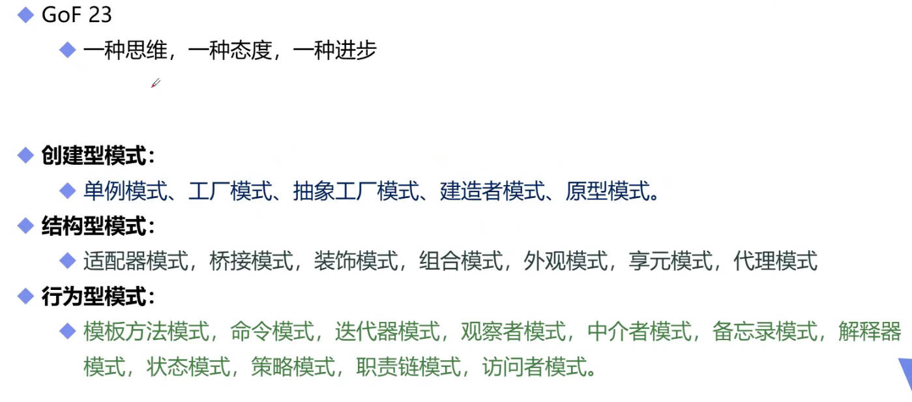 | 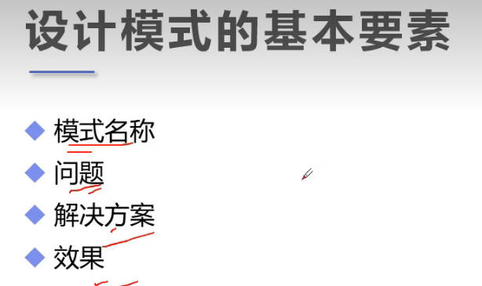 |
| ------------------------------------------------------- | ------------------------------------------------------- |
| 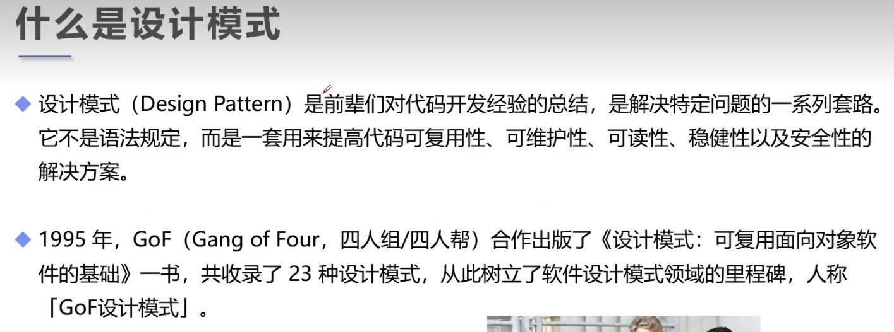 | 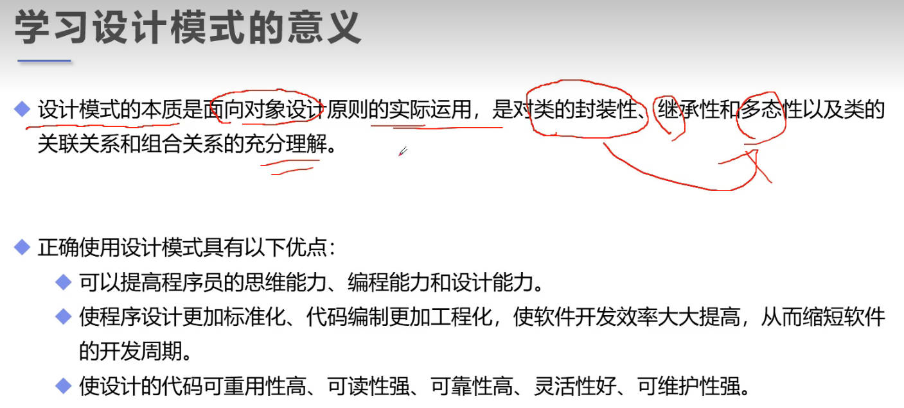 |
| 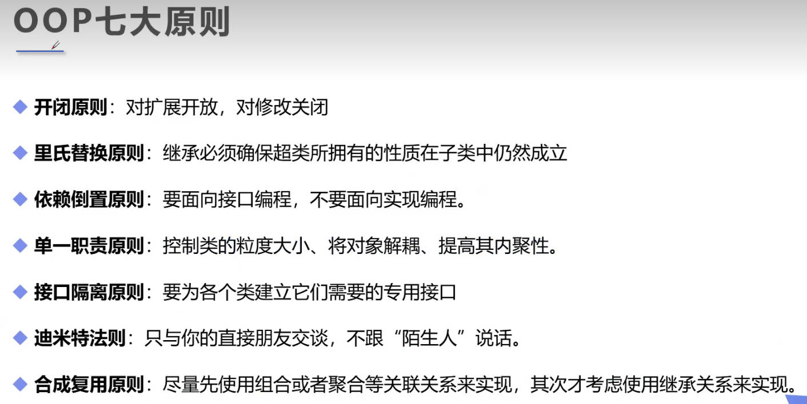 |                                                         |


## 2、7个OOP原则

> 1. 分类
>    1. 创建型(5)
>       1. ==怎么创建一个对象，让对象的创建和使用分离==
>       1. `单例、工厂、抽象工厂、建造者、原型模式`
>       1. 创建对象的同时隐藏创建逻辑的方式，而不是使用 new 运算符直接实例化对象
>    2. 结构型(7种)
>       1. 让类和对象按某种布局，==组成更大的结构==
>       1. ==关注类和对象的组合==
>    3. 行为型(11)
>       1. 描述类或对象之间如何协作，去==完成单个对象无法完成对任务==
>       1. ==关注对象之间的通信==
> 2. 七大原则： ==开里合接单依迪==
>    1. 开闭原则：新增功能，==不影响原来功能==； 里氏替换、合成复用属于开闭原则的实现； ==修改原来代码是关闭的==
>    2. 里氏替换：==子类可以扩展父类的功能，但不要改变父类原有的功能==；继承父类时，尽量添加新的方法，不要改(重写)父类的方法; `不要破坏继承关系`
>    3. 依赖倒置：==高层的模块不应该依赖低层的模块==，2个都应该依赖它的抽象，抽象不依赖细节，细节依赖抽象，降低耦合
>       1. `面向接口编程`
>    4. ==单一职责==：一个方法干好一件事情； ==单一功能，一个对象不该承担太多职责; 原子性==
>       1. `每个类职责要单一`
>    5. ==接口隔离==：尽量把接口拆分成更小更具体的接口; 和单一职责一样，都是为了提高内聚性
>       1. `接口要精简和单一`
>    6. 迪米特法则：a和b沟通，b和c沟通，a和c不沟通； 通过第三方转发，降低类之间耦合性； 会多很多中间类
>       1. `降低耦合度`
>    7. 合成复用原则：`优先使用组合聚合`等来实现，其次才考虑继承

## 3、23种设计模式

[设计模式笔记](https://www.kuangstudy.com/bbs/1580070347741810690) [笔记](https://www.kuangstudy.com/bbs/1566689346202349569) [菜鸟教程](https://www.runoob.com/design-pattern/singleton-pattern.html)   [设计模式（45 种）](https://baijiahao.baidu.com/s?id=1757590341900686107&wfr=spider&for=pc)

视频：[设计模式视频](https://www.bilibili.com/video/BV1mc411h719?p=3&vd_source=7346303e5e18677d7261c2c0c109ecfd) 

==单工造原==

### 1、创建型模式

创建对象

#### 1、单例

[单例模式](https://www.bilibili.com/video/BV1K54y197iS/?spm_id_from=333.788.recommend_more_video.1&vd_source=7346303e5e18677d7261c2c0c109ecfd)  [静态代理模式](https://www.bilibili.com/video/BV1mc411h719?p=9&vd_source=7346303e5e18677d7261c2c0c109ecfd)   [设计模式](https://www.bilibili.com/video/BV1eK4y1L71n/?p=11&vd_source=7346303e5e18677d7261c2c0c109ecfd)

> 1. 作用：不要new对象
> 2. 构造器私有，别人就无法new，保证内存中只有1个对象
> 3. 饿汉式单例
> 4. 懒汉式单例

| 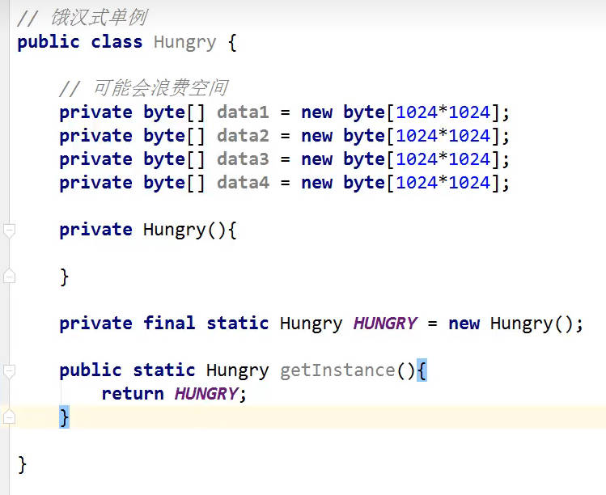 |  |
| ------------------------------------------------------- | ----- |

#### 2、工厂模式

用车不用知道车怎么制造的

> 1. 工厂模式：创建者和调用者分离； 将调用者和实现类解耦
>    1. 简单工厂：也叫静态工厂；用的是静态方法
>       1. 写一个==工厂类==，类的方法里==创建所有的对象==
>       2. 调用：`Car car2 = CarFactory.generateCar("特斯拉");`  ==工厂类方法==
>       3. 新增实现类时，要改工厂类代码，不符合开闭原则； 要优化，用工厂方法模式
>    2. 工厂方法：==工厂接口==
>       1. 问题：如果再增加一个车，要改工厂类，不符合开闭原则；所以要优化
>       2. 用工厂方法模式:每个车有自己的工厂； ==工厂类抽象为接口， 各个车企实现类方法创建各自的对象==
>       3. 调用：`Car2 car2 = new TelslaFactory().getCar2();`  ==new实现类==
>    3. 抽象工厂：

| 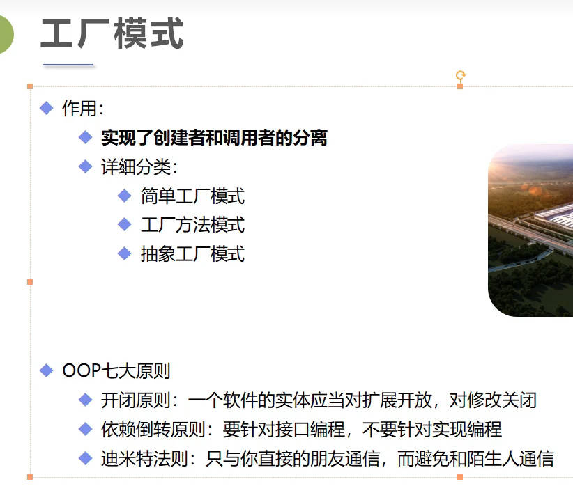      | 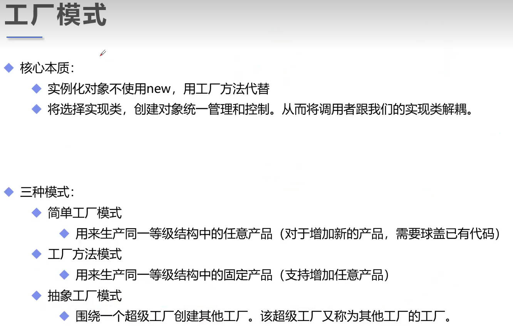      |
| ------------------------------------------------------------ | ------------------------------------------------------------ |
| 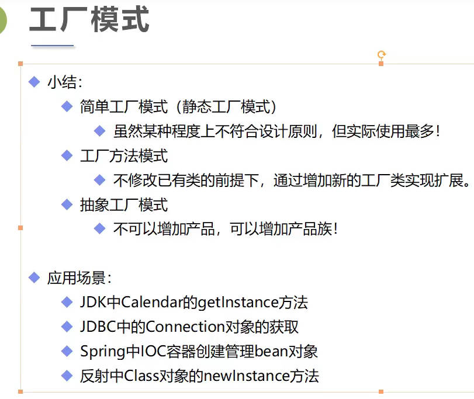      | 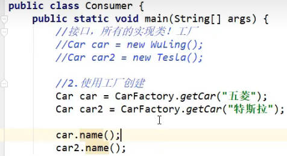 |
| 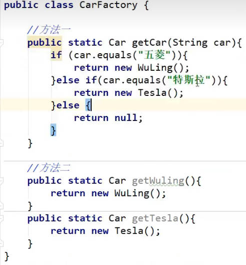 | 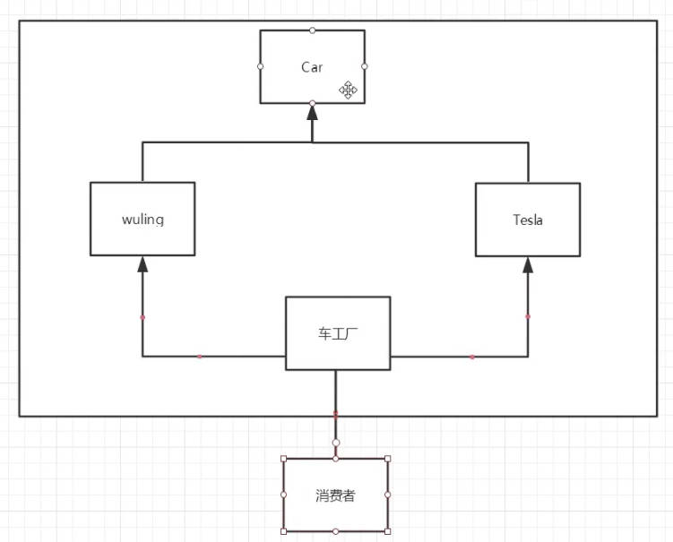      |

##### 1、简单工厂

```java
//接口
interface Car {
    void car();
}

//2个实现类
class Biyadi implements Car {
    @Override
    public void car() {
        System.out.println("我是比亚迪");
    }
}

class Telsla implements Car {
    @Override
    public void car() {
        System.out.println("我是特斯拉");
    }
}

//工厂类
public class CarFactory {
    public static Car generateCar(String name) {
        if (name.equals("比亚迪")) {
            return new Biyadi();
        } else if (name == "特斯拉") {
            return new Telsla();
        } else {
            return null;
        }
    }
}

//消费者
class Consumer {
    public static void main(String[] args) {
        //原来的方式
//        Car car1 = new Biyadi();
//        Car car2 = new Telsla();
        //简单工厂模式
        Car car1 = CarFactory.generateCar("比亚迪");
        Car car2 = CarFactory.generateCar("特斯拉");
        car1.car();
        car2.car();
        /**
         * 简单工厂模式不需要知道内部细节
         * 简单工厂模式的弊端：
         *     要添加新的就要修改代码，不符合开闭原则
         */
    }
}
```

##### 2、工厂方法模式

问题：如果再增加一个车，要改工厂类，不符合开闭原则；所以要优化，用工厂方法模式:每个车有自己的工厂

- 工厂类抽象为接口，把2个接口提到一边了


```java
//接口
interface Car2 {
    void car();
}

//2个实现类
class Biyadi2 implements Car2 {
    @Override
    public void car() {
        System.out.println("我是比亚迪");
    }
}

class Telsla2 implements Car2 {
    @Override
    public void car() {
        System.out.println("我是特斯拉");
    }
}

//问题：如果再增加一个车，要改工厂类，不符合开闭原则；所以要优化，用工厂方法模式:每个车有自己的工厂
//工厂类抽象为接口; 各个车企实现类方法创建对象
//再新增车企不改原来代码，只用再创建一个实现类工厂
interface Car2Factory2{
    Car2 getCar2();
}
class TelslaFactory implements Car2Factory2{
    @Override
    public Car2 getCar2() {
        return new Telsla2();
    }
}
//消费者
public class Consumer {
    public static void main(String[] args) {
        Car2 car2 = new TelslaFactory().getCar2();
    }
}
```

| 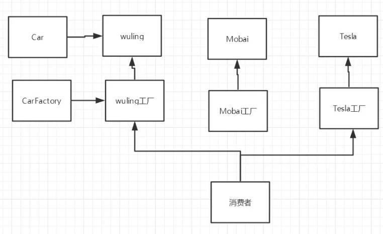 | 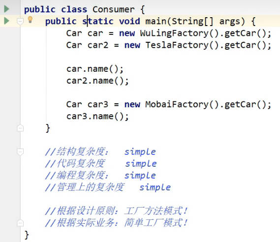 |
| ------------------------------------------------------- | ------------------------------------------------------- |


#### 3、抽象工厂

> 1. 适用于稳定的产品家族，不新增加产品
>    1. 不关注产品，关注产品族
>    1. 例如：小米工厂，生产一系列小米产品
> 1. 例子：
>    1. ==抽象工厂接口里放入产品接口==，手机和路由器接口； 这些抽象产品由具体的工厂去实现
>    1. ==生产产品的工厂==：建造小米工厂：
> 1. 抽象工厂模式==包含以下几个核心角色==
>    1. `抽象工厂`
>    1. `具体工厂`
>    1. `抽象产品`
>    1. `具体产品`
> 1. 菜鸟教程里多了个工厂生成器类，没有直接 `new XiaomiFactory()`

| 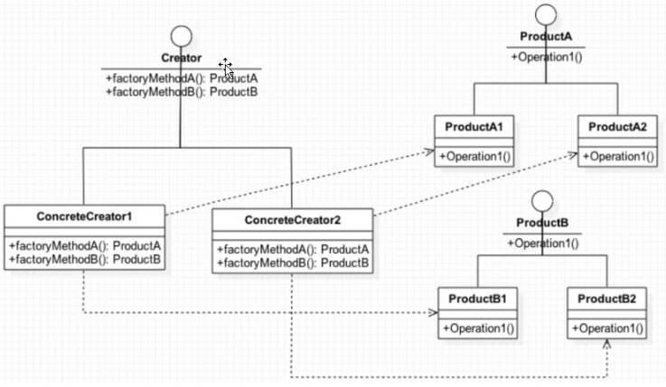      | 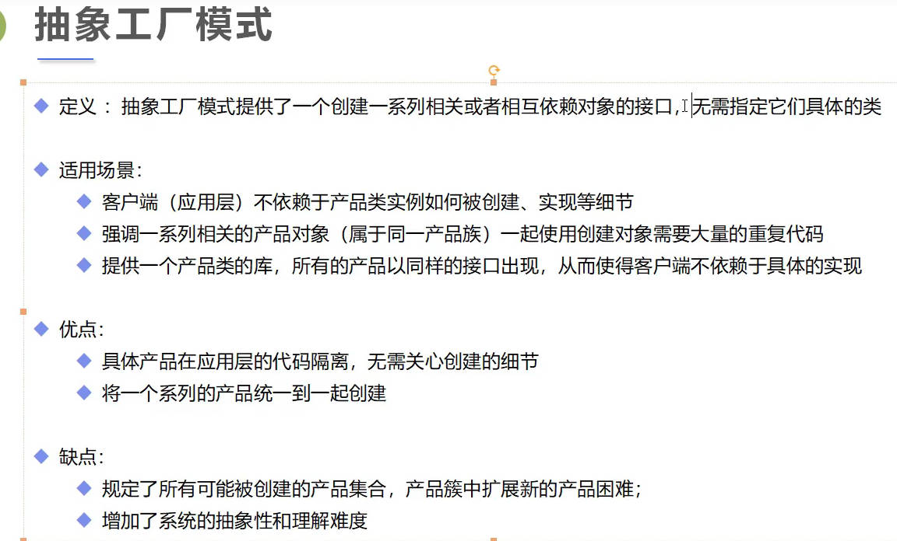      |
| ------------------------------------------------------------ | ------------------------------------------------------------ |
| 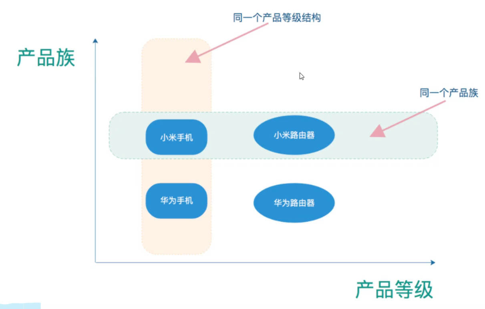      | 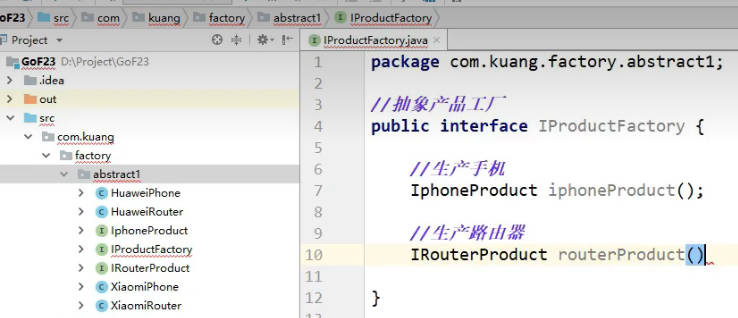 |
| 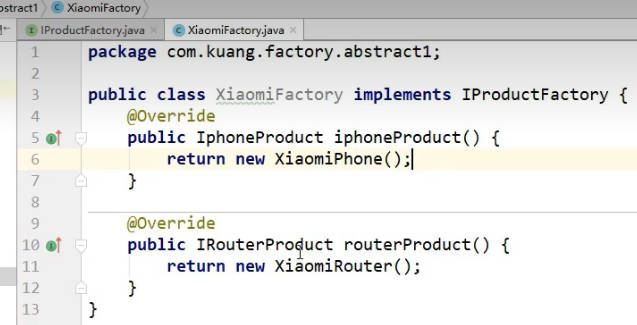 | 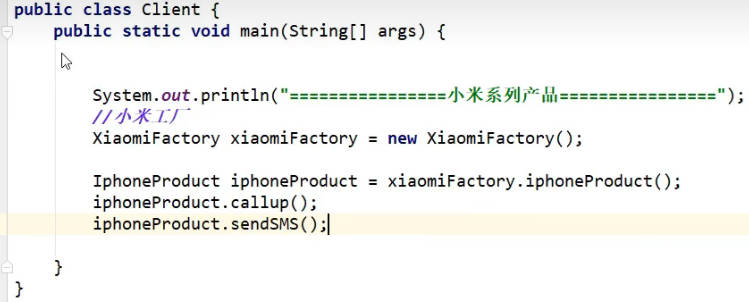      |
| 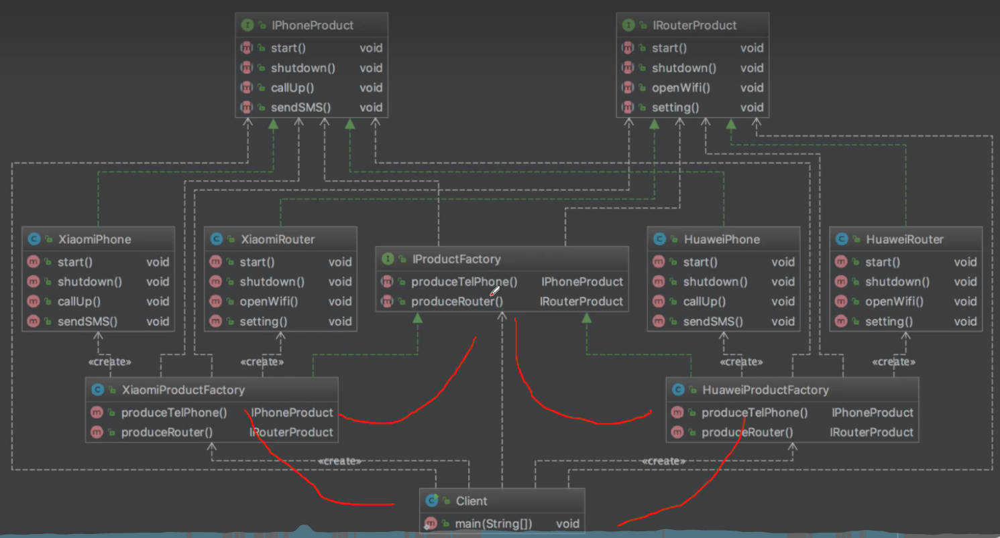      |                                                         |

#### 4、==建造者模式==

用来创建复杂对象： 在用户不知道对象的建造过程和细节的情况下，就可以创建复杂的对象

用户只需指定复杂对象的类型和内容： 例如买车

==构建过程和表示完全分离==

==需要的角色：==

- 指挥者： 
- 抽象的Builder：例如盖房子的图纸，就是抽象的
  - 抽象的建造者，用来==定义接口和方法==
- 具体的Builder：例如盖房子需要具体的工人去做
  - 具体的建造者：工人，完成一系列步骤，返回产品
- 生产具体的产品

==演示：==

1. 抽象的Builder：经过4个步骤，得到产品
2. 抽象的Builder：工人，完成一系列步骤，返回产品； 
   1. 产品不是有参构造传进来的，是工人创建出来的，所以`new Product()`


| 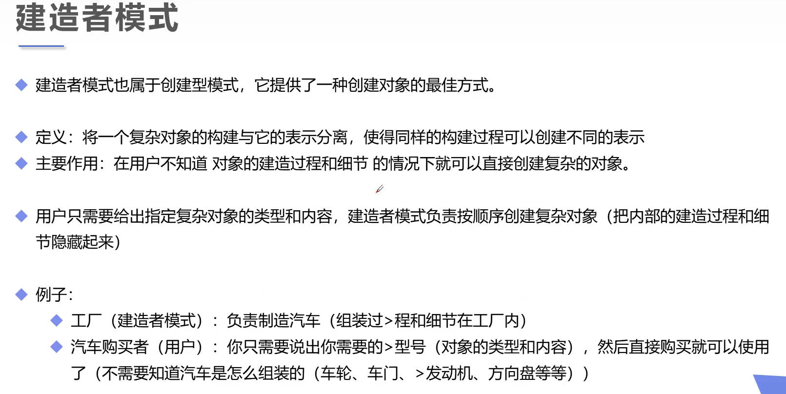      | 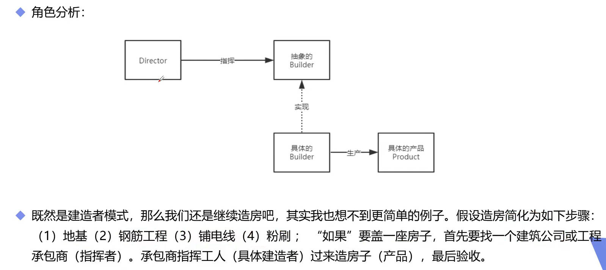      |
| ------------------------------------------------------------ | ------------------------------------------------------------ |
| 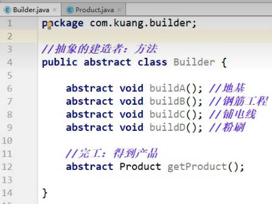 | 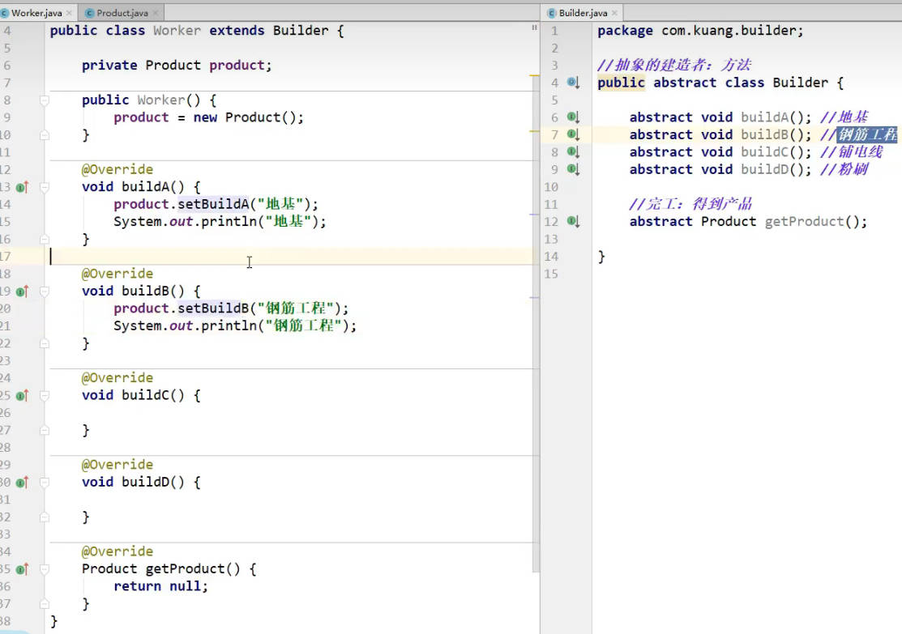      |
| 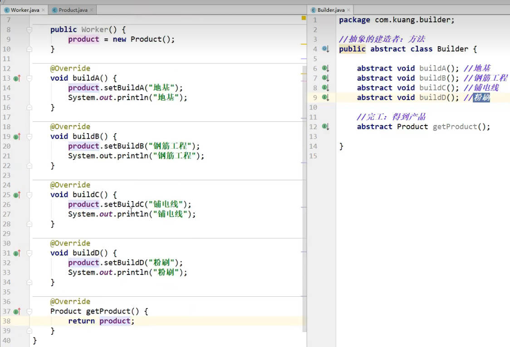 | 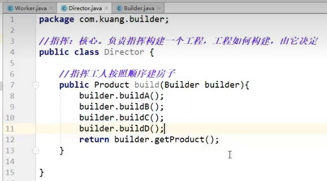 |
| 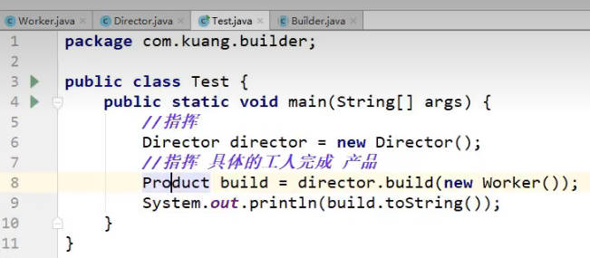  | 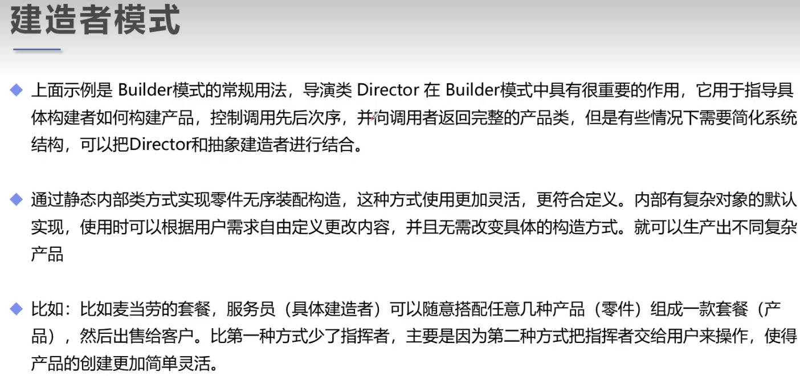      |

##### 1、第1种方法

###### 1、抽象的建造者

```java
//抽象的建造者：方法
public abstract class Builder {
    abstract void buildA(); //地基
    abstract void buildB(); //钢筋工程
    abstract void buildC(); //水电
    abstract void buildD(); //粉刷

    //做完上面步骤，完工：得到产品
    abstract Product getProduct();
}
```

###### 2、产品

```java
package DesignMode.build;
//产品：根据抽象的建造方法，得到房子
public class Product {
  private String buildA;
  private String buildB;
  private String buildC;
  private String buildD;
  public String getBuildA() { return buildA; }
  public void setBuildA(String buildA) { this.buildA = buildA; }
  public String getBuildB() { return buildB; }
  public void setBuildB(String buildB) { this.buildB = buildB; }
  public String getBuildC() { return buildC; }
  public void setBuildC(String buildC) { this.buildC = buildC; }
  public String getBuildD() { return buildD; }
  public void setBuildD(String buildD) { this.buildD = buildD; }
  @Override
  public String toString() {
      return "Product{" +
              "buildA='" + buildA + '\'' +
              ", buildB='" + buildB + '\'' +
              ", buildC='" + buildC + '\'' +
              ", buildD='" + buildD + '\'' +
              '}';
  }
}
```

###### 3、具体的建造者

- 工人； 完成抽象的步骤,返回产品

```java
package DesignMode.build;
//具体的建造者：工人; 完成抽象的步骤,返回产品
public class Worker extends Builder{
  private Product product;
  //产品不是有参构造传进来的，是工人创建出来的，所以new Product()； 这一步很重要
  public Worker() { this.product =new Product(); }
  @Override
  void buildA() {
      product.setBuildA("地基");
      System.out.println("地基");
  }
  @Override
  void buildB() {
      product.setBuildB("钢筋工程");
      System.out.println("钢筋工程");
  }
  @Override
  void buildC() {
      product.setBuildC("铺电线");
      System.out.println("铺电线");
  }
  @Override
  void buildD() {
      product.setBuildD("粉刷");
      System.out.println("粉刷");
  }
  @Override
  Product getProduct() { return product; }
}
```

###### 4、指挥者

指挥工人去执行步骤，构建产品； 构建顺序由它决定

```java
package DesignMode.build;
//指挥：核心，负责指挥构建一个工程，工程如何构建，由它决定
public class Director {
  public Product build(Builder builder){
      //指挥工人按照顺序建房子
      builder.buildA();
      builder.buildB();
      builder.buildC();
      builder.buildD();
      return builder.getProduct();
  }
}
```

###### 5、测试

```java
public class Test {
    public static void main(String[] args) {
        Director director=new Director();
        //指挥具体的工人完成产品
        Product build = director.build(new Worker());
        System.out.println(build.toString());
    }
}
```

##### 2、第2种方法： 建造者模式+静态内部类

消费者就是指挥者，例如去kfc买东西，买什么消费者决定

- ==少了指挥者，把指挥者交给用户来操作==； 产品的创建，更加简便灵活
- 用途：通过静态内部类方式实现零件无序构造，这种方式更加灵活。内部有复杂对象的默认实现，使用时可以根据用户需求自由定义更改内容，无需改变具体的构造方式。就可以产生不同复杂产品
- 例如麦当劳的套餐，服务员（具体建造者）可以随意搭配产品组成套餐，然后出售给客户。将指挥者的权限交给用户来操作


| 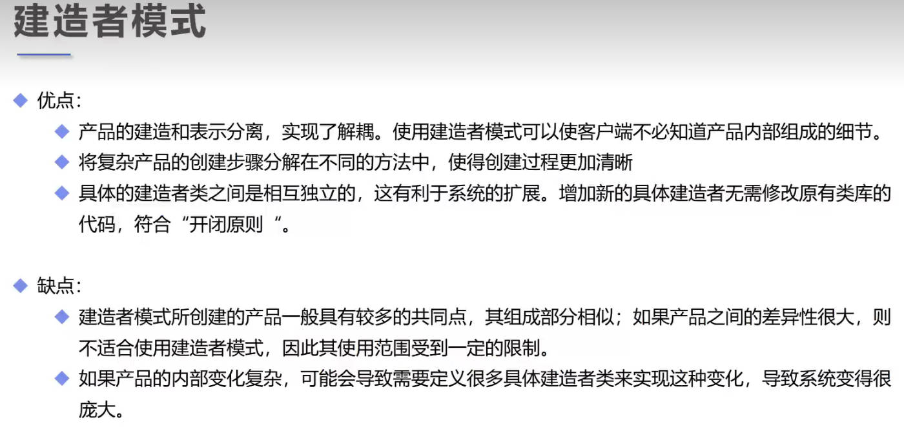 | 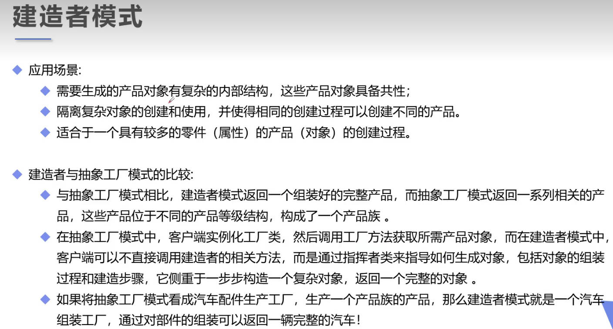 |
| ------------------------------------------------------- | ------------------------------------------------------- |


#### 5、原型模式

原型模式：  Prototype、Cloneable接口(可克隆的)、clone()方法

- 原型：实现Cloneable接口，重写clone方法
- 克隆对象：`v1=new Video(); v2=v1.clone()`

1. 浅克隆
   1. 3个对象，v1和v2都指向date对象
   2. 只是把v1的值和引用拷贝过来了，都指向同一个引用类型：date对象；
2. 深克隆
   1. 深克隆v2也有自己的引用类型：自己的date对象
   2. 改造clone方法实现深克隆


| 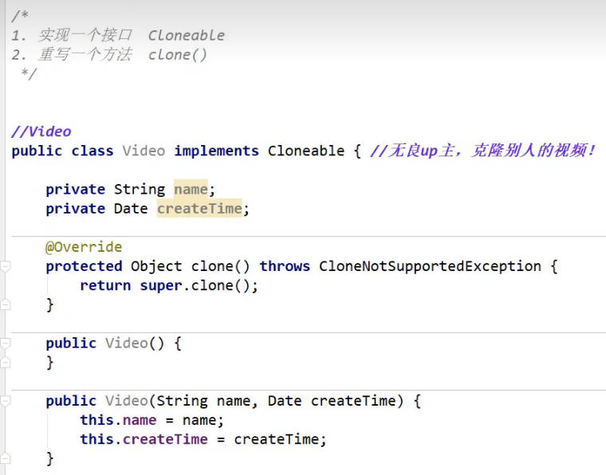 | 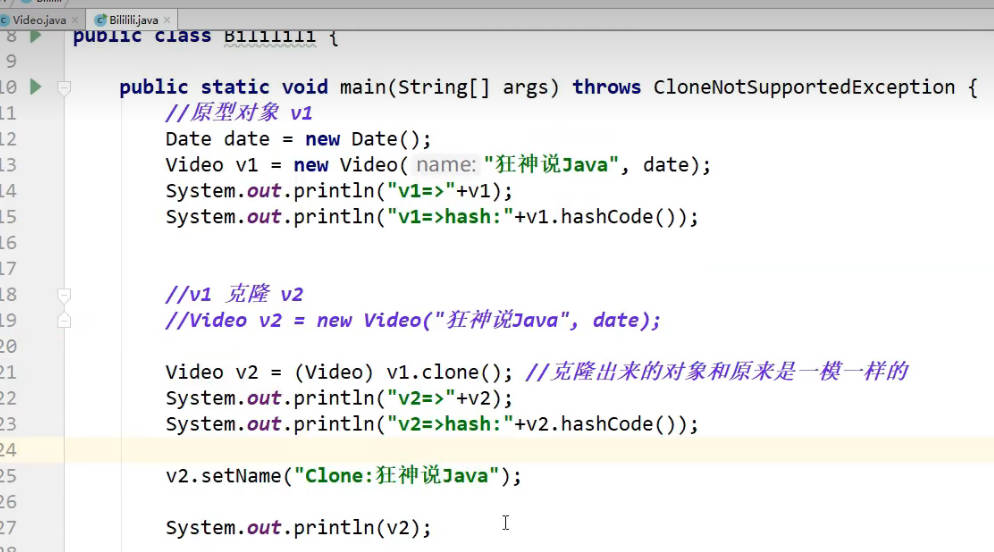      |
| ------------------------------------------------------------ | ------------------------------------------------------------ |
| 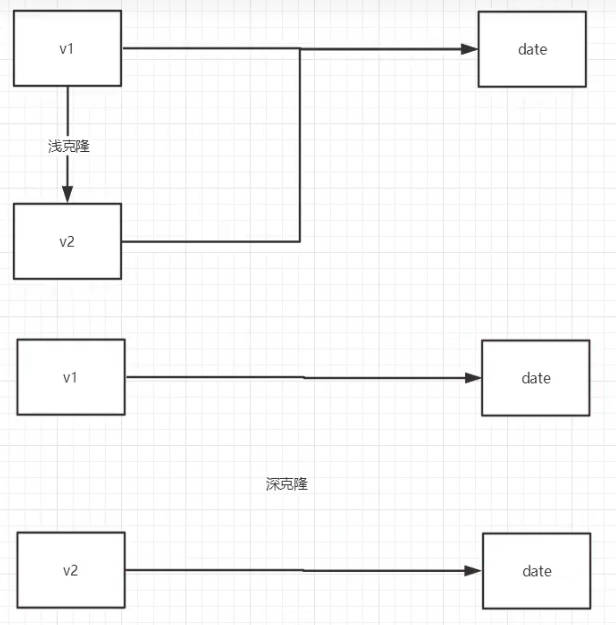 | 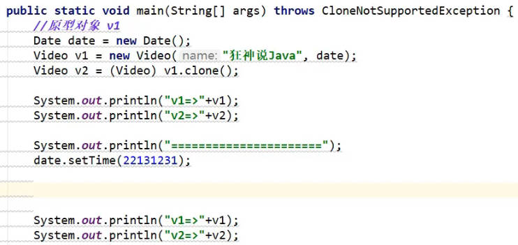 |
| 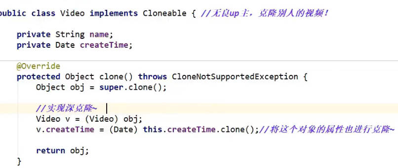 |                                                              |

### 2、结构型模式

[适配器模式](https://www.cnblogs.com/MrRightZhao/p/10784106.html)  [适配器模式](https://www.runoob.com/design-pattern/adapter-pattern.html)

#### 1、适配器模式

- 要被适配的类：网线
- 客户端类：想上网，插不了网线
- 转接头：接口，面向接口

例如：surface不能插网线，用一个转换器

- 类适配器:  类适配器，单继承，有局限
- 对象适配器: 对象适配器，更通用

| 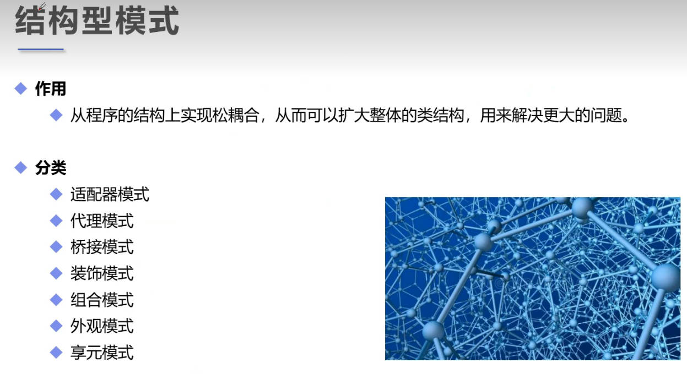 | 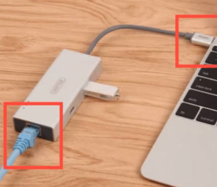 |
| ------------------------------------------------------- | ------------------------------------------------------- |
| 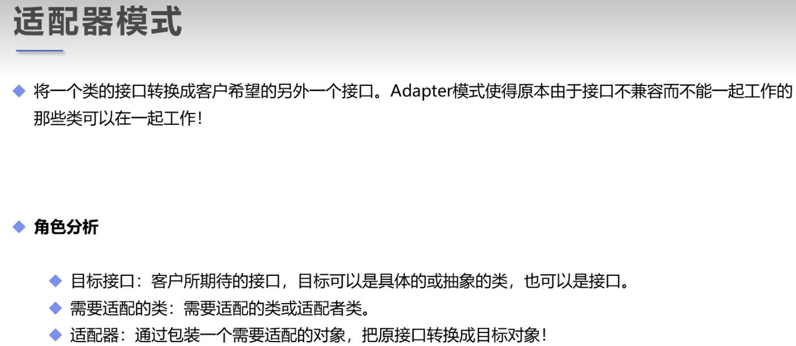 | 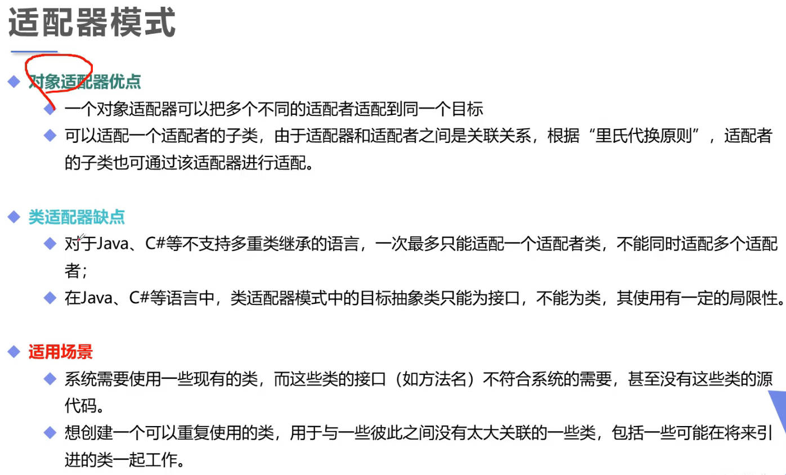 |

##### 1、类适配器

网线

```java
//要被适配的类：网线
public class Adaptee {
    public void request() {
        System.out.println("连接网线上网");
    }
}
```

电脑

```java
//客户端类：想上网，插不了网线
public class Computer {
    //电脑插转接头
    public void net(NetToUsb adapter) {
        //上网的具体实现：需要一个转接头
        adapter.handleRequest();
    }

    public static void main(String[] args) {
        Computer computer = new Computer();
        Adaptee adaptee = new Adaptee();
        Adapter adapter = new Adapter();
        computer.net(adapter);
    }
}
```

适配器接口

```java
//接口转换器的抽象实现
public interface NetToUsb {
    //作用：处理请求，网线=>usb
    public void handleRequest();
}
```

适配器

```java
//真正的适配器，一端连usb，一端连网线
public class Adapter extends Adaptee implements NetToUsb {
    @Override
    public void handleRequest() {
        super.request(); //可以上网了
    }
}
```

##### 2、对象适配器

1. 继承：类适配器，单继承，有局限
2. 组合：对象适配器，更通用

具体的适配器

```java
//1.继承：类适配器，单继承，有局限
//2.组合：对象适配器，更通用
//真正的适配器，一端连usb，一端连网线
public class Adapter implements NetToUsb {
    private Adaptee adaptee;	//不用继承，用组合

    public Adapter(Adaptee adaptee) {
        this.adaptee = adaptee;
    }

    @Override
    public void handleRequest() {
        adaptee.request(); //可以上网了
    }
}
```
电脑

```java
//客户端类：想上网，插不了网线
public class Computer {
    //电脑插转接头
    public void net(NetToUsb adapter) {
        //上网的具体实现：需要一个转接头
        adapter.handleRequest();
    }

    public static void main(String[] args) {
        Adaptee adaptee = new Adaptee();
        Adapter adapter = new Adapter(adaptee);

        Computer computer = new Computer();
        computer.net(adapter);
    }
}
```


#### 2、桥接模式

类型、品牌各写一个抽象类，通过桥连接起来 (交点)

| 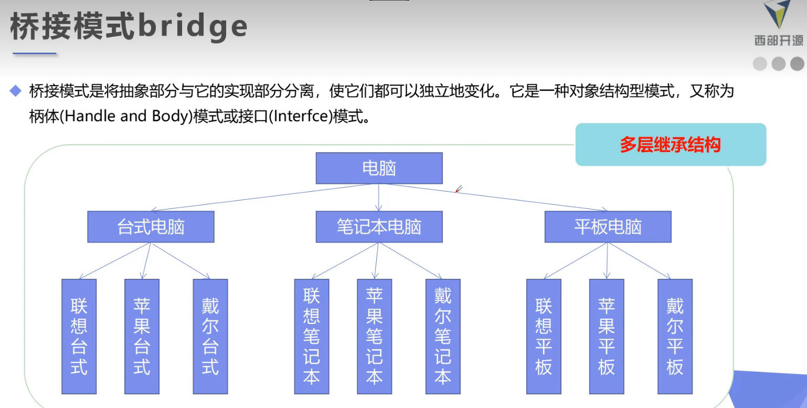 | 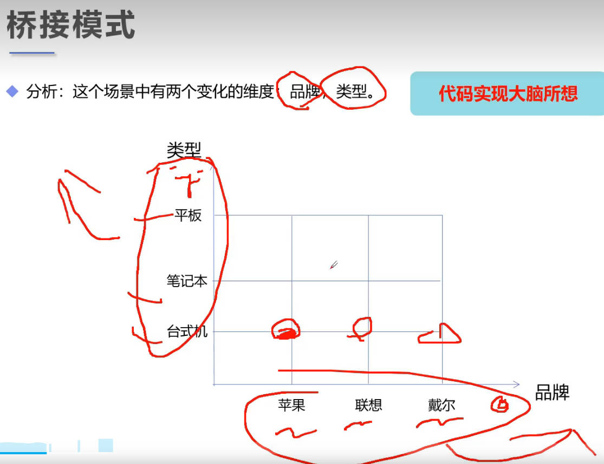 |
| ------------------------------------------------------- | ------------------------------------------------------- |
| 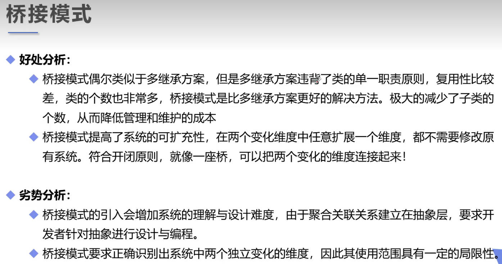 | 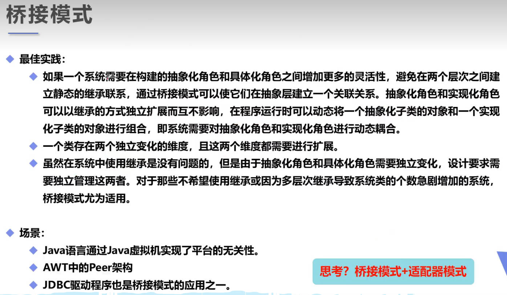 |

#### 3、代理模式

[静态代理模式_spring里有讲](https://www.bilibili.com/video/BV1WE411d7Dv?p=17&vd_source=7346303e5e18677d7261c2c0c109ecfd) [多线程09：静态代理模式](https://www.bilibili.com/video/BV1V4411p7EF?p=9&vd_source=7346303e5e18677d7261c2c0c109ecfd) 

##### 1、静态代理模式

> 1. 

|  |  |
| ----- | ----- |

##### 2、动态代理模式

> 1. 

|  |  |
| ----- | ----- |

### 3、行为型模式