md： [大数据知识汇总](.\大数据知识汇总)

# 1、简介

小结：

1. Hadoop平台搭建
2. HDFS: ==存储数据==
   1. HDFS的shell操作
   2. IDEA下操作HDFS API
3. YARN: 资源调度（内存、cpu等）
4. MapReduce: ==解决==分布式文件系统上存储（HDFS）的==数据计算的问题==

## 1、大数据处理流程

视频：[千锋-大数据](https://www.bilibili.com/video/BV18y4y1G7JA/?p=6&spm_id_from=pageDriver&vd_source=7346303e5e18677d7261c2c0c109ecfd) [千锋好程序员](https://space.bilibili.com/268858604/video?tid=0&pn=2&keyword=&order=pubdate)  [Hadoop 从入门到精通](https://www.bilibili.com/video/BV17E411g7F2/?spm_id_from=333.999.0.0&vd_source=7346303e5e18677d7261c2c0c109ecfd) [2019 spark+hadoop+数据挖掘](https://www.bilibili.com/video/BV13J411U71w/?spm_id_from=333.999.0.0&vd_source=7346303e5e18677d7261c2c0c109ecfd)

[【狂神说Java】ElasticSearch7.6.x](https://www.bilibili.com/video/BV17a4y1x7zq/?vd_source=7346303e5e18677d7261c2c0c109ecfd)  [【狂神说Java】ElasticSearch搜索实战仿京东搜索](https://www.bilibili.com/video/BV1Nk4y1R7Hf/?vd_source=7346303e5e18677d7261c2c0c109ecfd)  

[大数据处理流程](https://blog.csdn.net/qq_45974639/article/details/126055999) [企业级大数据处理方案](https://www.cnblogs.com/gnool/p/5655686.html) [大数据专用名词](https://blog.csdn.net/weixin_57551874/article/details/116241920)  [Hadoop](https://blog.csdn.net/weixin_45250512/article/details/108164513) [非结构化数据](https://blog.51cto.com/u_16099183/6698122) [Linux](https://blog.csdn.net/weixin_46860149/article/details/118326082)

[ElasticSearch（ES）基本概念和语句学习笔记](https://blog.csdn.net/zuzhiang/article/details/122641238)	 

大数据生态：[大规模数据处理架构：Spark与Hadoop生态系统](https://baijiahao.baidu.com/s?id=1773857342932125575&wfr=spider&for=pc) [Spark 与Hadoop](https://zhuanlan.zhihu.com/p/549425077)  [大数据平台架构](https://zhuanlan.zhihu.com/p/653973251?utm_id=0)  [Hadoop vs Spark vs Flink——大数据框架比较 ](https://zhuanlan.zhihu.com/p/549760480)  [学习大数据需要哪些知识框架](https://www.zhihu.com/question/427911536/answer/3126913232)

[Apache Projects List](https://projects.apache.org/projects.html) [Apache Software Foundation!](https://www.apache.org/index.html#projects-list) [Apache Hadoop](https://hadoop.apache.org/)  [Apache Spark™ ](https://spark.apache.org/) [Apache Flink® ](https://flink.apache.org/) 

[各科学习路线](http://video.mobiletrain.org/linux) [大数据学习路线2019版](https://www.cnblogs.com/coffees/p/11275524.html) [大数据学习路线](https://www.cnblogs.com/coffees/p/8523431.html)  [Java/前端/Go/大数据/C学习路线](https://www.bilibili.com/read/cv14023271/?spm_id_from=333.999.0.0)  [Java学习完整路线](https://www.bilibili.com/read/cv5702420/?spm_id_from=333.999.0.0) [大数据千锋、尚硅谷、海牛等机构哪个更靠谱](https://www.zhihu.com/question/591234163/answer/3013586776?utm_id=0)

[网络协议](https://blog.csdn.net/charon145/article/details/121703780)

[Kafka详解](https://www.cnblogs.com/chafry/p/16776767.html)  [数据库Redis hbase es](https://blog.51cto.com/u_16213409/9093380)  [Hive教程](https://blog.csdn.net/yuan_xw/article/details/78197917) [通用计算引擎Spark](https://cloud.tencent.com/developer/article/2315249)  [Hadoop生态圈](https://www.zhihu.com/question/483907450/answer/2209499322)  [hadoop和大数据的关系](https://www.zhihu.com/question/23036370/answer/1988607046)  [Spark](https://zhuanlan.zhihu.com/p/547291624)  [Superset数据分析和可视化](https://baijiahao.baidu.com/s?id=1703444220257145031&wfr=spider&for=pc) [数据湖hudi](https://blog.csdn.net/y3over/article/details/127247807) [Scala](https://blog.csdn.net/jiaoshi5167/article/details/130981061) 

- 企业大数据一般处理流程
  - 数据采集、存储
  - 数据导入和清洗
    - 预处理-数据存储
  - 数据分析和挖掘
  - 结果可视化

| 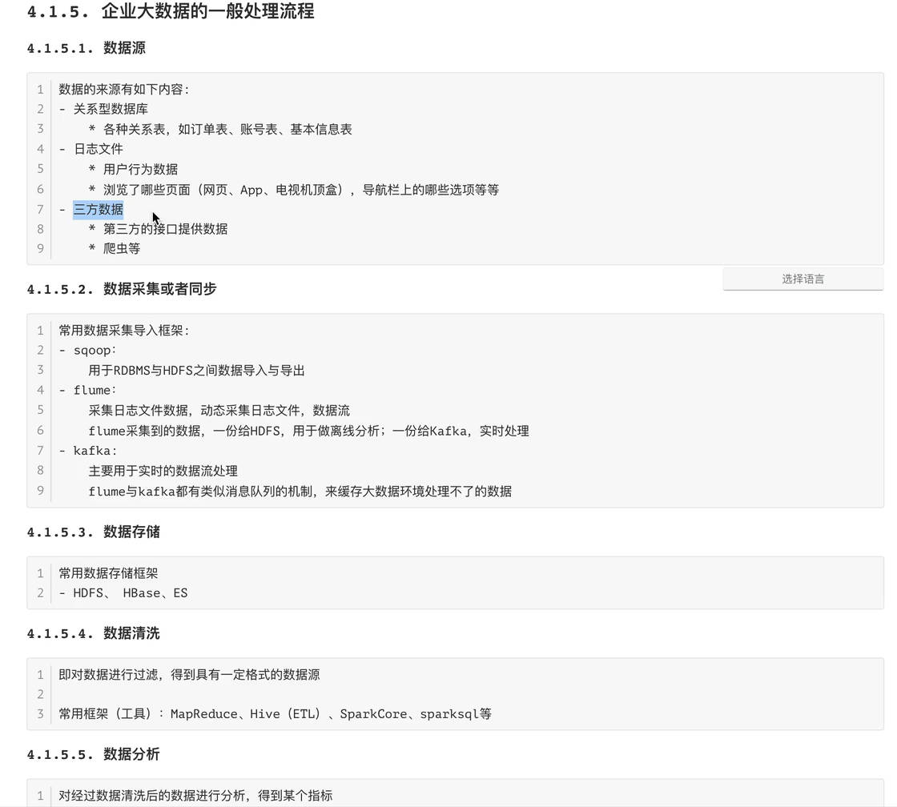 | 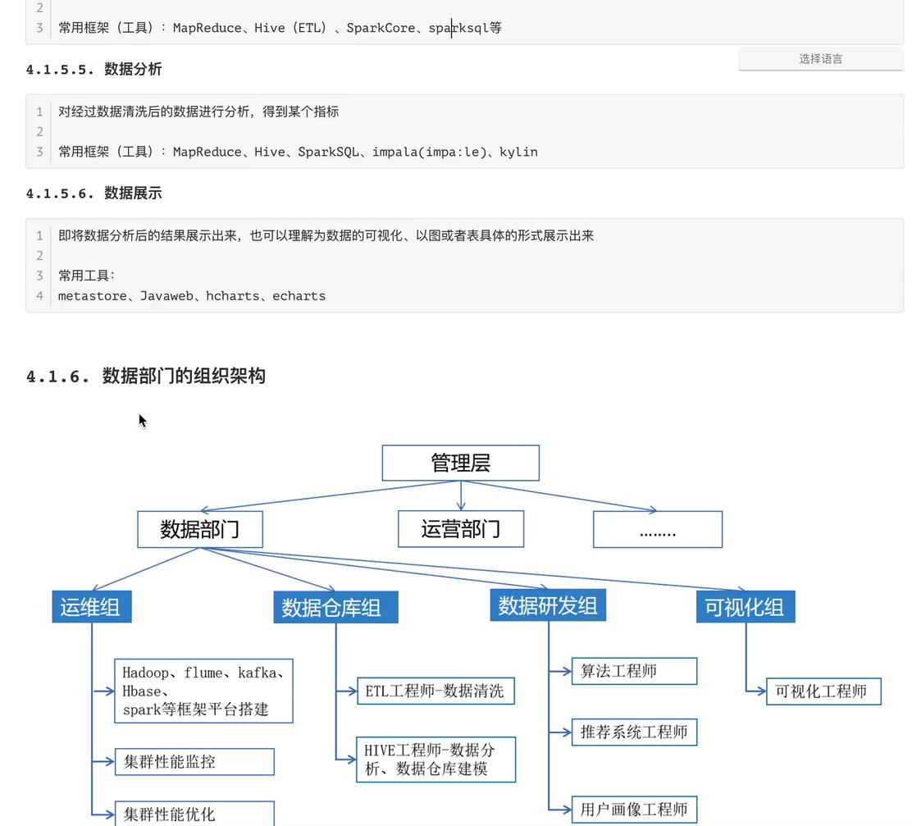 |
| ------------------------------------------------------------ | ----------------------------------------------------- |
| 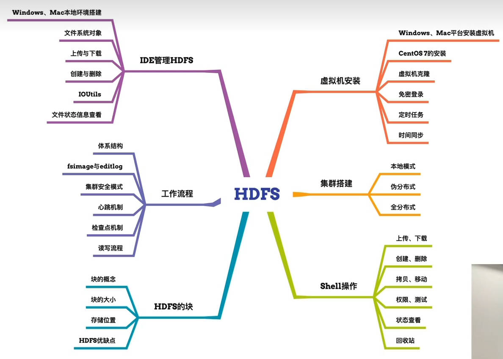        |                                                  |

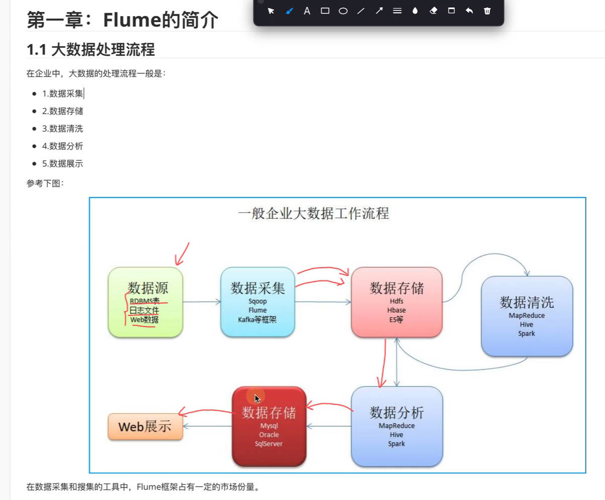

## 2、Hadoop版本

[CDH大数据平台](https://zhuanlan.zhihu.com/p/335663852) [CDH搭建](https://www.jianshu.com/p/106739236db4) [HDP-2.6.4 安装与配置](http://www.taodudu.cc/news/show-5098027.html?action=onClick) [大数据平台HDP搭建](https://blog.51cto.com/u_76633/5754945)

## 3、Hadoop三大核心组件

[Hadoop三大核心组件](https://blog.csdn.net/wql2008/article/details/127466395) [Hadoop 体系及核心组件](https://www.jianshu.com/p/8c0105711af9) [Hadoop核心组件](https://www.rstk.cn/news/291847.html?action=onClick) [Hbase](https://www.jianshu.com/p/8c0105711af9)

- 分布式文件存储系统HDFS: Hadoop Distributed File System
- MapReduce: 分布式离线并行计算框架
- YARN: 资源调度平台，作业调度与集群资源管理框架

| 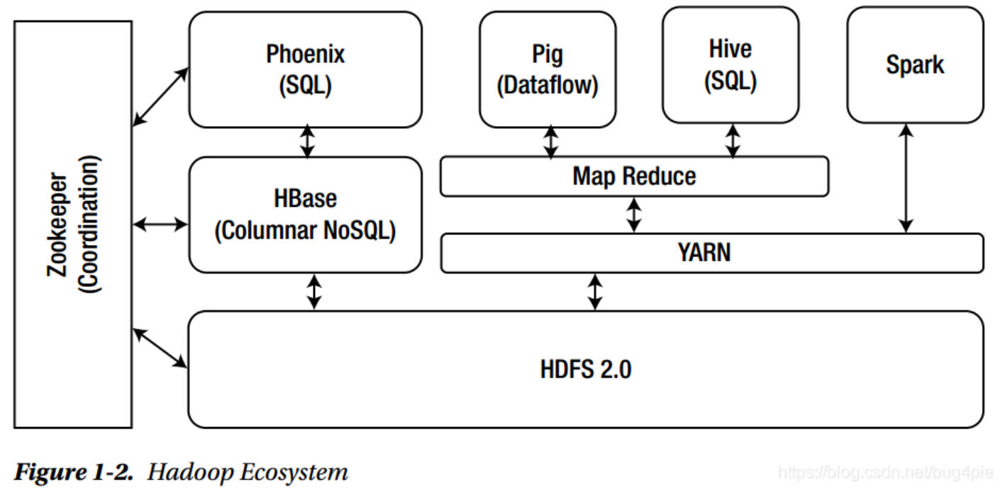 | 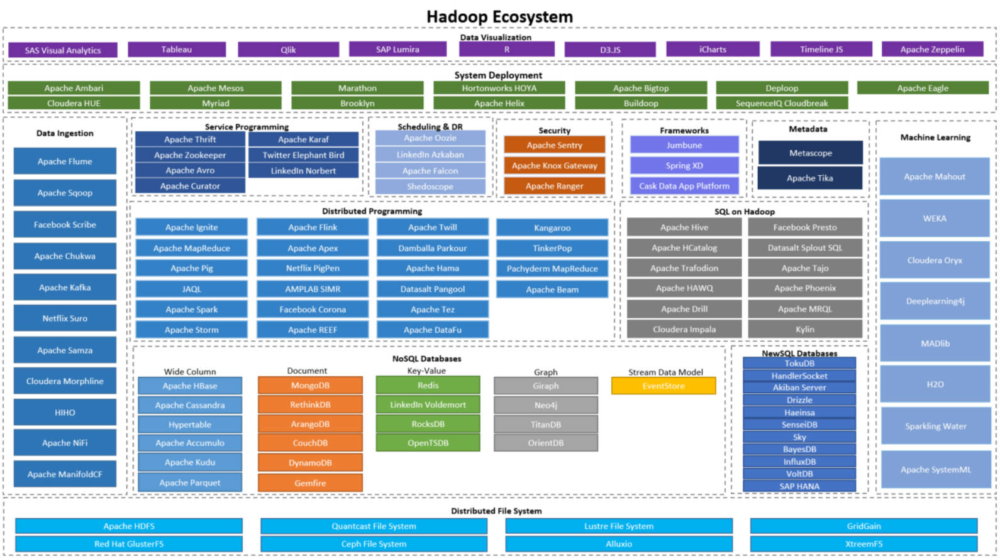 |
| ----------------------------------------------------- | ----------------------------------------------------- |

## 4、Hadoop生态圈

[Hadoop download](https://hadoop.apache.org/releases.html) [ Apache release archive历史版本](https://archive.apache.org/dist/hadoop/common/)  [Documentation文档](https://hadoop.apache.org/release.html)

[Hadoop Ecosystem](https://www.geeksforgeeks.org/hadoop-ecosystem/)  [Hadoop生态系统](https://blog.csdn.net/tuposky/article/details/125011437) [Hadoop生态](https://baijiahao.baidu.com/s?id=1757498018289305232&wfr=spider&for=pc) [Hadoop生态系统](https://blog.csdn.net/m0_63094069/article/details/131342993) [大数据](https://zhuanlan.zhihu.com/p/55685847)  [生态系统](https://www.yisu.com/zixun/269858.html)

[大数据技术演进](https://zhuanlan.zhihu.com/p/407175099?utm_id=0)

[81个开源大数据处理工具](https://www.likecs.com/show-230792.html) [Hadoop生态圈](https://zhuanlan.zhihu.com/p/22366610)

| 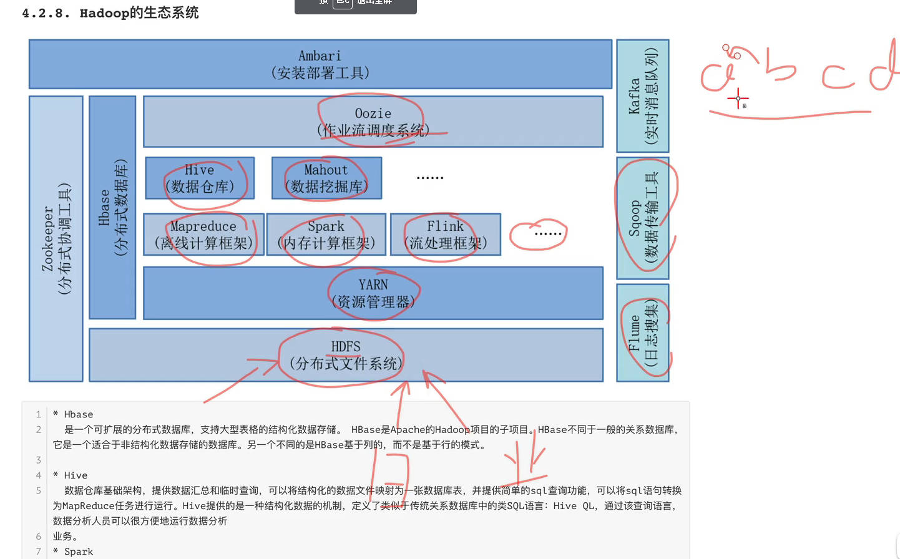 | 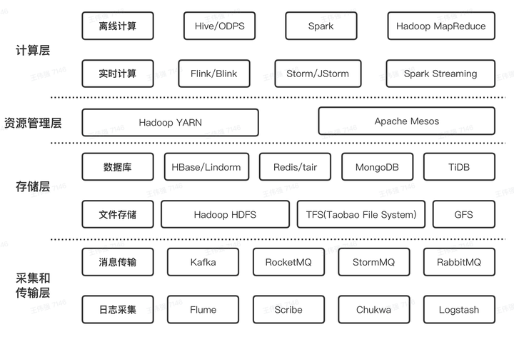 |
| ----------------------------------------------------- | ----------------------------- |

1. Oozie: 多个子作业，例如abcd作业，它们的执行有一定的先后顺序，b可能依赖a，c和ab没有关系，可以和ab并行执行，d可能依赖b和c的结果，所以要调度这些任务。==同类系统==：Azkaban轻量级

## 5、大数据平台搭建

小结：

1. 本地部署： [Hadoop部署本地模式](http://tuwen.1000phone.net/details?id=MzA0OQ==) [三种运行模式](https://www.cnblogs.com/hapyygril/p/13907202.html)
2. 伪分布式模式：只有一个节点的分布式集群
3. 完全分布式模式

自动搭建： [Ambari和ClouderaManager_大数据自动部署](https://developer.aliyun.com/article/762419?spm=a2c6h.13813017.0.dArticle738638.771875d3uyKXPc)  [大数据平台Ambari+HDP ](http://www.taodudu.cc/news/show-3992483.html?action=onClick) [Ambari-2.7.5整合HDP-3.1.5集群](http://www.taodudu.cc/news/show-5098016.html?action=onClick)  [Ambari + hdp](https://www.baidu.com/s?ie=UTF-8&wd=Ambari %2B hdp)  [Linux+Docker部署基于Ambari的Hadoop集群](https://www.bilibili.com/video/BV1Hh4y1x7jf/?spm_id_from=333.337.search-card.all.click&vd_source=7346303e5e18677d7261c2c0c109ecfd)  

[物联网综合平台](https://www.bilibili.com/video/BV1eu411E7zL/?spm_id_from=333.337.search-card.all.click&vd_source=7346303e5e18677d7261c2c0c109ecfd)  [冷链物流监控项目](https://www.bilibili.com/video/BV1i94y167eS/?spm_id_from=333.788.recommend_more_video.5&vd_source=7346303e5e18677d7261c2c0c109ecfd) [.NET6 +微服务+Consul+Docker实操企业级实战项目](https://www.bilibili.com/video/BV1b94y1r7N8/?spm_id_from=333.788.recommend_more_video.4&vd_source=7346303e5e18677d7261c2c0c109ecfd)  

[零基础ESP8266监测温湿度](https://www.bilibili.com/video/BV1r44y1c7pL/?spm_id_from=333.788.recommend_more_video.9&vd_source=7346303e5e18677d7261c2c0c109ecfd)

[Serial接口](https://support.huawei.com/enterprise/zh/doc/EDOC1100112420/81e2dd8e) [MobaXterm ](https://mobaxterm.mobatek.net/)

[shell中自动交互_delimiter](https://blog.csdn.net/appke846/article/details/80513099) [输入/输出重定向](https://www.runoob.com/linux/linux-shell-io-redirections.html)

[Hadoop集群搭建](https://www.bilibili.com/read/cv22995180/)

1. 虚拟机
   1. Mac平台:Parallels Desktop;  Win:vmware workstation pro
2. Centos 7
   1. /boot 300 标准分区 xfs; 	swap 内存2倍 LVM swap； 	/容量不写 LVM xfs
   2. IPv4: 手动ip 192.168.10.101，255.255.255.254, 192.168.10.1 ; 
   3. 虚拟机网段192.168.10.1 - 192.168.10.254,255.255.255.0, 子网192.168.10.0
   4. SSH远程连接工具:mac,finalShell,iTerm2;  win,MobaXterm
3. 安装
   1. 上传路径: /root/softwares, scp命令 ; 安装路径：/usr/local
   1. 伪分布式模式也是只需要一台机器，但是与本地模式的不同，伪分布式

# 2、shell

# 3、HDFS

[HDFS小文件处理解决方案总结+facebook(HayStack) + 淘宝（TFS）](https://www.iteye.com/blog/m635674608-2300665) 

[pom.xml设置自动加载依赖](https://blog.csdn.net/Ni_Bai/article/details/125268000) [pom动态增加依赖](https://blog.csdn.net/qq_34908167/article/details/129862854) [pom.xml配置文件自动导入依赖](https://blog.csdn.net/jiai032023/article/details/134709610)  [idea创建JAVA Class时自动生成头部文档注释](https://blog.51cto.com/u_15973676/6069272) [IDEA设置Class创建自动添加头部注释](https://blog.csdn.net/qq_35427589/article/details/129365200)

# 4、Yarn

## 1、yarn核心思想

[大数据资源调度平台有Yarn、Mesos、K8s等](https://baijiahao.baidu.com/s?id=1710413402711878512&wfr=spider&for=pc)  [大数据调度平台(Oozie/Azkaban/AirFlow/XXL-Job/DolphinScheduler)](https://zhuanlan.zhihu.com/p/481027675)  [Kubernetes和Mesos区别](https://www.zhihu.com/question/53751176)

==分布式计算之间的资源调度（内存、cpu等）、协调==

- 第一代Hadoop
  - JobTracker做全局统筹，初始化作业，分配作业，与TaskTracker通信，协调整个作业
  - TaskTracker负责真正干活，保持JobTracker通信，在分配的数据片段上执行MapReduce任务
    - 在每个节点上都有一个TaskTracker
- 

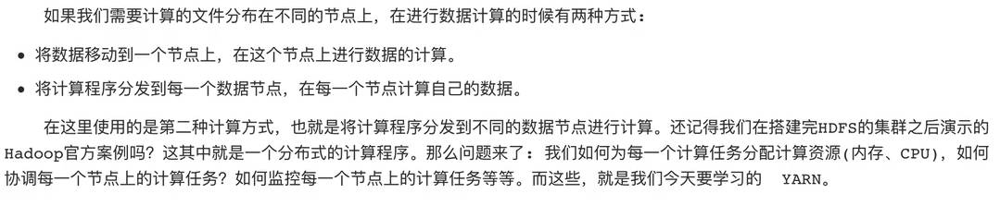

- 1.x :分布式计算中的资源调度被集成在MapReduce，分成JobTracker和TaskTracker2种角色； 兼顾计算和资源调度，这样MapReduce臃肿, Hadoop中就提出了Yarn,类似软件跑在操作系统上，cpu,内存等由系统调度
- yarn设计思想：RM资源管理， 作业调度和监视功能由AM完成,有任务时，AM向RM申请资源,然后与NodeManager联系，开辟空间跑这个任务,同时接收任务的汇报; ==这样资源的分配和任务的管理分开==; NodeManager负责管理本台机器的资源； 类似老板管部门领导，部门领导管各部门员工

| 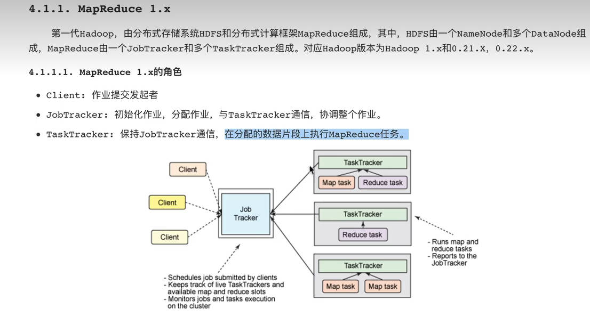 | 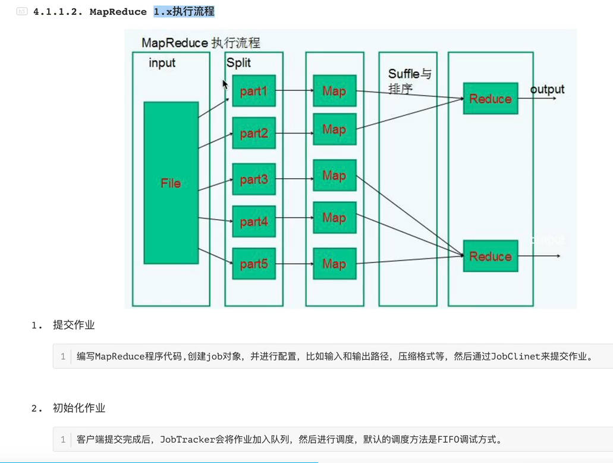 |
| ------------------------------------------------------------ | ------------------------------------------------------------ |
| 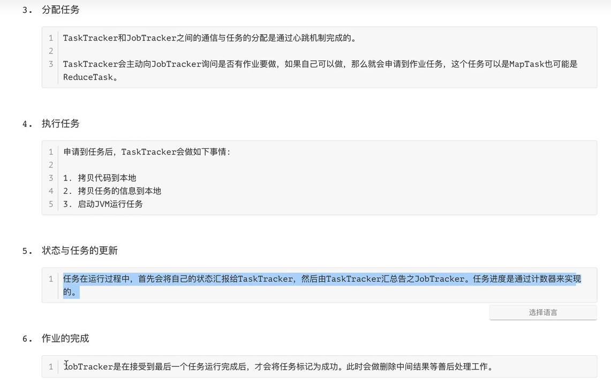        | 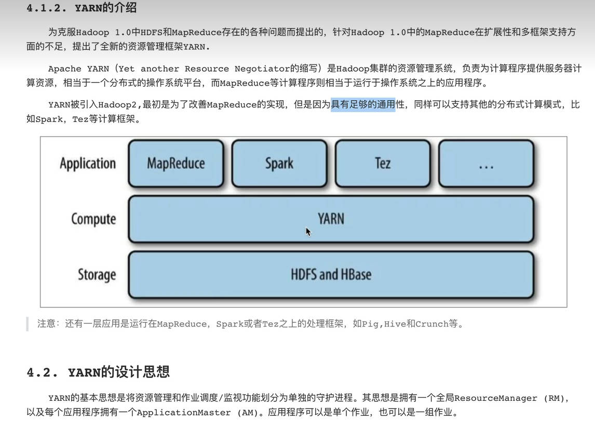        |
| 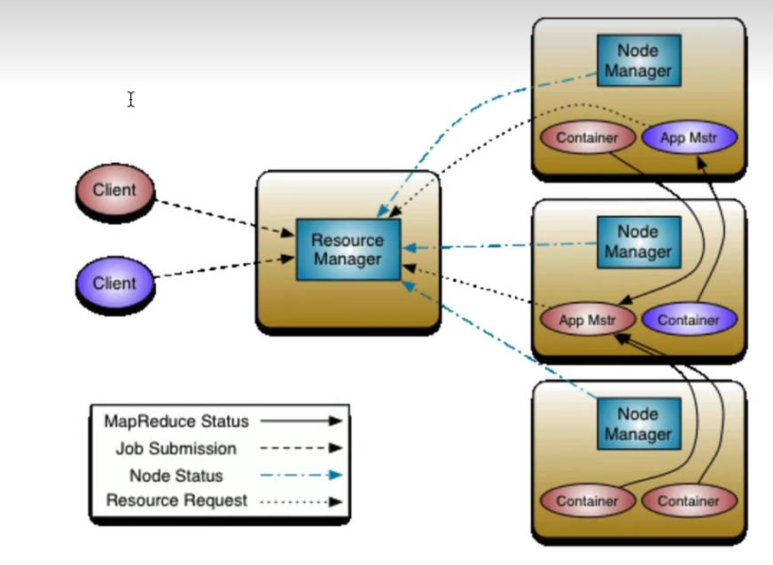        | 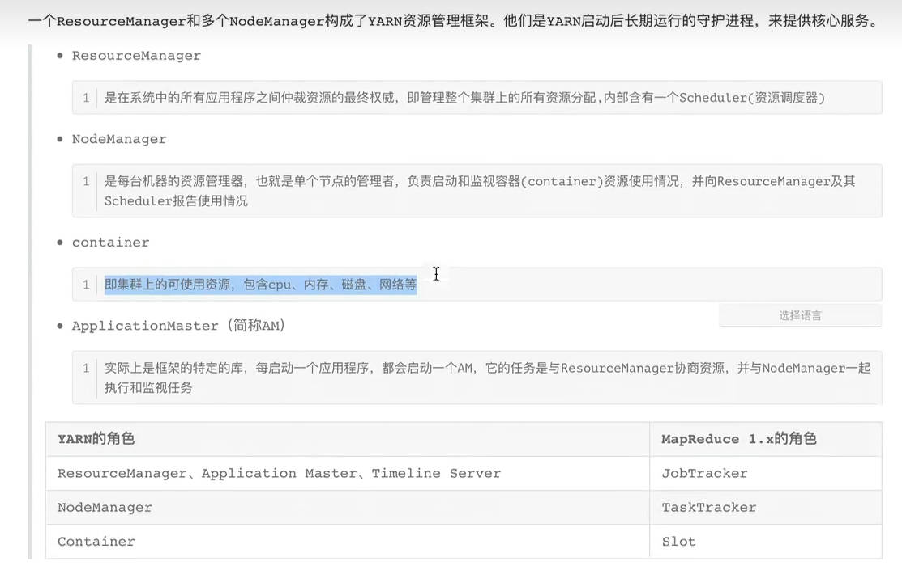        |

## 2、配置

## 3、Yarn三种调度器

- 调度器可看作ResourceManager的秘书,实际干活的是调度器，例如：分配空间，任务分配等
- 调度器
  - FIFO：先进先出，类似排队买票，前面的不走，后面的只能等着
  - 容量调度器：2个队列，耗时的大任务只能占80%资源，省时间的小任务用20%的资源处理
    - 要通过修改配置文件添加队列
  - 公平调度器

| 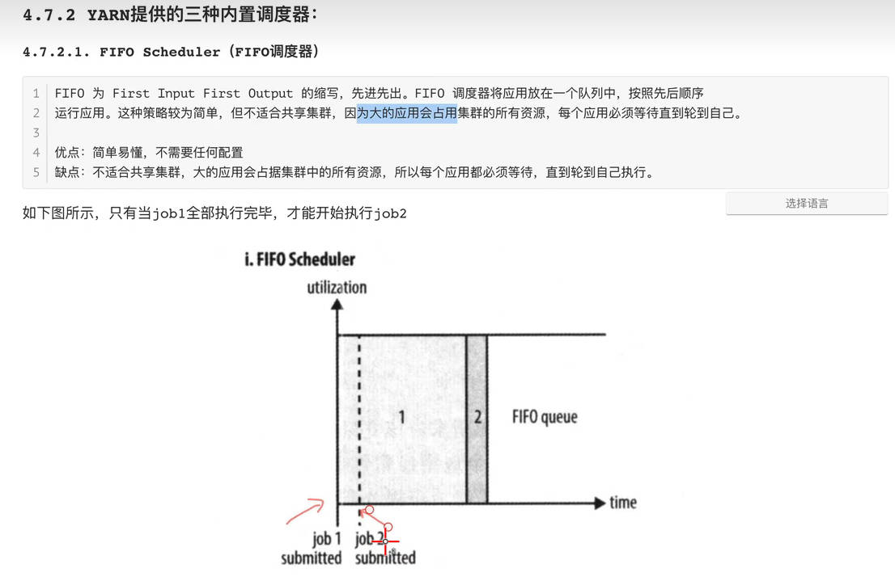     | 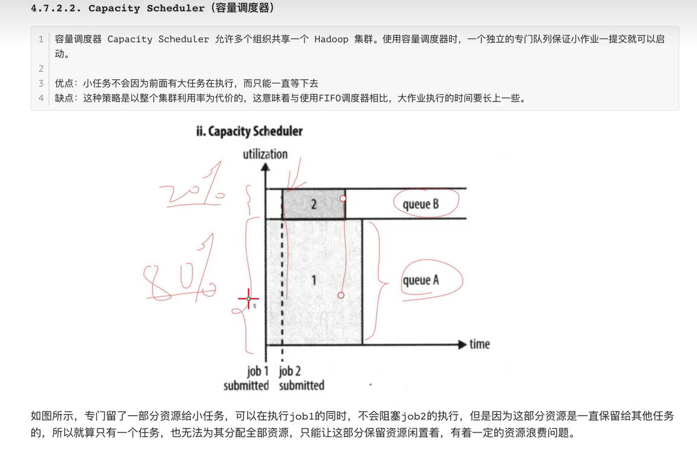 |
| --------------------------------------------------------- | ------------------------------------------------------------ |
| 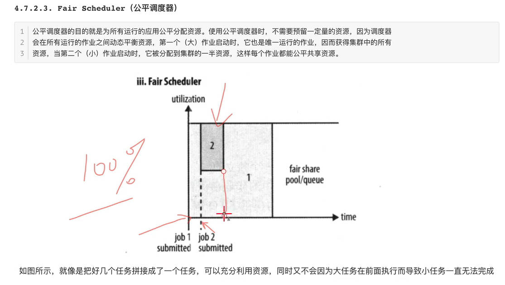 |                                                              |

# 5、Zookeeper

## 1、简介

Zookeeper注册中心，动物园管理者,分布式协调服务框架

| 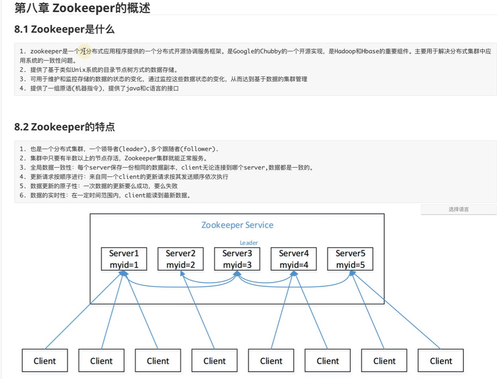 | 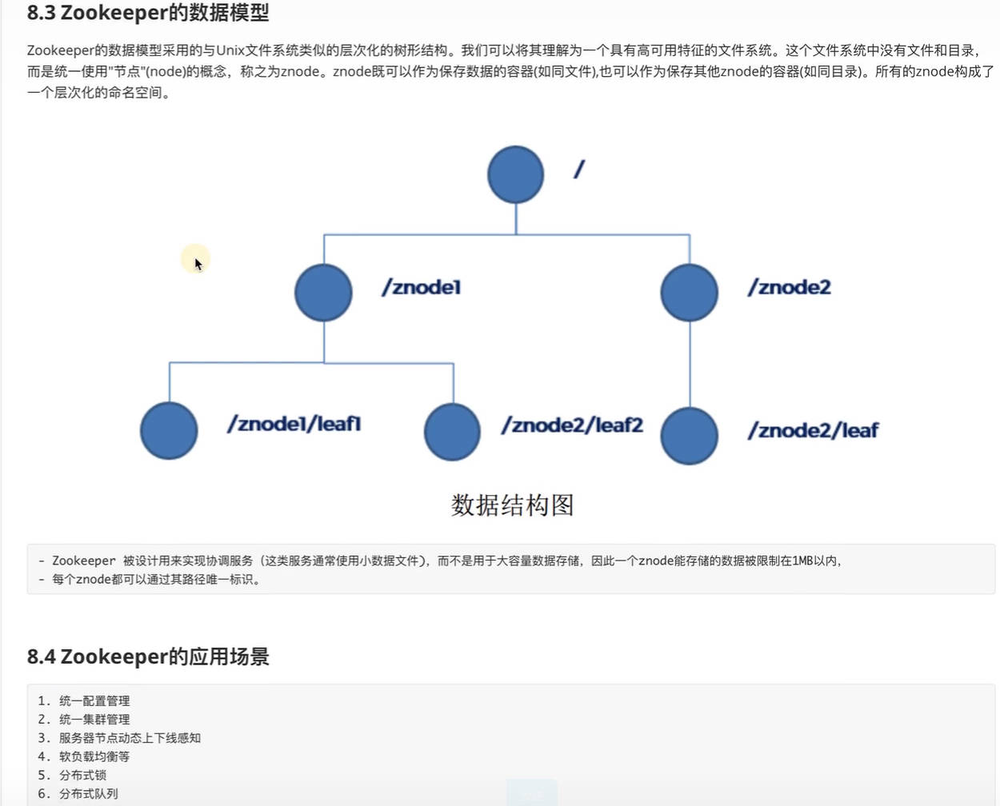 |
| ----------------------------------------------------- | ----------------------------------------------------- |

# 6、数据采集

## 1、Flume

日志收集

## 2、Sqoop

| 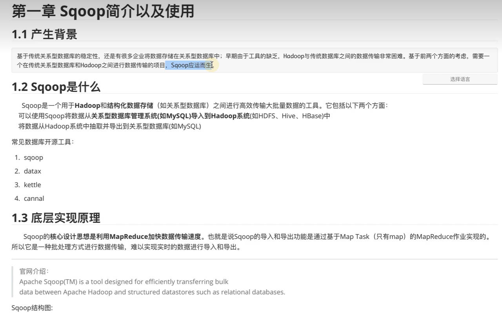 |  |
| ----------------------------------------------------- | ----- |

## 3、Kettle

[大数据Kettle](https://www.bilibili.com/video/BV1tf4y1X7mT/?spm_id_from=333.788.recommend_more_video.8&vd_source=7346303e5e18677d7261c2c0c109ecfd)

# 7、数据存储

## 1、Hbase

基于Hadoop的数据库，Hadoop database简称，是一种NoSQL数据库

# 8、数据清洗

[ETL与Kettle](https://betheme.net/news/txtlist_i107182v.html?action=onClick) [大数据清洗](http://db.hit.edu.cn/2021/0823/c13063a259140/page.htm) [数据清洗工具](https://baijiahao.baidu.com/s?id=1713655158873710300&wfr=spider&for=pc) [数据分析师](https://baijiahao.baidu.com/s?id=1770750127298959276&wfr=spider&for=pc)    [四种数据处理方式比较：传统 ETL 工具、Mapreduce、Hive、Spark ](https://www.sohu.com/a/230352341_151779)  

## 1、Hive数据仓库

### 1、概念

[六款ETL主流工具](https://zhuanlan.zhihu.com/p/549330638?utm_id=0)  [数据迁移ETL工具](https://www.cnblogs.com/mq0036/p/17252427.html) [ETL工具](https://baijiahao.baidu.com/s?id=1748887278550307811&wfr=spider&for=pc) [ETL工具推荐](https://baijiahao.baidu.com/s?id=1774096222497327991&wfr=spider&for=pc)  [ETLCloud全域数据集成平台](https://etl.restcloud.cn/restcloud/view/page/download.html?type=5&categoryId=6371e5004071f26ef2416667) [ETLCloud制造业轻量级数据中台解决方案](https://baijiahao.baidu.com/s?id=1775535897646597433&wfr=spider&for=pc) [数据集成：15种ETL调度工具](https://zhuanlan.zhihu.com/p/340393263?utm_id=0)

[为什么要建设数据仓库 ](https://www.firecat-web.com/news/920)  [大数据时代，数据仓库究竟是干嘛的](https://baijiahao.baidu.com/s?id=1752000788896845520&wfr=spider&for=pc)

[Hive和Hbase区别](https://baijiahao.baidu.com/s?id=1685411745554429414&wfr=spider&for=pc)

- Hive
  - ==对每天产生的海量数据进行管理： 读写、管理元数据==
  - hive是数据仓库的工具，将结构化的数据(HDFS中的数据)映射成一张表，采用类sql的方式对结构化的数据进行处理
  - Hadoop的数据仓库。数据仓库，严格来说不是数据库
  - Hive将HiveQL查询转换为Hadoop MapReduce作业执行, 还能够将查询转换为Apache Tez或Apache Spark作业
  - 通过SQL来处理和计算HDFS的数据，Hive会将SQL翻译为Mapreduce来处理数据，适用于离线的批量数据计算
  - 仅HBase不能用于分析查询，因为它没有专用的查询语言
  - Hive作为==分析查询引擎==，是专门为启用数据分析而设计的，专用的Hive查询语言（HiveQL）与SQL类似
- ETL工具: 各种数据的处理，转换，迁移
  - 对于一个数据驱动的组织来说，拥有一个集中的信息来源是至关重要的，否则就很难做出明智的预测。许多公司转向ETL来为他们的数据提供背景
  - ETL是 "提取、转换、加载 "的缩写，是一种标准模式，公司可以用它来将来自多个来源的数据整合到一个集中的数据存储库。如从不同的来源提取数据，刷洗和清理数据以达到更高的质量，并将所有的数据整合到数据仓库。可以使用ETL工具来简化数据管理策略，并通过标准化的方法提高数据质量。

`通过ETL工具将数据源抽取到HDFS存储；通过Hive清洗、处理和计算原始数据；HIve清洗处理后的结果，如果是面向海量数据随机查询场景的可存入Hbase；数据应用从HBase查询数据`

| 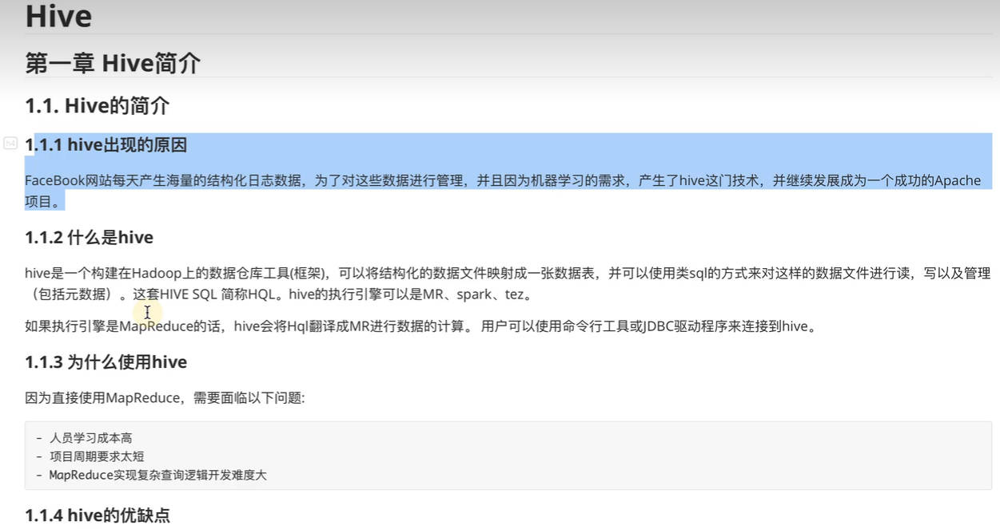 | 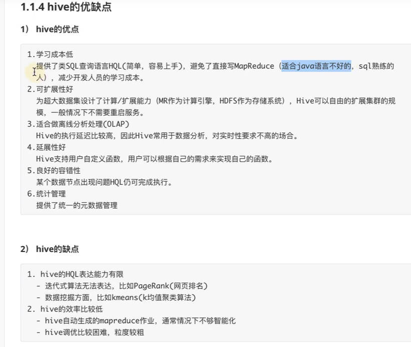 |
| ----------------------------------------------------- | ----------------------------------------------------- |

### 2、Hive架构和原理

| 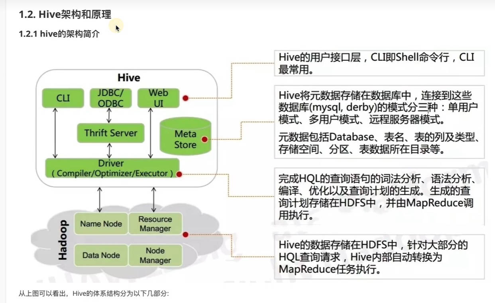 | 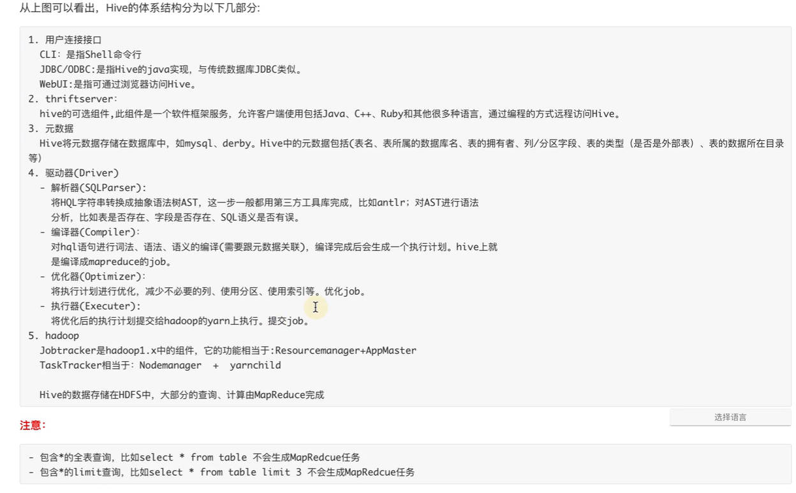 |
| ----------------------------------------------------- | ----------------------------------------------------- |
| 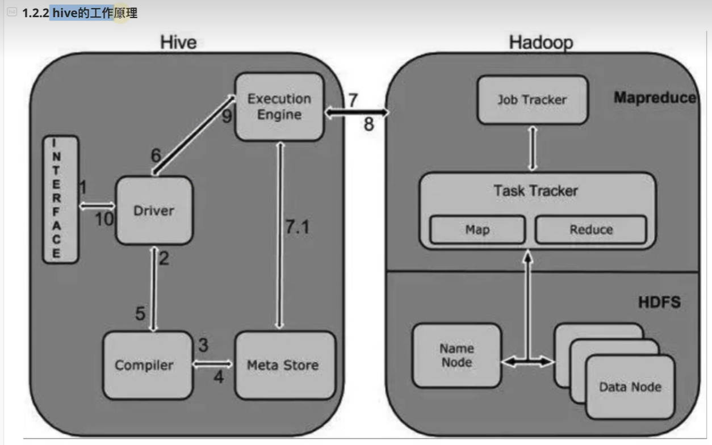 | 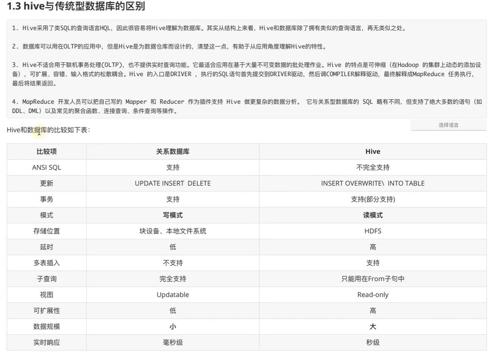 |

### 表分区

### 序列化反序列化

## 2、Spark

[千锋_Spark视频](https://www.bilibili.com/video/BV1tf4y1H7Ke/?vd_source=7346303e5e18677d7261c2c0c109ecfd)

# 9、数据挖掘

[Mahout（Hadoop体系的机器学习）](https://dandelioncloud.cn/article/details/1458840955750273026) [Mahout是什么](https://www.cnblogs.com/zlslch/p/6673584.html)

> 1. Mahout
>    1. Apache开源项目，提供一些可扩展的机器学习领域经典算法的实现，旨在帮助开发人员更加方便快捷地创建智能应用程序。Mahout包含许多实现，包括聚类、分类、推荐过滤、频繁子项挖掘。此外，通过使用 Apache Hadoop 库，Mahout 可以有效地扩展到云中。Mahout 是基于Hadoop的机器学习和数据挖掘的一个分布式框架。Mahout用MapReduce实现了部分数据挖掘算法，解决了并行挖掘的问题。
>    2. Mahout的主要目标是**建立可伸缩的机器学习算法**。这种可伸缩性是针对大规模的**数据集**而言的。Apache Mahout的算法运行在Apache**Hadoop平台**下，它通过**Mapreduce模式**实现
>    3. Mahout 是一个机器学习 Java 类库的集合，用于完成各种各样的任务，如分类、评价性的聚类和模式挖掘等
>    4. Mahout是一个Hadoop云平台的算法库，已经实现了多种经典算法，并一直在扩充中，其目标就是致力于创建一个可扩容的云平台算法库。

# 10、Hadoop管理工具

[Hadoop5大管理工具](https://www.cnblogs.com/zhangchenliang/archive/2012/06/28/2568844.html)

## 1、Ambari

[Ambari安装之部署](https://www.cnblogs.com/zlslch/p/6653872.html)  [Ambari自定义服务](https://zhuanlan.zhihu.com/p/457775467)

> 1. Ambari : 创建、管理、监视 Hadoop 的集群 ，Ambari 是为了让 Hadoop 以及相关的大数据软件更容易使用的一个工具

## 2、Mesos

## 3、Platform MapReduce

## 4、StackIQ Rocks+ Big Data

## 5、Zettaset Orchestrator

# 11、第二代大数据开发

## 1、Spark

[Spark生态](https://www.bilibili.com/video/BV1tf4y1H7Ke?p=53&vd_source=7346303e5e18677d7261c2c0c109ecfd) [scala和spark关系](https://blog.51cto.com/u_16099295/6327829)

` Spark 是在 Scala 语言中实现的，它将 Scala 用作其应用程序框架。与 Hadoop 不同，Spark 和 Scala 能够紧密集成，其中的 Scala 可以像操作本地集合对象一样轻松地操作分布式数据集`

| 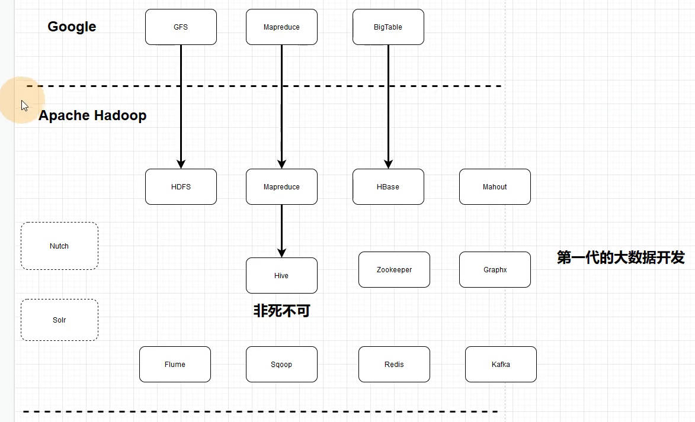 | 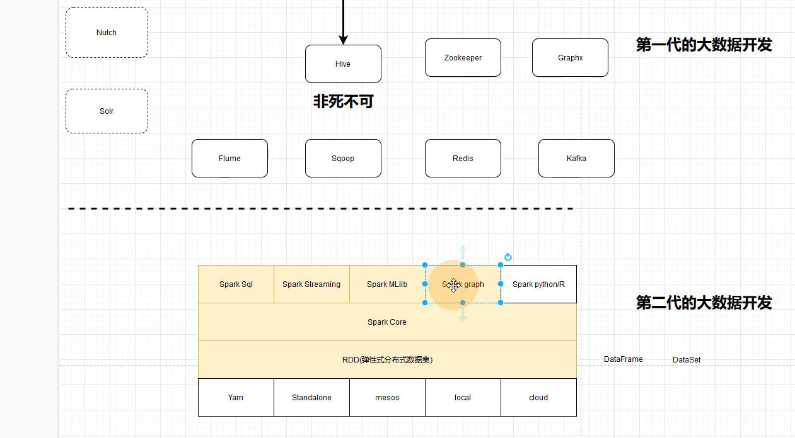 |
| ----------------------------------------------------- | ----------------------------------------------------- |

# 12、大数据项目

## 1、收集

[大数据准实时数仓](https://www.bilibili.com/video/BV1Hh411s7gp/?vd_source=7346303e5e18677d7261c2c0c109ecfd)  [dmp+实时移动充值系统+电商数仓+广告投放](https://www.bilibili.com/video/BV1gA411Y7Mx/?spm_id_from=333.999.0.0&vd_source=7346303e5e18677d7261c2c0c109ecfd)  [大数据项目实战之亿级流量采集与监控](https://www.bilibili.com/video/BV1b54y127E8/?spm_id_from=333.999.0.0&vd_source=7346303e5e18677d7261c2c0c109ecfd) 

## 2、用户画像

[什么是大数据用户画像](https://mp.weixin.qq.com/s?__biz=MzU0OTE4MzYzMw==&mid=2247487152&idx=5&sn=2a23a3b332565a640730d1b161efae00&chksm=fbb2874eccc50e589fe320f9e1eafae2aa044bc76fc3319808846f6ee84f127ec5bc4fac180b&scene=27) [大数据用户画像解决方案](https://www.alibabacloud.com/help/zh/lindorm/latest/a-solution-for-using-big-data-to-build-user-personas)   [大数据用户画像](https://www.bilibili.com/video/BV1Qg411V7WV/?spm_id_from=333.788.recommend_more_video.0&vd_source=7346303e5e18677d7261c2c0c109ecfd)  

> 1. 用户画像（User Profile），作为大数据的根基，它完美地抽象出一个用户的信息全貌，为进一步精准、快速地分析用户行为习惯、消费习惯等重要信息，提供了足够的数据基础，奠定了大数据时代的基石。
>    
> 2. 用户画像，即用户信息标签化，就是企业通过收集与分析消费者社会属性、生活习惯、消费行为等主要信息的数据之后，完美地抽象出一个用户的商业全貌作是企业应用大数据技术的基本方式。用户画像为企业提供了足够的信息基础，能够帮助企业快速找到精准用户群体以及用户需求等更为广泛的反馈信息。

# 13、云计算

[云计算基础入门](https://www.bilibili.com/video/BV1JA411H7sJ/?spm_id_from=333.999.0.0&vd_source=7346303e5e18677d7261c2c0c109ecfd)  [云原生生态中的技术栈概览 ](https://www.cnblogs.com/ywqdd/p/15677610.html)   [openstack云存储技术栈](https://blog.51cto.com/u_16213422/9251228)

[云原生架构总览](https://cloud.tencent.com/developer/article/2231618) [什么是云原生架构](https://zhuanlan.zhihu.com/p/648964015) [云原生架构](https://developer.aliyun.com/article/1136275) [云计算生态体系](https://blog.csdn.net/universsky2015/article/details/133004404)  [云原生架构，DevOps 介绍](https://baijiahao.baidu.com/s?id=1766600131599303700&wfr=spider&for=pc) 

[云原生开源大数据平台 E-MapReduce -火山引擎](https://www.volcengine.com/product/emr)  [OpsAnt云原生开源运维平台](https://www.opsant.com/#/) [KubeSphere Cloud云原生应用服务平台](https://kubesphere.cloud/) [云原生的开源大数据统一平台](https://yqh.aliyun.com/live/openbigdata) [开放云原生应用](https://promotion.aliyun.com/ntms/act/kubernetes.html)

[云原生之微服务架构](https://cloud.tencent.com/developer/article/2211475?areaSource=102001.2&traceId=1-9lyqmKqbCLWdkvWO4am)

[云原生部署](https://www.baidu.com/s?word=云原生部署&rsv_dl=feed_landingpage_rs&from=1020853i&rsf=) [云原生之使用Docker部署OneNav个人书签管理器](https://developer.aliyun.com/article/1264111)  [云原生之部署Docker可视化管理工具docker.ui](https://www.bilibili.com/read/cv23329424/) [云原生之kubernetes部署（kubeadm方式安装）](https://blog.csdn.net/m0_62948770/article/details/127638675)  [云原生架构，DevOps 介绍 ](https://baijiahao.baidu.com/s?id=1766600131599303700&wfr=spider&for=pc) [云计算和大数据以及两者的区别](https://developer.aliyun.com/article/979852)

