不是笔记视频：[Go](https://www.bilibili.com/video/BV1Uu411E7nE/?vd_source=7346303e5e18677d7261c2c0c109ecfd&p=16&spm_id_from=333.788.videopod.episodes)   [Go](https://www.bilibili.com/video/BV19u4y1r7jR/?vd_source=7346303e5e18677d7261c2c0c109ecfd&p=15&spm_id_from=333.788.videopod.episodes)  

[狂神Go语言全栈课程](https://www.bilibili.com/video/BV1m64y1w75p/?vd_source=7346303e5e18677d7261c2c0c109ecfd)  [2025年新版狂神Go语言全栈开发](https://www.bilibili.com/list/3546878241147722?oid=114245291283408&bvid=BV1LtZPYWErW)

[狂神go全栈一期](https://blog.csdn.net/qq_35401605/article/details/129071742)    

# go入门

## 环境搭建

[GOPROXY.IO - 一个全球代理 为 Go 模块而生](https://proxy.golang.com.cn/zh/)    [Go 语言开发工具](https://www.runoob.com/go/go-ide.html) 

```
go run hello.go
```

## 语法

```go
/*
一行代表一个语句结束， 结尾不用分号
字符串连接用加号 +
变量的声明必须使用空格隔开, 运算符和操作数之间使用空格  const Pi float64 = 3.14
*/
```

**Go 程序一般结构 :   basic_structure.go** 

- 通过 **type** 关键字进行结构(struct)和接口(interface)的声明

```go
// 当前程序的包名
package main

// 导入其他包
import . "fmt"

// 常量定义
const PI = 3.14

// 全局变量的声明和赋值
var name = "gopher"

// 一般类型声明
type newType int

// 结构的声明
type gopher struct{}

// 接口的声明
type golang interface{}

// 由main函数作为程序入口点启动
func main() {
    Println("Hello World!")
}
```

### 包

Go 程序通过 **package** 来组织

```go
// 单个包导入
import "io"
// 多个
import (
    "fmt"
    "math"
)
// 包引入一般为: 项目名/包名		import "test/controllers"
// 方法的调用为: 包名.方法名()		controllers.Test()

// 使用 <PackageName>.<FunctionName> 调用
// 为fmt起别名为fmt2
import fmt2 "fmt"

// 加个点表示省略调用，那么调用该模块里面的函数，可以不用写模块名称
import . "fmt"
func main (){
    Println("hello,world")
}
```

### 可见性规则

Go语言中，==使用大小写决定==该常量、变量、类型、接口、结构或函数==是否可以被外部包==调用。

函数名首字母小写即为 **private** :

```
func getId() {}
```

函数名首字母大写即为 **public** :

```
func Printf() {}
```

## 变量常量

[二进制到汇编学习](https://www.bilibili.com/video/BV1ni4y1G7B9/?vd_source=7346303e5e18677d7261c2c0c109ecfd) 

变量声明： `var identifier type`  

- `_` 下划线，匿名变量，赋值给匿名变量的值都会被丢弃

变量作用域：

- 全局变量必须用 `var`

```go
var name string = "张三"
//自动推导类型，短变量声明
name := "kuang"

// 变量交换 : 临时变量		a = 10   b = 20
// 思路 var t int  t = a   a = b   b = t
var a int = 100
var b int = 200
// 把a, b赋值给b, a
b, a = a, b

# %占位符, 数量和后面待输出的变量一致  
# %d数字  %p 变量的内存地址 ; 查看变量内存地址，在变量前加 &

fmt.Printf("num的值：%d,内存地址:%p\n", num, &num)
```

常量： 特殊的常量  iota，常量计数器，在const中自动加1，默认值0

```
const(
	a = iota
	b = iota
	c = iota
)
```

Printf格式化字符串： [fmt.Printf 格式化字符串](https://www.runoob.com/go/go-basic-syntax.html) 

## 数据类型

[Go中的转义字符](https://zhuanlan.zhihu.com/p/691588659)  [转义字符](https://www.jianshu.com/p/3cf39cdec7d0)  [字符串转义](https://blog.csdn.net/u010429831/article/details/108408783)  [go语言转义字符](https://blog.51cto.com/u_16175449/6813553)

[nil](https://www.cnblogs.com/xiaomotong/articles/17736681.html) 

派生类型:  

| 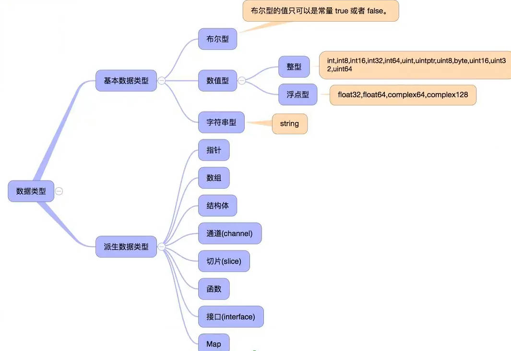 | 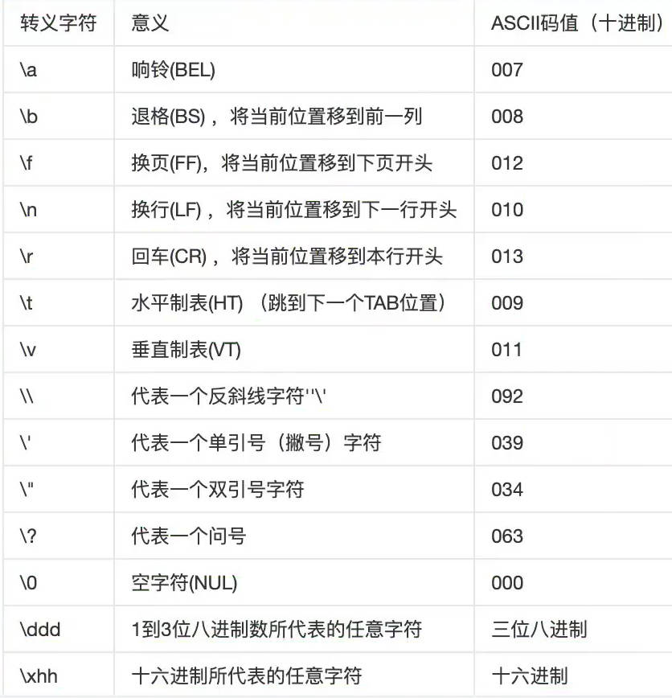 |
| ----------------------------------------------------- | ----------------------------------------------------- |


数据类型在内存中占用的空间是有范围的，不能无限的放东西

特殊类型：byte(uint8)  rune(int32)

`双引号是 string 类型，单引号是字符，字符本质是整型`

### 数据类型转换

go语言没有隐式类型转换，所有类型转换必须显式声明

```go
// 新类型的值 = 新类型(旧类型的值)
a := 5.9
b := int(a)
```

## 运算符

二进制位运算符

其他运算符： ` &	 返回变量存储地址；   *  指针变量` 

## ==流程控制==

### 条件

```go
// if...else if...else
if 布尔表达式 {		// 条件
   ...
} else {
   ...
}
====================
//switch： 不同条件执行不同动作
switch var1 {
    case val1:
        ...
    case val2:
        ...
    default:
        ...
}
====================
// select 语句类似 switch ，但是select会随机执行一个可运行的case。如果没有case可运行，它将阻塞，直到有case可运行
select {
  case <- channel1:
    // 执行的代码
  case value := <- channel2:
    // 执行的代码
  case channel3 <- value:
    // 执行的代码
  default:
    // 所有通道都没有准备好，执行的代码
}
```

### 循环

[循环](https://www.runoob.com/go/go-for-loop.html) 

` for 从哪里开始 到哪里结束 循环条件`

```go
Go 语言的 For 循环有 3 种形式，只有其中的一种使用分号。

// 和 C 语言的 for 一样：
for init; condition; post { }

// 和 C 的 while 一样：
for condition { }

// 和 C 的 for(;;) 一样：
for { }
```

## 函数

函数和方法不一样，方法是面向对象里的，要指定调用者

```go
// 返回类型， 函数返回一列值。return_types 是该列值的数据类型。  无返回值情况下， return_types 不是必须的

func function_name( [parameter list] ) [return_types] {
   函数体
}

func 函数名 (参数1，参数2) 返回值类型 { }

// 例子
func max (num1 int,num2 int) int { }
// 2个都是int，简写为 func max (num1 ,num2 int) { }
// 多个返回值，括号括起来,返回值也可以命名
func swap (x,y string) (a1 string, a2 string) { return y,x}
```


| 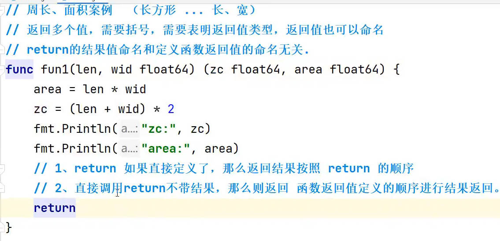 | 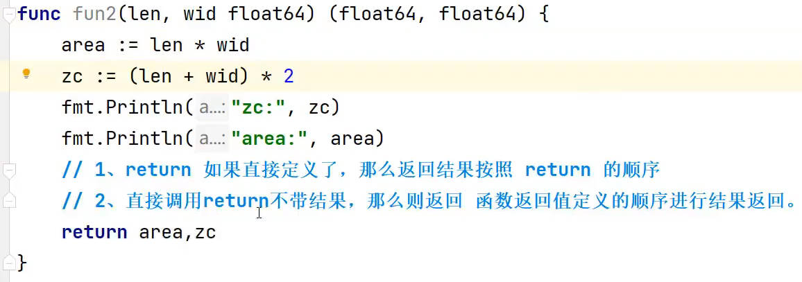 |
| ----------------------------------------------------- | ----------------------------------------------------- |

### 可变参数

函数的参数类型确定，参数个数不确定，可以用可变参数  

| 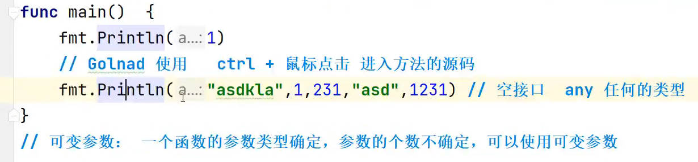 | 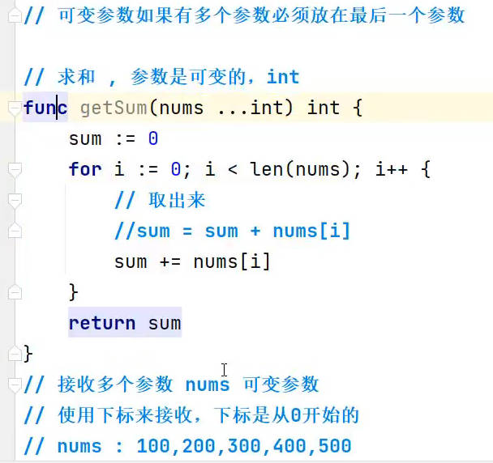 |
| ----------------------------------------------------- | ----------------------------------------------------- |

### 函数作用域

- 全部变量：函数外部定义的变量

- 局部变量

### 递归

[go实现斐波那契数列的3种方法](https://blog.csdn.net/tuobicui6522/article/details/80397918) 

### defer延迟函数

延迟执行函数： defer等其它语句执行完后，再执行； 多个defer，倒序执行

作用：处理善后，比如错误、文件、网络流关闭等

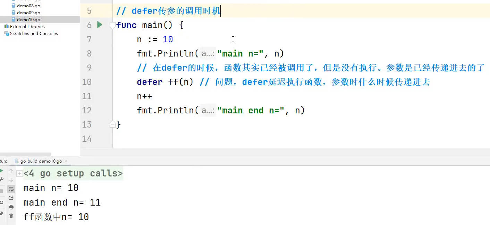

### 函数的数据类型

函数本身也是数据类型 `func`

函数加括号是调用，不加括号，函数也是一个变量

### 函数的本质

### 匿名函数

`func(){}()`  函数体后加括号,只能执行一次; 

匿名函数进行赋值，就能多次调用

```go
f3 := func() { }
f3()
```

匿名函数用于函数式编程

- 将匿名函数作为另一个函数的参数，形成回调函数
- 将匿名函数作为另一个函数的返回值，可以形成闭包

### 回调函数

### 闭包

[JS闭包的9大经典使用场景](https://cloud.tencent.com/developer/article/1842037)  [闭包的应用](https://www.cnblogs.com/ligd2022/p/17052541.html)  [闭包的应用_百度搜索](https://www.baidu.com/s?ie=utf-8&f=8&rsv_bp=1&tn=baidu&wd=%E9%97%AD%E5%8C%85%E7%9A%84%E5%BA%94%E7%94%A8&oq=%25E9%2597%25AD%25E5%258C%2585%25E7%25BB%2593%25E6%259E%2584%25E7%259A%2584%25E5%25BA%2594%25E7%2594%25A8&rsv_pq=d7b01e99000e405c&rsv_t=4e7aqyfnQeuGC5DK1sQGrG%2FKS%2FonU%2B1yITdWgSEtmf2%2BHzv8gn%2BzNYF0zNw&rqlang=cn&rsv_enter=1&rsv_dl=tb&rsv_sug3=2&rsv_sug1=2&rsv_sug7=100&rsv_sug2=0&rsv_btype=t&inputT=369&rsv_sug4=1404) 

由于在JavaScript语言中，只有函数内部的子函数才能读取局部变量，**闭包就是能够读取其他函数内部变量的函数**。所以本质上，闭包就是将函数内部和函数外部链接起来的一座桥梁。

> 闭包形成的原理

JS的“链式作用域”结构（chain scope），子对象会一级级地向上寻找父对象的变量。**父对象的所有变量，对子对象都是可见的，反之不成立。**

> 闭包解决的问题

- 能够让函数作用域中的变量在函数执行结束之后不被销毁，**让这些变量的值始终保持在内存中**
- 延伸变量作用域范围，使函数外部可以访问函数内部的局部变量。

> 闭包带来的问题

由于垃圾回收期不会将闭包中的变量销毁，可能会造成内存泄漏。

> 闭包的应用

- 模仿块级作用域
- 柯里化函数
- 在构造函数中定义特权方法
- Vue源码中的闭包
- 静态私有变量
- 函数防抖

| 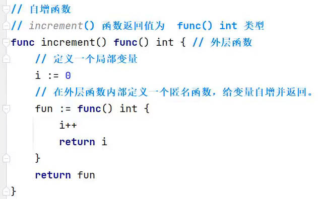 |  |
| ----------------------------------------------------- | ----------------------------------------------------- |

### 参数的传递

- 引用传递： 切片slice、map、chan...，操作的是数据的地址，多个变量指向同一个地址 
- 值传递: 数组、int、string、bool、float64、array...，创建的时候，拷贝一份

| 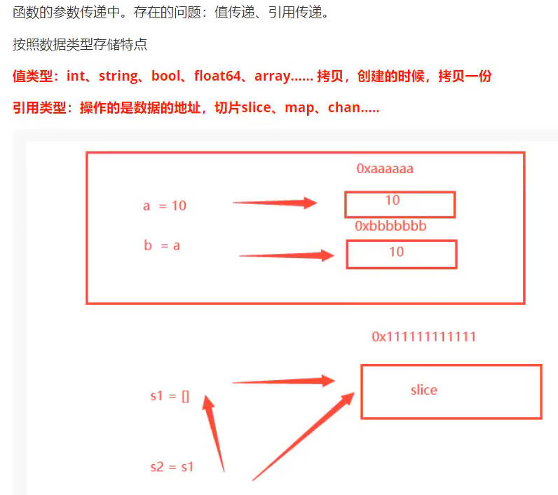 | 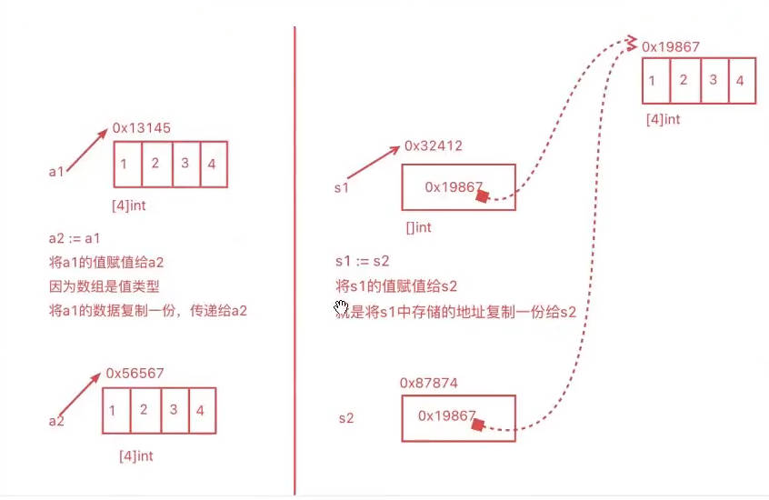 |
| ----------------------------------------------------- | ----------------------------------------------------- |

### 函数式编程

## 数组切片map

[go语言中的容量和长度](https://cloud.tencent.com/developer/article/2394359) 

数组也是变量，声明要用 `var`，数组要设置大小

数组方法: `len(arr1)  cap()数组的容量`

|  | 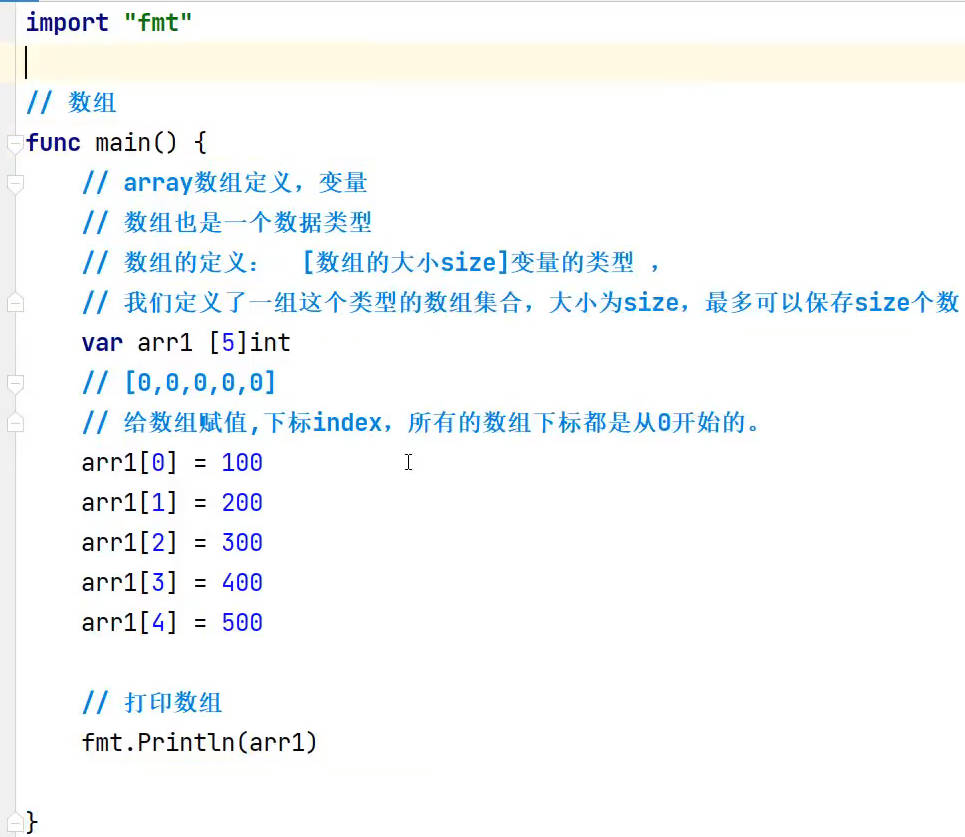 |
| ----------------------------------------------------- | ----------------------------------------------------- |

赋值初始化数组的几种方式: `1:100是下标`

| 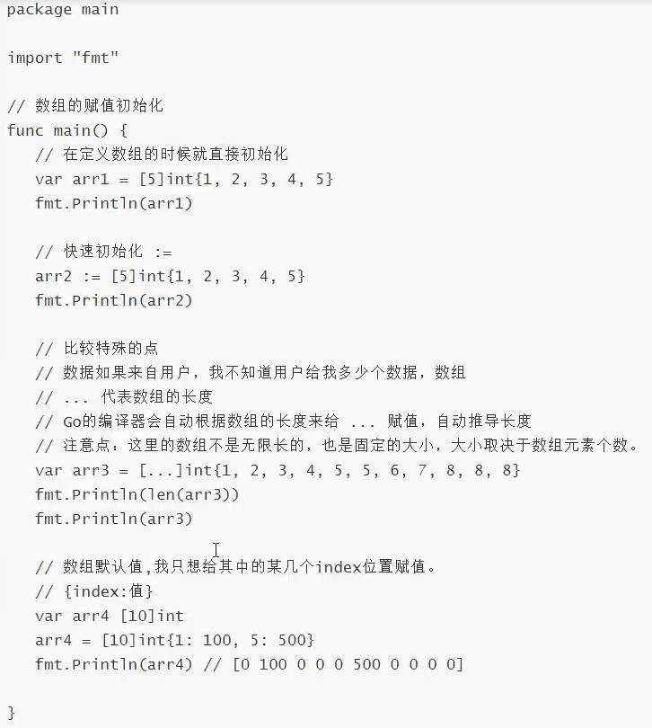 |  |
| ----------------------------------------------------- | ----- |

数组是值类型

数组排序

多维数组

### 切片

对数组的抽象,与数组相比，切片的长度不固定； 切片是引用类型,数组是值类型

`make()` 创建切片 

| 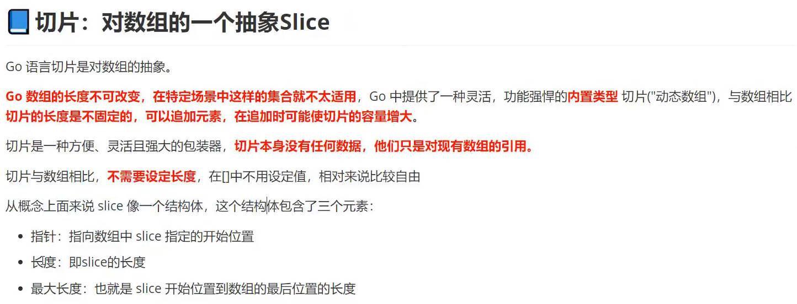 | 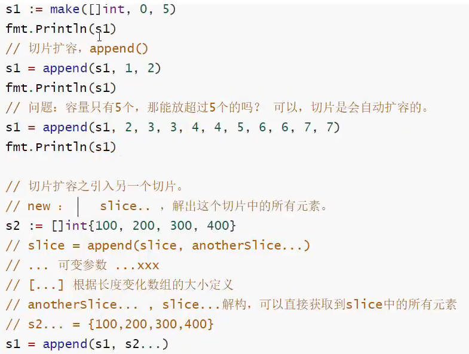 |
| ----------------------------------------------------- | ----------------------------------------------------- |

切片会自动扩容

切片扩容的内存分析

使用数组创建切片

深拷贝，浅拷贝

### map

## 指针和结构体

变量是一种占位符，底层指向一个内存地址, 指针变量通常缩写为 ptr  `pointer`

& 取地址符，指针变量存的是地址    * 取出变量指向的地址中的值

指针指向指针

- `var ptr **int`

### 指针

#### 数组指针

是一个指针，指向一个数组

#### 指针数组

是一个数组，存的是指针

#### 指针函数

通过函数访问指针

#### 指针作为函数参数

常用,解决一些值传递问题

### 结构体

变量数组等是零散的，对象把世界上的所有东西，抽象成类，属性方法集中到一起。

结构体指针

匿名结构体

匿名字段

结构体嵌套

## 面向对象

Go不是面向对象语言，只是通过一些方法模拟面向对象

- 语句多了：把一些功能性代码，或完成相同类型作业的代码聚集在一起，函数就出现了
- 变量多了：相同类型的变量，功能相近的变量放一起，组合成一个类，结构体就出现了
- 方法多了，变量多了，结构体多了，再封装到一起，类就出现了
- 类： 模板 ==>  通过模板创建具体的对象
  - 开发的时候，先开发类，具体使用的时候才是我们的具体对象实例化。

**面向过程思维**

- 线性思维  
  - 1/2/3/4/5

**面向对象思维**

- 分类的思维模式，首先思考这个问题怎么解决，细分成一些不同的类。然后再对类进行单独思考

|  |  |
| ----------------------------------------------------- | ----- |

### 封装

结构体用来封装

### 继承

结构体嵌套

java等语言显式声明继承，有很多问题

- Go语言的继承隐式声明： 不用显式声明，结构体的嵌套,把一个结构体丢到另一个结构体里面，父类放到子类里面

```go
type Person struct{ }	// 父类
type User struct{
	Person
}

// 实例：

package main

import "fmt"

// 定义一个父类
type Person struct {
   name string
   age  int
}

// 定义一个子类，Student拥有了父类所有的属性，还有自己的特性
type Student struct {
   Person // 匿名字段，实现了继承。
   school string
}

func main() {
   // 1、 创建父类对象
   p1 := Person{name: "kuangshen", age: 18}
   fmt.Println(p1)
   fmt.Println(p1.name, p1.age)

   // 2、创建子类
   s1 := Student{Person: Person{name: "小明", age: 3}, school: "学相伴"}
   fmt.Println(s1)
   fmt.Println(s1.Person.name, s1.Person.age, s1.school)

   // 3、创建子类	
   var s2 Student
   s2.Person.name = "张三"
   s2.Person.age = 3
   s2.school = "北大"
   fmt.Println(s2)

   // 概念：提升字段, 只有匿名字段才可以做到
   // Person 在Student中是一个匿名字段， Person中的属性 name age 就是提升字段
   // 所有的提升字段就可以直接使用了，不同在通过匿名字段来点了
   
   var s3 Student
   s3.name = "李四"
   s3.age = 4
   s3.school = "清华"
   fmt.Println(s3)
   fmt.Println(s3.name, s3.age)

}
```

**继承就是子类继承父类的特征和行为，使得子类具有父类的属性和方法，使得子类具有父类相同的行为。子类会具有父类的一般特性也会具有自身的特性。**

匿名字段  +  提升字段：Go语言中的匿名字段。

| 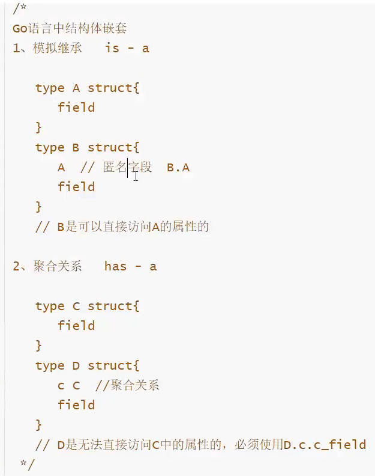 |  |
| ----------------------------------------------------- | ----- |

#### 方法

在函数上多了调用者

**Go语言中同时拥有函数和方法。一定要和其他只有方法的语言区分开**

类：结构体->属性、方法?

Go语言实现方法

**方法：和类绑定，需要指定调用者，约定这个方法属于谁的.   对象.方法()**

**函数：不需要指定调用者，定义了函数就可以直接函数名()调用**

```go
package main

import "fmt"

// 方法：可以理解为函数多了一个调用者
// 方法可以重名，不同的对象，调用的结果是不一样的
type Dog struct {
   name string
   age  int
}

// 方法定义, 增加了调用者，有调用者的函数：  func 方法调用者  方法名()
// 1、方法可以重名，只需要调用者不同
// 2、如果调用者相同，则不能重名
func (dog Dog) eat() {
   fmt.Println("Dog eating...")
}

func (dog Dog) sleep() {
   fmt.Println("Dog sleep...")
}

type Cat struct {
   name string
   age  int
}

func (cat Cat) eat() {
   fmt.Println("Cat eating...")
}
func (cat Cat) sleep() {
   fmt.Println("Cat sleep...")
}

func main() {

   // 创建一个对象
   dog := Dog{
      name: "旺财",
      age:  2,
   }
   fmt.Println(dog)
   // 方法的调用，通过对应的结构体对象来调用
   dog.eat()

   cat := Cat{name: "喵喵", age: 1}
   cat.eat()
}
```

方法：

- 某个类的行为功能，需要指定调用者
- 一段独立的代码功能，必须要使用调用者来调用
- 多个类的方法可以重名，单个类不行
- 方法是某个类的动作

函数：

- 一段独立的代码功能，可以直接调用

- 命名完全不能冲突
- 函数是一个特殊的类型


#### 方法的重写

需要和继承集合

子类可以重写父类的方法 override

子类还可以新增自己的方法

子类可以访问父类中的属性和方法

```go
package main

import (
   "fmt"
)

// 方法重写，建立在父类和子类结构上的
type Animal struct {
   name string
   age  int
}

func (animal Animal) eat() {
   fmt.Println(animal.name, " 正在吃....")
}
func (animal Animal) sleep() {
   fmt.Println(animal.name, " 正在sleep....")
}

// 子类
type Dog struct {
   Animal
}

// 子类自己的方法
func (dog Dog) wang() {
   fmt.Println("wangwangwanwg~~~")
}

type Cat struct {
   Animal
   color string // 子类可以定义自己的属性
}

// 子类重写父类的方法 , 子类的方法名和父类同名，即可重写父类的方法
func (cat Cat) eat() {
   fmt.Println(cat.name, " 正在吃cat....")
}

func main() {
   // 定义一个子类，使用父类方法
   dog := Dog{Animal{name: "旺财", age: 3}}
   dog.eat()  // 调用父类的方法
   dog.wang() // 调用自己扩展的方法
   cat := Cat{Animal{name: "煤球", age: 3}, "黑色"}
   cat.eat() // 如果重写了父类的方法就是调用子类自己的方法

   fmt.Println(cat.color) // 调用子类自己的属性

   // 子类可以操作父类的方法，父类可以操作子类的吗？不可以
   // 父类不能调用子类自己的扩展的方法
   a := Animal{name: "大黄", age: 3}
   a.eat()
   a.sleep()

}
```

### 多态

用接口模拟多态

#### 接口

`变量多了 ---> struct  语句--->函数  方法多了--->接口`

```go
package main

import (
   "fmt"
)

// 接口： USB、typec、插座
// 1、Go语言提供了接口数据类型。
// 2、接口就是把一些共性的方法集合在一起定义。
// 3、如果有实现类将接口定义的方法全部实现了，那么就代表实现了这个接口
	//  Go隐式实现 ，假设A实现了B接口中的所有方法，不需要显示声明
	//  显式实现
// 4、接口是方法的定义集合，不需要实现具体的方法内容。名字约束

// 接口的定义 interface 来定义，方法太多了，要归类，方法的集合
type USB interface { // 接口是，方法的集合
   input()  // 输入方法
   output() // 输出方法
}

// 结构体是，属性的集合
type Mouse struct {
   name string
}

// 结构体实现了接口的全部方法就代表实现了这个接口，否则不算实现这个接口
func (mouse Mouse) output() {
   fmt.Println(mouse.name, "鼠标输出")
}
func (mouse Mouse) input() {
   fmt.Println(mouse.name, "鼠标输入")
}

// 接口嗲用测试
func test(u USB) {
   u.input()
   u.output()
}

func main() {
   // 通过传入接口实现类来进行调用
   m1 := Mouse{name: "罗技"}
   // test 参数 USB 类型，如果一个结构体实现了这个接口所有的方法，那这个结构体就是这个接口类型的
   test(m1)

   k1 := KeyBoard{name: "雷蛇"}
   test(k1)

   // 定义高级类型  k1就升级了  KeyBoard --> USB  向上转型
   var usb USB
   usb = k1
   fmt.Println(usb)
   // 接口是无法使用实现类的属性的
   //fmt.Println(usb.name)

}

// 结构体
type KeyBoard struct {
   name string
}

// 结构体实现了接口的全部方法就代表实现了这个接口，否则不算实现这个接口
func (key KeyBoard) output() {
   fmt.Println(key.name, "键盘输出")
}
func (key KeyBoard) input() {
   fmt.Println(key.name, "键盘输入")
}
```

#### 模拟多态

多态：一个事物有多种形态

```toml
父类：动物
子类：猫
子类：狗

猫和狗是多态的，他们既可以是自己，也可以是动物，这个就是多态，一个事务有多种形态
```

```go
package main

import "fmt"

// 定义接口
type Animal interface {
   eat()
   sleep()
}

type Dog struct {
   name string
}

func (dog Dog) eat() {
   fmt.Println(dog.name, "--eat")
}
func (dog Dog) sleep() {
   fmt.Println(dog.name, "--sleep")
}

// 多态
func main() {

   // Dog 两重身份：1、Dog   2、Animal ，多态
   dog1 := Dog{name: "旺财"}
   dog1.eat()
   dog1.sleep()

   // Dog 也可以是 Animal
   test2(dog1)

   // 定义一个类型可以为接口类型的变量
   // 实际上所有实现类都可以赋值给这个对象
   var animal Animal // 模糊的 -- 具体化，将具体的实现类赋值给他，才有意义
   animal = dog1
   test2(animal)
}

// Animal 接口
func test2(a Animal) {
   a.eat()
   a.sleep()
}
```

接口的实现类都拥有多态特性：除了自己本身还是他对应接口的类型。


#### 空接口

不包含任何方法

因此：所有的结构体都默认实现了空接口  

因此空接口可以存储任何的类型

```go
interface{}  == any 	// 空接口不好记，起个别名叫 any
```

```go
package main

import "fmt"

type A interface{}
type Dogg struct {
   name string
}
type Catt struct {
   name string
}

func testNow(a A) {
   fmt.Println(a)
}

// 可以指定定义空接口
// // any is an alias for interface{} and is equivalent to interface{} in all ways.
//type any = interface{}
func testNow2(temp interface{}) {
}

func main() {
   var a1 A = Catt{name: "喵喵"}
   var a2 A = Dogg{name: "旺财"}
   var a3 A = 1
   var a4 A = "xuexiangban"
   fmt.Println(a1)
   fmt.Println(a2)
   fmt.Println(a3)
   fmt.Println(a4)

   // map
   map1 := make(map[string]interface{})
   map1["name"] = "qinjiang"
   map1["age"] = 18
   fmt.Println(map1)

   // slice
   s1 := make([]any, 0, 10)
   s1 = append(s1, 1, "12312", false, a1, a2)
   fmt.Println(s1)

   var arr [4]interface{}
   fmt.Println(arr)

}
```

- OOP思想 ：拟人化思想。物以类聚.   类：抽象的模板，定义一个类（属性、方法），实例化出来一个对象-具体的。
- OOP三大特性：封装、继承、多态
- **Go语言不是面向对象的编程语言**，有一些机制可以实现面向对象编程的思维
- 封装：结构体封装 + 方法实现  ， 模拟一个类 
- 继承：匿名字段 、提升字段 （属性、方法）
- 多态：一个事务可以拥有多种形态（接口）
- 空接口   any


#### 接口嵌套 

```go
package main

import (
   "fmt"
)

type AA interface {
   test1()
}
type BB interface {
   test2()
}

// 接口嵌套  CC :  test1()/test2()/test3()
// 如果要实现接口CC，那么需要实现这个三个方法。那这个对象就有3个接口可以转型。
type CC interface {
   AA // 导入AA接口中的方法
   BB
   test3()
}

// 编写一个结构体实现接口CC
type Dog7 struct {
}

func (dog Dog7) test1() {
   fmt.Println("test1")
}
func (dog Dog7) test2() {
   fmt.Println("test2")
}
func (dog Dog7) test3() {
   fmt.Println("test3")
}

func main() {
   // dog 拥有4种形态： Dog7 、CC 、 BB 、 AA
   var dog Dog7 = Dog7{}
   dog.test1()
   dog.test2()
   dog.test3()

   // 
   var a AA = dog
   a.test1()
   //a.test2() // 向上转型之后只能调用它自己对应的方法
   var b BB = dog
   b.test2()
   var c CC = dog
   c.test1()
   c.test2()
   c.test3()
}
```


#### 接口**断言**

**检查一个接口类型的变量是不是符合你的预期值。**

比如：我们预期使用 test3（） .   如果传递的是 a 、b 对象，我们就需要判断这个对象是否是我们预期的对象。 = 断言。

**被断言的对象必须是接口类型，否则会报错**

如果一个对象存在多种形态： 接口判断  登录   20个实现类 微信登录

- i.(T)  判断是否是预期接口
- swtich i.(type) 判断是否是预期的case结果

```go
package main

import "fmt"

// 通过switch来判断  switch i.(T)

type I interface{}

// 如果断言的类型同时实现了switch 多个case匹配，默认使用第一个case
func testAsserts(i interface{}) {
   // switch i.(type) 接口断言
   switch i.(type) {

   case string:
      fmt.Println("变量为string类型")
   case int:
      fmt.Println("变量为int类型")
   case I:
      fmt.Println("变量为I类型")
   case nil:
      fmt.Println("变量为nil类型")
   case interface{}:
      fmt.Println("变量为interface{}类型")

   // .....
   default:
      fmt.Println("未知类型")
   }
}

func main() {

   testAsserts("string")
   testAsserts(1)
   var i I      // 默认值为 nil
   var i2 I = 1 // 只有赋值了之后，才是对应的类型

   testAsserts(i)
   testAsserts(i2)
   
}
```


### type别名用法

- type xxx  TTT  自定义类型
- type xxx =  TTT  起别名

```go
package main

import "fmt"

// var 变量   type 类型（结构体、接口、别名...）

// type的别名用法,全局变量中
// 这是定义了一个新类型 MyInt，是int转换过来的，和int一样，但是不能通int发生操作，类型不同
// MyInt int
// 创建了一种新类型！
type MyInt int

func main() {
   var a MyInt = 20 // MyInt
   var b int = 10   // int

   // invalid operation: a + b (mismatched types MyInt and int)
   //fmt.Println(a + b)
   // 类型转换： T(v)
   fmt.Println(int(a) + b) // 30
   fmt.Printf("%T\n", a)   // main.MyInt
   fmt.Printf("%T\n", b)   // int

   // 给int起一个小名，但是它还得是int   type  any

   var c diyint = 30

   fmt.Printf("%T\n", c) // int

}

/*
type关键字的理解：
1、type 定义一个类型
 - type User struct 定义结构体类型
 - type User interface 定义接口类型
 - type Diy (int、string、....) 自定义类型，全新的类型

2、type 起别名
 - type xxx = 类型 ，将某个类型赋值给 xxx，相当于这个类型的别名
 - 别名只能在写代码的时候使用，增加代码的可阅读性。
 - 真实在项目的编译过程中，它还是原来的类型。
*/
```


## 错误

**错误：指的是程序中预期会发生的结果，预料之中**；  需要在程序中把控

打开一个文件：文件正在被占用，可知的。

**异常：不该出现问题的地方出现了问题，预料之外**

调用一个对象，发现这个对象是个空指针对象，发生错误。


**错误是业务的一部分，而异常不是。**


go语言开发过程中遇到最多的代码，就是error。

需要将所有的错误情况都考虑到，并写到你的代码中。


### 错误 error

**鼓励工程师在代码中显式的检查错误，而非忽略错误。**

```go
package main

import (
   "fmt"
   "os"
)

// 错误是开发中必须要思考的问题
// - 某些系统错误 ，文件被占用，网络有延迟
// - 人为错误：核心就是一些不正常的用户会怎么来给你传递参数，sql注入
func main() {

   //打开一个文件 os 系统包，所有可以用鼠标和键盘能执行的事件，都可以用程序实现
   // func Open(name string) (*File, error)
   file, err := os.Open("aaa.txt")
   // 在开发中，我们需要思考这个错误的类型  PathError
   // 1、文件不存在 err
   // 2、文件被占用 err
   // 3、文件被损耗 err
   // 调用方法后，出现错误，需要解决
   if err != nil {
      fmt.Println(err)
      return
   }

   fmt.Println(file.Name())
}

// 在实际工程项目中，
// 我们希望通过程序的错误信息快速定位问题，但是又不喜欢错误处理代码写的冗余而又啰嗦。
// Go语言没有提供像Java. c#语言中的try...catch异常处理方式，
// 而是通过函数返回值逐层往上抛, 如果没有人处理这个错误，程序就终止 panic

// 这种设计,鼓励工程师在代码中显式的检查错误，而非忽略错误。
// 好处就是避免漏掉本应处理的错误。但是带来一个弊端，让代码繁琐。

// Go中的错误也是一种类型。错误用内置的error类型表示。就像其他类型的，如int, float64。
// 错误值可以存储在变量中，从函数中返回，传递参数 等等。
```


### 自己定义一个错误

```go
package main

import (
   "errors"
   "fmt"
)

// 自己定义一个错误
// 1、errors.New("xxxxx")
// 2、fmt.Errorf()  
// 都会返回  error 对象， 本身也是一个类型
func main() {

   age_err := setAge(-1)
   if age_err != nil {
      fmt.Println(age_err)
   }
   fmt.Printf("%T\n", age_err) // *errors.errorString

   // 方式二
   errInfo1 := fmt.Errorf("我是一个错误信息：%d\n", 500)
   //errInfo2 := fmt.Errorf("我是一个错误信息：%d\n", 404)
   if errInfo1 != nil {
      // 处理这个错误
      fmt.Println(errInfo1)
   }

}

// 设置年龄的函数，一定需要处理一些非正常用户的请求
// 返回值为 error 类型
// 作为一个开发需要不断思考的事情，代码的健壮性和安全性
func setAge(age int) error {
   if age < 0 {
      // 给出一个默认值
      age = 3
      // 抛出一个错误 errors 包
      return errors.New("年龄不合法")
   }
   // 程序正常的结果，给这个用户赋值
   fmt.Println("年龄设置成功：age=", age)
   return nil
}
```


### 自定义一个错误

```go
package main

import (
   "fmt"
)

type KuangShenError struct {
   msg  string
   code int
}
// Error() string
func (e *KuangShenError) Error() string {
   //  fmt.Sprintf() 返回string
   return fmt.Sprintf("错误信息：%s,错误代码：%d\n", e.msg, e.code)
}


// 处理error的逻辑
func (e KuangShenError) print() bool {
   fmt.Println("hello，world")
   return true
}


// 使用错误测试
func test(i int) (int, error) {
   // 需要编写的错误
   if i != 0 {
      // 更多的时候我们会使用自定义类型的错误
      return i, &KuangShenError{msg: "非预期数据", code: 500}
   }
   // 正常结果
   return i, nil
}

func main() {

   i, err := test(1)

   if err != nil {
      fmt.Println(err)
      ks_err, ok := err.(*KuangShenError)
      if ok {
         if ks_err.print() {
            // 处理这个错误中的子错误的逻辑
         }
         fmt.Println(ks_err.msg)
         fmt.Println(ks_err.code)
      }
   }

   fmt.Println(i)

}
```

**购物**

下单：

1、查询商品信息 （FindGoodsError： msg、code | fun-商品不在了 ，fun-商品失效 ，fun-网络错误 ）

2、查询库存   （FindxxxError： msg、code | fun-库存为0 ，fun-库存>0）

3、查询物流是否可以到达 （xxxError： msg、code | fun ，fun）

4、查询价格生成订单 （xxxError： msg、code | fun ，fun）

5、支付成功与否  （xxxError： msg、code | fun ，fun）

6、成功就产生一个订单，推送到商家和物流  （xxxError： msg、code | fun ，fun）

## 异常panic

```go
package main

// panic
func main() {

   // 什么时候会发生恐慌panic，我们不知道什么时候会报错
   // 程序运行的时候会发生panic

   // 手动抛出panic。我们在一些能够预知到危险的情况下，可以主动抛出
   // 如果有panic发生，我们尽可能接收它，并处理。
   // func panic(v any)  使用 panic() 程序就会终止,停在这里强制结束
   panic("程序 panic了")


}
```

go 语言是追求简洁的，他没有使用 try...catch 语句

错误error机制： error接口，接收错误，然后判断实现。


异常：Java中也有

如果有些情况，必须要处理异常，就需要使用panic，抛出了异常，recover，接收这个异常来处理。

假设：手动给一个值设定了大小区间 （0-500） i++   499  panic， 有人给我处理这个panic

```go
package main

import "fmt"

// panic  recover
//
// 出现了panic之后，如果有defer语句，先执行所有的defer语句。
//
// defer : 延迟函数，倒序执行，处理一些问题。
func main() {
   defer fmt.Println("main--1")
   defer fmt.Println("main--2")
   fmt.Println("main--3")
   testPanic(1) // 外部函数，也不会继续再向下执行了
   defer fmt.Println("main--4")
   fmt.Println("main--5")
}
func testPanic(num int) {
   defer fmt.Println("testPanic--1")
   defer fmt.Println("testPanic--2")
   fmt.Println("testPanic--3")
   // 如果在函数中一旦触发了 panic，会终止后面要执行的代码。
   // 如果存在defer，正常按照defer逻辑执行
   if num == 1 {
      panic("出现预定的异常----panic")
   }
   defer fmt.Println("testPanic--4")
   fmt.Println("testPanic--5")
}
```

recover结合defer处理 panic 恐慌

```go
package main

import "fmt"

// panic  recover
//
// 出现了panic之后，如果有defer语句，先执行所有的defer语句。
//
// defer : 延迟函数，倒序执行，处理一些问题。
func main() {
   defer fmt.Println("main--1")
   defer fmt.Println("main--2")
   fmt.Println("main--3")
   testPanic(1) // 外部函数，如果在函数内部已经处理panic,那么程序会继续执行
   defer fmt.Println("main--4")
   fmt.Println("main--5")
}
func testPanic(num int) {
   // 出去函数的时候处理这里面可能发生的panic
   // recover func recover() any 返回panic传递的值
   // panic   func panic(v any)
   defer func() {
      if msg := recover(); msg != nil {
         fmt.Println("recover执行了... panic msg:", msg)
         // 处理逻辑
         fmt.Println("---------程序已恢复----------")
      }
   }()

   defer fmt.Println("testPanic--1")
   defer fmt.Println("testPanic--2")
   fmt.Println("testPanic--3")
   // 如果在函数中一旦触发了 panic，会终止后面要执行的代码。
   // 如果存在defer，正常按照defer逻辑执行
   if num == 1 {
      panic("出现预定的异常----panic")
   }
   defer fmt.Println("testPanic--4")
   fmt.Println("testPanic--5")
}
```


执行逻辑：

1、panic 触发

2、触发panic当前函数的所有defer语句，倒序执行

3、直到遇到recover处理了这个panic..函数结束

4、main，继续向下执行。

