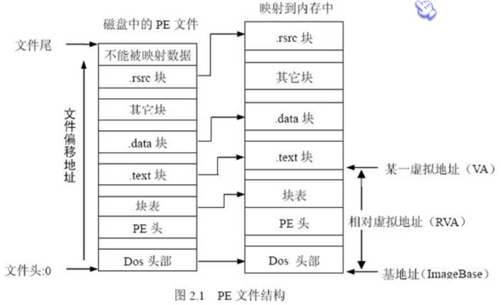
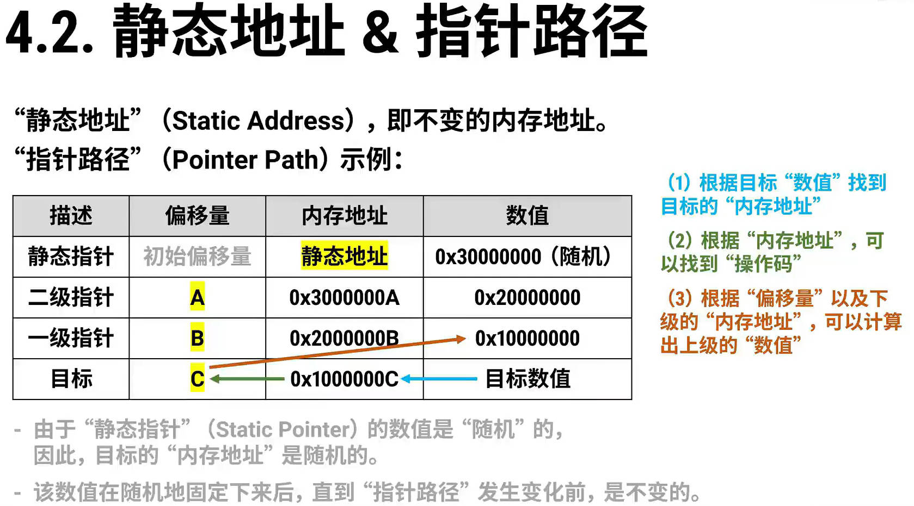

# hook d3d本质是注入吗

[hook d3d本质是注入吗_百度搜索](https://www.baidu.com/s?ie=UTF-8&wd=hook%20d3d%E6%9C%AC%E8%B4%A8%E6%98%AF%E6%B3%A8%E5%85%A5%E5%90%97)  

Hook D3D的本质不是注入，而是劫持。注入只是把代码送进目标进程的手段，真正的核心在于劫持DirectX渲染管线里的关键函数调用，把原本要执行的函数替换成自己的函数。

### 注入与Hook的关系

1. 注入是手段，不是目的：注入只是把DLL加载进目标进程，让代码能“进去”。Hook才是目的——在渲染流程里“插一脚”，拦截`Present`、`EndScene`、`DrawIndexed`等关键函数。
2. Hook的本质是改跳转目标：D3D的API围绕COM接口组织，Hook的核心就是修改COM对象虚函数表（VTable）里的函数指针，或改写函数入口字节码（Inline Hook），让调用跳转到自己的函数，执行完后再跳回原函数。

### 常见实现路径

- 虚表劫持（VMT Hook）：拿到设备对象（如`IDirect3DDevice9`）的虚表指针，把`Present`或`EndScene`槽位替换成自己的函数地址。DX9的`EndScene`通常在虚表第42位，`Present`在第17位；DX10/11/12的`IDXGISwapChain::Present`一般在第8位。
- 内联Hook（Inline Hook/Detour）：直接改写函数入口的机器码，插入跳转指令到自己的函数，通常借助MinHook或Detours库实现。
- 注入方式：常见的有`CreateRemoteThread`+`LoadLibrary`、`SetWindowsHookEx`全局钩子、APC注入、手动映射等。这些只是把DLL送进去的手段，不同方式在隐蔽性和稳定性上有差异。

> 需要澄清一点：注入本身不等于Hook。一个DLL注入进程后什么都不做，那就只是“注入”而已。只有当你替换了函数指针或修改了指令流，才叫Hook。

### 风险提示

这类技术常用于渲染调试、性能分析、画面叠加等合法场景，但也可能被用来做游戏透视或修改器。在线游戏通常有反作弊检测，Hook D3D很可能被标记为异常行为，导致封号。

Hook D3D的实现方式不少，可以看看虚表劫持和内联Hook有何区别?或者游戏反作弊如何检测D3D Hook?

# 指针路径

[指针路径_百度搜索](https://www.baidu.com/s?ie=UTF-8&wd=%E6%8C%87%E9%92%88%E8%B7%AF%E5%BE%84)  

## 指针路径

“指针路径”在编程里通常指两条线：一是C/C++指针的学习路线，二是用指针在数据结构或算法里找路径（比如链表、图搜索）。

### C/C++指针学习路线

1. 基础概念：先搞懂内存地址、取地址符 `&` 和解引用符 `*`。指针本质是存内存地址的变量，通过地址间接访问数据。
2. 指针与变量：掌握声明、初始化，以及指针运算（加、减、比较）。指针大小在64位系统下统一为8字节，与指向类型无关。
3. 指针与数组：数组名在多数表达式里退化为指向首元素的指针，`a[i]` 等价于 `*(a+i)`。但数组名不是普通指针变量，不能随意赋值。
4. 高级指针：函数指针（存函数入口地址）、数组指针、指针的指针（二级指针），是笔试面试重点。
5. 指针与函数：C语言传参只有传值，“传址”本质是传地址的副本，函数内通过地址就能修改原变量。
6. 动态内存：`malloc`/`free` 必须成对出现，申请后检查返回值，释放后指针置空，否则易内存泄漏或悬空指针。

> 建议多画内存图、多读别人代码，把指针操作和内存模型对应起来，比死记语法有效得多。

### 用指针找路径的场景

1. 链表与图搜索：在DFS/BFS里用指针保存路径节点，但用裸指针存路径常因缓存不友好反而更慢，优先用 `std::vector<int>` 存节点ID，配合全局节点表查。
2. 双指针技巧：快慢指针找链表环、中点；左右指针处理有序数组的两数之和；滑动窗口解决连续子数组问题。
3. 多级指针定位：若问的是OpenClaw这类工具的配置路径，可用 `openclaw config --show-path` 获取真实路径，再用 `openclaw config set` 直接写入嵌套字段。

### 常见坑

- 野指针：未初始化或已释放的指针，解引用会段错误。
- 越界访问：指针超出数组范围是未定义行为，编译器不拦你，运行时可能悄悄改坏数据。
- const与指针：`const int *p` 指向的值不可改，`int *const p` 指针本身不可改，别搞混。

若你问的是具体某段代码里的指针路径问题，可再补充上下文，我帮你针对性分析。

指针路径涉及不少细节，要不要继续看看野指针和悬空指针有什么区别?或者const int<em>和int</em>const怎么区分?

## ce的动态地址与静态地址是不是VA和ImageBase

不完全等同，但存在对应关系。CE里的“动态地址/静态地址”和PE结构里的“VA/ImageBase”是两个不同层面的概念，不能直接画等号，但理解VA和ImageBase有助于理解CE中的寻址逻辑。

### 概念对应关系

1. $\color{green}\Large 静态地址 ≈ ImageBase + 模块偏移$：CE中显示的绿色静态地址，通常形如 `game.exe+5FFD58`，本质是模块基址（ImageBase）+ 固定偏移。ImageBase是PE文件加载到内存时的首选起始地址，静态地址基于此计算，每次启动不变。[游戏基址](https://baike.baidu.com/item/%E6%B8%B8%E6%88%8F%E5%9F%BA%E5%9D%80/9817034)   

2. $\color{green}\Large动态地址 ≈ VA（虚拟地址）$：CE中搜索到的黑色临时地址，即程序运行时数据实际所在的内存位置，属于进程虚拟空间中的绝对地址，对应PE概念中的VA。每次启动可能变化。

3. 核心区别：静态地址是“模块基址+偏移”的表达方式，动态地址是运行时数据所在的实际虚拟地址。二者通过“基址+偏移=动态地址”关联，但不等同于VA和ImageBase本身。

### 换算关系

- VA = ImageBase + RVA：PE文件中，虚拟地址（VA）由映像基址（ImageBase）加相对虚拟地址（RVA）计算得到。
- 动态地址 = 静态地址（基址）+ 偏移量：CE逆向中，最终数据地址通过多级指针链从静态基址加偏移推导。

> 关键区别：PE中的ImageBase是文件加载的首选基址，而CE中的静态地址是模块基址+固定偏移的完整表达；VA是运行时实际虚拟地址，而CE中的动态地址就是运行时找到的那个临时地址。两者概念层级不同，但底层逻辑相通。

理解了静态和动态地址的对应关系后，可以再深入看看为什么ImageBase不是固定值?或者CE中如何找到模块基址?

|  |  |
| ----------------------------------------------------- | ----------------------------------------------------- |

## ce找静态地址

[ce找静态地址_百度搜索](https://www.baidu.com/s?ie=UTF-8&wd=ce%E6%89%BE%E9%9D%99%E6%80%81%E5%9C%B0%E5%9D%80)  

在 Cheat Engine (CE) 中查找静态地址（基址）主要有两种方法：==手动逆向追踪==（适合理解原理、层级少）和 ==指针扫描==（适合自动化、层级多）。

### 方法一：手动逆向追踪（推荐，精准度高）

通过“找出是什么改写了这个地址”功能，逐层向上追溯汇编指令中的寄存器来源，直到找到模块内的固定地址（绿色显示）。

1.  定位动态地址：先通过数值扫描找到目标数据的当前内存地址（动态地址），将其添加到下方地址列表。
2.  调试写入指令：
    *   右键该动态地址 -> 选择 “找出是什么改写了这个地址” (Find out what writes to this address)。
    *   回到游戏触发数值变化（如扣血、花钱）。
    *   CE 会捕获汇编指令，例如 `mov [eax+10], ecx`。记下偏移量（此处为 `10`）。
3.  追溯寄存器来源：
    *   双击该指令进入反汇编窗口。
    *   向上翻阅代码，寻找给寄存器（如 `eax`）赋值的指令。
    *   若看到 `mov eax, [ebx+04]`，则 `ebx` 是上一层指针，偏移为 `04`。继续追溯 `ebx` 的来源。
    *   若看到 `mov eax, [00500000]` 或 `lea eax, [game.exe+1234]`，且地址显示为绿色，则该地址即为静态基址。
4.  构建指针链：
    *   在 CE 主界面点击 “Add Address Manually”。
    *   勾选 “Pointer”，输入找到的绿色基址。
    *   按追溯顺序添加偏移量（注意顺序：从基址到最终地址的偏移依次填入）。

### 方法二：指针扫描（自动化，适合多层指针）

利用 CE 内置工具自动搜索指向目标动态地址的所有指针路径，并通过重启游戏筛选稳定路径。

1.  准备动态地址：确保已找到准确的动态地址并添加到列表。
2.  启动指针扫描：
    *   右键该地址 -> “指针扫描” (Pointer scan for this address)。
    *   设置参数：
        *   Max level (最大层级): 通常设为 3-5 层即可，过深会增加噪音。
        *   Max offset (最大偏移): 默认 2048 或 4096。
    *   点击 OK，保存扫描结果文件 (.ptrscan)。
3.  重启游戏筛选：
    *   完全关闭游戏和 CE。
    *   重新启动游戏，重新附加进程。
    *   再次扫描找到新的动态地址。
    *   在指针扫描器窗口中，点击 “Rescan memory” (重新扫描内存)。
    *   选择 “Keep only pointers that point to the new address” (只保留指向新地址的指针)。
    *   重复重启游戏和重新扫描步骤 2-3 次，直到剩余指针路径极少（理想情况为 1-5 条）。
4.  验证与使用：
    *   双击剩余的一条指针路径，CE 会自动将其添加到地址列表。
    *   修改该地址的值，观察游戏内数据是否同步变化。若生效，即为有效的静态地址链。

### 关键判断标准

*   绿色地址：在 CE 中显示为绿色的地址通常是模块基址（如 `game.exe+XXXX`），属于静态地址，重启不失效。
*   黑色/红色地址：通常为堆栈或动态分配的内存，重启后失效，需继续向上追溯。
*   偏移量方向：手动追踪时，注意汇编指令是 `[基址 + 偏移]` 还是 `[基址 - 偏移]`，CE 添加指针时通常只支持正偏移，若遇到负偏移需转换为无符号数或调整基址。

两种方法各有侧重，可以看看手动追踪适合哪些游戏?或者指针扫描为何需要多次重启?

# CE模块

## auto assemble

[auto assemble](https://www.baidu.com/s?ie=UTF-8&wd=auto%20assemble%20ce)  [auto assembler_百度百科](https://baike.baidu.com/item/auto%20assembler/6078139?fr=aladdin)  [gmh5225/CE-MCP-Plugin](https://github.com/gmh5225/CE-MCP-Plugin)  

[别再只用Auto Assemble了！手把手教你用CE的Lua Engine写自动化脚本](https://blog.csdn.net/weixin_27024175/article/details/160812033)    [Lua脚本实现一键连招自动化](https://blog.csdn.net/weixin_33850890/article/details/92971321)  [基于CE的AutoAssemble LUA注入](https://gslab.qq.com/article-384-1.html)  

[游戏修改](https://zhuanlan.zhihu.com/p/2011626813370147121)  

Auto Assemble（自动汇编）是 Cheat Engine 内置的脚本工具，==用来向目标进程注入汇编代码、修改指令或内存值==，是制作修改脚本和代码注入的核心功能。

### 核心用途

- 代码注入：在指定地址写入自定义汇编逻辑，比如修改数值、跳过判断、hook 函数。
- 制作修改脚本：配合 `[ENABLE]`/`[DISABLE]` 结构，可随 CT 表保存、加载，实现一键开关效果。
- 特征码定位（AOB）：用 `aobscan` 搜索字节模式，替代写死的绝对地址，游戏更新后更稳定。

### 基本结构

一个典型 AA 脚本长这样：

```asm
[ENABLE]
alloc(newmem, 2048)
label(returnhere)
label(originalcode)

newmem:
  mov [eax+0x20], 999999   // 你的自定义代码
  jmp returnhere

originalcode:
  mov [eax+0x20], edx       // 原指令

"game.exe"+1234:
  jmp newmem
  nop
  nop

[DISABLE]
"game.exe"+1234:
  mov [eax+0x20], edx       // 恢复原指令
```

### ⚙️ 常用命令

- alloc/label：分配内存和定义跳转标签，是注入代码的基础。
- registersymbol/unregistersymbol：注册/注销符号名，让地址可在 CE 其他地方引用。
- aobscan：搜索特征码，支持通配符 `??`，返回匹配地址。
- assert：检查指定地址字节是否匹配，不匹配则脚本不运行。
- `{$lua}`：在 AA 脚本中嵌入 Lua 代码，可调用 CE 的 Lua API 做更复杂逻辑。

### ⚠️ 注意事项

- 注入代码时注意保存和恢复寄存器，否则可能破坏原函数逻辑导致崩溃。
- 修改指令时注意 x86 指令变长，跳转后需用 `nop` 填补空缺，保证指令对齐。
- 写脚本前建议先用访问断点定位真正写入数据的指令，再决定注入位置，避免改错。
- 这类技术仅用于单机游戏或自己有权修改的程序，联网对战和带反作弊的服务不要碰。

Auto Assemble 脚本结构里有些细节值得深挖，比如为什么需要保存和恢复寄存器?或者assert 命令在脚本中如何使用?

## Lua脚本

## ultimap

[ultimap_百度搜索](https://www.baidu.com/s?ie=UTF-8&wd=ce%20ultimap)   [利用Ultimap功能对抗游戏数据加密以及拓展](https://blog.csdn.net/THMAIL/article/details/106073857)  [Ultimap功能对抗游戏数据加密](https://bbs.kanxue.com/thread-251882-1.htm)  

[用CE指针扫描器和Ultimap分析CS1.6：从找基址到写一个瞬移外挂的完整流程](https://wenku.csdn.net/column/bj1xsujg9p8)   [使用ultimap定位加密程序call基址实现破解](https://www.cnblogs.com/Hello233/p/16688362.html)   

[提升逆向分析效率](https://blog.csdn.net/weixin_28742653/article/details/160323547) 

Ultimap 是 Cheat Engine 里的==代码执行过滤工具==，用于按“代码是否执行、执行次数”筛选汇编指令，帮你从海量代码里定位关键 Call 或函数，常用于游戏逆向分析。

### 工作原理

普通内存扫描找数据值，Ultimap 找“执行过的代码”。操作中先开始记录，在目标程序里触发动作（开枪、扔手雷、点击按钮等），再回 CE 标记“代码已执行”或“代码未执行”，反复筛选后，剩下就是与动作相关的汇编指令。

> DBVM是一个虚拟机，它将运行您的操作系统并扩展指令集以允许用户模式应用程序访问kernelmode。它允许程序将系统事件流重定向到不同的位置并更改其结果。（例如，在不编辑中断表的情况下将中断重定向到不同的中断处理程序）

###  使用步骤

1. 开启 DBVM：Ultimap 依赖 DBVM 虚拟机。在 CE 菜单“帮助 → 关于”里查看是否支持，点击绿色文字启用。Intel 老 CPU 可用 Ultimap1，AMD 或新平台用 Ultimap2。
2. 打开 Ultimap 窗口：在“内存浏览器”里，点“工具”菜单选 Ultimap，或按快捷键 `Ctrl+Alt+U`。
3. 开始记录并筛选：点击 Start 开始记录，切到目标程序执行目标操作，切回 CE 点“代码已执行”；重复几次后，用“代码未执行”排除干扰项，再按执行次数过滤，最后点“显示匹配例程”查看结果。
4. 分析结果：筛选出的代码就是关键 Call 或指令，拷贝地址进反汇编器（如 x64dbg）进一步分析。

### 注意事项

- 版本建议：推荐 CE 7.0 以上，有教程提到某些版本使用 Ultimap 会失败或误报不支持 DBVM。
- 管理员权限：CE 和目标程序最好以管理员身份运行，否则可能出现“Branch 目标始终为 0”的问题。
- 常见故障：Ultimap 无法正常使用时，可尝试在“编辑 → 设置 → 调试器选项”勾选“使用全局调试”和“单步调试内核代码的能力”。
- 硬件支持：DBVM 需要 CPU 支持 Intel-VT 指令集，不支持时无法开启 Ultimap1，可尝试 Ultimap2。

### 典型应用场景

- 定位开枪、攻击、寻路等关键 Call。
- 分析加密程序，绕过数据加密直接找到关键逻辑。
- 找碰撞检测、按钮控件 Call 等。

简单说，当常规内存搜索被加密或复杂逻辑卡住时，Ultimap 是直接从代码执行层面切入的利器。

Ultimap 的使用细节不少，可以看看Ultimap1 和 Ultimap2 有何区别?或者DBVM 依赖的 Intel-VT 指令集是什么?

## DBVM

[DBVM_百度搜索](https://www.baidu.com/s?ie=UTF-8&wd=DBVM)  

DBVM 是 Cheat Engine 软件中的内嵌虚拟机监控器，全称存在多种说法，主要包括 DarkByte Virtual Machine、Dynamic Binary Virtual Machine 等，其==核心作用是利用硬件虚拟化技术让 Cheat Engine 获得比操作系统更高的权限层级，从而实现对受保护进程的内存读写和调试==。

### 全称与定义

1. DBVM 的全称在技术社区存在多种说法，尚未有官方统一定义：
   - DarkByte Virtual Machine：中文技术社区较常使用的说法，与 Cheat Engine 作者 DarkByte 相关。
   - Dynamic Binary Virtual Machine：部分技术文档采用的名称。
   - Debugger Virtual Machine 或 Driver-Based Virtual Machine：其他常见变体。
2. 基本定义：DBVM 是一个超轻量级虚拟机主机，让 Windows 操作系统在虚拟机环境中运行，使 Cheat Engine 能够在操作系统之上更高层级操作。


### 平台与核心功能

1. 所属平台：DBVM 是 Cheat Engine 软件的内嵌功能模块，需通过 Cheat Engine 主界面启用。
2. 核心作用：
   - 绕过 Ring3 反调试检测，实现对受保护进程的内存读写。
   - 利用 Intel VT-x 或 AMD-V 硬件虚拟化技术，Windows 成为 guest OS，Cheat Engine 获得更高特权层级。
   - 支持设置对操作系统不可见的断点，通过扩展页表实现页面级访问控制。
3. 启用方法：在 Cheat Engine 主界面右键点击图标打开"关于"屏幕，若显示"Your system supports DBVM"，点击该消息加载内核驱动并切换至 DBVM 模式。


### 技术原理与注意事项

1. 技术原理：
   - DBVM 在 Windows 下层运行，通常不虚拟化设备，直接传递中断，对性能影响很小。
   - 可将系统事件流重定向到不同位置并更改其结果，例如在不编辑中断表的情况下将中断重定向到不同的中断处理程序。
2. 兼容性注意事项：
   - 需关闭 Hyper-V、Windows 沙盒等占用虚拟化资源的服务。
   - 部分系统在开启 DBVM 后可能出现蓝屏或死机，尤其在 Windows 11 环境下。
   - 需确保 BIOS 中已启用虚拟化技术（VT-x/AMD-V），并关闭安全启动和内存完整性保护。
3. 安全提示：DBVM 属于高阶逆向工具，操作不当可能导致系统不稳定，恶意软件也可能利用该技术，需谨慎使用。

DBVM 的技术细节挺多，可以继续了解 它如何绕过反调试检测？ 或者 开启 DBVM 后蓝屏怎么解决？