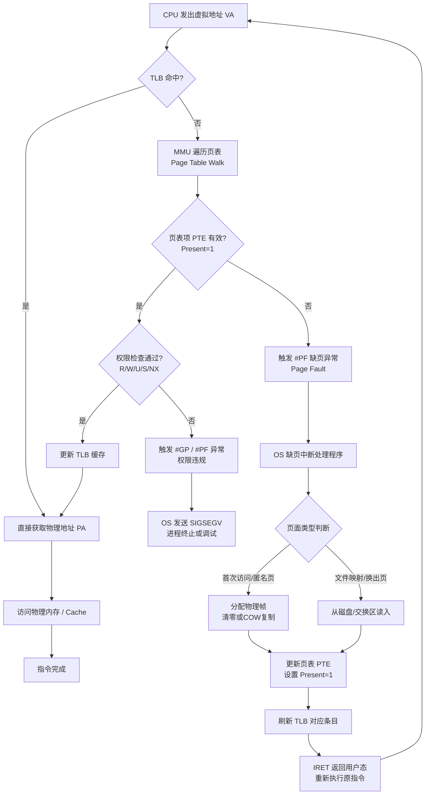

[运行模式](https://baike.baidu.com/item/%E8%BF%90%E8%A1%8C%E6%A8%A1%E5%BC%8F/5189144?fr=aladdin)  

[linux运行模式_百度搜索](https://www.baidu.com/s?ie=UTF-8&wd=linux%E8%BF%90%E8%A1%8C%E6%A8%A1%E5%BC%8F)  [linux的7种运行模式](https://www.cnblogs.com/lwl117/p/10932697.html)   [Linux运行模式详解](https://blog.csdn.net/weixin_44375561/article/details/125441783)  [linux的运行模式 ](https://cloud.tencent.com/developer/news/692273)  [Linux运行模式详解](https://blog.csdn.net/diansi9287/article/details/102309669)  

# 运行模式

[linux和windows运行模式对比_百度搜索](https://www.baidu.com/s?ie=utf-8&f=8&rsv_bp=1&tn=baidu&wd=linux%E5%92%8Cwindows%E8%BF%90%E8%A1%8C%E6%A8%A1%E5%BC%8F%E5%AF%B9%E6%AF%94&oq=%25E8%25BF%2590%25E8%25A1%258C%25E6%25A8%25A1%25E5%25BC%258F&rsv_pq=f66d83960007da32&rsv_t=6354abJ1xuJO0S9sigw2wpl%2B%2BDhAfK8rzFMxvzexBpgBOk3lE4%2F6f%2FofMjg&rqlang=cn&rsv_enter=1&rsv_dl=tb_click&rsv_sug3=7&rsv_sug1=4&rsv_sug7=100&rsv_n=2&rsv_btype=t&inputT=146377&rsv_sug4=146377)  [用户模式和内核模式 ](https://learn.microsoft.com/zh-cn/windows-hardware/drivers/gettingstarted/user-mode-and-kernel-mode)  [用户模式与内核模式](https://blog.csdn.net/xingke/article/details/150965389)  

[在服务器运维中win系统和linux系统的区别](https://cloud.tencent.com/developer/article/2491611)   [Linux与Windows对比](https://www.cnblogs.com/dachenyi/p/17007597.html)  [Linux内核 vs Windows内核](https://www.21ic.com/a/1000454.html)   [Linux内核与Windows内核的深度对比分析](https://www.21ic.com/a/1002885.html)  

[Windows运行Linux的5种方案对比与性能实测](https://blog.csdn.net/weixin_32050773/article/details/167962352)  [Windows VDI_百度搜索](https://www.baidu.com/s?ie=UTF-8&wd=Windows%20VDI)  

[Linux 与 Windows：谁更适合 CLI 模式 AI 编程工具](https://blog.csdn.net/weixin_44592002/article/details/153738661)  

## linux和windows运行模式对比

Linux和Windows的核心差异在于设计哲学和运行模式：Linux采用宏内核架构，强调开源、定制和命令行控制；Windows采用混合内核架构，注重闭源、图形界面和软硬件兼容性。

### 内核架构

- Linux（宏内核）：进程调度、内存管理、文件系统、设备驱动等核心模块全部运行在内核态，模块间直接函数调用，效率高。
- Windows（混合内核）：内核中保留微内核概念，核心基础功能在内核态，文件系统、大部分驱动等运行在用户态，模块间通过消息通信，隔离性好。

> Linux高并发场景吞吐量通常优于Windows，同等硬件下Web服务能力高出20%到50%；Windows驱动隔离更好，单个驱动出问题不易拖垮整个系统。

### 交互方式

- Linux：命令行（Shell）为核心，图形界面可选，适合脚本自动化与远程管理。
- Windows：图形界面为主，操作直观，点击即可完成大部分任务，适合普通用户。

### 软件生态

- Linux：开源软件丰富且免费，但专业软件和游戏支持少，硬件驱动不如Windows全面。
- Windows：软件数量庞大，99%的游戏可直接运行，硬件厂商支持近乎全覆盖，但多数商业软件需付费授权。

### 安全与权限

- Linux：基于权限的安全模型，用户权限分离，权限管理严格，病毒难植入，系统更稳定。
- Windows：基于角色的安全模型，对新手更友好；但因普及率高，成为攻击目标，漏洞和病毒频次相对较高。

### 文件系统

- Linux：树状目录结构，单一根目录，区分大小写，路径用斜杠`/`分隔。
- Windows：磁盘盘符分区（C盘、D盘），不区分大小写，路径用反斜杠`\`分隔。

### 怎么选

- 开发/服务器：优先Linux，开源工具链齐全，定制性强，资源占用低，适合长期运行。
- 桌面/游戏/普通办公：优先Windows，软件兼容性和硬件支持更好，上手门槛低。

若想同时拥有两者，可用WSL 2在Windows内运行Linux环境，安装简单，性能接近原生，日常开发够用。

Linux和Windows的内核架构差异挺大，要不要继续看看宏内核和混合内核具体怎么区分?或者为什么Linux高并发性能更好?

## linux和windows运行模式对比

Linux 和 Windows 在运行模式（Operating Modes）上的核心差异，源于两者截然不同的**设计哲学**：Windows 倾向于“一体化与易用性”，而 Linux 遵循“模块化与权限分离”。

以下是从内核架构、权限模型、服务管理及用户交互四个维度进行的深度对比：

### 1. 核心架构与内核运行模式

| 特性         | Windows (NT Kernel)                                          | Linux (Monolithic/Hybrid Kernel)                             |
| ------------ | ------------------------------------------------------------ | ------------------------------------------------------------ |
| **内核类型** | **混合内核 (Hybrid)**。微内核理念+宏内核实现，关键子系统（如窗口管理器 Win32k.sys）历史上曾运行在内核态以提高性能。 | **宏内核 (Monolithic)**。所有核心服务（调度、内存、文件系统、驱动）均在内核态运行，通过模块化加载机制保持灵活性。 |
| **图形界面** | **紧耦合**。GDI/DXGI 等图形栈深度集成于内核或高特权会话中。Explorer.exe 崩溃可能影响整个桌面会话。 | **完全解耦**。GUI (X11/Wayland) 仅是运行在用户态的普通进程。显示服务器崩溃通常不会导致内核恐慌，重启即可恢复。 |
| **驱动模型** | WDM/WDF 框架。驱动程序必须经过 WHQL 签名（默认强制），强调稳定性与硬件抽象层。 | 开源/闭源混合。驱动直接编译进内核或作为模块加载，更新无需重启（部分场景），但劣质驱动更易导致 Kernel Panic。 |
| **API 范式** | Win32 API / COM / .NET。高度封装，向后兼容性极强，但层级较厚。 | POSIX / Syscall。接口简洁直接，ABI 稳定，强调文本流与管道组合。 |

### 2. 权限与安全运行模式

- **Windows: 令牌与完整性级别**
    - 基于 **Access Token** 和 **Integrity Level**（低/中/高/系统）。
    - UAC（用户账户控制）是后加的安全层，管理员日常仍以中等完整性运行，提权需弹窗确认。
    - 安全边界相对复杂，历史上因向后兼容导致许多旧程序默认拥有较高权限。
- **Linux: DAC + Capabilities + Namespaces**
    - 传统上基于 **UID/GID** 的自主访问控制（DAC），root 拥有绝对权力。
    - 现代 Linux 引入了 **Capabilities**（将 root 权限细分为 CAP_NET_BIND_SERVICE 等）、**SELinux/AppArmor**（MAC 强制访问控制）以及 **Namespaces/Cgroups**（容器化隔离）。
    - 安全模型更细粒度，且默认遵循“最小权限原则”，服务通常以专用低权限用户运行。

### 3. 服务与后台进程管理

| 维度           | Windows Services                                             | Linux Daemons / Systemd Units                                |
| -------------- | ------------------------------------------------------------ | ------------------------------------------------------------ |
| **管理机制**   | SCM (Service Control Manager)。二进制注册表配置，依赖关系管理较弱。 | systemd / init。纯文本 Unit 文件声明式配置，支持复杂的依赖链、定时器、Socket 激活。 |
| **配置存储**   | **Windows Registry**（注册表）。集中式二进制数据库，修改需专用工具，难以版本控制和差异比对。 | **Everything is a File**。配置文件位于 `/etc`，纯文本格式，天然支持 Git 管理、diff 和自动化部署。 |
| **日志系统**   | Event Log (evttx)。结构化二进制日志，查询依赖事件查看器或 PowerShell。 | journald / syslog。统一日志流，支持实时 tail、结构化字段过滤，与终端工具无缝集成。 |
| **启动并行度** | 改进中但仍受限于服务组依赖。                                 | systemd 支持激进的并行启动和 Socket Activation，显著缩短冷启动时间。 |

### 4. 用户交互与运维模式

- **Windows**: **GUI First**。绝大多数管理和配置操作设计为通过图形界面完成。PowerShell 虽强大，但很多底层设置仍需调用 COM 对象或 .NET 类，学习曲线陡峭。适合桌面办公、企业AD域环境。
- **Linux**: **CLI First / API First**。一切皆可通过命令行或配置文件完成。SSH 是一等公民，无头（Headless）运行是常态。脚本化、自动化（Ansible/Terraform）原生友好。适合服务器、云计算、嵌入式及开发环境。

### 总结与建议

**核心区别一句话概括：**
Windows 是一个**以桌面为中心、向下兼容优先**的集成平台；Linux 是一个**以开发者/运维为中心、模块化组装**的工具集合。

- **选择 Windows**：当你的工作负载强依赖 .NET/MSSQL、需要 Active Directory 域管理、或最终用户为非技术人员时。
- **选择 Linux**：当你需要构建云原生应用、追求极致的资源利用率、需要深度定制系统行为、或进行大规模自动化运维时。
- **融合趋势**：WSL2 (Windows Subsystem for Linux) 正在弥合这一鸿沟，允许在 Windows 内核之上运行完整的 Linux 用户空间，使开发者能在同一台机器上兼顾两种运行模式的优势。

## win11用户模式和内核模式

Windows 11 的处理器会在用户模式和内核模式两种特权级别之间切换，取决于正在执行的代码类型。 简单说，用户模式是普通应用程序的“沙盒”，内核模式是操作系统核心和驱动程序的“控制室”。

### 两种模式的核心区别

1. 用户模式：应用程序在此运行，权限受限。每个应用有独立的虚拟地址空间和句柄表，互相隔离，一个应用崩溃不会拖垮系统或其他程序。
2. 内核模式：操作系统核心组件和驱动程序在此运行，拥有最高权限，可直接访问硬件和所有内存。所有内核代码共享同一个虚拟地址空间，一旦驱动程序写错地址，可能损坏系统数据，甚至导致整个系统蓝屏崩溃。

### 模式如何切换

用户程序需要读写文件、分配内存或访问硬件时，不能直接操作，必须通过系统调用请求内核帮忙。切换过程大致是：应用调用 API（如 `ReadFile`）→ 触发特殊指令（如软中断或快速系统调用）→ CPU 从用户模式切换到内核模式 → 内核执行操作 → 切回用户模式并返回结果。

> 每次切换都有开销，涉及保存/恢复上下文和切换栈，频繁的小请求会影响性能，这也是很多高性能程序尽量减少系统调用次数的原因。

### 为什么 Win11 要这样设计

- 安全性：防止普通程序直接篡改内核内存或硬件，避免恶意代码或错误程序搞垮系统。
- 稳定性：用户模式下的程序出错只影响自己，不会波及操作系统和其他进程。
- 对应 CPU 特权级：Windows 主要用 x86 的 Ring 0（内核模式）和 Ring 3（用户模式）两级。

### 与 Win11 相关的安全细节

微软正在推进“Windows Resilience Initiative”，计划将防病毒和终端检测响应工具从内核模式移出，以降低第三方驱动导致系统崩溃的风险，并计划在符合条件的 Win11 设备上于 2026 年 10 月开始默认启用内存完整性保护。 另外，Win11 的内核模式硬件强制堆栈保护{id="entity_1"}功能，能阻止恶意程序通过修改内核内存返回地址来劫持电脑。

模式切换涉及系统调用，可以看看系统调用如何触发模式切换?或者频繁切换为何会影响性能?

# 句柄

[句柄指向对象吗_百度搜索](https://www.baidu.com/s?ie=UTF-8&wd=%E5%8F%A5%E6%9F%84%E6%8C%87%E5%90%91%E5%AF%B9%E8%B1%A1%E5%90%97)  [句柄_百度百科](https://baike.baidu.com/item/%E5%8F%A5%E6%9F%84/3527587)  [句柄](https://www.cnblogs.com/cdaniu/p/15676942.html)  

句柄是==指向对象==的`引用或标识符`，但它本身不是对象，也不是直接的内存地址。可以理解为“门把手”——通过它来操作对象，但不等同于对象本身。

### 不同语境下的句柄

1. Windows 系统：句柄是一个整数值（32位或64位），作为系统内部句柄表的索引。应用程序通过句柄间接访问窗口、文件、线程等内核对象，但不能直接用句柄读取对象数据。

2. Java/C++ 等面向对象语言：句柄（引用）指向对象，多个句柄可指向同一个对象，句柄也可不指向任何对象（null）。

3. SystemVerilog/UVM：类变量存的是句柄（对象地址），`new()` 创建对象并返回句柄。多个句柄指向同一对象时，通过任一句柄修改都会影响原对象。

### 关键区别

- 句柄 ≠ 指针：句柄不直接包含对象数据地址，而是由系统管理的间接引用，安全性更高。
- 多对一关系：多个句柄可指向同一对象，但一个句柄同时只指向一个对象。
- 句柄可独立存在：有句柄不意味着一定有对象相连，如 `String s;` 只创建了句柄，未指向任何对象。

句柄在不同系统里用法不同，可以看看Windows句柄如何访问窗口?或者Java中句柄和对象生命周期如何关联?

# 消息机制

[理解消息机制与事件机制](https://ouyangshima.blog.csdn.net/article/details/78463438)  [事件和消息机制的理解](https://www.cnblogs.com/andbut/p/5389785.html)  [基于消息的事件驱动机制（Message Based, Event Driven）](https://cloud.tencent.com/developer/article/1857333)  

[基于消息的事件驱动机制_百度搜索](https://www.baidu.com/s?ie=UTF-8&wd=%E5%9F%BA%E4%BA%8E%E6%B6%88%E6%81%AF%E7%9A%84%E4%BA%8B%E4%BB%B6%E9%A9%B1%E5%8A%A8%E6%9C%BA%E5%88%B6)  

## 消息机制和事件

消息机制和事件是计算机系统中实现异步通信和响应交互的核心设计，两者常一起出现但概念不同：事件是“发生了什么”，消息是“通知这件事的信息”。

### 🔄 核心关系

事件是用户操作或系统状态变化，如鼠标点击、键盘按下、窗口大小改变。消息是事件发生后系统生成的数据包，携带事件类型、来源、参数等信息，如“鼠标左键在坐标(100,200)被按下”。

流程：事件产生 → 系统捕获并封装成消息 → 放入消息队列 → 消息循环取出分发 → 调用对应处理函数响应。

### 📨 消息机制的三大要素

1. 消息队列：先进先出存储结构，消息按产生顺序排队，避免丢失或乱序。
2. 消息循环：程序中的死循环，持续从队列取消息并分发，如Windows的`GetMessage`+`DispatchMessage`。
3. 消息处理：根据消息类型调用对应函数。Windows中窗口过程用`switch`语句分派，Qt中`event()`函数分发到具体事件处理器。

### 🖥️ 各平台的具体实现

- Windows：消息驱动系统，每个GUI线程有独立消息队列。消息由系统或应用生成，通过`PostMessage`异步入队或`SendMessage`直接发送。窗口过程处理消息，未处理的消息交给`DefWindowProc`默认处理。
- Qt：事件对象继承自`QEvent`，创建后传给`QObject::event()`分发。可重写`event()`拦截所有事件，或重写`keyPressEvent()`、`mousePressEvent()`等特定处理器。事件过滤器可在事件到达目标前拦截。
- Android：基于`Handler`、`Looper`、`MessageQueue`、`Message`四组件，实现线程间异步通信。子线程通过Handler发送消息，主线程Looper循环取出并处理。
- 嵌入式（如LuatOS）：基于消息队列和协程，支持全局广播（`sys.publish`/`sys.subscribe`）和定向消息（`sys.sendMsg`/`sys.waitMsg`），实现模块间解耦。

### ⚠️ 事件和消息的区别

- 触发来源：事件由用户操作或系统状态变化触发；消息可由事件转换、系统产生，或由另一条消息产生。
- 通信方式：消息通常一对一，有明确接收方；事件往往一对多，支持广播，多个订阅者能同时响应。
- 耦合度：消息驱动耦合更低，发送方不需要知道接收方；事件驱动适合模块内部通信，消息驱动更适合跨模块或跨进程。

### 💡 为什么用消息机制

核心优势是解耦。发送方只管发消息，不关心谁接收、怎么处理；接收方只处理自己关心的消息，不依赖发送方。这让系统更易扩展和维护，也支持异步处理——消息入队后，程序可继续执行其他任务，不用阻塞等待。

> 消息机制就像食堂打饭：学生（事件）排队等餐，值日生（消息循环）按顺序分发，学生拿到饭后自己处理（事件响应）。排队保证不挤，分发保证有序。

消息机制在不同平台实现有差异，可以看看Windows和Qt消息机制有何区别?或者Android中Handler如何实现线程间通信?

## 基于消息的事件驱动机制

[改变嵌软开发思维方式之：状态机+事件驱动框架](https://www.uml.org.cn/embeded/202205061.asp)  [Win32基于事件驱动的消息机制](https://www.cnblogs.com/zhangjun1130/archive/2010/12/01/1892725.html)  [基于事件驱动机制的提醒系统设计方案](https://www.cnblogs.com/kaisheng-reflect/p/19328853)  [MFC基于消息，使用事件驱动（Message Based,Event Driven）机制](https://blog.csdn.net/csf111/article/details/6934012)  

[消息循环_百度百科](https://baike.baidu.com/item/%E6%B6%88%E6%81%AF%E5%BE%AA%E7%8E%AF/4970437?fr=aladdin)  [事件驱动编程_百度百科](https://baike.baidu.com/item/%E4%BA%8B%E4%BB%B6%E9%A9%B1%E5%8A%A8%E7%BC%96%E7%A8%8B/6417369)  [基于消息的事件驱动机制（Message Based, Event Driven）](https://www.php.cn/faq/1587463.html)  

基于消息的事件驱动机制，核心思路是把用户操作或系统状态变化转成“消息”放进队列，程序通过循环不断取消息、分发到对应处理函数，以此驱动整个应用运行。

### 🖥️ 基本模型

整个机制由四部分协作：

1. 消息产生：鼠标点击、键盘按键等操作被系统或框架捕获，转成统一格式的消息对象，如Windows里的`MSG`结构，包含窗口句柄、消息ID和附加参数。
2. 消息队列：消息先存入队列，起缓冲作用。系统队列接收设备输入，再分发到对应线程的队列；每个GUI线程有独立队列。
3. 消息循环：程序主线程跑一个死循环，不断从队列取消息，如`while(GetMessage(...))`，取到后翻译并分发。
4. 消息处理：消息被派发到目标窗口的处理函数，通常用`switch`语句按消息ID调用对应逻辑，处理完回到循环等下一个消息。

### 🔄 两个典型应用

Windows/MFC桌面应用：用户点击鼠标，驱动产生消息进系统队列，系统转给应用程序队列，消息泵取出后通过消息映射表找到对应函数执行。消息处理函数里不能做耗时任务，否则会卡住后续消息，界面就“假死”了。

浏览器前端：用户点击DOM元素触发事件，事件按捕获→目标→冒泡三个阶段传播。JavaScript是单线程，靠事件循环从任务队列取任务执行，实现异步非阻塞。

### 📨 消息与事件的区别

容易混淆，但设计上有关键差异：

- 消息：更通用，可以是命令、请求或事件。如“扣减库存”是命令，要求下游做某事。
- 事件：只表示“已经发生的事实”，如“订单已创建”，不可变，生产者不关心谁在消费。

### 🏗️ 分布式系统中的应用

在微服务架构中，该机制演变为事件驱动架构（EDA），用消息中间件（如Kafka、RabbitMQ）实现服务间异步通信。

- 解耦：上游服务发布事件后不用管下游，新增业务只需新加订阅者，不改核心代码。
- 削峰填谷：瞬时高并发流量先存入队列，消费者按自身能力处理，避免系统被压垮。
- 故障隔离：下游挂了不影响上游核心链路，消息在队列里等恢复后再消费。

> 引入异步消息也带来代价：需处理最终一致性、消息重复消费（消费者要幂等）、消息丢失（需配置可靠投递）以及链路追踪困难等问题。

### 🧠 一句话理解

把程序想象成餐厅：顾客（用户）下单（产生消息），小票夹在排单槽（消息队列），厨师（消息循环）按顺序取单做菜（处理消息），做完喊号（回调通知）。整个过程不阻塞，餐厅能同时接待更多顾客。

事件驱动架构在微服务中很关键，可以看看事件驱动架构如何保证最终一致性?或者消息中间件如何避免消息丢失?

## windows消息队列有多少种

消息队列类型:  [消息队列和消息处理技术背景知识 | Microsoft Learn](https://learn.microsoft.com/zh-cn/previous-versions/visualstudio/visual-studio-2008/19ww660c(v=vs.90)?redirectedfrom=MSDN)  

Windows消息队列的分类，取决于你是从“系统内部消息机制”还是“MSMQ组件”的角度来看，两种理解差别很大。

### 🖥️ 系统消息机制角度

若问Windows系统内部用于事件驱动的消息队列，从结构上分两类：

1. 系统消息队列：全局唯一，由系统维护。鼠标、键盘等硬件输入先进入这里，系统再按目标窗口所属线程分发。
2. 线程消息队列：每个GUI线程一个，应用程序实际感知和处理的“消息队列”指此。非GUI线程默认不创建，首次调用特定用户函数时才生成。

线程队列内部按优先级分层，投递消息（如`PostMessage`）优先级最高，其次是输入消息（鼠标、键盘），`WM_TIMER`、`WM_PAINT`这类低优先级消息排后面。

### 📬 MSMQ组件角度

若问Windows的“消息队列”服务组件（MSMQ，用于异步通信），队列类型更丰富，常见分类如下：

1. 公共队列：在Active Directory域中发布，整个网络可发现和访问。
2. 专用队列：仅本机可见，路径写法为`.\private$\队列名`，是最常用的类型。
3. 系统队列：由服务自动维护，包含死信队列、日记队列、事务死信队列等，无需手动创建。
4. 外发队列：消息发送到目的地前临时存储。
5. 管理队列：存储消息回执等确认信息。
6. 响应队列：目标应用程序接收消息后返回给发送方的响应消息。

> 需留意：MSMQ的“重试”只发生在投递阶段，投递失败且开启死信机制后，消息转入死信队列，不会自动回到业务代码。非事务消息默认存在内存中，服务或机器重启后消息会丢失。

消息队列分类挺多的，要不要继续看看系统消息队列和线程队列怎么区分?或者MSMQ的死信队列有什么作用?

# windows保护模式

[保护模式_百度百科](https://baike.baidu.com/item/%E4%BF%9D%E6%8A%A4%E6%A8%A1%E5%BC%8F/3209404?fr=aladdin)  [CPU工作模式：执行程序的三种模式](https://blog.csdn.net/qq_43331089/article/details/153780544) 

## win11用的是保护模式还是实模式

Windows 11 运行在保护模式下，不是实模式。现代操作系统从启动到运行都离不开保护模式，实模式只在开机初期短暂出现。

### 🖥️ 为什么是保护模式

- 实模式只是起点：x86 处理器加电或复位后默认进入实模式，这是为了兼容 8086 时代的设计。BIOS 初始化硬件时运行在 16 位实模式下，但很快就把控制权交给操作系统。

- Win11 正式运行在保护模式：Windows NT 内核从设计之初就放弃了实模式支持，进入系统后 CPU 全程工作在保护模式（32 位）或长模式（64 位），这样才能访问 4GB 以上的内存空间、实现内存保护和多任务。

- 启动过程：传统 BIOS 启动时，CPU 从 16 位实模式切换到 32 位保护模式，再切换到 64 位长模式。而 Win11 要求 UEFI 启动，UEFI 一开始就运行在 32 位或 64 位模式下，不需要这些模式切换，CPU 直接以最高效率工作。

### 🔒 保护模式带来的关键能力

1. 内存保护：通过段级保护与特权级检查机制，防止程序胡乱访问其他程序的内存空间。
2. 更大的寻址空间：实模式只能访问 1MB 内存，保护模式可以访问 4GB 甚至更多。
3. 多任务支持：保护模式下才能实现任务切换、分页和虚拟内存管理，这是现代操作系统的基础。

> 简单理解：实模式就像一间只有一个出入口的小房间，所有人都能随便进出；保护模式就像带门禁的大楼，每个房间都有权限控制，程序不能乱闯别人的空间。Win11 需要这种"门禁系统"才能安全稳定地运行。

保护模式是Windows 11的基础，要不要继续了解保护模式和实模式具体怎么切换的?或者为什么Windows NT内核不支持实模式?

## 保护模式的虚拟内存

在 x86 架构的保护模式（Protected Mode）下，虚拟内存不仅仅是一项“扩展内存”的技术，它是整个操作系统安全与多任务隔离的基石。

保护模式下的虚拟内存机制，本质上是通过 **分段（Segmentation） + 分页（Paging）** 两级地址翻译，将程序看到的“逻辑地址”映射到物理内存，并由硬件强制执行访问权限检查。

### 🏗️ 核心架构：两级地址翻译

CPU 在执行指令时，看到的永远是虚拟地址。从代码中的变量到真实的 RAM，需要经历以下转换：

> ⚠️ **关键概念区分**
>
> - **逻辑地址**：程序员/编译器视角的地址（`CS:EIP` 或 `DS:Offset`）。
> - **线性地址**：分段单元输出的中间地址。若未启用分页，线性地址 = 物理地址。
> - **物理地址**：内存总线上的真实地址。

### 🔑 保护模式的三大保护机制

虚拟内存在保护模式下之所以叫“保护”，是因为硬件在地址翻译的每一步都嵌入了权限校验：

#### 1. 特权级检查 (Ring 0 - Ring 3)

- GDT 中的每个段描述符都包含 **DPL（Descriptor Privilege Level）**。
- CPU 当前运行在 **CPL（Current Privilege Level）**（存储在 CS/SS 寄存器的低2位）。
- **规则**：只有当 `CPL ≤ DPL` 时，才能访问该数据段。用户态程序（Ring 3）试图直接访问内核数据段（Ring 0）会立即触发 **#GP 异常**。

#### 2. 分页级权限控制

即使通过了分段检查，页表项（PTE）仍提供第二层防护：

- **R/W 位**：只读 vs 可写。防止用户修改代码段或只读数据。
- **U/S 位**：User/Supervisor。标记页面是否允许 Ring 3 访问。
- **NX/XD 位**（后期扩展）：禁止执行数据页，防御缓冲区溢出攻击。
- **Present 位**：页面是否在内存中。为0时触发 **#PF 缺页异常**，由OS负责换入/分配。

#### 3. 隔离与不可见性

- 每个进程拥有独立的页目录（CR3 寄存器指向它）。
- 进程 A 的页表中根本没有进程 B 的物理页映射。**不是“不能访问”，而是“看不见”**。这从根本上杜绝了进程间越界读写。

### 🆚 分段 vs 分页：历史与现代实践

| 特性               | 分段 (Segmentation)                                          | 分页 (Paging)                                                |
| ------------------ | ------------------------------------------------------------ | ------------------------------------------------------------ |
| **设计初衷**       | 支持多任务、权限隔离、逻辑分组                               | 解决物理内存碎片、实现虚拟内存                               |
| **粒度**           | 可变大小（1B ~ 4GB）                                         | 固定大小（通常 4KB / 2MB / 1GB）                             |
| **现代OS使用方式** | **基本废弃**。Linux/Windows 均设置基址=0、限长=4GB，形成“平坦模型” | **核心机制**。所有虚拟内存管理、Copy-on-Write、内存映射文件均基于分页 |
| **为何保留分段？** | x86 强制要求。切换 Ring 0/Ring 3 仍需通过 TSS 和段选择子；64位长模式下分段被大幅简化但未完全移除 | N/A                                                          |

> 💡 **为什么现代 OS 偏爱分页而非分段？** 分段导致外部碎片，且可变长度使内存管理算法复杂。分页的固定粒度完美适配磁盘交换区、TLB 缓存和伙伴系统分配器。因此，保护模式下的分段在今天更多是**兼容遗留架构的“过路费”**，真正的虚拟内存工作全由分页完成。

### 🛡️ 虚拟内存如何支撑“保护”

1. **内核空间保护**：高地址（如 Linux 的 `0xC0000000+`）页表项标记为 Supervisor Only。用户进程即使猜测到内核地址，也会因 U/S 位被硬件拦截。
2. **Copy-on-Write**：fork() 时父子进程共享物理页但标记为只读。任一进程写入时触发 #PF，OS 捕获后复制页面再恢复执行。既高效又保证隔离。
3. **栈溢出防护**：Guard Page（守卫页）映射在栈底下方，Present=0。栈溢出触碰时触发 #PF 而非静默覆盖堆数据。
4. **ASLR / DEP**：随机化加载地址 + 数据页不可执行，均依赖页表属性动态配置。

### ⚙️ 关键硬件寄存器

- **GDTR / LDTR**：指向全局/局部描述符表基址与界限。
- **CR0.PG**：分页开关（Bit 31）。保护模式下可单独关闭分页。
- **CR3**：存储当前进程页目录的物理地址。上下文切换时更新此寄存器即完成虚拟地址空间切换。
- **TLB**：页表缓存。切换 CR3 时必须刷新（或使用 PCID/ASID 优化），否则旧进程的映射会泄露到新进程。

### 📌 总结

> **保护模式下的虚拟内存 = 分页机制 + 硬件权限 enforcement**
>
> 分段提供了最初的保护框架，但现代系统中真正承担虚拟内存职责的是**分页**。它将“地址翻译”与“权限检查”原子化地绑定在每一次内存访问中，使得**没有操作系统授权，任何程序都无法触及不属于自己的字节**。这就是“保护”二字的硬件级含义。

## 分段和分页

[分段和分页、页面置换算法、缓冲区溢出、上下文切换、轮询和中断](https://blog.csdn.net/qq_45593575/article/details/120784329)  

[分页和分段的区别](https://zhuanlan.zhihu.com/p/662027499)  [分页 & 分段的区别](https://blog.csdn.net/qq_45638953/article/details/146425323) [分段和分页](https://cloud.tencent.com/developer/article/2696365)    

[内存管理：分段、分页和段页式](https://cloud.tencent.com/developer/article/2639454)  

分页和分段是操作系统管理内存的两种不同方式，分页按固定大小切块，分段按逻辑功能分块，两者在碎片处理、地址结构和用户可见性上有核心区别。

### 分页和分段有啥不一样

1. 切分单位不同：分页是把内存切成固定大小的页，不管程序内容，纯粹为了管理方便 ；分段是按程序的逻辑功能（如代码段、数据段）来分，每段大小不固定，由程序决定 。
2. 空间浪费情况不同：分页主要产生内部碎片（最后一页没填满）；分段主要产生外部碎片（段与段之间的空隙）。
3. 地址结构不同：分页的地址是一维的，只要给一个地址就能找到位置 ；分段的地址是二维的，需要段号和段内地址两部分 。
4. 用户能不能看见：分页对用户是透明的，程序员感觉不到分页的存在 ；分段对用户是可见的，程序员需要知道段的划分 。

### 它们是怎么工作的

1. 分页怎么找地址：系统给每个进程建一张页表，记录逻辑页号对应物理块号，通过页表把逻辑地址转成物理地址 

2. 地址变换时，硬件自动把逻辑地址分成页号和页内偏移，查页表找到物理块号，再拼上偏移量得到物理地址 
3. 分段怎么找地址：系统给每个进程建一张段表，记录段号对应的段长和起始地址
   - 地址变换时，先查段表找到段基址，检查段内地址是否越界，然后把基址和段内地址相加得到物理地址 。
4. 硬件支持：两者都需要内存管理单元（MMU）帮忙，分页常用快表（TLB）加速查找 。

### 现在系统里怎么用

1. 段页式结合：现代系统常把两者结合起来，叫段页式，先按逻辑分段，段内再分页 。
   - 这样既保留了分段的逻辑清晰，又利用了分页的内存高利用率 。
   - 地址结构变成三段：段号、页号、页内偏移 。
2. 主流系统选择：
   - Linux 和 Windows主要用分页机制管理内存，因为实现简单、效率高 。
   - x86 架构支持分段和分页，但 Linux 为了简化，通常只设两个段（用户段和内核段），实际主要靠分页 
   - 分段在需要共享和保护特定逻辑模块时仍有优势，比如代码段只读、数据段可写 。

需要我帮你对比分页和分段各自的优缺点吗？这样能更清楚为什么现代系统多用分页。

# 程序执行流程

[保护模式下加载运行C程序](https://blog.csdn.net/xundh/article/details/162177754)  [CPU工作模式：执行程序的三种模式](https://blog.csdn.net/qq_43331089/article/details/153780544)  

[ Linux内核《运行原理及初始化流程》](https://zhuanlan.zhihu.com/p/569502762)  [实模式和保护模式](https://www.cnblogs.com/hongzg1982/articles/2116219.html)  

[实战操作系统 loader 编写（上） -- 进入保护模式](https://cloud.tencent.com/developer/article/2031686)  

## 程序通过虚拟内存执行的流程

程序通过虚拟内存执行，并非简单的“读取-运行”线性过程，而是一个由 **CPU 硬件（MMU/TLB）** 与 **操作系统内核** 紧密协作的动态翻译与按需加载循环。

以下是当 CPU 执行一条指令（如 `mov eax, [0x0804A000]`）时，从虚拟地址到物理执行的完整微观流程：

### 🔄 核心执行流程图解

### 🔍 关键阶段详解

#### 1. 快速路径：TLB 命中

- **Translation Lookaside Buffer** 是 MMU 内部的专用高速缓存，存储最近使用的 `VA → PA` 映射。
- 若命中且权限匹配，**整个过程仅需 1 个时钟周期**，对程序完全透明。这是虚拟内存高性能的关键。
- TLB 通常按 ASID/PCID 标记进程，避免上下文切换时全量刷新。

#### 2. 慢速路径：页表遍历

- TLB 未命中时，MMU 自动根据 CR3（页目录基址）+ VA 的高位索引逐级查表（x86-32 为两级，x86-64 为四级）。
- 每次遍历可能产生 **4 次额外的内存访问**（页目录→页中间目录→页表→目标页），这就是为什么 TLB 命中率至关重要。
- 现代 CPU 支持大页（2MB/1GB），减少页表层级和 TLB 压力。

#### 3. 异常驱动：缺页中断

当 PTE 的 Present 位为 0，或权限不匹配时，CPU 立即暂停当前指令，陷入内核态：

| 缺页原因                     | OS 处理动作                                      | 典型场景                            |
| ---------------------------- | ------------------------------------------------ | ----------------------------------- |
| **合法缺页** (Demand Paging) | 分配物理页框，从磁盘/零页填充，更新 PTE          | 程序首次访问 malloc 内存、mmap 文件 |
| **换入** (Swap In)           | 从交换分区/文件读回之前被换出的页面              | 内存紧张时被回收的页面再次被访问    |
| **写时复制** (COW)           | 检测到共享只读页上的写操作，复制新页并赋予写权限 | fork() 后子进程首次写入             |
| **非法访问**                 | 向进程发送 SIGSEGV/SIGBUS 信号                   | 空指针解引用、越界、执行数据页      |

> ⚠️ **重要细节：指令重执行** 缺页处理完成后，OS 通过 `IRET` 返回用户态，**CPU 会重新执行触发异常的那条指令**。此时 TLB/页表已更新，第二次执行必然成功。程序对此毫无感知。

#### 4. 权限检查的原子性

硬件在地址翻译的同时完成权限验证，二者不可分割：

- **U/S 位**：Ring 3 代码访问 Supervisor 页 → 立即 #PF。
- **R/W 位**：写操作命中只读页 → #PF（COW 或 SIGSEGV）。
- **NX/XD 位**：取指操作命中数据页 → #PF（防 ROP/JOP 攻击）。
- **SMAP/SMEP**（现代扩展）：即使 Ring 0 也不能随意访问用户页/执行用户代码，防止内核漏洞利用。

### 🧩 虚拟内存对程序执行的深层影响

- **按需加载**：程序启动时无需全部载入内存。ELF/PE 加载器仅建立页表映射，实际页面在首次访问时才分配。这使得大型程序秒级启动成为可能。
- **稀疏地址空间**：栈和堆可以向对方方向自由增长，中间巨大的未映射区域作为安全缓冲。访问空洞区域触发 #PF 而非静默破坏。
- **共享库去重**：libc.so 等只读段在所有进程中映射到相同物理页。写时复制确保各进程的 .data/.bss 独立。
- **内存映射 I/O**：`mmap()` 将设备寄存器或文件内容直接映射到虚拟地址空间，访问内存即等同于 I/O 操作，无需系统调用开销。

### 💡 性能优化视角

| 瓶颈         | 优化手段                                     | 原理                             |
| ------------ | -------------------------------------------- | -------------------------------- |
| TLB Miss 高  | 使用大页、数据局部性优化、HugePages          | 减少页表项数量，提升 TLB 覆盖率  |
| 缺页频繁     | 预读、madvise(MADV_WILLNEED)、合理 swap 策略 | 将磁盘 I/O 提前到非关键路径      |
| 上下文切换慢 | PCID/ASID、INVPCID 指令                      | 避免切换 CR3 时全量刷新 TLB      |
| 页表遍历慢   | 硬件 Page Walker + 页表缓存                  | 多级页表访问并行化、缓存中间节点 |

### 📌 总结

> **程序在虚拟内存中执行的本质，是一场由硬件主导、异常兜底的“按需翻译”游戏。**
>
> - **常态**：TLB 命中，零开销透明执行。
> - **非常态**：缺页异常触发 OS 介入，动态构建物理映射后重试。
> - **安全保障**：每一次内存访问都经过硬件级权限校验，无一例外。
>
> 正是这种“懒惰”与“严格”的结合，使得每个进程都仿佛独占一台拥有无限内存的机器，同时彼此隔离、互不干扰。

## 程序在保护模式下执行流程

程序在保护模式下执行，核心是CPU通过GDT查表完成段基址、界限和权限校验，再按线性地址取指执行。整体流程可以从启动切换、内存访问、特权级控制、中断处理四个层面理解。

### 🔄 从实模式到保护模式的切换

1. 准备GDT：先构建全局描述符表，内含代码段、数据段等段描述符，每个描述符8字节，定义段基址、段界限、粒度、特权级等属性。
2. 加载GDTR：用`lgdt`指令将GDT的基址和界限装入GDTR寄存器。
3. 打开A20地址线：通过端口0x92置位开启A20，解除实模式1MB地址回绕限制，使CPU可访问更大内存空间。
4. 置位CR0.PE：将CR0寄存器的第0位（PE位）置1，CPU正式进入保护模式。
5. 远跳转刷新流水线：执行`jmp dword 选择子:偏移`，强制CPU用新选择子加载CS段寄存器，清空实模式下残留的指令流水线和段描述符缓存，确保后续按32位保护模式规则取指执行。

### 📋 执行过程中的内存访问机制

- 段寄存器存的是选择子：保护模式下，段寄存器（CS、DS等）存16位选择子，不再是实模式下的段基址。选择子高13位是GDT索引，第2位TI位指定查GDT还是LDT，低2位是请求特权级RPL。
- CPU自动查表加载描述符：当段寄存器被加载选择子时，CPU内部自动用索引×8定位GDT中段描述符，将段基址、界限、属性等加载到不可见的描述符缓存中，后续访问直接使用缓存，无需反复查表。
- 线性地址计算：保护模式下线性地址 = 段基址（来自描述符）+ 32位段内偏移。平坦模型下所有段基址为0、界限覆盖4GB，线性地址就等于偏移地址。
- 开启分页后：若启用分页（CR0.PG=1），线性地址再通过页目录和页表两级查表转换成物理地址，CR3寄存器指向页目录基址。

### 🔐 特权级与权限控制

1. 特权级分级：保护模式有4个特权级（Ring 0~3），Ring 0最高，Ring 3最低。当前特权级CPL由CS选择子低2位决定。
2. 数据段访问规则：要求CPL ≤ DPL且RPL ≤ DPL，否则触发异常。这防止低特权级程序访问内核数据段。
3. 代码段跳转规则：非一致代码段要求CPL == DPL才能跳转；一致代码段允许CPL ≥ DPL，但跳转后CPL不改变。内核态与用户态切换需通过中断门或调用门配合TSS完成栈切换。
4. 任务切换：通过JMP/CALL指令或中断触发任务转换，CPU将当前任务上下文（通用寄存器、段选择子、EFLAGS、EIP）保存到当前任务的TSS，再从新任务TSS恢复上下文，按新的CS:EIP执行。

### ⚡ 中断与异常处理流程

1. IDT中断描述符表：保护模式下中断向量表被IDT取代，每个表项8字节门描述符，包含处理程序偏移、段选择子、属性（中断门/陷阱门/任务门）和DPL。
2. 中断触发流程：CPU根据中断向量号×8定位IDT表项，检查门描述符的DPL是否允许当前CPL调用，然后从TSS读取目标特权级的内核栈，压入用户态SS、ESP、EFLAGS、CS、EIP，跳转到中断处理程序。
3. 返回流程：处理程序执行`iret`指令，CPU从栈中弹出EIP、CS、EFLAGS、ESP、SS，完成从内核态返回用户态。

> 进入保护模式后，BIOS中断（如INT 10h、INT 13h）不再可用，所有硬件操作需直接写显存、轮询端口或自行建立IDT处理中断。

保护模式的段描述符和门描述符各有属性，可以看看段描述符的粒度位是什么作用?或者门描述符的属性字段包含哪些?