https://weibo.com/1742566624/Rl45ZrDxS   [英语体系](https://weibo.com/1742566624/Rl45ZrDxS#repost)  

[SAT（美国高中毕业生学术能力水平考试）](https://baike.baidu.com/item/SAT/1721270)  

==电子书==： [好： 英语框架_吴全欢](https://baike.baidu.com/item/%E8%8B%B1%E8%AF%AD%E6%A1%86%E6%9E%B6/850999)  [英语框架](https://book.douban.com/subject/35398556/)  [英语框架](https://www.zhihu.com/tardis/bd/ans/1119075293)  

md:  [英语词类](.\英语词类)  [从句](.\从句) [英语大全](.\英语大全)

在线词典： [Cambridge Dictionary ](https://dictionary.cambridge.org/)  [Cambridge中文](https://dictionary.cambridge.org/zhs/%E8%AF%8D%E5%85%B8/%E8%8B%B1%E8%AF%AD-%E6%B1%89%E8%AF%AD-%E7%AE%80%E4%BD%93/cambridge)   [Oxford English Dictionary](https://www.oed.com/?tl=true)  [Oxford Learner's Dictionaries](https://www.oxfordlearnersdictionaries.com/)  

真实视频语境学习外语发音： [YouGlish_百度搜索](https://www.baidu.com/s?ie=UTF-8&wd=YouGlish)  [ YouGlish](https://youglish.com/)   [youglish](https://mp.weixin.qq.com/s?__biz=MzIwMDM5NzgxMA==&mid=2651642891&idx=1&sn=c9804620d1b63e4bf6a28dd904ae3321&poc_token=HF8Ny2qjl02YRu_bsN_18ak282HfJTplnHM5zyL0)   [VoiceTube - Learning English through Videos](https://www.voicetube.com/)  [网站](https://mp.weixin.qq.com/s?__biz=MzA4MDYyMTcxOA==&mid=2651296738&idx=1&sn=0b78cd0948f4712f366b7ffaf9f6422e&poc_token=HPYNy2qjzUW87PhLRjEJYz7kpRTpjg5ckZFeGtyE)  

IPA 国际音标表：[国际音标](https://www.xdf.cn/zhuanti/bd-phonetic-alphabet-card/index.html)   [国际音标速成](https://zhuanlan.zhihu.com/p/136256314)  

==英语体系==： [英语体系](https://baijiahao.baidu.com/s?id=1825998211900597418&wfr=spider&for=pc)  [语法体系](https://www.bilibili.com/opus/975858471385694209)    [英语核心内容](https://www.baidu.com/s?ie=UTF-8&wd=%E8%8B%B1%E8%AF%AD%E6%A0%B8%E5%BF%83%E5%86%85%E5%AE%B9%E9%99%A4%E4%BA%86%E4%BB%8E%E5%8F%A5%E3%80%81%E6%97%B6%E6%80%81%E3%80%81%E9%9D%9E%E8%B0%93%E8%AF%AD%E5%8A%A8%E8%AF%8D%EF%BC%8C%E8%BF%98%E6%9C%89%E4%BB%80%E4%B9%88) [英语体系大全_百度搜索](https://www.baidu.com/s?ie=UTF-8&wd=%E8%8B%B1%E8%AF%AD%E4%BD%93%E7%B3%BB%E5%A4%A7%E5%85%A8)    [英语知识体系](https://baijiahao.baidu.com/s?id=1823559084084480578&wfr=spider&for=pc)  

# 英语框架

1. 一句英文只能用一个动词
   1. I love eating apples
2. 如果一句中文有多个动词，翻译成英文时，通常保留第一个动词，==多余的==动词要==变成非动词==
   1. 一句英文只能用一个动词，多余动词要变非动词，非动词数量不受限制
3. 一句英文只能有一个主句，从句有多少个都可以
   1. 有几个动词就是有几个句子，即，这句话由几个句子构成，==一个当主句，其余的句子当从句==
   2. 主句+从句+...+从句=一个完整的句子
   3. 定理2和3并列存在，有时可互换
      1. 部分定语从句和状语从句可以简化为非动词
4. 形容词修饰名词，这个名词就是形容词的主语
   1. spoken English，即：English is spoken
   1. 当动词变非动词用来修饰名词时，用这个定理==判断非动词是用主动还是被动==
5. ==介词+ 名词= 副词==
   1. 介词：具有引介作用的词，组成==介词短语==，修饰或者补充谓语中心语， 通常接‌**名词、代词、动名词或相当于名词的短语**
      1. `介词短语充当状语时，功能上相当于副词`
      2. 不及物动词要加介词，才能接名词（宾语）
   2. 因此，定语从句中有：介词+which=where
   3. 名词作主语/宾语，当名词不是主/宾时，要==把名词变副词==
      1. `of + 名词是形容词`，不等于副词，books of library

| 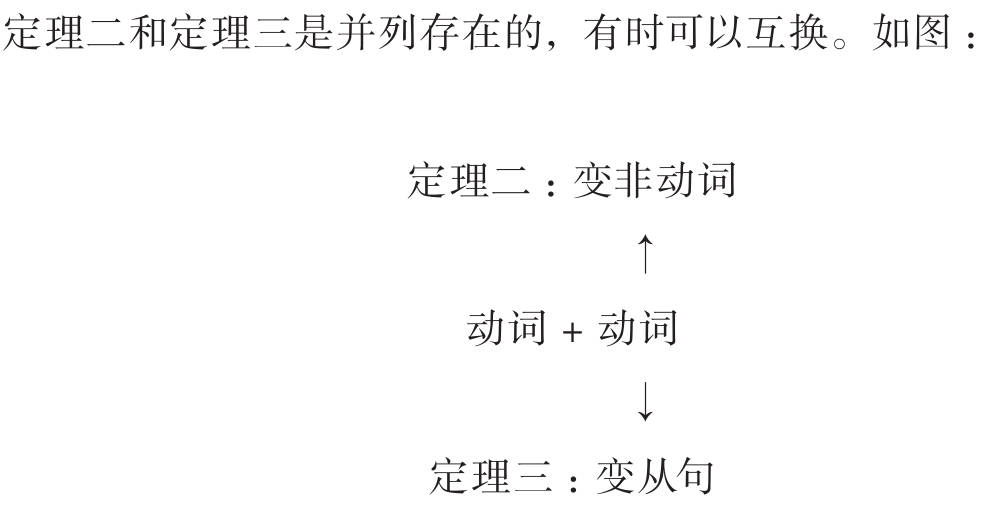 | 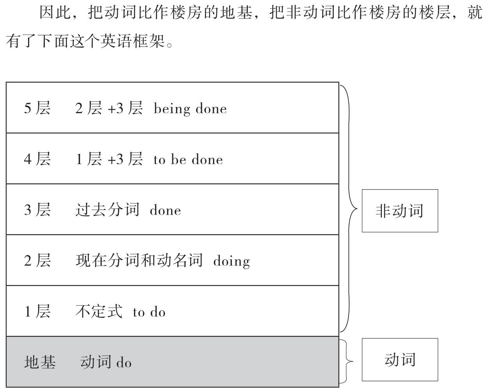 |
| ------------------------------------------------------- | ------------------------------------------------------- |
| 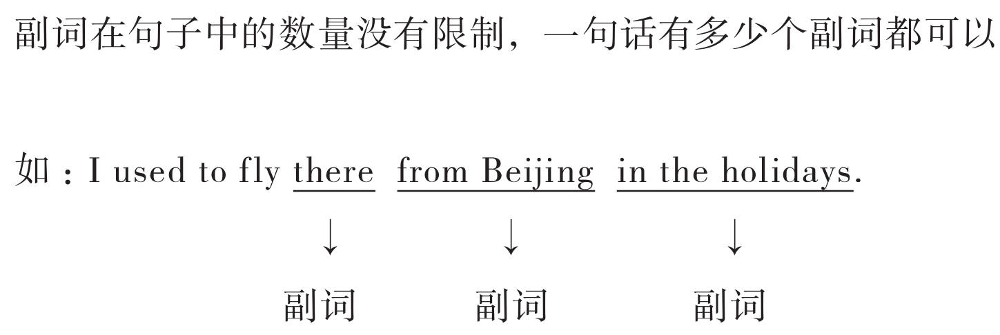 |                                                         |

# 基本概念

> 英语大部分语法，是`名、动、形和副词`的用法，因此==把各种 "语" 还原为这4种词==，语法就会简单很多

### 名词

- 可数/不可数
- ==代词==：代替人/物，因此代词代替名词，代词还有形容词性
  - 形容词性物主代词=形容词，加 ==s== 后，就变为名词性物主代词，$our \to ours$

### 动词

4种词带有动词称呼

1. 系动词
2. 实义动词
3. 助动词：帮助动词，不是动词
4. 情态动词：给动词表态，不是动词

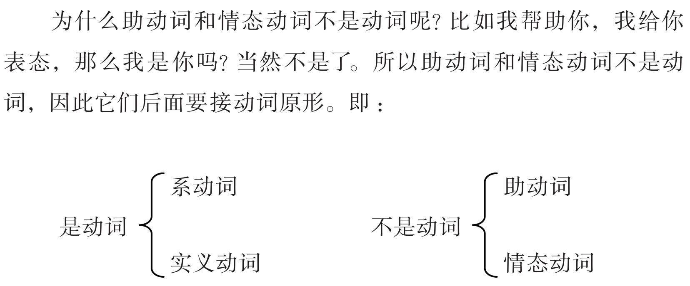

### 形容词

形修饰名，可放在名词前

- 也可放在名词后，通常不叫形容词，叫定语或==补足语==
  - 即：定语=形容词，而==补足语由定语从句简化而来==
- 定语既可以前置也可以后置，`短语和从句作定语时`通常放在名词后面
  - 单个的词作定语时放在名词前
- 还有形容词性物主代词 = 形容词，$this、that、which、what、another、...$ 

### 副词

修饰==动、形、副和句子==，可放句首、句中、句尾，游离在主谓宾结构之外

副词放在哪里，主要看它要修饰谁。

- 修饰`形容词和其他副词`时，副词通常放在`前面`
- 修饰`动词`时，`位置比较灵活`，常见放在动词后面或整个动宾结构后面

### 介词

介词：具有引介作用（做介绍）的词，组成==介词短语==，修饰或者补充谓语中心语， 通常==接‌名词==、**代词、动名词或相当于名词的短语**

- 介词后接动词时，动词要变名词，即动名词
- 介词后接名词构成的是‌==介词短语‌==，整体作用相当于‌`副词‌或‌形容词`
  - 其他情况‌：介词短语还可以作‌`表语‌`（说明主语状态，如“The key is ‌in the bag‌”）、‌`宾语补足语‌`（补充说明宾语，如“We regarded him ‌as a hero‌”）

- A of B，A是B的一部分，翻译为 B的A，a friend of mine，我的一个朋友

### 系动词和表语

系动词包括be动词、感官动词和变化类动词等，后接表语，`表语`可以是 ==名、形、副词==

- 感官动词和变化类动词与be动词一样，后面可接形容词，I feel good, She got sick

### 实义动词和宾语

实义动词后接名、副，==不能接形容词==

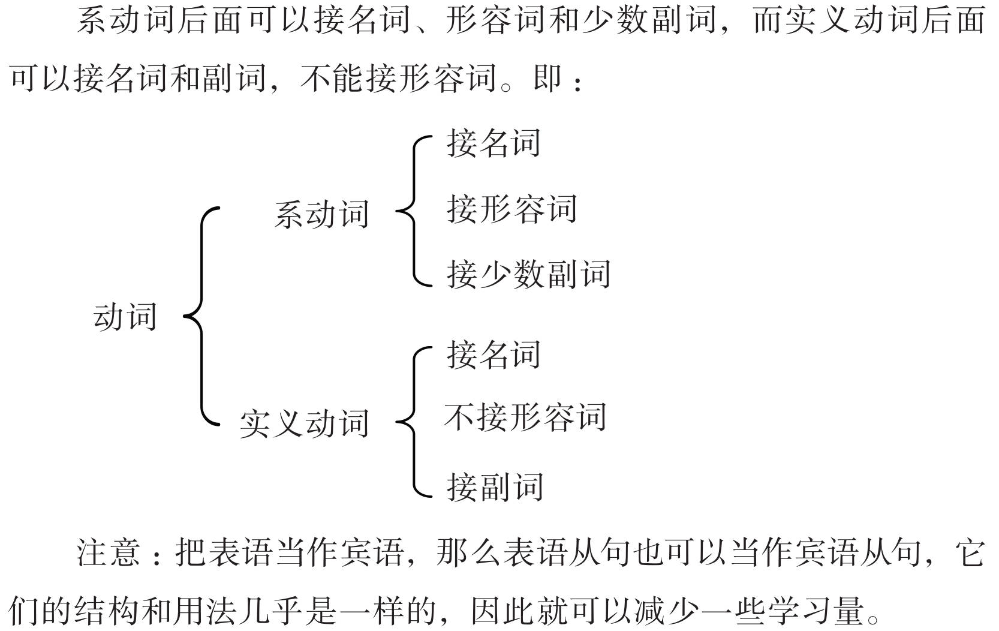

### ==主谓宾==

一句话必须有主谓，宾语可有可无

- 主谓之间： 主动/被动，是非动词主要内容
- 谓宾之间： 及物/不及物，==定语从句引导词==用关系代词还是关系副词，由它决定

### 助动词

动词遇到困难时，即被否定和被疑问时，因此==否定句和疑问句，要用助动词==

- 动没遇到困难（==肯定句==），也可以帮助动词，这时起强调作用，I do like Beijing,我确实喜欢北京

### 情态动词

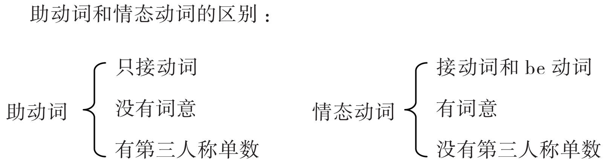

### ==同位语==

[同位语](https://baike.baidu.com/item/%E5%90%8C%E4%BD%8D%E8%AF%AD/7453238)  

与`主语、宾语`位置相同，一个句子只能有一个主语

- Tom,my friend,likes reading. Tom是主语，myfriend 叫 Tom 同位语
- 同位语对主、宾做进一步说明，说它们相等只是为了方便理解，==同位语 = 名词==
  - 同位语与被修饰词保持语法功能一致，可由`名词、代词或从句`充当

- 同位语位于被修饰的名词或代词之后
  - 强调时同位语可置于名词之前，用逗号隔开
  - 非限制性同位语（补充信息）用逗号分隔；限制性同位语（必要信息）不用逗号

注意： ==有些动词可以接2个宾语==，当2个名词不相等时，才是2个宾语，如：Give me money， 此时 me 不等于 money

### ==补足语==

补足语是==定语从句简化形式==，定语从句简化后剩下的词就叫补足语

- 简化后变成==形、副、名词==，因此形、副、名都能作补足语
  - ==去掉主语，动词变非动词==，如果动词是be动词，直接去掉
  - 没了主语就不是句子，也就不能用动词

- 定语从句的关系代词作主语时，可以简化

补足语分`主语补足语、宾语补足语`

- 宾语补足语：由宾语后的定语从句简化而来
- 主语补足语：由主语后的定语从句简化而来

> 补足语可以由形容词充当，但也能由名词、副词、介词短语、分词、不定式等充当‌，它的核心功能是“`补全语义`”，而不是“`修饰限定`”
>
> 区分定语和补足语: 试着‌**删掉目标部分，看句子意思是否完整**‌：
>
> - 删掉后句子仍然通顺，只是少了修饰:  **定语**‌。
> - 删掉后句子意思不完整、不成立: **补足语**

I know them who are my classmates. $\to$  I know them my classmates.

- my  classmates 是 them 的同位语，也就是说，==同位语也是由定==
  ==语从句简化而来的==，所以补足语也包括同位语

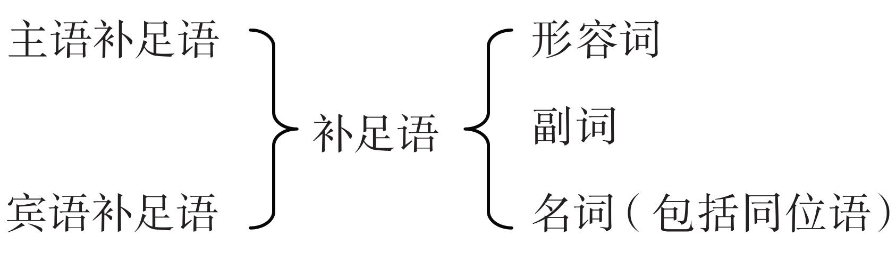

### 定语和状语

定语=名词，状语=副词

例会飞的鸟，会飞的是形容词，这个形容词中有动词飞， 即这个形容词由一个句子构成

- ==句子构成的形容词==，是`形容词句子`，但词是句的组成部分，词与句矛盾，因此不叫词句，叫==语句==

- 因此把形容词叫成定语，修饰名词的句子就叫==定语从句==； 副词叫状语，作副词的句子叫==状语从句==
  - 定语通常指动词变成的非动词，放名词前叫前置定语，名词后叫==后置定语==

### 主动和被动

加 ==~ed== 表示被动，加 ==~ing== 表主动

- 现在分词表主动，过去分词表被动

主动：主语完成

| 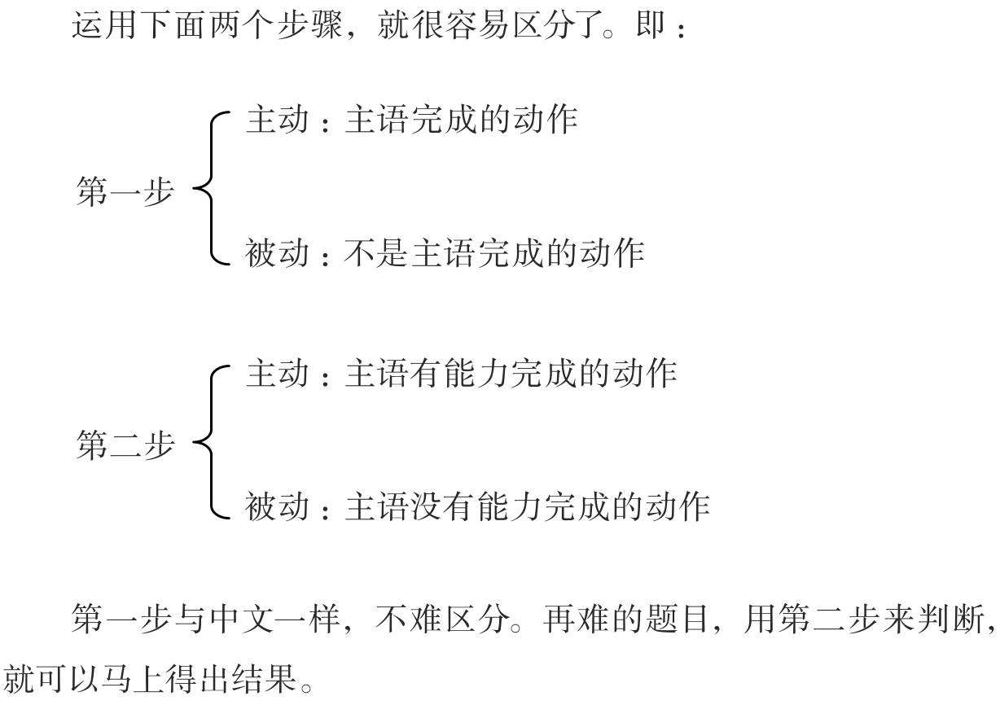 | 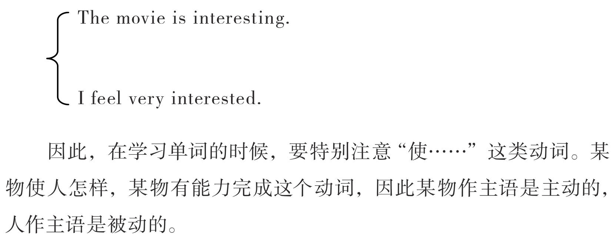 |
| ------------------------------------------------------- | ------------------------------------------------------- |

### ==及物和不及物动词==

不及物动词要加介词才能加名词： 即不及物动词和名词没联系，要介词介绍

- 所有及物动词都可作不及物动词，即任一动词都可作不及物动词，任一句英语，都可以不接宾语

**先行词**： 定语从句中，动词要接的名词已经给出，这个词是先行词

==**区分及物和不及物动词**==

- 及物：`动词的目的是动作本身，或名词有变化`， 符合其中一个条件
- 不及物：2个条件都不符合，就是不及物，就需要介词
  - 例：go to school，去学校目的是学习，不是去； 学校没有变化，是不及物
- `不及物动词没有被动，因为动、名之间没有相互影响`

go home，go to school, home有副词词性，to school也是副词，修饰动词，因此证明： ==介词 + 名词 = 副词==

- ==定语从句的难点==在于区分及物和不及物动词： `in which  = where`

| 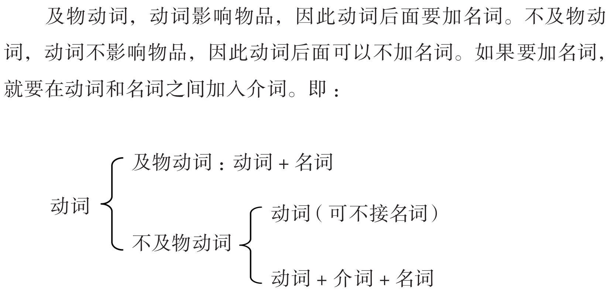 | 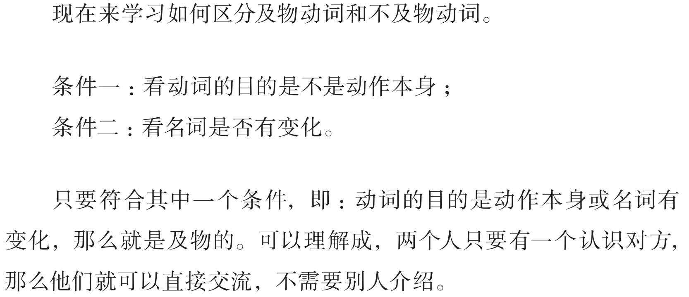 |
| ------------------------------------------------------- | ------------------------------------------------------- |

# 非动词

非动词变成了==名词、形容词==，虽然不是动词了，但==仍然表示动作==，因此仍然可以接名词作宾语

- 接名词时，`非动词就是形容词`
  - 作形容词时，放在名词前/后
  - 作形容词时==修饰名词==，通常叫定语或补足语
- 不接名词时，非动词是`名词`
  - 非动词变名词时，用来==作主语、宾语==，也可以放介词后面
- 非动词不需要考虑时间，只需要判断==动作已经发生==还是未发生
  - 动词才考虑时间，非动词不考虑，因此，只有动词才需要==考虑时态==，非动词不需要考虑
    时态

### to do

表示do这个==**动作未发生**==

- ==to do表主动==
- 词性： to do不是动词，可以是`形、名`，作形容词时==修饰名词==，作名词时==作主语、宾语==

==动词 + 介词==，相当于一个新动词，后面通常接宾语， （不及物动词要加介词才能加名词）

- go on to do sth： 做完一件事后接着做另一件事
- go on doing sth： 继续做原来正在做的事

***

**to do例外用法： **==**省略to**==

- ==have、make、let== 是`使`或`让`意思时，后接to do要`省略to`，Let's go
  - ==help== 后接to do，可省可不省，help sb to do sth, help sb do sth
  - `表示被动时`，to do不能省略to
- 前有do，后无to
  - but、besides、except 或 be动词， 前面有do(动词/非动词形式)，后接不定式，不加 to‌

***

==**to do作宾语补足语时主动/被动**==:  `动作由谁来做`

- 补足语是==定语从句简化形式==，简化后变成==形、副、名词==

- to do 作宾补时，动作的主语可以是它`修饰的名词`， 也可以是`句子的主语`

- 主动 `to do`，被动 `to be done`，具体用哪个取决于宾语和动作之间的关系：宾语是动作的发出者就用主动，宾语是动作的承受者就用被动

  > 能区分： `I want to do it；  I want it to do； I want it to be done`
  >
  > - 区别在于‌**动作由谁来做**‌：第一句是自己做，第二句是让“它”去做，第三句是希望“它”被完成（不强调谁做）
  > - 我想亲自做这件事;  我想让它去做（某事）;  我希望这件事被完成

| 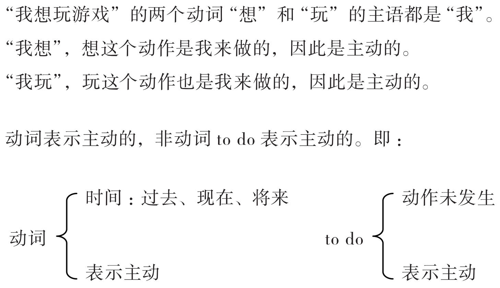 | 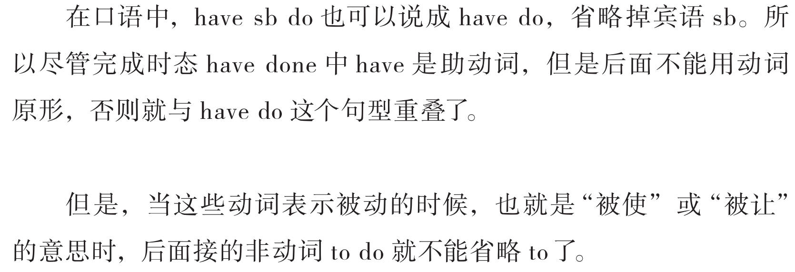 |
| ------------------------------------------------------- | ------------------------------------------------------- |
| 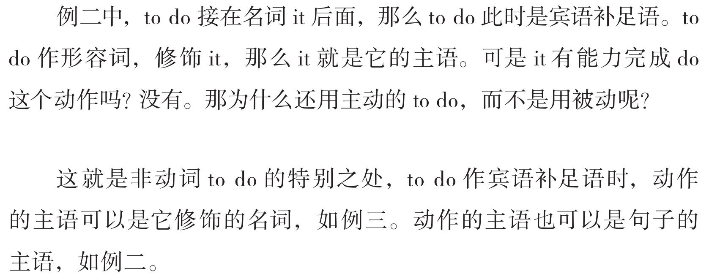 | 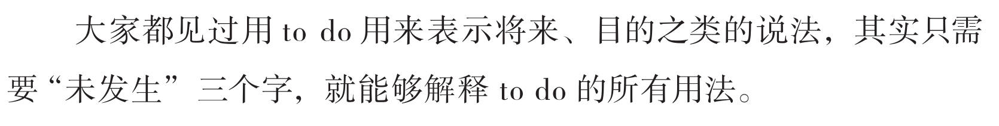 |

### doing

doing 表示 do 这个==**动作已发生**==

- 我想玩游戏，说明还没有玩，`I want to play games.`  我爱玩游戏，表明之前玩过，`I love playing games`
- 爱、玩主语都是我，因此是主动的， 非动词==doing表主动==
- doing作==名、形==， 作名词叫`动名词`，作形容词时叫`现在分词`

==**doing小分支**==： 系动词 + doing 有3种情况

- 现在分词作表语： 相当于形容词，表示主语的性质或状态，The story is interesting
- 动名词作表语： 说明主语的身份或内容，Her hobby is painting. 她的爱好是画画
- 用doing表进行时： be + doing 构成进行时， She is singing.
  - 有些动词（如 keep、enjoy、finish 等）后面直接跟 doing 作宾语，那是“动词 + doing”的==固定搭配==，和“系动词 + doing”不是一回事， 如： enjoy doing‌ ， 喜欢做某事
  - It is surprising,不表示正在进行，只代表`动作已发生`和`动作是主动的`

感官动词接非动词的用法比较特殊

| 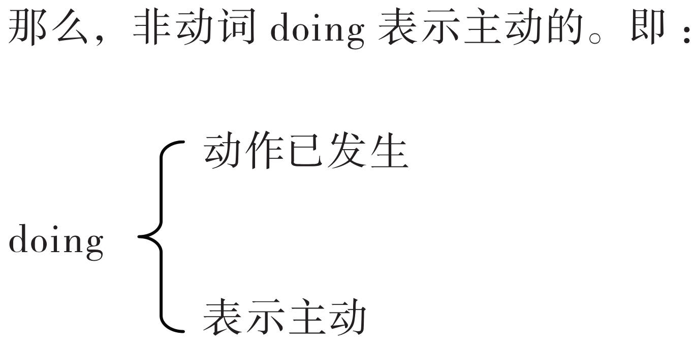 | 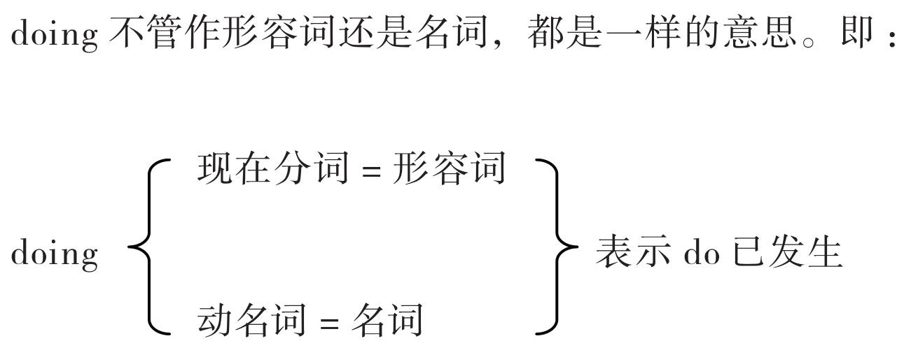 |
| ------------------------------------------------------- | ------------------------------------------------------- |

### to do和doing比较

to do 表示==**动作未发生**==

doing 表示==**动作已发生**==

`be going to do`: 计划做某事，be doing表正在进行，to do表未发生，合在一起表`将来发生的动作`

- be going to do 表to do这个动作，已经处于正在计划当中
- 和 `be to do` 对比: 将来的动作
- ==be going to do可简写为 be doing==，但不是所有 be doing都是由be going to do缩写而来
  - I am going to come 缩写为 I am coming

| 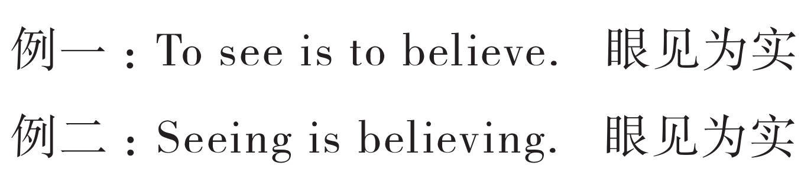 | 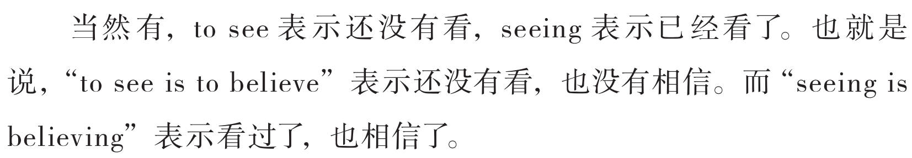 |
| ------------------------------------------------------- | ------------------------------------------------------- |
| 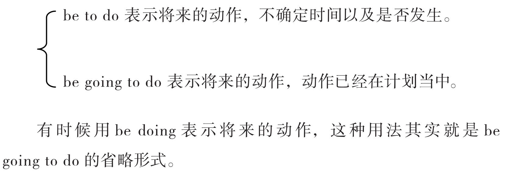 | 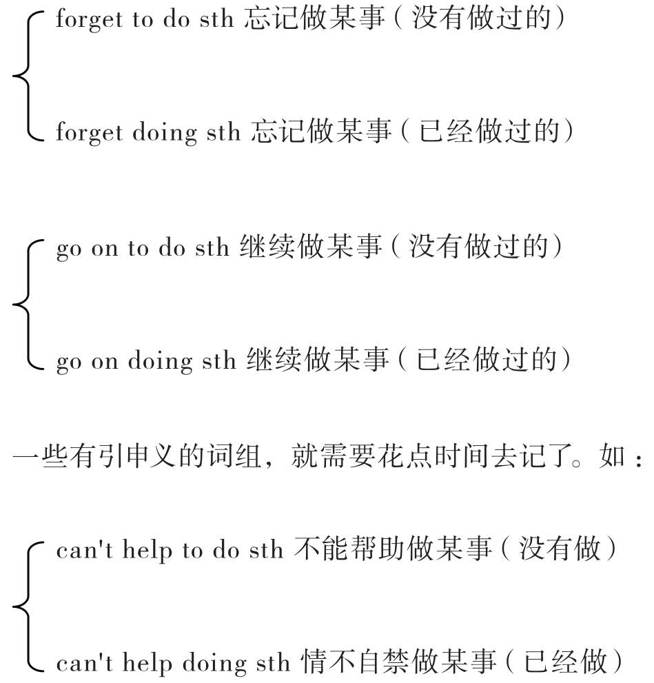 |

### ==done==

过去分词: 被动、已完成的状态

done 也表示==动作已发生==，但是，doing 表示主动发生，done 表示==被动发生==

done==只能作形容词==

**过去分词和过去式都是加ed，如何区分**

- 过去式(是)动词，动词表主动，那么`过去式表主动`
  - `过去分词表被动`
- 一句话先有动词才有非动词，那么，`先找句子动词，再找非动词`，就可以判断动词加ed，是过去式还是过去分词

***

**过去分词用法**

- 如果一句话中文意思完整了，但没有动词，就`用be动词作动词`， Homework was written
- done修饰名词时，可放名词前，也可放名词后，是定语从句的简化
- done例外情况： `I have finished my homework`
  - ==完成时态==have done中，have是助动词，非动词done作动词，动词是主动的，因此  ==have done 是主动的==
    - 如果要表达==被动的完成时态==，加入been， `have been done`
  - ==have done里的done不表示被动==，它只表示“==完成==”。过去分词本身并不天生等于被动，它只是“==完成==”和“==被动==”两种含义的载体，具体表达哪种要看它跟谁搭配。跟have搭配时，done承担的是“完成”的功能，用来构成完成时态；  真正要表达被动，得用have been done，多出来的been才是被动标记
    - 因为 have done 也是现在完成时

| 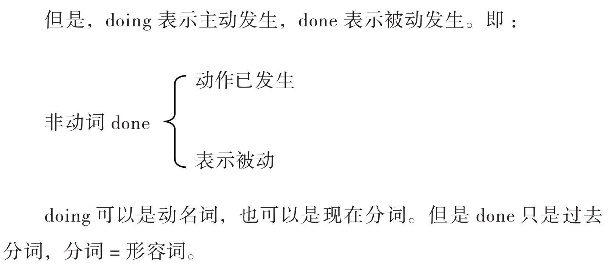     | 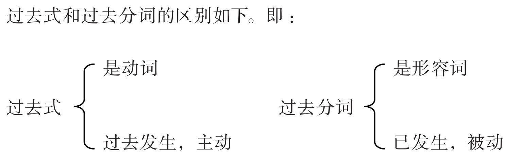 |
| ----------------------------------------------------------- | ------------------------------------------------------- |
| 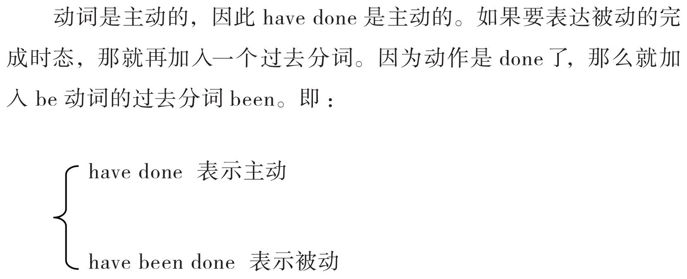 | 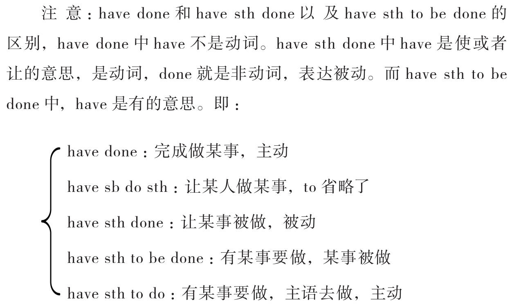 |

### to be done

`to be done = to do + done`，to do表未发生，done表被动，to be done表示==没有发生的被动==

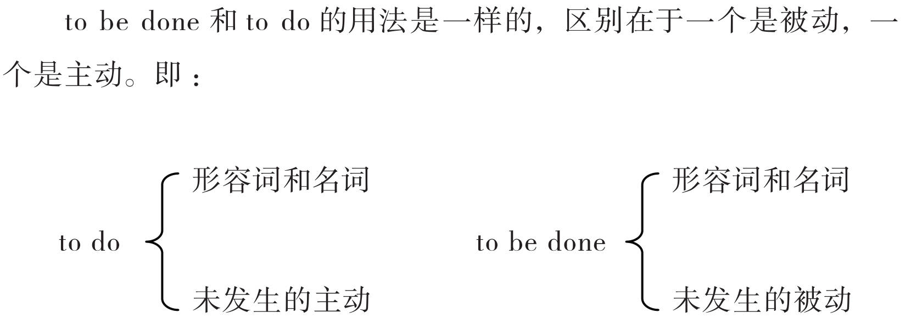

### ==being done==

与 done 和 to be done 一样，==being done 也表被动==

done只能作==形容词==； being是动名词，done前加上名词后，`being done`就成了==名词==，可作主、宾语，也可放介词后(介+名=副)

- done 和 being done 意思一样，区别: `一个是形容词，另一个是名词`
- being done放在介词后，就是==**动名词的被动形式**==作介词宾语，核心作用是表达“被...”的被动含义

**主动/被动进行时:**  

- He `is being  bitten` by a mosquito, 他正在被蚊子咬
- He is bitten by a mosquito, 他被蚊子咬

| 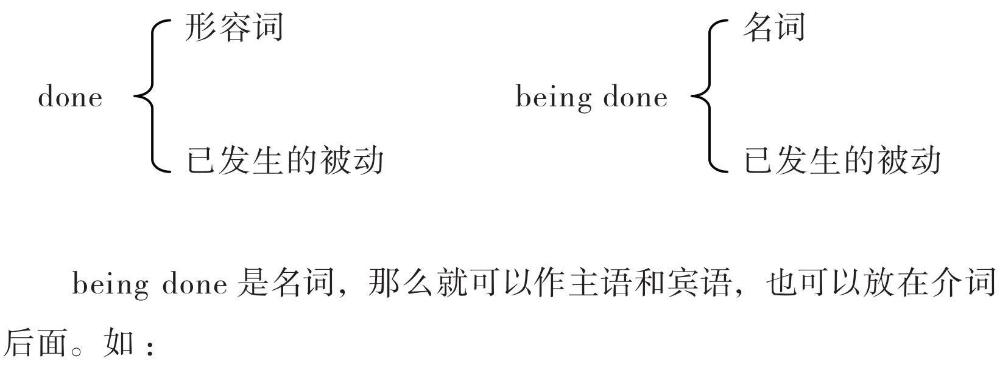 | 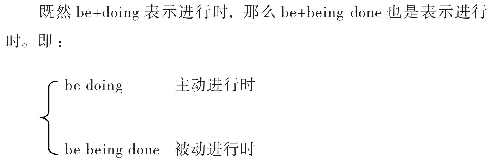 |
| ------------------------------------------------------- | ------------------------------------------------------- |

### 现在分词和动名词区别

现在分词和动名词都是动词后加 ing 变的非动词，现在分词是形容词，动名词是名词

- 动名词：不强调动作主动发生
  - `swimming pool`：   pool 没有游泳的能力，所以 swimming 是现在分词， 动名词+名词构成的名词短语
- 现在分词：==强调动作主动发生==
  - `swimming  boys`：  boys 有游泳的能力，主动，所以 swimming 是现在分词

因此， 遇 到 `doing + 名词` 这类==词组==时， 就分析名词是否有能力完成 do 这个动作。如果有，doing 就是现在分词 ；如果没有，doing 就是动名词，意思等于 `名词 for doing`

---

过去分词 + 名词 用法: 

1. 作定语修饰名词
   1. 过去分词`像形容词一样修饰后面的名词`，表示‌==被动‌或‌完成‌==的含义。
2. 构成独立主格结构
   1. 结构是 `名词/代词 + 过去分词`，在句中作‌状语，和主句用逗号隔开

| 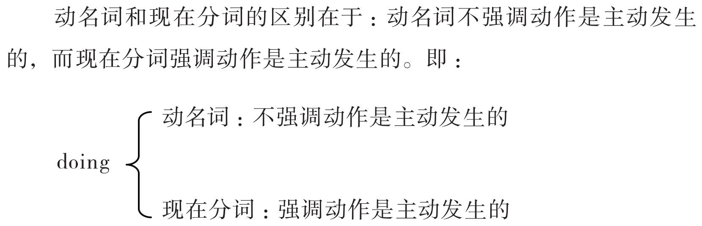 | 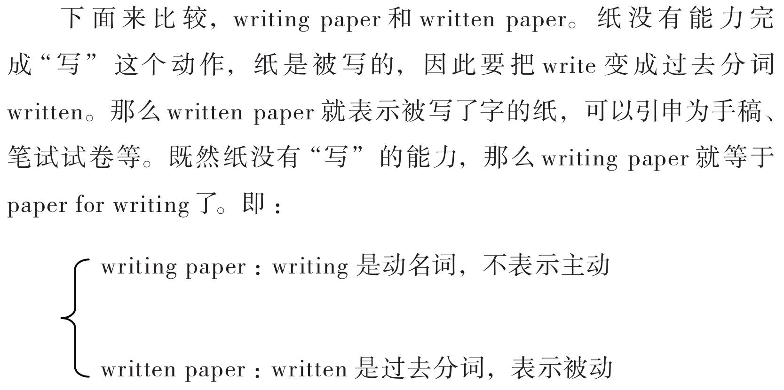 |
| ------------------------------------------------------- | ------------------------------------------------------- |
| 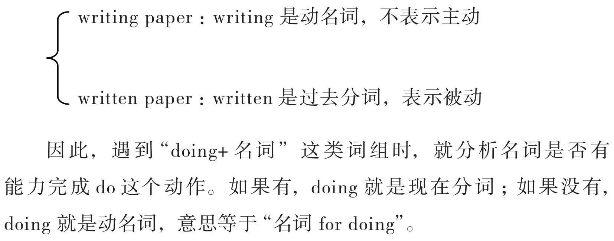 | 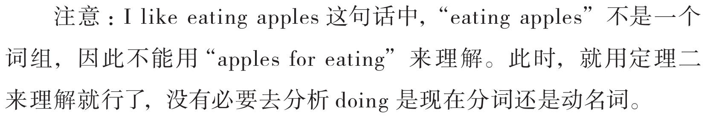 |

### 特殊用法

有些动词后面只能接 to do，有的只能接 doing。这些特殊的用法，大部分都是可以用 ==已发生== 和 ==未发生== 来解释。少数无法解释的，学到的时候最好背下来

be+doing表示进行时， ==to be doing== 表示`未发生的进行时`，也就是==将来进行时==。

-  to be doing 接在只能接 to do 的动词后，表示正在进行

| 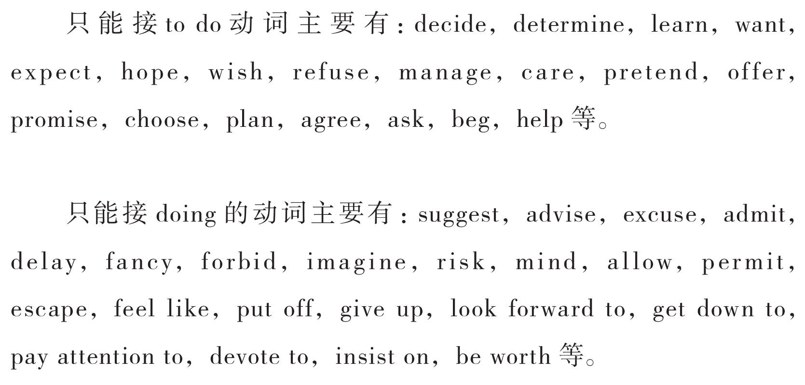 | 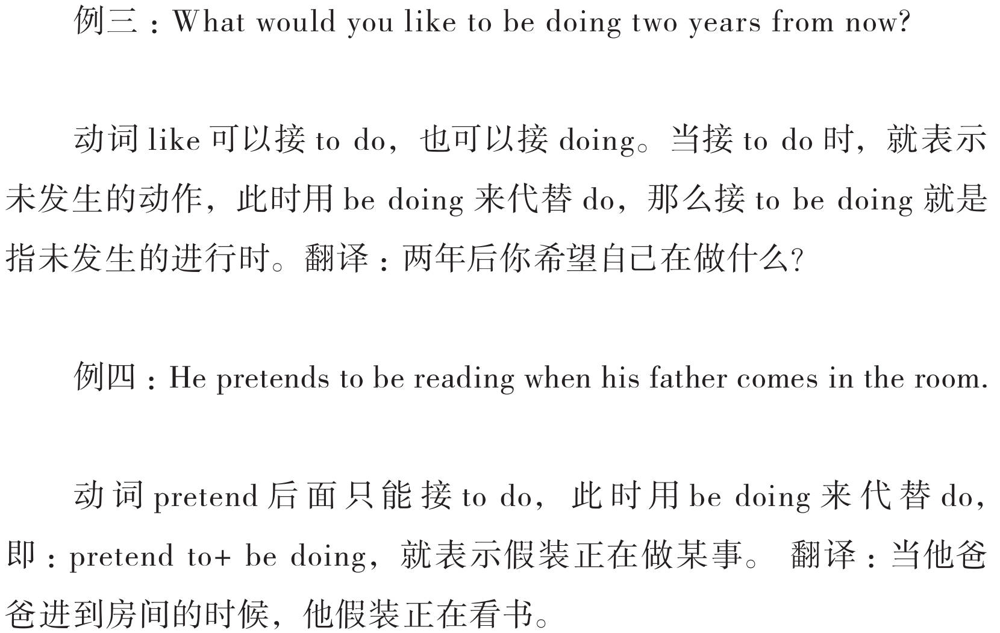 |
| ------------------------------------------------------- | ------------------------------------------------------- |

### 感官动词

把==感官动词归类为系动词==，是因为感官动词可以后接形容词，而不是像实义动词后接副词

感官动词后接 doing 和 to  do 作宾语补足语时，用法比较特殊

| 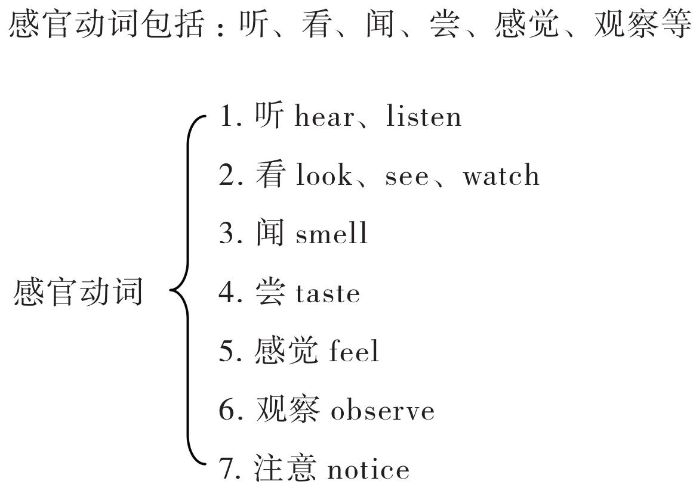 | 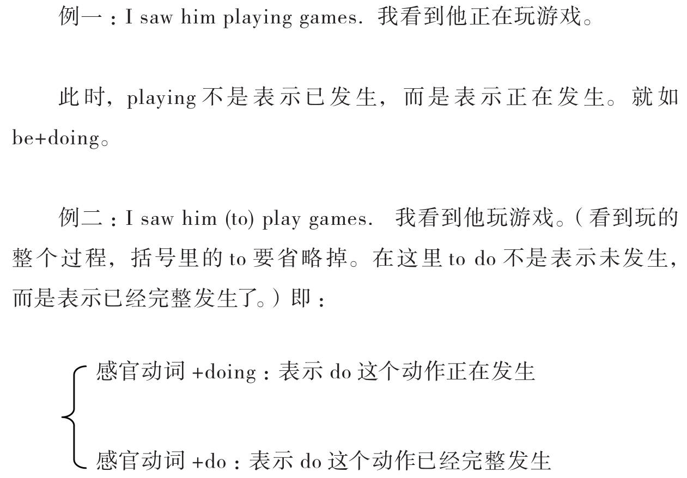 |
| ------------------------------------------------------- | ------------------------------------------------------- |
| 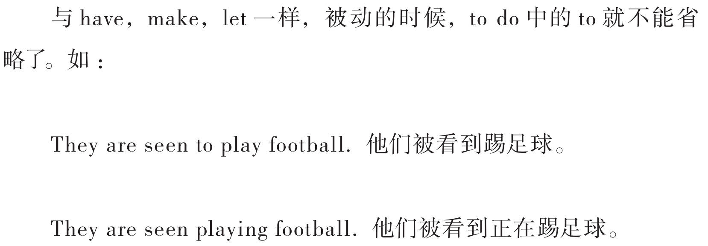 |                                                    |

### 总结

- 完成时态 have  done 也是动词，因此 have done 也有非动词形式 ：`to have done` 和 `having done`
- 非动词的否定形式都是在非动词前面加 not， 即 ：（动词 +）not+ 非动词
- ==完成进行时== ： have been + doing

| 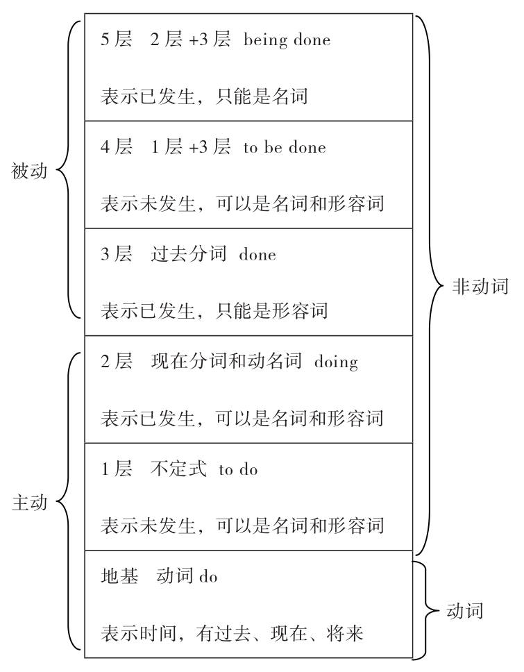 | 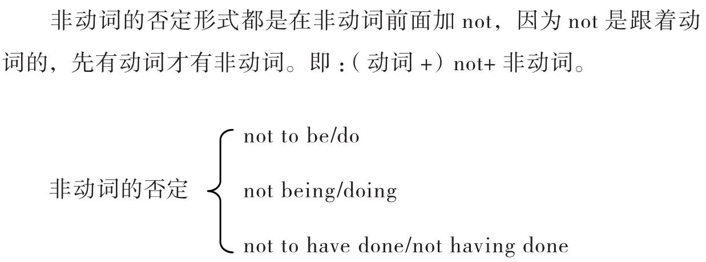 |
| ------------------------------------------------------- | ------------------------------------------------------- |
| 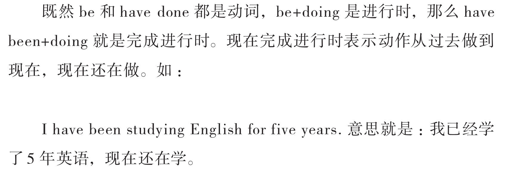 |                                                         |

# 复合句

md： [从句](.\从句)

> 引导词根据**从句的性质**分为三大类：
>
> - 名词性从句引导词
> - 定语从句引导词
> - 状语从句引导词

### 句子结构

- 主谓只能有一个，宾语： 可以没有、有1个，少数动词可接2个
- 主句可在从句前、后，有==引导词==的就是从句
  - 引导词可在从句==作主、宾语==； 也可以只引导，不作从句主、宾
- 主句和从句，都是句子，都要有==主谓宾==

| 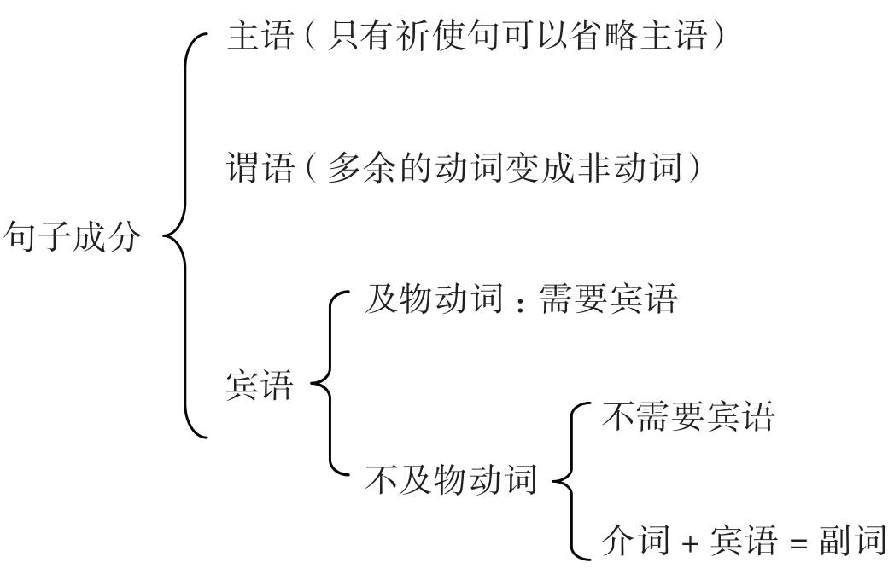 | 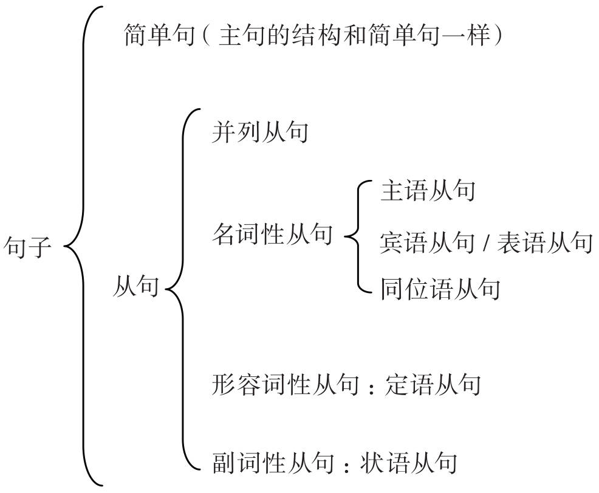 |
| ------------------------------------------------------- | ------------------------------------------------------- |

### 引导词

md： [从句](.\从句)

哪些词可以做从句引导词：**连词、连接代词、连接副词、关系代词、关系副词**

- ==连接代词==引导名词性从句（主语、宾语、表语、同位语从句），关系代词引导定语从句，核心区别在于连接代词没有先行词而==关系代词有先行词==
- 引导词多但不乱，核心就一句话：‌**先看从句类型，再看从句里缺什么成分，最后匹配引导词**‌。 三步走下来，基本不会选错

引导词分两类： 核心作用是“引导从句”，但“是否充当句子成分”要分情况看

- 只起连接作用，不充当句子成分
- 既引导从句，又充当句子成分

> 总结口诀：
>
> 1. 名从看缺啥（缺成分选wh-，不缺选that/whether）；
>    1. 连词:  `that` 只能引导**名词性从句**， 不作任何成分
>    2. 连接代词:   `what` 必须在从句中**充当主语、宾语或表语**
>    3. 连接副词
> 2. 定从看先行（人/物/时/地/因）+ 从句缺啥； 既起连接作用，又在从句中==充当成分==
>    1. 关系代词
>    2. 关系副词
>    3. 核心考点：判断==用关系代词还是关系副词，取决于从句缺什么成分==。
>       - 从句==缺主/宾/表 → 用关系代词== (which/that/who)
>       - 从句不缺主宾表，只==缺状语 → 用关系副词== (when/where/why)
> 3. 状从看逻辑（时间/原因/条件/让步等），==不充成分只连意==。

从句引导词根据**从句的性质**主要分为三大类：名词性从句引导词、定语从句引导词和状语从句引导词。它们的语法功能各不相同，不能混用

- 名词性从句引导词
  - **功能**：引导主语、宾语、表语或同位语从句，在句中相当于一个“名词”
  - 连词和副词不是名词，不能作主语和宾语，只起引导作用
  - 主、宾、表和同位语都有名词词性，那么主语从句、宾语从句、表语从句和同位语从句都是==名词性从句==
- 定语从句引导词
  - **功能**：引导定语从句==修饰先行词==，既起连接作用，又在从句中**充当成分**
- 状语从句引导词
  - **功能**：引导状语从句==修饰主句的动词、形容词或整个句子==，`表示逻辑关系`。**不在从句中充当成分**。

做题： `______`I met her, I  found  her beautiful and  gentle

- 有`两个动词`met 和 found，那么就是`两个句子`，用逗号隔开，说明一个是主句，另一个是从句。

- 后面句子是主语 I 开头，`没有引导词，那么就是主句`。因此，`前面是从句，从句需要引导词`，the first time 可以作引导词，所以第一题选 A

| 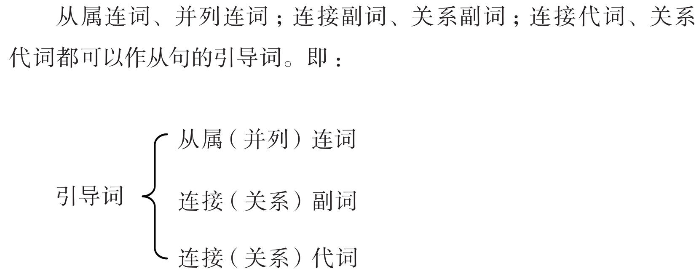 | 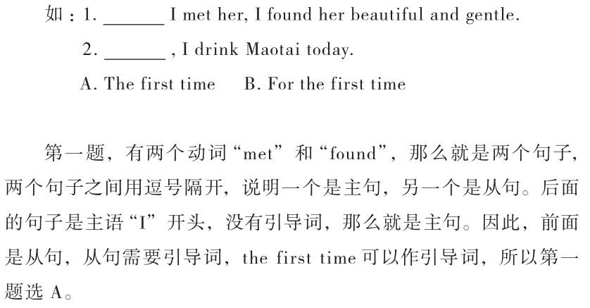 |
| ------------------------------------------------------- | ------------------------------------------------------- |

### 并列从句

并列连词：  or、and、but

### 主语从句

主语从句： 用一个句子作主语

- What you did was good.  你做的事很好 或 你做得不错

- 通常`主语从句`当作第三人称单数，因此==主句的谓语动词用单数==

***

==it 作形式主语==，主语从句放句尾，即：It is ... 引导词 + 主语从句。为了`避免头重脚轻` 

- It is important that we should study hard

主语从句的==语序是陈述句==（主语 + 谓语），==不能用倒装==

| 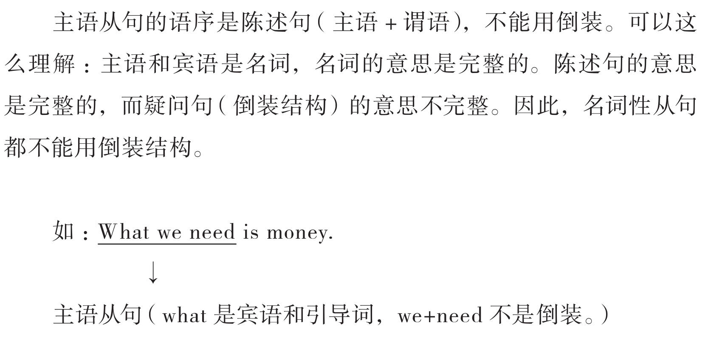 | 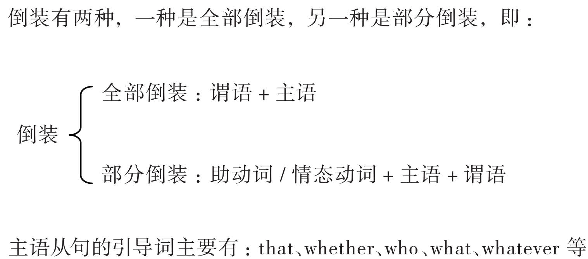 |
| ------------------------------------------------------- | ------------------------------------------------------- |

### 宾语从句

作主句的宾语

宾语从句主要按它依附的词分类，常见分为三类：

- 动词后的宾语从句： 主语 + 谓语 + 宾语从句
- `介词后的宾语从句`： 主语 + 谓语 + 介词 + 介词后的宾语从句
  - 动词和宾语（从句）之间==不及物==，因此需要介词
  - 通常由‌==wh-==类引导词或 ==whether‌==引导，that 从句仅限特殊情况
    - Please think `about` ‌what I said just now‌.  请想想我刚才说的话
- `形容词后的宾语从句`： 主语 + ==谓语 + 形容词== + 形容词后的宾语从句
  - 即：==表语的补语从句==， 把 `be动词 和 形容词`当作是一个及物动词

全用==**陈述语序，不能倒装**==

***

**it 作形式宾语**

- 如果宾语从句后有补足语，可用 it 作形式宾语，把宾语从句后置
  - I think that he knew you before impossible 
  - ‌I think it impossible that he knew you before
- 用 it 作形式主语或形式宾语时，句子都变成了形容词的宾语从句

***

**动词接两个宾语的宾语从句**

- 双宾语结构‌（动词 + 间接宾语 + 直接宾语）中的‌==直接宾语==由一个从句来充当‌
- 动词 + 间接宾语 + 宾语从句

| 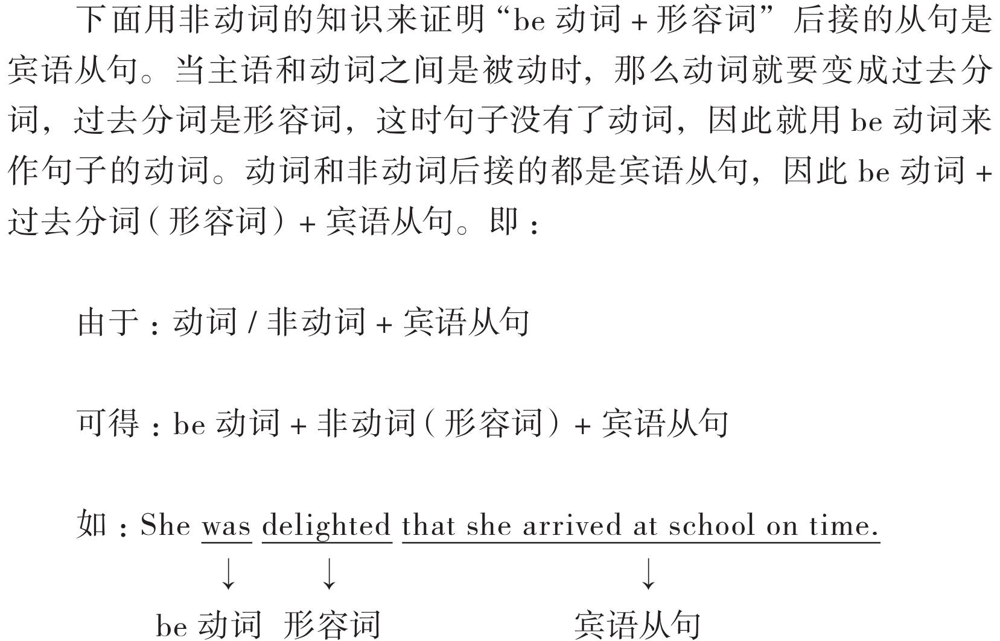 | 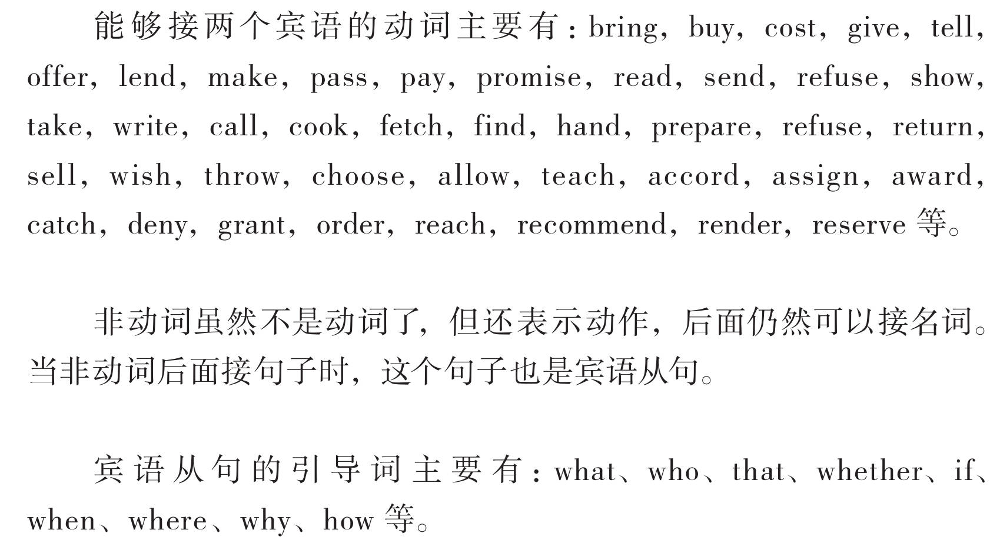 |
| ------------------------------------------------------- | ------------------------------------------------------- |

### 表语从句

句子作表语： 主 + 系动词 + 表语从句

表语从句中连词 that 不能省略，宾语从句中that可以省

| 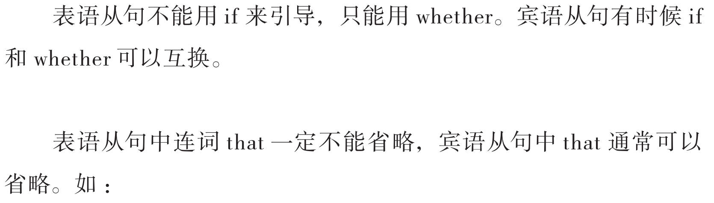 |  |
| ------------------------------------------------------- | ----- |

### ==定语从句==

[定语从句：先行词+关系词](https://baijiahao.baidu.com/s?id=1858720290747897739&wfr=spider&for=pc)  

md： [从句](.\从句)

**定语从句核心难点(个人理解)**： 引导词前要不要加介词

==定语 = 形容词==，修饰名词，主语和宾语是名词，因此，定语从句==修饰主语、宾语==，放在修饰的名词==后面==

定语从句引导词： 关系代词、关系副词

> 掌握定语从句的关键在于理清“先行词”、“关系词”与“从句内部成分”三者之间的逻辑关系
>
> - 先行词 + 关系词 + 定语从句
> - ==选择关系词==需同时考虑两个维度：**先行词的类型** + **从句缺失的成分**，参考 [从句](.\从句)
>
> 定语从句的本质是  ==**还原法**== ：将关系词还原到从句中，看它在从句里做什么成分。养成这个思维习惯，比死记硬背规则更有效

***

**判断从句动词及物不及物**： 不及物用==关系副词、介词+which==

定语从句2大类型：

- 从句缺少主语： ==关系代词==作主语
  - `或者`把从句动词==变非动词==
- 从句有主语： 看`从句动词`与`先行词`是不是及物
  - 及物：用==代词==代替先行词
  - 不及物：`从句动词`与`先行词`之间要==加介词==

任何一个名词后面都可以接定语从句

***

---

定语从句还分==限制性==定语从句和==非限制性==定语从句:  限制先行词，`定语从句只修饰先行词`（限制性）

- 限制性定语从句
  - ==**必不可少，限定先行词范围**==，无逗号隔开
- 不限制先行词，那么`先行词可以是主句的主语或宾语`，也可以是`整个主句`
  - ==**补充说明，删去不影响主句完整性**==，有逗号隔开
  - 需要用==逗号==把主句和从句隔开，不能用 that 作引导词
  - 非限制性定语从句是==对先行词或整个主句==进行==补充说明==的从句，去掉后主句意思仍然完整‌

***

==whose== 也能引导定语从句，是==形容词==，即 ：“先行词”的。先行词可以是人，也可以是物

`it is...that` 的强调句属于定语从句

- 如果 that 不是作从句的主语，并且与从句的动词是不及物时，那么就需要用介词，即 ：in  which。但是 it is...that 这个 结 构不用which 作引导词，==只能用副词==代替介词 + which

***

由于`定语从句和同位语从句`的结构一样， 所以  `It is + 名词 + that...`也可以是 that 引导的同位语从句

where 引导`定语从句和状语从句`的区别

| 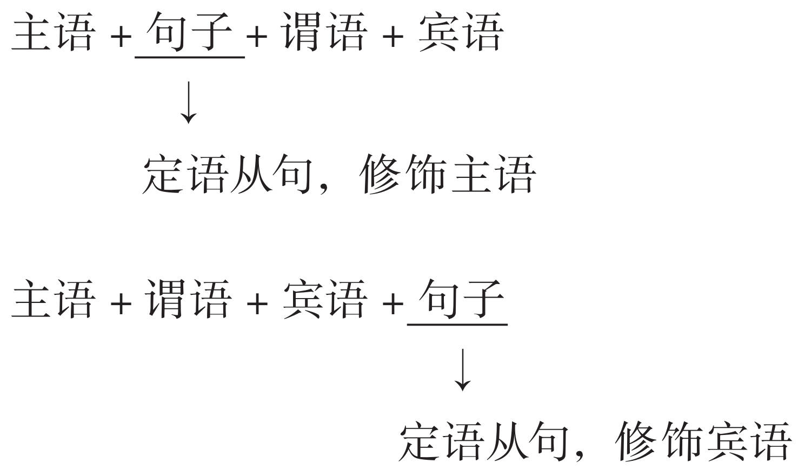 |  |
| ------------------------------------------------------- | ------------------------------------------------------- |
|  |  |
|  |  |
|  |  |

**限制性定语从句** 

- 限制性： 定语从句只修饰先行词
- 非限制性： 不限制先行词，先行词可以是`主句的主语或宾语`，也可以是`整个主句`

|     |  |
| ---------------------------------------------------------- | ------------------------------------------------------- |
|  |  |
|  |  |

### ==状语从句==

1. 只需要学习==状语从句修饰句子==的用法
2. 状语从句可以放句子==**前、中间、后面**==，也可以出现在`名词后面`，不要误以为它是定语从句
3. 一些表示时间、方式的==名词==也能作状语从句的==引导词==

> - 状语从句是复合句中充当**状语**成分的从句，用来修饰主句的谓语动词、形容词、副词或整个句子，说明动作发生的时间、地点、原因、条件、让步、目的、结果、方式及比较等背景信息。
>
> - 与定语从句不同，状语从句**不修饰名词**，而是修饰“动作”或“状态”。掌握状语从句的核心在于：==**识别逻辑关系 + 选对连词 + 注意特殊句式**==。

==状语 = 副词==，副词可以`修饰动词、句子`。因此，状语从句用来修饰动词和句子

`副词修饰动词`，放在动词后； 而宾语从句也是放在动词后

- 即： 如果宾语从句引导词是连接副词时，就与动词后接状语从句是一样的
  - 为了避免这个冲突，把==动词后接的从句==都当作宾语从句
- 把==系动词后接的从句==都当作表语从句
- 这样，就只需要学习==状语从句修饰句子==的用法

***

副词可以放句子前、中间、后面， 状语从句也可以放句子==**前、中间、后面**==

- 放主句前面时，与副词一样，通常==用逗号==与主句隔开
- 状语从句位置很灵活，也可以出现在`名词后面`，不要误以为它是定语从句，`可以通过意思来区分`

***

状语从句的引导词非常多，一些表示时间、方式的==名词==也能作状语从句的引导词

- 如 ：the  moment，every time，the day，the way等，可作定语从句的先行词，也可以作状语从句的引导词

---

==让步从句的倒装==

- 当 **as / though** 引导让步状语从句时，必须将==表语、状语或动词原形==提前至句首：

  - **Child as he is**, he knows a lot. （名词提前，且省略冠词）
  - as 表“虽然”时，需将表语（Child）前置至句首
  - 他虽然是个孩子，却懂得很多

---

**区别： 状语从句 、 定语从句**：  参考 [从句](.\从句)

|  |  |
| ------------------------------------------------------- | ------------------------------------------------------- |
|  |  |

### 同位语从句

`同位语 = 主语或宾语 = 名词`。所以，同位语从句 = ==名词性从句==

同位语从句的`结构和定语从句的结构非常相似`，都是把句子放在名词后面。但是，同位语从句等于名词，而定语从句等于形容词

- 定语从句的==先行词==可以是所有名词，但是只有那些==抽象名词后==面才能接同位语从句。 
  - 如 ：idea、plan、fact、theory、promise、hope、news、doubt、truth、information、suggestion、question、though、belief、conclusion 等
- 同位语从句的==引导词==主要有 ：that、whether、what、who、whom、whose 等

### ==从句的简化==

==并列从句、定语从句和状语从句==都可以简化，`名词性从句`简化的情况比较少

> 核心原则只有一条：当从句主语与主句`主语一致`（或为泛指/形式主语）时，可==省略主语和be动词==，将谓语动词转化为==非谓语形式（分词/不定式）或介词短语==

**并列从句**

- 主、从句主语一样，从句主语省略
- 主、从句主、谓一样，从句主、谓省略
- and 连接两个宾语从句，由于 and 后面的主、谓与主句一样，因此省略主、谓
- 多个相同类型的并列从句，只保留最后一个从句的引导词，中间从句的引导词省略
- 名词性从句的引导词是 `wh-` 时，从句中与主句一样的词，可以省略

___

**定语从句**

1. 定语从句的`引导词作主语`，可以简化： 去掉引导词，动词变非动词，如果是be动词，直接去掉
   1. 定语从句的==引导词作宾语==，引导词可以省略
2. 定语从句是主动的==进行时态==时，简化后与==一般时态==是一样的

____

**状语从句**

状语从句简化后，变成`不定式`作状语、`现在分词`作状语和`过去分词`作状语

- 非动词不等于副词，那为什么非动词能作状语呢？
- 状语从句的主语与主句的主语一样，引导词和主语去掉，动词变非动词，如果是 be 动词，直接去掉，保留非动词

非动词开头的句子，句子的主语就是非动词的主语，可以判断==非动词==用主动还是被动

从句可以简化，主句不能简化

- 定语从句和状语从句简化后成了==非动词==，也就是说，==非动词和从句==可以相互转换

|  |  |
| ------------------------------------------------------- | ------------------------------------------------------- |
|  |  |

### 名词后的状语从句

名词后接从句，而且引导词是副词（where，when，why），从句是`定语从句`还是`状语从句` ？

当名词后接副词引导的从句，如果副词（where，when，why）等于==介词加副词前面的名词==，这个从句就是定语从句，如果不等，就是状语从句

|  |  |
| ------------------------------------------------------- | ------------------------------------------------------- |

### 总结

- 并列连词引导词的句子是并列句
- ==动词前面==的句子是`主语从句`
- ==动词后面==的句子是`宾语从句`
- 系动词后面的句子是表语从句
- ==名词后面==的句子是`定语从句`或者`同位语从句`

剩下的从句就是状语从句，状语从句位置灵活多变，有时候也接在==名词==后面，通过==意思来区别==是定语从句还是状语从句

> 名词性从句：　主/宾/表/同位语，==引导词选择==不依赖先行词，而取决于`从句本身的完整性`　和　`你想表达的含义`

___

that 和 which

- **定从**中是代词，作主、宾语，what不能在定从中作引导词
- **名从**：that仅是引导词，不作从句成分； 
  - which 在名从是形容词，后接名词，和名词一起作主语或宾语 
  - 名词性从句通常用 what 来作主语或宾语
- **状从**：　that 和 which 都不能作引导词，但是 that 可以和其他引导词连用，　如 ：so...that、the way that 等

___

有两个从句时，`两个从句的引导词`通常==连在一起写==，分开写也是对的

|  |  |
| ------------------------------------------------------- | ------------------------------------------------------- |
|  |                                                    |

# 发音与记忆

md: [发音规则](.\发音规则)

### 单词结构

单词由几个发音组成，有多少个发音就有多少对 `辅音 + 元音`。

- 如 ：camera，有三个发音，那就是有三对 `辅音 + 元音`， c+a，m+e，r+a

有的音节由==两个辅音或两个元音==构成， student、look

有的音节由==三个辅音或三个元音==构成， string、beauty

都是在 ==辅音 + 元音== 的结构上变化

___

单词之间的==**连读**==，也需要符合 ==辅音 + 元音== 这个规则。如 ：it is，it辅音结尾，is元音开头，因此 `t+i` 可以构成一个音，所以 `it is` 就可以连读。

- 同理 look at 可以连读，k+a 是辅音加元音。 
- 但是 look back 就不能连读，因为 k 和 b 都是辅音

### 单词发音

> 元音规则、辅音规则、重音规则
>
> - 元音： 开音节与闭音节、元音组合
> - 辅音： C 和 G 的软硬音、辅音组合、辅音连缀

1. 辅音的发音固定，==**每个元音都有几个发音**==，就如同中文的多音字。
   1. 开音节
   2. 闭音节

2. 四个特殊辅音 `l、y、m、n`，在辅音和元音后通常作元音，它们作辅音和作元音时发音不一样

---

3. **组成单词后**

- 单独的元音可以发音
  - 如 ：apple、egg 等以元音开头的单词，一个元音就是一个音节
- 以元音 e 结尾的单词，e 不发音。如 ：like、bye 
  - 只有一个音节的单词除外，如 ：he、she
- ==单独的辅音不发音==
  - 口语交流中，没必要把单独的辅音念出来的。如 ：cat， t 后没有元音，t 不用念出来
  - 单独的辅音 `s、z、g` 除外
    - 单独的 g 发 `g- 哥` 音时，不用发，如 ：big 
    - 单独的 g 发 `dз- 举` 音时，就要发，如 ：cage
- ==两个一样的==辅音或元音连在一起 时，发一个音
  - pool，两个 o 连在一起当作一个 o 发音
- ==三个辅音==或三个元音连在一起时，无法拼读就把前面两个忽略掉，只发最后一个
  - right，ght 三个辅音无法读，那么就忽略掉 gh 的音
  - beauty，eau 三个元音无法读，就忽略掉 ea 的音

> 单独的辅音不是没有音，而是它们的音太轻了。因此，只需把每句话==最后一个单词的单独辅音==发出来就行了
>
> - I `want` to go to `work` by bike.  中间的 want 和 work 的单独辅音 t 和 k 不需要发

4. C 和 G 的软硬音看后面跟的字母：跟 ==a、o、u 或辅音==时发硬音，跟 ==i、e、y== 时发软音

- C 的硬音：发 /k/，比如 cat、cold、cut。
- C 的软音：发 /s/，比如 cent、city、cycle。
- G 的硬音：发 /g/，比如 game、go、gun。
- G 的软音：发 /dʒ/（类似“j”），比如 gentle、giant、gym

---

==辅音组合==发音

==辅音连缀==: 两个或以上辅音相连，每个辅音都要快速读出，不能加元音

- bl、cl、fl、gl、pl、sl: 		black, clean, fly
- br、cr、dr、fr、gr、pr、tr:     bread, cry, drive
- st、sp、sk、sm、sn、sw:         stop, speak, sky

---

==重音规则==

- 重音位置直接影响元音的音质（非重读元音常弱化为 /ə/）
- **双音节名词/形容词：** 重音多在**第==一==**音节 → **TA**-ble, **HAP**-py
  - ==名前动后==

- **双音节动词：** 重音多在**第二**音节 → re-**LAX**, de-**CIDE**
- **后缀影响：**
  - -tion, -sion, -ic 重音在其**前一**音节 → in-for-**MA**-tion, eco-**NOM**-ic
  - -ee, -eer, -ese 重音在**后缀本身** → employ-**EE**, engin-**EER**
- **复合词：** 名词重音在前 → **BLACK**-board；形容词/动词重音在后 → bad-**TEM**-pered
  - ==名前动后==

> 如果没有明显的后缀提示，可以参考以下倾向：
>
> 1. **倒数第三音节原则：** 很多三音节以上的学术词汇，重音倾向于落在**倒数第三个音节**（antepenultimate）。
>    - **dem**ocracy, **pho**tography, **e**conomy, **in**dustry
> 2. **避免重音落在最后一个音节：** 除非有特定后缀（如-ee），英语原生词极少重读末尾音节。
> 3. **次重音：** 四个音节以上的单词通常有次重音，一般落在主重音前隔一个音节的位置。
>    - ˌedu**ca**tion, ˌorgani**za**tion

---

**连读规则**

- `辅音 + 元音`连读
- `辅音 + 辅音`连读
  - 相同辅音合并：只发一次音
  - 不同辅音衔接：前一个只做口型不送气
- `元音 + 元音`连读： 为了避免发音断层，会自然插入一个过渡滑音 /j/ 或 /w/
  - 插入 /j/ 音： `see it` → /siː-**j**-ɪt/
  - 插入 /w/ 音： `do it` → /duː-**w**-ɪt/
  - **注意：** 这个过渡音是**自然产生**的，不是刻意添加的。只要口型滑动到位，滑音就会自动出现
- R 连读
  - 在美式英语和部分英式口音中，当词尾的 `r` 或 `re` 后面紧跟**元音开头的词**时，/r/ 音会与后面的元音连读。

    - `far away` → /fɑː-**r**-əweɪ/

|  |  |
| ------------------------------------------------------- | ----- |

### 参照物记忆法

参照物记忆法就是找某些==我们熟悉的东西来作参照物==，用我们熟悉的东西来作对比，从而达到快速区分和记忆的目的

# 题目解析

### 英式中文

先把==中文变成英语结构的中文==，然后再翻译成英文

### 题目分析

1. 动词是英语的地基，因此做题时，第一步先找出句子的==动词==，没有动词就加
   入动词，有多余的动词就把它变成非动词
2. 第二步找句子的主语和宾语，只有是祈使句，才能省略主语，宾语可有可无，因此第二步的
   重点是==找主语==
3. 如果有从句，那么第三步就是==找引导词==

|  |  |
| ------------------------------------------------------- | ----- |

### 完形和阅读

完形和阅读的难点在于如何==快速地把英文翻译成中文==

- 把`中文翻译成英文`，就运用“英式中文”。
- 同样，把`英文翻译成中文`，也可以运用“英式中文”，先把英文句子的主谓宾翻译出来，这样就能够知道大概意思了

# 英语时态

md: [英语时态](.\英语时态)

[好： 解释时态](https://easylearn.baidu.com/edu-page/tiangong/questiondetail?id=1832840127559815421&fr=search&svcp_stk=1_RhGwsohinqnn5FUMxinxYWJWtgocYHExLlhM2zzgKRBhsKmjb4SNS_i8K5aUydxyCuhPenH_4WD65MOiHCXeDBIYKMrOLsXAKp6EpL3oJsWrhY39_AZOJRYhZugg_O5X5Jy1RSerXBvZixuYFVK08WECi9_6CQmMlcGR1nIZCxoLS_81Ng0-U0X6Mr65JNA2)    [动词时态](https://oldwestenglish.github.io/grammar/#/./%E5%8A%A8%E8%AF%8D%E7%9A%84%E6%97%B6%E6%80%81/%E5%8A%A8%E8%AF%8D%E7%9A%84%E7%8E%B0%E5%9C%A8%E6%97%B6)  [英语主要时态](https://zhuanlan.zhihu.com/p/100988787)  

> **过去分词**‌：==动词原形加-ed==构成（不规则动词需特殊记忆），表示==被动== 或 ==完成==意义，也可作定语、状语、表语等
>
> - 分词属于非谓语动词，兼有动词和形容词特征

**时态**: 表示动作发生==时间与状态==的动词形式，分为“时间”和“状态”两个维度。时间包括现在、过去、将来、过去将来;  状态包括一般、进行、完成、完成进行，共组合为16种时态。

1. **概念核心**：时态由“时间”（动作发生的时间点）与“状态”（动作的进展程度）共同构成，例如“现在完成时”表示“现在时间+已完成状态”。
2. **时间分类**：
   - 现在：当前时间范围内
   - 过去：发生在之前
   - 将来：尚未发生
   - 过去将来：从过去视角看未来（如间接引语）
3. **状态分类**：
   - 一般时：描述常态或一次性动作
   - 进行时：动作正在进行
   - 完成时：动作已结束但影响持续
   - 完成进行时：动作持续到某一时间点并可能继续
4. **16种时态组合**：
   - 现在一般/进行/完成/完成进行
   - 过去一般/进行/完成/完成进行
   - 将来一般/进行/完成/完成进行
   - 过去将来一般/进行/完成/完成进行
5. **逻辑验证**：通过例句验证分类合理性，如“I have eaten”（现在完成时）符合“现在时间+完成状态”的定义，证明组合逻辑的正确性。

----

***

**过去将来**: 

- ==站在过去看未来==，表示从过去某个时间点看将要发生的动作或状态，最常见于宾语从句和间接引语中 

**完成进行**

- `某一特定时间之前`一直在进行的动作，==强调动作的持续性==
- 其动词形式为 have been doing。
  - 如，到现在为止，雨已经下了一天了，而且还在下。
  - It has been raining all day. It is still raining right now.

|   **时间**   | **一般时态**                                 | **进行时态**                                                 | **完成时态**                                                 | **完成进行时态**                                             |
| :----------: | :------------------------------------------- | ------------------------------------------------------------ | ------------------------------------------------------------ | ------------------------------------------------------------ |
|   **现在**   | work  works  一般现在时            | am  is working  are  现在进行时 ==be doing== | has have worked  现在完成时 ==hava/has + 过去分词== | has  have been working  现在完成进行时 ==hava/has+been+doing== |
|   **过去**   | worked  一般过去时                      | was  were working  过去进行时                      | had worked  过去完成时                                  | had been working  过去完成进行时                        |
|   **将来**   | shall  will work  一般将来时       | shall  will be working  将来进行时                 | shall  will have worked  将来完成时                | shall  will have been working  将来完成进行时      |
| **过去将来** | should  would work  一般过去将来时 | should  would be working  过去将来进行时           | should  would have worked  过去将来完成时          | should  would have been working  过去将来完成进行时 |

