# 粤语会话三月通

md： 

视频： [粤语会话三月通](https://www.bilibili.com/video/BV19Fp86PEDT/?vd_source=7346303e5e18677d7261c2c0c109ecfd)  [粤语会话三月通](https://www.bilibili.com/video/BV1px411U7HU/?vd_source=7346303e5e18677d7261c2c0c109ecfd)    [高效学粤语](https://www.bilibili.com/video/BV1Je4y187EV/?vd_source=7346303e5e18677d7261c2c0c109ecfd)  [粤语学习 ](https://www.bilibili.com/video/BV1Te4y1r7hL/?vd_source=7346303e5e18677d7261c2c0c109ecfd)  [超级棒的粤语教程](https://www.bilibili.com/video/BV12b411L7NS/?vd_source=7346303e5e18677d7261c2c0c109ecfd)  [粤语从入门到精通](https://www.bilibili.com/video/BV1sy4y1y7He/?vd_source=7346303e5e18677d7261c2c0c109ecfd)  [粤语九声六调](https://www.bilibili.com/video/BV1ax411U7Et/?vd_source=7346303e5e18677d7261c2c0c109ecfd)  [发音技巧](https://www.bilibili.com/video/BV1uC4y1h7x7/?vd_source=7346303e5e18677d7261c2c0c109ecfd)  [粤语拼音](https://www.bilibili.com/video/BV1S7411m7AS/?vd_source=7346303e5e18677d7261c2c0c109ecfd)  

==词典==： [開放粵語詞典](https://kaifangcidian.com/han/yue/)  [好：粵語自學平台辭典](https://corpus.eduhk.hk/cantonese/search/#/search)  [香港粤语大词典](https://baike.baidu.com/item/%E9%A6%99%E6%B8%AF%E7%B2%A4%E8%AF%AD%E5%A4%A7%E8%AF%8D%E5%85%B8/57328098?fr=aladdin)  [ 好：網上廣東話輸入法](https://www.cantoneseinput.com/)  

==输入法==： [仓颉输入法_百度搜索](https://www.baidu.com/s?ie=utf-8&f=8&rsv_bp=1&tn=baidu&wd=%E4%BB%93%E9%A2%89%E8%BE%93%E5%85%A5%E6%B3%95&oq=%25E4%25BB%2593%25E9%25A2%2589&rsv_pq=c8f944410000a2dd&rsv_t=f2f5G3Mlae97TcKcsBd8bgeOwlBXzuy9VFy1Z5lbq%2BhbSd4jlL%2FjGgbzapM&rqlang=cn&rsv_enter=1&rsv_dl=tb_enter&rsv_sug3=7&rsv_btype=t&inputT=1784&rsv_sug4=1784) [RIME中州韻輸入法](https://rime.im/)   [粵語拼音輸入法 Jyutping IME](https://jyutping.net/)  [粤语输入法-维基百科](https://zh.wikipedia.org/wiki/%E7%B2%A4%E8%AF%AD%E8%BE%93%E5%85%A5%E6%B3%95)  [網上廣東話輸入法](https://www.cantoneseinput.com/)  [粵拼輸入法](https://jyutping.app/)  [TypeDuck打得粵拼輸入法](https://www.typeduck.hk/)  [2026年实测4款](https://tinrec.com/cn/blog/12331)  [输入法](https://mp.weixin.qq.com/s?__biz=MzA4MzE4NjQyMQ==&mid=2653786611&idx=1&sn=817da062399f83233fbf94a991d2fe19&poc_token=HEdhzGqjBO9rs30-2xggrhpCJhNB-GKZxfbxZIxZ)  

资料： [口语字](https://tieba.baidu.com/p/6577285190)  [栋笃](https://baike.baidu.com/item/%E6%A0%8B%E7%AC%83/10800896)  [315个粤语字](https://mp.weixin.qq.com/s?__biz=MzA4OTQ2MTUwNw==&mid=2651213938&idx=5&sn=f344841ed3b7af385ce6766fabc8cc08&poc_token=HLNWzmqjsmc-LEeNnCrLhuacrxZYTrMCmcasFD2G)  [汉典](https://zdic.net/)  [乜滞](https://www.docin.com/p-79896516.html)  [得滞](https://blog.sina.com.cn/s/blog_646ffc4d0102ykhp.html)  

[平仄速推法](https://baijiahao.baidu.com/s?id=1766016261487539163&wfr=spider&for=pc)  [平仄](https://www.baidu.com/s?ie=UTF-8&wd=%E5%B9%B3%E4%BB%84)   [押韵](https://www.baidu.com/s?ie=UTF-8&wd=%E6%8A%BC%E9%9F%B5)  

杂： [粤韵](https://baijiahao.baidu.com/s?id=1811161910435052317&wfr=spider&for=pc)  

### 基础

1. 个妹、屋企、早唞、佢哋
2. 乜(嘢)、入嚟、边度、[隔篱(屋)](https://baike.baidu.com/item/%E9%9A%94%E7%AF%B1/11046288)、[住埋一起](https://www.baidu.com/s?ie=UTF-8&wd=%E4%BD%8F%E5%9F%8B)
   1. ==近指==：呢$\to$这； 呢个、呢位、呢哋  ==远指==：嗰$\to$那； 嗰个、嗰位、嗰哋 
3. 返工、做嘢、而家、边间
   1. 疑问代词：边$\to$哪； 边个、边位、边度、边处
4. 噉$\to$那么、唔該、骾亲$\to$噎着、冚$\to$盖，全部
   1. 表示进行：喺度$\to$正在；  动词+==紧==+宾语，紧$\to$正在
   2. 表示完成：动词+==咗==+宾语，去咗$\to$去了
5. 咁$\to$这么、得意$\to$可爱
6. 听日$\to$明天、琴日$\to$昨日、1个字表5分钟、个半钟头（即1个半），量词前1可以省略、几耐$\to$多久、人哋$\to$别人
7. 呢度$\to$这里、笃$\to$终点，尽头，捅、屈$\to$拐弯、荡失路$\to$迷路
8. 叻$\to$能干，厉害、古仔$\to$ 故事
9. 畀$\to$给、使乜$\to$不用、动词+翻$\to$返回
10. 钟意、需要
11. 得、可以、梗系$\to$ 当然,肯定
12. 定$\to$还是、形容词+过、唔够、不如、諗$\to$思考、至$\to$最，才，到
13. 添$\to$再，还，呢、争啲$\to$差点儿、啩$\to$吧
14. 形容词 + 得 + 交关$\to$程度很深，很厉害、==噉==$\to$这样、哂$\to$全部，最、滞$\to$太、奄尖$\to$挑剔、肉酸$\to$恶心，难看 

| 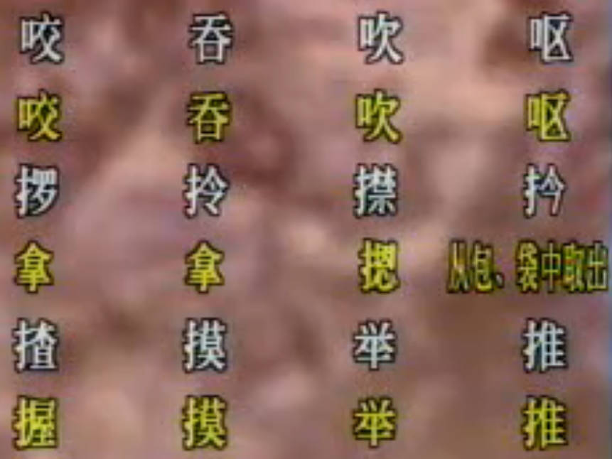 | 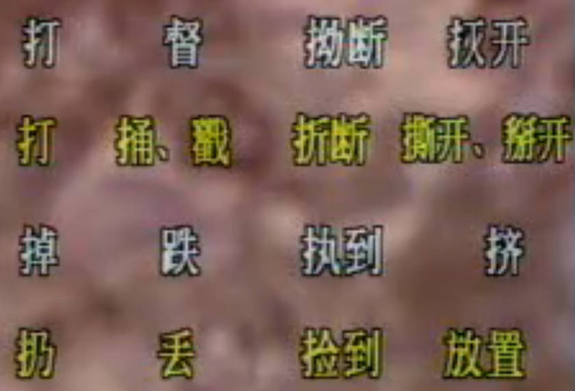 |
| --------------------------------------------------- | --------------------------------------------------- |
| 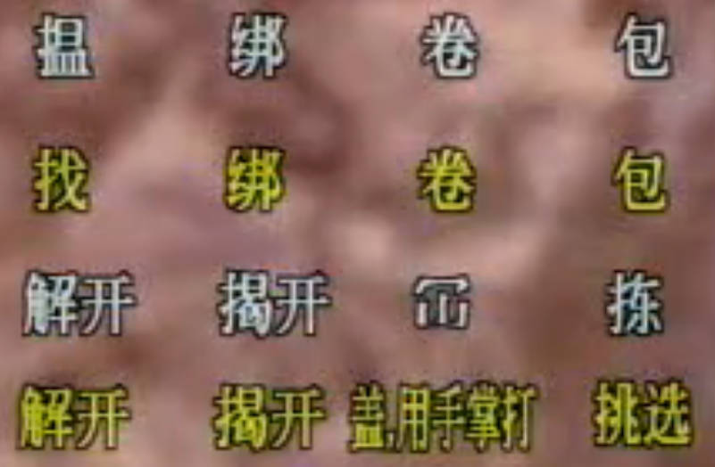 | 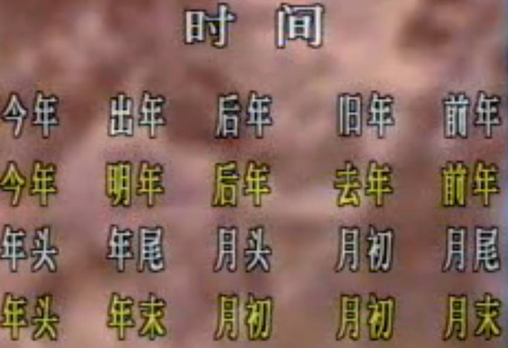 |
| 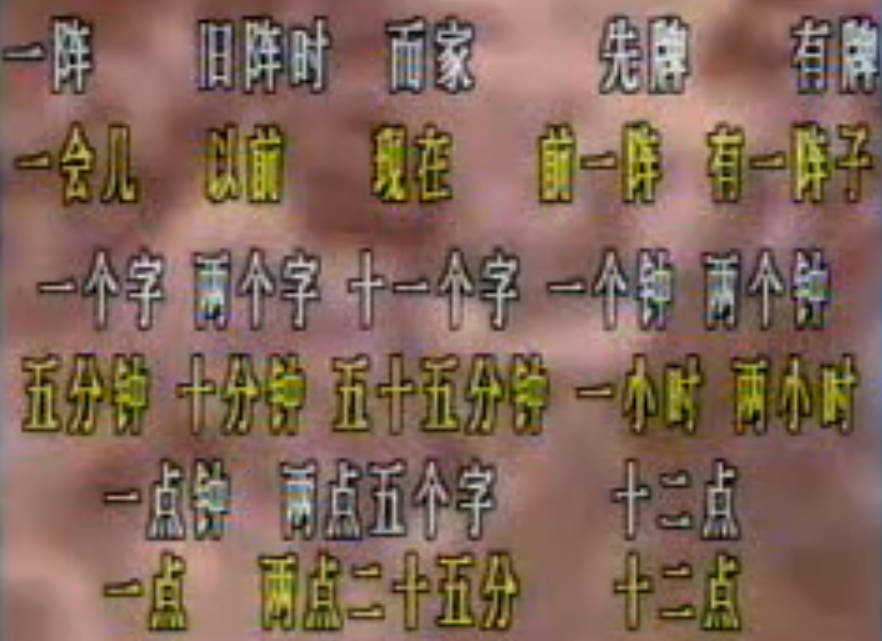 | 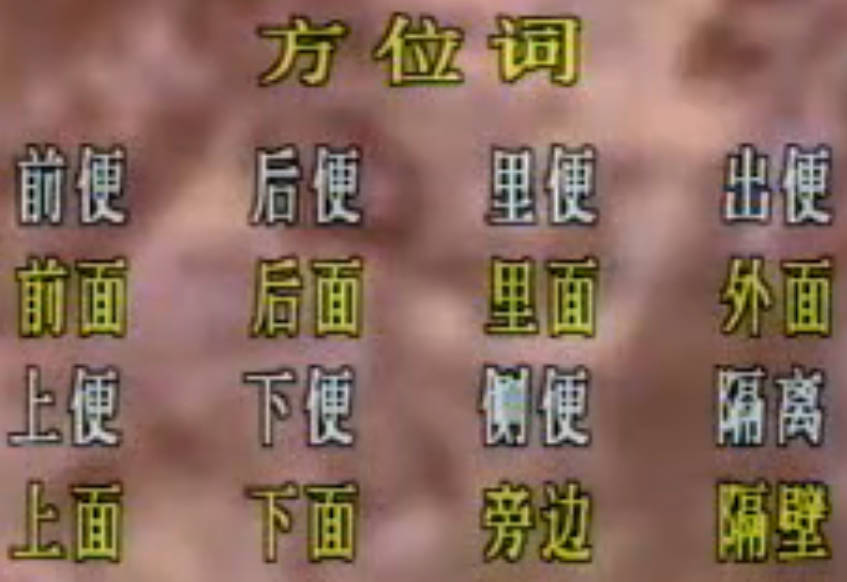 |
| 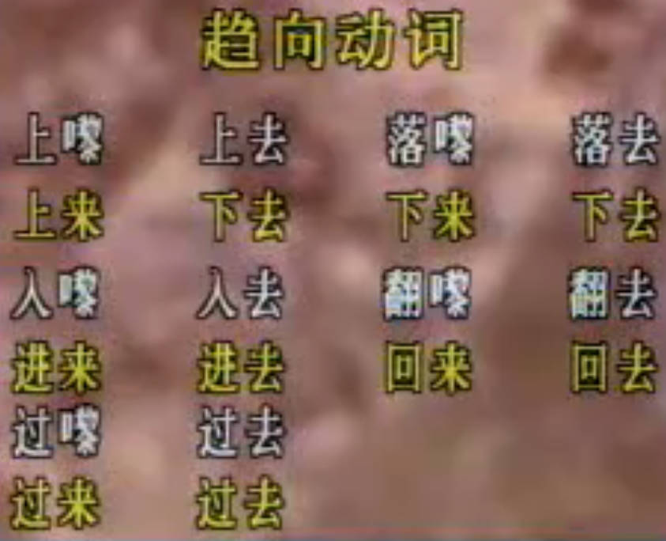 | 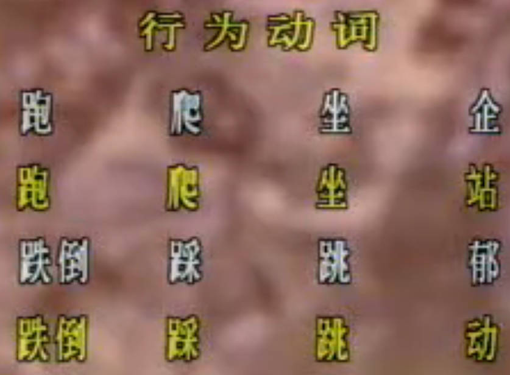 |
| 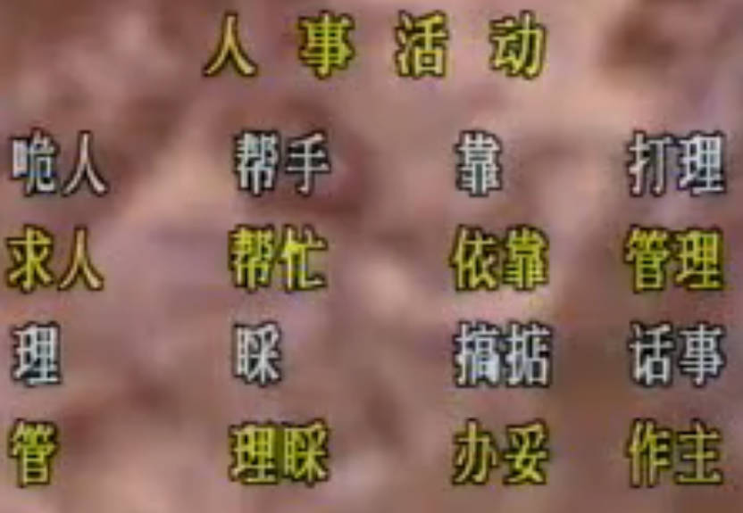 | 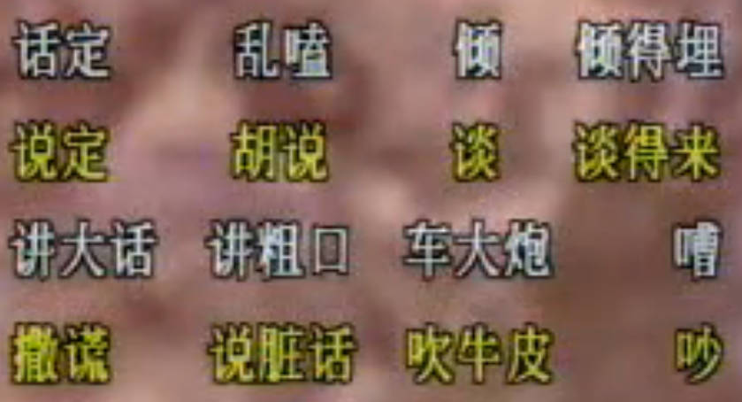 |
| 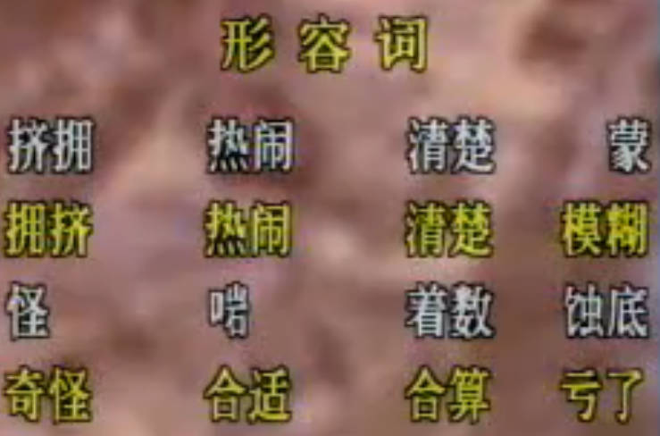 | 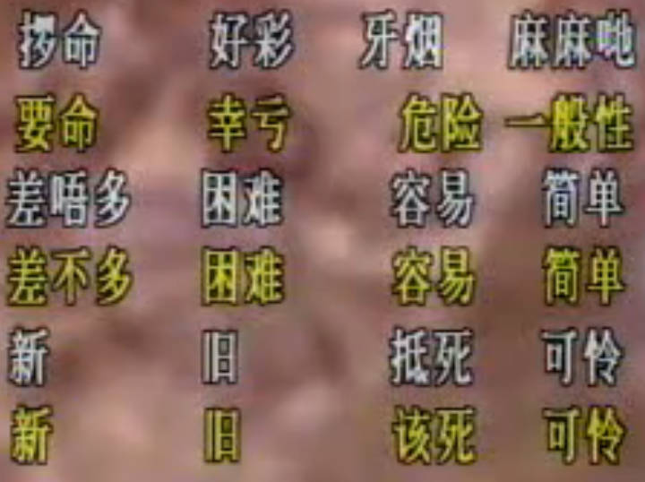 |

### 会话

# 九声六调

[好：九声六调哪九声、哪六调？](https://mp.weixin.qq.com/s?__biz=MjM5NzQwODg4MA==&mid=2652920666&idx=1&sn=b5e5e7828bec3463f1449e45ee6f83b8&poc_token=HOj7zmqjqejLHIBy5k2VdOaZ32Ol2V-c8fED693d)    [廣州話自學教材](https://www.eduhk.hk/cle2/cantonese_selfstudy/cheapter2.htm)  [声调、调值、调型，五度标记法识声调](https://tieba.baidu.com/p/7273313241)  [粤语九声六调](https://baijiahao.baidu.com/s?id=1873758340692003973&wfr=spider&for=pc)  [九声六调](https://baijiahao.baidu.com/s?id=1834140644518469954&wfr=spider&for=pc)  [九声六调](https://www.zhihu.com/question/42204386)  

视频： [粤拼](https://www.bilibili.com/video/BV1RA4m1g7fE/?vd_source=7346303e5e18677d7261c2c0c109ecfd)  [九声六调](https://www.bilibili.com/video/BV1kL4y1a7PD/?vd_source=7346303e5e18677d7261c2c0c109ecfd)  [粵語的九聲六調](https://www.bilibili.com/video/BV12h411b7oB/?vd_source=7346303e5e18677d7261c2c0c109ecfd)  [九声六调](https://www.bilibili.com/video/BV1ar4y1S7of/?vd_source=7346303e5e18677d7261c2c0c109ecfd)  

[粤语拼音](https://www.bilibili.com/video/BV1iz411v7cn/?spm_id_from=333.788.recommend_more_video.9&trackid=web_related_0.router-related-2589621-dpmnd.1791958222735.30&vd_source=7346303e5e18677d7261c2c0c109ecfd)   [粤语九声六调｜老师私藏定调法](https://www.bilibili.com/video/BV1JPwyzjEZA/?vd_source=7346303e5e18677d7261c2c0c109ecfd)  [声母韻母声调](https://www.bilibili.com/video/BV1aY4y1z76a/?spm_id_from=333.788.recommend_more_video.13&trackid=web_related_0.router-related-2589621-qhxck.1791958316708.851&vd_source=7346303e5e18677d7261c2c0c109ecfd) [粤语发音](https://www.bilibili.com/video/BV1zPLbzTE2T/?vd_source=7346303e5e18677d7261c2c0c109ecfd) [粤拼](https://www.bilibili.com/video/BV1RA4m1g7fE/?vd_source=7346303e5e18677d7261c2c0c109ecfd)    [粤拼](https://www.bilibili.com/video/BV1xp4y1r7HY/?vd_source=7346303e5e18677d7261c2c0c109ecfd&p=2&spm_id_from=333.788.videopod.episodes)  [粤拼韵母](https://www.bilibili.com/video/BV1VG4y1T7cm/?vd_source=7346303e5e18677d7261c2c0c109ecfd)  

md: [粤语发音](.\粤语发音)

杂： [九声六调](https://www.zhihu.com/pin/2050707341134258335)  

> 对比粤语九声六调与普通话四声的异同

6个舒声调、3个入声调

### 六调

共有九个调类，但实际音高只有六种

- 九声：阴平、阴上、阴去、==阳平、阳上、阳去==、阴入、中入、阳入。
- 六调：因为阴入、中入、阳入的音高分别与阴平、阴去、阳去相同，只是发音短促并以 -p、-t、-k 结尾，所以可听辨的调值只有六种。

常见例字可帮助区分：诗、史、试、时、市、事对应六种音高，色、锡、白等入声字短促收尾。粤语声调丰富，因此诵读古诗词或唱粤语歌时往往更有抑扬顿挫的音乐感。

---

==调号==只是每个调的编号，本身并不表示音高高低。而要真正看清楚每个调的高低关系，就要用到调值

==调值==就是指声音在音高上的具体位置**。**记录汉语调值，通常会采用语言学家赵元任发明的“五度标记法”。它将声调从最低的1度到最高的5度，分为5个等级，每个声调都可以在这个五线谱上面，直观地体现出它的相对音高

==调型==是指声调的高低、升降、曲直、长短变化类型

| 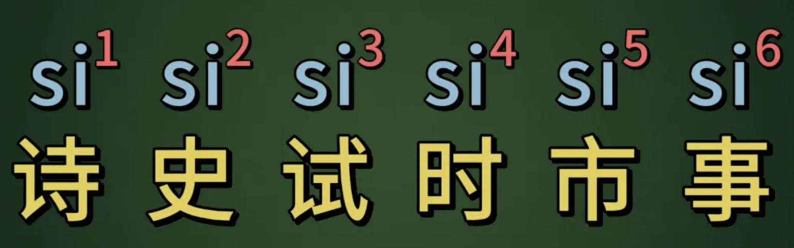 | 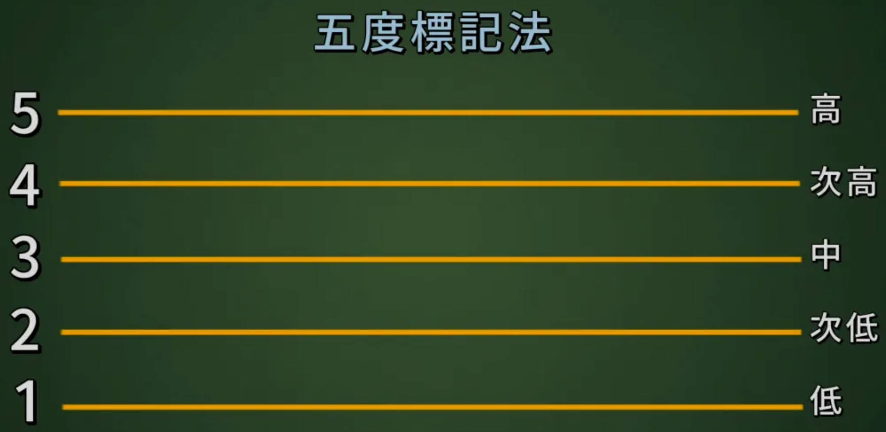 |
| --------------------------------------------------- | --------------------------------------------------- |
| 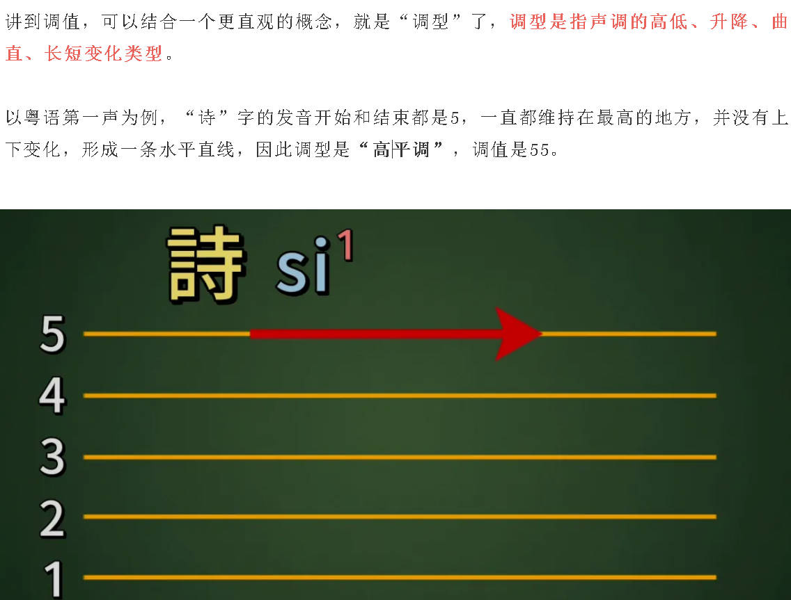 | 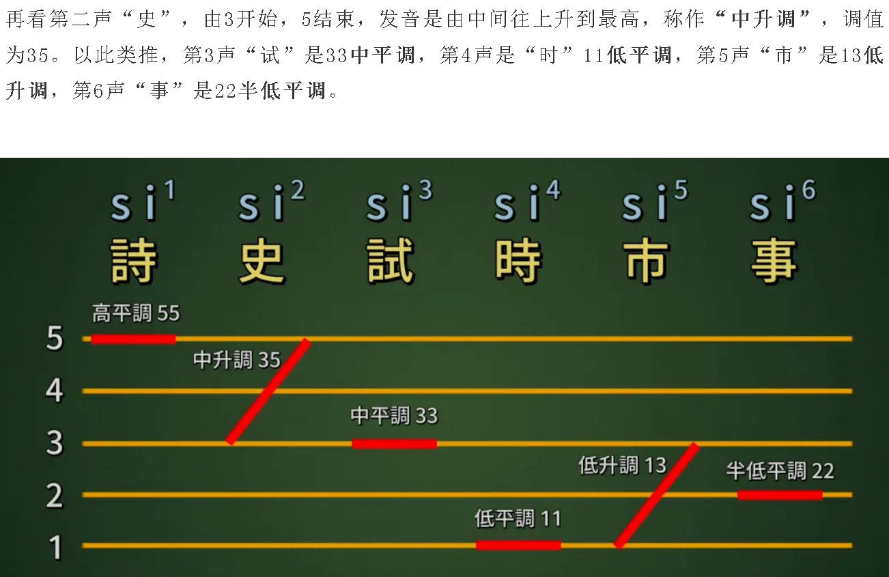 |
| 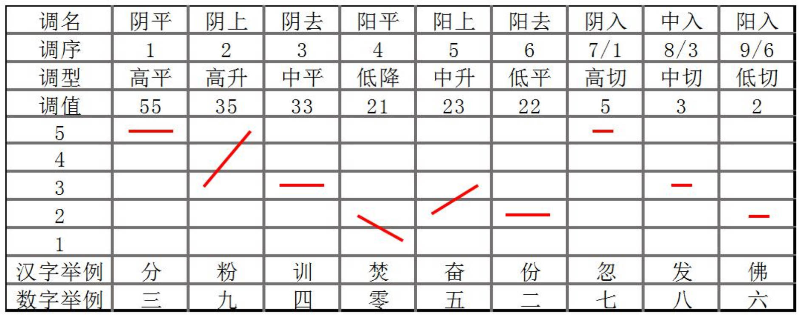 |                                                |

### 九声

除了六调，**粤语还完整保留了中古汉语的三个入声调**，特点是“短、促、急、收、藏”，句尾收在k、p、t、这3个塞音韵尾上，比如“色”、“摄”、“舌”，就像“关水龙头”的一瞬间，嘴巴的气流被完全堵住，并不发声，听起来有一种顿挫感。

- 因为这3个入声，虽然发音方式不同，但它们在音高上，分别和第1声、第3声、第6声是对应的。所以大多数的粤语拼音方案，入声通常直接标为1、3、6，通过看韵尾的字母是不是==k、p、t==来区分。而教育学院拼音方案，就把它们单独编号为第 7、第 8、第 9 声了。

我们经常听到的**“阴平阳平阴上阳上”**等说法，其实讲的是调类。

- **调类是将调值、调型相同的音高变化形式归为一类，沿用传统音韵学的术语来命名**，源头可以追溯到中古汉语的**“平、上、去、入”**四声，再根据清音浊音的分化，细分为**阴、阳**两类

古人习惯用“阴”“阳”概念来分类事物，在现代粤语里，大致可以理解为：**阴类声调整体偏高，阳类声调整体偏低**，但要注意，这是一种语音演变后的结果，而不是一开始就单纯按高低来命名的。

所以，从传统音韵学的角度看，粤语可以分成九个发声类别；而从现代语言学的分析来看，粤语在音高变化上只有六种。把这两种看法合在一齐讲，就形成了我们常说的**“九声六调”**了。

| 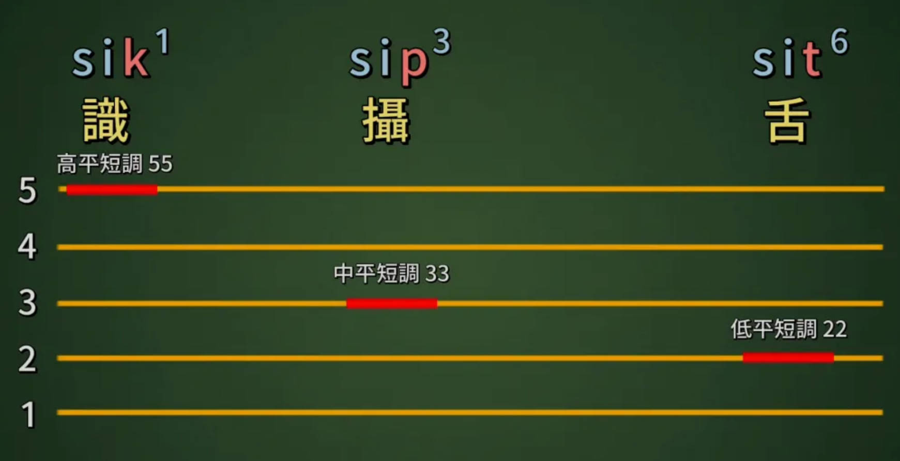 | 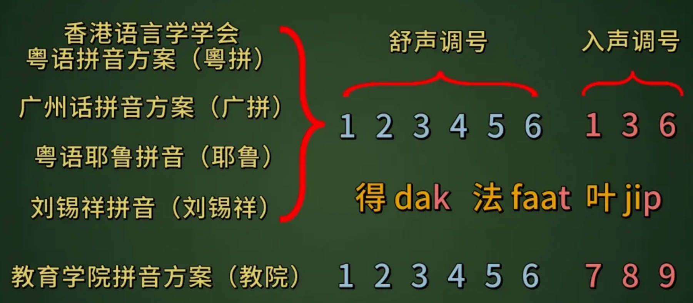 |
| --------------------------------------------------- | --------------------------------------------------- |
| 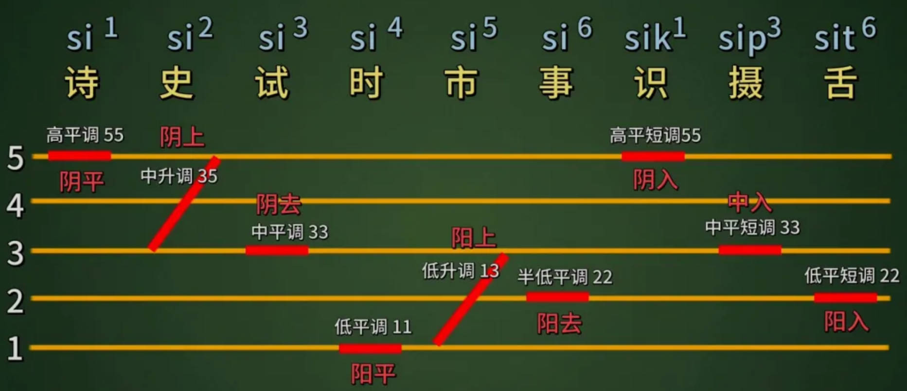 |                                                |

**补充**

- 阴平第一声在某些情况下，会出现从高位往下降的读法，这种调型叫作“高降调”，调值是 53，它并不是新的声调，而是第一声的常见变体
- 粤语第四声在理论上通常写成11，但在实际说话时，其实很难长时间保持这么低的音，往往是更接近 21，所以也可以写成21
- 九声六调，惯常用来举例的字，除了刚才讲到的“诗、史、试，时，市，事，色，摄，舌”，还有“分，粉，瞓，焚，愤，份，忽，发，佛”。但这2个版本都未免过于沉闷难记
  - 为了方便分辨粤语声调，有人就编写了一些朗朗上口的口诀。例如：“三碗半牛腩面一百碟”，“三九四零五二一八六”，“猪狗兔牛马象畜雀鹤”，“轻走过田野路不吃力”等等
  - 这类口诀，就是把九个声调编成一句易读易记的话。只要读一次，就能感受到声调**由高到低、由平到促**的变化。口诀最大的作用，并不是死记每一个字对应第几声，而是帮助耳朵建立一种“对比感”。哪怕记不住理论，靠多读几次，也能慢慢找到感觉

| 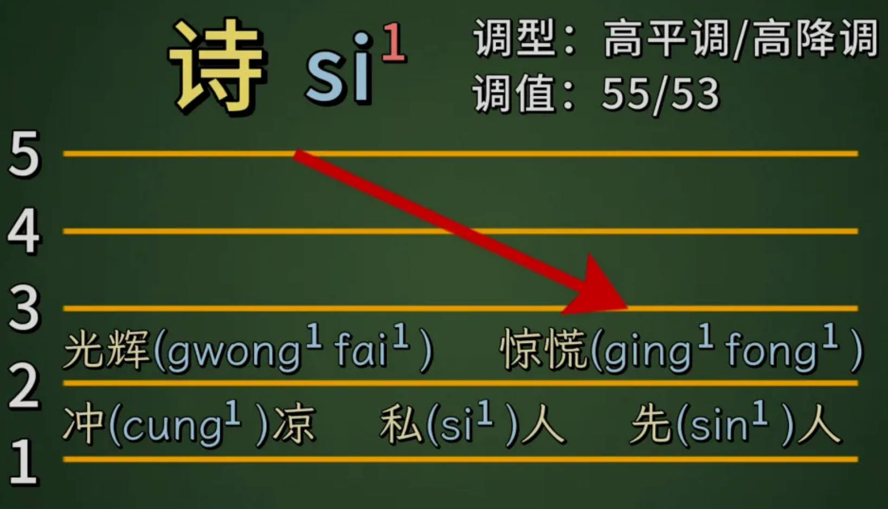 | 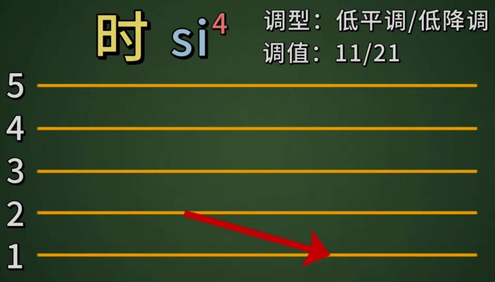 |
| --------------------------------------------------- | --------------------------------------------------- |
| 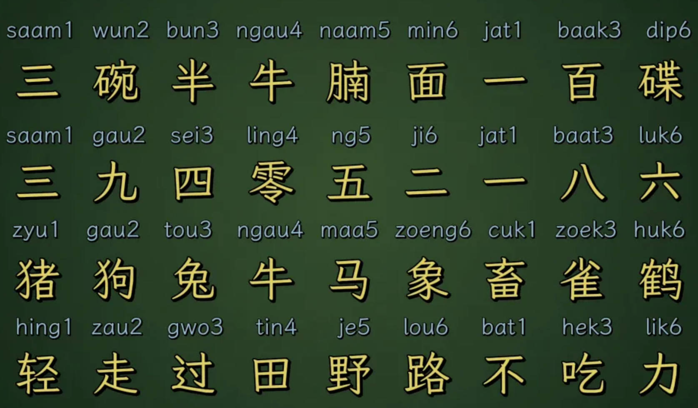 |                                                |

### 生母韵母

[好：廣東話拼音](https://www.cantoneseinput.com/) [粤语拼音介绍](https://zhuanlan.zhihu.com/p/1911526516833130115)     [粤语拼音](https://mbd.baidu.com/newspage/data/dtlandingsuper?nid=dt_5140271707519304883)  

[广州话拼音方案](https://baike.baidu.com/item/%E5%B9%BF%E5%B7%9E%E8%AF%9D%E6%8B%BC%E9%9F%B3%E6%96%B9%E6%A1%88/6158022?fr=aladdin)  

拼音方案： 粤拼、广拼  [2种](https://www.bilibili.com/video/BV1oB421675r/?vd_source=7346303e5e18677d7261c2c0c109ecfd)  

粤拼由==声母、韵腹和韵尾==组成

- 韵腹和韵尾合在一起就是==韵母==
- 有些韵腹可单独使用，其它要结合韵尾才能成为韵母

ng$\to$nia、h$\to$ha

| 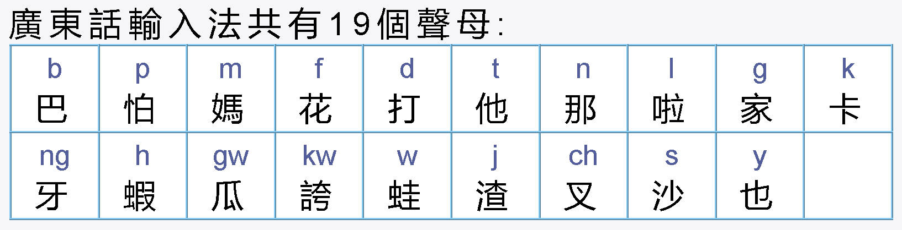 | 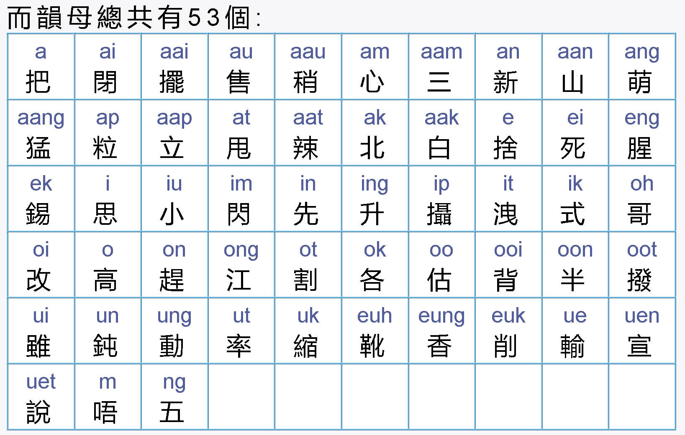 |
| --------------------------------------------------- | --------------------------------------------------- |
| 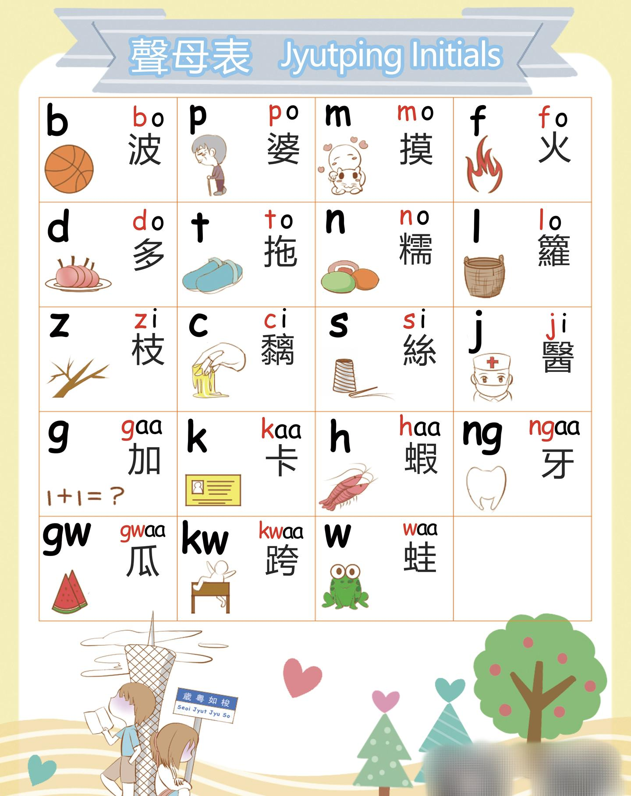                        | 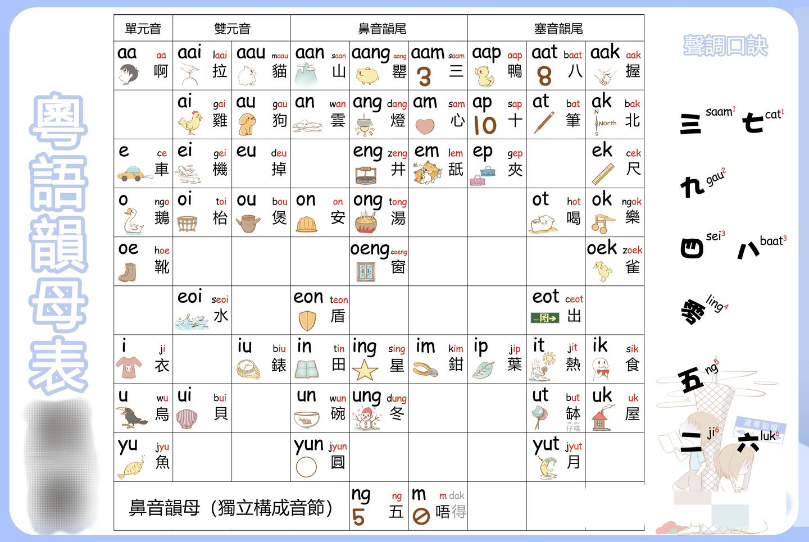                            |
| 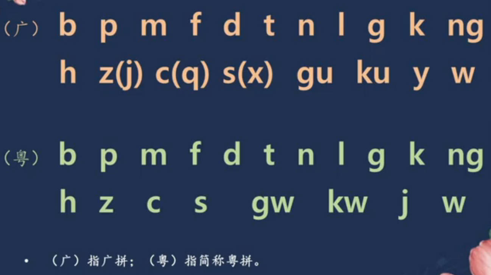 | 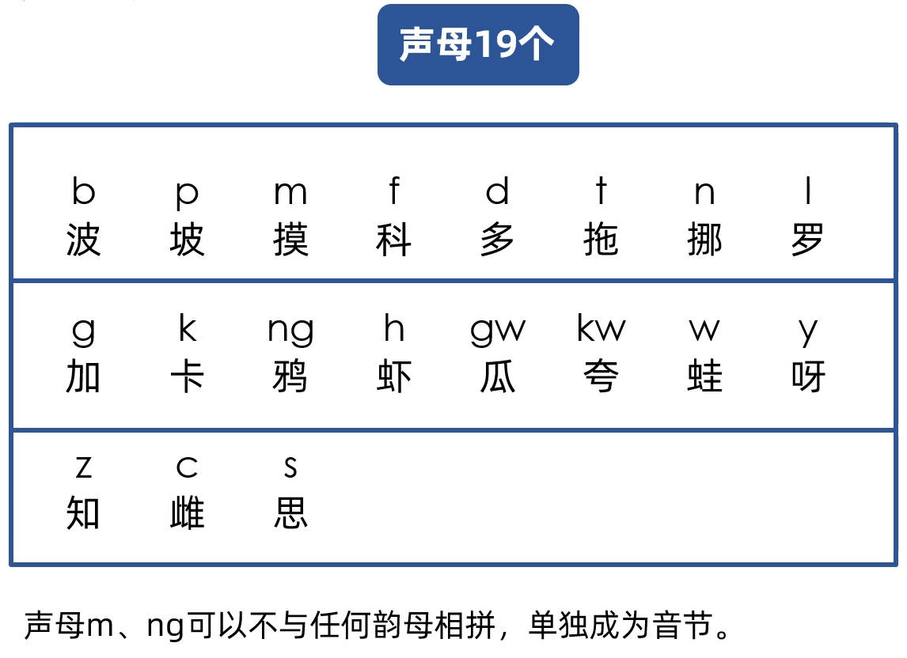 |
| 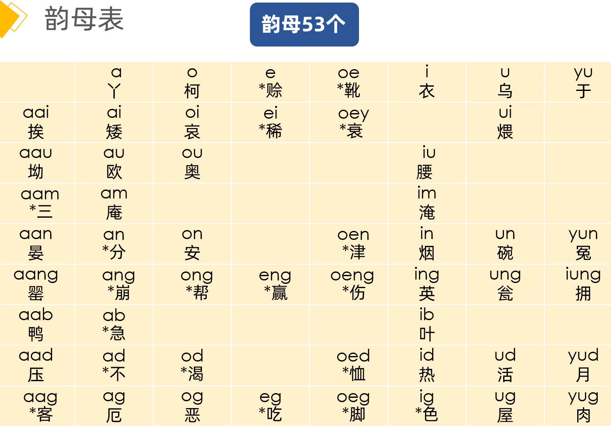 | 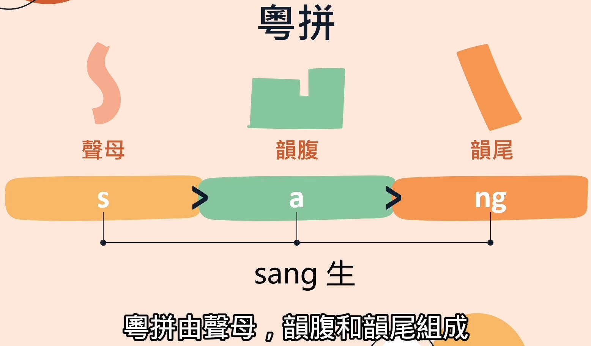 |
| 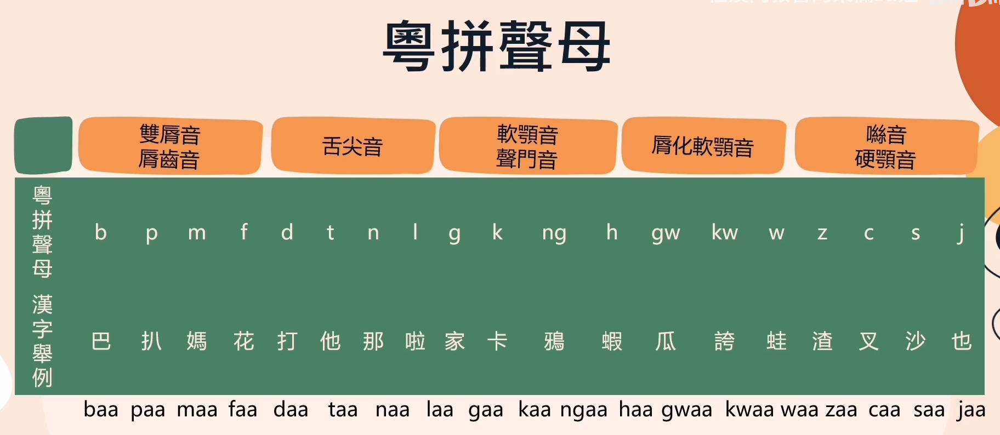 |                                                |
|                                                |                                                |

# 练习

视频：[社交对话](https://www.bilibili.com/video/BV1hZ4y1j7mq/?spm_id_from=333.788.videopod.episodes&vd_source=7346303e5e18677d7261c2c0c109ecfd&p=6)  [香港粤语教材课文](https://www.bilibili.com/video/BV16u411k7CF/?vd_source=7346303e5e18677d7261c2c0c109ecfd)  [香港粤语日常会话速成](https://www.bilibili.com/video/BV1WbD1BZEto/?vd_source=7346303e5e18677d7261c2c0c109ecfd)  [粤语教程](https://www.bilibili.com/video/BV1wx4y1R7YN/?vd_source=7346303e5e18677d7261c2c0c109ecfd)  [全职粤语老师带读粤语](https://www.bilibili.com/video/BV1B94y1y7aL/?vd_source=7346303e5e18677d7261c2c0c109ecfd)  [课文跟读](https://www.bilibili.com/video/BV1QM411W7x2/?spm_id_from=333.788.recommend_more_video.17&trackid=web_related_0.router-related-2589621-49mtn.1791963180676.283&vd_source=7346303e5e18677d7261c2c0c109ecfd)  [粤语跟读练习](https://www.bilibili.com/video/BV1ViEg6PEBg?vd_source=7346303e5e18677d7261c2c0c109ecfd&spm_id_from=333.788.videopod.sections)  [速成口语5000句](https://www.bilibili.com/video/BV1pCZ3YxEDg/?vd_source=7346303e5e18677d7261c2c0c109ecfd)  [20天流利说](https://www.bilibili.com/video/BV1nH4y1S7j5/?vd_source=7346303e5e18677d7261c2c0c109ecfd)  

​                              $\to$  $\to$  $\to$   $\to$   $\to$  $\to$  $\to$  $\to$   $\to$   $\to$  $\to$  $\to$  $\to$   $\to$   $\to$  $\to$  $\to$  $\to$   $\to$   $\to$  $\to$  $\to$ 

|  |  |
| ----- | ----- |
|  |  |
|  |  |
|  |  |

11

|  |  |
| ----- | ----- |
|  |  |
|  |  |
|  |  |

11

|  |  |
| ----- | ----- |
|  |  |
|  |  |
|  |  |

11

|  |  |
| ----- | ----- |
|  |  |
|  |  |
|  |  |

11

|  |  |
| ----- | ----- |
|  |  |
|  |  |
|  |  |

11

|  |  |
| ----- | ----- |
|  |  |
|  |  |
|  |  |

1