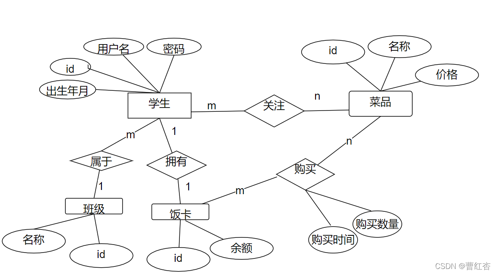
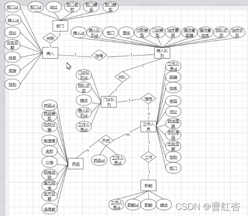

##### 一、<strong>ER图简介</strong>

[数据库设计 ER图](https://blog.csdn.net/caohongxing/article/details/122398825?utm_medium=distribute.pc_feed_404.none-task-blog-2~default~BlogCommendFromBaidu~Rate-17-122398825-blog-null.pc_404_mixedpudn&depth_1-utm_source=distribute.pc_feed_404.none-task-blog-2~default~BlogCommendFromBaidu~Rate-17-122398825-blog-null.pc_404_mixedpud)

ER图，简单来说，E是实体，实体有一组属性；R是关系。找到系统中的实体以及实体关系就可以绘制出ER图了。

例如，下图是网上找到的ER图，矩形的是实体，椭圆是属性，实体和实体之间的关系用菱形，关系也有属性，例如，学生选修课程，有成绩属性，当然如果系统需要，也可以记录选修的时间等属性信息。

认真看下，你会发现ER图理解起来还是比较容易的。

ER图中识别出实体后，找到实体之间的关系很重要。而关系可能是一对一（1:1）、一对多（1：n），多对多（m：n），关系用菱形表示，而关系的类型在菱形的两条与实体的连接线上标注，

判断两个实体的关系是，先让实体A假设为1，看它能对应实体B的个数，然后反过来，假设实体B为1个，看实体A对应的个数，就可以得到实体对应关系。

例如，

1个学生可关注多个商品，而1个商品可被多个学生关注，所以学生和商品的关系是多对多；

1个学生属于1个班级，而1个班级可以有多个学生，所以班级和学生的关系是一对多；

1个学生拥有1张饭卡，而1张饭卡只属于1个学生。所以学生和饭卡的关系是一对一

<strong>二、ER图绘制常见问题</strong>
但是真的落实到自己绘制，很多同学就会遇到困难。下面我们通过反例来学习ER图

1、 反例1  区分功能和关系
例如，管理员可以管理用户。但是如果系统不记录哪个管理员可以管理哪些用户，那么就无需在ER图上绘制该关系。只有需要在数据库保存的关系，才需要在ER图上保存。

2、 反例2：区分程序功能和数据库数据
挂号排队信息

我个人挂号排队一般不用保存到数据库，所以无需在ER图上表示

另外，如果要显示排队信息，我认为应当是给每个用户一个id序号，程序实现排队，而不是数据库去记录这个排队信息、

<strong>三、ER图转关系模式</strong>

所有的实体应当转为一张表。所以上面的班级 学生 课程 教师都是一张表

班级表包含字段：班级号，班级名，专业，人数  主键：班级号

学生表包含字段：学号，姓名，性别，年龄 主键：学生号

课程表包含字段：课程号，课程名，课时，学分  主键：课程号

教师表包含字段：编号，姓名，职称，年龄，性别 主键：编号

根据关系是1:1  1：n   m:n 转成表

1） 对于 1:1的  可以将关系保存到任何一个实体表中，

2） 对于1：n的，可以将关系保存到n的那个实体里，例如图中的班级和学生是1对多，那么可以在学生表中增加一个班级id的字段，说明该学生是哪个班级的

学生表包含字段：学号，姓名，性别，年龄，班级ID 主键：学生号

3)、对于多对多的关系  m：n的 ，关系保存到新表中

例如，学生和课程是多对多的关系，那么吧两个表的主键拿出来，加上关系属性，组成一个表

学生成绩表： 学号 课程号 成绩  主键：学号  课程号