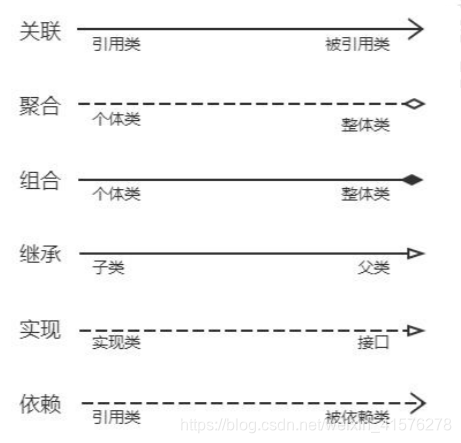

# UML

[UML类图](https://blog.csdn.net/weixin_41418480/article/details/169259112)  [Spring Boot超详细讲解请求处理流程机制](https://www.jb51.net/article/255206.htm)  [搞懂UML类图6大关系](https://blog.csdn.net/weixin_30756499/article/details/95766069)  [Spring‑Statemachine 状态机](https://www.cnblogs.com/hewei-blogs/articles/22739496)  

[SpringBoot源码解析如何判断应用类型并创建Environment](https://developer.aliyun.com/article/1462605)  [彻底搞懂Spring状态机原理](https://xie.infoq.cn/article/b5e63159488d09aa6be198094)  

[UML类图符号解读](https://blog.csdn.net/KoalaY_Doctor/article/details/50723085)  [UML基础概念](https://www.cnblogs.com/huzi007/archive/2013/05/16/3080995.html)  

## UML关系

[UML类图及各种线代表的关系含义总结 ](https://www.cnblogs.com/bruce1992/p/18008359)  [UML类图关系及连接线](https://blog.csdn.net/MrHHHHHH/article/details/143725786)  [UML 图_用例图](https://uzong.blog.csdn.net/article/details/156810305)  [UML中的四种关系](https://cloud.tencent.com/developer/article/1783946)  [UML类图](https://zhuanlan.zhihu.com/p/267298708)  

[UML类图符号和关系](https://cloud.tencent.com/developer/article/2258493)  [UML类图中的六种线条与六种关系](https://www.cnblogs.com/kgtone/p/10357880.html)  

[UML类图六大关系详解](https://blog.csdn.net/weixin_31155097/article/details/169871121)  

UML类图里常见的六种关系线，核心口诀是：三角指向父类/接口，菱形贴着整体，虚线临时、实线长久。下面从松到紧逐个说清。

### 六种关系线速查

1. 依赖（Dependency）：虚线 + 普通箭头，箭头指向被依赖的类。表示临时“用一下”，如方法参数、局部变量、静态调用。最弱的关系。
2. 关联（Association）：实线（可加普通箭头），箭头指向被持有方。表示长期“认识”，通常对应成员变量，如学生有课程。
3. 聚合（Aggregation）：实线 + 空心菱形，菱形在整体这一端。表示“整体-部分”但部分能独立活，如班级和学生，学生转学后还是学生。
4. 组合（Composition）：实线 + 实心菱形，菱形在整体这一端。表示“同生共死”，整体没了部分也没意义，如订单和订单项、人和心脏。
5. 泛化（Generalization）：实线 + 空心三角，三角指向父类。即继承，子类是父类的一种，用 `extends`。
6. 实现（Realization）：虚线 + 空心三角，三角指向接口。类实现接口契约，用 `implements`。

### 容易混淆的三组

- 继承 vs 实现：都是空心三角，区别在线型——继承是实线（类到类），实现是虚线（类到接口）。
- 聚合 vs 组合：都是菱形，区别在实心与否——空心表示部分可独立存在，实心表示生命周期绑定。
- 关联 vs 依赖：关联是实线、长期持有（成员变量），依赖是虚线、临时使用（方法参数）。

> 判断口诀：三角指向父类，菱形贴着整体，虚线是临时关系，实线是长久关系。

### 代码特征对照

| 关系 | 代码特征           | 线型          |
| ---- | ------------------ | ------------- |
| 泛化 | `extends` 类       | 实线+空心三角 |
| 实现 | `implements` 接口  | 虚线+空心三角 |
| 依赖 | 方法参数/局部变量  | 虚线+箭头     |
| 关联 | 成员变量           | 实线+箭头     |
| 聚合 | 成员变量，外部传入 | 实线+空心菱形 |
| 组合 | 成员变量，内部new  | 实线+实心菱形 |

关系强弱排序大致为：泛化 = 实现 > 组合 > 聚合 > 关联 > 依赖。设计时在满足需求前提下，尽量选耦合最弱的关系。

六种关系线的代码特征对照表已经列清楚了，要不要直接整成六种关系线对照表或者六种关系线代码特征对照表

|  |  |
| ------------------------ | ----- |
|                     |  |
|                     |  |
|                     |  |

