[清华大学电路](https://www.bilibili.com/video/BV1R7411q759?p=6) [原理](https://www.bilibili.com/video/BV1cx411V7CQ?p=2) [电路分类](https://www.bilibili.com/video/BV1cx411V7CQ?p=2) [1](https://www.bilibili.com/video/BV1ft411H7cG?p=39) [2](https://www.bilibili.com/video/BV1cx411V7CQ?p=3) [学堂](https://www.xuetangx.com/learn/THU08061000294/THU08061000294/5882652/video/9137744) [大图](https://www.easyzoom.com/imageaccess/6f1677d1a83948d5a8f519d07610b8a8)

[微波平面电路](https://zhidao.baidu.com/question/556053922013786812.html) [电磁理论及计算电磁学概述](https://www.docin.com/p-2503115183.html)

md： [电路基本概念](.\电路基本概念)   [安全用电](.\安全用电)  [无源元件](.\无源元件) [有源元件](.\有源元件)  [动态电路](.\动态电路)

视频： [清华大学-电子技术基础（数电+模电+实验）](https://www.bilibili.com/video/BV1XE411X7qU/?vd_source=7346303e5e18677d7261c2c0c109ecfd)  [清华](https://www.bilibili.com/video/BV1bc411W7e9/?vd_source=7346303e5e18677d7261c2c0c109ecfd)  

# 电路基本概念与基本定律

[均匀传输线](https://www.baidu.com/s?ie=UTF-8&wd=%E5%9D%87%E5%8C%80%E4%BC%A0%E8%BE%93%E7%BA%BF)  [磁路](https://www.baidu.com/s?ie=UTF-8&wd=%E7%A3%81%E8%B7%AF)  

| 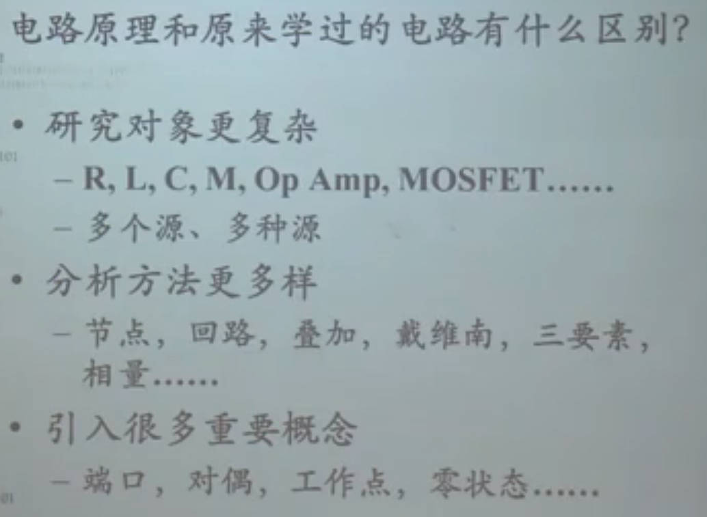 | 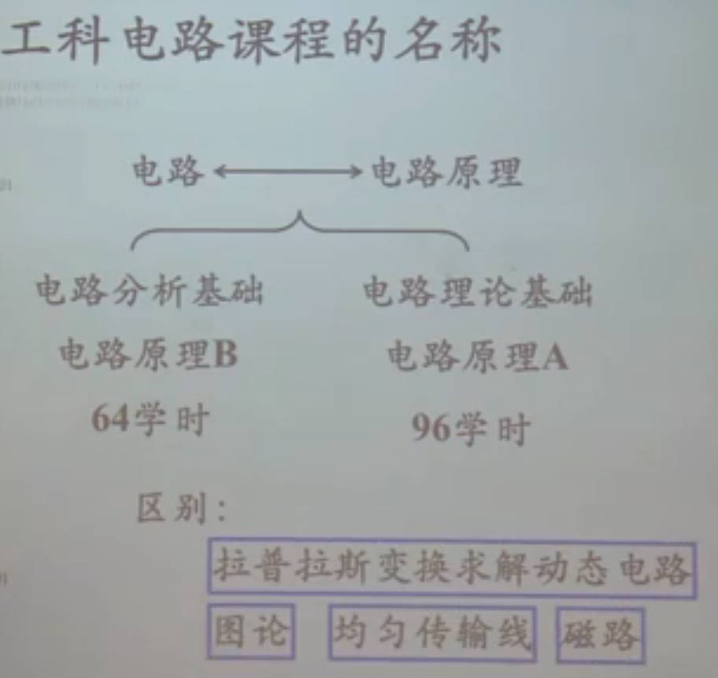 |
| ------------------------------------------------------- | ------------------------------------------------------- |
| 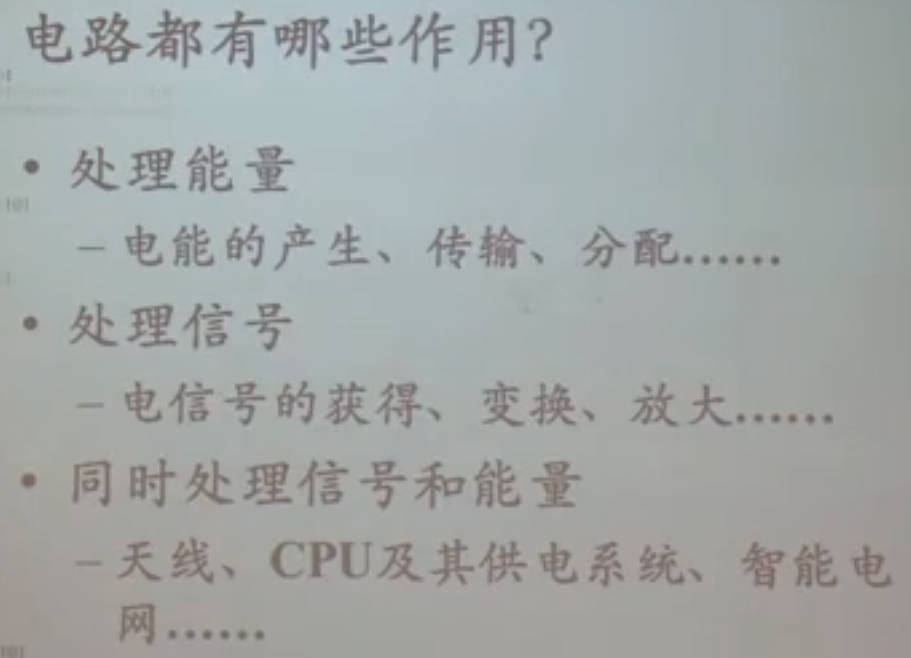 | 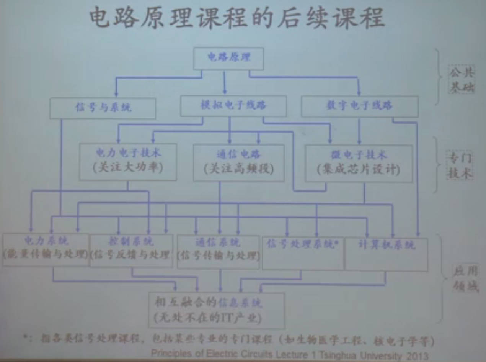 |
| 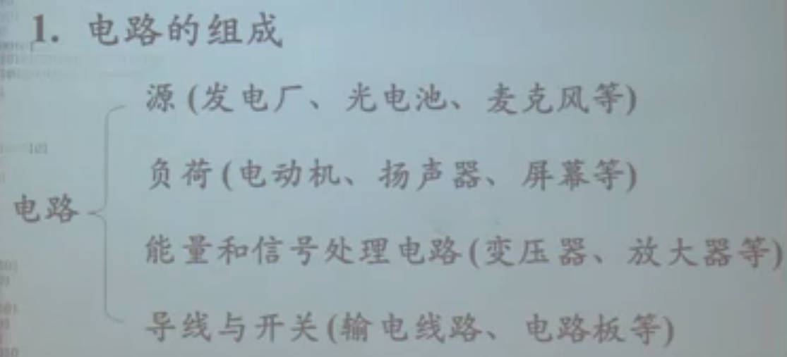 | 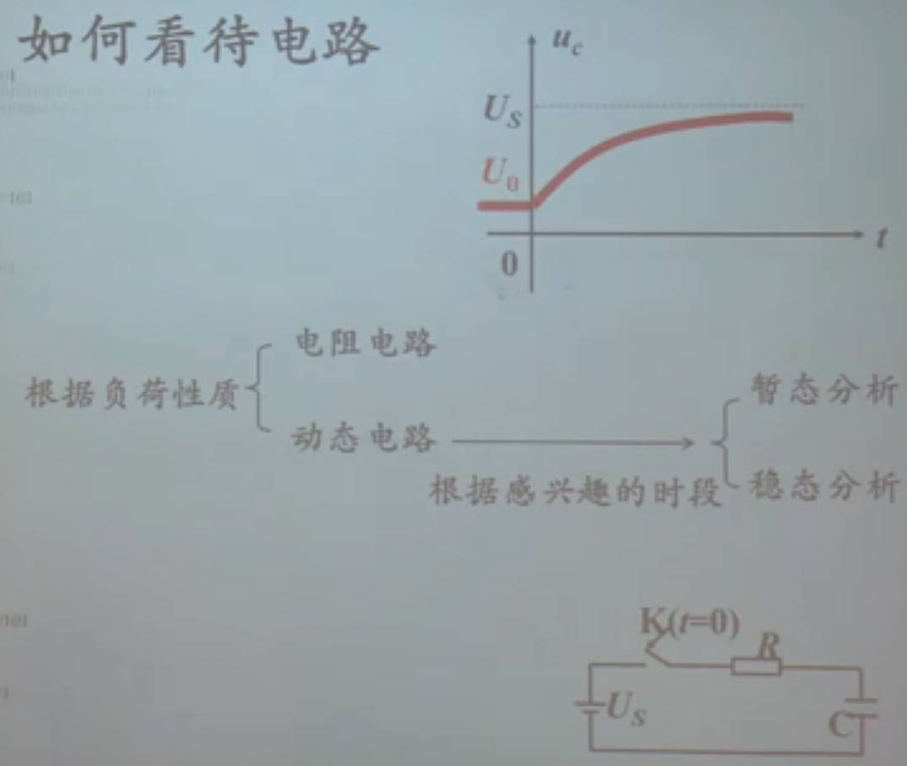 |
|                                                    |                                                    |

## 电路模型

[电路模型化_百度搜索](https://www.baidu.com/s?ie=utf-8&f=8&rsv_bp=1&tn=baidu&wd=%E7%94%B5%E8%B7%AF%E6%A8%A1%E5%9E%8B%E5%8C%96&oq=%25E5%258A%259F%25E7%258E%2587%25E6%2580%25A7%25E8%25B4%25A8%25E5%2588%25A4%25E6%2596%25AD&rsv_pq=a929f37d00116699&rsv_t=2c5abN1nbJy9M%2BMElNqYFl49X7FPa34BQCZ6lr7rRlKkGQkncH0hEFl9gBI&rqlang=cn&rsv_enter=1&rsv_dl=tb_enter&rsv_sug3=15&rsv_sug1=1&rsv_sug7=100&rsv_btype=t&inputT=3373&rsv_sug4=3374)  

| 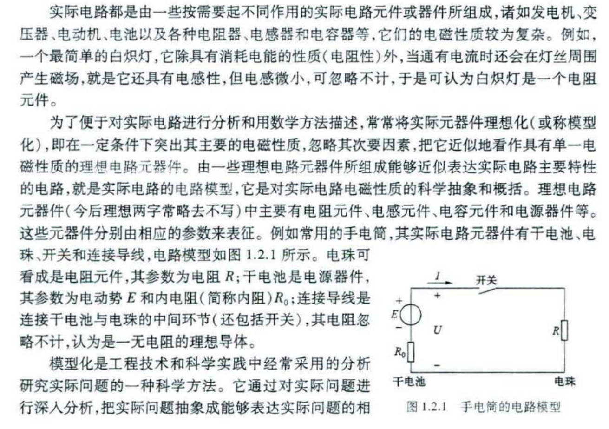 | 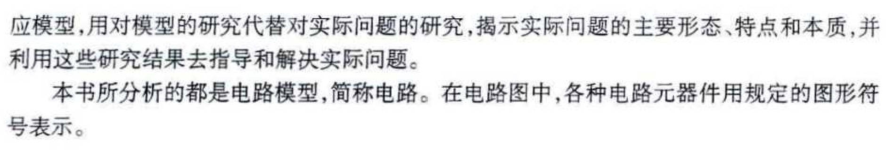 |
| ------------------------------------------------------- | ------------------------------------------------------- |

## 电路电流电压及参考方向

[电压电位是静电力做功,电动势是非静电力做功_百度搜索](https://www.baidu.com/s?ie=UTF-8&wd=%E7%94%B5%E5%8E%8B%E7%94%B5%E4%BD%8D%E6%98%AF%E9%9D%99%E7%94%B5%E5%8A%9B%E5%81%9A%E5%8A%9F%EF%BC%8C%E7%94%B5%E5%8A%A8%E5%8A%BF%E6%98%AF%E9%9D%9E%E9%9D%99%E7%94%B5%E5%8A%9B%E5%81%9A%E5%8A%9F) 

设在时间$dt$内通过导体某一横截面的电荷量的代数和为$dq$， 则
$$
i=\dfrac{dq}{dt}
$$

- 即电流等于`通过该横截面的电荷量`的代数和`对时间的变化率`

电流的参考方向用==箭头==或==双下标==表示

- 分析电路时，常任选一方向作为电流参考方向，当参考方向与实际方向一致，则电流为正
- 参考方向选定后，电流才有正负之分

电压方向

- 元件电压的实际方向难以判断，因此电压也假定一个`参考方向`或正方向
- 电压参考方向用`箭头`、`双下标`或`极性`表示
- 参考方向假定后，计算的电压U如果为正，说明电压实际方向与参考方向相同

> 电位和电压计算公式： 两者定义式都是“功与电荷量的比值”，但一个描述“==某点相对参考点==”，一个描述“==两点之间的差值==”

1. 电位: 电荷在电场中某一点相对于参考点的电位(势)能 $W_a$ 与其所带的电荷量 $q$ 之比，称为该点的电位(或电势)，用字母 $V_a$ 表示，即
   $$
   \Large V_a=\dfrac{W_a}{q}
   $$
   $V_a$ 在数值上等于==单位正电荷在电场中的该点相对于参考点所具有的电位(势)能==，也可以理解为电场力将单位正电荷从该点沿任意路径移动到参考点所做的功

   电荷q在电场中某点a处的==电位能$W_a$==，在量值上等于电场力把q从a处移到无穷远点所做的功（即电位能的改变量）
   
2. 电压： 电路中任意两点之间的电位(势)之差，是衡量电场力对电荷做功能力的物理量
   $$
   \Large u_{ab}=V_a-V_b=\dfrac{d_{w_{ab}}}{d_q}
   $$
   电压在数值上等于==电场力将正电荷从 $a$ 点移动到 $b$ 点做的功 $d_{w_{ab}}$ 与电荷量 $d_q$ 的比值==

   ==电压本质是电场力对单位电荷所做的功==，即电场力做功的本领，而非“做功”本身。

   电路中某点的电位与参考点的选取位置有关，其值是相对的； 电压是两点之间的电位差，与参考点选取无关，其值是绝对的

   电压参考方向用==箭头、双下标==或==极性==表示

3. ==电动势 $E$== ： 衡量电源内部非静电力(电源力)对电荷做功能力

> 电功与电功率

- 电流通过某种方式将电能转换为其他形式能量的过程中所做的功
- 功率： 描述做功快慢
  - 电功率: 电流在单位时间内所做的功
  - $P=\dfrac{W}{t}=\dfrac{UQ}{t}=\dfrac{UIt}{t}=UI$
- 电功
  - 电功是电流所做的功，本质是==电能转化为其他形式能量的过程==中所做的功，计算核心公式为 $W=UIt$
  - **电压不做功**。做功需要“力”和“在力的方向上移动的物体”，电压既不是力，也不是被移动的对象
- ==功率性质的判断==：因为u、i有正负，功率也有正负
  - u、i为关联参考方向
    - $p=ui>0$，元件吸收功率； $p=ui<0$，元件发出功率

  - u、i为非关联参考方向
    - $p=ui>0$，元件发出功率； $p=ui<0$，元件吸收功率

  - 只需判断实际电流是从高电位流向低电位，还是低电位到高电位，即可判断元件是吸收功率还是发出功率
    - 高电位流向低电位，正电荷失去能量，说明元件吸收功率
    - 低到高，正电荷获得能量，说明元件发出功率
  

| 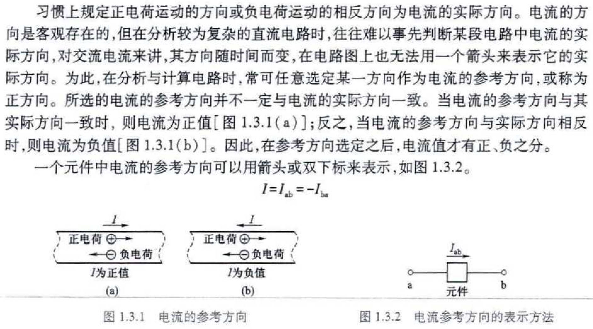 | 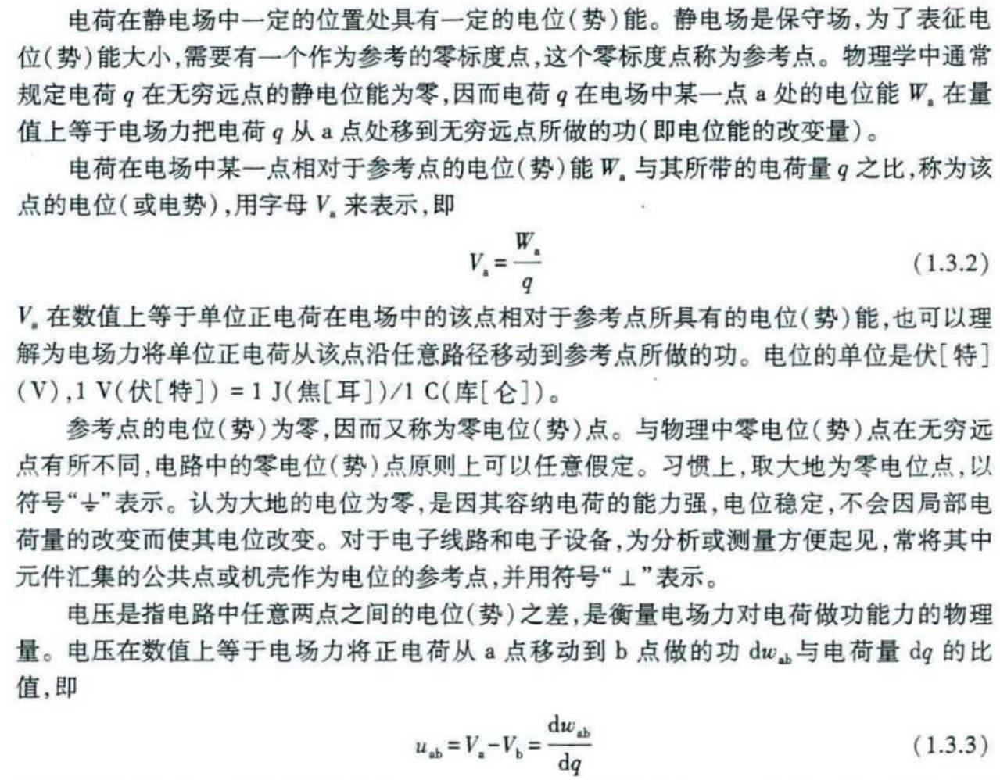 |
| ------------------------------------------------------- | ------------------------------------------------------- |
|  | 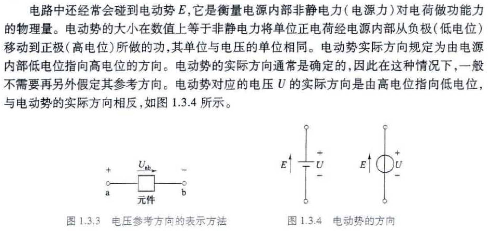 |
| 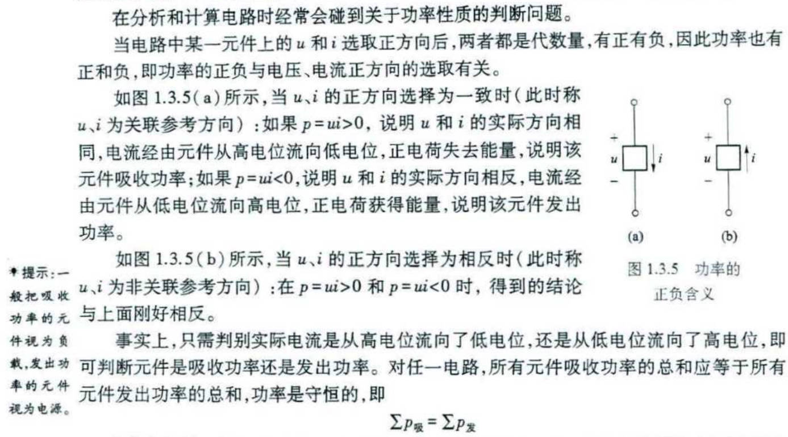 | 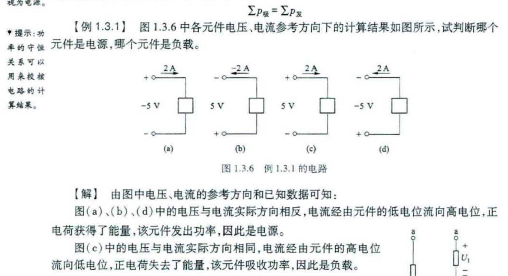 |

## 电路基本元件

md： [无源元件](.\无源元件)

### 无源元件

[安培定则](https://baike.baidu.com/item/%E5%AE%89%E5%9F%B9%E5%AE%9A%E5%88%99/10784798)  [楞次定律](https://www.baidu.com/s?wd=%E6%A5%9E%E6%AC%A1%E5%AE%9A%E5%BE%8B&usm=2&ie=utf-8&oq=%E6%84%9F%E5%BA%94%E7%94%B5%E5%8A%A8%E5%8A%BF%E6%96%B9%E5%90%91&rsv_dl=re_dqa_generate&sa=re_dqa_generate)  [电感线圈感应电动势和它两端的电压等大反向](https://www.zhihu.com/question/34317934/answer/3108580756)  [电动势与反电动势](https://www.elecfans.com/article/dianqi/2019/201908211056420.html)  [感应电动势的参考方向与电压的参考方向](https://www.baidu.com/s?ie=utf-8&f=8&rsv_bp=1&tn=baidu&wd=%E6%84%9F%E5%BA%94%E7%94%B5%E5%8A%A8%E5%8A%BF%E7%9A%84%E5%8F%82%E8%80%83%E6%96%B9%E5%90%91%E4%B8%8E%E7%94%B5%E5%8E%8B%E7%9A%84%E5%8F%82%E8%80%83%E6%96%B9%E5%90%91%E7%9B%B8%E5%8F%8D&oq=%25E6%2584%259F%25E5%25BA%2594%25E7%2594%25B5%25E5%258A%25A8%25E5%258A%25BF%25E7%259A%2584%25E5%258F%2582%25E8%2580%2583%25E6%2596%25B9%25E5%2590%2591%25E4%25B8%258E%25E7%2594%25B5%25E6%25B5%2581%25E7%259A%2584%25E5%258F%2582%25E8%2580%2583%25E6%2596%25B9%25E5%2590%2591%25E4%25B8%2580%25E8%2587%25B4&rsv_pq=ab8754a5000bb611&rsv_t=7260ID6gn3%2B7Jco2pfPTao1669CyXG9CeJ%2BqSQaCutoSmO4VRuAa%2FDyi%2FA4&rqlang=cn&rsv_enter=1&rsv_dl=tb_enter&rsv_sug3=21&rsv_sug1=10&rsv_sug7=100&rsv_btype=t&inputT=9547&rsv_sug4=9547)  

正比指比值(商)一定: $y/x=k$ ;  反比指乘积一定: $xy=k$

- 电阻元件
  - 金属导体的电阻与导体尺寸(长度l、横截面积S)及导体材料的导电性能有关
    - $R=\rho \dfrac{l}{S} $
    - [电阻率](https://www.baidu.com/s?ie=UTF-8&wd=%E7%94%B5%E9%98%BB%E7%8E%87)： $\rho$ 
  - 电路计算有2套正负号
    - ==关联参考方向==： 元件的电压和电流的参考方向一致； 电流顺着电压降方向走，就是关联
    - 电流电压本身还有正负号
-  电感元件
  - 感应电动势 $e$ 大小和方向
    - $e$ 的大小等于磁通的变化率  $|e|=\left |\dfrac{d\phi}{dt}\right |$
      - 单匝线圈：$e=-\dfrac{d\phi}{dt}$
      - 多匝线圈：$e=-n\dfrac{d\phi}{dt}$，$n$ 为匝数 
      - 负号是楞次定律的数学体现，它保证感应电动势的方向总是阻碍磁通量的变化
  - 自感电动势:  ==磁通或磁链与电流 $i$ 有正比关系==， $\Psi=N\Phi=Li$
    - ==电感 $L$== :  $L=\dfrac{\Psi}{i}=\dfrac{N\Phi}{i}$
    - $e_L$: 自感电动势， $e_L=-L\dfrac{di}{dt}$
    - 自感电动势是感应电动势的一种
      - 感应电动势像“外界变化引起的电动势”；自感电动势像“自己电流变化引起的电动势”
  - 电压的方向是==电位降==低的方向，电动势方向是==电位升==高方向，故 $u+e_L=0$
    - 电感元件上电压与通过的电流的`导数关系式`： $\color{green} u=-e_L=L\dfrac{di}{dt} $
      - 当电感通过不随时间变化的恒定电流时，其上电压为0，电感元件可视为短路
    - 电感元件上电压与电流的`积分关系式`
      - 对 $ u=L\dfrac{di}{dt} $ 两边积分，得到 $\dfrac{1}{L}u=\dfrac{di}{dt} \Rightarrow\color{green}i=i_0+\dfrac{1}{L}\int_0^t u \,dt$
  - ==能量转换==问题
    - 对 $ u=L\dfrac{di}{dt} $ 两边乘以 $i$ 并积分: $\color{green} W_L=\int_0^i Li\,di=\dfrac{1}{2}Li^2$
- 电容元件: 电容器存电不需要电流穿过绝缘层，靠的是==电场储能==
  - 两块极板积累了`等量异号电荷`。虽然电荷没有穿过介质，但极板之间已经建立了**电场**，能量就储存在这个电场里
    - `电荷只在外部导线和极板上移动`，没有穿过中间绝缘层。但两块极板因为带上了异号电荷，就会相互吸引，形成稳定的电场。这个电场就是电容器的“储能状态”
    - 电池靠化学反应储存能量；电容器主要靠`电荷分离和电场`储存能量
    - 只要两块极板上分别带有正电荷和负电荷，它们之间就会存在电场
  - 极板上储集的电量q与其上电压u成正比： $\dfrac{q}{u}=C$
    - C与`极板尺寸`及其间介质的`介电常数`有关： $C=\dfrac{\varepsilon S}{d}$，S极板面积，$d$ 板间距离
    - 极板上的电荷量q或电压u发生变化，电路中就要引起电流： $\color{green}i=\dfrac{dq}{dt}=C\dfrac{du}{dt}$
      - 因此，电容两端加恒定电压时，$i=0$，电容元件可视作开路
    - $\color{green}i=\dfrac{dq}{dt}=C\dfrac{du}{dt}$ 两边==积分==，得到 $\color{green}u=u_0+\dfrac{1}{C}\int_0^t i dt$
      - 能量转换： 两边乘 $u$，并积分，得到 $\color{green}W_c=\int_0^tuidt=\int_0^uCudu=\dfrac{1}{2}Cu^2$
      - 电容上电压增高，电容充电

|  | 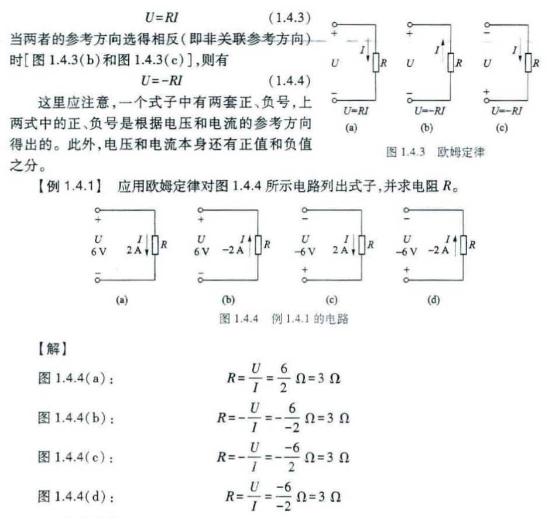 |
| ------------------------------------------------------- | ------------------------------------------------------- |
| 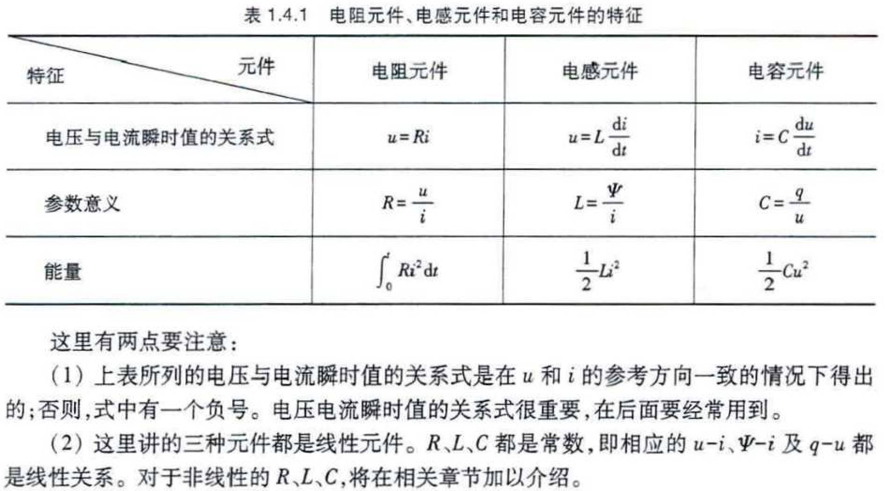 |                                                    |

### 电源元件

电源分为独立电源和受控电源

- ==独立电源==： 独立电源的参数不受电路中其它电压或电流影响，即不受外电路的控制而独立存在
  - 电压源： 理想电压源 $U_S$； 实际电压源 $U=U_S-IR_0$，内部有内阻上的压降
  - 电流源： 理想电流源 $I_S$；  实际电流源 $I=I_S-\dfrac{U}{R_0}$， 内部有内阻 $R_0$ 分流
- ==受控电源==： 电压源电压和电流源电流，受电路中其他部分的电流或电压控制，有4种理想受控电源模型
  - 电压/电流控制电压源， 电压/电流控制电流源

| 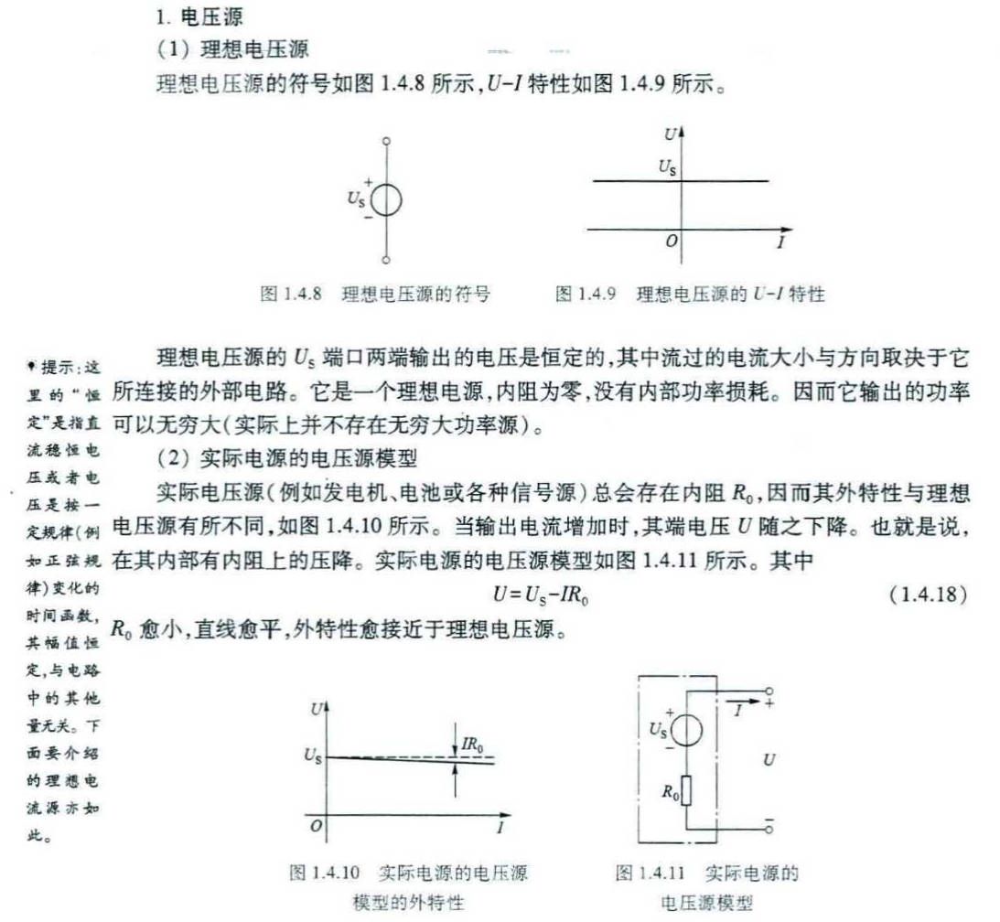 | 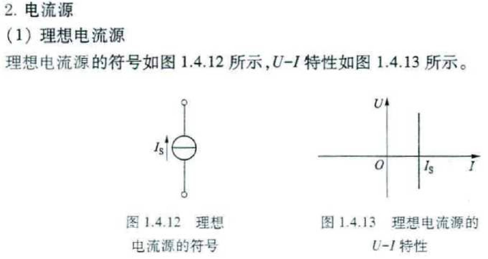 |
| ------------------------------------------------------- | ------------------------------------------------------- |
| 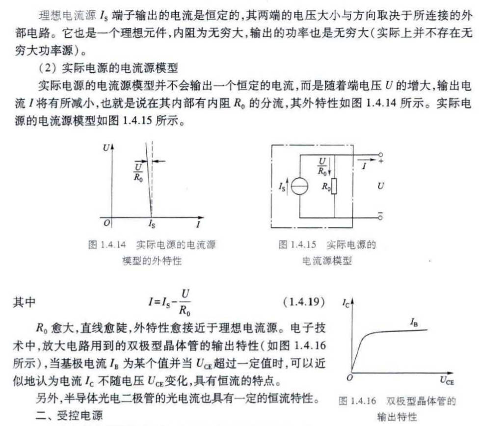 | 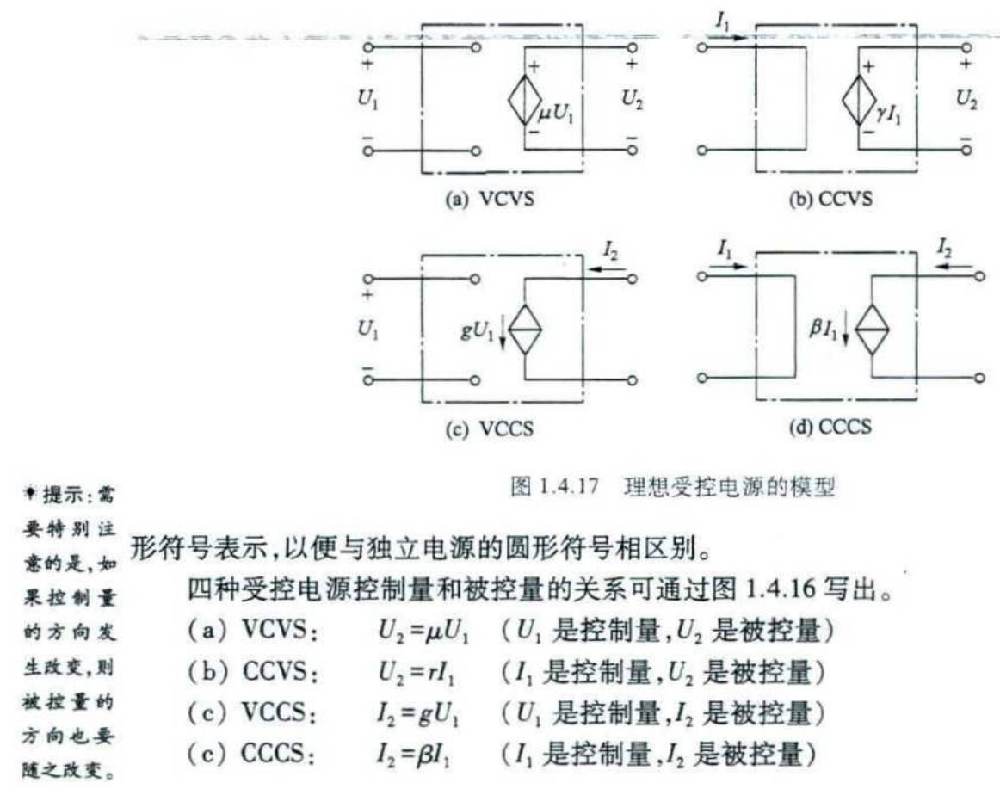 |

## 有载工作、开路短路

电压为0视作短路,电流为0视作开路

> 电源有载工作：以最简单的直流电压源电路为例

1. 电压与电流

   1. $$
      \begin{gathered}I=\frac{E}{R_0+R} \\ U=R I \\ U=E-R_0 I\end{gathered}
      $$

2. 功率与功率平衡

   1. $UI=EI-R_0I^2=P_E-\Delta P$
   2. $P_E$ 电源产生的功率， $\Delta P$ 电源内阻上损耗的功率，$P$ 电源输出功率

3. 电源与负载的判别

   1. 判断电路元件是电源还是负载

4. 额定值与实际值

   1. 额定电压、电流、功率用 $U_N I_N P_N$ 表示
   2. 1 瓦功率作用 1 秒，等于 1 焦耳（即 1W=1J/s）

> 开路、短路

短路：

| 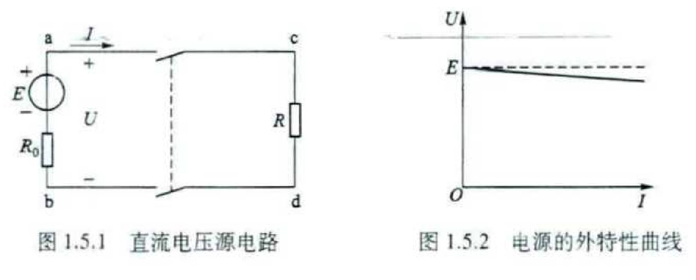 | 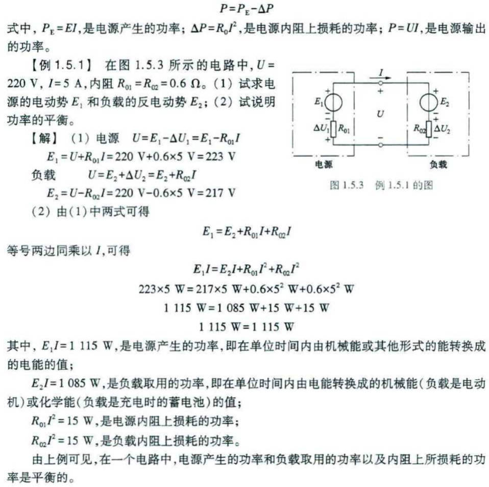 |
| ------------------------------------------------------------ | ------------------------------------------------------------ |
| 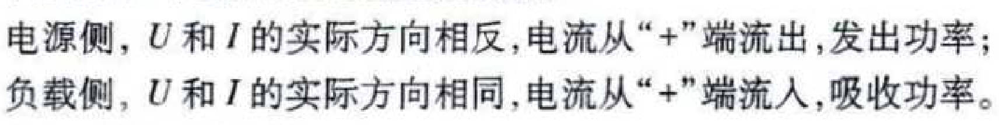      |       |
| 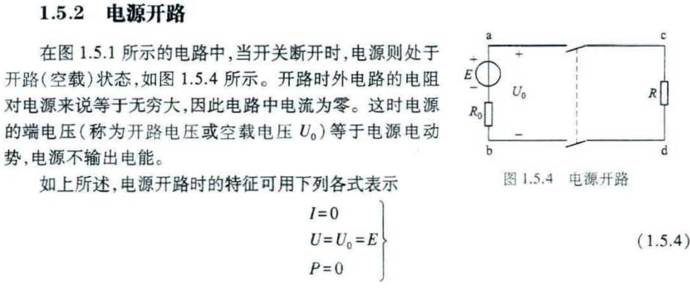      | 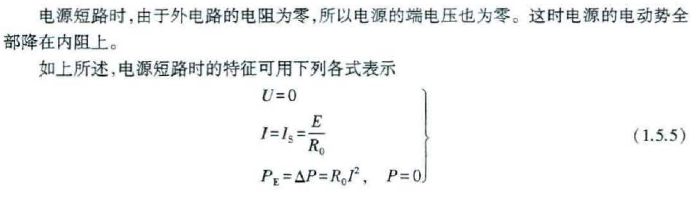      |
| 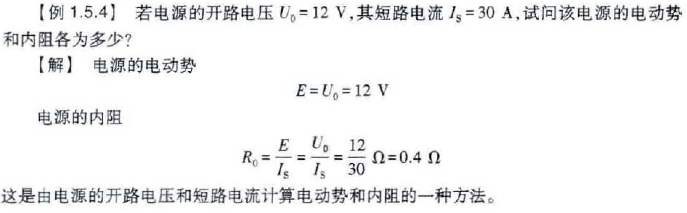      |                                                              |

## 基尔霍夫定律

> 基尔霍夫电流定律

1

> 基尔霍夫电压定律

1

## 电位

# 电路基本分析方法与基本定理

## 电路等效变换

# 电路暂态过程分析