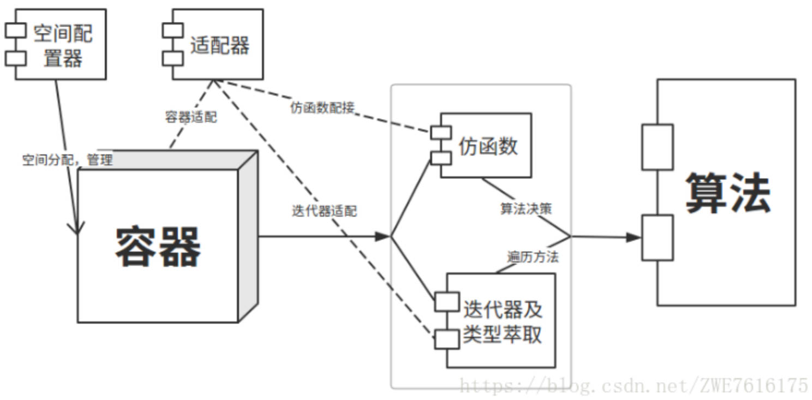

# 库

## 标准库和STL区别

[标准库和STL有什么区别_百度搜索](https://www.baidu.com/s?ie=UTF-8&wd=%E6%A0%87%E5%87%86%E5%BA%93%E5%92%8CSTL%E6%9C%89%E4%BB%80%E4%B9%88%E5%8C%BA%E5%88%AB)  

STL是C++标准库的一个子集，标准库包含STL，还包含I/O流、字符串、多线程等非STL部分。

简单说，标准库是“全家桶”，STL是其中==专注于泛型编程==的那部分（容器、算法、迭代器）。

### 具体区别

1. STL的核心组件：容器（`vector`、`map`、`list`等）、算法（`sort`、`find`等）、迭代器、函数对象、适配器、空间配置器，全部基于模板实现。

2. 标准库独有内容：`<iostream>`（I/O流）、`<string>`（字符串类）、`<thread>`/`<mutex>`（多线程）、智能指针（`shared_ptr`等）、C兼容库（`<cstdio>`、`<cmath>`）。

3. 头文件区分：STL典型头文件如`<vector>`、`<algorithm>`、`<map>`；非STL标准库头文件如`<iostream>`、`<string>`、`<thread>`。

### 为什么容易混淆

STL最初由惠普实验室开发，1994年被纳入C++标准库，成为其一部分。 很多人习惯用“STL”代指整个标准库，虽不严谨但很常见。微软官方文档也提到，虽然正式名称是C++标准库，但出于搜索习惯，他们也偶尔用“STL”指代整个标准库。

> 在正式场合（文档、面试）建议用“C++标准库”保持准确；讨论泛型编程时，可以明确说“STL”。

STL是标准库的一部分，但功能侧重不同，可以看看STL的容器和标准库的字符串有何区别?或者STL的算法如何与标准库的I/O结合使用?

# 组件

[C++STL常用组件](https://blog.csdn.net/weixin_73240939/article/details/136266317)  

[STL中六大组件](https://www.cnblogs.com/gschain/p/11246137.html)  

[C++之 bind 绑定器](https://blog.csdn.net/qq_53324833/article/details/141017847)  [函数绑定器(bind用法)](https://blog.csdn.net/qq_45834144/article/details/126550844)  

## STL组件

除了适配器和迭代器，常用组件还有容器、算法、仿函数（函数对象）、分配器，这六类共同构成 STL 的核心架构。

### 六大组件一览

1. 容器：管理元素集合的类模板，如 `vector`、`list`、`deque`、`map`、`set`，负责数据的存储与组织。
2. 算法：操作容器数据的函数模板，如 `sort`、`find`、`count`、`for_each`，通过迭代器与容器协作。
3. 迭代器：容器与算法间的“桥梁”，像通用指针，支持移动、解引用和比较，屏蔽底层结构差异。
4. 仿函数：重载了 `operator()` 的类对象，可携带状态，像函数一样调用，为算法提供自定义行为（如排序规则）。C++11 后 lambda 常替代它，但底层仍是匿名仿函数对象。
5. 适配器：包装已有组件改变接口形态，如容器适配器 `stack`、`queue`，迭代器适配器 `back_insert_iterator`，函数适配器 `bind`。
6. 分配器：负责容器内存申请与释放，默认 `std::allocator`，支持自定义，用于特殊内存管理场景（如内存池、共享内存）。

### 实际使用建议

- 核心三件套：容器、算法、迭代器使用频率最高，初学先掌握它们。
- 仿函数与适配器：现代 C++ 中 lambda 和 `auto` 替代不少场景，但理解其“包装接口”思想对阅读源码和设计抽象层很有帮助。
- 分配器：多数工程不用自己写，但遇到嵌入式开发、特殊对齐或内存追踪需求时，它是关键扩展点。

STL六大组件各有侧重，可以看看容器和算法如何协作?或者仿函数和lambda有何区别?

### STL六大组件的相互关系

[好：相互关系](https://blog.csdn.net/ZWE7616175/article/details/80261358)  

容器通过空间配置器取得数据存储空间；算法通过迭代器存取数据存储容器内容；仿函数可以协助算法完成不同的策略变化；空间适配器可以修饰或套接仿函数

## 适配器作用

[适配器](https://baijiahao.baidu.com/s?id=1833151708405932710&wfr=spider&for=pc)  [适配器](https://developer.aliyun.com/article/1336964)  

适配器的作用简单说就是==让原本接口不匹配、没法直接一起工作的东西能协同工作==，它不改变原有接口，==只做中间转换==。下面从生活、硬件和编程三个角度举例说明。

### 生活里的适配器

最典型的是电源适配器。墙上的插座是220V交流电，手机、笔记本需要的是低压直流电，直接插上去会烧坏。电源适配器把交流电转换成设备需要的直流电，同时把电压稳定在安全范围，比如手机标5V充电，它就稳在5V，防止电压波动伤电池。

另一个例子是出国用的插头转换器。中国电器是扁平两脚插头，德国插座是圆形两孔，形状对不上就没法充电。转换器一头插进德国插座，另一头提供国标插孔，你的充电器就能正常用了。

### 硬件里的适配器

读卡器也很常见。电脑只能读SD卡，但手机里的TF卡更小，直接插不进去。读卡器相当于一个适配器，把TF卡的接口转换成SD卡接口，让电脑能读取TF卡内容，不需要改造电脑或TF卡本身。

射频领域也有阻抗转换适配器，比如把50Ω系统连接到75Ω系统时，直接混用会产生信号反射，导致测试结果失真。适配器能做阻抗转换，但它本身也会引入插入损耗，精密测量时不能当成理想连接件。

### 编程里的适配器模式

在软件开发中，适配器模式用于让两个接口不兼容的类一起工作。比如你有一个老类，方法叫 `specificRequest()`，但客户端期望一个 `request()` 方法，直接调用会编译报错。这时写一个适配器类，它实现客户端期望的接口，内部把 `request()` 的调用转给 `specificRequest()`，客户端就能正常使用了。

Java里的 `InputStreamReader` 就是真实案例，它把字节流（InputStream）适配成字符流（Reader），让 `BufferedReader` 能按字符读取文件，底层字节流和上层字符流原本不兼容，靠这个适配器衔接起来。

统一支付接口也是常见应用。支付宝、微信、银联各自的方法名和参数都不一样，但业务方希望用统一的 `pay()` 方法调用。为每个支付平台写一个适配器，把各自的支付方法适配到统一接口上，业务代码就不需要关心具体是哪个平台了。

### 使用适配器的注意点

- 适配器只是做转换，不改变原有接口，也不增强功能；如果需要增强功能，应该考虑装饰器模式。
- 替换电源适配器时，不能只看插头能不能插上，还要核对输出电压、额定电流、极性等参数，参数不匹配可能导致设备运行不稳定甚至损坏。
- 适配器模式会增加额外类和中间层，过度使用会让代码变复杂，只在确实需要解决接口不兼容时使用。

适配器模式在编程中很常见，可以看看装饰器模式和适配器模式有何区别?或者Java中还有哪些适配器类?

## 分配器作用

[分配器_百度百科](https://baike.baidu.com/item/%E5%88%86%E9%85%8D%E5%99%A8/9852086)  

> 分配器负责管理[STL](https://baike.baidu.com/item/STL/70103?fromModule=lemma_inlink)容器在运行时的==动态内存分配与释放==
>
> - 负责容器内存申请与释放，默认 `std::allocator`，支持自定义，用于特殊内存管理场景（如内存池、共享内存）

分配器的作用总结成一句话就是：把一路信号或资源分成多路，让多个设备能同时使用同一个信号源。下面用几个常见例子说明。

### 视频分配器：让一台电脑画面同时显示在多块屏幕上

会议室里，一台电脑的画面要同时投到投影仪和两块显示器上，直接并联信号会衰减、画面失真。接一个1进4出的视频分配器，电脑信号输入后，分配器放大并复制出4路完全相同的信号，每块屏幕画面都清晰同步。

### 信号分配器：让一个仪表信号同时给多个系统用

工业控制中，一个4-20mA的传感器信号，既要给显示仪表看，又要给PLC控制系统，还要给DCS系统。信号分配器一进三出，把一路信号隔离成三路独立输出，互不干扰。某一路设备故障也不影响其他系统，还解决了地环路干扰问题。

### 耳机分配器：让多个人同时监听同一路音频

录音棚里，调音台的一路混音信号要同时送给歌手、乐手和录音师监听。耳机分配器把一路音频输入分成4路独立输出，每路都有独立音量旋钮，大家各听各的，互不影响。

### C++分配器：管理容器内存的“搬运工”

C++里，`vector` 等容器需要动态申请和释放内存。分配器就是封装内存管理细节的组件，默认用 `std::allocator` 调 `new`/`delete`，也可换成内存池分配器：预先申请一大块内存，后续频繁分配时直接从池里取，避免频繁系统调用，大幅提升性能。

### 有线电视分配器：让一路电视信号进多家

楼道里，一根主干电视信号线要分给多户人家。分支分配器把一路信号均匀分成多路，每户都能收到稳定信号，且各户之间隔离，某户线路故障不影响邻居看电视。

> 核心逻辑都一样：一进多出，同步复制，隔离互不影响，只是不同领域的具体实现和叫法不同。

分配器在不同领域用法不同，可以看看视频分配器和信号分配器有何区别?或者分配器能解决信号衰减问题吗?