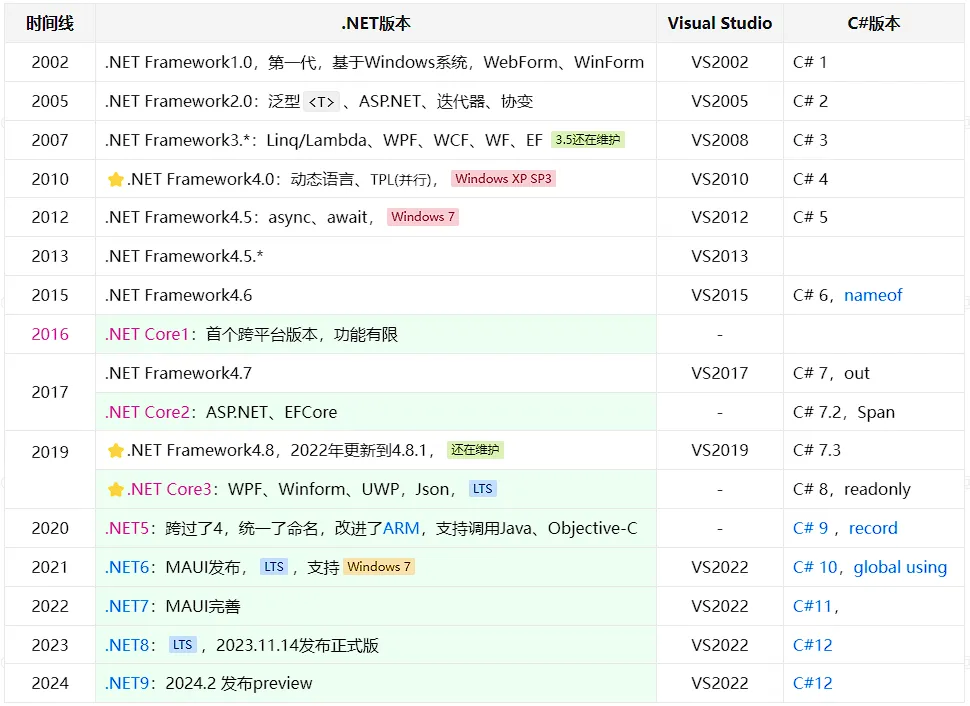
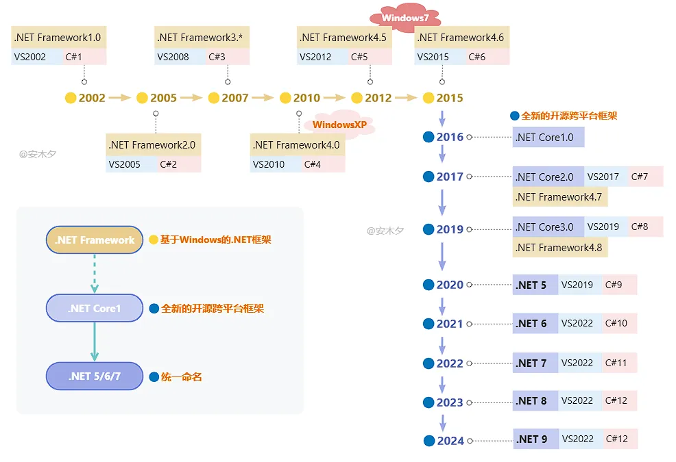
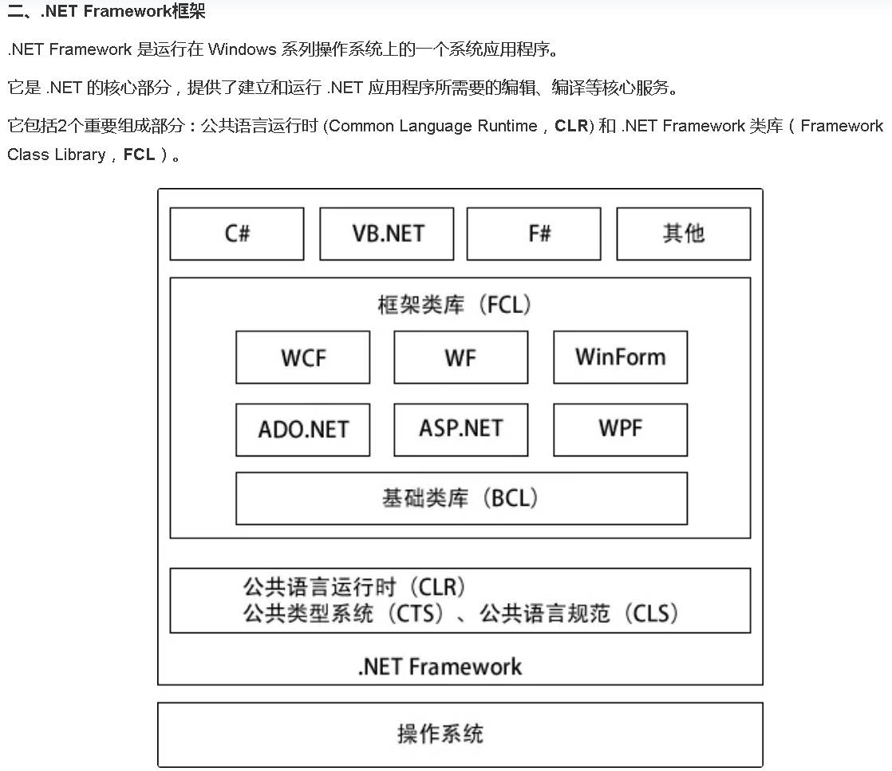
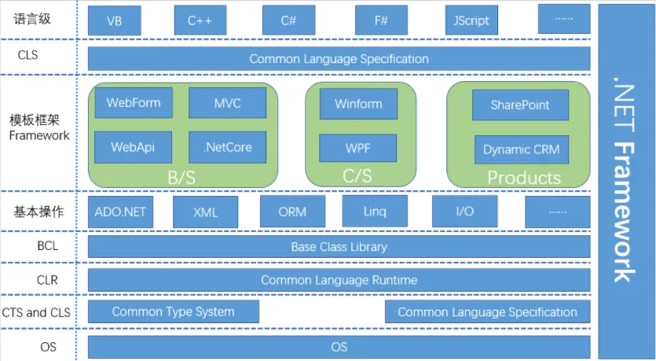
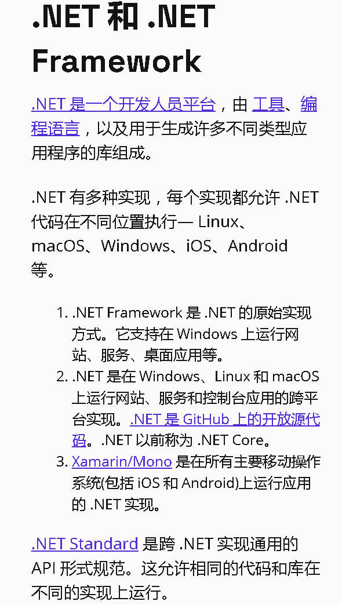
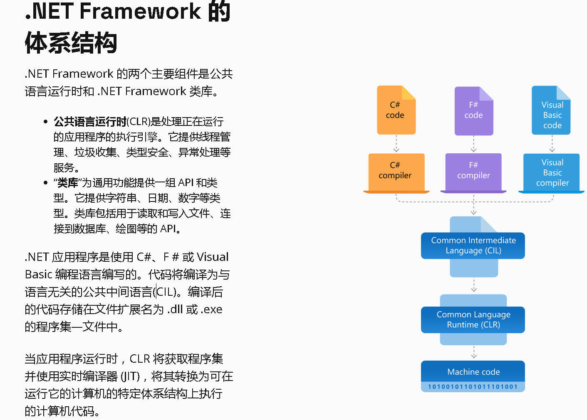
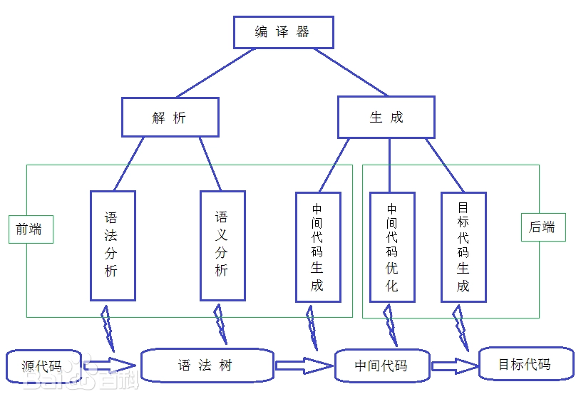

# 编程的基本框架

视频： [通俗讲解编程的基本框架](https://www.bilibili.com/video/BV1FP4y1K7W5/?vd_source=7346303e5e18677d7261c2c0c109ecfd)	[代码是如何驱动硬件的？](https://www.bilibili.com/video/BV1b64y167kE/?vd_source=7346303e5e18677d7261c2c0c109ecfd)	 [机电编程原理](https://search.bilibili.com/all?vt=20236630&keyword=%E6%9C%BA%E7%94%B5%E7%BC%96%E7%A8%8B%E5%8E%9F%E7%90%86)	

[从底层汇编看显卡工作原理及编程方式](https://www.bilibili.com/video/BV1V34y1o7aj/?vd_source=7346303e5e18677d7261c2c0c109ecfd)	 [C语言怎么控制电路？单片机开发全过程](https://www.bilibili.com/video/BV1x441197Ye/?vd_source=7346303e5e18677d7261c2c0c109ecfd)	

# c语言开发演化

[c语言开发演化_百度搜索](https://www.baidu.com/s?wd=c%E8%AF%AD%E8%A8%80%E5%BC%80%E5%8F%91%E6%BC%94%E5%8C%96&rsv_spt=1&rsv_iqid=0x95a241ed001565f4&issp=1&f=3&rsv_bp=1&rsv_idx=2&ie=utf-8&tn=baiduhome_pg&rsv_enter=1&rsv_dl=ts_0&rsv_sug3=8&rsv_sug1=4&rsv_sug7=100&rsv_sug2=0&rsv_btype=i&prefixsug=c%25E8%25AF%25AD%25E8%25A8%2580&rsp=0&inputT=4379&rsv_sug4=5374&rsv_sug=1)	[C语言发展史](https://byteqqb.blog.csdn.net/article/details/141901946)     [计算机编程语言的演变：从 C 语言到现代 Python 的发展历程与影响](https://baijiahao.baidu.com/s?id=1817012263420758977&wfr=spider&for=pc)	[C语言起源、特性和发展历程](https://baijiahao.baidu.com/s?id=1764426766975489445&wfr=spider&for=pc)	

[C语言的前世今生](https://zhuanlan.zhihu.com/p/687410274)	   [C语言家族：C、C++、C#](https://mbd.baidu.com/newspage/data/dtlandingsuper?nid=dt_4215324717571435680&sourceFrom=search_a)	 

[C语言历史与演化—C89、C99、C11、C17、C2x](https://www.jb51.net/program/330768ahq.htm) 	

COM编程： 组件对象模型，`Component Object Model`   [COM编程_百度搜索](https://www.baidu.com/s?ie=UTF-8&wd=COM%E7%BC%96%E7%A8%8B)	   [什么是COM编程](https://search.bilibili.com/all?vt=20146048&keyword=%E4%BB%80%E4%B9%88%E6%98%AFCOM%E7%BC%96%E7%A8%8B&search_source=5) 	 [com编程_百度百科](https://baike.baidu.com/item/com%E7%BC%96%E7%A8%8B/833430)	[com编程被什么取代了](https://worktile.com/kb/ask/2188292.html)  	[com编程是什么](https://worktile.com/kb/p/1507082)	 

## c c++ c#区别

[c c++ c#区别_百度搜索](https://www.baidu.com/s?ie=utf-8&f=8&rsv_bp=1&tn=baidu&wd=c%20c%2B%2B%20c%23%E5%8C%BA%E5%88%AB&oq=c%2520c%252B%252B%2520c%2523&rsv_pq=95d666380008d158&rsv_t=25eazhLboh2ODBW6B%2FWxmjXDfXQFPyXQNKS8r1j0%2Bhf025lywm91JZcxqM4&rqlang=cn&rsv_dl=tb&rsv_sug3=5&rsv_sug1=3&rsv_sug7=100&rsv_btype=t&prefixsug=c%2520c%252B%252B%2520c%2523%25E5%258C%25BA%25E5%2588%25AB&rsp=10&inputT=6110&rsv_sug4=7823)	  [C语言、C++和C#区别](https://blog.csdn.net/m0_61505785/article/details/139731794)	[C＃和C++的区别](https://www.cnblogs.com/AIBigTruth/p/11947272.html)	 [C语言、C++和C#的对比表格_百度搜索](https://www.baidu.com/s?ie=UTF-8&wd=%E4%BB%A5%E4%B8%8B%E6%98%AFC%E8%AF%AD%E8%A8%80%E3%80%81C%2B%2B%E5%92%8CC%23%E7%9A%84%E5%AF%B9%E6%AF%94%E8%A1%A8%E6%A0%BC)	 

1. **编程范式**: 

- ‌**C**‌：C是一种‌**过程式编程语言**‌，着重于数据和函数的结合，程序由函数组成，所有操作和计算依赖于函数调用。C没有内置的面向对象支持，主要强调直接操作内存和硬件‌
- ‌**C++**‌：C++是基于C的一种扩展语言，支持‌**多范式编程**‌，包括面向对象编程（OOP）、泛型编程和过程式编程。C++增加了类、继承、多态等面向对象特性，并支持模板和异常处理‌
- ‌**C#**‌：C#是一种‌**完全面向对象的编程语言**‌，不支持过程式编程。它主要用于构建Windows应用程序、Web应用程序和游戏（通过Unity引擎）‌

2. **内存管理**

- ‌**C**‌：C语言允许程序员手动控制内存分配和释放，需要使用`malloc`、`calloc`等函数分配内存，并通过`free`释放内存。这种手动管理内存的方式虽然灵活，但容易出错，需要开发者小心避免内存泄漏或野指针的出现‌
- ‌**C++**‌：C++延续了C的手动内存管理方式，但提供了`new`和`delete`关键字用于动态内存分配和释放。此外，C++还引入了智能指针（如`std::unique_ptr`和`std::shared_ptr`），使得内存管理变得更安全，减少了内存泄漏的风险‌
- ‌**C#**‌：C#提供了自动的垃圾回收机制（GC），所有的内存管理都由.NET环境自动完成，开发者不需要手动释放内存，这大大降低了内存泄漏的风险。然而，垃圾回收也会带来一定的性能开销‌

## c c++ c#演化

C、C++、C是同一脉络演化的三种语言，核心趋势是从贴近硬件、追求效率，一步步走向更安全、更抽象、更注重开发效率。C 是源头，C++ 在 C 上加面向对象和泛型，C则借鉴了 C++ 和 Java，全面转向托管环境和企业级开发。

### 演化脉络

1. C 语言（1972）：由贝尔实验室的 Dennis Ritchie{id="entity_1"} 在 B 语言基础上设计，最初为重写 UNIX 而生。设计哲学是“相信程序员”，提供直接操作内存和硬件的指针，代码效率接近汇编，至今统治操作系统内核、嵌入式、驱动开发。
2. C++（1983）：由 Bjarne Stroustrup 在 C 上扩展，最初叫“C with Classes”。目标是“零开销抽象”——在保持 C 性能和兼容性的同时，加入类、继承、多态等面向对象特性，以及模板泛型编程和 RAII 资源管理，成为游戏引擎、高性能服务的主力。
3. C（2000）：微软为.NET 框架设计的核心语言，由 Anders Hejlsberg 主导。语法借鉴 C++ 和 Java，但本质是全新设计，走“类型安全 + 自动内存管理”路线，代码编译成中间语言（IL），由 CLR 运行时 JIT 编译执行，靠垃圾回收（GC）自动管理内存，开发效率高，适合企业级应用和 Web 服务。

### 关键演进逻辑

- 内存管理：从 C 的 `malloc/free` 手动控制，到 C++ 的 `new/delete` 加智能指针，再到 C的自动 GC，安全性逐步提升，但底层控制力相应减弱。
- 编程范式：C 是面向过程，C++ 是多范式（过程式 + 面向对象 + 泛型），C是纯面向对象并融合了 LINQ 声明式查询、async/await 异步等现代特性。
- 运行方式：C/C++ 直接编译成机器码原生运行；C编译成中间语言，依赖.NET 运行时，早期仅限 Windows，2014 年开源后通过.NET Core 实现跨平台。

### 怎么选

1. 追求极致性能和底层控制：选 C，比如操作系统内核、嵌入式设备、驱动开发。
2. 需要性能与抽象平衡：选 C++，比如游戏引擎、高频交易、桌面应用。
3. 追求开发效率和生态丰富度：选 C，比如 Web 服务、企业后台、Unity 游戏开发、跨平台移动应用。

> 三者不是简单的“谁取代谁”，而是各自占据不同生态位。C 依然是一切底层基础设施的基石，C++ 在性能敏感领域不可替代，C则代表了现代托管语言的主流方向。

三者演进逻辑清晰，要不要继续看看C++的RAII资源管理机制或者C#的LINQ声明式查询语法

## C# 演变

[C# 发展历史 | Microsoft Learn](https://learn.microsoft.com/zh-cn/dotnet/csharp/whats-new/csharp-version-history#c-version-71)  [好：.NET 体系概览](https://cloud.tencent.com/developer/article/2422682)    [C# 版本历史的探索](https://baijiahao.baidu.com/s?id=1770468558090934779&wfr=spider&for=pc)  [C#的历史和发展](https://programercat.blog.csdn.net/article/details/131020321)  

[C#发展史](https://www.cnblogs.com/sslyc8991/p/evolution-of-csharp.html)  [ C#12 新变化](https://cloud.tencent.com/developer/article/2359908)  [C# 和 .NET Core 的关系](https://blog.csdn.net/chinaherolts2008/article/details/113838588)  

[C# 趋势](https://blog.csdn.net/hjxxlsx/article/details/144545010)  [C#/.NET/.NET Core技术](https://cloud.tencent.com/developer/article/2456420)  [.NET 和C#关系](https://docs.pingcode.com/ask/ask-ask/299071.html)  

[.NET简史、.NET Standard以及C#和.NET Framework之间的关系](https://www.cnblogs.com/daxnet/p/18299758)  

`C#`编程语言不仅一直在演变，而且其演进速度非常快，几乎与.NET 平台的更新保持同步。从最初的面向对象语言，发展到如今融合了函数式编程、异步并发、高性能底层操作等多种范式的现代语言，`C#`的每一次大版本更新都带来了显著的生产力提升和性能优化。

以下是 `C#` 近年来演变的核心趋势及最新进展：

### 核心演变趋势

*   语法简洁化与去样板代码：通过引入记录类型 (Records)、主构造函数、全局 using 和文件范围命名空间，大幅减少了冗余代码，使业务逻辑更清晰 。
*   类型安全增强：从早期的可空值类型 (`int?`) 发展到 可空引用类型 (Nullable Reference Types)，将空指针异常的风险在编译期而非运行期暴露，显著提升了代码健壮性 。
*   异步编程原生支持：自 `C#5.0` 引入 `async/await` 以来，异步模型不断进化，包括 异步流 (Async Streams) 和更高效的异步状态机优化，使其在高并发场景下表现卓越 。
*   模式匹配的深度集成：从简单的类型检查扩展到关系模式、逻辑模式和属性模式，允许开发者以声明式的方式处理复杂的数据结构，减少了大量的 `if-else` 嵌套 。

### 最新版本特性 (截至 2026 年)

根据微软官方文档，`C#` 近期版本持续推出创新功能：

*   `C# 14` (2025 年 11 月发布)：
    *   扩展成员：允许为现有类型添加扩展属性、索引器等。
    *   field 支持的属性：简化自动属性的底层字段访问。
    *   未绑定泛型类型支持：为 `Span<T>` 等类型提供更多隐式转换能力 。
*   `C# 13` (2024 年 11 月发布)：
    *   params 集合：`params` 关键字不再局限于数组，支持任何集合类型（如 `List<T>`、`Span<T>`）。
    *   新的 lo`C#`k 语义：针对 `System.Threading.Lock` 优化了独占范围的进入和退出机制，提升多线程性能 。
*   `C# 12` (2023 年 11 月发布)：
    *   主构造函数：允许在类或结构体定义时直接声明主构造函数，简化初始化逻辑。
    *   集合表达式：引入 `[..collection]` 语法，方便地展开和合并集合 。

### 与.NET 平台的协同演进

`C#` 的演变紧密依赖并推动着.NET 运行时的发展：

*   性能导向：新语言特性（如 `ref struct`、`Span<T>`）旨在减少内存分配和垃圾回收压力，配合.NET 11 中的 `Runtime AsynC` 和 `NativeAOT` 技术，实现了接近原生代码的性能 。
*   跨平台与云原生：随着.NET Core 到.NET 5+ 的统一，`C#` 已完全脱离 Windows 绑定，成为 Linux、macOS、iOS、Android 以及 WebAssembly 上的首选语言之一 。

总结：`C#` 并非静止不变，它正朝着更安全（编译期检查）、更简洁（减少样板代码）、更高性能（零拷贝、栈分配）的方向快速迭代。对于开发者而言，保持对最新语言特性的关注，能显著提升开发效率和应用程序质量。

`C#` 的演变方向很明确，要不要继续看看`C# 14` 的扩展成员具体怎么用?或者可空引用类型如何配置?

|                       |    |
| ------------------------------------------------------------ | -------------------------------------- |
|  |  |

## C# 演变

[C#图解教程](https://www.ituring.com.cn/book/tupubarticle/28564)  [C#语言发展史](https://blog.51cto.com/u_92655/14359806?)  [C#进化史](https://www.cnblogs.com/qianzi067/p/6019615.html)  

`C#` 的演化可以概括为：从早期对标Java的Windows专属语言，逐步发展为开源、跨平台、多范式的高性能通用语言。 整个过程大致分为五个阶段，每个阶段都有清晰的主题。

### 诞生背景（20世纪90年代末—2001年）

微软当时需要统一Windows应用开发体验，提供类型安全、自动内存管理和跨语言组件能力。`C#` 由Anders Hejlsberg领导设计，早期内部代号为“Cool”，2000年公开亮相，2001年12月通过ECMA-334标准化。 它继承了C/C++的语法风格，又吸收了Java的托管模型，常被看作微软对Java的回应。

### 版本演进主线

1. 1.0—2.0（骨架期）：确立面向对象基础（类、接口、委托、事件、属性），2.0引入泛型、可空类型、迭代器和匿名方法。
2. 3.0—4.0（范式革命）：3.0带来LINQ及配套的lambda、扩展方法、表达式树，是`C#` 转向函数式混合的关键节点；4.0加入dynamic、命名参数和泛型协变/逆变。
3. 5.0—7.x（异步化）：5.0的async/await让异步代码写起来像同步代码，7.x引入元组、模式匹配、本地函数等提升日常开发体验。
4. 8.0—10.0（开源跨平台）：绑定.NET Core 3.0，正式开源跨平台；可空引用类型、record、switch表达式、global using等特性大幅提升表达力和安全性。
5. 11.0—14.0（表达力与性能）：泛型数学、原始字符串、主构造函数、集合表达式、params集合等特性持续简化代码；同时ref struct、AOT等让 `C#` 在性能敏感场景也能贴近裸机。

### 关键转折点

- 开源：核心实现开源是 `C#` 最重要的分水岭，让外部贡献者参与演进，开发节奏明显加快。
- 跨平台：从绑定Windows到支持Linux、容器、移动端和嵌入式，`C#` 的应用场景大幅拓宽。
- 治理模式：从公司内部决策转向社区开放，年度版本发布节奏让升级更可控。

### 理解主线

贯穿`C#` 演化的核心逻辑是不断抬高抽象层级：1.0帮你管理内存，2.0帮你复用类型，3.0把你从手写循环里解放出来，5.0把异步状态机藏进编译器，9.0用一行record实现值对象语义，11.0的泛型数学让算法不依赖具体数值类型。 每一代更新都在消除重复劳动，同时保持向后兼容，这也是`C#`能成为企业级开发可靠选择的重要原因。

从Java到开源，`C#` 的演进很丰富，要不要继续看看`C#` 的函数式编程特性有哪些?或者`C#`开源后有哪些主要贡献者?

## .net core和c#关系

[C#语言发展史](https://blog.51cto.com/u_92655/14359806?)  [C#二十余年演进史：从Java替代品到多范式高性能语言](https://blog.csdn.net/weixin_29611239/article/details/167799810)

.NET Core 是 `C#` 的运行平台，`C#` 是编程语言。写的是 `C#`代码，真正负责编译、内存管理、垃圾回收、跨平台底层支持的，是`.NET Core`（从.NET 5 起已统一改叫.NET）

| 对比维度   | C#                  | .NET Core /.NET          |
| ---------- | ------------------- | ------------------------ |
| 本质       | 编程语言            | 运行平台                 |
| 主要职责   | 语法、逻辑          | 编译执行、内存管理       |
| 跨平台支持 | 不直接支持          | 支持 Windows/Linux/macOS |
| 版本关系   | 语法版本随.NET 调整 | 决定可用语言特性         |

### 具体怎么分工

1. 编译执行：`C#`源码编译后是中间语言 IL，需靠.NET 的 CLR 转成机器码运行，`C#`本身不直接跟操作系统打交道.
2. 基础库支持：`Console.WriteLine`、`List<T>`、`HttpClient` 等均来自.NET 的 BCL，没有.NET，C代码连基本功能都用不了.
3. 版本绑定：`C# 12` 新语法在 `net6.0` 项目下可能报错，因语法版本由目标.NET 版本决定.

### 需要留意的坑

- 命名演变：.NET Framework →.NET Core →.NET 5/6/8/10，.NET Framework 最高 4.8 后进入维护模式，新特性全在现代.NET 上.
- 跨平台优势：.NET Core 重写了底层，用 `C#`写的 Web API 默认能在 macOS 或 Ubuntu 上跑，只要没硬编码 Windows 注册表或 WMI.
- 部署更灵活：支持自包含发布，打包时自带运行时，目标机器不用预装.NET，且不同版本应用可并行运行，互不冲突.

了解了基本关系，要不要再看看`C#` 语法版本如何与.NET版本绑定?或者跨平台时哪些细节容易踩坑?

## .net core和c#关系

`C#`是编程语言，.NET Core是它运行的平台和运行时环境。`C#`负责写代码，.NET Core负责编译、运行和管理程序，两者分工明确但深度绑定。

### 核心分工

1. `C#`的职责：只负责语法和逻辑。你写的代码编译后变成中间语言（IL），不是直接可执行的机器码。
2. .NET Core的职责：提供运行时（CLR）、基础类库（BCL）、垃圾回收（GC）、JIT编译等能力，真正让程序跑起来。
3. 依赖关系：没有.NET Core，`C#`代码连`Console.WriteLine`都找不到，语法正确也无法运行。

### 版本演变

.NET Core不是“另一个.NET”，而是从.NET Framework重写而来的跨平台版本。从.NET 5开始，微软去掉了“Core”字样，统一叫.NET，后续版本为.NET 6、8、10等。 现代`C#`的新语法特性，需对应版本的运行时支持，如`net8.0`项目默认启用`C# 12`

### 常见误区

- `C#`版本 ≠.NET版本：装了最新VS，但项目面向`net6.0`时，`C# 12`的新语法会报错。
- .NET Framework和.NET Core是两回事：前者绑死Windows，后者跨平台支持Linux和macOS。

两者关系紧密，要不要继续了解C#代码如何编译成机器码?或者跨平台开发具体指哪些平台?

## .net框架

[什么是 .NET Framework?一个软件开发框架](https://dotnet.microsoft.com/zh-cn/learn/dotnet/what-is-dotnet-framework)    


即时编译器: Just-In-Time Compiler  [即时编译器JIT](https://baike.baidu.com/item/%E5%8D%B3%E6%97%B6%E7%BC%96%E8%AF%91%E5%99%A8/18428531)  [JIT编译](https://baike.baidu.com/item/JIT%E7%BC%96%E8%AF%91/2886569?fr=aladdin)  

.NET 框架是微软开发的软件开发平台，用于构建和运行各类应用程序，包含两大实现：仅限 Windows 的.NET Framework 和跨平台开源的现代.NET。

### 核心组成与功能

1. **公共语言运行时（CLR）**：负责内存管理、线程调度、代码安全验证等核心服务，类似 Java 虚拟机。
   - 将源代码编译为中间语言（MSIL/CIL），再通过即时编译（JIT）转换为本机代码执行。
   - 自动处理垃圾回收，解决内存泄漏和无效内存引用问题。
2. .NET 类库：提供可重用的面向对象类型集合，涵盖字符串管理、数据收集、数据库连接、文件访问等常见编程任务。
   - 支持多种开发框架：`ASP.NET（Web 应用）、WPF（桌面应用）、WCF（面向服务应用）`等。
3. 语言互操作性：支持 C#、F#、Visual Basic、C++/CLI 等多种语言，通过公共类型系统（CTS）和公共语言规范（CLS）实现跨语言协作。


### 两大版本区别

1. .NET Framework（旧版）：
   - 仅限 Windows 平台，最新版本 4.8.1（2022 年 8 月发布）。
   - 深度集成 Windows 系统，包含在 Windows 中作为系统组件。
   - 支持周期：4.6.2 支持至 2027 年 1 月，3.5 SP1 支持至 2029 年 1 月。
2. 现代.NET（新版）：
   - 跨平台支持 Windows、Linux、macOS，开源免费。
   - 当前 LTS 版本.NET 10.0（2026 年 7 月发布），支持至 2028 年 11 月。
   - 性能更高，支持微服务、云原生、移动开发（MAUI）等现代场景。
3. 选择建议：微软建议新开发项目使用.NET 而非.NET Framework，现有.NET Framework 应用无需迁移但新项目应选用现代.NET。


### 开发应用场景

1. Web 应用：使用 ASP.NET 构建网站、Web API 和微服务。
2. 桌面应用：Windows 窗体、WPF 用于开发图形界面程序。
3. 云服务：构建云原生应用、无服务器函数，支持 Azure 等主流云平台。
4. 其他场景：移动应用（iOS/Android）、游戏、物联网（IoT）、机器学习、控制台应用、Windows 服务等。

关于.NET的跨平台和新旧版本区别，可以看看 现代.NET支持哪些操作系统？ 或者 为什么旧版.NET会逐渐被取代？

|  |  |
| ------------------------------------------------------------ | ------------------------------------------------------------ |
|                          |                                                         |

# .net体系

[.NET 体系概览](https://cloud.tencent.com/developer/article/2422682) 

[CLI、CLR、IL、JIT、GC](https://blog.csdn.net/guai006/article/details/134741544)  

[通用中间语言 (CIL) ](https://www.zhihu.com/question/22159888/answer/29770366)  [通用中间语言_百度百科](https://baike.baidu.com/item/%E9%80%9A%E7%94%A8%E4%B8%AD%E9%97%B4%E8%AF%AD%E8%A8%80/3582939)  

[深入解析CIL：.NET平台的中间语言与运行机制](https://blog.csdn.net/weixin_29611239/article/details/169079097)  [IL访问静态属性和字段](https://www.cnblogs.com/blqw/p/3256196.html) 

[.NET框架与C#编程语言的区别](https://blog.csdn.net/weixin_57765329/article/details/124648672)  

PE结构： [.NET的PE文件结构篇](https://www.cnblogs.com/seely/p/4186864.html)   [.net框架编译的程序pe结构](https://www.baidu.com/s?ie=UTF-8&wd=.net%E6%A1%86%E6%9E%B6%E7%BC%96%E8%AF%91%E7%9A%84%E7%A8%8B%E5%BA%8Fpe%E7%BB%93%E6%9E%84%E6%98%AF%E4%BB%80%E4%B9%88)  [.NET平台PE结构](https://blog.csdn.net/weixin_33308579/article/details/151272518)  

## 公共中间语言CIL

COMMON intermediate language（CIL）是.NET平台的核心中间语言，全称Common Intermediate Language，中文通常叫通用中间语言或公共中间语言，是`C#、VB.NET`等高级语言编译后生成的中间指令集。

### 它是什么

CIL是一种基于堆栈、面向对象的低级指令集，不依赖具体CPU或平台，任何支持.NET运行时的环境都能执行。所有.NET语言最终都会编译成CIL，因此不同语言写的程序可以互相调用，这就是.NET跨语言互操作的基础。

> 可以这样理解：CIL就像不同语言共同翻译出的一份“通用代码”，再由运行时翻译成机器能懂的原生码。

### 执行流程

1. **编译阶段**：`C#、VB.NET`等源代码被编译成==CIL==，存储在`.exe`或`.dll`程序集中，同时附带元数据（类型定义、方法签名等）。
2. **运行阶段**：==CLR==（公共语言运行时）接手，通过JIT（即时编译）将CIL按需编译成当前平台的原生机器码执行。
3. **可选预编译**：也可以用==NGEN==等工具提前将`CIL`编译为特定处理器的原生映像，提升启动速度。

### 一个直观例子

`C#`的`Console.WriteLine("Hello, World!");`编译成CIL后大概长这样：

```cil
.method public hidebysig static void Main() cil managed
{
.entrypoint
.maxstack 8
    IL_0000: nop
    IL_0001: ldstr "Hello, World!"
    IL_0006: call void [mscorlib]System.Console::WriteLine(string)
    IL_000b: ret
}
```

`ldstr`把字符串压入栈，`call`调用方法，`ret`返回——典型的堆栈式操作。

### 关键特点

- 跨平台：CIL与平台无关，只要目标环境实现了CLI（通用语言基础结构）标准，如.NET、Mono，就能运行。
- 托管代码：CIL由CLR管理执行，自动处理内存回收、类型安全、安全边界等，与C/C++那种“非托管代码”形成对比。
- 可反编译：CIL保留了较多结构信息，用ILSpy、dnSpy、ILDasm等工具可以反编译回高级代码，这也是逆向分析.NET程序的基础。

### 名字的由来

CIL在.NET测试版时叫MSIL（Microsoft Intermediate Language，微软中间语言），后来微软把.NET提交给ECMA标准化，才正式改名为CIL。不过MSIL这个旧叫法在老资料和部分工具里仍很常见，两者指同一个东西。

### 常用工具

- ILAsm/ILDasm：官方提供的IL汇编器和反汇编器，可查看和编辑程序集中的CIL代码。
- ILSpy /.NET Reflector：反编译.NET程序集，直接查看CIL或还原成C代码。
- Visual Studio：调试时可查看CIL代码，支持单步执行IL。

CIL的执行流程很关键，可以看看JIT编译为什么按需执行?或者NGEN预编译有什么优缺点?

## 即时编译器JIT

[jit 即时编译器](https://developer.aliyun.com/article/535131)  [即时编译器](https://cloud.tencent.com/developer/article/2480643)  

## .net的作用类似编译器吗

.NET 不只是一个编译器，而是一个完整的开发平台，它内部包含编译器，但作用比编译器大得多。

编译器只是把源代码翻译成另一种代码的工具，而.NET 是一个集“编译 + 运行环境 + 类库”于一体的平台。可以这样理解：编译器像“翻译官”，.NET 则像“翻译官 + 车间 + 工具库”的组合。

### .NET 里编译器扮演的角色

.NET 自带编译器（如 `C#`编译器），负责把 `C#、F#`等语言的源代码编译成中间语言（IL/CIL），这是一种与 CPU 无关的中间代码，保存在 `.exe` 或 `.dll` 程序集里。

### 编译器之外，.NET 还有更核心的部分

1. 运行时（CLR）：这是.NET 最关键的部分。程序运行时，CLR 里的 JIT 编译器把 IL 实时编译成当前机器能执行的本机机器码。
2. 类库（BCL/FCL）：提供现成的功能，如文件操作、字符串处理、网络请求等，开发者直接调用，无需从零写底层代码。
3. 开发工具链：包括.NET CLI 命令行工具、MSBuild 构建系统等，覆盖创建、编译、运行、发布整个流程。

### 从代码到运行的完整流程

1. 用 `C#`写源代码
   2..NET 编译器把源码编译成 IL 中间语言
2. IL 存到程序集（`.exe` 或 `.dll`）
3. 运行时，CLR 的 JIT 编译器把 IL 编译成当前机器 CPU 能理解的机器码
4. 机器码真正执行

> 这也是.NET 能“一次编写，到处运行”的原因：同一份 IL 代码，在不同平台由各自 CLR 的 JIT 编译成对应平台的本机码。

所以，说.NET 类似编译器不太准确——编译器只是它的一部分，.NET 更像是“编译器 + 虚拟机 + 类库 + 工具链”的完整开发环境。

理解了.NET的编译流程，可以再深入看看JIT编译器和`C#`编译器有什么区别?或者IL代码和机器码具体有什么不同?

## PE结构

[.net框架编译的程序pe结构是什么_百度搜索](https://www.baidu.com/s?ie=UTF-8&wd=.net%E6%A1%86%E6%9E%B6%E7%BC%96%E8%AF%91%E7%9A%84%E7%A8%8B%E5%BA%8Fpe%E7%BB%93%E6%9E%84%E6%98%AF%E4%BB%80%E4%B9%88)  [.Net 框架](https://cloud.tencent.com/developer/article/1350535)  

.NET 框架编译出来的程序，PE 结构本质上就是标准的 Windows PE 文件，但在 PE 头的基础上扩展了一个 CLR 头（CLR Header），并把真正的代码存成了中间语言（IL）和元数据。

### 📦 整体结构

一个.NET 可执行文件（EXE 或 DLL）从文件头到末尾大致是这样布局：

1. DOS 头：兼容 MS-DOS，包含 "MZ" 标志，并指明 NT 头的偏移位置。
2. NT 头（PE 头）：包含 PE 签名、文件头（IMAGE_FILE_HEADER）和可选头（IMAGE_OPTIONAL_HEADER）。可选头里的数据目录表（Data Directory）第 15 项，存放了 CLR 头的 RVA 和大小，这是找到 CLR 头的关键。
3. 节表（Section Table）：描述各个节区（如.text、.rdata、.data）在文件中和内存中的位置、大小及访问权限。
4. 节区（Sections）：实际内容存放的地方。对于.NET 程序，最特别的是：

### 🔑 关键扩展：CLR 头

CLR 头（IMAGE_COR20_HEADER）是.NET PE 文件区别于普通 PE 的核心，它告诉 CLR 如何加载和运行这个程序。

CLR 头主要字段如下：

| 偏移 | 字段                | 说明                                                   |
| ---- | ------------------- | ------------------------------------------------------ |
| 0    | Cb                  | CLR 头的大小                                           |
| 4    | MajorRuntimeVersion | 所需.NET 运行时主版本                                  |
| 6    | MinorRuntimeVersion | 所需.NET 运行时次版本                                  |
| 8    | MetaData            | 元数据的 RVA 和大小                                    |
| 16   | Flags               | 属性标志（如 ILONLY、32BITREQUIRED、STRONGNAMESIGNED） |
| 20   | EntryPointToken     | 入口方法的元数据 Token（EXE 必须有，DLL 可为 0）       |
| 24   | Resources           | 托管资源的 RVA 和大小                                  |
| 32   | StrongNameSignature | 强名称签名数据的 RVA 和大小                            |

> 在 32 位.NET 程序中，入口点通常用 EntryPointToken 指向一个方法；但在.NET 2.0 之后，EntryPointToken 字段也可能存放本地入口代码的 RVA。

### 📝 元数据与 IL 代码

CLR 头里最重要的就是 MetaData 字段，它指向元数据的存放位置。元数据是.NET 自描述机制的核心，包含：

- 元数据头：以 "BSJB" 签名开头，记录版本信息、流数量等。
- 流（Streams）：常见的有 `Strings`（字符串堆）、`Blob`（二进制堆）、`GUID`、`US`（用户字符串）、`~`（元数据表流）。
- 元数据表（Metadata Tables）：`~` 流里存放各种表，如 TypeDef、MethodDef、FieldDef、AssemblyRef 等，记录程序集中所有类型、方法、字段和依赖的信息。

IL 代码（中间语言）存储在.text 节区中，JIT 编译时由运行时读取并转换为本机指令。

### 🔍 怎么查看

想直观地看这些结构，可以用这些工具：

- CFF Explorer：查看 PE 头、节表、CLR 头和元数据表。
- LordPE：查看 PE 头信息和节区布局。
- Ildasm.exe：反编译.NET 程序集，查看 IL 代码和元数据。
- PE-bear：另一个常用的 PE 查看工具。

简单来说，.NET 程序是"披着 PE 外衣"的托管模块，外壳是标准的 Windows PE 格式，内核则是 CLR 头 + 元数据 + IL 代码，由 CLR 负责加载和执行。

CLR 头里还有不少细节，可以看看Flags 字段的常见标志有哪些?或者EntryPointToken 如何指向入口方法?

# IDE

[Downloads - MinGW-w64](https://www.mingw-w64.org/downloads/#mingw-builds) 

[Win10必备工具（重装系统必备）](https://cloud.tencent.com/developer/article/1980569)  [前端开发在线工具](https://cloud.tencent.com/developer/article/1142656)  [什么是QT](https://cloud.tencent.com/developer/article/2084699)    [AI开发工具](https://cloud.tencent.com/developer/article/2345726) 

IDE:       [Code::Blocks官网](https://www.codeblocks.org/)  [codeblocks](https://www.baidu.com/s?ie=UTF-8&wd=codeblocks)   [Code Blocks安装](https://www.jb51.net/softjc/716994.html)  [Code::Blocks](https://c.biancheng.net/view/467.html)  [CodeBlocks入门](https://cloud.tencent.com/developer/article/1101731)   [Code::Blocks 学习助手](https://blog.csdn.net/hongwenjun/article/details/6269535)   [下载 Code::Blocks](https://appzip.cn/codeblocks/w/download)  [CodeBlocks-20.03下载安装及中文](https://developer.aliyun.com/article/1499650)   [中文编译提示 Code::Blocks SVN6988学习增强版(适合C/C++初学者)](https://bbs.csdn.net/topics/360090434)   [C语言学习——IDE软件Code::Blocks教程](https://developer.aliyun.com/article/1049155)   [Code::Blocks 自动格式化代码](https://blog.csdn.net/hnjzsyjyj/article/details/119518211) 

[好：C语言编译器大全](https://www.bilibili.com/opus/941751311433465857?jump_opus=1)	


[code blocks中汉字下方有红色波浪线](https://blog.csdn.net/weixin_41290863/article/details/119608446)   [查看windows系统默认编码](https://blog.csdn.net/weixin_49114503/article/details/127945397)  [codeblock输出中文乱码问题](https://blog.csdn.net/mantou_riji/article/details/123596205)   [Illegal byte sequence|_百度搜索](https://www.baidu.com/s?ie=UTF-8&wd=converting%20to%20execution%20character%20set%3A%20Illegal%20byte%20sequence%7C)    [CodeBlocks快捷键](https://blog.csdn.net/u010278698/article/details/105822037/)

[CLion](https://www.baidu.com/s?ie=utf-8&f=8&rsv_bp=1&tn=baidu&wd=CLion&oq=%2526lt%253Bode%253A%253ABlocks&rsv_pq=e5ef426100edcdd1&rsv_t=b0b89u%2FPrslJFwBNyfaKmj3iEdlB%2BK%2F%2FEGevpmxbBRqXtcy2Dv%2B%2B6o%2B5kY0&rqlang=cn&rsv_enter=0&rsv_dl=tb&rsv_n=2&rsv_sug3=1&rsv_sug1=1&rsv_sug7=100&rsv_btype=t&inputT=1281&rsv_sug4=1282)  [CLion安装](https://blog.csdn.net/annesede/article/details/133940779)   [CLion：JetBrains 出品的 C 和 C++ 跨平台 IDE](https://www.jetbrains.com/zh-cn/clion/) 

[C-Free下载和安装图文教程 - 编译器](https://www.dotcpp.com/course/340) 

[知心编译器（中文版C语言编译器-基于TCC-Tiny C Compiler）+IDE（集成开发环境-gtk+3 + Scintilla+SQLite3）](https://gitee.com/zhiyuyan/zhi)	 

Qt: [Qt（跨平台应用程序开发框架）](https://baike.baidu.com/item/Qt/451743?fr=ge_ala)   [视频](https://www.bilibili.com/list/ml2581384607?oid=696483292&bvid=BV1km4y1k7CW)   [Windows环境下Qt6 C++开发环境的在线下载与安装](https://blog.csdn.net/SeaBiscuitUncle/article/details/126595329) 

- 1991年由Qt Company开发的[跨平台](https://baike.baidu.com/item/跨平台/8558902?fromModule=lemma_inlink)C++[图形用户界面](https://baike.baidu.com/item/图形用户界面/3352324?fromModule=lemma_inlink)[应用程序](https://baike.baidu.com/item/应用程序/5985445?fromModule=lemma_inlink)开发框架

Boost:  [Boost程序库完全开发指南：深入C++准标准库(第4版) ](https://www.jb51.net/books/692139.html) 

- **Boost** 是一个功能强大、构造精巧、跨平台、开源并且完全免费的C++程序库，有着“C++‘准’标准库”的美誉。Boost 由C++标准委员会部分成员所设立的Boost 社区开发并维护，使用了许多现代C++编程技术，内容涵盖字符串处理、正则表达式、容器与数据结构、并发编程、函数式编程、泛型编程、设计模式实现等许多领域，极大地丰富了C++的功能和表现力

[Dev-C++](https://www.baidu.com/s?ie=utf-8&wd=Dev-C%2B%2B)   [Dev C++的下载和使用](https://blog.csdn.net/qq_45772965/article/details/109366056) 

[c/c++开发工具哪个好](https://www.qtvcd.com/com/cjj-tool.html)   [ C/C++ 语言的常用开发工具下载 ](https://codebus.cn/bestans/ide-download)   [ C/C++ 开发工具下载](https://cloud.tencent.com/developer/article/1820971) 

编译：  [编译_百度百科](https://baike.baidu.com/item/%E7%BC%96%E8%AF%91/1258343?fr=ge_ala)   [编译器 ](https://www.zhihu.com/topic/19629384/top-answers)     [编译](https://blog.csdn.net/m0_52642997/article/details/113147006)  [GCC编译过程（预处理->编译->汇编->链接）](https://zhuanlan.zhihu.com/p/111500914) 

[不建议新手用IDE，而是用编辑器＋编译器，用命令行编译](https://www.zhihu.com/question/300147676/answer/1585151369)   

c语言参考： [c/c++ 中文手册](https://blog.csdn.net/liyankang/article/details/128530859) 


[10款 C/C++ 开发IDE](https://zhuanlan.zhihu.com/p/12572402528)	 [10款C++工具](https://mbd.baidu.com/newspage/data/dtlandingsuper?nid=dt_5145394774624411659&sourceFrom=search_a)	

[C语言中的常见编译器](https://www.cnblogs.com/wuseng/p/18488797)	

## Windows平台主流IDE/编译器‌

[好：主流C语言开发环境汇总（15款IDE推荐）](https://www.54benniao.com/a/yvvd2h.html)	

[Anjuta_百度搜索](https://www.baidu.com/s?ie=UTF-8&wd=Anjuta)	[Eclipse平台C/C++开发实战指南-CSDN博客](https://blog.csdn.net/weixin_42598278/article/details/146233539)	[Netbeans 适配C/C++、JAVA](https://blog.csdn.net/ccozkf/article/details/104713183/)	

gcc的windows移植版： [MinGW](https://cloud.tencent.com/developer/article/2055112)	

ARM编译器: [ARM编译器及IDE开发环境](https://cloud.tencent.com/developer/article/2093936?policyId=1004)	

- ‌**Visual Studio (VS)**‌：微软开发的“宇宙最强IDE”，支持多语言（C/C++、Python等），集成调试、版本控制等功能，最新版VS2022优化了Debug体验。社区版免费，但商用需注意许可证。
- ‌**Dev-C++**‌: 轻量级开源IDE，内置GCC编译器，NOIP比赛指定工具，适合教学和非商业开发。
- ‌**Code::Blocks**‌: 跨平台开源IDE，支持多编译器（GCC、Clang等），ACM竞赛推荐工具。
- CLion
- Anjuta
- Netbeans

## 跨平台编译器核心工具链‌

- ‌**GCC**‌: GNU编译器套件，支持多语言（C/C++等），Linux系统默认编译器，对C11/C17标准支持良好。
  - GCC 原本作为 GNU 操作系统的官方编译器，现已被大多数类 Unix 操作系统（如Linux、BSD、Mac OS X等）采纳为标准的编译器，GCC 同样适用于微软的Windows。GCC 是自由软件过程发展中的著名例子，由自由软件基金会以 GPL 协议发布
    - g++是gcc的c++编译器,  c语言的编译器程序名叫gcc
  - Windows下比较流行的GCC移植版主要有三个，他们是 ==MinGW，Cygwin 和 Djgpp== 
- ‌**Clang**‌: LLVM前端，编译速度快、诊断信息清晰，macOS默认编译器，Windows可通过VS集成使用。

## 其他推荐工具‌

- ‌**Xcode**‌: macOS官方IDE，需安装Command Line Tools支持C编译。
- ‌**Eclipse**‌: 通过插件支持C开发，适合Java开发者复用环境。

‌**选择建议**‌：

- ‌**初学者**‌：优先选择Dev-C++或VS社区版（平衡功能与复杂度）。
- ‌**Linux/macOS开发者**‌：直接使用系统默认的[GCC](https://www.baidu.com/s?wd=GCC&usm=4&ie=utf-8&rsv_pq=cf54d4b70018a4a0&oq=c语言编译器有哪些&rsv_t=6aeb4RVMpW2wrJN%2FCWuuamC%2BXrVgoWDndzldvV6jZ8poWm0IjEVF0hFwBaw&rsv_dl=re_dqa_generate&sa=re_dqa_generate)或[Clang](https://www.baidu.com/s?wd=Clang&usm=4&ie=utf-8&rsv_pq=cf54d4b70018a4a0&oq=c语言编译器有哪些&rsv_t=5797dGetwxEUHgqrka7zLJOdUbaAU3HzlGnmLp%2Bbdc0F55dMxM8HdmfnJEk&rsv_dl=re_dqa_generate&sa=re_dqa_generate)。
- ‌**嵌入式开发**‌：需考虑交叉编译工具链（如[MinGW](https://www.baidu.com/s?wd=MinGW&usm=4&ie=utf-8&rsv_pq=cf54d4b70018a4a0&oq=c语言编译器有哪些&rsv_t=a470WMqHN9t9IF0ryW6%2FUjI2n9TRKvaP1gxdZnJPBKEhJZPDCyDRozR0cFY&rsv_dl=re_dqa_generate&sa=re_dqa_generate)）。

‌**注意事项**‌：

- MSVC对C99/C11支持有限，但可通过Clang插件弥补。

# 桌面应用程序开发框架

[7款桌面应用程序开发框架](https://blog.csdn.net/weixin_51627076/article/details/132818008)	[2024年windows原生应用用什么框架开发?](https://www.zhihu.com/question/6328848898)	 [跨平台开发工具开发Windows，linux，mac以及安卓和iOS软件](https://www.zhihu.com/question/300750046)	 [Windows桌面应用开发框架_百度搜索](https://www.baidu.com/s?ie=utf-8&f=8&rsv_bp=1&tn=baidu&wd=Windows%E6%A1%8C%E9%9D%A2%E5%BA%94%E7%94%A8%E5%BC%80%E5%8F%91%E6%A1%86%E6%9E%B6&oq=Windows%25E6%25A1%258C%25E9%259D%25A2%25E5%25BA%2594%25E7%2594%25A8%25E5%25BC%2580%25E5%258F%2591%25E7%25AC%25AC%25E4%25B8%2589%25E6%2596%25B9%25E6%25A1%2586%25E6%259E%25B6&rqlang=cn&rsv_enter=1&rsv_dl=tb&rsv_sug3=2&rsv_sug1=1&rsv_sug7=100&rsv_sug2=0&rsv_btype=t&inputT=358&rsv_sug4=565)	

[桌面客户端应用开发](https://cloud.tencent.com/developer/article/2513404)	[win32框架有哪些_百度搜索](https://www.baidu.com/s?ie=UTF-8&wd=win32%E6%A1%86%E6%9E%B6%E6%9C%89%E5%93%AA%E4%BA%9B)	

[用wxWidgets写跨平台UI界面](https://blog.csdn.net/ablo_zhou/article/details/1867480)	 

[Win32++:可替代MFC的Windows桌面应用开发框架](https://blog.csdn.net/Rongbo_J/article/details/45128777)  	

[c++开发的经典软件_百度搜索](https://www.baidu.com/s?ie=utf-8&f=8&rsv_bp=1&tn=baidu&wd=c%2B%2B%E5%BC%80%E5%8F%91%E7%9A%84%E7%BB%8F%E5%85%B8%E8%BD%AF%E4%BB%B6&oq=c%2523%25E5%25BC%2580%25E5%258F%2591%25E7%259A%2584%25E7%25BB%258F%25E5%2585%25B8%25E8%25BD%25AF%25E4%25BB%25B6&rqlang=cn&rsv_enter=1&rsv_dl=tb&rsv_btype=t&inputT=933&rsv_sug3=14&rsv_sug1=11&rsv_sug7=100&rsv_sug2=0&rsv_sug4=1796)	

`WinForm、WPF、MFC、wxWidgets、Qt、GTK、 Electron`

| **开发框架**  | **支持语言**                                  | **支持平台**            | **特点**                                                     |      |      |
| :------------ | :-------------------------------------------- | :---------------------- | :----------------------------------------------------------- | ---- | ---- |
| **WinForm**   | C#                                            | windows                 | ==图形控件类库==,基于.NET Framework，拖放方式快速创建用户界面 |      |      |
| **WPF**       | C#、VB.NET                                    | windows                 | WPF 的核心是一个与分辨率无关且基于矢量的呈现引擎，旨在充分利用现代图形硬件，基于Direct3D技术创建 |      |      |
| **MFC**       | C++                                           | Windows、Linux和macOS   | MFC是Microsoft提供的C++库                                    |      |      |
| **wxWidgets** | C、C++、Python、.NET、Lua、Ruby等。           | Windows、Linux和macOS等 | C++构架库                                                    |      |      |
| **Qt**        | C、C++、Python、Javascript等                  | Windows、Linux和macOS等 | C++框架                                                      |      |      |
| **GTK**       | C、C++、 C#、 Python、 Java、 Perl、 .NET等。 | Windows、Linux和macOS等 | `The GIMP Toolkit`,  C语言图形界面库                         |      |      |
| **Electron**  | HTML、CSS 、 JavaScript等                     | Windows、Linux和macOS等 | 使用Node.js（作为后端）和Chromium（作为前端）完成桌面GUI应用程序的开发 |      |      |
| **UWP**       |                                               |                         | Windows 10中引入的平台                                       |      |      |

## WinForm、MFC、WPF

[winform wpf mfc_百度搜索](https://www.baidu.com/s?ie=utf-8&f=8&rsv_bp=1&tn=baidu&wd=winform%20wpf%20mfc&oq=Windows%25E6%25A1%258C%25E9%259D%25A2%25E5%25BA%2594%25E7%2594%25A8%25E5%25BC%2580%25E5%258F%2591%25E6%25A1%2586%25E6%259E%25B6&rsv_pq=88d2a75f001a356f&rsv_t=fc696LwaYUTjE0jkGYpkarfzzHYemrMYF6%2FujNgjIbprMMJkaBQRMGmoSsk&rqlang=cn&rsv_enter=1&rsv_dl=tb&rsv_sug3=16&rsv_sug1=14&rsv_sug7=100&rsv_sug2=0&rsv_btype=t&inputT=18256&rsv_sug4=18257)	 [ WinForm、MFC、WPF](https://www.zhihu.com/question/435492936/answer/3524225135)     [MFC,WinForm,WPF](https://www.cnblogs.com/ranjiewen/p/5316899.html)	 [VS2022项目类型比较：控制台、MFC、WPF与WinForm](https://blog.csdn.net/weixin_42433809/article/details/134174135)	

[WinForm和WPF有什么区别 ](https://worktile.com/kb/ask/54691.html)	 [Winform和WPF的技术对比](https://blog.csdn.net/sixpp/article/details/142888188)	 

MFC: [MFC_百度搜索](https://www.baidu.com/s?ie=UTF-8&wd=MFC) [MFC_百度百科](https://baike.baidu.com/item/MFC/2236974)	   [MFC入门](https://www.cnblogs.com/yangyuqing/p/10283641.html)		  [MFC 快速入门](https://www.jianshu.com/p/0324359b567c)	 

WPF: [WPF](https://blog.csdn.net/qq_3517289697/article/details/141262770)	[WPF_百度搜索](https://www.baidu.com/s?ie=UTF-8&wd=WPF)	

WinForm： [WinForm_百度搜索](https://www.baidu.com/s?ie=UTF-8&wd=WinForm)	

1. **MFC** : `Microsoft Foundation Classes`, 微软基础类库
2. **WinForm**： 微软提供的一种图形用户界面（GUI）框架
3. **WPF** ： `Windows Presentation Foundation`，Windows呈现基础
   1. 基于Windows Vista的用户界面框架， 属于.NET Framework 3.0的一部分
   2. WPF被视为是WinForm的升级版本
   3. WinForm基于传统的Windows窗体应用程序设计，而WPF是基于XAML的应用程序框架，采用了更为现代化的设计理念。

## .NET框架

[.NET框架_百度搜索](https://www.baidu.com/s?ie=UTF-8&wd=.NET%E6%A1%86%E6%9E%B6)	

[.NET Framework 框架](https://cloud.tencent.com/developer/article/1455030?policyId=1003)	 

[.NET Framework 和 .NET Core 区别](https://blog.csdn.net/weixin_61361738/article/details/129866848) 	

​	

# GUI应用程序开发框架

[C++ GUI 框架大列表](https://zhuanlan.zhihu.com/p/5694948096)	

[Qt Creator](https://blog.csdn.net/bao_Heng/article/details/139523698)	

