# 概念

参考： 汇编1-4.md  

- 反编译： （Decompilation）是将已编译的==二进制文件转换为高级语言源代码==的过程，  **将已编译的编程语言还原到未编译状态的过程**
  - 以便更好地`理解程序的结构和逻辑`，并进行相应的分析和修复。
- 反汇编： （Disassembly）是将==二进制文件转换为汇编代码==的过程
  - 了解程序的`执行过程和指令序列`，并进行相应的分析和修复

# 自动化编译

[Makefile](https://baike.baidu.com/item/Makefile/4619787)  ‌

==自动化构建工具==：  [Makefile编译项目](https://mp.weixin.qq.com/s?__biz=Mzg4ODQ1NTE2Mg==&mid=2247568267&idx=1&sn=cf96cb9acfaf8d34f7d6cc250d204fb9&poc_token=HNrB2mqj1_150swPAApM1Jqa98v02lZAKQPhxa7W)   [makefile编写规则](https://gitee.com/osunjin/cpp_primer_practice/blob/master/makefile%E7%BC%96%E5%86%99%E8%A7%84%E5%88%99.md?svcp_stk=1_YDxjX9D_u_UWOVIu2cL8tUjdjAxjnJZR-4K_8SgdfIHfeRza_SgyKHEXEkGi3uGRUUmcCHFui1wwcIwg4uQW9flWnZQoBRULPA4fu9pvUBc5RlhnqtuB3A8qgu2c4qgSuDN41kehO-bnvuSOz32yDp8wTcFfAABBS20ajcCqpdTcrM3Y-8FGpbkIy9ZhBheo1zEjAad4CCxyZLMJAuAkEw%3D%3D) [make和makefile自动化构建工具](https://cloud.tencent.com/developer/article/2482331)     [Cpp构建和编译笔记](https://zhuanlan.zhihu.com/p/653277401)  [Makefile文件](https://andy-fighting.blog.csdn.net/article/details/164247147)  [自动化构建工具makefile的使用](https://cloud.tencent.com/developer/article/2458284)  [中文版最权威的makefile文档](https://blog.csdn.net/shanshanpt/article/details/7365630)  

## Makefile

Makefile 是用来自动化编译项目的配置文件，写好之后只需一条 make 命令就能完成整个工程的编译、链接和构建‌。‌‌

- 不需要自己输命令编译链接

### Makefile 能干啥

1. ‌**自动化编译**‌：Makefile 定义了工程中所有文件的编译顺序和依赖关系，一旦写好，只需要输入 make 命令，整个工程就能完全自动编译，极大提高开发效率。
2. ‌**增量编译**‌：make 工具会检测源文件与目标文件的依赖关系，仅对需要更新的文件执行编译指令，避免重复编译所有文件。
3. ‌**统一管理**‌：一个工程中的源文件按类型、功能、模块放在不同目录中，Makefile 可以指定哪些文件先编译、哪些后编译、哪些需要重新编译

## 自动编译工具对比

[自动编译工具对比_百度搜索](https://www.baidu.com/s?ie=UTF-8&wd=%E8%87%AA%E5%8A%A8%E7%BC%96%E8%AF%91%E5%B7%A5%E5%85%B7%E5%AF%B9%E6%AF%94)  

自动编译工具的核心区别在于“构建生成器”和“底层执行器”的分工，选型主要看项目规模、跨平台需求和团队习惯。目前主流方案里，CMake + Ninja 是工业级黄金标准，Bazel 更适合超大规模仓库，Make 则逐渐退居老旧项目或简单场景。

### 构建工具分层

1. 底层执行器：直接调用编译器（GCC、Clang、MSVC）编译源码、链接程序。典型代表是 Make 和 Ninja，只负责“怎么编译”，不关心跨平台。
2. 构建生成器：用高级语法写一次配置，自动生成不同平台的底层构建文件。典型代表是 CMake、Meson、GN，负责“编译什么”，解决跨平台适配。
3. 一体化构建系统：既当生成器又当执行器，自带沙箱、远程缓存和依赖管理。典型代表是 Bazel，适合全语言、超大型单体仓库。

### 主流工具横向对比

| 工具  | 角色       | 配置文件          | 速度           | 跨平台         | 适用场景                         |
| ----- | ---------- | ----------------- | -------------- | -------------- | -------------------------------- |
| Make  | 底层执行器 | Makefile          | 中等           | 偏 Unix        | 小型项目、Linux 运维自动化       |
| Ninja | 底层执行器 | build.ninja       | 极快           | 优秀           | 作为 CMake/Meson 的后端驱动      |
| CMake | 构建生成器 | CMakeLists.txt    | 慢~中等        | 极强（全平台） | 绝大多数现代 C/C++ 项目首选      |
| Meson | 构建生成器 | meson.build       | 快             | 优秀           | Linux 生态、追求语法现代的项目   |
| GN    | 构建生成器 | BUILD.gn          | 极快           | 偏 Google 系   | 浏览器级别、千万行代码超大型项目 |
| Bazel | 一体化构建 | BUILD / WORKSPACE | 巨快（带缓存） | 优秀           | 大厂、超大型单体仓库（Monorepo） |

### 选型建议

1. 新项目无脑选 CMake + Ninja：CMake 生态无敌，绝大多数开源库（OpenCV、Boost、Qt）原生支持，一套配置到处编译；指定 Ninja 做后端，编译速度飞快。
2. 追求现代化语法可选 Meson + Ninja：语法类似 Python，清晰易读，原生绑定 Ninja，对交叉编译友好，但生态不如 CMake 庞大。
3. 超大规模仓库、多语言混合选 Bazel：增量构建极快，支持分布式缓存，构建结果绝对可重现；但学习曲线陡峭，中小型项目属于“大炮轰蚊子”。
4. 老旧项目或简单场景用 Make：几乎所有类 Unix 系统自带，轻量直接，但跨平台差、语法晦涩，大型项目维护困难。

> 实际工程中常采用组合拳：CMake 编写跨平台构建逻辑 → 生成 Ninja 配置文件 → Ninja 高速执行编译，这是目前最工业级的搭配。

### ⚠️ 关键注意事项

- 不要只看构建速度：CMake 自身配置阶段较慢，但用 Ninja 做后端后，增量构建效率大幅提升；Bazel 增量构建极快，但内存占用更高。
- 依赖管理方式不同：CMake 依赖 `find_package` 或外部工具（vcpkg/Conan），Bazel 显式声明所有依赖并内置远程缓存。
- 团队背景很重要：如果团队熟悉传统构建工具，逐步迁移到现代 CMake 更稳妥；若项目规模庞大且能接受学习 Starlark 规则，Bazel 收益更明显。

选型时除了看速度，还要注意CMake配置阶段慢的原因是什么?或者Bazel显式声明依赖有什么好处?

# 编译流程

[GCC编译器原理](https://www.cnblogs.com/kele-dad/p/9520639.html)  

## gcc编译流程

[gcc/g++编译流程](https://baike.baidu.com/item/g%2B%2B/8324824?fr=ge_ala) 

```sh
gcc/g++编译流程

# 预处理，生成.i的文件[预处理器cpp]
# 将预处理后的文件转换成汇编语言，生成文件.s[编译器egcs]
# 由汇编变为目标代码（机器代码）生成.o的文件[汇编器as]
# 连接目标代码，生成可执行程序[链接器ld]
```

若干个源文件经过编译之后生成若干个==目标文件==。经过[链接器](https://so.csdn.net/so/search?q=链接器&spm=1001.2101.3001.7020)==把目标文件和所需要的库函数==链接起来，生成可执行程序

```sh
# 预处理:	展开头文件/宏替换/去掉注释/条件编译	（  test.i  main .i  ）
# 编译:	检查语法，生成汇编					 （  test.s  main.s ）
# 汇编:	汇编代码转换机器码   				 (  test.o main.o  )
# 链接:	链接到一起生成可执行程序				a.out
```

- 在C++编译过程中，最后一步需要进行链接，如果程序依赖于外部库，**链接器将库文件与程序的目标文件结合起来**。
  - `静态链接`: **库的代码被复制到最终的可执行文件中** 
    - A和B依赖**静态链接库 static library**，A和B在运行时，内存中会有多份static library
  - `动态链接`: **程序在运行时加载依赖的库** 
    - A和B依赖**动态链接库 shared library**，A和B在运行时，内存中只有一份 shared library（shared：共享）
    - 动态链接库加载后，**在内存中仅保存一份拷贝**，多个程序依赖它时，**不会重复加载和拷贝**，`节省内存空间` 

## win32汇编

[dll、Lib、obj、.h文件的区别与作用](https://blog.csdn.net/Yelbosh/article/details/8309885)  [vs编译和cmake编译的区别](https://blog.csdn.net/qing101hua/article/details/53007847)  [链接器_百度百科](https://baike.baidu.com/item/%E9%93%BE%E6%8E%A5%E5%99%A8/10853221)  

[项目管理器的怎么连编出exe ](https://docs.pingcode.com/ask/1201371.html)  

win32可执行文件开发

# 汇编和编译

==解释器作用==： 将高级语言转换为机器语言, 即将高级编程语言代码逐行翻译成计算机能执行的指令

[C语言文件后缀有哪些？（超过10种）](https://c.biancheng.net/view/yl01vv0.html)	

[Python解释器安装配置](https://blog.csdn.net/a1657054242/article/details/140488262) [解释器](https://baike.baidu.com/item/%E8%A7%A3%E9%87%8A%E5%99%A8/10418965)   [解释器和编译器区别](https://wenxin.baidu.com/search/7900212872782900056?enter_type=a_baikan_61344_followup_entity&aPageWord=%E8%A7%A3%E9%87%8A%E5%99%A8%E4%BD%9C%E7%94%A8&apagelid=a31b81210020d1e2&fileInfo=%7B%22data%22%3A%7B%22text%22%3A%7B%22query%22%3A%22%E8%A7%A3%E9%87%8A%E5%99%A8%E5%92%8C%E7%BC%96%E8%AF%91%E5%99%A8%E6%9C%89%E4%BB%80%E4%B9%88%E5%8C%BA%E5%88%AB%EF%BC%9F%22%7D%7D%2C%22type%22%3A%22TEXT%22%7D)  [Java中解释器的解析](https://www.php.cn/faq/1376083.html)  

## ==汇编和编译区别== 

[C/C++ 中的内存段](https://www.bilibili.com/video/BV14hdbY6ETE/?vd_source=7346303e5e18677d7261c2c0c109ecfd)	  

[动态编译与静态编译](https://www.bilibili.com/video/BV1bD4y147fH/?vd_source=7346303e5e18677d7261c2c0c109ecfd)	 [开源动画引擎 movy.js](https://www.bilibili.com/video/BV1Qf4y167Fq/?vd_source=7346303e5e18677d7261c2c0c109ecfd)	[好：编译过程-动画演示](https://www.bilibili.com/video/BV1MtQLYhEm1/?vd_source=7346303e5e18677d7261c2c0c109ecfd)	[编译过程动画-bilibili](https://search.bilibili.com/all?keyword=%E7%BC%96%E8%AF%91%E8%BF%87%E7%A8%8B%E5%8A%A8%E7%94%BB&search_source=5)	[编译原理笔记](https://blog.csdn.net/weixin_41633902/article/details/108282177)	[C语言编译流程详解-CSDN博客](https://blog.csdn.net/kevin_heidashuai/article/details/103049929)	

AST: [AST抽象语法树的基本思想](https://blog.csdn.net/u013212754/article/details/106981084) [抽象语法树(AST) ](https://www.cnblogs.com/lxh2cwl/p/14842913.html) [初识抽象语法树](https://www.cnblogs.com/ToTigerMountain/articles/18047272)			[编译原理中的抽象语法树(AST)为什么而存在？ ](https://www.zhihu.com/question/363445606/answer/2767230528)	[抽象语法树AST(Abstract Syntax Tree)](https://juejin.cn/post/7379958888909144083)	[抽象语法树的定义（C语言版）-菜鸟笔记](https://www.coonote.com/c-note/abstract-syntax-tree.html)	[AST抽象语法树原理与创建 - 知乎](https://zhuanlan.zhihu.com/p/599326926)	[语法抽象树_百度搜索](https://www.baidu.com/s?ie=UTF-8&wd=%E8%AF%AD%E6%B3%95%E6%8A%BD%E8%B1%A1%E6%A0%91)	


- `masm 1.asm`汇编编译为机器码 `1.obj`;  链接： `link 1.obj`  1.exe
  - masm + link： `ml.exe  1.asm`

图片可能显示不出来，汇编教程里有

|  |  |
| -------------------------------------------------------- | -------------------------------------------------------- |
| 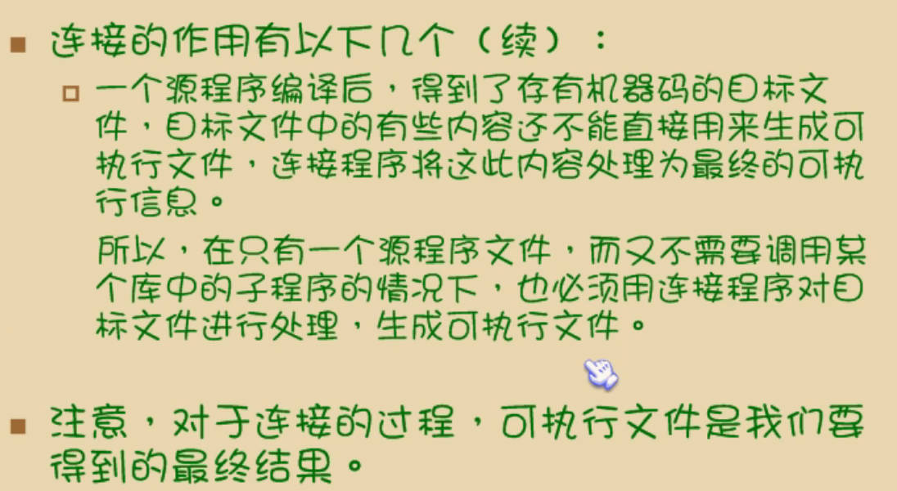 |  |
| 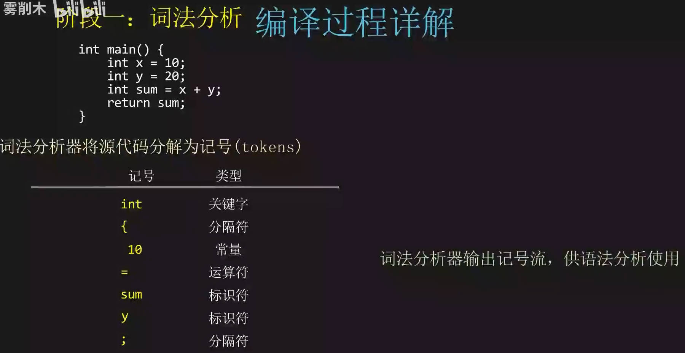 | 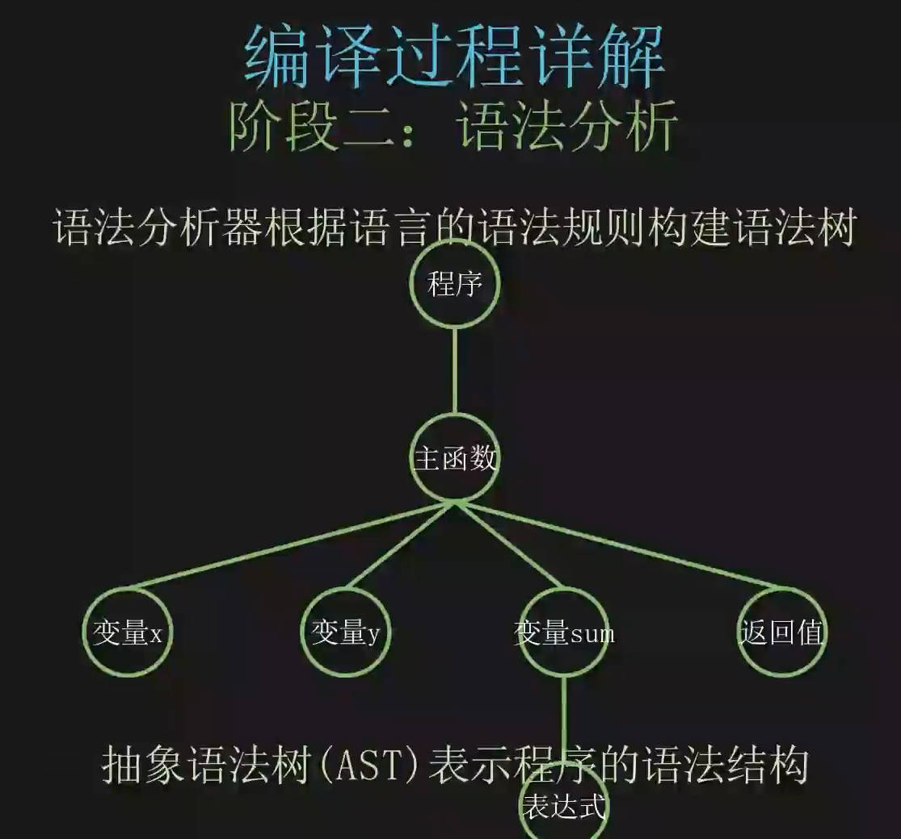 |
| 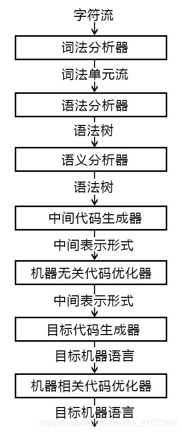                         | 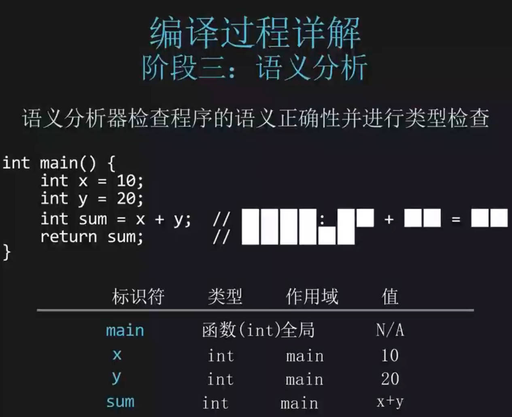 |
| 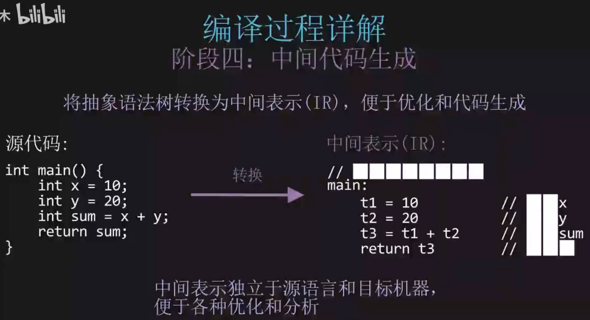 | 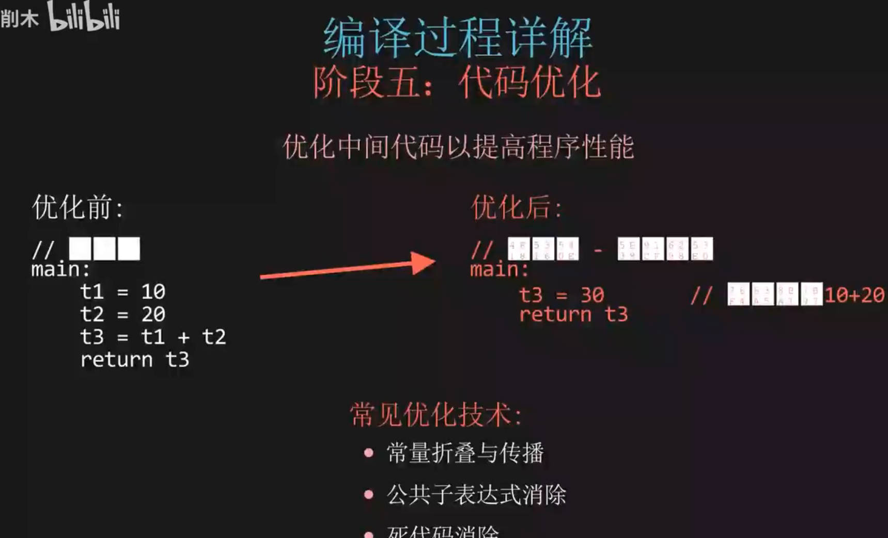 |
| 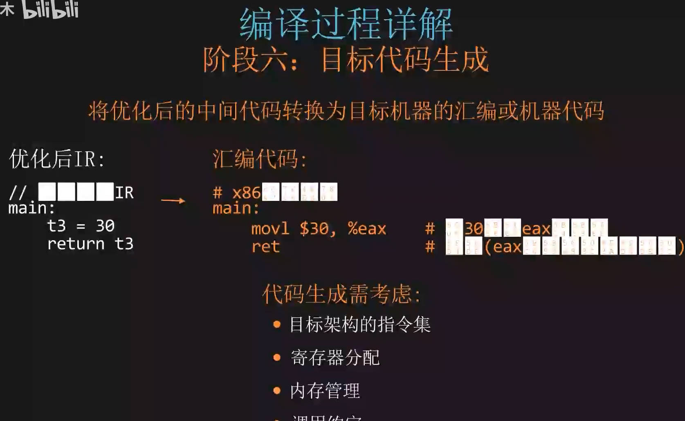 | 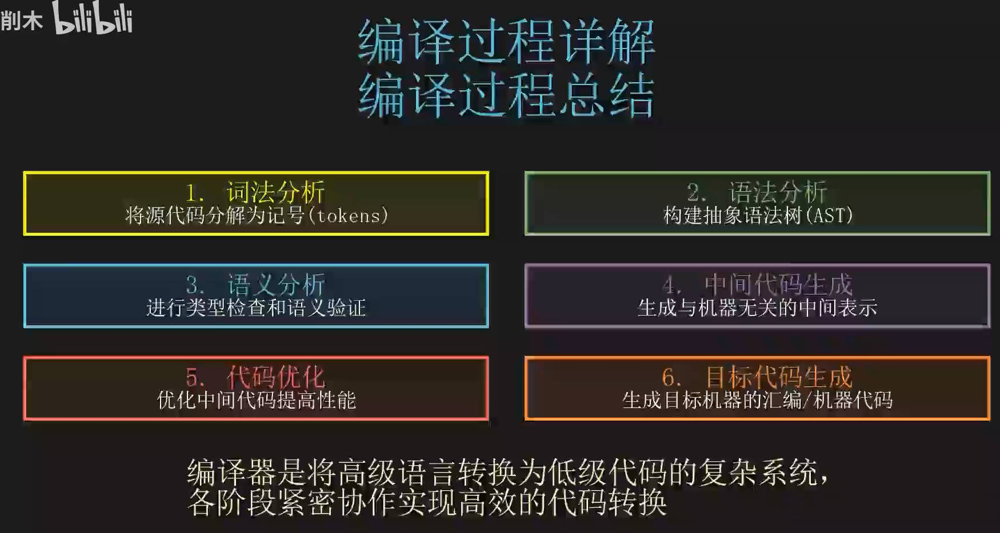 |

[编译器的工作流程](https://fishc.com.cn/thread-78063-1-1.html) 

> ==链接==: 
>
> 源代码中调用了 printf 函数，但并没有定义 printf 函数的实现过程，这是因为我们知道这是一个 stdio 的标准库函数。虽然在预处理（第一步）中，将 stdio.h 头文件导了进来，但那里边只有 printf 函数的声明而已：
>
> `extern int printf (__const char *__restrict __format,...);`
>
> 从程序员的角度看，函数库实际上就是==头文件（.h）和库文件（.so 或 .a）==的结合，==头文件中声明函数，库文件中定义函数的实现==。所以在最后一步的链接，就是把相关的库文件给链接进来（也就是把 printf 的实现代码添加进来）。
>
> *注：Linux 下的库文件分为两大类，分别是：动态链接库（通常以 .so 结尾）和静态链接库（通常以 .a 结尾）*

[符号表管理技术](https://blog.csdn.net/b12345678_123/article/details/125889597)    [什么是反编译_百度搜索](https://www.baidu.com/s?ie=utf-8&f=8&rsv_bp=1&tn=baidu&wd=%E4%BB%80%E4%B9%88%E6%98%AF%E5%8F%8D%E7%BC%96%E8%AF%91&oq=%25E5%258F%258D%25E7%25BC%2596%25E8%25AF%2591%2520%25E5%258F%258D%25E6%25B1%2587%25E7%25BC%2596&rsv_pq=8be91c4200038449&rsv_t=cb24REoxSV3GSWU%2BWxsQT9Sk2OmlldjAQQXCGpecAZ48JVhEUoqENSQA%2FWs&rqlang=cn&rsv_enter=1&rsv_dl=tb&rsv_btype=t&inputT=49651&rsv_sug3=22&rsv_sug1=18&rsv_sug7=100&rsv_sug2=0&rsv_sug4=7500876)    [java字节码和汇编语言有什么区别_百度搜索](https://www.baidu.com/s?ie=UTF-8&wd=java%E5%AD%97%E8%8A%82%E7%A0%81%E5%92%8C%E6%B1%87%E7%BC%96%E8%AF%AD%E8%A8%80%E6%9C%89%E4%BB%80%E4%B9%88%E5%8C%BA%E5%88%AB)  [汇编和编译](https://www.zhihu.com/question/388069555/answer/1155963493) [高级语言为什么不直接编译成机器码,而编译成汇编代码](https://blog.csdn.net/gaoyi221119/article/details/53319451)  [编译结果是汇编还是机器码_百度搜索](https://www.baidu.com/s?ie=UTF-8&wd=%E7%BC%96%E8%AF%91%E7%BB%93%E6%9E%9C%E6%98%AF%E6%B1%87%E7%BC%96%E8%BF%98%E6%98%AF%E6%9C%BA%E5%99%A8%E7%A0%81) 

[构建和编译区别](https://www.baidu.com/s?ie=UTF-8&wd=%E6%9E%84%E5%BB%BA%E5%92%8C%E7%BC%96%E8%AF%91%E5%8C%BA%E5%88%AB)   [编译、构建、调试、运行](https://blog.csdn.net/qq_41861406/article/details/126370735)  [编译原理和语言知识](https://zhuanlan.zhihu.com/p/68871910)  

- 构建build, 是指一些列的处理，包括编译  

> **构建和编译是软件开发过程中的两个不同阶段，它们在功能与目的、执行环境与依赖、执行频率与阶段、涉及的工具与资源以及输出与结果方面存在差异。**‌
>
> - ‌**功能与目的**‌：==构建是将源代码转化为可执行代码的过程==，它包括编译、链接、打包等一系列步骤，可能涉及测试、部署等。编译则是构建过程中的一个阶段，专门负责将人类可读的源代码转换成机器可执行的代码或中间代码。
> - ‌**执行环境与依赖**‌：构建通常涉及复杂的依赖管理和环境配置，不仅包括编译，还可能包括测试、压缩、优化等步骤。编译只依赖于源代码和编译器，将源代码转换为目标代码或字节码。
> - ‌**执行频率与阶段**‌：构建在开发过程中可能频繁执行，涉及的阶段从开发到测试再到部署都可能涉及。编译通常作为构建过程中的一个步骤，每次构建都会执行。
> - ‌**涉及的工具与资源**‌：构建工具通常更为复杂，例如Jenkins、TeamCity等，可能涉及源代码管理、依赖管理、任务调度等。编译工具相对简单，例如GCC、javac等，主要负责源代码的转换。
> - ‌**输出与结果**‌：构建的输出是一个完整的可部署或可执行的软件产品，包括编译后的代码、资源文件、配置等。编译的输出是中间代码或机器代码，通常需要链接等步骤才能成为可执行文件。
>
> 综上所述，‌**编译**‌主要是将源代码转换为机器代码的过程，而‌**构建**‌则是一个更广泛的过程，包括编译在内的多个阶段，旨在生成一个可部署或可执行的软件产品。两者在软件开发过程中共同作用，以确保软件的质量、兼容性和可维护性‌

**java是解释型语言**， 不直接编译成机器码，而是==将源代码转换为中间代码==（字节码），发送给解释器，由解释器逐句翻译给cpu执行；  好处是可以实现跨平台; 每次都要翻译，所有效率低

- 编译型：做好菜再开吃；   解释型：火锅，想吃什么下什么料

源代码经过**编译**得到汇编代码，汇编代码*经过**汇编**得到*机器代码

- 把 `预处理+编译+汇编+连接` 简称为“编译+连接”，甚至直接称为“编译” 
- 汇编是从汇编语言到机器码的过程
- 编译是 `源代码->词法分析->语法分析->中间代码生成和优化->汇编代码->机器码` 的过程，有一些语言是解释执行，就转为对应虚拟机的字节码。  

1. **预编译：** `Add.h` 和`Test.c` 头文件和源文件     [好：汇编和编译具体指什么-](https://www.zhihu.com/question/388069555)    [C++中预处理、编译、汇编、链接的区别](https://blog.csdn.net/qq_40287633/article/details/128006176?spm=1001.2101.3001.6661.1&depth_1-utm_source=distribute.pc_relevant_t0.none-task-blog-2%7Edefault%7EBlogCommendFromBaidu%7EPaidSort-1-128006176-blog-123750439.235%5Ev43%5Epc_blog_bottom_relevance_base5) 
   1. 预编译的指令`gcc Test.c -E -o Test.i`，将`Test.c`预编译为 ==Test.i==    也可以 `gcc  Test.c && ./Test.out`
   2. 编译时会将包含的[头文件](https://www.zhihu.com/search?q=头文件&search_source=Entity&hybrid_search_source=Entity&hybrid_search_extra={"sourceType"%3A"answer"%2C"sourceId"%3A3495132276})和`define`等替换拓展
   3. 注释会被删除。注释毕竟是给人看的，编译器不需要
2. **编译：**  `gcc -S Test.i -o Test.s` 将`Test.i`编译为 ==Test.s==  ；    
   1. 代码被转化成了[汇编语言](https://www.zhihu.com/search?q=汇编语言&search_source=Entity&hybrid_search_source=Entity&hybrid_search_extra={"sourceType"%3A"answer"%2C"sourceId"%3A3495132276})，其实还进行了以下过程： 词法分析、语法分析、语义分析、中间代码生成；   
   2. 要牢记住这个步骤 `符号汇总` 。将程序中出现的`函数汇总`起来，供下一步汇编时形成符号表
3. **汇编： ** 将汇编代码转化为机器码， `gcc -c Test.s -o Test.o`  ==Test.o== 
   1. 将上一个过程汇总的符号 `形成符号表`; 符号表包含的是 **函数名以及函数的地址** 
4. **链接：** 
   1. 解决一个项目多文件，多模块==相互之间调用==的问题，将这些模块之间和文件之间连接起来
   2. 汇编过程中两个文件各生成了一个==符号表==包含着函数的名称和地址，链接时把这两个符号表合成一个，共享一个符号表，编译器会将地址无效的去除掉保留有效的
   3. 编译是将[源代码](https://www.zhihu.com/search?q=源代码&search_source=Entity&hybrid_search_source=Entity&hybrid_search_extra={"sourceType"%3A"answer"%2C"sourceId"%3A3495132276})转换为目标代码(机器语言)的过程，**目标代码**通常以对象文件的形式存在。**链接**是==将多个对象文件和库文件结合在一起==，生成一个可执行程序的过程
5. ==cl表示visual studio的编译器，gcc表示linux下的编译器== 

> [编译程序](https://baike.baidu.com/item/编译程序/8290180?fromModule=lemma_inlink)把人们熟悉的语言换成2进制的。 [编译程序](https://baike.baidu.com/item/编译程序/8290180?fromModule=lemma_inlink)把一个[源程序](https://baike.baidu.com/item/源程序/9752646?fromModule=lemma_inlink)翻译成[目标程序](https://baike.baidu.com/item/目标程序/8082041?fromModule=lemma_inlink)的工作过程分为五个阶段：[词法分析](https://baike.baidu.com/item/词法分析/8853461?fromModule=lemma_inlink)；[语法分析](https://baike.baidu.com/item/语法分析/8853407?fromModule=lemma_inlink)；语义检查和[中间代码生成](https://baike.baidu.com/item/中间代码生成/8853318?fromModule=lemma_inlink)；[代码优化](https://baike.baidu.com/item/代码优化/571727?fromModule=lemma_inlink)；[目标代码](https://baike.baidu.com/item/目标代码/9407934?fromModule=lemma_inlink)生成。主要是进行[词法分析](https://baike.baidu.com/item/词法分析/8853461?fromModule=lemma_inlink)和[语法分析](https://baike.baidu.com/item/语法分析/8853407?fromModule=lemma_inlink)，又称为[源程序](https://baike.baidu.com/item/源程序/0?fromModule=lemma_inlink)分析，分析过程中发现有语法错误，给出提示信息

[Java字节码文件和二进制文件的区别与联系](https://blog.csdn.net/qq_36851469/article/details/136218605)   [二进制文件和字节码的区别_百度搜索](https://www.baidu.com/s?ie=utf-8&f=3&rsv_bp=1&tn=baidu&wd=%E4%BA%8C%E8%BF%9B%E5%88%B6%E6%96%87%E4%BB%B6%E5%92%8C%E5%AD%97%E8%8A%82%E7%A0%81%E7%9A%84%E5%8C%BA%E5%88%AB&oq=%25E4%25BA%258C%25E8%25BF%259B%25E5%2588%25B6%25E6%2596%2587%25E4%25BB%25B6%25E3%2580%2581%25E5%25AD%2597%25E8%258A%2582%25E7%25A0%2581&rsv_pq=d140509500181410&rsv_t=c101VKcdWcOAJKIkNZr3qmVXZ7688rcfZjk9J8qLZ9eHOCLJjYOGtW2MZTA&rqlang=cn&rsv_dl=ts_0&rsv_enter=1&rsv_sug3=4&rsv_sug1=3&rsv_sug7=100&rsv_sug2=1&rsv_btype=t&prefixsug=%25E4%25BA%258C%25E8%25BF%259B%25E5%2588%25B6%25E6%2596%2587%25E4%25BB%25B6%25E5%2592%258C%25E5%25AD%2597%25E8%258A%2582%25E7%25A0%2581&rsp=0&inputT=6900&rsv_sug4=9254)    [反编译 反汇编_百度搜索](https://www.baidu.com/s?ie=utf-8&f=8&rsv_bp=1&tn=baidu&wd=%E5%8F%8D%E7%BC%96%E8%AF%91%20%E5%8F%8D%E6%B1%87%E7%BC%96&oq=%25E5%258F%258D%25E7%25BC%2596%25E8%25AF%2591&rsv_pq=9df43ef20038cf1e&rsv_t=9bd88VA3zkbA3tRmI0E6rw330lou2O0N7lk%2FjzrNsQ1ywhkTETQptxqB1%2Fo&rqlang=cn&rsv_enter=1&rsv_dl=tb&rsv_sug3=11&rsv_sug1=10&rsv_sug7=100&rsv_sug2=0&rsv_btype=t&inputT=4455&rsv_sug4=6834) 

- 目标代码：  [目标代码_百度百科](https://baike.baidu.com/item/%E7%9B%AE%E6%A0%87%E4%BB%A3%E7%A0%81/9407934?fr=ge_ala)    [源代码、目标代码、可执行代码、本地代码的区别 ](https://www.cnblogs.com/leesky/articles/13966617.html)  
  - [编译器](https://baike.baidu.com/item/编译器/0?fromModule=lemma_inlink)或[汇编器](https://baike.baidu.com/item/汇编器/0?fromModule=lemma_inlink)处理[源代码](https://baike.baidu.com/item/源代码/0?fromModule=lemma_inlink)后所生成的代码，它一般由机器代码或接近于[机器语言](https://baike.baidu.com/item/机器语言/0?fromModule=lemma_inlink)的代码组成。[目标文件](https://baike.baidu.com/item/目标文件/0?fromModule=lemma_inlink)（object file）即存放目标代码的[计算机](https://baike.baidu.com/item/计算机/0?fromModule=lemma_inlink)文件，它常被称作[二进制文件](https://baike.baidu.com/item/二进制文件/0?fromModule=lemma_inlink)（binaries）。
  - [目标文件](https://baike.baidu.com/item/目标文件/0?fromModule=lemma_inlink)包含着机器代码（可直接被[计算机](https://baike.baidu.com/item/计算机/0?fromModule=lemma_inlink)[中央处理器](https://baike.baidu.com/item/中央处理器/0?fromModule=lemma_inlink)执行）以及代码在运行时使用的[数据](https://baike.baidu.com/item/数据/0?fromModule=lemma_inlink)，如[重定位](https://baike.baidu.com/item/重定位/0?fromModule=lemma_inlink)信息，如用于链接或调试的程序符号（[变量](https://baike.baidu.com/item/变量/0?fromModule=lemma_inlink)和函数的名字），此外还包括其他调试信息。
  - [目标文件](https://baike.baidu.com/item/目标文件/0?fromModule=lemma_inlink)是从[源代码](https://baike.baidu.com/item/源代码/0?fromModule=lemma_inlink)文件产生[程序文件](https://baike.baidu.com/item/程序文件/0?fromModule=lemma_inlink)这一过程的中间产物，[链接器](https://baike.baidu.com/item/链接器/0?fromModule=lemma_inlink)正是通过把目标文件链接在一起来生成[可执行文件](https://baike.baidu.com/item/可执行文件/0?fromModule=lemma_inlink)或库文件。[目标文件](https://baike.baidu.com/item/目标文件/0?fromModule=lemma_inlink)中唯一的要素是机器代码，例如，用于[嵌入式系统](https://baike.baidu.com/item/嵌入式系统/0?fromModule=lemma_inlink)的目标文件可能仅仅含有机器代码。 
- 目标代码是基于某种特定的系统体系的。由一种机器上的编译器编译出来的文件可能不能在另一种不同体系的机器上执行。尽管，这个问题已经由“中间代码”和“即时编译器”解决，但仍然有许多语言，像Java，遵循目标代码生成的传统方式。
- 修改源码后，每次需要编译源代码以反映目标代码中的更改。

| 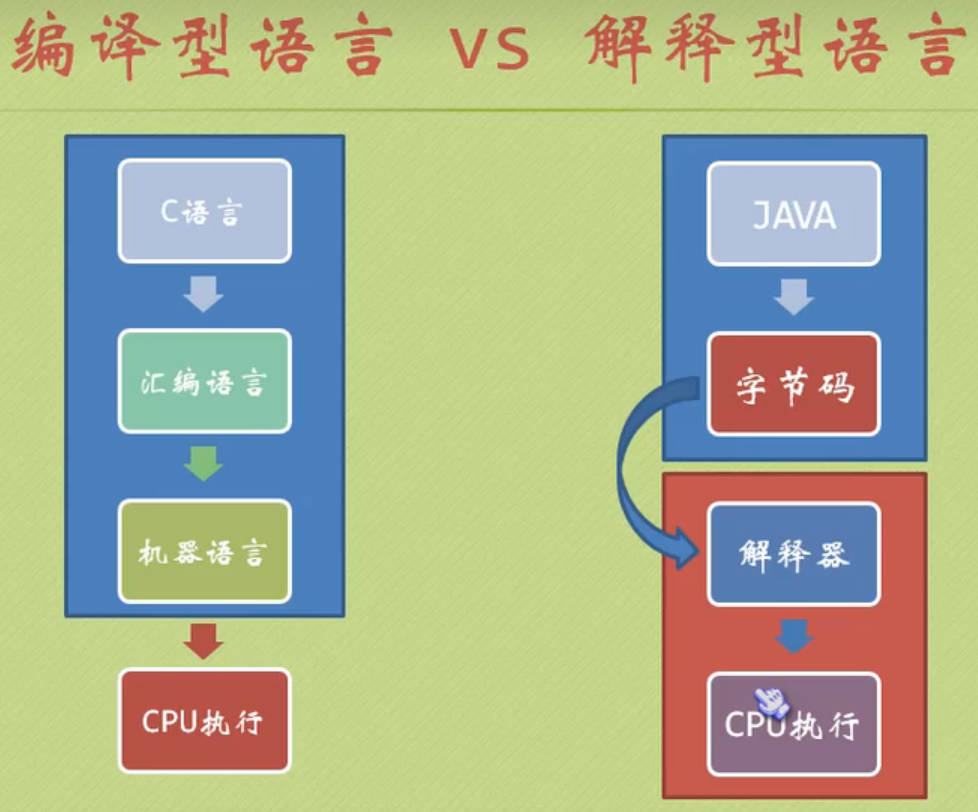 | 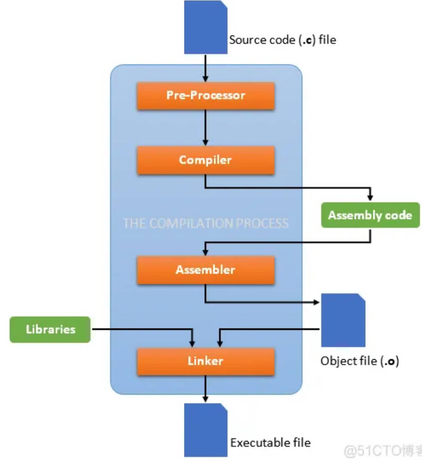 |
| -------------------------------------------------------- | -------------------------------------------------------- |
| 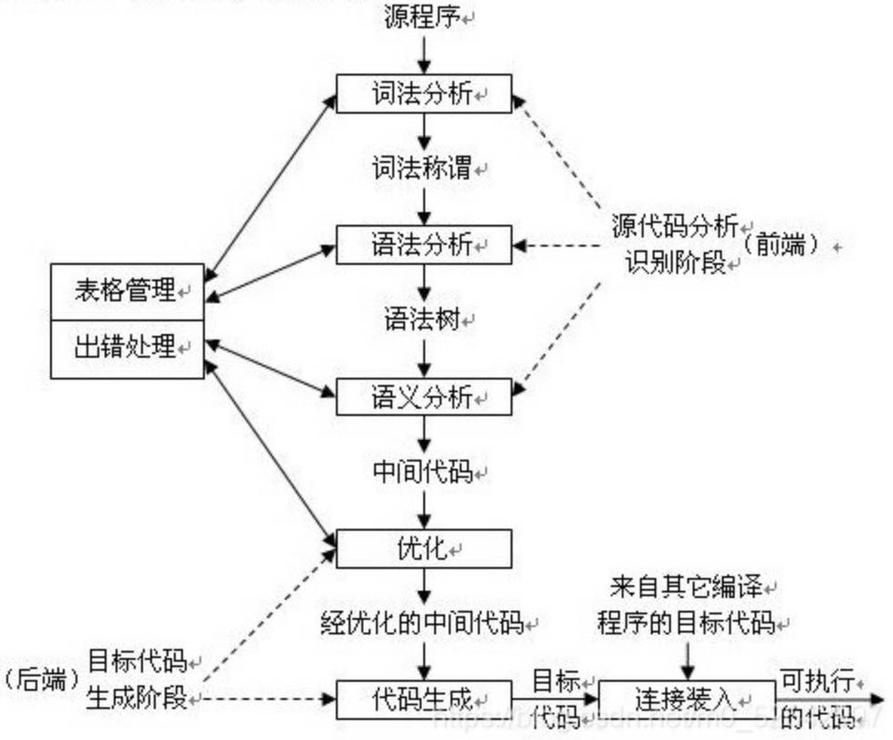 | 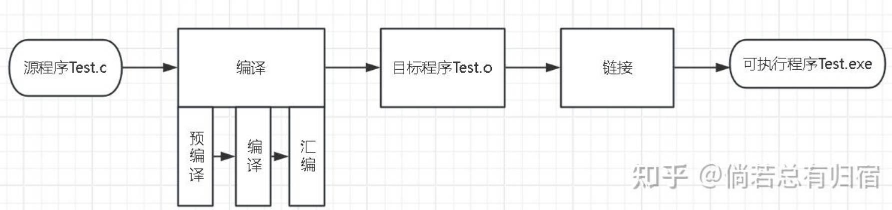 |
| 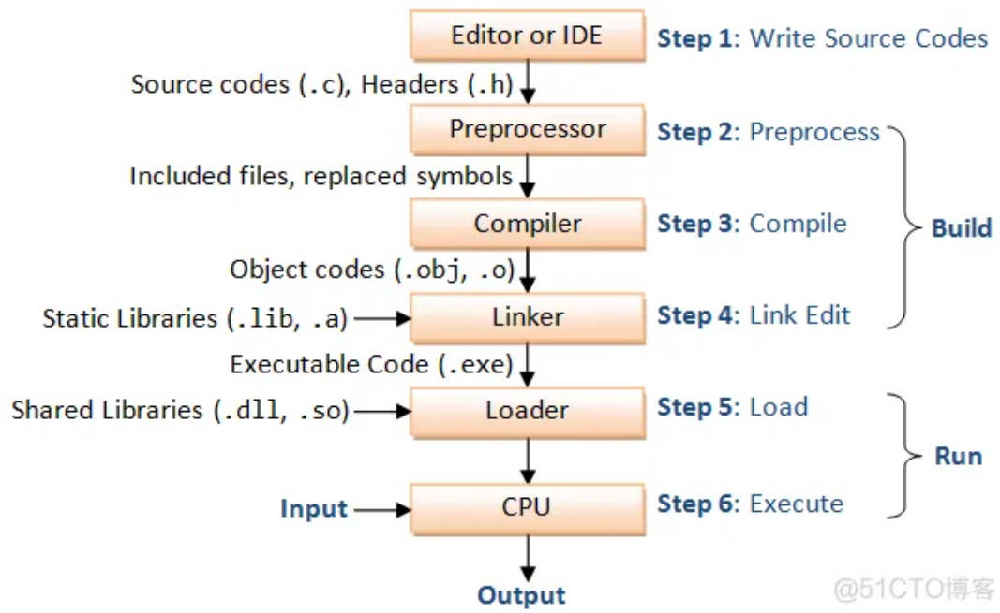 | 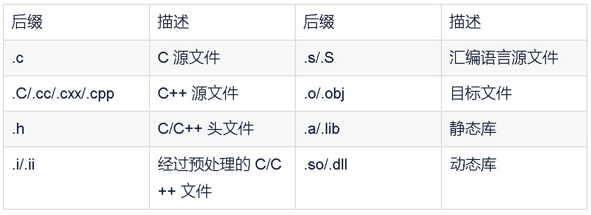 |

## make_makefile, cmake, qmake

[CMake教程](https://zhuanlan.zhihu.com/p/534439206)   [好： make, makefile, cmake, qmake ](https://www.zhihu.com/question/27455963/answer/89770919) 

[makefile教程](https://www.bilibili.com/video/BV1vTV2z3Eyp/?vd_source=7346303e5e18677d7261c2c0c109ecfd)	

- gcc: GNU Compiler Collection（就是GNU[编译器套件](https://www.zhihu.com/search?q=编译器套件&search_source=Entity&hybrid_search_source=Entity&hybrid_search_extra={"sourceType"%3A"answer"%2C"sourceId"%3A89770919})），也可以简单认为是编译器
  - 当程序只有一个源文件时，直接就可以用gcc命令编译它
- 当程序包含==很多源文件== 时，用gcc命令==逐个编译==时，容易混乱而且工作量大, 所以出现了 `make工具`  **批量编译**
  - make工具可以看成是一个智能的批处理工具，本身并没有编译和链接的功能，而是用类似于[批处理](https://www.zhihu.com/search?q=批处理&search_source=Entity&hybrid_search_source=Entity&hybrid_search_extra={"sourceType"%3A"answer"%2C"sourceId"%3A89770919})的方式 — 通过 `调用makefile文件` 中用户指定的命令来进行编译和链接的
  - make 工具 根据makefile中的命令进行编译和链接
  - makefile命令中 包含了调用gcc（也可以是别的编译器）去 `编译某个源文件的命令`
- 工程大的时候，==手写makefile也很麻烦==， 出现了 Cmake 工具
  - cmake 可以 ==更简单的生成makefile文件== 给make用。当然cmake还有其他功能，就是可以跨平台生成对应平台能用的makefile
  - cmake 根据 `CMakeLists.txt`文件（学名：[组态档](https://www.zhihu.com/search?q=组态档&search_source=Entity&hybrid_search_source=Entity&hybrid_search_extra={"sourceType"%3A"answer"%2C"sourceId"%3A89770919})）去生成makefile
  - `CMakeLists.txt`文件要自己手写
- qmake
  - Qt专有的moc编译器（The Meta-Object Compiler）和[uic编译器](https://www.zhihu.com/search?q=uic编译器&search_source=Entity&hybrid_search_source=Entity&hybrid_search_extra={"sourceType"%3A"answer"%2C"sourceId"%3A89770919})（User Interface Complier）， 对Qt源文件进行预处理
  - [makefile文件](https://www.zhihu.com/search?q=makefile文件&search_source=Entity&hybrid_search_source=Entity&hybrid_search_extra={"sourceType"%3A"answer"%2C"sourceId"%3A89770919}) 没办法对qt源文件进行预处理。qmake就产生了
  - qmake工具用来`生成Qt 专用makefile文件`，这种makefile文件就能自动智能调用moc和uic对源程序进行预处理和编译

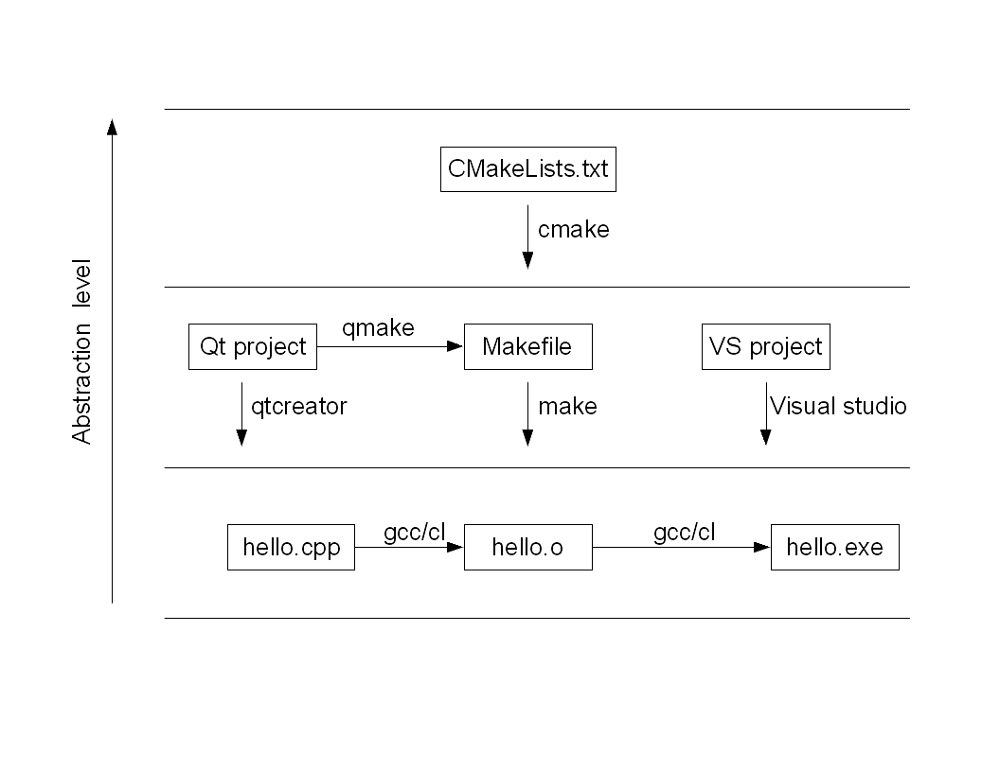

[程序连接_百度百科](https://baike.baidu.com/item/%E7%A8%8B%E5%BA%8F%E8%BF%9E%E6%8E%A5/6965399)  [程序的编译与链接](https://blog.51cto.com/u_17144325/13672203)   [编译与链接：从源码到可执行文件的四个阶段](https://blog.csdn.net/weixin_32075843/article/details/167407747)  [汇编程序的执行流程：编辑、编译、连接与运行](https://cloud.tencent.com/developer/article/2462414)  [编译后为什么要链接？](https://blog.csdn.net/bleen1009/article/details/142779684)  

## 编译后为什么要连接

编译后的目标文件还不能直接运行，因为它只是零散的半成品，缺少模块间的关联信息和最终的内存地址，必须通过链接把它们拼装成一个完整的可执行文件。

打个比方：编译像是把每个源文件单独翻译成一份机器码零件，链接则是把这些零件组装成一台能开动的整机。

### 为什么必须链接

1. 解决跨文件调用：项目拆成多个 `.c` 文件时，一个文件里调用另一个文件的函数或变量，编译阶段并不知道对方的确切地址，链接器负责找到这些定义并填上正确的地址。
2. 合并代码和数据段：把各个目标文件里的代码段、数据段等按类型合并到一起，统一安排内存布局，避免冲突。
3. 对接库文件：程序中用到的标准库（如 `printf`）或第三方库，需要由链接器把它们和目标文件整合，程序运行时才能找到这些函数。
4. 解析符号和重定位：把所有函数、变量的引用都指向真实定义，并把临时地址修正成最终的可执行地址。
5. 生成可执行文件：最终产出带入口点、完整加载信息的可执行程序（如 `.exe`），操作系统才能加载运行。

> 编译是“逐文件翻译”，链接是“全局组装”。编译阶段只能看到单个文件，跨文件的地址关系必须靠链接来解决。

### 静态链接 vs 动态链接

- 静态链接：把库代码直接复制进可执行文件，生成独立程序，文件体积较大但部署简单。
- 动态链接：程序运行时才加载共享库，可执行文件更小，多个程序可共用同一份库代码。

如果跳过链接直接运行目标文件，系统会因无法解析符号、缺少入口点而拒绝加载，这也是遇到 `未定义符号`、`重复定义` 等链接错误的原因。

链接过程涉及不少细节，可以看看链接时如何解决符号冲突?或者静态库和动态库怎么选择?

## 编译器工作流程

好：[编译与链接：从源码到可执行文件的四个阶段](https://blog.csdn.net/weixin_32075843/article/details/167407747)   [编译器的工作过程](https://kb.cnblogs.com/page/508336/)  

[通用编译程序_百度百科](https://baike.baidu.com/item/%E9%80%9A%E7%94%A8%E7%BC%96%E8%AF%91%E7%A8%8B%E5%BA%8F/22099336)  [编译器的基础概念与类型分类](https://cloud.tencent.com/developer/article/2475906)  [编译程序的六个工作流程 ](https://www.kancloud.cn/digest/bianyiyuanli/164790)  

[从源码到CPU：C/C++编译、链接与加载全流程解析](https://blog.csdn.net/weixin_30768881/article/details/167725234)  [TypeScript 是怎么工作的？深入编译器内部流程](https://blog.csdn.net/xgangzai/article/details/147524381)   

> 一个 C/C++ 源文件变成可执行文件，宏观上要经历四步：
>
> 1. 预处理 ：处理 #include 、 #define 、条件编译指令，生成“纯 C/C++ 代码”。这一步不检查语法，只是文本替换与文件拼接。
> 2. 编译 ：词法分析、语法分析、语义分析，加上各种优化，最终生成 汇编代码 。这一步才是真正的“翻译”。
> 3. 汇编 ：把汇编代码转成机器指令，生成 目标文件 （ .o / .obj ）。目标文件是“半个成品”，里面的地址还是待定的。
> 4. 链接 ：把多个目标文件和库组合在一起，完成符号解析与重定位，生成最终的可执行文件。

编译器把高级语言源码变成机器能跑的可执行文件，核心是一条“多阶段翻译加优化”的流水线，主要分预处理 → 词法分析 → 语法分析 → 语义分析 → 中间代码生成 → 代码优化 → 目标代码生成 → 汇编 → 链接这几步。

以 C 语言为例，完整流程大致这样：

### 编译前的准备

- 预处理：处理 `include`、`define` 宏展开、条件编译指令，并删掉注释。这步只是纯文本替换，不做语法检查。
- 词法分析：把源码字符流从左到右扫描，拆成一个个“单词”（Token），比如关键字、标识符、运算符、常量，同时丢掉空格和注释。
- 语法分析：根据语言的语法规则，把 Token 流组合成语法单位（表达式、语句等），并构建一棵抽象语法树（AST），检查括号匹配、语句结构是否合法。
- 语义分析：检查类型是否匹配、变量有没有声明、作用域是否正确等“意思”上的问题，并建立符号表记录各名字的类型和作用域。

### 生成与优化

- 中间代码生成：把语法树转换成与具体机器无关的中间表示（IR），常见形式有三地址码、四元式、语法树等。
- 代码优化：在中间代码或目标代码层面做等价变换，比如常量折叠（`1+2` 直接算成 `3`）、删除死代码、优化循环，让最终程序跑得更快、占空间更小。
- 目标代码生成：把优化后的中间代码翻译成目标机器的汇编代码或机器码，同时要处理寄存器分配、指令选择、调用约定等。

### 生成可执行文件

- 汇编：把汇编代码翻译成机器码，生成目标文件（`.o` 或 `.obj`），此时还没分配最终内存地址。
- 链接：把多个目标文件和库文件合并，解析跨文件的函数调用地址，生成最终可执行文件。链接分静态链接（库代码直接复制进可执行文件）和动态链接（运行时再加载库）。

### 关键补充

- 前端与后端：词法、语法、语义分析属于与源语言相关的前端；代码优化和目标代码生成属于与目标机相关的后端。这种划分让编译器更容易支持多种语言和多平台。
- 符号表与出错处理：符号表贯穿全程，记录标识符信息；每个阶段都可能报错，出错处理让编译器尽量多查出问题。
- JIT 编译：Java、Python 等语言常先编译成字节码，再由虚拟机边运行边翻译，并把翻译结果缓存起来提升性能，这就是即时编译（JIT）。
- 经典工具链：GCC 和 LLVM/Clang 是两大主流开源编译器。LLVM 把编译分成前端、中端（优化）、后端三段，让不同语言共享同一套优化和代码生成。

编译器流程里有些细节挺有意思，比如预处理阶段宏展开的替换规则或者符号表在不同阶段如何维护

## 目标文件是机器码

[目标代码_百度百科](https://baike.baidu.com/item/%E7%9B%AE%E6%A0%87%E4%BB%A3%E7%A0%81/9407934)  

[.o文件和.obj文件是经过汇编后的二进制文件是吗](https://blog.csdn.net/slty_123/article/details/149480557)  

[为什么 .o 文件不一定是机器码？深入解析目标文件与链接重定位机制](https://bbs.csdn.net/weixin_32576389/article/details/100532810)  

目标文件里存的是机器码，不是汇编代码。

汇编代码是人可读的文本指令（比如 `mov`、`add`），而目标文件（`.o`、`.obj`）是汇编器把汇编代码翻译后生成的二进制文件，里面是 CPU 能直接执行的机器指令，还带着符号表、重定位信息这些链接时用的元数据。

> 需要区分一下：汇编代码是“源文件”形态，目标文件是“中间产物”形态。汇编器只做一件事——把汇编指令精确翻译成字节，不负责优化和链接。

### 目标文件里有什么

1. 机器代码：核心内容，放在 `.text` 段，就是可执行的二进制指令。
2. 数据：已初始化的全局变量、静态变量放在 `.data` 段，未初始化的放在 `.bss` 段。
3. 元数据：符号表、重定位信息、调试信息等，这些是链接时用来把多个目标文件拼成可执行文件用的。

### 和目标文件相关的小知识

- ==目标文件也叫二进制文件==，是编译过程的中间产物，链接器把多个目标文件链接后才会生成最终的可执行文件。
- 常见的 `.exe`、`.dll`、`.so` 也都属于目标文件的范畴，只是类型不同。
- ==不同平台的格式不一样==：Linux 用 ELF，==Windows 用 PE==，macOS 用 Mach-O。

目标文件里除了机器码，还有符号表和重定位信息，要不要看看符号表在链接时起什么作用?或者重定位信息如何帮助链接?

# 编译器

## c语言编译器对比

C 语言编译器的选择，本质上是在**平台、标准支持、优化质量、工具链生态**四者之间做权衡：Linux/服务端几乎默认 GCC，追求诊断质量和跨平台一致性选 Clang/LLVM，Windows 原生开发与 MSVC 生态绑定最深，嵌入式则基本由厂商工具链（Arm/IAR/Keil 等）主导。下面按“速查结论 → 主流三家横评 → 其他选手 → 选型建议”展开。

### 一、选型速查

| 你的情况                                                  | 推荐                            |
| --------------------------------------------------------- | ------------------------------- |
| Linux 服务器/发行版软件、GNU 项目、autotools 老项目       | GCC                             |
| 跨平台项目、想要更好的报错信息、静态分析/Sanitizer        | Clang/LLVM                      |
| Windows 桌面、DirectX/COM、游戏、需要与 VS 调试器深度配合 | MSVC                            |
| 嵌入式 MCU、需要认证（MISRA/Certified）                   | IAR / Keil(AC6) / 厂商 GCC 分支 |
| 只想快速跑通小脚本、极小体积编译                          | TinyCC（tcc）                   |
| 追求极致数值性能且用 Intel 平台                           | Intel ICX（icx/-march 调优）    |

### 二、主流三家横评（2026 年现状）

**版本基线**：GCC 16.1 于 2026 年 4 月 30 日发布，是 GCC 16 系列首个稳定版，完成了 C23 标准的完整集成；LLVM/Clang 23.1 是 LLVM 23 系列首个稳定版，带来了更多 C2Y 语言特性与部分 C++26 支持；Windows 侧对应 Visual Studio 2026 的 MSVC 生成工具 14.50/14.51（`_MSC_VER` 为 1950/1951），版本节奏改为每六个月一次。

| 维度         | GCC                                              | Clang / LLVM                                                 | MSVC                                              |
| ------------ | ------------------------------------------------ | ------------------------------------------------------------ | ------------------------------------------------- |
| 架构         | 前端+中端+后端一体化，传统单体结构               | 前端/优化器/后端清晰分层，IR 可复用                          | 闭源一体化，与 Windows SDK、IDE 深度耦合          |
| C 标准支持   | C23 已完整集成（GCC 16）                         | C23 完整、C2Y 特性持续落地                                   | 相对滞后，C11/C17 为主，新标准跟进最慢            |
| 优化强项     | 循环优化、自动向量化、数值/科学计算积累深厚      | 内联与常量传播激进、LTO/ThinLTO 优秀、新指令集支持快         | Windows API/图形负载调优好，支持 PGO              |
| 生成代码性能 | SPEC CPU2017 INT 上平均约 3% 领先 Clang（O2/O3） | 向量化相关用例可大幅领先（如 x264 场景）；与 GCC 16 互有胜负 | 64 位下与 GCC/Clang 接近，32 位 historically 较弱 |
| 编译速度     | 中等                                             | 通常最快，增量编译体验好                                     | 默认配置偏慢，受 PDB/调试信息影响大               |
| 诊断与工具   | 诊断持续改进，GDB/binutils 生态完整              | 报错质量公认最好，clang-tidy/clang-format/静态分析器/Sanitizer 齐全 | IDE 内体验最佳（图形调试、性能分析器）            |
| 平台         | Linux/Unix 事实标准，交叉编译目标极多            | 跨平台一致性好，macOS/Android/嵌入式均广泛使用               | 仅 Windows（含 UWP/ARM64）                        |
| 许可         | GPL（运行时例外）                                | Apache-2.0 + LLVM 例外                                       | 专有                                              |

几点补充说明：

- **“C 编译器”其实是一整套工具链**。真正影响体验的还有标准库与运行库（glibc/musl、MSVC CRT）、链接器（ld/Gold/lld/Microsoft linker）、调试器（GDB/LLDB/VS Debugger）以及构建系统（CMake 对三者的抽象最好）。同一份代码换链接器或运行库，行为可能比换编译器变化还大。
- **语言扩展不兼容**是跨平台移植的主要痛点：GCC 的 `__attribute__`、`__builtin_*`，MSVC 的 `__declspec`、`__forceinline`，Clang 大体兼容 GCC 扩展但仍有差异。写跨平台 C 时建议把扩展封装到宏或独立适配层里。
- **ABI 与混编风险**：不同编译器/不同版本的调用约定、结构体对齐、异常与 CRT 堆可能不一致，Windows 上尤其要注意运行时库（/MD、/MT）统一，Linux 上则主要看 libstdc++ 与 libc++ 不要混用。

### 三、其他值得知道的编译器

- **MinGW-w64 / MSYS2**：Windows 上跑 GCC，适合想要 GNU 生态又不想装 WSL 的场景；但与 MSVC 生成的库互操作需谨慎。
- **Intel ICX（icx/icpx）**：基于 LLVM，x86 向量化与数学库调优强，数值计算场景常能再挤出性能。
- **TinyCC（tcc）**：编译极快、体积很小，自带解释器，适合教学、脚本化编译，优化能力有限。
- **嵌入式工具链**：Arm 生态常见 Keil MDK（AC6 前端基于 Clang）、IAR Embedded Workbench（MISRA 检查与认证完善）、以及 `arm-none-eabi-gcc`；RISC-V 侧多用 GCC 与 LLVM 的定制分支。选型时**认证支持与厂商 BSP 成熟度**往往比纯性能更重要。
- **Zig 的 `zig cc`**：本质是 Clang 封装 + 自带 libc 交叉编译能力，交叉编译体验很省心。
- **教学/研究型**：cproc、chibicc 等，主要用于学习编译器实现，不适合生产。

### 四、怎么选（按场景）

1. **学习 C 语言 / 刷题 / 写小工具**：任选，Linux 用 GCC，Windows 装 MSVC 或 MinGW-w64 都行，差别感受不出来。
2. **开源项目 / CI 矩阵**：GCC + Clang 双编译器编译，用 Clang 做 tidy/静态分析与 Sanitizer 跑测，GCC 做发布构建，是当下很常见的组合。
3. **Windows 商业软件**：MSVC 为主；若代码库跨平台，用 CMake 抽象，避免写死编译器特定标志。
4. **高性能计算**：先固定 `-march/-mtune` 与 `-O2/-O3`，再用 GCC、Clang、ICX 各跑一遍真实基准，**以实测为准**——不同负载下胜负会翻转。
5. **嵌入式/安全关键**：优先看工具链是否支持目标芯片、是否有功能安全认证、MISRA 检查与静态分析能力，其次才是优化率。

### 五、自己对比的最小方法

用同一份源码、同一台机器、关闭无关负载，比较三件事：**编译耗时、产物体积、基准运行时间**。

```bash
# GCC
gcc -O2 -march=native -o app_gcc main.c
# Clang
clang -O2 -march=native -o app_clang main.c
# MSVC（在开发者命令提示符中）
cl /O2 /arch:AVX2 main.c /Feapp_msvc.exe
```

再用 `hyperfine` 或简单循环计时对比运行时间，用 `size`/`ls -l` 看体积，用 `-S`/`/Fa` 看关键函数的汇编差异。注意统一优化级别（`-O2` 对应 `/O2`）、是否开启 LTO、是否链接同一套数学库，否则结论没有可比性。

如果你能说明**目标平台（Linux/Windows/嵌入式）、用途（学习/项目/性能优化）以及是否涉及 C++ 混编**，我可以给出更具体的编译器与编译参数建议。

## gcc

[好：gcc执行过程](https://blog.csdn.net/liuxingyuzaixian/article/details/125979677)	[GCC编译过程及静态链接库和动态链接库](https://blog.csdn.net/f2157120/article/details/102811425)	   [gcc执行](https://blog.csdn.net/weixin_47826078/article/details/120474122)	 [gcc test.c &&_百度搜索](https://www.baidu.com/s?ie=UTF-8&wd=gcc%20test.c%20%26%26)	

[GCC, the GNU Compiler Collection - GNU Project](https://gcc.gnu.org/) 

[gcc说明](https://www.zhihu.com/search?hybrid_search_extra=%7B%22sourceType%22%3A%22answer%22%2C%22sourceId%22%3A89770919%7D&hybrid_search_source=Entity&q=%E7%BC%96%E8%AF%91%E5%99%A8%E5%A5%97%E4%BB%B6&search_source=Entity&type=content)   [GCC参数详解|菜鸟教程](https://www.runoob.com/w3cnote/gcc-parameter-detail.html)	

[gcc 命令详解](https://www.cnblogs.com/zhangjxblog/p/7776551.html)   [gcc 命令详解及最佳实践](https://blog.51cto.com/u_11767891/5533097)   [gcc命令](https://zhuanlan.zhihu.com/p/698659528) [GCC常用命令](https://blog.csdn.net/txmnQAQ/article/details/120654273)   [GCC 常用命令](https://blog.csdn.net/TyearLin/article/details/130201720)  

windows下gcc移植版： [MinGW-w64_百度搜索](https://www.baidu.com/s?ie=UTF-8&wd=MinGW-w64)  [mingw_百度百科](https://baike.baidu.com/item/mingw/1777782?fr=aladdin)  [win10/win11安装MinGW-w64](https://www.cnblogs.com/ajianbeyourself/p/17959513)  [MinGW-w64](https://zhuanlan.zhihu.com/p/26143367916)  [MinGW-w64 ](https://blog.csdn.net/weixin_28840143/article/details/168022986)  

- GCC 原本作为 GNU 操作系统的官方编译器，现已被大多数类 Unix 操作系统（如Linux、BSD、Mac OS X等）采纳为标准的编译器，GCC 同样适用于微软的Windows。GCC 是自由软件过程发展中的著名例子，由自由软件基金会以 GPL 协议发布
  - g++是gcc的c++编译器,  c语言的编译器程序名叫gcc
- **Windows下比较流行的GCC移植版**主要有三个，他们是 ==MinGW，Cygwin 和 Djgpp== 

```c
// gcc 不指定目标文件名时默认生成的可执行文件名为 a.out(linux) 或 a.exe(windows)。
// gcc [源文件名] -o [目标文件名]
```


| 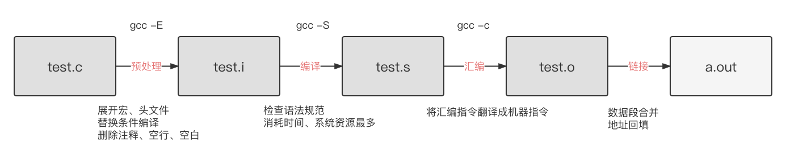 | 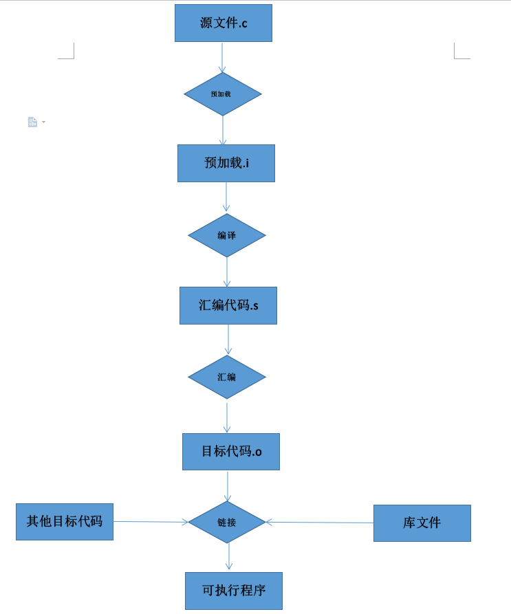 |
| ------------------------------- | -------------------------------- |

# 工具

## Cmake

[CMake vs Makefile](https://www.cnblogs.com/xiaowange/p/17435839.html)   [CMake构建跨平台项目](https://blog.csdn.net/qq_53144843/article/details/136040086?utm_medium=distribute.pc_relevant.none-task-blog-2~default~baidujs_baidulandingword~default-0-136040086-blog-131527660.235^v43^pc_blog_bottom_relevance_base9&spm=1001.2101.3001.4242.1&utm_relevant_index=3)   

- 自己动手写 makefile，会发现，makefile 通常==依赖于当前的编译平台==，而且编写 makefile 的工作量比较大，解决依赖关系时也容易出错
- CMake 恰好能解决上述问题， 允许开发者指定整个工程的编译流程，再根据编译平台，自动生成本地化的Makefile和工程文件，最后用户只需make编译即可；   CMake: ==自动生成 Makefile的工具==

## 工具下载

[看雪学苑](https://www.kanxue.com/)	 [看雪知识库](https://www.kanxue.com/chm.htm)	

[Ghidra使用](https://cloud.tencent.com/developer/article/2483246)	

# SDK

[SDK的优势以及应用场景](https://cloud.tencent.com/developer/techpedia/1839)  [软件开发工具包_百度百科](https://baike.baidu.com/item/%E8%BD%AF%E4%BB%B6%E5%BC%80%E5%8F%91%E5%B7%A5%E5%85%B7%E5%8C%85/10418833)  [SDK 与 API](https://www.ibm.com/cn-zh/think/topics/api-vs-sdk)  [SDK用途及工作原理](https://unity.com/cn/glossary/sdk)  

[第三方SDK列表](https://www.sony.com.cn/privacy/terms-sdk-2109.html)  [VUE接入第三方SDK列表](https://mmvmaterial.wxqcloud.qq.com/agreements/VUE/third-party-sdk.html)  

[开放api和开放sdk对比_百度搜索](https://www.baidu.com/s?ie=utf-8&f=8&rsv_bp=1&tn=baidu&wd=%E5%BC%80%E6%94%BEapi%E5%92%8C%E5%BC%80%E6%94%BEsdk%E5%AF%B9%E6%AF%94&oq=VU%2526gt%253B%25E7%25AC%25AC%25E4%25B8%2589%25E6%2596%25B9sdk&rsv_pq=d226d4470008fb84&rsv_t=f4d1sigrdIfDxgN7rzlHVLPmeSrJKwOpV33q06N3ksKjFbNOUQHIgUd%2FMy8&rqlang=cn&rsv_enter=1&rsv_dl=tb_enter&rsv_sug3=31&rsv_btype=t&inputT=17913&rsv_sug4=17913)  [从定义范围等六个维度深入对比API与SDK](https://developer.aliyun.com/article/1628034)  

## SDK

SDK 全称 Software Development Kit，中文叫软件开发工具包，是帮开发者快速创建软件的一套工具集合，里面通常包含代码库、文档、示例和调试工具等，能让开发工作省事不少。

### SDK 工具箱里都有啥

1. 核心代码和接口：SDK 里封装好了现成的功能模块，开发者直接调用就能用，不用从零写代码。
   - 比如地图 SDK 已经把定位、显示、路线规划都打包好了。
   - 支付 SDK 把下单、调起支付、验签流程都封装完毕。
2. 配套文档和示例：提供使用说明、接口文档和可运行的 Demo，照着做就能快速上手。
3. 辅助工具：包含调试器、模拟器、配置文件管理工具等，帮开发者测试和排查问题。


### SDK 和 API 有啥不一样

1. 范围不同：API 只是一组接口规范，定义软件之间怎么通信；SDK 是一整套工具包，里面可能包含多个 API 加上其他开发资源。
   - API 像一扇门，告诉你怎么进出。
   - SDK 像整个工具箱，连螺丝刀、说明书都配齐了。
2. 使用方式不同：调用 API 需要自己处理请求、加密、解析等底层逻辑；用 SDK 则把这些细节都封装好了，直接调用方法就行。
   - 纯 API 方式：要自己组装请求、处理加密、解析数据、兼容不同版本。
   - SDK 方式：配置好应用 ID，调用一个方法就能拿到结果。
3. 适用场景不同：只需要单一功能时选 API 更轻量；需要深度集成或全链路支持时选 SDK 更省心。


### 用 SDK 要留意的地方

1. 权限申请：有些 SDK 会申请与应用功能无关的权限，比如获取通讯录、短信记录等，要保持警惕。
2. 来源可靠性：尽量选择经过备案认证的 SDK，引入前做好安全检测和风险评估。
3. 版本兼容性：SDK 更新后可能导致应用程序需要修改，依赖性强，选择时要考虑长期维护成本。

SDK 的作用不少，要不要继续看看 地图 SDK 一般包含哪些功能？ 或者 支付 SDK 需要哪些基础配置？

## 开放api和开放sdk对比

开放API是接口，开放SDK是工具包，两者不在一个层级上。API是“怎么调”，SDK是“怎么省事地调”。

### 核心差异

1. 本质不同：==API==是软件对外暴露的标准化功能入口，==像餐厅菜单==，定义好入参出参；SDK是包含API、文档、示例代码、调试工具等的完整集合，像配好料的半成品菜和专用锅具。
2. 存在形式：API无本地实体，靠HTTP/RPC请求调用；SDK有实体，可下载、import进项目，以jar包、npm包等依赖形式存在。
3. 使用方式：调API需自己拼请求、处理网络通信和序列化；用SDK直接实例化对象调方法，认证、重试、加密等底层逻辑已被封装。
4. 语言绑定：API通常语言无关，任何技术栈都能调；SDK强绑定特定语言，Java SDK就得用Java调。

### 对比速览

| 维度     | 开放API                | 开放SDK                      |
| -------- | ---------------------- | ---------------------------- |
| 定位     | 接口契约、协议规范     | 开发工具包、代码集合         |
| 交付物   | 文档、OpenAPI规范文件  | jar包、npm包、源码、示例工程 |
| 本地存在 | 无实体文件             | ==以依赖形式存在本地==       |
| 使用方式 | 按文档构造HTTP/RPC请求 | import包、实例化、调方法     |
| 学习成本 | 较低，只需懂接口       | 需学SDK结构，但掌握后效率高  |
| 维护责任 | 服务方定义维护         | 使用方负责升级兼容           |

### 怎么选

- 选API：只调少数功能、要轻量集成、需完全控制请求逻辑、跨语言调用、技术栈要独立。如仅发短信验证码、查汇率，几行代码搞定。
- 选SDK：功能复杂、要深度集成、追求开发效率、需处理加密/重试/跨机型兼容。如嵌支付流程、视频通话、人脸识别，SDK能省大量时间。
- 两者不互斥：SDK里通常包含API，用SDK底层仍走API，只是帮你把繁琐的拼接工作提前做完。很多成熟项目是“SDK为主 + API做定制补充”。

> 简单理解：SDK是密封饮料杯，API是插在上面的吸管。想喝到饮料，必须通过吸管；SDK把吸管、说明书、工具都打包好给你了。

理解了API和SDK的区别，要不要再看看为什么SDK要绑定特定语言?或者SDK里通常包含哪些API?