# 简介

[Python| 菜鸟教程](https://www.runoob.com/python3/python-uwsgi.html)   [Python_百度百科](https://baike.baidu.com/item/Python/407313?fr=ge_ala#5) 

[Welcome to Python.org](https://www.python.org/)  

视频：  [Python教程（数据分析）](https://www.bilibili.com/video/BV1u2421A7LY/?vd_source=7346303e5e18677d7261c2c0c109ecfd)   [Python](https://www.bilibili.com/video/BV1wD4y1o7AS/?vd_source=7346303e5e18677d7261c2c0c109ecfd)   [面向对象](https://www.bilibili.com/video/BV1Ls421M7Qx?p=67&vd_source=7346303e5e18677d7261c2c0c109ecfd) 

官方： [Python语言参考手册 — 3.12.4 文档](https://docs.python.org/zh-cn/3/reference/index.html#reference-index)   [3.12.4 Documentation](https://docs.python.org/zh-tw/3.12/index.html)    [Python 标准库](https://docs.python.org/zh-cn/3/library/index.html)    [Python3 模块](https://www.runoob.com/python3/python3-module.html)    [Python/C API 参考手册 — Python 3.12.4 文档](https://docs.python.org/zh-cn/3.12/c-api/)   

软件包公共存储：[PyPI · The Python Package Index](https://pypi.org/) 

*第三方模組*: 

[posix-可移植操作系统接口Portable Operating System Interface of UNIX ](https://zhuanlan.zhihu.com/p/627322587)  

## python解释器 

[Python交互式解释器有哪些](https://blog.csdn.net/xiangxueerfei/article/details/127650896)  

### ipython

[Project Jupyter | Installing Jupyter](https://jupyter.org/install)   

[IPython使用](https://www.cnblogs.com/zzhzhao/p/5295476.html)   [ipython使用](https://blog.csdn.net/qq_27825451/article/details/84320859)   [Ubuntu环境下IPython](https://cloud.tencent.com/developer/article/1088283)  [ubuntu安装Jupyter Notebook](https://www.baidu.com/s?ie=utf-8&f=8&rsv_bp=1&tn=baidu&wd=ubuntu%E5%AE%89%E8%A3%85Jupyter%20Notebook&oq=ipython%2520notebook&rsv_pq=c48dd391004b1406&rsv_t=17b1QvrB3iJdbItDsbqtzjUmQxDpRIjHSGrxgXdMmC1OyJMcmcDdA%2B4tFT4&rqlang=cn&rsv_enter=1&rsv_dl=tb&rsv_sug3=16&rsv_sug1=15&rsv_sug7=101&sug=ubuntu%25E5%25AE%2589%25E8%25A3%2585ipython&rsv_n=2&rsv_sug2=0&rsv_btype=t&inputT=8188&rsv_sug4=9387)   [Ipython和Jupyter Notebook介绍](https://blog.csdn.net/cnds123/article/details/133524069)   [ Ubuntu 安装 Python 和 Jupyter Notebook（IPython Notebook）](https://blog.csdn.net/2301_82244006/article/details/139945074)  [Jupyter Notebook介绍及使用](https://blog.csdn.net/maiya_yayaya/article/details/133272850)  

**报错：** [jupyter：command not found ](https://blog.csdn.net/u013310037/article/details/108466330)   

```sh
# 升级pip
python3 -m pip install --upgrade pip
pip3 install ipython3

# Jupyter Notebook（此前被称为 IPython notebook）
pip3 install notebook
# 启动 
python -m notebook
nohup ./jupyter-notebook --ip='*' --port=8888 --no-browser &	# 后台启动
```

==只会用端口转发访问jupyter== 

[好： Jupyter Notebook 安装配置及远程访问 ](https://blog.xieqiaokang.com/posts/3789531152.html)   [好：Jupyter Notebook ](https://re-ra.xyz/%E4%BA%91%E4%B8%8A%E7%9A%84-Jupyter-Notebook/)  [本地映射远程请求](https://blog.csdn.net/qq_43722079/article/details/136281734)  [端口转发解决Jupyter远程无法连接](https://blog.51cto.com/xfxuezhang/6178621) 

[远程访问本地jupyter notebook服务 - 无公网IP端口映射-cpolar隧道](https://blog.csdn.net/qq_62662919/article/details/130627694)   [远程连接](https://blog.csdn.net/weixin_44318831/article/details/125915073)

[JupyterLab的使用](https://zhuanlan.zhihu.com/p/383005827)   [Jupyter 快速配置远程访问 ](https://zhuanlan.zhihu.com/p/563315077)  [配置Jupyter Notebook开启远程访问](https://www.jianshu.com/p/4dd75f03180b)   [jupyter只能本地访问_百度搜索](https://www.baidu.com/s?ie=UTF-8&wd=jupyter%E5%8F%AA%E8%83%BD%E6%9C%AC%E5%9C%B0%E8%AE%BF%E9%97%AE) 

```sh
#  生成配置文件   ~/.jupyter/jupyter_notebook_config.py
./jupyter-notebook   --generate-config
# 修改配置

# 启动后可以直接用token打开，也可设置密码：生成json文件，存的是加密的密码
./jupyter-notebook password
# 之后需要把它写到notebook配置文件中： jupyter_notebook_config.py
c.ServerApp.password = u'argon2:$argon2id$v=19$m=10240,t=10,p=8$9H+DvKEOLVHy8'

# SSH 端口转发登录 Jupyter 服务器；  或者   https 的替代加密方案，socks5加密代理
# ssh -L -f -N <local port>:<remote host>:<remote port> <SSH hostname>
ssh -L 8888:localhost:8888 root@192.168.1.140
```


# 开发环境IDE

都要安装python解释器

**Thonny:**  [Thonny](https://www.oschina.net/p/thonny?hmsr=aladdin1e1)   [Release Version 4.1.4 ](https://github.com/thonny/thonny/releases/tag/v4.1.4) 

**vscode:**   [Python运行环境](https://www.bilibili.com/video/BV1tF411M7hy/?vd_source=7346303e5e18677d7261c2c0c109ecfd)   [VScode中配置Python运行环境 ](https://www.bilibili.com/video/BV1TN411K7sn/?spm_id_from=autoNext&vd_source=7346303e5e18677d7261c2c0c109ecfd)  

[VSCode配置python虚拟环境](https://blog.csdn.net/2401_84004012/article/details/137702502)    [python虚拟环境](https://www.baidu.com/s?ie=UTF-8&wd=vscode%E4%B8%AD%E9%85%8D%E7%BD%AEpython%E8%99%9A%E6%8B%9F%E7%8E%AF%E5%A2%83)    

- 安装python，再安装python插件 

**HBuilder：** [HBuilder集成Python开发环境](https://www.cnblogs.com/vincyicy/p/13055968.html)  

**Web 应用**: [jupyter notebook](https://blog.csdn.net/qq_27825451/article/details/84427269)   [Jupyter Notebook](https://zhuanlan.zhihu.com/p/691619249)  [Jupyter安装](https://blog.csdn.net/weixin_49895216/article/details/134172473) 


## 集成的Python环境

[Anaconda](https://blog.csdn.net/ITLearnHall/article/details/81708148)   [anaconda_百度搜索](https://www.baidu.com/s?ie=UTF-8&wd=anaconda) 

# 数据类型

## 字符串

```py
# 字符串用 + 运算符连接在一起，用 * 运算符重复
# 字符串有两种索引方式，从左往右以 0 开始，从右往左以 -1 开始
# 转义： 反斜杠转义，使用 r 可以让反斜杠不发生转义： raw string
print(r'\n')      # 输出 \n

# 字符串切片 ： start（包含）是开始的索引，end（不包含）是结束的索引
str[start:end]
# 加上步长 step
str[start:end:step]
```

### 字符串处理

[join(seq)](https://www.runoob.com/python3/python3-string-join.html)  [split() ](https://www.runoob.com/python3/python3-string-split.html) 

- join:  将seq中元素以==指定字符连接==, 生成一个新的字符串
- split: ==指定分隔符==对字符串切片，分割成子字符串, 并返回子字符串组成的列表 `str.split('i',1)`    
  - `str.split(str="", num=string.count(str))`
  - num 分割次数;  有指定值，则分割为 num+1 个子字符串

```py
#  去掉空格
"".join(i_content.split())

```


## List集合

方括号 **[ ]** 、用逗号分隔开元素

`list = [ 'abcd', 786 , 2.23, 'runoob', 70.2 ]`

==访问列表中的值:==  `list[0]` 

## Tuple（元组）

与列表类似，不同之处：元组的元素不能修改。元组写在小括号 **( )** 里，元素之间用逗号隔开

`tuple = ( 'abcd', 786 , 2.23, 'runoob', 70.2 )`

==访问元组== : `tup1[0]` 

## Set（集合）

大括号 **{ }** ，元素之间用逗号 **,** 分隔

```py
sites = {'Google', 'Taobao', 'Runoob', 'Facebook', 'Baidu'}
#  set() 函数创建集合
set1 = set([4, 5, 6, 7])      # 使用 set() 函数从列表创建集合
```

## Dictionary（字典）

列表是有序的对象集合，字典是无序的对象集合。区别：字典当中的元素是通过键来存取的，而不是通过偏移存取

- 用 **{ }** 标识，是一个无序的 **键(key) : 值(value)** 的集合

```py
tinydict = {'name': 'runoob','code':1, 'site': 'www.runoob.com'}
# 使用内建函数 dict() 创建字典
Dict = dict()
```

==访问字典里的值== : 键放入方括号,   `dict['Name']` 

## bytes 类型

表示不可变的二进制序列（byte sequence）

创建 bytes 对象：

- 使用 b 前缀： `x = b"hello"`
- 用 ==bytes()== 函数将其他类型的对象转换为 bytes 类型

# ==面向对象==

[面向对象](https://www.bilibili.com/video/BV1Ls421M7Qx?p=67&vd_source=7346303e5e18677d7261c2c0c109ecfd) 

[Python3 面向对象 | 菜鸟教程](https://www.runoob.com/python3/python3-class.html) 

## 类属性与方法

```py
# 类的私有属性：   __private_attrs：两个下划线开头，声明该属性为私有，不能在类的外部被使用或直接访问

# 类的私有方法：  __private_method：两个下划线开头，声明该方法为私有方法，只能在类的内部调用 ，不能在类的外部调用

# 类的专有方法

# 运算符重载
```

==对象赋值== 

```py
class DoubanItem(scrapy.Item):
    serial_number = scrapy.Field()
    movie_name = scrapy.Field()
    
# 赋值
from douban.items import DoubanItem
for i_item in movie_list:
    douban_item = DoubanItem()
    douban_item['serial_number'] = i_item.xpath(".//div[@class='item']").extract_first()
    yield douban_item   	# 生成器函数，用来生成数据
```


## 类对象

类对象支持两种操作：属性引用和实例化 `x = MyClass()` 

- 构造方法： `def __init__(self):` 
- ==类方法==与普通函数区别： 必须有一个额外的**第一个参数名称**, 即 self；   self 代表类的实例，而非类； 用于表示类的实例（对象）自身

## 继承

```py
class DerivedClassName(BaseClassName):		# 派生类   基类
 
# 多继承
class DerivedClassName(Base1, Base2, Base3):
```

**方法重写**

```py
#!/usr/bin/python3
 
class Parent:        			# 定义父类
   def myMethod(self):
      print ('调用父类方法')
 
class Child(Parent): 			# 定义子类
   def myMethod(self):
      print ('调用子类方法')
 
c = Child()          			# 子类实例
c.myMethod()        			# 子类调用重写方法   			输出： 调用子类方法
super(Child,c).myMethod() 		#用子类对象调用父类已被覆盖的方法  输出： 调用父类方法
```

[鸭子类型测试与多态](https://www.bilibili.com/video/BV1Ls421M7Qx?p=84&vd_source=7346303e5e18677d7261c2c0c109ecfd)   [Python全套教程](https://www.bilibili.com/video/BV1Xz421b7b5/?spm_id_from=333.788.recommend_more_video.1&vd_source=7346303e5e18677d7261c2c0c109ecfd) 

| 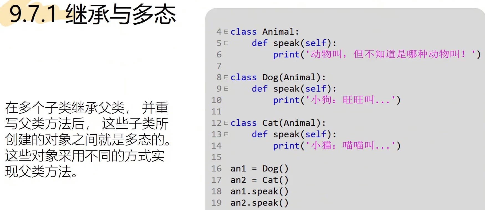 | 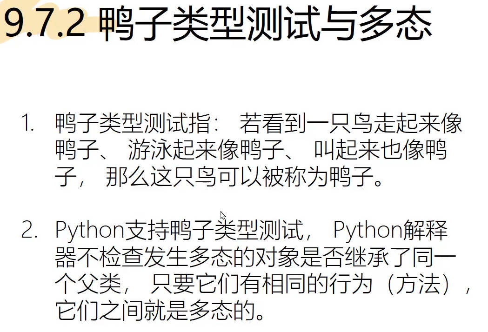 |
| --------------------------------------------------------- | --------------------------------------------------------- |
| 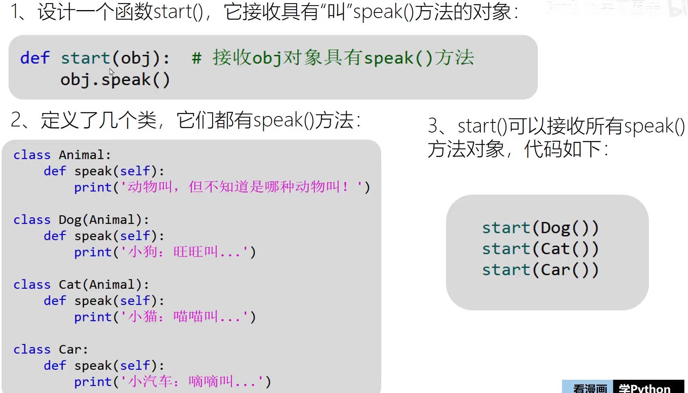 |                                                           |

# 判断循环

```python
# 注释：			 以 # 开头;  多行注释：  ''' 和 """
# 代码块:			 用缩进表示代码块，不需要使用大括号 {}
# 多行语句:			用反斜杠 \ 
# 同一行显示多条语句： 分号 ; 分割
import sys; x = 'runoob'; sys.stdout.write(x + '\n')

# 多个语句构成代码组: 以关键字开始，以冒号( : )结束
if expression : 
   suite
elif expression : 
   suite 
else : 
   suite
```

## 条件语句

```py
if condition_1:
    statement_block_1
elif condition_2:
    statement_block_2
else:
    statement_block_3
```

Python 3.10 增加了 **==match...case==** 的条件判断，不需要再使用一连串的 **if-else** 来判断了：  被称为`“模式匹配”或“结构化匹配”` 

```py
match subject:
    case <pattern_1>:
        <action_1>
    case <pattern_2>:
        <action_2>
    case <pattern_3>:
        <action_3>
    case _:
        <action_wildcard>
```


| 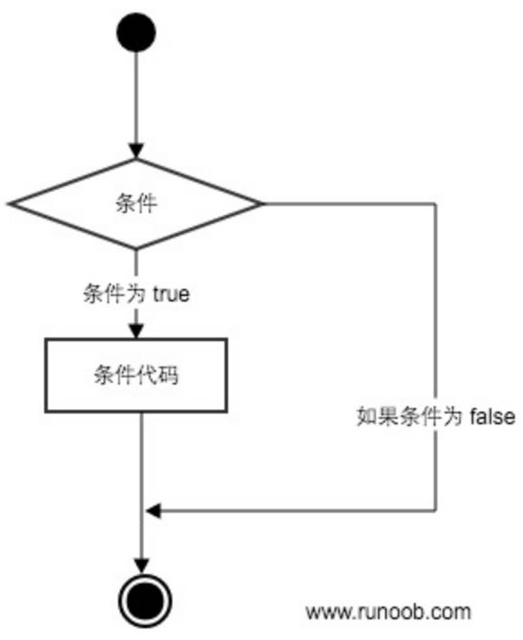 | 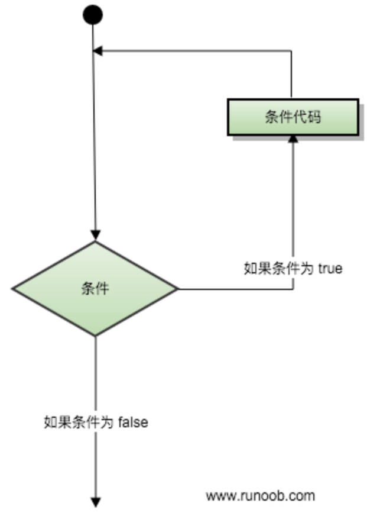 |
| ------------------------------------------------------------ | ------------------------------------------------------------ |


## 循环语句

**while 循环**

```py
while 判断条件(condition)：
    执行语句(statements) ...
    
# 例
while counter <= n:
    sum = sum + counter
    counter += 1
```

**for 循环**

```py
for <variable> in <sequence>:
    <statements>
else:
    <statements>
    
    
#  pass是空语句，是为了保持程序结构的完整性, 用做占位语句
```

# ==函数==

```py
 # def 开头，后接函数名称和圆括号 ()
 def 函数名（参数列表）:
    函数体
```

## 匿名函数

```py
# Python 使用 lambda 来创建匿名函数
lambda [arg1 [,arg2,.....argn]]:expression

x = lambda a : a + 10
print(x(5))
```

[对象有不同类型的区分 ](https://www.runoob.com/python3/python3-function.html)    [不能说值传递还是引用传递，应该说传不可变对象和传可变对象](https://www.runoob.com/python3/python3-function.html) 

```python
a=[1,2,3]
a="Runoob"
# 类型属于对象，对象有不同类型的区分，变量是没有类型的
# [1,2,3] 是 List 类型，"Runoob" 是 String 类型，而变量 a 是没有类型，仅仅是一个对象的引用（一个指针），可以是指向 List 类型对象，也可以是指向 String 类型对象。
```

## 参数

[可变长参数](https://www.runoob.com/python3/python3-function.html) 

- 必需参数： `printme(str)`
- 关键字参数： `printinfo( age=50, name="runoob" )`
- 默认参数: 没有传递参数，则会使用默认参数
  - `def printinfo( name, age = 35 ):`     `printinfo( name="runoob" )`
- 不定长参数(可变长):  ==加星号 *****== 的参数会以元组(tuple)的形式导入，存放未命名的变量参数
  - `def printinfo( arg1, *vartuple ):`   `printinfo( 70, 60, 50 )`    输出：70  (60, 50)
  - ==加两个星号 ***\*** 的参数会以字典的形式导入== 
    - `def printinfo( arg1, **vardict ):`   `printinfo(1, a=2,b=3)`   输出：1  {'a': 2, 'b': 3}
  - 如果单独出现星号 *****，则星号 ***** 后的参数必须用关键字传入
    - `def f(a,b,*,c):`     `f(1,2,c=3)` 
- 强制位置参数
  - Python3.8 新增了一个函数形参语法 ==/==,  用来指明函数==形参必须使用指定位置参数==，不能使用关键字参数的形式

# 错误和异常

语法错误和异常

==异常处理== : try ... except


# ==迭代器与生成器==

遍历集合元素

**迭代器**

- **迭代**： 是一种操作，比如for，==逐个获取数据的过程叫迭代==
- **可迭代对象：** 是对象的一种特性，比如[]、{}、()、文件对象都是可迭代的，==可以被for循环==的
- **迭代器：**是一种==支持netxt()操作的对象==, 例如：`将一个列表l2变成一个迭代器`： `a = iter(l2)`
  - 它包含一组元素，执行next()时，返回其中一个元素
  - 所有元素都被返回后，再执行next()报异常：Stoplteration

```py
# 迭代器有两个基本的方法：iter() 和 next()

list=[1,2,3,4]
it = iter(list)    # 创建迭代器对象
print (next(it))   # 输出迭代器的下一个元素
1
print (next(it))
2
```

[Python3 迭代器与生成器 | 菜鸟教程](https://www.runoob.com/python3/python3-iterator-generator.html) 

**生成器** ：使用了 **yield** 的函数被称为生成器（generator）  [好：五分钟彻底搞懂 Python 迭代器和生成器](https://www.bilibili.com/video/BV1gu411C7C9/?vd_source=7346303e5e18677d7261c2c0c109ecfd) 

- **yield** 是一个关键字，用于定义生成器函数，在迭代过程中逐步产生值，而不是一次性返回所有结果
- ==生成器是特殊的迭代器==， 本质是一个带yield的函数，它记住了上一次返回时，在函数体中的位置
- `生成器不仅"记住"了它的数据状态，还记住了程序执行的位置`
- 生成器一定是可迭代的，也一定是迭代器对象
- 生成器有2种生成方式
  - 把中括号变成圆括号，`iter1 = [i for i in range(5)]`
  - ==带yield的函数==制作成一个生成器，通常和循环一起使用

- ==生成器用来生成元素==，迭代器是访问集合元素的一种方式; ==迭代器输出生成器的内容==
  - 迭代器不知多长，next不断调用，最后程序会报错
  - `平时是通过for去循环data(生成器)，去取值(yield返回)，yield里有值就取出，没值就会自动停止`

- 生成器是一个返回迭代器的函数，只能用于迭代操作

| 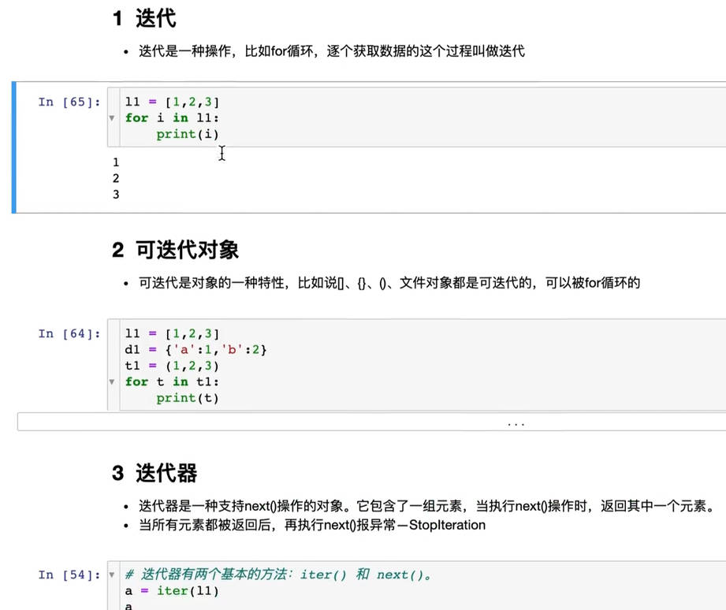 | 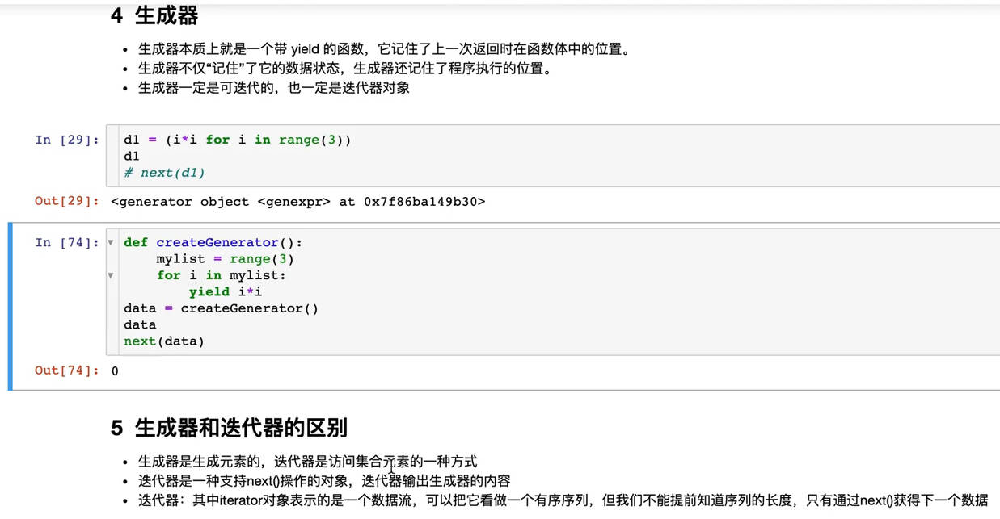 |
| --------------------------------------------------------- | --------------------------------------------------------- |


```py
# 使用了 yield 的函数被称为生成器,   生成器是特殊的迭代器， 本质是一个带yield的函数
# 生成器用来生成元素
def countdown(n):
    while n > 0:
        yield n
        n -= 1
 
# 创建生成器对象
generator = countdown(5)
 
# 通过迭代生成器获取值
print(next(generator))  # 输出: 5
print(next(generator))  # 输出: 4
print(next(generator))  # 输出: 3
 
# 使用 for 循环迭代生成器
for value in generator:
    print(value)  # 输出: 2 1
```


# ==装饰器==

[好：装饰器](https://www.bilibili.com/video/BV1Gu411Q7JV/?vd_source=7346303e5e18677d7261c2c0c109ecfd)        [装饰器](https://www.bilibili.com/video/BV1TM411R7v5/?vd_source=7346303e5e18677d7261c2c0c109ecfd)    

[Python 装饰器 | 菜鸟教程](https://www.runoob.com/python3/python-decorators.html) 

[有用的Python装饰器](https://baijiahao.baidu.com/s?id=1773078819234614521&wfr=spider&for=pc) 

允许动态地修改函数或类，  保持代码整洁同时，扩展程序的功能

- **装饰器是一个闭包** ， 生成器是 输入和输出都是函数的函数
- py中，**函数是一个对象**，所以可以作为其它函数参数,也可以成为一个返回值
- 装饰器可以在==不改变原来函数==的基础上，给函数==增加更多功能== ，有点像java反射
- 装饰器语法: 使用 **`@decorator_name`** 应用在==函数或方法上==
- 装饰器本质上是一个接收==函数作为输入==并返回一个新的, ==包装过的函数== 
  - 使用 `@decorator_function` 前缀在 原函数上面， Python会自动将 ==原函数 作为参数==传递给 `decorator_function`，然后将==返回新函数==替换掉==原函数==    [Python 装饰器](https://www.runoob.com/python3/python-decorators.html) 
  - 调用原函数，实际上是调用了==经过装饰器处理后的函数== 

- 装饰器是一种函数，它接受一个函数作为参数，并==返回一个新的函数==或修改原来的函数

```py
@decorator_name
@staticmethod 和 @classmethod
# 函数装饰器，类装饰器

def dec(f):
    pass

@dec
def double(x):
    return x*2

# 装饰器是个语法糖，等价于
double = dec(double)		# 生成器是 输入和输出都是函数的函数， double从函数变成了对象
```


| 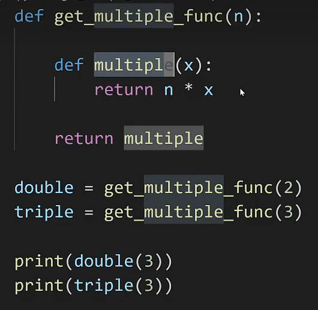 | 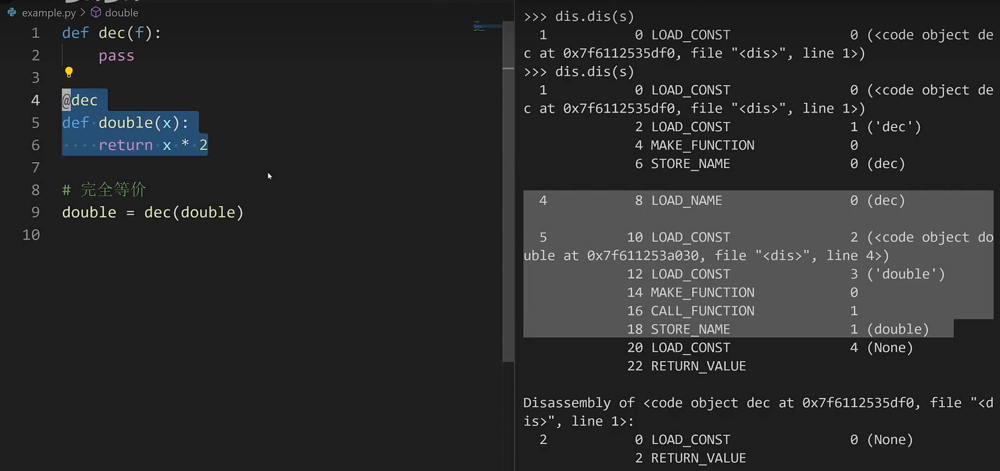 |
| ------------------------------------------------------------ | --------------------------------------------------------- |
| 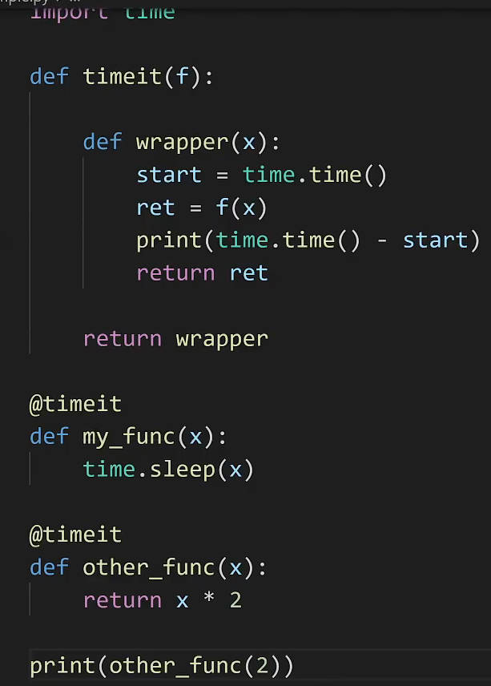    |                                                           |

## 带参数的装饰器

```py
#等价的过程中，多了一次函数调用： 先计算timeit(10),返回的是一个函数，这个函数再调用double

@timeit(10)
def double(x):
	return x * 2
	
# 等价于
double = timeit(10)(double)
```

带参数的装饰器实现

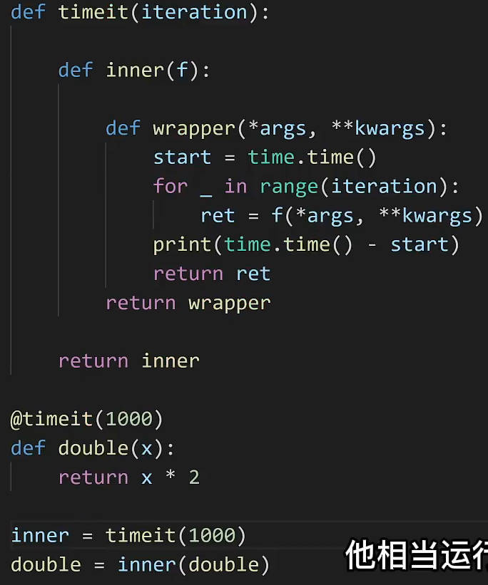

## 类装饰器

[一个公式解决所有复杂的装饰器](https://www.bilibili.com/video/BV19U4y1d79C/?spm_id_from=333.788&vd_source=7346303e5e18677d7261c2c0c109ecfd) 

除了函数装饰器，Python 还支持类装饰器

- 可以当作装饰器的类, 可以装饰类的装饰器
  - ==装饰器==既可以是函数，也可以是类
  - ==装饰的对象==同样，既可以是函数，也可以是类

类装饰器是包含 `__call__` 方法的类，它接受一个函数作为参数，并返回一个新的函数。

| 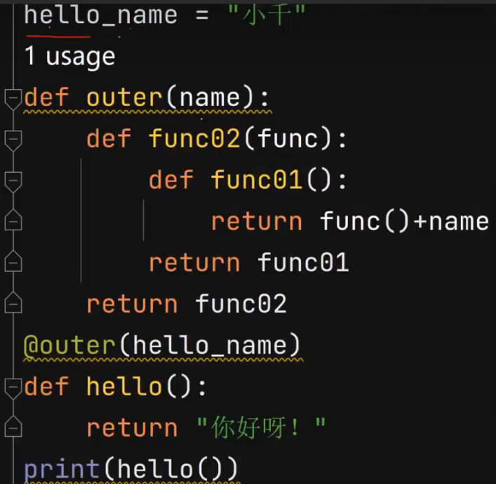    | 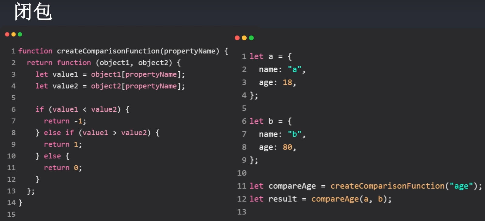 |
| ------------------------------------------------------------ | --------------------------------------------------------- |
| 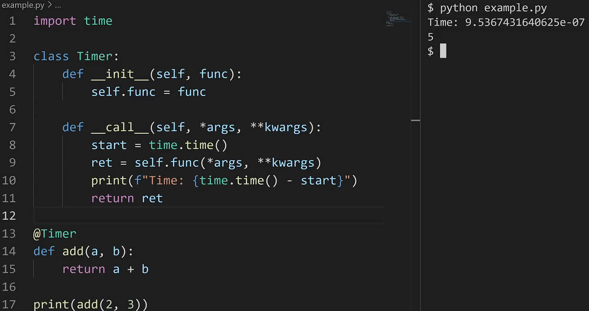    | 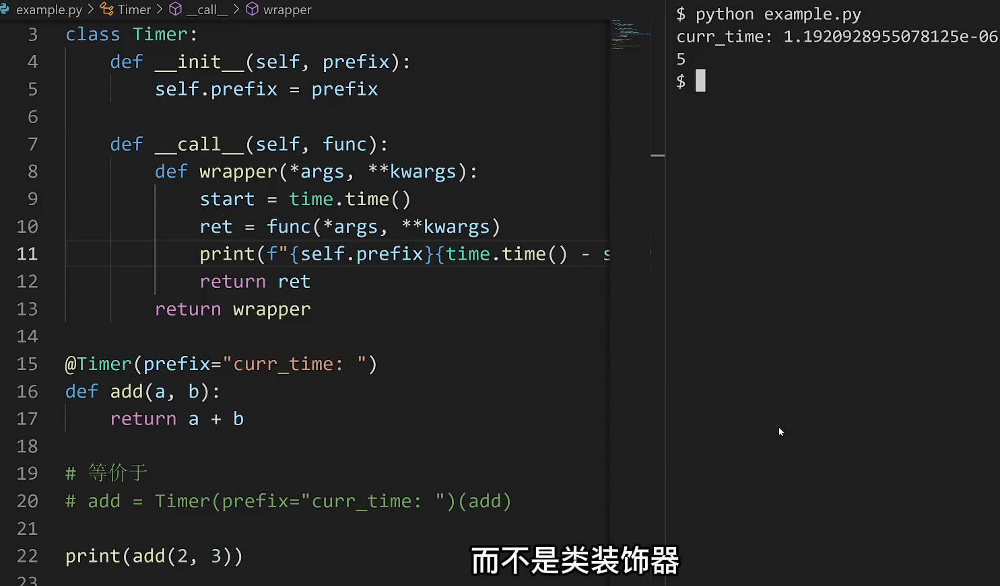 |
| 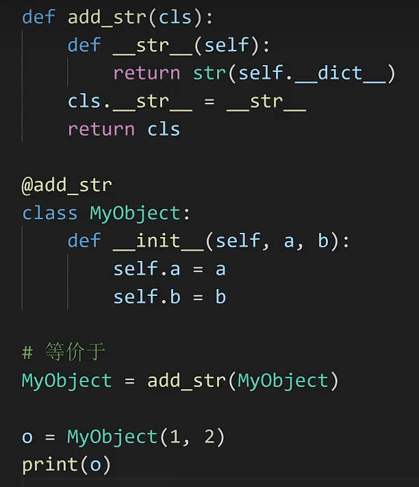 |                                                           |

### 魔术方法

[魔术方法_百度搜索](https://www.baidu.com/s?ie=UTF-8&wd=%E9%AD%94%E6%9C%AF%E6%96%B9%E6%B3%95) 

## 闭包

[好：什么是闭包](https://www.bilibili.com/video/BV1Vr421V74D/?vd_source=7346303e5e18677d7261c2c0c109ecfd)   [闭包和装饰器](https://www.bilibili.com/video/BV1E1421f77r/?vd_source=7346303e5e18677d7261c2c0c109ecfd)    

[Web开发者指南-MDN官网](https://developer.mozilla.org/zh-CN/docs/Web/Guide)  [闭包-MDN](https://developer.mozilla.org/zh-CN/docs/Web/JavaScript/Closures)    

[python函数闭包](https://www.bilibili.com/video/BV15c411n7JE/?vd_source=7346303e5e18677d7261c2c0c109ecfd)  [闭包-](https://search.bilibili.com/all?vt=94017587&keyword=%E9%97%AD%E5%8C%85&search_source=5) 

==新函数的作用域链依然保有，对其父级活动对象的引用==； 因此它所指向的这块内存虽然已经不会用到了， 但不会被释放； 此时，就说==新创建的函数是一个闭包== 

- 闭包让开发者可以`从内部函数访问外部函数的作用域`。在 JavaScript 中，闭包会随着函数的创建而被同时创建 

闭包是一个==函数==(compareAge函数)，==及其==捆绑的==周边环境状态==的，==引用组合[就是未释放掉的活动对象]==； 

- 函数包函数是闭包产生的主要场景: 定义一个函数，函数又返回一个函数
- 闭包是一种容易导致内存泄漏的常见场景
- **理解：** `createComparisonFunction("age")执行结束`，上下文和作用域会被销毁；但新函数compareAge保有对其父级活动对象==(propertyName变量)==的引用， 因此它所指向的这块内存虽然已经不会用到了， 但不会被释放； 此时，就说==新创建的函数compareAge（）是一个闭包==  
- 避免使用闭包，用完之后要将其置为null `let compareAge = null`,就能主动释放掉额外占用的空间

当js开始执行一个函数前，js引擎会做2件事

- 创建上下文
- 创建作用域链，每个上下文都有一个对应的作用域链

| 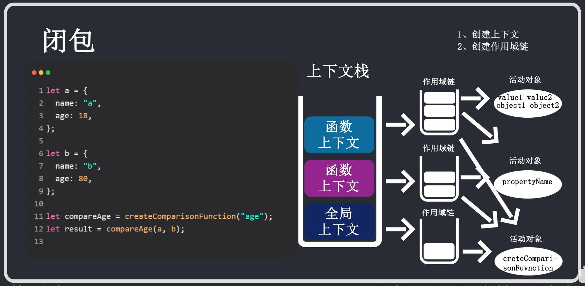 | 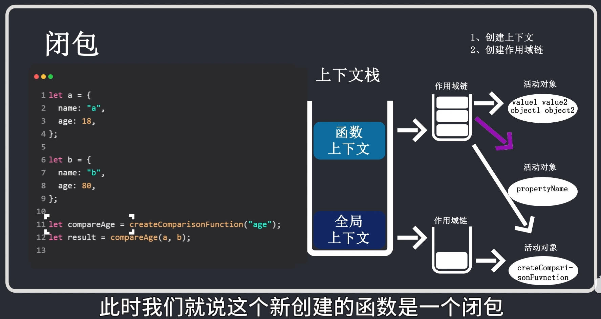 |
| --------------------------------------------------------- | --------------------------------------------------------- |


# 命名空间和作用域

命名空间(Namespace)是从名称到对象的映射，大部分的命名空间都是通过 Python 字典实现

一般有三种命名空间: 

- **内置名称（built-in names**）， Python 语言==内置的名称==，比如函数名 abs、char 和异常名称 BaseException、Exception 等等。
- **全局名称（global names）**，==模块中定义的名称==，记录了模块的变量，包括函数、类、其它导入的模块、模块级的变量和常量。
- **局部名称（local names）**，==函数中定义的名称==，记录了函数的变量，包括函数的参数和局部定义的变量。（类中定义的也是

==**命名空间查找顺序:**==  局部的命名空间 -> 全局命名空间 -> 内置命名空间

==**命名空间的生命周期：**==命名空间的生命周期取决于对象的作用域，如果对象执行完成，则该命名空间的生命周期就结束

==**四种作用域：**== 

- **L（Local）**：最内层，包含局部变量，比如一个函数/方法内部。
- **E（Enclosing）**：包含了非局部(non-local)也非全局(non-global)的变量。比如两个嵌套函数，一个函数（或类） A 里面又包含了一个函数 B ，那么对于 B 中的名称来说 A 中的作用域就为 nonlocal。
- **G（Global）**：当前脚本的最外层，比如当前模块的全局变量。
- **B（Built-in）**： 包含了内建的变量/关键字等，最后被搜索。

# ==输入输出==

`input()`: 等待输入，按回车，程序退出

`print()`: 换行输出，不换行在变量末尾加上 `end=""`： `print( y, end=" " )` 

Python两种输出值的方式: `表达式语句`和 `print()` 函数

- 第三种方式是使用文件对象的 `write()` 方法，标准输出文件可以用 `sys.stdout` 引用
- `str.format()` 函数格式化输出值
- 将输出值转成字符串，使用 `repr() 或 str()` 函数来实现
  - `str()`： 函数返回一个用户易读的表达形式
  - `repr()`： 产生一个解释器易读的表达形式

## 读和写文件

- `open()`  ： 返回 file 对象;  `open(filename, mode)`
- 文件对象的方法
  - `f.read()` : 读取文件内容
  - `f.write()` : 将 string 写入到文件
  - `f.close()`
  - `f.tell()`
  - `f.seek()`
- pickle 模块:  序列和反序列化

[Python3 文件 ](https://www.runoob.com/python3/python3-inputoutput.html)

[python标准库 —— io（StringIO）](https://www.cnblogs.com/mtcnn/p/9421724.html)   [StringIO](https://blog.csdn.net/zhaoxi_1988/article/details/127640363)    [cStringIO安装_百度搜索](https://www.baidu.com/s?ie=utf-8&f=8&rsv_bp=1&tn=baidu&wd=cStringIO%E5%AE%89%E8%A3%85&oq=cStringIO&rqlang=cn&rsv_enter=1&rsv_dl=tb&rsv_sug3=5&rsv_sug1=2&rsv_sug7=100&rsv_sug2=0&rsv_btype=t&inputT=1143&rsv_sug4=3179)   

[bson二进制json_bson.binary](https://blog.csdn.net/daoer_sofu/article/details/107186237)    [运用BSON将数据记录转换成二进制](https://blog.51cto.com/u_1044274/6714716) 

[cStringIO安装_百度搜索](https://www.baidu.com/s?ie=utf-8&f=8&rsv_bp=1&tn=baidu&wd=cStringIO%E5%AE%89%E8%A3%85&oq=cStringIO&rsv_pq=d5627ab400020365&rsv_t=2cb7K88awUhelQKePWN08EZ7oJQckYY2hLBA51uYAYHHwRLi%2B4BBW4qolsQ&rqlang=cn&rsv_enter=1&rsv_dl=tb&rsv_sug3=5&rsv_sug1=2&rsv_sug7=100&rsv_sug2=0&rsv_btype=t&inputT=1143&rsv_sug4=3179)  

流是**抽象概念**，它代表了数据的**无结构化传递**。按照流的方式进行输入输出，数据被当成==无结构的字节序或字符序列== 

- StringIO的行为与file对象非常像，但它不是磁盘上文件，而是一个内存里的“文件”

```py
# 只读模式打开一个文件对象, 文件不存在，抛出IOError
# f = open('./aaaaa', 'r')
f = open('./paste.jpg', 'r')
# 如果文件打开成功，read()一次读取全部内容到内存
f.read()
# 用完必须关闭
f.close()

# 读写会IOError，用try...finally
try:
    f = open('./aaaaa', 'r')
    print(f.read())
finally:
    if f:
        f.close()
# 用try麻烦，py用with语句自动调用close()
with open('./aaaaa', 'r') as f:
    print(f.read())
```


# ==模块包库框架==

[Python 3.13 删除了 19 个内置标准库](https://blog.csdn.net/m0_59235699/article/details/132483286) 

[Python中库、包、模块、类和方法之间的关系 ](https://zhuanlan.zhihu.com/p/692788514)  [模块和库的区别](https://blog.csdn.net/weixin_44943389/article/details/130856433)  [模块、包、库](https://blog.csdn.net/weixin_45490820/article/details/139123006)  [库和模块](https://www.baidu.com/s?ie=UTF-8&wd=%E5%BA%93%E5%92%8C%E6%A8%A1%E5%9D%97)  [框架和库的区别](https://baijiahao.baidu.com/s?id=1802704249269849260&wfr=spider&for=pc)  

模块包含定义的==函数和变量==

==包==: 一种管理 Python 模块命名空间的形式，采用"点模块名称"

- ==包是组织模块==的结构方式，它是==目录==级别的概念。	【模块的目录结构】
- ==库==是提供特定功能的代码集合，它是功能性的概念，可以==包含一个或多个包和模块==。
  - **库**（library）： 一个或多个==提供特定功能==的Python模块或包的集合
    - 库是一组可重用的代码和功能，旨在解决特定问题或==提供特定功能==的集合。库通常具有以下特点：提供了一系列函数、类或方法，供开发者调用；专注于特定领域或任务，`提供高级别的抽象；可以在不同项目中重复使用` 
  - **包**（package）： 一个==包含多个模块（module）的目录==，它们能够完成特定的功能。
  - **模块**： 包含Python代码的文件（`.py`文件）
  - **类**（class）是面向对象编程中的基本概念，==用于封装属性和方法==。
  - **方法**（method）则是类中定义的函数，用于对象进行操作


## ==框架== 

[框架是什么](https://www.py.cn/faq/python/27670.html)   [框架](https://blog.csdn.net/weixin_39781186/article/details/110053221)  [框架和库的区别](https://baijiahao.baidu.com/s?id=1802704249269849260&wfr=spider&for=pc)   


- 对==基础代码进行封装==和==提供编程接口==，开发人员在==使用框架时直接调用==封装的应用编程==接口==，从而提高生产效率和开发速度。 
  - 对基础的==代码进行了封装并提供相应的API==,开发者在使用框架时直接调用封装好的api可以省去很多代码编写,从而提高工作效率和开发速度。
- *框架*是一个基础架构，为开发者提供了一套通用的工具、库和设计模式，以便快速构建应用程序
- 每种框架都针对特定的应用领域进行了优化，使得开发者能够更==专注于业务逻辑==的实现，而不是底层架构的搭建


### Web框架

[37 个 Python Web 开发框架](https://www.easemob.com/news/8251)   [30框架种](https://blog.csdn.net/2401_83641533/article/details/137804670)   [11个主流框架](https://cloud.tencent.com/developer/article/2282219) 

Django、Flask、Tornado

### 爬虫框架

[Python爬虫框架](https://blog.csdn.net/xiangxue666/article/details/135185274)   [Python爬虫框架](https://blog.csdn.net/2201_75362610/article/details/130841920) 

Scrapy、requests、beautifulsoup4

### 机器学习框架

TensorFlow、PyTorch

### 自动测试框架

[5大自动化测试的Python框架](https://zhuanlan.zhihu.com/p/696701292) 

```py
# import 或者 from...import 导入模块

将整个模块(somemodule)导入：   import module
从某个模块中导入某个函数： 		from module import function
从某个模块中导入多个函数： 		from module import func, func
将某个模块中的全部函数导入： 	    from module import *
```


## ==标准库==


## 网络编程库

[Twisted 异步网络编程库twisted ](https://www.baidu.com/s?ie=utf-8&f=3&rsv_bp=1&tn=baidu&wd=Twisted%20python&oq=twisted&rsv_pq=bdafa669001f9d10&rsv_t=13e8QQr64cFKHZlspttHvfLQWKWv2lMY7q9BkuW1Qh%2FpGCtzjE8BjaHBlC4&rqlang=cn&rsv_enter=1&rsv_dl=ts_0&rsv_sug3=7&rsv_sug1=5&rsv_sug7=100&rsv_sug2=0&rsv_btype=t&prefixsug=twisted%2520py&rsp=0&inputT=4042&rsv_sug4=4748)  [网络框架twisted](https://cloud.tencent.com/developer/article/2346242) [twisted](https://cloud.tencent.com/developer/article/2003455) [ Twisted](https://www.cnblogs.com/lizexiong/p/17243349.html) 

## 科学计算库

[Scipy](https://www.baidu.com/s?ie=UTF-8&wd=Scipy) 

# python==虚拟环境==

[venv基本使用和原理](https://www.bilibili.com/video/BV1V7411n7CM/?p=3&spm_id_from=pageDriver&vd_source=7346303e5e18677d7261c2c0c109ecfd)    

[虚拟环境和包 — Python 3.12.4 文档](https://docs.python.org/zh-cn/3/tutorial/venv.html)  

[python虚拟环境管理之以workon切换虚拟环境 ](https://www.yisu.com/ask/32010920.html)   [workon python虚拟环境_百度搜索](https://www.baidu.com/s?ie=utf-8&f=8&rsv_bp=1&tn=baidu&wd=workon%20python%E8%99%9A%E6%8B%9F%E7%8E%AF%E5%A2%83&oq=workon&rsv_pq=99425ef000550b35&rsv_t=3218UXJuOcn0mGVi8atFXwxtTE1jDK5E3PBQuPI0BW7Nki0SWnuO0hwLDOw&rqlang=cn&rsv_enter=1&rsv_dl=tb&rsv_sug3=19&rsv_sug1=10&rsv_sug7=100&rsv_sug2=0&rsv_btype=t&inputT=13979&rsv_sug4=14775) 

```sh
# 1. 创建虚拟环境
python3 -m venv venvdemo
# 2. 激活虚拟环境；   撤销激活虚拟环境： deactivate
# 也可以不激活，进入虚拟环境目录：python
source venvdemo/bin/activate
# 3. 在虚拟环境中安装
pip install novas

# 4. 保存和复制虚拟环境
pip freeze > requirments.txt
pip install -r requirments.txt

# 5. 显示虚拟环境中安装的包
python -m pip list
```

python： ^+后退键  ^ + u


# Python ==推导式==

一种独特的数据处理方式，可以从一个数据序列==构建另一个新的数据序列==

- 列表(list)推导式
  - `[表达式 for 变量 in 列表  if 条件]`  例： `a = [i for i  in  range(30)  if  i % 3 == 0]`
- 字典(dict)推导式
  - `{ key_expr: value_expr for value in collection if condition }`
- 集合(set)推导式
  - `{ expression for item in Sequence if conditional }`
- 元组(tuple)推导式
  - `{ expression for item in Sequence if conditional }`

# 包管理

[python包管理工具有哪些_百度搜索](https://www.baidu.com/s?ie=utf-8&f=3&rsv_bp=1&tn=baidu&wd=python%E5%8C%85%E7%AE%A1%E7%90%86%E5%B7%A5%E5%85%B7%E6%9C%89%E5%93%AA%E4%BA%9B&oq=python%25E5%258C%2585%25E7%25AE%25A1%25E7%2590%2586&rsv_pq=caf2c3c9000d1dc7&rsv_t=6010FQgKPn3KieQ69%2FrQFS77PooHaqryOCatPqsXGoo4Ehgq%2FIBiux2vOLU&rqlang=cn&rsv_enter=1&rsv_dl=ts_1&rsv_btype=t&rsv_sug3=17&rsv_sug1=11&rsv_sug7=100&rsv_sug2=1&prefixsug=python%25E5%258C%2585%25E7%25AE%25A1%25E7%2590%2586&rsp=1&rsv_sug4=7115&rsv_sug=1)   [7种Python包管理](https://zhuanlan.zhihu.com/p/698729926) 

1. **[pip](https://www.baidu.com/s?wd=pip&usm=1&ie=utf-8&rsv_pq=ccb3142f006d1439&oq=python包管理工具有哪些&rsv_t=69b50jtoTY4fE0xyxnfLbxe38Fg1WhdbI1GDzqYRc3WQdPqK6HTcIRSmrqw&sa=re_dqa_zy&icon=1)**：这是Python的默认包管理器，广泛用于安装、更新和管理Python包。它可以从Python包索引(PyPI)中下载和安装第三方包，也可以管理虚拟环境中的包依赖关系。
2. **[conda](https://www.baidu.com/s?wd=conda&usm=1&ie=utf-8&rsv_pq=ccb3142f006d1439&oq=python包管理工具有哪些&rsv_t=69b50jtoTY4fE0xyxnfLbxe38Fg1WhdbI1GDzqYRc3WQdPqK6HTcIRSmrqw&sa=re_dqa_zy&icon=1)**：主要用于科学计算和数据分析。它可以安装Python包以及其他非Python软件包，并提供强大的依赖项解析和环境管理功能。
3. **[easy_install](https://www.baidu.com/s?wd=easy_install&usm=1&ie=utf-8&rsv_pq=ccb3142f006d1439&oq=python包管理工具有哪些&rsv_t=69b50jtoTY4fE0xyxnfLbxe38Fg1WhdbI1GDzqYRc3WQdPqK6HTcIRSmrqw&sa=re_dqa_zy&icon=1)**：这是Python的另一个包管理器，也是Python标准库中的一部分。尽管它已经被pip所取代，但pip通常是更常用的选择。
4. **[poetry](https://www.baidu.com/s?wd=poetry&usm=1&ie=utf-8&rsv_pq=ccb3142f006d1439&oq=python包管理工具有哪些&rsv_t=69b50jtoTY4fE0xyxnfLbxe38Fg1WhdbI1GDzqYRc3WQdPqK6HTcIRSmrqw&sa=re_dqa_zy&icon=1)**：一个现代化的Python包管理工具，用于管理项目的依赖项和虚拟环境。它提供了一种声明性的方式来定义和安装项目的依赖项，并具有良好的依赖项解析和锁定机制。
5. **[pyenv](https://www.baidu.com/s?wd=pyenv&usm=1&ie=utf-8&rsv_pq=ccb3142f006d1439&oq=python包管理工具有哪些&rsv_t=69b50jtoTY4fE0xyxnfLbxe38Fg1WhdbI1GDzqYRc3WQdPqK6HTcIRSmrqw&sa=re_dqa_zy&icon=1)**：用于管理多个Python版本的工具。它可以安装和切换不同的Python版本，并可以通过插件管理包和虚拟环境。
6. **[Rye](https://www.baidu.com/s?wd=Rye&usm=1&ie=utf-8&rsv_pq=ccb3142f006d1439&oq=python包管理工具有哪些&rsv_t=69b50jtoTY4fE0xyxnfLbxe38Fg1WhdbI1GDzqYRc3WQdPqK6HTcIRSmrqw&sa=re_dqa_zy&icon=1)**：这是Flask的作者Armin Ronacher推出的一个实验性质的Python包管理系统，旨在解决Python包管理工具链碎片化的问题。

## 镜像站

[清华大学开源软件镜像站](https://mirrors.tuna.tsinghua.edu.cn/help/pypi/) 

## pip 

[pip_百度搜索 ](https://www.baidu.com/s?ie=UTF-8&wd=pip)    [pip搜索包_百度搜索](https://www.baidu.com/s?ie=utf-8&f=3&rsv_bp=1&tn=baidu&wd=pip%E6%90%9C%E7%B4%A2%E5%8C%85&oq=pip%25E5%2591%25BD%25E4%25BB%25A4&rsv_pq=f09383120055e3b7&rsv_t=df58rYe%2F119ap1MKgVOvWJJZMy4tOAq6X0dMcV7oRZRZuseE%2F%2BYd6HebN0o&rqlang=cn&rsv_enter=1&rsv_dl=ts_0&rsv_sug3=9&rsv_sug1=7&rsv_sug7=100&rsv_sug2=0&rsv_btype=t&prefixsug=pip%25E6%2590%259C%25E7%25B4%25A2&rsp=0&inputT=4993&rsv_sug4=18568) 

# ==实例==

## 爬虫

[10个Python爬虫框架](https://blog.csdn.net/2201_75362610/article/details/130841920)  

[python爬取妹子图突破防盗链](https://gitee.com/ymy214/meizitu-spider/tree/master)  [爬虫-妹子图](https://zhuanlan.zhihu.com/p/82844605)  [妹子图网爬虫](https://www.cnblogs.com/copywang/p/7894519.html) 

**视频：** [Python爬虫框架Scrapy-大壮](https://www.imooc.com/learn/1017)    [Python网络爬虫实战 ](https://study.163.com/course/courseMain.htm?courseId=1003285002)    [python爬虫入门](https://www.bilibili.com/video/BV1CY411f7yh/?vd_source=7346303e5e18677d7261c2c0c109ecfd)   [Python爬虫](https://www.bilibili.com/video/BV1ut4y1B7CX/?vd_source=7346303e5e18677d7261c2c0c109ecfd)   [Python爬取天气数据并实现数据可视化](https://www.bilibili.com/video/BV1U1421b7J2/?vd_source=7346303e5e18677d7261c2c0c109ecfd)   [Python爬虫](https://www.bilibili.com/video/BV1MZ421H74V/?vd_source=7346303e5e18677d7261c2c0c109ecfd)  [python爬虫-bilibili](https://search.bilibili.com/all?vt=26782024&keyword=python%E7%88%AC%E8%99%AB&search_source=5) 

[Jsoup_HTML解析器](https://www.baidu.com/s?ie=UTF-8&wd=Jsoup)  

### Scrapy

[ Scrapy 2.11.2 documentation](https://docs.scrapy.org/en/2.11/topics/item-pipeline.html)  

**框架：**

- Scheduler： 调度器，是消息队列，将==请求排队==
- Spiders： 响应经引擎，交给==spiders解析==,爬虫组件，写xpath、正则的组件，写解析策略，分析数据
- pipeline: 管道，==封装去重、存储类==，`分析spiders获取的数据` ，过滤、存储等
- 2个中间件
  - downloaderM: 封装代理，http头，用来隐藏自己
  - spiderM:扩展引擎和spider通信功能的组件,可以修改进入spider的响应，和从spider出去的请求

| 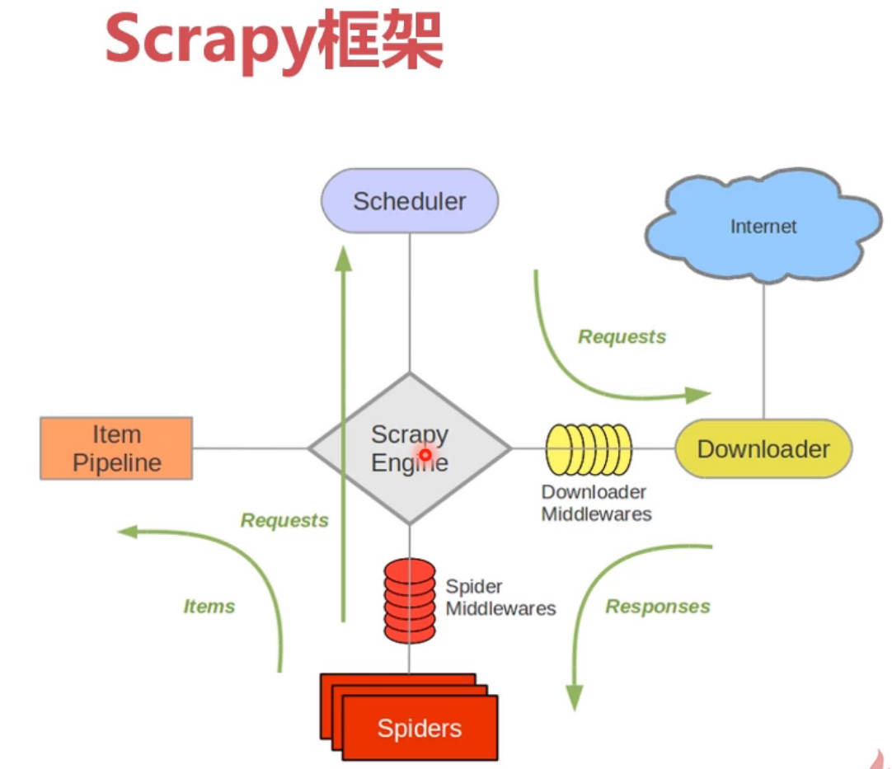 |  |
| --------------------------------------------------------- | ----- |

**User-Agent：**  [浏览器User-Agent简史 ](https://cloud.tencent.com/developer/article/2304756)   [为什么反爬虫会选择 User-Agent ](https://bbs.huaweicloud.com/blogs/101462)    [user-agent_百度搜索](https://www.baidu.com/s?ie=UTF-8&wd=user-agent) 

```
用户代理字符串，是一个浏览器发出请求时表明身份的标记
```

[utf-8格式之no bom和+bom ](https://www.cnblogs.com/mamboer/archive/2011/03/16/utf8-bom-no-bom.html)  [UTF-8与UTF-8(BOM)](https://blog.csdn.net/weixin_50464560/article/details/119277677)   [UTF-8的BOM含义](https://www.cnblogs.com/hurry-up/p/9798756.html)  [UTF8最好不要带BOM](https://cloud.tencent.com/developer/article/1395029) 

**隧道服务器:** [http隧道服务器_百度搜索](https://www.baidu.com/s?ie=UTF-8&wd=http%E9%9A%A7%E9%81%93%E6%9C%8D%E5%8A%A1%E5%99%A8)   [什么是隧道代理](https://baijiahao.baidu.com/s?id=1780626964652451444&wfr=spider&for=pc)   [chisel：一款快速稳定的隧道工具](https://www.163.com/dy/article/G61G6GG40511FSTO.html)    [Linux系统中HTTP隧道的搭建](https://blog.csdn.net/weixin_73725158/article/details/136166991) 

#### 安装scrapy

[ubuntu安装openssl-devel](https://blog.51cto.com/u_16213645/7907799)  [ubuntu系统安装openssl-devel](https://www.cnblogs.com/new-journey/p/13323301.html)   [CentOS7.6 安装python](https://blog.csdn.net/zhang20080528yeahnet/article/details/108620625)    

[python安装流程](https://blog.51cto.com/u_16213419/8611045)

```bash
# 安装python3.12.4
# 1. openssl-devel
yum install -y openssl-devel
# ubuntu上这个包分开两个，需要分开来安装
apt install openssl
apt install libssl-dev
# 2. gcc

# 3. 通过编译安装的python，要兼容ssl模块，需要重新编译python
# 在自己家目录编译安装一个python，不会影响其它人的python
./configure --prefix='/root/scrapy/python3/' --with-ssl  --enable-optimizations

# 4. apt install make
make
make install 

# 5. .bashrc 或者 用软链接
alias python3='/root/scrapy/python3/bin/python3'
alias pip3='/root/scrapy/python3/bin/pip3'

ln -s /usr/local/python3/bin/python3   /usr/bin/python3
ln -s /usr/local/python3/bin/pip3   /usr/bin/pip3

# 6. python虚拟环境安装
==================================================================
# py虚拟环境下安装scrapy, 会安装到 python3/bin/scrapy 目录下
pip install scrapy
## 如果缺 twisted模块 ,在 pypi 网站下载然后解压，用python安装
python3 setup.py  install

# 安装完后，scrapy别名写入 .bashrc
alias scrapy='/root/venvdemo/bin/scrapy'
```

需要的库： [查看缺少什么模块](https://blog.csdn.net/weixin_50843918/article/details/129817978)     [uuid ](https://docs.python.org/zh-tw/3/library/uuid.html)  [ModuleNotFoundError: No module named 'xxx'可能的解决方案](https://zhuanlan.zhihu.com/p/416872266) 

[python3_UUID模块](https://www.cnblogs.com/ranxf/p/7804420.html)   [SSL](https://www.jianshu.com/p/73f19cb92ab4)  [Python 标准库 — Python 3.12.4 文档](https://docs.python.org/zh-cn/3.12/library/index.html)   [Tkinter库](https://blog.csdn.net/m0_73608980/article/details/135178335) 

[No module named '_sqlite3'](https://www.baidu.com/s?ie=UTF-8&wd=ModuleNotFoundError%3A%20No%20module%20named%20%27_sqlite3%27)   [ 好：No module named '_sqlite3' ](https://www.cnblogs.com/wangzy-Zj/p/15718981.html)  [ No module named ‘_sqlite3‘](https://blog.csdn.net/weixin_49452153/article/details/135752766)  [No module named ‘pysqlite2](https://blog.csdn.net/qq_51701007/article/details/136179916)     [_lzma](https://blog.csdn.net/weixin_41559133/article/details/137705276)    [No module named '_lzma' ](https://zhuanlan.zhihu.com/p/404162713)  [Tkinter](https://cloud.tencent.com/developer/article/2328098) 

**下载模块**：[Python 模块索引 — Python 3.12.4 文档](https://docs.python.org/zh-cn/3.12/py-modindex.html)    [PyPI · The Python Package Index](https://pypi.org/)      [Debian -- 在 trixie 中的 liblzma5 软件包详细信息](https://packages.debian.org/trixie/liblzma5)    [Tkinter (Tk) - Python 中文开发手册](https://cloud.tencent.com/developer/section/1372347)   

```sh
python -m tkinter	# 查看模块

libgdbm-dev、   libgdbm-compat-dev、 libdb-dev、 libbz2-dev、libffi-dev、python3-gdbm、python3-tk
apt install python3-pip

# 没试过： zlib-devel、bzip2-dev、openssl-devel ncurses-devel sqlite-devel readline-devel tk-devel

pkg-config

# 确少_sqlite3, 要重新编译python
yum install sqlite*
# _lzma
apt install liblzma5 
apt install liblzma-dev
```

安装模块就要编译python解决

```py
# 激活python虚拟环境后，安装模块
python -m pip install pymongo
```

#### scrapy抓取分4步

爬取 ：`https://movie.douban.com/top250` 

1. 新建项目
   1. `scrapy startproject douban`
2. 明确目标
3. 制作爬虫
4. 存储内容

```sh
# 1.新建项目
# items.py : 		item字段定义
# settings.py:		项目设置文件； USER_AGENT、 robots协议、并发16、下载延迟0.5s、cookie需要登录抓取、middlewares、pipelines

# spiders目录下写爬虫策略: 进入这个目录，用命令生成爬虫文件： douban_spider.py
scrapy genspider douban_spider movie.douban.com
==============================================================
# 2.明确目标

```

==2、明确目标==： 用字段明确要抓取的目标  

```python
# items.py

import scrapy
class DoubanItem(scrapy.Item):
    serial_number = scrapy.Field()
    movie_name = scrapy.Field()
    introduce = scrapy.Field()
    star = scrapy.Field()
    # 介绍
    evaluate = scrapy.Field()
    describe = scrapy.Field()
```

==3、制作爬虫==： 编写爬虫文件， `douban_spider.py`    [xpath helper](https://blog.csdn.net/weixin_43411585/article/details/128908199) 

```py
准备
# spiders目录下爬取数据
scrapy crawl douban_spider
scrapy crawl douban_spider -o -  |  grep 'useragent'	# - for stdout

## 响应403错误：　settings.py里设置USER_AGENT
USER_AGENT = "Mozilla/5.0 (Windows NT 10.0; Win64; x64) AppleWebKit/537.36 (KHTML, like Gecko) Chrome/109.0.0.0 Safari/537.36"
=================================
# douban目录下新建main.py, 就不用在ssh里执行爬虫命令来
from scrapy import cmdline
cmdline.execute('scrapy crawl douban_spider'.split())
=================================
# xpath helper： ^+sh+x打开，^+sh选择,x提取
=================================
```

编写爬虫: `douban_spider.py`	==定位到ol，循环下面的li:  定位到要循环的li==

```py
import scrapy
from douban.items import DoubanItem

class DoubanSpiderSpider(scrapy.Spider):
    # 爬虫名,不能和项目名一样
    name = "douban_spider"  
    allowed_domains = ["movie.douban.com"]
    # 入口url
    start_urls = ["https://movie.douban.com/top250"]
    # 1. parse解析下载的页面
    def parse(self, response):
        # 先获取列表，然后再逐个处理每个列表项
        # 定位到ol，循环下面的li:  定位到要循环的li
        movie_list = response.xpath("//div[@class='article']/ol[@class='grid_view']/li")
        for i_item in movie_list:
            douban_item = DoubanItem()
            douban_item['serial_number'] = i_item.xpath(".//div[@class='item']//em/text()").extract_first()
            douban_item['movie_name'] = i_item.xpath(".//a/span[1]/text()").extract_first()
            # 多行字符串处理
            content = i_item.xpath(".//div[@class='bd']/p[1]/text()").extract()
            for i_content  in content:
                # 去掉空格, 切片，通过字符连接生成新字符串
                content_s = "".join(i_content.split())
                douban_item['introduce'] = content_s
            douban_item['star'] = i_item.xpath(".//div[@class='star']/span[2]/text()").extract_first()
            douban_item['evaluate'] = i_item.xpath(".//div[@class='star']/span[4]/text()").extract_first()
            douban_item['describe'] = i_item.xpath(".//span[@class='inq']/text()").extract_first()
            yield douban_item   # 生成器函数，用来生成数据

        # 翻页：新的request请求, 翻页有链接就取，没有就不取
        next_link = response.xpath("//span[@class='next']/link/@href").extract()
        if next_link:
            next_link = next_link[0]
            # 请求发到调度器,后跟一个回调函数，回调parse函数 
            yield scrapy.Request("https://movie.douban.com/top250"+next_link,callback=self.parse)   
```

不在shell里执行爬虫命令 `scrapy crawl douban_spider`

```py
# main.py
from scrapy import cmdline
cmdline.execute('scrapy crawl douban_spider'.split())		# split() 默认以空格为分隔符
```

==4、保存数据==

```py
scrapy crawl douban_spider -o test.json  # csv文件用utf-8-bom编码，用excel打开

# settings.py定义变量, 用来连接mongodb
#mongo_host = '192.168.1.140'
#mongo_port = 27017
#mongo_db_name = 'douban'
#mongo_db_collection = 'douban_movie'
#然后再pipelines.py里编写  pip3 install pymongo

# settings.py里打开 ITEM_PIPELINES
==============================================
pipelines.py 编写

import pymongo
from pymongo import MongoClient
# from itemadapter import ItemAdapter
class DoubanPipeline:
    def process_item(self, item, spider):
        client = MongoClient('mongodb://192.168.1.140:27017/')
        db = client['douban']		# 数据库
        posts = db['colle']			# 表  
        posts.insert_one(dict(item))
        return item

```

#### ==中间件编写==

[Scrapy的中间件Downloader Middleware实现User-Agent随机切换](https://www.cnblogs.com/zhaof/p/7345856.html)  

爬虫伪装

##### ip代理中间件

[阿布云 - http隧道](https://www.abuyun.com/)

[HTTP头信息 ](https://www.cnblogs.com/pdun/p/11438364.html)  [http头_百度搜索](https://www.baidu.com/s?ie=UTF-8&wd=http%E5%A4%B4)     [HTTP headers](https://blog.csdn.net/JHXL_/article/details/133242393)  

HTTP 头部（HTTP Headers）:  在 HTTP 请求和响应中==传输元数据==的重要方式，能够影响到请求和响应的处理方式、安全性、缓存、身份验证等多个方面

```py
import  base64
class my_proxy(object):     # 继承object
    def process_request(self,request,spider):
        # 设置request里的一个参数，实现代理ip
        request.meta['proxy'] = 'http-cla.abuyun.com:9030'
        proxy_name_pass = b'H343834:F3343'       # 用户名密码,只能加密byte类型
        encode_pass_name = base64.b64encode(proxy_name_pass)   # base64加密
        # http头设置密码认证;   解密为字符串才能相加: 编码解码
        request.headers['Proxy-Authorization'] = 'Basic ' + encode_pass_name.decode()   
        
# settings里 打开 DOWNLOADER_MIDDLEWARES 
"douban.middlewares.my_proxy": 543,
```

##### 随机user-agent

[Scrapy之设置随机User-Agent和IP代理](https://cloud.tencent.com/developer/article/1992891)    [scrapy user agent_百度搜索](https://www.baidu.com/s?ie=UTF-8&wd=scrapy%20user%20agent) 

```py
import  random

class my_useragent(object):     # 继承object
    def process_request(self,request,spider):
        USER_AGENT_LIST = [
            "Mozilla/4.0 (compatible; MSIE 6.0; Windows NT 5.1; SV1; AcooBrowser; .NET CLR 1.1.4322; .NET CLR 2.0.50727)",
            "Mozilla/4.0 (compatible; MSIE 7.0; Windows NT 6.0; Acoo Browser; SLCC1; .NET CLR 2.0.50727; Media Center PC 5.0; .NET CLR 3.0.04506)",
            "Mozilla/4.0 (compatible; MSIE 7.0; AOL 9.5; AOLBuild 4337.35; Windows NT 5.1; .NET CLR 1.1.4322; .NET CLR 2.0.50727)",
            "Mozilla/5.0 (Windows; U; MSIE 9.0; Windows NT 9.0; en-US)",
            "Mozilla/5.0 (compatible; MSIE 9.0; Windows NT 6.1; Win64; x64; Trident/5.0; .NET CLR 3.5.30729; .NET CLR 3.0.30729; .NET CLR 2.0.50727; Media Center PC 6.0)",
            "Mozilla/5.0 (compatible; MSIE 8.0; Windows NT 6.0; Trident/4.0; WOW64; Trident/4.0; SLCC2; .NET CLR 2.0.50727; .NET CLR 3.5.30729; .NET CLR 3.0.30729; .NET CLR 1.0.3705; .NET CLR 1.1.4322)",
            "Mozilla/4.0 (compatible; MSIE 7.0b; Windows NT 5.2; .NET CLR 1.1.4322; .NET CLR 2.0.50727; InfoPath.2; .NET CLR 3.0.04506.30)",
            "Mozilla/5.0 (Windows; U; Windows NT 5.1; zh-CN) AppleWebKit/523.15 (KHTML, like Gecko, Safari/419.3) Arora/0.3 (Change: 287 c9dfb30)",
            "Mozilla/5.0 (X11; U; Linux; en-US) AppleWebKit/527+ (KHTML, like Gecko, Safari/419.3) Arora/0.6",
            "Mozilla/5.0 (Windows; U; Windows NT 5.1; en-US; rv:1.8.1.2pre) Gecko/20070215 K-Ninja/2.1.1",
            "Mozilla/5.0 (Windows; U; Windows NT 5.1; zh-CN; rv:1.9) Gecko/20080705 Firefox/3.0 Kapiko/3.0",
            "Mozilla/5.0 (X11; Linux i686; U;) Gecko/20070322 Kazehakase/0.4.5",
            "Mozilla/5.0 (X11; U; Linux i686; en-US; rv:1.9.0.8) Gecko Fedora/1.9.0.8-1.fc10 Kazehakase/0.5.6",
            "Mozilla/5.0 (Windows NT 6.1; WOW64) AppleWebKit/535.11 (KHTML, like Gecko) Chrome/17.0.963.56 Safari/535.11",
            "Mozilla/5.0 (Macintosh; Intel Mac OS X 10_7_3) AppleWebKit/535.20 (KHTML, like Gecko) Chrome/19.0.1036.7 Safari/535.20",
            "Opera/9.80 (Macintosh; Intel Mac OS X 10.6.8; U; fr) Presto/2.9.168 Version/11.52",
            "Mozilla/5.0 (Windows NT 6.1; WOW64) AppleWebKit/536.11 (KHTML, like Gecko) Chrome/20.0.1132.11 TaoBrowser/2.0 Safari/536.11",
            "Mozilla/5.0 (Windows NT 6.1; WOW64) AppleWebKit/537.1 (KHTML, like Gecko) Chrome/21.0.1180.71 Safari/537.1 LBBROWSER",
            "Mozilla/5.0 (compatible; MSIE 9.0; Windows NT 6.1; WOW64; Trident/5.0; SLCC2; .NET CLR 2.0.50727; .NET CLR 3.5.30729; .NET CLR 3.0.30729; Media Center PC 6.0; .NET4.0C; .NET4.0E; LBBROWSER)",
            "Mozilla/4.0 (compatible; MSIE 6.0; Windows NT 5.1; SV1; QQDownload 732; .NET4.0C; .NET4.0E; LBBROWSER)",
            "Mozilla/5.0 (Windows NT 6.1; WOW64) AppleWebKit/535.11 (KHTML, like Gecko) Chrome/17.0.963.84 Safari/535.11 LBBROWSER",
            "Mozilla/4.0 (compatible; MSIE 7.0; Windows NT 6.1; WOW64; Trident/5.0; SLCC2; .NET CLR 2.0.50727; .NET CLR 3.5.30729; .NET CLR 3.0.30729; Media Center PC 6.0; .NET4.0C; .NET4.0E)",
            "Mozilla/5.0 (compatible; MSIE 9.0; Windows NT 6.1; WOW64; Trident/5.0; SLCC2; .NET CLR 2.0.50727; .NET CLR 3.5.30729; .NET CLR 3.0.30729; Media Center PC 6.0; .NET4.0C; .NET4.0E; QQBrowser/7.0.3698.400)",
            "Mozilla/4.0 (compatible; MSIE 6.0; Windows NT 5.1; SV1; QQDownload 732; .NET4.0C; .NET4.0E)",
            "Mozilla/4.0 (compatible; MSIE 7.0; Windows NT 5.1; Trident/4.0; SV1; QQDownload 732; .NET4.0C; .NET4.0E; 360SE)",
            "Mozilla/4.0 (compatible; MSIE 6.0; Windows NT 5.1; SV1; QQDownload 732; .NET4.0C; .NET4.0E)",
            "Mozilla/4.0 (compatible; MSIE 7.0; Windows NT 6.1; WOW64; Trident/5.0; SLCC2; .NET CLR 2.0.50727; .NET CLR 3.5.30729; .NET CLR 3.0.30729; Media Center PC 6.0; .NET4.0C; .NET4.0E)",
            "Mozilla/5.0 (Windows NT 5.1) AppleWebKit/537.1 (KHTML, like Gecko) Chrome/21.0.1180.89 Safari/537.1",
            "Mozilla/5.0 (Windows NT 6.1; WOW64) AppleWebKit/537.1 (KHTML, like Gecko) Chrome/21.0.1180.89 Safari/537.1",
            "Mozilla/5.0 (iPad; U; CPU OS 4_2_1 like Mac OS X; zh-cn) AppleWebKit/533.17.9 (KHTML, like Gecko) Version/5.0.2 Mobile/8C148 Safari/6533.18.5",
            "Mozilla/5.0 (Windows NT 6.1; Win64; x64; rv:2.0b13pre) Gecko/20110307 Firefox/4.0b13pre",
            "Mozilla/5.0 (X11; Ubuntu; Linux x86_64; rv:16.0) Gecko/20100101 Firefox/16.0",
            "Mozilla/5.0 (Windows NT 6.1; WOW64) AppleWebKit/537.11 (KHTML, like Gecko) Chrome/23.0.1271.64 Safari/537.11",
            "Mozilla/5.0 (X11; U; Linux x86_64; zh-CN; rv:1.9.2.10) Gecko/20100922 Ubuntu/10.10 (maverick) Firefox/3.6.10",
            "Mozilla/5.0 (Windows NT 10.0; Win64; x64) AppleWebKit/537.36 (KHTML, like Gecko) Chrome/58.0.3029.110 Safari/537.36",
            "Mozilla/5.0 (Windows NT 10.0; Win64; x64) AppleWebKit/537.36 (KHTML, like Gecko) Chrome/109.0.0.0 Safari/537.36",
        ]
        # 随机选一个给请求头
        agent = random.choice(USER_AGENT_LIST)
        request.headers['User_Agent'] = agent


# settings里 打开 DOWNLOADER_MIDDLEWARES 
"douban.middlewares.my_proxy": 543,
```


#### 配置文件

==settings.py==, 里面配置的各种变量

[Scrapy的Setting配置详解](https://developer.baidu.com/article/details/2804802)  [Scrapy配置文件Settings](https://blog.csdn.net/manba_yqq/article/details/136431595)  [scrapy框架中settings](https://blog.csdn.net/manfanying/article/details/136238111)

```py
AutoThrottle		# 自动限速
```

#### 多页面爬取和深度爬取

[scrapy技术进阶之多页面爬取](https://www.cnblogs.com/jackley/p/10782512.html)    [Scrapy爬取多级页面数据_爬取一个网站的多个页面数据](https://blog.csdn.net/manfanying/article/details/136157106)   [多页面爬取和深度爬取](https://zhuanlan.zhihu.com/p/620805805)   

[scrapy多页面抓取_百度搜索](https://www.baidu.com/s?ie=UTF-8&wd=scrapy%E5%A4%9A%E9%A1%B5%E9%9D%A2%E6%8A%93%E5%8F%96) 

## 爬虫及可视化

[移动端Python数据抓取+数据可视化](https://coding.imooc.com/class/chapter/283.html#Anchor)    [Python爬虫实战数据可视化分析](https://coding.imooc.com/class/chapter/363.html#Anchor) 

## 实例

[探秘TeleGram-Scraper：Telegram数据抓取工具](https://blog.csdn.net/gitblog_00067/article/details/138178593)  [爬虫抓取电报资源_百度搜索](https://www.baidu.com/s?ie=utf-8&f=8&rsv_bp=1&tn=baidu&wd=%E7%88%AC%E8%99%AB%E6%8A%93%E5%8F%96%E7%94%B5%E6%8A%A5%E8%B5%84%E6%BA%90&oq=%25E6%259C%2589%25E6%25B2%25A1%25E6%259C%2589meizitu%25E7%25B1%25BB%25E4%25BC%25BC%25E7%259A%2584%25E7%25BD%2591%25E7%25AB%2599&rqlang=cn&rsv_enter=0&rsv_dl=tb&rsv_btype=t&rsv_sug3=24&rsv_sug1=21&rsv_sug7=101&rsv_sug2=0&inputT=12797&rsv_sug4=14429) 

```

```

[Python分布式爬虫打造搜索引擎Scrapy精讲](https://clxf.me/detail.php?md5hash=2c9ae4ae96e2a71b5f4f25e95386ab138cc82ff297978aba311e3a6fe5dca2a1&sjk=2) 

[Scrapy爬取全站数据并存储到数据库和文件中](https://www.cnblogs.com/xiao-apple36/p/12617046.html)   [scrapy存储到gridfs_百度搜索](https://www.baidu.com/s?ie=UTF-8&wd=scrapy%E5%AD%98%E5%82%A8%E5%88%B0gridfs)  [python利用mongodb上传图片数据 : GridFS 与 bson两种方式](https://www.cnblogs.com/ExMan/p/9712392.html)  

[使用scrapy,redis,mongodb实现的一个分布式网络爬虫](https://cloud.tencent.com/developer/article/1032891)   [项目源码](https://github.com/gnemoug/distribute_crawler/blob/master/woaidu_crawler/woaidu_crawler/spiders/woaidu_detail_spider.py)  

# ==数据库==

## mongodb

视频：[好:mongodb数据库的安装_](https://www.imooc.com/video/17515) 

[Download MongoDB Community Server](https://www.mongodb.com/try/download/community)     [MongoDB 手册 v7.0](https://www.mongodb.com/zh-cn/docs/manual/)  

[MongoDB——CRUD](https://cloud.tencent.com/developer/article/2041749)

[MongoDB安装教程—Ubuntu](https://developer.aliyun.com/article/1291613)     [在Ubuntu22.04中安装MongoDB6.0](https://dblab.xmu.edu.cn/blog/4594/)    [ubuntu安装mongodb_百度搜索](https://www.baidu.com/s?ie=UTF-8&wd=ubuntu%E5%AE%89%E8%A3%85mongodb) 

[robots协议_百度搜索](https://www.baidu.com/s?ie=UTF-8&wd=robots%E5%8D%8F%E8%AE%AE)   [python数据库框架_百度搜索](https://www.baidu.com/s?ie=UTF-8&wd=python%E6%95%B0%E6%8D%AE%E5%BA%93%E6%A1%86%E6%9E%B6)  

找一个源下载 或 官网下载deb包:  `dpkg -i mong.deb`    

- 配置文件： `/etc/mongod.conf` ，修改==bindIp==为本机ip；   `systemctl restart mongod`
- 没设置密码，直接连

设置密码：[MongoDB 用户管理 ](https://www.runoob.com/mongodb/mongodb-user.html)   [mongodb加入用户名和密码](https://blog.csdn.net/jokertiger/article/details/117707679?spm=1001.2101.3001.6650.17&depth_1-utm_source=distribute.pc_relevant.none-task-blog-2%7Edefault%7EBlogCommendFromBaidu%7ERate-17-117707679-blog-117662172.235%5Ev43%5Epc_blog_bottom_relevance_base5) 

[mongodb uri格式](https://blog.csdn.net/tangdou369098655/article/details/135591266) 

### 使用

[官方 MongoDB Manual](https://www.mongodb.com/docs/v2.6/reference/method/db.collection.save/)   [中文PyMongo_v4.8](https://www.mongodb.com/zh-cn/docs/languages/python/pymongo-driver/current/databases-collections/) 

 [MongoDB 插入文档](https://www.runoob.com/mongodb/mongodb-insert.html)    [MongoDB 基础](https://zhuanlan.zhihu.com/p/694219985)   

```sql
use douban								# db
show collections						# collections	
db.colle.find().pretty()				# 显示colle表内容
db.getCollection("colle").find({})

```


### pymongo

[PyMongo 4.8.0 documentation](https://pymongo.readthedocs.io/en/stable/)   [PyMongo 4.8.0](https://pymongo.readthedocs.io/en/stable/tutorial.html) 

[PyMongo](https://www.oschina.net/p/pymongo?hmsr=aladdin1e1)   [PyMongo ](https://www.cnblogs.com/xiaowange/p/17961967) [python操作MongoDB数据库](https://cloud.tencent.com/developer/article/2307250)  [pymongo参考文档 ](https://zhuanlan.zhihu.com/p/671418947) 

[python中pymongo](https://blog.csdn.net/weixin_44799217/article/details/113756208)  [pymongo](https://cloud.tencent.com/developer/article/2334331)  [pymongo](https://www.jb51.net/python/285339367.htm)  [scrapy把数据保存到mongodb](https://www.cnblogs.com/andy0816/p/15497047.html) 

[scrapy 导入mongodb](https://blog.51cto.com/u_16175490/10626239)  [将scrapy提取的数据保存到mongodb数据库中的两种写法](https://blog.csdn.net/qq_42336581/article/details/80977600) 

PyMongo 是 [MongoDB](http://www.oschina.net/p/mongodb) 的 Python 接口开发包 


### 存储大文件

[gridfs_百度搜索](https://www.baidu.com/s?ie=UTF-8&wd=gridfs) 

[python 使用 with open() as 读写文件](https://www.jb51.net/article/267550.htm) 

mongodb存储文件，可以使用两种方式

1. 像存储普通数据那样，将==文件转化为二进制数据==存入mongodb
2. ==使用gridfs== 

#### GridFS

[GridFS - MongoDB 手册 v 7.0](https://www.mongodb.com/zh-cn/docs/manual/core/gridfs/) 

[mongodb存储二进制数据的二种方式——binary bson或gridfs](https://blog.51cto.com/u_11908275/6385539) 

[基于MongoDB GridFS的图片存储 ](https://itindex.net/blog/2011/01/01/1293893056231.html)  [使用 GridFS API 获取/保存图像](https://www.kancloud.cn/apachecn/howtodoinjava-zh/1953271)  [MongoDB对象存储：图片与文件存储策略](https://developer.baidu.com/article/detail.html?id=1870426) 

[将数据写入 MongoDB - PyMongo](https://www.mongodb.com/zh-cn/docs/languages/python/pymongo-driver/current/write-operations/#std-label-pymongo-write)   [使用GridFS ](https://zhuanlan.zhihu.com/p/498535846)   [GridFS(命令行+php操作)](https://www.cnblogs.com/wujuntian/p/8406039.html)    [Python使用MongoDB-GridFS进行文档管理](https://blog.csdn.net/qq_38923792/article/details/107765422)  

**GridFS API**: 

[GridFS API nodejs](https://mongodb.github.io/node-mongodb-native/3.5/tutorials/gridfs/streaming/)   [MongoDB GridFS 怎么用](https://cloud.tencent.com/developer/article/1794164)    [使用GridFSBucket逐块处理正在下载的文件-js](https://cloud.tencent.com/developer/information/%E5%A6%82%E4%BD%95%E4%BD%BF%E7%94%A8GridFSBucket%E9%80%90%E5%9D%97%E5%A4%84%E7%90%86%E6%AD%A3%E5%9C%A8%E4%B8%8B%E8%BD%BD%E7%9A%84%E6%96%87%E4%BB%B6)   [GridFs-java](https://cloud.tencent.com/developer/news/659878) 

使用2个集合存储文件: 

- chunks: 存储文件内容的二进制数据, 以类jison格式存储；  fs.chunks
- files：存储文件元数据, 集合名字,fs.files

```sql
show collections
db.fs.files.find()
db.fs.chunks.find()

db.getCollection("fs.chunks").find({})
```

**gridfs简单使用**  [mongodb存储图片_百度搜索](https://www.baidu.com/s?ie=UTF-8&wd=mongodb%E5%AD%98%E5%82%A8%E5%9B%BE%E7%89%87)   [GridFS示例 - PyMongo 4.5.0 文档](https://www.osgeo.cn/mongo-python-driver/examples/gridfs.html) 

```py
# 连接： 为正在运行的mongod实例创建一个MongoClient
from pymongo import MongoClient
from bson.binary import Binary
import io
import gridfs

# 连接到MongoDB
# client = MongoClient("192.168.1.140", 27017) 
client = MongoClient("mongodb://192.168.1.140:27017/")
# 获取数据库
db = client['mydatabase']

# 创建GridFS对象
fs = gridfs.GridFS(db)

# 读取图片
with open('./paste.jpg', 'rb') as file:
    # 将图片转换为二进制数据
    data = file.read()
    binary_data = Binary(data)
 
	# 存储图片到MongoDB
    fs.put(binary_data, filename='paste.jpg', content_type='image/jpg')
 
# 从MongoDB检索图片
image_data = fs.get_version('paste.jpg')
# 将图片数据写入文件
with open('ccc.jpg', 'wb') as out:
    out.write(image_data.read())
    
    
===========================
# 好像不用转二进制，直接存
with open('./OpenSSH-Win64.zip', 'rb') as fs:
	fs.put(file, filename='OpenSSH-Win64.zip', content_type='zip')
# 检索
my_file = fs.get_file('OpenSSH-Win64.zip')
```


# 其它

## 数据可视化

[ pyecharts 模块](https://www.runoob.com/python3/python-pyecharts.html) 

pyecharts库

## 量化交易

[Python 量化](https://www.runoob.com/python3/python-qt.html)  [Python 量化交易 ](https://www.runoob.com/python-qt/qt-tutorial.html) 

**量化**： 利用 Python 以及相关的库和工具来进行==金融市场数据分析==、策略开发和交易执行的过程

**量化交易**： 高频交易，是利用数学模型、统计学方法和计算机编程来进行金融交易的一种策略

## 统计计算

[Python statistics 模块](https://www.runoob.com/python3/python-statistics.html) 

## AI

[Python AI 绘画 ](https://www.runoob.com/python3/python-ai-draw.html) 

## WSGI

[Python WSGI 详解](https://cloud.tencent.com/developer/news/366431)  

[Python uWSGI 安装配置](https://www.runoob.com/python3/python-uwsgi.html)   [uWSGI、WSGI、uwsgi、wsgiref、werkzeug](https://www.cnblogs.com/liuweida/p/11717683.html)   [wsgi是什么](https://blog.51cto.com/u_15057852/4135240)   [WSGI_百度搜索](https://www.baidu.com/s?ie=UTF-8&wd=WSGI) 

[齐夫定律_百度搜索](https://www.baidu.com/s?ie=UTF-8&wd=%E9%BD%90%E5%A4%AB%E5%AE%9A%E5%BE%8B) 