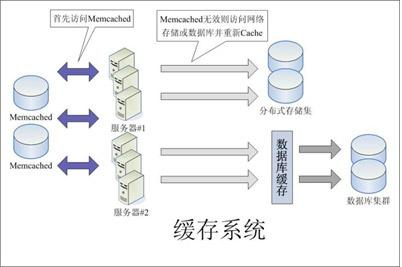
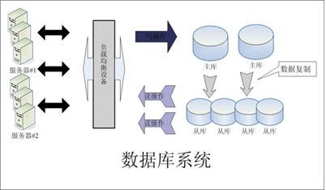
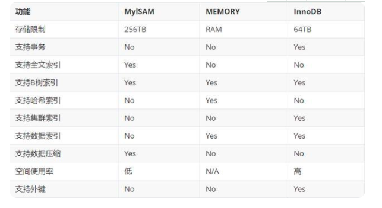

# Net Core 重要的技术点

# 1、中间件概念

 是处理Http请求和响应的组件（代码段，一段处理逻辑），每个组件

- 选择是否将请求传递给管道中的下一个组件。
- 可以在调用管道中的下一个组件之前和之后执行一些逻辑。

这样的机制使得HTTP请求能够很好的被层层处理和控制，并且层次清晰处理起来甚是方便。
最后一个管道或者中断管道的中间件叫终端中间件；

请求委托（Request delegates）用于构建请求管道，处理每个HTTP请求

 管道就是http请求抵达服务器到响应结果返回的中间的一系列的处理过程

# 2、中间件常用的方法

中间件中定义了Run、Use、Map、MapWhen几种方法，我们下面一一讲解这几种方法。

 ## 1、Run()

Run()方法中只有一个RequestDelegate委托类型的参数，没有Next参数，所以Run()方法也叫终端中间件，不会将请求传递给下一个中间件，也就是发生了“短路”

```c#
// Run方法向应用程序的请求管道中添加一个RequestDelegate委托
// 放在管道最后面，终端中间件
app.Run(handler: async context => 
{
    await context.Response.WriteAsync(text: "Hello World1\r\n");
});
app.Run(handler: async context =>
{
    await context.Response.WriteAsync(text: "Hello World2\r\n");
});
```

## 2、Use()方法

Use方法的参数是一个Func委托，输入参数是一个RequestDelegate类型的委托，返回参数也是一个RequestDelegate类型的委托，这里表示调用下一个中间件

```c#
Public   delegate Task RequestDelegate(HttpContext context)
```


RequestDelegate是一个委托，有一个HttpContext类型的参数，HttPContext表示Http请求上下文，可以获取请求信息，返回值是Task类型

```c#
// 向应用程序的请求管道中添加一个Func委托，这个委托其实就是所谓的中间件。
// context参数是HttpContext，表示HTTP请求的上下文对象
// next参数表示管道中的下一个中间件委托,如果不调用next，则会使管道短路
// 用Use可以将多个中间件链接在一起
app.Use(async (context, next) =>
{
    await context.Response.WriteAsync(text: "hello Use1\r\n");
    // 调用下一个委托
    await next();
});
app.Use(async (context, next) =>
{
    await context.Response.WriteAsync(text: "hello Use2\r\n");
    // 调用下一个委托
    await next();
});
```


# 3、自定义中间件

中间件遵循显示依赖原则，并在其构造函数中暴露所有依赖项。中间件能够利用UseMiddleware<T>扩展方法的优势，直接通过它们的构造函数注入服务。依赖注入服务是自动完成填充的。

ASP.NET Core约定中间件类必须包括以下内容：

1. 具有类型为RequestDelegate参数的公共构造函数。
2. 必须有名为Invoke或InvokeAsync的公共方法，此方法必须满足两个条件：方法返回类型是Task、方法的第一个参数必须是HttpContext类型。

我们自定义一个记录IP的中间件，新建一个类RequestIPMiddleware，代码如下：

```c#
using Microsoft.AspNetCore.Http;
using System.Threading.Tasks;

namespace MiddlewareDemo.Middleware
{
    /// <summary>
    /// 记录IP地址的中间件
    /// </summary>
    public class RequestIPMiddleware
    {
        // 私有字段
        private readonly RequestDelegate _next;

        /// <summary>
        /// 公共构造函数，参数是RequestDelegate类型
        /// 通过构造函数进行注入，依赖注入服务会自动完成注入
        /// </summary>
        /// <param name="next"></param>
        public RequestIPMiddleware(RequestDelegate next)
        {
            _next = next;
        }

        /// <summary>
        /// Invoke方法
        /// 返回值是Task，参数类型是HttpContext
        /// </summary>
        /// <param name="context">Http上下文</param>
        /// <returns></returns>
        public async Task Invoke(HttpContext context)
        {
            await context.Response.WriteAsync($"User IP:{context.Connection.RemoteIpAddress.ToString()}\r\n");
            // 调用管道中的下一个委托
            await _next.Invoke(context);
        }
    }
}
```

 然后创建一个扩展方法，对IApplicationBuilder进行扩展：

```c#
using Microsoft.AspNetCore.Builder;

namespace MiddlewareDemo.Middleware
{
    public static class RequestIPExtensions
    {
        /// <summary>
        /// 扩展方法，对IApplicationBuilder进行扩展
        /// </summary>
        /// <param name="builder"></param>
        /// <returns></returns>
        public static IApplicationBuilder UseRequestIP(this IApplicationBuilder builder)
        {
            // UseMiddleware<T>
            return builder.UseMiddleware<RequestIPMiddleware>();
        }
    }
}
```

最后在Startup类的Configure方法中使用自定义中间件：

```c#
// 使用自定义中间件
app.UseRequestIP();
```

# 4、中间件和过滤器的区别

中间件和过滤器都是一种AOP的思想，他们的功能类似，那么他们有什么区别呢？

1. 过滤器更加贴合业务，它关注于应用程序本身，关注的是如何实现业务，比如对输出结果进行格式化，对请求的ViewModel进行数据校验，这时就肯定要使用过滤器了。过滤器是MVC的一部分，它可以拦截到你Action上下文的一些信息，而中间件是没有这个能力的。可以认为过滤器是附加性的一种功能，它只是中间件附带表现出来的特征。
2. 中间件是管道模型里重要的组成部分，不可或缺，而过滤器可以没有。

# 5、Asp.Net Core异常处理

1. 使用开发人员异常页面（The developer exception page）
2. 配置HTTP错误代码页 Configuring status code pages
3. 使用MVC过滤器 ExceptionFilter
4. 自定义异常捕获中间件 Middleware

## 1、使用开发人员异常页面（The developer exception page）

```c#
public void Configure(IApplicationBuilder app, IHostingEnvironment env)
{
   //判断是否是开发环境
    if (env.IsDevelopment())
    {
        app.UseDeveloperExceptionPage();
    }
    else
    {
        app.UseExceptionHandler("/error");
    }

}
```


 ## 2、配置HTTP错误代码页 Configuring status code pages

```c#
 public void Configure(IApplicationBuilder app, IHostingEnvironment env)
        {
            if (env.IsDevelopment())
            {
                //开发环境异常处理
                app.UseBrowserLink();
                app.UseDeveloperExceptionPage();
            }
            else
            {
                //生产环境异常处理
                app.UseExceptionHandler("/Home/Error");
            }
            app.UseStatusCodePages();//使用HTTP错误代码页
        }
```

app.UseStatusCodePages支持多种扩展方法。其中一个方法接受一个lambda表达式:

```c#
app.UseStatusCodePages(async context =>
{
    context.HttpContext.Response.ContentType = "text/plain";
    await context.HttpContext.Response.WriteAsync(
        "Status code page, status code: " + 
        context.HttpContext.Response.StatusCode);
});
```

还可以跳转到指定页面，并附加Response.StatusCode

app.UseStatusCodePagesWithReExecute("/Home/Error/{0}"); 

## 3、使用MVC过滤器

```c#
    /// <summary>
    /// 自定义全局异常过滤器
    /// </summary>
    public class GlobalExceptionFilter : IExceptionFilter
    {
       
        readonly ILoggerFactory _loggerFactory;//采用内置日志记录
        readonly IHostingEnvironment _env;//环境变量
        public GlobalExceptionFilter(ILoggerFactory loggerFactory, IHostingEnvironment env)
        {
            _loggerFactory = loggerFactory;
            _env = env;
        }

        public void OnException(ExceptionContext context)
        {
            var controller = context.ActionDescriptor;          
            ILog log = LogManager.GetLogger(Startup.Repository.Name, controller.ToString());//初始化Log4net日志
            #region 记录到内置日志
            //var logger = _loggerFactory.CreateLogger(context.Exception.TargetSite.ReflectedType);
            //logger.LogError(new EventId(context.Exception.HResult),
            //context.Exception,
            //context.Exception.Message);
            #endregion
            if (_env.IsDevelopment())
            {
                log.Error(context.Exception.ToString());
                //var JsonMessage = new ErrorResponse("未知错误,请重试");
                //JsonMessage.DeveloperMessage = context.Exception;
                //context.Result = new ApplicationErrorResult(JsonMessage);
                //context.HttpContext.Response.StatusCode = (int)HttpStatusCode.InternalServerError;
                //context.ExceptionHandled = true;
            }
            else
            {
                log.Error(context.Exception.ToString());
                context.ExceptionHandled = true;
                context.Result=new RedirectResult("/home/Error");
            }
        }
        public class ApplicationErrorResult : ObjectResult
        {
            public ApplicationErrorResult(object value) : base(value)
            {
                StatusCode = (int)HttpStatusCode.InternalServerError;
            }
        }
        public class ErrorResponse
        {
            public ErrorResponse(string msg)
            {
                Message = msg;
            }
            public string Message { get; set; }
            public object DeveloperMessage { get; set; }
        }
    }
}
```

## 4、四自定义异常捕获中间件 Middleware

 ```c#
    /// <summary>
    /// 自定义异常处理中间件
    /// </summary>
    public class ExceptionHandlingMiddleware
    {
        private readonly RequestDelegate _next;

        public ExceptionHandlingMiddleware(RequestDelegate next)
        {
            _next = next;
        }

        public async Task Invoke(HttpContext context)
        {
            try
            {
                await _next(context);
            }
            catch (Exception ex)
            {
                var statusCode = context.Response.StatusCode;
                await HandleExceptionAsync(context, ex.ToString());            
            }        
        }
        private Task HandleExceptionAsync(HttpContext context,  string msg)
        {          
            HandleExceptionHelper hannd = new HandleExceptionHelper();
            hannd.log.Error(msg);//记录到日志文件
            return context.Response.WriteAsync("ERROR");
        }
    }
 ```

#  6、依赖注入

ASP.NET Core的核心是通过一个Server和若干注册的Middleware构成的管道，不论是管道自身的构建，还是Server和Middleware自身的实现，以及构建在这个管道的应用，都需要相应的服务提供支持，ASP.NET Core自身提供了一个DI容器来实现针对服务的注册和消费。

DI框架具有两个核心的功能，即服务的注册和提供，这两个功能分别由对应的对象来承载, 它们分别是ServiceCollection和ServiceProvider

## 1、依赖注入的三种方式

在ASP.Net Core 依赖注入有三种：

- Transient ：每次请求时都会创建，并且永远不会被共享。
- Scoped ： 在同一个Scope内只初始化一个实例 ，可以理解为（ 每一个request级别只创建一个实例，同一个http request会在一个 scope内）
- Singleton ：只会创建一个实例。该实例在需要它的所有组件之间共享。因此总是使用相同的实例。

DI容器跟踪所有已解析的组件， 组件在其生命周期结束时被释放和处理：

- 如果组件具有依赖关系，则它们也会自动释放和处理。
- 如果组件实现IDisposable接口，则在组件释放时自动调用Dispose方法。

重要的是要理解，如果将组件A注册为单例，则它不能依赖于使用Scoped或Transient生命周期注册的组件。更一般地说：

>  **服务不能依赖于生命周期小于其自身的服务。**

通常你希望将应用范围的配置注册为单例，数据库访问类，比如Entity Framework上下文被推荐以Scoped方式注入，以便可以重用连接。如果要并行运行的话，请记住Entity Framework上下文不能由两个线程共享，如果需要，最好将上下文注册为Transient，然后每个服务都获得自己的上下文实例，并且可以并行运行。

**建议的做法：**

尽可能将您的服务注册为瞬态服务。 因为设计瞬态服务很简单。 您通常不用关心多线程和内存泄漏，并且您知道该服务的寿命很短。
1、请谨慎使用Scoped，因为如果您创建子服务作用域或从非Web应用程序使用这些服务，则可能会非常棘手。
2、谨慎使用singleton ，因为您需要处理多线程和潜在的内存泄漏问题。
3、在singleton 服务中不要依赖transient 或者scoped 服务，因为如果当一个singleton 服务注入transient服务，这个 transient服务就会变成一个singleton服务，并且如果transient服务不是为支持这种情况而设计的，则可能导致问题。 在这种情况下，ASP.NET Core的默认DI容器已经抛出异常。

## 2、DI在ASP.NET Core中的应用

### 1在Startup类中初始化

ASP.NET Core可以在Startup.cs的 ConfigureService中配置DI，大家看到 IServiceCollection这个参数应该就比较熟悉了。

```c#
public void ConfigureServices(IServiceCollection services)
{
    services.AddTransient<ILoginService<ApplicationUser>,
      EFLoginService>();
    services.AddMvc();
)
```

　　

ASP.NET Core的一些组件已经提供了一些实例的绑定，像AddMvc就是Mvc Middleware在 IServiceCollection上添加的扩展方法。

```c#
public static IMvcBuilder AddMvc(this IServiceCollection services)
{
    if (services == null)
    {
        throw new ArgumentNullException(nameof(services));
    }
 
    var builder = services.AddMvcCore();
 
    builder.AddApiExplorer();
    builder.AddAuthorization();
    AddDefaultFrameworkParts(builder.PartManager);
    ...
}
```

　　

 

### 2 Controller中使用

一般可以通过**构造函数**或者属性来实现注入，但是官方推荐是通过构造函数。这也是所谓的显式依赖。

```c#
private ILoginService<ApplicationUser> _loginService;
public AccountController(
  ILoginService<ApplicationUser> loginService)
{
  _loginService = loginService;
}
```

　　

我们只要在控制器的构造函数里面写了这个参数，ServiceProvider就会帮我们注入进来。这一步是在Mvc初始化控制器的时候完成的，我们后面再介绍到Mvc的时候会往细里讲。

### 3 View中使用

在View中需要用**@inject 再声明一下**，起一个别名。

```c#
@using MilkStone.Services;
@model MilkStone.Models.AccountViewModel.LoginViewModel
@inject ILoginService<ApplicationUser>  loginService
<!DOCTYPE html>
<html xmlns="http://www.w3.org/1999/xhtml">
<head></head>
<body>
  @loginService.GetUserName()
</body>
</html>
```

　　

### 4 通过 HttpContext来获取实例

HttpContext下有一个RequestedService同样可以用来获取实例对象，不过这种方法一般不推荐。同时要注意GetService<>这是个范型方法，默认如果没有添加Microsoft.Extension.DependencyInjection的using，是不用调用这个方法的。

```c#
HttpContext.RequestServices.GetService<ILoginService<ApplicationUser>>();
```

## 3、替换其它的Ioc容器

使用Autofac可实现批量注入，Autofac 原来的一个生命周期InstancePerRequest，将不再有效。正如我们前面所说的，整个request的生命周期被ASP.NET Core管理了，所以Autofac的这个将不再有效。我们可以使用 InstancePerLifetimeScope ，同样是有用的，对应了我们ASP.NET Core DI 里面的Scoped

这会给我们的初始化带来一些便利性，我们来看看如何替换Autofac到ASP.NET Core。我们只需要把Startup类里面的 ConfigureService的 返回值从 void改为 IServiceProvider即可。而返回的则是一个AutoServiceProvider。

```c#
public IServiceProvider ConfigureServices(
  IServiceCollection services){
    services.AddMvc();
    // Add other framework services
 
    // Add Autofac
    var containerBuilder = new ContainerBuilder();
    containerBuilder.RegisterModule<DefaultModule>();
    containerBuilder.Populate(services);
    var container = containerBuilder.Build();
    return new AutofacServiceProvider(container);
}
```

Autofac 批量注入

  //自动注册接口
  builder.RegisterAssemblyTypes(assemblies).Where(b => b.GetInterfaces().
   Any(c => c == baseType && b != baseType)).AsImplementedInterfaces(). InstancePerLifetimeScope();

```c#
//定义可批量注入的接口  需要继承
public interface IAutoInject { }

protected void Application_Start()
        {
            var builder = new ContainerBuilder();
            //获取IAutoInject的Type
            var baseType = typeof(IAutoInject);
            //获取所有程序集
            var assemblies = System.Web.Compilation.BuildManager.GetReferencedAssemblies().Cast<Assembly>().ToArray();
            //自动注册接口
            builder.RegisterAssemblyTypes(assemblies).Where(b => b.GetInterfaces().
            Any(c => c == baseType && b != baseType)).AsImplementedInterfaces(). InstancePerLifetimeScope();
            //自动注册控制器
            builder.RegisterControllers(assemblies);
            var container = builder.Build();
            DependencyResolver.SetResolver(new AutofacDependencyResolver(container));

            AreaRegistration.RegisterAllAreas();
            FilterConfig.RegisterGlobalFilters(GlobalFilters.Filters);
            RouteConfig.RegisterRoutes(RouteTable.Routes);
            BundleConfig.RegisterBundles(BundleTable.Bundles);
        }
 
```

# 7、提高ASP.NET Web应用性能

参考

https://developer.aliyun.com/article/298431

## 1、运行环境优化 做负载均衡和服务器加成

服务器配置升级 CPU 处理器 磁盘阵列

横向扩展    使用负载均衡、反向代理服务实现服务器集群

## 2、缓存应用

缓存是一种用空间换取时间的技术，通俗点也就是说把你得到的数据存放在内存 中一段时间，在这短时间内服务器不去读取数据库、或是真实的数据源，而是读取你存放在内存中的数据。 缓存是网站性能优化不可缺少的一种数据处理机制，他能有效的缓解数据库压力。 ASP.NET 中的缓存主要分为：

页面缓存
数据源缓存
自定义数据缓存

redis分布式缓存

增加缓存命中率

全文搜索使用ES

　**缓存系统**



 

　　缓存分为文件缓存、内存缓存、数据库缓存。在大型Web应用中使用最多且效率最高的是内存缓存。最常用的内存缓存工具是Memcachd。使用正确的缓存系统可以达到实现以下目标： 

　　1、使用缓存系统可以提高访问效率，提高服务器吞吐能力，改善用户体验。

　　2、减轻对数据库及存储集服务器的访问压力。

　　3、Memcached服务器有多台，避免单点故障，提供高可靠性和可扩展性，提高性能。


## 3、数据库优化

搭建数据库集群 使用主从策略、读写分离

1、读写分离 主从策略 主从库，主负责写，从是只读的；搭建集群

2、分库分表

3、合理使用索引，避免使用全表扫描

4、搜索引擎ES（文档和索引结合，快的原因是分词 like "%word%"，es只需要查"word"这个词包含的文档id ） ELK

5、使用ETL工具（Kettle）



 

　　由于Web前端采用了负载均衡集群结构提高了服务的有效性和扩展性，因此数据库必须也是高可靠的才能保证整个服务体系的高可靠性，如何构建一个高可靠的、可以提供大规模并发处理的数据库体系?

　　我们可以采用如上图所示的方案： 

　　1)使用SQL数据库，考虑到Web应用的数据库读多写少的特点，我们主要对读数据库做了优化，提供专用的读数据库和写数据库，在应用程序中实现读操作和写操作分别访问不同的数据库。 

　　2)使用同步机制实现快速将主库(写库)的数据库复制到从库(读库)。一个主库对应多个从库，主库数据实时同步到从库。 

　　3)写数据库有多台，每台都可以提供多个应用共同使用，这样可以解决写库的性能瓶颈问题和单点故障问题。 

　　4)读数据库有多台，通过负载均衡设备实现负载均衡，从而达到读数据库的高性能、高可靠和高可扩展性。 

　　5)数据库服务器和应用服务器分离。  

## 4、代码层面

1、资源合理利用，合理释放资源数据库连接 的关闭 使用using()

2、避免抛出异常最小化异常 尽量不要抛出异常  异常应极少。 相对于其他代码流模式，引发和捕获异常的速度很慢。 因此，不应使用异常来控制正常的程序流。

3、使用异步 async/await  多个请求过来时，线程池分配足够的线程来处理多个请求，提高线程池的利用率 ！ 

4、返回多个数据源进行读取，减少数据库的连接 比方分页中返回 所有当前页数据 和数据总条数 一条sql 返回多个数据源 进行读取

5、较少装箱拆箱操作，使用泛型，string 和stringbuilder


# 8、Redis分布式缓存 

主从模式：读写分离

哨兵模式：

  心跳机制（每隔几分钟发送一个固定信息给服务端，服务端收到后回复一个固定信息如果服务端几分钟内没有收到客户端信息则视客户端断开）+哨兵裁决。主从切换，故障转移。

Cluster集群模式：无中心架构

面试题：redis内存操作速度快，缺点是受物理内存限制。持久化：RDB（定时，二进制，适合备份），AOF（日志方式，写，删，没有查询），缓存命中率，通过缓存取到数据，不需要去数据库查询，预热可以提高。

# 9、IIS经典模式和集成模式的区别

**经典模式** 兼容IIS 6，服务器通过 ISAPI 托管代码请求，在经典模式中，IIS拥有自身的管道，ASP.NET作为一个ISAPI扩展运行，只是IIS管道中的一项组成部分。

**集成模式**  将使用 IIS 和 ASP.NET 的集成请求处理管道来处理请求，可以通过Module自定义扩展。

 # 10、MySql 引擎




# 11、NET core 如何实现 动态扩展   如何 承载 高并发

## 1、动态扩展

使用AOP思想的中间件和过滤器

使用依赖注入

## 2、承载高并发 缓存 存储 负载

 1、缓解数据库读取压力，使用缓存机制 内存缓存、redis缓存 、增加缓存命中率（粒度、缓存预热、有效期、更新缓存、多级缓存 服务器内存和nosql缓存配合）

2、缓解数据库压力 数据库分库分表、读写分离 建立集群

3、缓解web服务器压力，使用负载均衡多台服务器

4、使用消息队列，建立多个消费端，进行流量削峰


