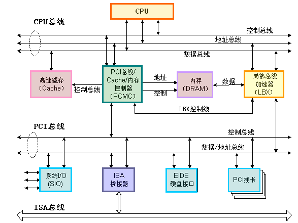
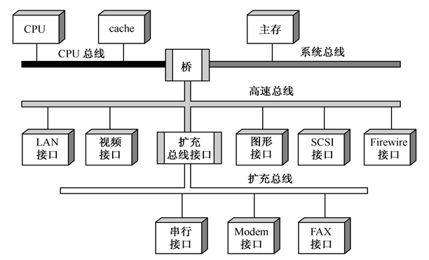
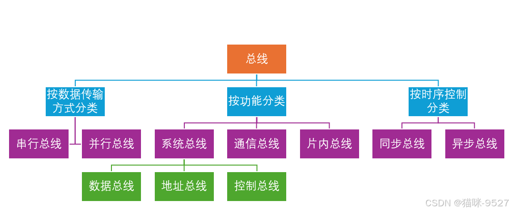
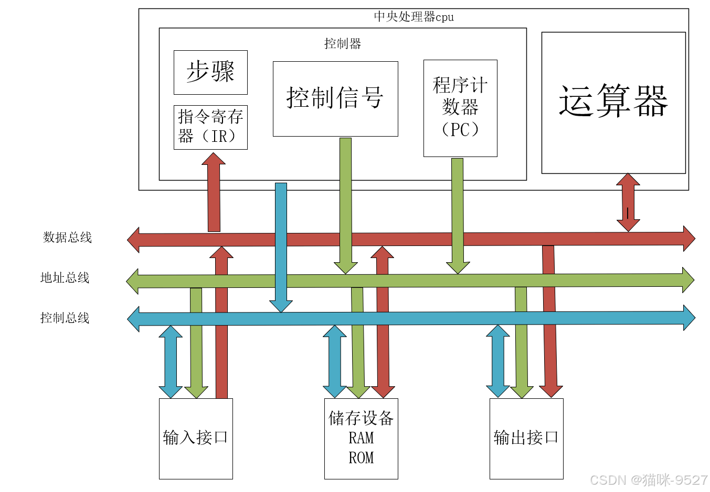
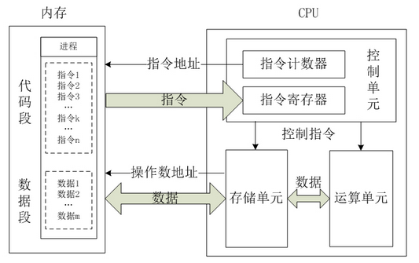
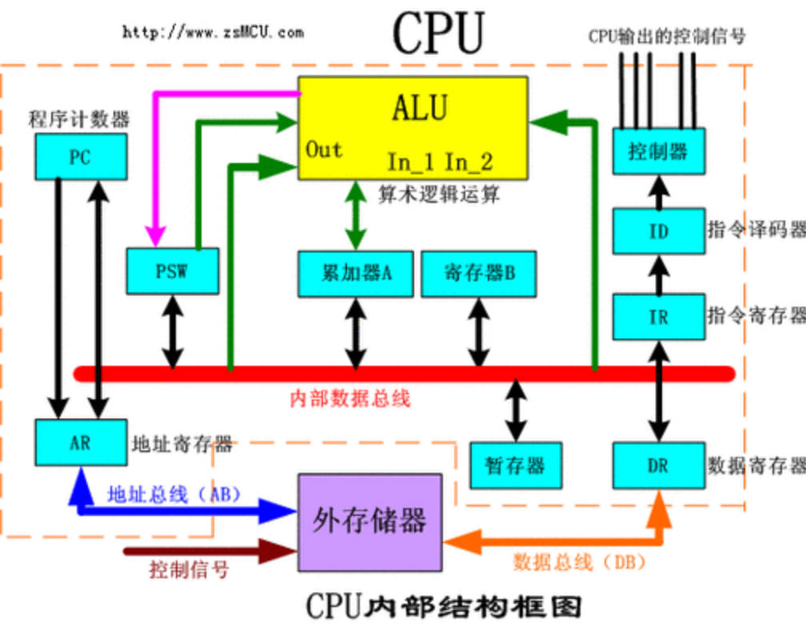
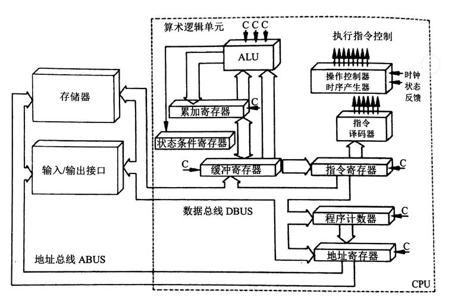

# 程序本质就是很多个01

[Windows程序启动与消息循环底层原理](https://blog.csdn.net/weixin_29913663/article/details/167763305)   [DLL劫持漏洞新玩法](https://www.cnblogs.com/swyft/articles/5580342.html)  

[Windows启动蓝屏0xc0000001/0xc000021a深度解析：SmpInitialize与difxapi.dll故障链](https://bbs.csdn.net/weixin_33824385/article/details/100507815)  

对，这个说法基本正确——Windows 程序本质上就是一大堆 0 和 1 组成的二进制文件。

说“本质”是因为它最终跑在 CPU 里的样子就是二进制指令流，但中间隔着好几层，直接看 01 串其实啥也看不懂。

### 为什么是 01

- 硬件只认 0 和 1：CPU 里的晶体管就像开关，通电（1）和断电（0）两种状态。
- 程序是二进制文件：比如 `.exe` 文件，本质就是按特定格式（PE 格式）组织起来的二进制数据，里面包含机器指令、数据、资源等。
- 不是随便堆的：这些 01 要遵循 PE 格式的规则，操作系统才能正确加载和运行它。

### 但别被“本质”骗了

- 直接看 01 没意义：一个 exe 可能有好几 MB，也就是几千万个比特，人眼根本没法读。实际开发中你写的是 C/C++、C这类高级语言，编译器负责把它们翻译成机器码。
- 中间有很多层：从高级语言 → 汇编 → 机器码 → 操作系统加载 → API 调用，每一层都在“翻译”和“调度”。
- Windows 程序还有个特点：它大量依赖系统提供的 DLL（动态链接库），比如 `kernel32.dll`、`user32.dll`，程序自己只包含一部分代码，运行时再去调用系统功能。

### 一句话总结

> 可以这样理解：Windows 程序的“本质”确实是 01，但它是“有组织、有格式、按规则排列”的 01，不是一堆乱码。平时你不需要直接面对它，编译器、链接器和操作系统帮你把这些 01 翻译成能跑的窗口、按钮和逻辑。

你如果对底层感兴趣，可以留意下 [PE 文件格式](https://blog.csdn.net/sqym1/article/details/149838575)、[Win32 API](https://baike.baidu.com/item/win32/4894730) 或 [二进制算法](https://baike.baidu.com/item/二进制算法/6436554) 这几个方向。

Windows 程序的二进制本质很有趣，要不要继续看看PE 文件格式具体包含哪些部分?或者Win32 API 是如何调用系统功能的?

# 存储单元

[16G内存有多少存储单元_百度搜索](https://www.baidu.com/s?ie=UTF-8&wd=16G%E5%86%85%E5%AD%98%E6%9C%89%E5%A4%9A%E5%B0%91%E5%AD%98%E5%82%A8%E5%8D%95%E5%85%83)  

## 16G内存有多少存储单元

16G内存按字节编址来算，存储单元总数是 16 × 1024 × 1024 × 1024 = 17179869184 个（约 172 亿个）。

这里的换算按计算机二进制标准：1GB = 1024MB，1MB = 1024KB，1KB = 1024B（字节）。通常所说的==“一个存储单元”对应一个字节（8位）==，所以 16GB 就是 2^34 个字节单元。

> ⚠️ 如果内存条的数据线宽度不是 8 位（比如数据线 32 条时，每个存储单元是 4 字节），存储单元个数会相应减少，需要按“总字节数 ÷ 单元字节数”重新计算。

# 地址空间

## 外设的地址空间

[PCIe总线上的三种地址空间（MMIO、IOMMU、BAR）](https://blog.csdn.net/weixin_28742653/article/details/160704742)  [ARM Cortex-M系统中APB外设地址空间分配](https://blog.csdn.net/weixin_30616969/article/details/99952236)  

[ARM 地址空间：物理地址、虚拟地址与 ioremap](https://zhuanlan.zhihu.com/p/2032121521251017570)  [PCIe mem io 配置](https://blog.51cto.com/u_16213702/13893503)  

[地址空间_百度百科](https://baike.baidu.com/item/%E5%9C%B0%E5%9D%80%E7%A9%BA%E9%97%B4/1423980)  

[内存映射原理](https://cloud.tencent.com/developer/article/2253425)  [内存映射原理](https://www.baidu.com/s?ie=utf-8&f=8&rsv_bp=1&tn=baidu&wd=%E5%86%85%E5%AD%98%E6%98%A0%E5%B0%84%E5%8E%9F%E7%90%86&oq=%25E5%2590%2584%25E7%25A7%258D%25E5%25A4%2596%25E8%25AE%25BE%25E7%259A%2584%25E5%259C%25B0%25E5%259D%2580%25E7%25A9%25BA%25E9%2597%25B4&rsv_pq=cedd5d670021a661&rsv_t=b1b2cVPbYod2pWED2J%2FVuY1rIoEYoSiB1cWPNiJ7e6NAlxnB%2FtChVdhMclY&rqlang=cn&rsv_enter=1&rsv_dl=tb_pre&rsv_btype=t&inputT=569663&rsv_sug2=0&rsv_sug3=34&rsv_sug1=17&rsv_sug7=100&rsv_n=2&bs=%E5%90%84%E7%A7%8D%E5%A4%96%E8%AE%BE%E7%9A%84%E5%9C%B0%E5%9D%80%E7%A9%BA%E9%97%B4)  

各种外设的地址空间，核心要看两种编址方式：独立编址和统一编址。简单说，就是CPU怎么给外设分配“门牌号”，以及这些门牌号和内存地址是分开还是共用。

### 两种主流编址方式

1. 独立编址（I/O映射方式）：外设拥有独立的地址空间，和内存地址互不干扰。CPU用专门的 `IN`/`OUT` 指令访问外设。x86架构的PC就是这么干的，I/O地址空间是 `0000H~FFFFH`，共 64KB。
2. 统一编址（存储器映射方式）：把外设的寄存器当作内存单元，共用同一个地址空间。CPU用普通的访存指令就能操作外设，不用专门指令。ARM、STM32等嵌入式芯片普遍用这种方式。

> 需要注意的是：统一编址会占用内存地址空间，导致可用的物理内存变小；独立编址不占内存，但需要专用指令，操作不够灵活。

### 典型架构的外设地址空间

x86 PC（独立编址）

- I/O端口空间：`0000H~FFFFH`，共64KB，用 `IN`/`OUT` 指令访问。
- 直接用8位地址时，只能访问256个端口；用DX寄存器间接寻址，才能访问全部64K端口。

STM32（统一编址，Cortex-M内核）

- 整个4GB地址空间 `0x00000000~0xFFFFFFFF` 被划分为固定区域。
- 外设寄存器区：`0x40000000~0x5FFFFFFF`，APB1、APB2、AHB总线都挂在这里。
- 外部RAM区（FSMC/FMC）：`0x60000000~0x9FFFFFFF`。
- 内部SRAM区：`0x20000000~0x3FFFFFFF`。

### PCIe总线的地址空间

现代计算机里，PCIe设备（显卡、网卡等）的地址空间更复杂，主要有三种概念：

1. MMIO（内存映射I/O）：把设备寄存器映射到物理内存地址空间，CPU用普通访存指令访问。
2. BAR（基地址寄存器）：每个PCIe设备都有一组BAR，用来声明自己需要多大的MMIO空间，系统启动时分配。
3. IOMMU：负责把设备的DMA请求地址翻译成物理地址，相当于给设备加了个“内存管理单元”，提升安全性和灵活性。

### 补充说明

- 地址空间≠实际容量：32位CPU有4GB寻址能力，但实际只装了1GB内存，剩下的地址空间是空着的，访问未占用的区域会出错。
- MMIO的影响：MMIO会占据物理地址空间，这就是为什么装了4GB内存，32位系统有时只能识别3GB多——一部分地址被外设预留了。
- 嵌入式常用统一编址：STM32这类芯片把Flash、SRAM、外设寄存器都映射到同一个4GB空间里，用指针就能直接操作外设。

两种编址方式各有特点，可以看看独立编址为什么需要专用指令?或者统一编址如何避免内存冲突?

## 内存映射原理

内存映射的核心是：把文件或设备直接挂到进程的虚拟地址空间里，让程序像读写内存一样操作文件，省掉传统的read/write系统调用和中间拷贝。

### 整个过程分三步走，关键在“懒加载”：

1. 建立映射：调用 `mmap()` 后，内核在进程虚拟地址空间里划出一段区域，创建 `vm_area_struct` 结构，并建立虚拟地址与文件磁盘地址的对应关系。此时不加载任何文件数据，只是“登记”了一下。
2. 触发缺页：当程序真正访问这段映射地址时，CPU查页表发现该虚拟页没有对应的物理页，触发缺页异常。
3. 按需加载：内核在缺页处理中分配物理页，把文件内容从磁盘读入这块物理内存，并在页表中建立虚拟页到物理页的映射。之后程序直接读写这块内存，就相当于读写文件。

### 底层依赖：虚拟内存机制

内存映射能成立，全靠操作系统的虚拟内存{id="entity_1"}体系支撑：

- 虚拟地址空间：每个进程拥有独立的虚拟地址空间，通过页表映射到物理内存，进程之间互不干扰。
- 页表与MMU：CPU通过MMU{id="entity_2"}（内存管理单元）自动查页表，把虚拟地址翻译成物理地址。多级页表解决了64位大地址空间下页表过大的问题。
- TLB加速：TLB{id="entity_3"}（快表）缓存最近用过的映射，命中率通常99%以上，让地址翻译开销几乎感觉不到。

### 为什么快：少一次拷贝

传统 `read()` 读文件要两次数据拷贝：磁盘→内核页缓存→用户空间。而 `mmap` 映射后，文件数据直接从磁盘读入用户空间的物理页，只拷贝一次，所以大文件随机访问场景下效率更高。

### 不是银弹：适用边界

- 适合：大文件随机访问、多进程共享数据、频繁读同一文件。
- 不适合：小文件（<16K，mmap有额外开销）、频繁随机写入（脏页回刷引发随机I/O）、变长文件（映射大小需提前固定）。
- 注意：映射区大小必须是页大小（通常4K）的整数倍；访问超出文件实际大小的部分会触发`SIGBUS`或`SIGSEGV`错误。
- 数据落盘：修改不会立即写回磁盘，需要调 `msync()` 强制同步，或等系统自动回刷脏页。

内存映射的原理讲完了，要不要再看看为什么 mmap 不适合小文件?或者脏页回刷会带来什么性能问题?

## 虚拟地址空间

[虚拟地址和物理地址的区别](https://download.csdn.net/blog/column/11381019/138012211)  [虚拟地址](https://www.baidu.com/s?ie=UTF-8&wd=%E8%99%9A%E6%8B%9F%E5%9C%B0%E5%9D%80%E6%98%AF%E7%94%B1CPU%E7%94%9F%E6%88%90%E7%9A%84%E5%9C%B0%E5%9D%80%EF%BC%8C%E5%AE%83%E6%98%AF%E4%B8%80%E4%B8%AA%E8%99%9A%E6%8B%9F%E7%9A%84%E5%9C%B0%E5%9D%80%E7%A9%BA%E9%97%B4%E3%80%82%E6%AF%8F%E4%B8%AA%E8%BF%9B%E7%A8%8B%E9%83%BD%E6%9C%89%E8%87%AA%E5%B7%B1%E7%9A%84%E8%99%9A%E6%8B%9F%E5%9C%B0%E5%9D%80%E7%A9%BA%E9%97%B4%EF%BC%8C%E8%BF%99%E4%BD%BF%E5%BE%97%E6%AF%8F%E4%B8%AA%E8%BF%9B%E7%A8%8B%E9%83%BD%E8%AE%A4%E4%B8%BA%E8%87%AA%E5%B7%B1%E6%8B%A5%E6%9C%89%E6%95%B4%E4%B8%AA%E7%B3%BB%E7%BB%9F%E7%9A%84%E5%86%85%E5%AD%98%E3%80%82%E8%99%9A%E6%8B%9F%E5%9C%B0%E5%9D%80%E6%98%AF%E5%9C%A8%E7%A8%8B%E5%BA%8F%E6%89%A7%E8%A1%8C%E6%97%B6%E4%BD%BF%E7%94%A8%E7%9A%84%E5%9C%B0%E5%9D%80)   [虚拟地址空间_百度百科](https://baike.baidu.com/item/%E8%99%9A%E6%8B%9F%E5%9C%B0%E5%9D%80%E7%A9%BA%E9%97%B4/56405189)  [64位计算_百度百科](https://baike.baidu.com/item/64%E4%BD%8D%E8%AE%A1%E7%AE%97/7508532?fr=aladdin)  

好： [虚拟地址空间区域划分 ](https://blog.csdn.net/L221578/article/details/149641603) [虚拟地址空间 ](https://learn.microsoft.com/zh-cn/windows-hardware/drivers/gettingstarted/virtual-address-spaces)  [64位虚拟地址长度是多少](https://blog.csdn.net/essencelite/article/details/147289411)  

[Linux虚拟地址空间](https://cloud.tencent.com/developer/article/2480690)  [Linux:虚拟地址空间](https://blog.csdn.net/2301_80641185/article/details/147325620)   [Liunux内核内存管理之虚拟地址空间](https://cloud.tencent.com/developer/article/2120461)  [Linux 内核内存管理：虚拟地址空间、伙伴系统和块分配器](https://cloud.tencent.com/developer/article/2571777)  

[64位系统的虚拟地址空间_百度搜索](https://www.baidu.com/s?ie=utf-8&f=8&rsv_bp=1&tn=baidu&wd=64%E4%BD%8D%E7%B3%BB%E7%BB%9F%E7%9A%84%E8%99%9A%E6%8B%9F%E5%9C%B0%E5%9D%80%E7%A9%BA%E9%97%B4&oq=64%25E4%25BD%258D%25E7%25B3%25BB%25E7%25BB%259F%25E7%259A%2584%25E8%2599%259A%25E6%258B%259F%25E5%2586%2585%25E5%25AD%2598%25E7%25A9%25BA%25E9%2597%25B4&rsv_pq=c79a529c00223952&rsv_t=40ddtddUEGJUd%2F2xybyUvPq1S4EmrqF1hEVoCySA5NGSZ19dvuPE908w6gw&rqlang=cn&rsv_enter=1&rsv_dl=tb_enter&rsv_btype=t&inputT=9653&rsv_sug2=0&rsv_sug3=41&rsv_sug4=9653)  

虚拟地址就是CPU在执行程序时生成的逻辑地址，每个进程都有自己独立的虚拟地址空间，这让进程以为自己独占了整个内存。这个机制解决了进程隔离、内存安全和效率问题。

### 核心概念

- 虚拟地址：程序执行时使用的地址，不是物理内存的真实位置，需要经过转换才能访问实际数据。
- 虚拟地址空间：操作系统为每个进程划分的连续地址区间，比如32位系统通常是0~4GB。
- 物理地址：数据在内存条上的真实位置，由硬件直接访问，用户程序看不到。

### 🔄 转换机制

CPU通过内存管理单元(MMU) 和页表把虚拟地址翻译成物理地址。 具体流程：以32位系统为例，虚拟地址分成3部分——高10位索引页目录、中间10位索引页表、低12位是页内偏移，CPU按这个结构逐级查找，最终得到物理地址。

### 🎯 为什么需要虚拟地址

直接使用物理地址会有三个严重问题：

1. 进程不隔离：任何程序都能访问甚至修改其他进程或内核的数据，恶意软件可以搞瘫系统。
2. 地址不确定：程序每次加载到内存的位置都不同，无法预知运行地址。
3. 效率低下：内存不足时要整体换入换出进程，磁盘拷贝太慢。

有了虚拟地址，每个进程的地址空间彼此隔离，互不干扰，物理内存可以碎片化分配，而进程看到的虚拟地址永远是连续的。

### 🗂️ 地址空间划分

不同系统对虚拟地址空间的划分不同：

- Windows：低2G给用户，高2G给系统，访问系统空间需要ring0权限。
- Linux：低3G给用户，高1G给内核，内核空间所有进程共享。

### 💡 重要补充

- 你用C/C++里`&`取到的变量地址，全是虚拟地址，不是物理位置。
- 虚拟内存不只是"骗人"，它配合缺页中断实现按需加载，程序访问的页不在内存时才从磁盘读入，大幅提高内存利用率。
- 物理内存不足时，系统会把不活跃的页换到硬盘的swap分区，所以16G内存的电脑能跑出更大内存的效果，但频繁换页会导致卡顿。

虚拟地址的转换机制挺有意思，要不要继续看看页表是如何实现虚拟到物理的转换?或者缺页中断具体是怎么触发的?

## intel cpu的内存地址空间分配

[intel cpu的内存地址空间分配_百度搜索](https://www.baidu.com/s?ie=UTF-8&wd=intel%20cpu%E7%9A%84%E5%86%85%E5%AD%98%E5%9C%B0%E5%9D%80%E7%A9%BA%E9%97%B4%E5%88%86%E9%85%8D)  [虚拟内存以及进程的虚拟内存分布](https://download.csdn.net/blog/column/10281356/90273751)  

Intel CPU的内存地址空间不是一块单纯给内存条用的空间，而是被划分为物理内存（DRAM）、内存映射I/O（MMIO）和设备I/O端口三大部分，由硬件、BIOS和操作系统共同管理和分配。

### 🧠 地址空间的基本构成

1. 物理地址空间：CPU地址总线能访问的全部地址范围，由地址总线位数决定。例如32位CPU最大4GB，现代64位CPU则远大于此。
2. 内存（DRAM）空间：物理地址中分配给内存条的部分，由内存控制器直接管理，CPU间接访问。
3. 内存映射I/O（MMIO）空间：把外设寄存器、显存、PCI配置空间等映射到物理地址空间里，CPU访问这些地址就像访问内存一样。PCI配置空间、集成显存等都会占用这块空间。
4. 独立I/O端口空间：x86特有的独立编址方式，通过`in`/`out`指令访问，有独立的64KB地址空间（0x0000-0xFFFF）。

### 📐 4GB以下空间的经典布局

以传统PC为例，4GB以下地址空间大致这样划分：

- 0 ~ TOLUD：分配给DRAM，TOLUD是BIOS设定的分界线。
- TOLUD ~ 4GB：分配给MMIO，包括PCI配置空间、显存、BIOS固件等。其中640KB-1MB区域有特殊用途（如BIOS shadow），4GB顶部附近是High BIOS。

当DRAM容量超过4GB时，被MMIO“遮挡”的DRAM部分会通过REMAPBASE/REMAPLIMIT寄存器重映射到4GB以上空间，这就是PAE（物理地址扩展）机制的核心。

### 🔄 现代Intel处理器的扩展

- 物理地址位：决定最大可寻址物理内存。例如至强可扩展处理器支持46位物理地址，即最大2^46字节。
- 虚拟地址位：决定进程可用的虚拟地址空间。例如48位虚拟地址对应2^48字节。
- 线性地址空间分离（LASS）：至强6处理器引入的硬件安全功能，将64位虚拟地址空间分为上下两半，分别对应内核空间和用户空间，防止跨权限访问。
- 平面内存模式：至强6处理器可将DRAM和CXL内存统一为一个平坦地址空间，由硬件自动管理。

### 🖥️ 操作系统视角的分配

在Linux等系统中，进程的虚拟地址空间被划分为用户空间和内核空间（32位下通常为3GB+1GB）。内核使用`ioremap`将MMIO物理地址映射到内核虚拟地址空间，驱动通过`readb`/`writeb`等函数访问I/O内存。

> 在x86平台上，物理地址就是总线地址，两者共享同一地址空间，因此CPU访问某个地址时，既可能命中内存，也可能命中某个外设。

如果你想查看自己系统的实际分配情况，Linux下可以查看`/proc/ioports`（I/O端口）和`/proc/iomem`（内存映射）文件。

内存地址空间的划分涉及不少细节，可以看看MMIO和传统I/O端口有何区别?或者PAE机制如何解决4GB内存限制?

## MMIO和虚拟地址空间

[内存管理五大技术概念：MMU、IOMMU、MMIO、mmap、ioremap](https://cloud.tencent.com/developer/article/2601736)  

[MMIO_百度百科](https://baike.baidu.com/item/MMIO/5986323)  [PCIe总线上的三种地址空间（MMIO、IOMMU、BAR）](https://blog.csdn.net/weixin_28742653/article/details/160704742)  [PCIe总线地址空间与MMIO](https://blog.csdn.net/weixin_42652674/article/details/160544150)  [通过指针直接读写硬件寄存器的技巧](https://forum.eepw.com.cn/thread/396256/1/)  [内存映射输入输出_百度百科](https://baike.baidu.com/item/%E5%86%85%E5%AD%98%E6%98%A0%E5%B0%84%E8%BE%93%E5%85%A5%E8%BE%93%E5%87%BA/53323046?fr=aladdin)   

虚拟地址空间是 CPU 看到的“逻辑地址世界”，MMIO 则是把设备寄存器放进这个地址世界里，让 CPU 像读写内存一样访问硬件。

### 虚拟地址空间是什么

1. 它给每个进程一个独立的地址视图
   - 每个进程看到的地址范围是私有的，实际访问时再通过页表转换成物理地址。
   - 这样不同进程之间互不干扰，系统更安全、稳定 。
2. 转换由 MMU 硬件完成
   - 程序中用的指针地址是虚拟地址，CPU 不能直接用它访问硬件。
   - MMU 根据页表把虚拟地址映射到真实内存或设备寄存器对应的物理地址 。
3. 空间大小取决于系统架构
   - 32 位系统通常约 4GB，64 位系统可以大得多，比如 64 位进程可拥有上百 TB 级别的虚拟地址空间 。

### MMIO 是怎么工作的

1. 把设备寄存器“当成内存”来编址
   - MMIO 将外设寄存器映射到物理地址空间的一段区域。
   - CPU 使用普通内存指令就能读写这些寄存器，不需要专用 I/O 指令 。
2. 访问时仍要经过虚拟地址转换
   - CPU 实际访问的是虚拟地址，操作系统把这段虚拟地址映射到设备寄存器的物理地址。
   - 写入某个虚拟地址，最终会直接作用到设备寄存器上 。
3. 适合多种外设场景
   - 常见于显卡帧缓存、PCIe 设备、GPIO 控制、外设配置等。
   - 相比传统端口 I/O，MMIO 编程更统一，也能利用内存访问机制提升效率 。

### 软件上怎么建立这段映射

1. Linux 内核常用 ioremap
   - ioremap 把设备寄存器的物理地址映射到内核虚拟地址空间。
   - 映射成功后，驱动可以用指针访问这段区域，进而控制设备 。
2. 访问时要用专用函数，不要直接当普通指针用
   - 应使用 readl/writel 等接口，避免缓存、编译器重排或端序问题。
   - 直接用普通指针读写 MMIO 区域可能导致寄存器状态错误或内核不稳定 。
3. 用完要释放映射
   - 驱动卸载或资源释放时，应调用 iounmap 解除虚拟地址映射。
   - 否则可能浪费内核虚拟地址空间，甚至引发地址冲突 。

需要我帮你对比MMIO和传统I/O方式的优缺点吗？可以帮你理解为什么现代系统更倾向用MMIO。

## 保护模式是内存映射吗

[保护模式](https://www.cnblogs.com/doubleconquer/p/18197701)  [32 位 Linux 系统内存地址映射（一）：从实模式到保护模式](https://blog.csdn.net/2301_76564925/article/details/148216280)  [CPU 保护模式](https://blog.csdn.net/xingke/article/details/151107611)  

[保护模式_百度百科](https://baike.baidu.com/item/%E4%BF%9D%E6%8A%A4%E6%A8%A1%E5%BC%8F/3209404)  [x86保护模式下的内存分段的地址映射](https://cloud.tencent.com/developer/article/1947028)  [浅谈OS虚拟内存](https://developer.aliyun.com/article/1416774)  

[好：内存管理方式](https://qxlxi.blog.csdn.net/article/details/132678215)  

保护模式不完全是内存映射，但它确实依赖内存映射机制来实现核心功能。更准确地说，保护模式是 x86 处理器的一种运行模式，它==通过分段和分页两种地址转换机制来管理内存==，而“内存映射”只是其中分页机制的具体实现手段。

- 分段机制：保护模式将内存划分为多个段，每个段由段描述符定义基址、界限和权限。程序通过段选择子（段寄存器中的索引）在全局描述符表（GDT）或局部描述符表（LDT）中找到对应描述符，再结合偏移量得到线性地址。
- 分页机制：线性地址会进一步通过页目录和页表转换为物理地址，这就是典型的内存映射过程。分页以固定大小（通常 4KB）的页为单位，支持虚拟内存、按需调页和进程间内存隔离。
- 保护的核心：保护模式之所以叫“保护”，关键在于段描述符和页表项中都包含访问权限、特权级等信息，CPU 会在每次访问时检查权限，防止程序越权访问其他任务或操作系统内核的内存。

> 需要澄清一点：保护模式下分段是必须的，分页是可选的。如果不开启分页，线性地址直接就是物理地址；只有开启分页后，才真正形成“虚拟地址 → 物理地址”的内存映射关系。

现代操作系统（如 Linux、Windows）通常都会开启分页，利用页表把每个进程的虚拟地址空间映射到物理内存，实现进程隔离和虚拟内存。所以可以说，保护模式为内存映射提供了硬件基础，而内存映射是保护模式下实现内存管理和保护的关键手段。

保护模式的分段和分页机制很关键，要不要继续看看`分段机制如何实现内存保护?或者分页开启后线性地址怎么转换?`

## 寻址方式

[寻址方式](https://www.cnblogs.com/doubleconquer/p/18197701)  

# 总线

[总线_百度搜索](https://www.baidu.com/s?ie=UTF-8&wd=%E6%80%BB%E7%BA%BF)  [总线技术_百度百科](https://baike.baidu.com/item/%E6%80%BB%E7%BA%BF%E6%8A%80%E6%9C%AF/6579304?fr=aladdin)  [总线_百度百科](https://baike.baidu.com/item/%E6%80%BB%E7%BA%BF/108823)  

[系统总线](https://cloud.tencent.com/developer/article/2621246)   [总线的概念和结构形态](https://cloud.tencent.com/developer/article/2070238)  [总线](https://cloud.tencent.com/developer/article/2486692)  

## 总线

总线是计算机硬件系统中连接 CPU、内存及各功能部件的公共通信通道，主要负责传输数据、地址和控制信号，根据 Britannica 及计算机体系结构权威资料，它是实现组件间信息交换的核心基础设施 。

### 总线主要分哪几类

总线按照不同的标准有多种分类方式，最常见的是按功能和传输形态来划分：

1. 按功能分类：这是最基础的分类，决定了总线传输的内容 。
   - 数据总线：负责双向传输实际的数据信息（如指令、运算结果），其宽度（位数）直接影响每次能传输多少数据。
   - 地址总线：负责单向传输地址信息，告诉系统数据存放在哪里，其位数决定了 CPU 能访问的最大内存空间。
   - 控制总线：负责传输控制信号和时序信号（如读/写命令、中断请求），协调各部件的工作步调。
2. 按传输方式分类：决定了信号是如何跑在路上的 。
   - 并行总线：多条线同时传输多个比特，速度快但布线复杂，适合短距离（如早期的 ISA、PCI 总线）。
   - 串行总线：一条线按时间顺序逐位传输，结构简单、抗干扰强，适合长距离和高速传输（如 USB、PCIe、SATA）。
3. 按连接位置分类：
   - 片内总线：CPU 芯片内部的连线。
   - 系统总线：连接主板上的 CPU、内存和扩展卡。
   - 外部总线：连接电脑与外部设备（如打印机、硬盘）。

### 常见总线标准有哪些

不同的设备和使用场景会采用不同的总线标准，以下是生活中和技术领域最常见的几种：

1. 电脑内部高速通道：
   - PCI Express (PCIe)：目前电脑显卡、固态硬盘最常用的接口，采用串行传输，速度极快，支持 x1、x16 等不同通道规格 。
   - SATA：主要用于连接机械硬盘和光驱，速度较 PCIe 慢但兼容性好。
2. 外部设备连接：
   - USB (通用串行总线)：连接鼠标、键盘、U 盘等，支持热插拔，是目前最普及的外部总线 。
   - Thunderbolt (雷电)：苹果和高端 PC 常用，传输速度极快，可同时传输数据和视频信号。
3. 汽车与工业控制：
   - CAN 总线：汽车电子系统的“神经网”，用于发动机、变速箱等控制单元之间的通信，抗干扰能力强 。
   - RS-485：工业现场常用的通信总线，适合长距离、多节点的设备联网，但布线不规范容易出现乱码 。

### 总线速度怎么衡量

总线的性能直接决定了电脑或设备的运行效率，主要看以下两个指标：

1. 总线带宽：即单位时间内能传输的数据总量，计算公式为：总线带宽 = 工作频率 × 位宽 / 8 。
   - 例如，频率越高、位宽越宽（如 64 位比 32 位宽），带宽就越大，传输速度越快。
2. 实际影响因素：
   - 仲裁机制：当多个设备同时想用总线时，需要仲裁器决定谁先用，仲裁方式（如链式查询、独立请求）会影响响应速度 。
   - 信号质量：线路过长、电磁干扰或接触不良会导致信号衰减，引发通信错误（如 CAN 总线故障常因线路干扰引起）。


注意区分：虽然英文中"Bus"原意是“公共汽车”，比喻像公交车一样按固定路线运送乘客（数据），但在中文语境下，“总线”专指计算机或通信领域的传输线路，与日常乘坐的“公交车”是完全不同的概念，仅在英文词源上有关联 。

总线分类方式多样，可以看看 并行和串行总线哪种更常用？ 或者 PCIe和SATA接口速度差多少？

|  |   |
| -------------------------------- | ------------------------------- |
|   |  |

## 并行和串行总线哪个速度快

[串行总线硬盘为什么比并行总线硬盘快](https://blog.51cto.com/u_16097040/6243494)   [串行总线效率为啥比并行总线效率高](https://blog.csdn.net/SYT_Boss/article/details/82794420)  [并行总线和串行总线](https://cloud.tencent.com/developer/article/1658133)  [并行与串行传输深度对比](https://blog.csdn.net/weixin_32496547/article/details/166912114)  

> ​    直观上讲，串行一次只能传送一个二进制数字也就是0或者1，而并行总线一次可以传输多个二进制数字，假如一个16位的并行总线，速度应该是串口总线的16倍啊！
>
> ​	事实不是这样，因为这只考虑了位宽，而没有考虑频率，实际的传输速率是位宽和频率的乘积，如果频率相同，没错16bit的并口传输是串口的传输的十多倍，
>
> ​	但是随着频率的大幅提高，并口多根信号线之间的串扰越来越严重（在通信原理课上我们知道，多信道之间相互是有干扰的），同时，信号的同步也越来越困难
>
> ​	举个编程的例子，你一次跑16个线程和一次跑1个线程哪个好控制？线程同步就是一个相当麻烦的事情，弄不好还死锁了。当达到一定频率之后，并口传输的数据开始失真，就不能再提高传输频率了。而串口通信一般是采用的差分信号，功耗低，串扰问题很小，因此可以大幅提高通信频率，就上面的例子来说，如果你串口通信的频率是并口通信的频率的16+倍，那么串口通信的数据传输速率就比并口通信的数据传输速率快了。
>
> ​	另外，这里面还有个成本的问题，并口串扰的问题可以通过一些技术来抑制和减低干扰，但是成本很高，而提高通信频率，相对来说简单很多，所以高速通信暂时看来会向着串行技术发展。

这个问题的答案要分场景看：短距离、低频率下并行总线更快；现代高速长距离传输中，串行总线反而更快，所以不能简单说谁绝对快。

简单理解，并行总线像多条车道同时跑多辆车，理论上带宽高；但车道一多，车与车之间容易互相干扰，而且很难保证所有车同时到达（信号同步问题）。串行总线只有一条“车道”，但能把车速（频率）提得很高，还用了差分信号、内嵌时钟等抗干扰技术，实际吞吐量反而更大。

现在你身边的高速接口，基本都是串行总线：PCIe、SATA、USB 这些，单通道速率能做到 6Gbps、8Gbps 甚至更高，这是传统并行接口很难做到的。 并行总线现在主要用在芯片内部、内存这类距离极短、对延迟敏感的场景，比如 DDR 内存。

> 关键区别在于：并行总线的理论速度是“线数 × 单线速度”，但频率一高，信号歪斜、串扰问题会严重拖累实际速度；串行总线用频率换宽度，通过差分信号和时钟恢复技术绕开了这些瓶颈，所以现代高速场景基本都是串行。

并行和串行各有适用场景，可以看看为什么DDR内存用并行总线?或者串行总线如何解决信号同步问题?

## 3类总线协同完成信息传输

[地址、数据、控制总线如何运行_百度搜索](https://www.baidu.com/s?ie=UTF-8&wd=%E5%9C%B0%E5%9D%80%E3%80%81%E6%95%B0%E6%8D%AE%E3%80%81%E6%8E%A7%E5%88%B6%E6%80%BB%E7%BA%BF%E5%A6%82%E4%BD%95%E8%BF%90%E8%A1%8C)  

[计算机三总线](https://blog.csdn.net/luotuo28/article/details/148954297)  [计算机基础之三总线结构](https://cloud.tencent.com/developer/article/2445731)  

地址、数据、控制三条总线协同工作，完成一次信息传输大致分三步：CPU 先通过地址总线发出目标地址，再通过控制总线发出读/写命令，最后由数据总线传输实际数据。

可以把这三条总线理解成一次“取快递”的过程：地址总线告诉系统“去哪个货架拿”，控制总线决定“是拿还是放”，数据总线负责“把东西搬过去”。

### 三条总线各自的分工

1. 地址总线（AB）：专门传地址，只能由 CPU 或总线主设备发出，是单向的。它的位数直接==决定能寻址多大的内存空间==，比如 32 位地址总线最多寻址 4GB。
2. 数据总线（DB）：负责传真正的数据，是双向的，CPU 既能读也能写。它的宽度==决定一次能搬多少数据==，比如 64 位总线一次能传 8 字节。
3. 控制总线（CB）：==传各种控制信号和时序信号==，比如读信号、写信号、中断请求、时钟等。它的方向不固定，有的信号由 CPU 发出，有的由外部设备反馈回来。

### 一次完整的“CPU 读内存”流程

以 CPU 从内存地址 `0x2000` 读取数据为例，三条总线是这样配合的：

1. 地址阶段：CPU 把目标地址 `0x2000` 放到地址总线上，内存通过地址译码选中对应的存储单元。
2. 控制阶段：CPU 通过控制总线发出“读”命令，通知内存准备输出数据。
3. 数据阶段：内存把该单元的数据放到数据总线上，CPU 从数据总线上取走数据，随后撤销读命令，一次传输结束。

> ⚠️ 同一时刻总线上只能有一个主设备占用总线，多个设备要发数据时需要通过仲裁机制排队，否则数据会在线上叠加互相干扰。

==总线的运行机制==挺有意思，要不要继续看看地址总线为什么是单向的?或者数据总线宽度和内存速度有关吗?

## ==如何通过总线读写内存==

[如何通过总线读写内存_百度搜索](https://www.baidu.com/s?ie=UTF-8&wd=%E5%A6%82%E4%BD%95%E9%80%9A%E8%BF%87%E6%80%BB%E7%BA%BF%E8%AF%BB%E5%86%99%E5%86%85%E5%AD%98)  

[CPU 是如何工作的 |CPU 通过总线读取内存的工作方式](https://www.cnblogs.com/cdaniu/p/15605828.html)   [总线与输入/输出实用的系统](https://www.cnblogs.com/gccbuaa/p/19330401)  

[通过IIC总线读写AT24C512存储器](https://www.elecfans.com/d/2307188.html)  [指令总线_百度百科](https://baike.baidu.com/item/%E6%8C%87%E4%BB%A4%E6%80%BB%E7%BA%BF/21503429?fr=aladdin)  

通过总线读写内存，核心是CPU 通过“地址总线—数据总线—控制总线”三组总线协作完成。读操作时先送地址、再发读信号、最后从数据总线取数；写操作则是送地址、送数据、发写信号。整个过程由控制总线统一协调时序。

### 读内存的三步流程

1. 送地址：CPU 把目标存储单元的地址放到地址总线上，地址译码器据此定位到具体存储单元。
2. 发读信号：CPU 在控制总线上发出“读”命令，存储器准备好后返回 Ready 信号。
3. 取数据：存储器把该单元的数据复制一份放到数据总线上，CPU 从数据总线接收。原数据仍然保留，除非后续执行写操作覆盖它。

### 写内存的对应流程

个人理解：看着有点问题，应该先写信号，再送数据吧？

写操作与读类似，区别在于控制信号和数据流向不同：

1. 送地址：CPU 把目标地址放到地址总线上。
2. 送数据：CPU 把要写入的数据放到数据总线上。
3. 发写信号：CPU 在控制总线上发出“写”命令，存储器在时序脉冲（如时钟上升沿）触发下，将数据总线上的内容存入指定单元。

> 读和写不会同时发生，由不同的控制信号和时钟边沿精确触发。

### 现代系统中的实际访存路径

上面描述的是总线层面的基本原理。在真实的现代 CPU 中，一条访存指令的执行路径更复杂，总线操作只是其中一环：

1. 生成虚拟地址：CPU 根据指令（如 `mov eax, [0x12345678]`）计算出虚拟地址。
2. 地址转换：内存管理单元（MMU）先查 TLB，未命中则查页表，将虚拟地址转换为物理地址。若页面不在内存中，会触发缺页中断，由操作系统从磁盘调入。
3. 查询缓存：物理地址先访问 Cache（L1/L2/L3），命中则直接返回数据；未命中才继续访问主内存。
4. 总线访问：Cache 未命中时，通过系统总线从物理地址对应的主存位置读取数据，数据同时会按缓存策略载入 Cache。

### 软件层面如何操作

在编程层面，读写内存通过指针完成，编译器会帮你生成对应的总线操作指令：

- 读：对指针解引用（如 C 语言中的 `*ptr`），CPU 会执行上述访存流程。
- 写：对指针赋值（如 `*ptr = value`）。

```c
int value = 0x1234;      // 写：将数据存入变量（内存）
int *ptr = &value;       // 取变量地址
int data = *ptr;         // 读：通过地址访问内存中的数据
```

> 操作指针时要小心空指针和野指针，对它们解引用会导致程序崩溃或未定义行为。

### 大块数据传输的替代方案：DMA

当需要`外设与内存之间`传输大量数据时，==CPU 逐字节搬移效率太低。此时可使用 DMA（直接内存访问） 技术==：

1. CPU 初始化 DMA 控制器（DMAC），指定源地址、目的地址和传输长度。
2. 外设向 DMAC 发出 DMA 请求，DMAC 向 CPU 申请总线控制权。
3. CPU 让出总线，由 DMAC 直接在外设和内存之间搬运数据，完成后释放总线。

这样做能大幅减轻 CPU 负担，适合硬盘读写、网络传输等场景。

总线读写是基础，可以看看地址总线、数据总线、控制总线分别是什么?或者DMA如何避免与CPU总线冲突?

|  |  |
| ---------------------------------- | ----- |

# CPU

[cpu构成_百度搜索](https://www.baidu.com/s?ie=UTF-8&wd=cpu%E6%9E%84%E6%88%90)   [中央处理器部分_百度百科](https://baike.baidu.com/item/%E4%B8%AD%E5%A4%AE%E5%A4%84%E7%90%86%E5%99%A8%E9%83%A8%E5%88%86/21869720)  

[计算机硬件系统各组成部分](http://www.sne.bnu.edu.cn/resource/pxxm/362V40JP/jsjyyjc_bk/contents/learn/ch_01/ch_01_05_01.html)  [处理器结构_百度百科](https://baike.baidu.com/item/%E5%A4%84%E7%90%86%E5%99%A8%E7%BB%93%E6%9E%84/14724193)  [指令译码器_百度百科](https://baike.baidu.com/item/%E6%8C%87%E4%BB%A4%E8%AF%91%E7%A0%81%E5%99%A8/3295261?fromModule=lemma_inlink)  

[cpu写操作_百度搜索](https://www.baidu.com/s?ie=UTF-8&wd=cpu%E5%86%99%E6%93%8D%E4%BD%9C)  [CPU硬件工作原理](https://www.uml.org.cn/embeded/202505064.asp)  

好： [剖析操作系统中CPU指令执行全过程](https://blog.csdn.net/lrj41781196/article/details/156016573)  

## CPU构成

[CPU GPU是什么?](https://cloud.tencent.com/developer/article/2178948)  

CPU 主要由运算器、控制器和寄存器三大部分构成，协同完成指令处理与数据运算。

### 核心部件有哪些

1. 运算器（ALU）：执行加减乘除等算术运算及与或非等逻辑操作，是 CPU 的计算核心。
2. 控制器：包含指令寄存器和译码器，负责读取、解析指令并协调各部件工作。
3. 寄存器：CPU 内部高速存储单元，暂存指令、数据和地址，访问速度远快于内存。

### 辅助组件

- 高速缓存：存储常用数据，减少内存访问延迟。
- 总线单元：负责 CPU 与内存及其他设备间的数据交换。
- 时钟信号：同步 CPU 内部操作节奏，决定指令执行频率。

需要我帮你==梳理运算器、控制器和寄存器是如何协同工作==的吗？这样能更直观地理解==CPU的指令处理流程==。

|  |  |
| ------------------------------------------------------- | ------------------------------ |

## 寄存器组分类

[计算机寄存器是如何实现的](https://cloud.tencent.com/developer/article/2520771)   [寄存器组与指令集架构（ISA）](https://www.cnblogs.com/hcgk/p/18916872)  [寄存器_百度百科](https://baike.baidu.com/item/%E5%AF%84%E5%AD%98%E5%99%A8/187682)  

“寄存器组”在不同架构里差别挺大，最常见的几种可以按下面这么分：

### x86 架构（32位）

- 数据寄存器：EAX（累加器）、EBX（基址）、ECX（计数）、EDX（数据），都可以拆成16位或8位用。
- 指针和变址寄存器：ESP（栈顶指针）、EBP（栈基址指针）、ESI（源变址）、EDI（目的变址）。
- 段寄存器：CS、DS、SS、ES、FS、GS，共6个。
- 其他：EIP（指令指针）、EFLAGS（标志寄存器）。

### ARM 架构（以Cortex-M为例）

- 通用寄存器：R0~R12，共13个32位寄存器。
- 特殊功能寄存器：R13（栈指针SP）、R14（链接寄存器LR）、R15（程序计数器PC）。
- 另外还有：CONTROL、PRIMASK、FAULTMASK、BASEPRI 等特殊寄存器。

### x86-64 架构（64位）

- 通用寄存器：RAX、RBX、RCX、RDX、RSI、RDI、RBP、RSP，再加上 R8~R15，一共16个。
- 状态寄存器：RFLAGS。
- 指令指针：RIP。

另外，不同架构还有专门的浮点寄存器（如x86的XMM系列）和向量寄存器（如ARM的V0~V31），用于处理浮点运算和多媒体数据。

寄存器组在不同架构里差别挺大，要不要继续看看x86和ARM寄存器组主要区别在哪?或者浮点寄存器和向量寄存器有什么不同?

## 寄存器组

[寄存器组有哪些](https://blog.csdn.net/weixin_47906677/article/details/118113955)  

### 通用寄存器组

1. 数据寄存器（字或字节）：AX、BX、CX、DX
   1. AX：作为`累加器`使用，算术运算的主要寄存器，在乘、除等指令中指定用来存放操作数。
   2. BX：计算存储器地址时，用作`基址寄存器`。
   3. CX：`保存计数值`，移位指令、循环和串指令中用作隐含的计数器。
   4. DX：作`双字长运算`时，把DX和AX组合在一起存放一个双字长数，DX用来存放高位字；对某些I/O操作，DX用来存放I/O的端口地址。
2. 指针寄存器：SP（堆栈指针）、BP（基址指针）
   1. SP、BP与堆栈段寄存器SS联用来确定堆栈段中的某一存储单元的地址。
   2. SP用来指示`段顶的偏移地址`，BP作为堆栈区的一个基地址以便访问堆栈中的信息。
3. 变址寄存器：SI（源变址寄存器）、DI（目的变址寄存器）
   1. SI、DI一般与数据段寄存器DS联用，用来确定数据段中某一存储单元的地址。（有自动增量和减量的功能）
   2. 在串处理指令中，SI和DI作为隐含的源变址和目的变址寄存器，此时SI和DS联用，DI和附加段寄存器ES联用，分别达到在数据段和附加段中寻址的目的。
4. 段寄存器：CS（代码段）、DS（数据段）、ES（附加段）、SS（堆栈段）

**只有四个指针和变址寄存器以及BX寄存器可以存放偏移地址**

### 专用寄存器

1. 指令指针寄存器：IP（存放代码段中的偏移地址）
   1. 在程序运行过程中，它始终指向下一条指令的首地址，与段寄存器CS联用确定下一条指令的物理地址。
2. 堆栈指针寄存器：SP（存放栈顶的偏移地址）
3. 标志寄存器：FLAGS（PSW，程序状态寄存器）

### 条件码

OF：溢出标志。溢出，OF置1，否则置0.
SF：符号标志。结果为负时置1，否则置0.
ZF：零标志。运算结果为0时，ZF置1，否则置0.
CF：进位标志。最高有效位有进位时置1，否则置0

控制标志位为方向标志（DF），在串处理指令中控制信息的方向用。当DF为1时，每次操作后使变址寄存器SI和DI减小，这样就使串处理从高地址向低地址方向处理。当DF为0时，每次操作后使变址寄存器SI和DI增大，这样就使串处理从低地址向高地址方向处理。

### 实模式存储器寻址

每个存储单元有20位物理地址，由16位段地址和16位偏移地址组成。把段地址左移4位再加上偏移地址就形成物理地址

## 处理器逻辑段

[ BSS段](https://cloud.tencent.com/developer/article/2620924)  [处理器逻辑段_百度搜索](https://www.baidu.com/s?ie=utf-8&f=8&rsv_bp=1&tn=baidu&wd=%E5%A4%84%E7%90%86%E5%99%A8%E9%80%BB%E8%BE%91%E6%AE%B5&oq=%25E9%2599%25A4%25E4%25BA%2586%25E4%25BB%25A3%25E7%25A0%2581%25E6%25AE%25B5(%2526lt%253BS)%25E3%2580%2581%25E6%2595%25B0%25E6%258D%25AE%25E6%25AE%25B5(DS)%25E3%2580%2581%25E6%25A0%2588%25E6%25AE%25B5%252C%25E8%25BF%2598%25E6%259C%2589%25E4%25BB%2580%25E4%25B9%2588%25E6%25AE%25B5&rsv_pq=818965da00398245&rsv_t=4a71p2mmzF6YTForxYSoucKlkid1mYj9ScKU7vvOATDhQP2pMXTgdmr3%2FtI&rqlang=cn&rsv_enter=1&rsv_dl=tb_enter&rsv_sug3=15&rsv_sug1=10&rsv_sug7=100&rsv_btype=t&inputT=3233&rsv_sug4=3234)  

除了代码段、数据段、堆栈段，还有一个附加段（ES），它们合称8086的4个逻辑段。

### 四个逻辑段

1. 代码段（CS）：存放程序指令。
2. 数据段（DS）：存放程序要处理的数据。
3. 堆栈段（SS）：临时存放需要保存的数据，比如函数调用时的返回地址。
4. 附加段（ES）：作为额外的数据段，常用于字符串操作等需要额外数据区的场景。

### 扩展补充

- 段寄存器：8086有4个段寄存器，分别对应这4个逻辑段——CS、DS、SS、ES，用来存放各段的基地址。
- 更多段寄存器：在32位及以后的x86架构中，还增加了FS和GS两个附加段寄存器，供操作系统或程序特定用途使用（比如Windows用FS访问线程信息块）。
- 物理地址计算：段地址左移4位（×16）加上偏移地址，得到20位物理地址，比如 `DS=250AH，偏移=0204H，物理地址=250A0H+0204H=252A4H`。

段寄存器除了CS、DS、SS、ES，还有FS和GS，可以看看FS和GS段寄存器主要用在什么场景?或者段地址左移4位的原理是什么?

# 伪指令

[ERQ_百度百科](https://baike.baidu.com/item/ERQ/14436861)   [伪指令](https://www.chinaaet.com/article/3000065830)   [伪指令](https://www.cnblogs.com/Tatsukyou/p/17494396.html)  

## EQU

EQU伪指令是汇编语言中用于给常量、表达式或助记符起名字的符号定义伪指令，格式为 `符号名 EQU 表达式`，汇编时编译器会把符号名直接替换成对应的值或文本，不占用存储空间。

### 核心用法

1. 定义常量：`COUNT EQU 256`，之后写 `COUNT` 就相当于写 256。
2. 定义表达式：`VAR1 EQU COUNT-2`，若 COUNT 为 256，则 VAR1 代表 254。
3. 定义助记符简写：`PH EQU PUSH`，之后写 `PH AX` 就相当于 `PUSH AX`。
4. 定义字符串或文本：`pressKey EQU <"Press any key to continue...",0>`，可用于后续数据定义。

### 关键限制

- 不可重复定义：同一源程序中，用 EQU 定义的符号不能再重新赋值，这是它与 `=` 伪指令的主要区别。
- 表达式符号须先定义：EQU 后面表达式中出现的符号必须已提前定义。
- 数值范围：51 汇编中 EQU 定义的常量不能超过 16 位（65535）。

### EQU 与 = 的区别

| 对比项     | EQU                        | `=`                      |
| ---------- | -------------------------- | ------------------------ |
| 重复定义   | 不允许                     | 允许                     |
| 支持助记符 | 支持（如 `PH EQU PUSH`）   | 不支持                   |
| 典型用途   | 常量、表达式、文本、助记符 | 整数常量、可反复修改的值 |

简单说，常量用 EQU，需要改值的用 `=`。

### 常见应用场景

- 定义硬件端口地址、配置值，提高代码可读性和可维护性。
- 集中管理常量，修改时只需改声明处一处，不用全局搜索替换。
- 在 ARM 汇编中，EQU 也常用于定义地址常量，配合 `LDR Rn, =constant` 使用。

> 记住：EQU 是给汇编器看的“假指令”，CPU 执行时并不存在，它只是编译阶段的文本替换机制。

了解了EQU的基本用法，可以再看看EQU表达式中能包含算术运算吗?或者EQU和ARM的LDR指令怎么配合用?
