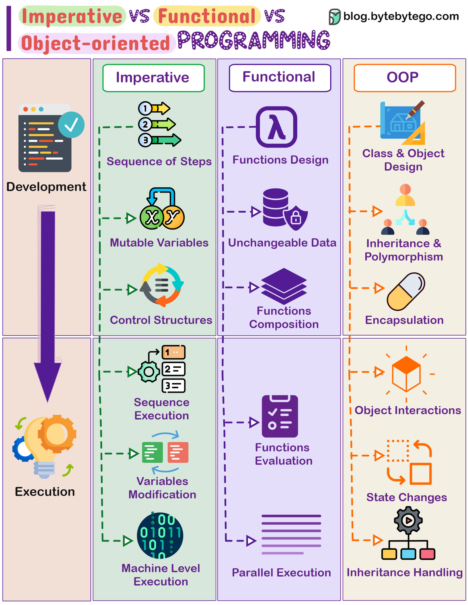

# 编程范式

[编程范型_百度百科](https://baike.baidu.com/item/%E7%BC%96%E7%A8%8B%E8%8C%83%E5%9E%8B/1475451)  

[编程范式](https://cloud.tencent.com/developer/article/2435602)  [四大编程范式解锁你的编码力](https://zhuanlan.zhihu.com/p/674978024) [七大常用编程范式](https://cloud.tencent.com/developer/article/2313147)    [程序员必须要知道的编程范式](https://developer.aliyun.com/article/1252661)  

[声明式与命令式编程区别](https://blog.csdn.net/ITHomeZSL/article/details/150472347)  [好：区别](https://www.zhihu.com/question/540934299/answer/27940633015)  

[命令式与函数式编程核心差异解析](https://mbd.baidu.com/newspage/data/dtlandingsuper?nid=dt_4080898902662104161&sourceFrom=search_a)  [编程范式大揭秘：OOP、命令式与函数式](https://mbd.baidu.com/newspage/data/dtlandingsuper?nid=dt_4714062405948558309&sourceFrom=search_a)  

[ByteByteGo ](https://bytebytego.com/guides/imperative-vs-functional-vs-object-oriented-programming/)  

## 编程范式

编程范式是软件工程中编程风格和方法论的分类体系，主流分类包括==命令式、声明式、面向对象、函数式==等。

### 编程范式是什么

编程范式就是程序员写代码时遵循的一套思维模式和方法规范，它决定了你如何看待程序、如何组织代码。简单来说，编程范式提供了程序员对程序执行的看法。
- 在面向过程编程中，程序员认为程序是一系列`相互调用的过程`或者函数
- 在面向对象编程中，程序员认为程序是一系列`相互作用的对象`
- 在函数式编程中，程序被看作是无状态的函数计算序列
- 在命令式编程中，程序员通过指令序列描述执行步骤

编程范式与编程语言没有直接绑定关系，一种语言可以支持多种范式，比如 Python 同时支持过程式、面向对象和函数式编程。

### 主流编程范式有哪些

编程范式可以从顶层分为两大体系：命令式编程描述"怎么做"，声明式编程描述"要什么结果"。
1. 命令式编程：侧重于描述计算机应该执行的操作步骤。
   - 过程式编程：以过程或函数为核心，按顺序调用完成任务，典型语言有 C、Pascal。
   - 面向对象编程：以对象为中心，通过封装、继承、多态组织代码，典型语言有 Java、C++、Python。
2. 声明式编程：侧重于描述程序的状态和结果，而非具体执行步骤。
   - 函数式编程：强调纯函数和不可变数据，函数是一等公民，典型语言有 Haskell、Lisp、Scala。
   - 逻辑式编程：使用逻辑关系和规则定义程序行为，典型语言有 Prolog。
3. 其他常见范式
   - 面向接口编程：强调依赖抽象接口而非具体实现，提升解耦和可扩展性。
   - 结构化编程：使用干净的控制结构，避免 goto 语句。

### 怎么选合适的范式

不同范式适合不同场景，实际开发中往往融合多种范式优点。
- 过程式适合线性任务和小到中型程序，逻辑清晰、执行效率高。
- 面向对象适合大型项目和复杂系统，利于维护和扩展，绝大多数商业开发场景使用。
- 函数式适合数据处理、并行计算和并发场景，代码更容易推理且无副作用。
- 声明式适合描述目标结果的场景，如 SQL 查询、HTML 页面结构。


优秀的程序员会根据实际需求选择合适的范式，或用过程式实现主流程、用函数式处理数据流、用面向对象组织整体结构。

编程范式各有侧重，要不要看看 函数式编程如何避免副作用？ 或者 面向对象的封装具体指什么？

## 常见编程范式

[程序员必须要知道的编程范式](https://developer.aliyun.com/article/1252661)  

1. **命令式编程**（Imperative Programming）：以指令的形式描述计算机执行的具体步骤，关注计算机的状态变化和控制流程。典型代表语言：C、Java。
2. **面向对象编程**（Object-Oriented Programming）：将程序组织为对象的集合，强调数据和操作的封装、继承和多态。典型代表语言：Java、C++、Python。
3. **函数式编程**（Functional Programming）：将计算视为数学函数的求值，强调使用纯函数、不可变数据和高阶函数。典型代表语言：Haskell、Clojure、Scala。
4. **声明式编程**（Declarative Programming）：以描述问题的本质和解决方案的逻辑为重点，而非具体的计算步骤。包括逻辑编程、函数式编程、数据流编程等。典型代表语言：Prolog、SQL、HTML/CSS。
5. **逻辑编程**（Logic Programming）：使用逻辑表达式描述问题和解决方案，基于逻辑推理进行计算。典型代表语言：Prolog。
6. **并发编程**（Concurrent Programming）：处理多个并发执行的任务，关注并发、并行、同步和通信等问题。典型代表语言：Java、Go、Erlang。
7. **泛型编程**（Generic Programming）：通过参数化类型来实现代码的复用和抽象，提供通用的数据结构和算法。典型代表语言：C++、Rust。
8. **面向切面编程**（Aspect-Oriented Programming）：将横切关注点（如日志、事务管理）从主要逻辑中分离出来，以提供更好的模块化和可维护性。典型代表框架：AspectJ。
9. **响应式编程**（Reactive Programming）：通过使用流（Stream）和异步事件来处理数据流和事件流，使程序能够以响应式、弹性和容错的方式进行处理。典型代表框架：RxJava、Reactor。

这些编程范式具有不同的思维方式、原则和技术，适用于不同的问题和场景。在实际开发中，可以根据需求和团队的偏好选择合适的编程范式或结合多种范式来实现目标。

|  |  |
| ------------------------------------------------------------ | ----- |
|                                                              |       |
|                                                              |       |
|                                                              |       |


# 命令式编程

[指令式编程_百度百科](https://baike.baidu.com/item/%E6%8C%87%E4%BB%A4%E5%BC%8F%E7%BC%96%E7%A8%8B/22934771)  [imperative language_百度百科](https://baike.baidu.com/item/imperative%20language/13021441?fr=aladdin)  

[一文解决现代编程语言选择困难：命令式编程](https://cloud.tencent.com/developer/article/2256312)   

> 命令式编程，就像是我们在给计算机下达命令：“先做这个，再做那个”。它使用一系列的指令来告诉计算机如何操作数据，如何进行流程控制。
>
> 这种编程范式是最直观的，因为这种工作方式和我们人类处理问题的方式很像。

## 命令式编程

[命令式编程_百度搜索](https://www.baidu.com/s?ie=UTF-8&wd=%E5%91%BD%E4%BB%A4%E5%BC%8F%E7%BC%96%E7%A8%8B)  

命令式编程是一种通过指令序列明确控制计算机操作步骤的编程范式，核心思想是告诉计算机"怎么做"，通过变量赋值、条件分支、循环等语句逐步改变程序状态来实现计算目标。

### 核心思想与工作原理

1. 核心思想是关注"如何做"（How），开发者需要详细描述计算机执行任务的每一个步骤，通过指令序列来实现程序逻辑 。
2. 工作原理是通过语句改变程序状态：
   - 程序状态指在某一时间点上所有变量包含的值。
   - 执行语句时会读取变量值、进行运算、然后写入新值到内存，从而更新状态。
   - 例如语句"x = x + y"会先读取 x 和 y 的值，相加后将结果写回 x，状态从 [x=5,y=3] 变为 [x=8,y=3]。
3. 主要控制流程包括三种基本语句：
   - 循环语句：容许一些语句反复运行数次，可依据默认数目或条件决定运行次数。
   - 条件分支语句：仅当某些条件成立时才运行某个区块，否则略过继续运行。
   - 无条件分支语句：容许运行顺序转移到程序的其他部分，包括跳跃、副程序等。


### 典型语言与特点

1. 主流命令式编程语言包括：
   - 早期语言：FORTRAN（1954 年，首个主要命令式语言）、ALGOL、COBOL、BASIC。
   - 结构化语言：Pascal（1970 年）、C 语言（1970 年代）。
   - 面向对象语言：C++、Java、Python、JavaScript、Ruby 等。
2. 优点：
   - 直观和控制性强，工作方式与人类处理问题的方式很像。
   - 通过分解问题并创建可复用的代码部分，简化复杂问题的解决方法。
3. 缺点：
   - 随着程序增长和变得复杂，结构和流程会越来越难以理解和维护。
   - 副作用使程序难以推理，因为必须同时建模程序状态。


### 与声明式编程的区别

1. 根本区别在于关注点不同：
   - 命令式编程关注"怎么做"（过程），开发者需详细描述每个执行步骤。
   - 声明式编程关注"做什么"（结果），开发者只需表达想要达到的目标，具体执行由框架负责。
2. 状态管理方式不同：
   - 命令式编程中变量值通常能够随时访问或重新赋值，强调状态变更。
   - 声明式编程更关注最终状态而非中间过程，减少手动同步状态的工作。
3. 现代趋势：
   - 命令式与声明式编程正在融合，特别是在基础设施即代码和 AI 系统编程中。

命令式编程强调过程，要不要再看看 它和函数式编程有何区别？ 或者 为什么副作用会让程序难以维护？

# 声明式编程

[四大编程范式解锁你的编码力](https://zhuanlan.zhihu.com/p/674978024)  

> 声明式编程，就像是你在告诉计算机“我想要的结果是这样的”，而不是告诉它“应该怎么做”。你定义了你想要的结果，让计算机去找出如何达到这个结果

代表语言有SQL、[正则表达式](https://zhida.zhihu.com/search?content_id=238125020&content_type=Article&match_order=1&q=正则表达式&zhida_source=entity)、CSS、Prolog。举一个SQL的例子：

```sql
SELECT name FROM users WHERE age > 30;
```

这行代码没有告诉数据库如何进行查找操作，只是描述了我们想要的结果是什么。

# 泛型编程

[泛型编程_百度搜索](https://www.baidu.com/s?ie=UTF-8&wd=%E6%B3%9B%E5%9E%8B%E7%BC%96%E7%A8%8B)  [泛型_百度百科](https://baike.baidu.com/item/%E6%B3%9B%E5%9E%8B/4475207)  

[.NET 泛型编程（泛型类、泛型方法、泛型接口、泛型委托、泛型约束）](https://blog.csdn.net/qq_51917985/article/details/154138591)  

杂： [泛型编程](https://baijiahao.baidu.com/s?id=1711439995328875937&wfr=spider&for=pc)  

[C++ STL](https://www.runoob.com/cplusplus/cpp-stl-tutorial.html)  

> STL 的设计基于泛型编程，这意味着使用模板可以编写出独立于任何特定数据类型的代码

泛型编程是一种编程范式，核心是通过参数化类型编写与具体数据类型无关的通用代码。它允许程序员在强类型语言中定义包含类型参数的类、接口或方法，使用时指定具体类型来实例化，实现一次编写多次复用 。

- 核心思想是将数据类型参数化，使代码能够在不针对特定类型的情况下编写，从而实现 “一套逻辑，多类型适配”
- 通俗来说，就是编写可以重复使用的代码，以适用多种类型的数据
- 假设你写了一个函数来处理整数，然后又写了一个几乎一模一样的函数来处理字符串，这样的代码既冗余又难以维护，而泛型编程就能很好的解决这个问题，你只需编写一次代码，就可以让它适用于多种不同的数据类型

### 核心思想与优势

1. 参数化类型：将数据类型作为参数传递给函数或类，实现代码与类型解耦 。
2. 代码复用：一份模板代码可适配多种数据类型，避免重复编写相似功能 。
3. 类型安全：编译阶段进行类型检查，避免运行时类型转换错误 。
4. 性能提升：对值类型可避免装箱和拆箱操作，提升集合操作性能 。

### 主流语言实现

1. C++：通过模板（Template）实现泛型编程，分为函数模板和类模板 。
2. Java：2005 年 Java SE 5 引入泛型，主要用于集合框架的类型安全 。
3. C：泛型具有完整运行时类型信息，支持约束、协变和逆变 。
4. Go：1.18 版本（2022 年）正式引入泛型，1.27 版本（2026 年 8 月）扩展支持泛型方法 。

### 典型应用场景

1. 通用数据结构和容器类：如列表、映射、集合等 。
2. 通用算法和函数模板：实现与数据类型无关的算法逻辑 。
3. 标准库构建：C++ STL、Java 集合框架、.NET 泛型集合均基于泛型 。
4. 专业领域库：如 CGAL 计算几何库采用 C++泛型编程实现高效算法 。

泛型编程在不同语言中实现方式有差异，可以看看 C++模板和Java泛型有何区别？ 或者 泛型编程如何避免类型转换错误？

# 面向对象编程

> 属于 **命令式编程**，以对象为中心的编程范式，它将`数据`和操作数据的`方法`组织在对象中，特点如下：
>
> - 封装：将数据和方法捆绑在一个对象内部，对外只暴露必要的信息，通过访问控制保护数据的完整性
> - 继承：允许类重用其他类的代码，通过不断抽象，减少重复代码
> - 多态：同一个接口可以有多种实现，对象可以根据上下文采取不同的形态来提高代码的灵活性和可扩展性

# ==函数式编程==

 [函数式编程_百度百科](https://baike.baidu.com/item/%E5%87%BD%E6%95%B0%E5%BC%8F%E7%BC%96%E7%A8%8B/4035031)  

## 函数式编程

[函数式编程中,程序被看作是什么_百度搜索](https://www.baidu.com/s?ie=UTF-8&wd=%E5%87%BD%E6%95%B0%E5%BC%8F%E7%BC%96%E7%A8%8B%E4%B8%AD%EF%BC%8C%E7%A8%8B%E5%BA%8F%E8%A2%AB%E7%9C%8B%E4%BD%9C%E6%98%AF%E4%BB%80%E4%B9%88)  

在函数式编程中，程序被看作一系列数学函数的组合，核心是“计算过程”而非“状态变化”。

函数式编程把整个程序抽象为纯函数的求值过程，通过函数组合和转换实现复杂逻辑，而非指令序列修改变量状态。

### 核心理解

1. 函数是一等公民：函数可像普通数据一样，作为参数传递、作为返回值接收，也可在函数内部定义和使用。
2. 计算是数学函数的求值：程序运行本质是数学函数的求值过程，强调“是什么”而非“怎么做”，即声明式风格。
3. 纯函数与不可变性：函数输出只依赖输入，无副作用；数据创建后不可变，任何修改都生成新副本。

> 可以这样理解：指令式编程像一份“步骤清单”，一步步告诉计算机怎么改状态；函数式编程像一组“数学公式”，输入数据进去，经过层层函数变换，最终得出结果。

### 为什么这样设计

- 更易测试和维护：纯函数无副作用，相同输入永远得到相同输出，测试和推理更简单。
- 适合并行计算：不可变数据和无副作用意味着无共享状态需同步，函数可安全在多线程或多核上同时执行。
- 代码更简洁优雅：通过组合小函数构建复杂逻辑，代码通常更短、更易读。

函数式编程强调纯函数和不可变性，可以看看纯函数如何避免副作用?或者不可变数据如何生成新副本?

## 函数式编程和面向过程编程对比

[面向过程与函数式编程](https://www.cnblogs.com/chenwenyin/p/12573681.html)  [区别](https://www.zhihu.com/question/540934299/answer/27940633015)  

函数式编程（FP）和面向过程编程（PP）的核心区别在于：面向过程强调“怎么做”，按步骤一步步执行并修改状态；函数式编程强调“做什么”，通过纯函数的组合和数据映射来完成任务，尽量避免状态改变和副作用。

### 思维方式的差异

1. 面向过程编程：把程序看作一系列命令的集合，按照顺序执行，通过修改变量和状态来完成任务。==像写菜谱==，一步一步告诉计算机“先做什么、再做什么”。
2. 函数式编程：把程序看作数学函数的组合，关注“输入→输出”的映射关系，不修改原始数据，而是返回新数据。==像数学公式==，只关心输入和输出的对应关系。

### 关键对比

| 对比项   | 面向过程编程                   | 函数式编程                                |
| -------- | ------------------------------ | ----------------------------------------- |
| 核心思想 | 步骤化执行，修改状态           | 函数组合，避免状态                        |
| 代码风格 | 命令式（怎么做）               | 声明式（做什么）                          |
| 数据处理 | 循环、修改原数据               | 高阶函数（map/filter/reduce）、返回新数据 |
| 副作用   | 常见（修改全局变量、IO操作）   | 尽量避免，使用纯函数                      |
| 状态管理 | 依赖和修改全局变量或对象状态   | 无状态或不可变，输入不变则输出不变        |
| 调试难度 | 状态复杂时较难                 | 较低，只需检查输入输出                    |
| 适合场景 | 简单脚本、系统编程、一次性任务 | 数据处理、并行计算、复杂逻辑              |

### 适用场景

1. 面向过程更适合：功能一旦实现后就很少需要改变的场景，比如简单脚本、一次性任务、系统编程。程序规模不大时，流程清晰，按模块和函数的方法很好组织。
2. 函数式更适合：数据处理和转换（如大数据、AI算法）、并行/分布式计算（纯函数无副作用，天然适合多线程并行执行）、需要高可维护性的复杂逻辑（如金融系统的交易计算）。

### 需要注意的地方

- 这两种范式没有绝对的优劣，实际开发中经常混合使用。面向过程是基础，即使面向对象或函数式编程中也包含面向过程的思想。
- Python并非纯函数式语言，但提供了lambda、map、reduce、filter等函数式特性，可以灵活组合两种风格。
- 函数式编程的核心优势在于可预测性和可测试性——同样的输入永远得到同样的输出，不受外部状态干扰，这在并发场景下尤其有价值。

两种编程范式各有侧重，要不要继续看看纯函数如何保证输入输出一致性?或者Python中函数式编程有哪些实际应用?

## 函数式编程和面向过程编程对比

函数式编程（FP）和面向过程编程（Procedural Programming）都属于“编程范式”，也就是组织代码的思维方式。差别可以一句话概括：**面向过程关心“怎么一步步做”，函数式关心“由什么组合而成”**——前者用可变状态加控制流描述过程，后者用纯函数加数据变换描述关系。

### 一、两者的基本画像

**面向过程编程**：以“过程/函数”为基本单元，程序 = 数据结构 + 算法。典型代表是 C、Pascal、Fortran、Shell。它贴近冯·诺依曼机器的执行模型：变量存状态，循环和分支控制执行顺序，函数负责复用一段步骤。

**函数式编程**：以“函数”为一等公民，程序 = 函数组合。核心主张是纯函数（相同输入必得相同输出、无副作用）、不可变数据、引用透明。典型代表是 Haskell、Erlang/Elixir、Clojure、F#、Scheme/Lisp；Scala、Rust、Python、JS 则属于“支持函数式风格”的多范式语言。

需要提醒一点：函数式和“面向对象”才是更常见的对照（Java/Python 语境下），而面向过程与函数式的对比更偏“命令式 vs 声明式”这条线。

### 二、核心差异对照

| 维度     | 面向过程                           | 函数式                                               |
| -------- | ---------------------------------- | ---------------------------------------------------- |
| 思维焦点 | 步骤、控制流（怎么做）             | 数据变换与组合（做什么）                             |
| 状态     | 可变变量、全局状态常见             | 强调不可变，状态通过参数传递或 monad 等机制管理      |
| 副作用   | 随处可发生（IO、修改全局）         | 纯函数无副作用，副作用被隔离到边界                   |
| 复用手段 | 函数调用、模块、继承（若混用 OOP） | 高阶函数、函数组合、偏应用、类型类/多态              |
| 重复逻辑 | for/while 循环                     | 递归、map/filter/reduce、折叠                        |
| 函数地位 | 过程封装，可作一等公民但非必须     | 一等公民，可传递、返回、部分应用                     |
| 可测试性 | 依赖状态和顺序，需构造环境         | 纯函数输入输出确定，单测极简单                       |
| 并发     | 共享可变状态需加锁，易竞态         | 无共享可变状态，天然更易并行                         |
| 调试     | 断点单步、看变量变化，直观         | 数据流追踪，栈深/惰性求值时较绕                      |
| 运行开销 | 循环与原地修改，通常更省内存和时间 | 闭包、递归、不可变复制有额外开销（可被优化部分抵消） |
| 学习曲线 | 对新手友好，贴近机器思维           | 抽象层次高，范畴论术语（Functor/Monad）门槛较高      |

### 三、同一个需求的两种写法

需求：取列表中偶数的平方和。

面向过程（命令式）：

```python
def sum_square_even(nums):
    total = 0                 # 可变状态
    for n in nums:            # 显式控制流
        if n % 2 == 0:
            total += n * n    # 副作用：修改 total
    return total
```

函数式（声明式）：

```python
def sum_square_even(nums):
    return sum(map(lambda n: n * n,
                   filter(lambda n: n % 2 == 0, nums)))
```

第二种写法没有中间变量、没有循环、没有可变状态，读起来更像“偶数 → 平方 → 求和”这条数据管道。当逻辑变复杂时，这种管道更容易拆成可单独测试的小函数，也更容易并行化（比如换成并行 map）。

再比如“修改配置”：面向过程常是 `config.timeout = 30` 就地修改；函数式倾向返回一份新副本（如 Python 的 `dataclasses.replace`、JS 的展开语法、Clojure 的持久化数据结构），原对象不变，从而避免“谁在什么时候改了它”这类排查难题。

### 四、各自的优劣

**面向过程的优势**：直观、性能可控、与系统底层和硬件交互自然，适合脚本、驱动、算法实现、性能敏感的热点循环。**劣势**：状态分散后容易形成“隐式耦合”，函数之间靠全局变量或参数对象偷偷通信，规模变大后维护和测试成本上升。

**函数式的优势**：引用透明带来可推理性——任何表达式都能被其结果替换，因此便于测试、缓存（记忆化）、重构和并行；不可变数据让并发和撤销/回溯（时间旅行调试、Redux 式状态管理）变得简单；高阶函数让通用逻辑（重试、日志、事务、管道）抽象得非常干净。**劣势**：需要为不可变付出内存/拷贝代价；递归和惰性求值会让调试与性能分析变复杂；对 IO 密集、需要频繁原地更新的业务代码，硬套 FP 反而啰嗦；团队不熟悉时抽象滥用会伤害可读性。

### 五、实践建议

1. **不要二选一，按层分配。** 主流做法是“函数式内核 + 命令式外壳”：业务规则、计算逻辑写成纯函数（易测、易复用），IO、数据库、网络、UI 更新放在边界层用命令式方式编排。
2. **优先吸收低成本的 FP 特性**：`map/filter/reduce` 替代手写循环、避免不必要的可变变量、用不可变数据结构和纯函数做核心、用高阶函数消除重复的控制流骨架。这些收益大、风险小。
3. **谨慎使用高阶抽象**：Monad、类型类、隐式转换等在团队未共识前会显著降低可读性；能用简单函数组合解决的，不要引入抽象层次。
4. **看场景选型**：数据管道、并发/并行计算、规则引擎、编译器与 DSL、前端状态管理，FP 风格优势明显；操作系统、嵌入式、游戏主循环、数值计算内层循环，面向过程/命令式更合适。
5. **注意语言生态的“默认风格”**：Python 里过度追求 FP（满屏 lambda 与 functools）往往不如列表推导或清晰的循环可读；Haskell 里想写命令式则要与 IO Monad 搏斗。顺应语言习惯通常更省力。

简单说，面向过程给你对执行过程的精确控制，函数式给你可推理、可组合、易并发的代码结构。现代工程里两者不是对立阵营，而是同一工具箱里的两种工具：**用函数式约束复杂度，用命令式掌控执行**。

------

你平时主要用哪种语言开发？我可以帮你整理一份该语言下实用的函数式风格编码指南。